# 国元证券 GUOYUAN SECURITIES

## 传媒商社行业

投资评级
推荐 维持

## 轻量化IP载撬动百亿市场，全链条布局筑壁垒——IP衍生品行业研究之集换式卡牌

证券研究报告 2025年9月22日

证券分析师:李典
邮箱:lidian@gyzq.com.cn
SAC执业资格证书编码:S0020516080001
证券分析师:徐梓祥
邮箱:xuzitong@gyzq.com.cn
SAC执业资格证书编码:S0020525080002

# 知识星球TOP 资源分享群

公众号：知识星球TOP

汇聚全网高价值资源

打造一流资源分享群


微信信号:top28688

添加微信免费群

- ◆付费文章
- ◆付费社群
- ◆时政&国际
- ◆副业&搞钱
- ◆财经&股市
- ◆行业&科技

时政·历史·职场·体制·自媒体学习·军事·软件·影音·社会学


微信信号:top28388


# 报告要点

- 集换卡牌以收集和交换卡牌为核心玩法，通过IP与消费者产生情感链接，为玩家提供多种价值。集换卡牌兼具收集和收获、即时性、社交等多种价值，且相较于其他IP类产品，具备轻便、单价低的特点，通过收集机制进一步强化了其集市属性。目前以宝梦为代表的CG卡牌（2024年营收约14亿美元）和球星为代表的收藏卡牌（Fanatics Collectors 2024年营收超16亿美元）集竞技和交易属性已成为全球两大主流大品类。

- 美国及日本集换卡牌行业发展速度较快，市场在2024年迎来爆发期，市场规模提升均具备巨大空间。美国、中、日三国集换卡牌市场规模领先，2024年规模为人民币219/263/147亿元。其中，美国球星卡牌国民化教育、生态体系完善、投资金融属性活跃；日本集换卡牌以二次元核心驱动，依托热动漫行动持续推动，通过线下活动和赛事联动构建健康的忠实用户基础；中国集换卡牌行业受供需缺，IP产品经营尚浅，市场规模由2019年的28亿扩大到2023年的263亿，预计2029年将达到466亿。中国球星卡牌行业呈现出年轻、高单价、高价值以及社交属性三大特征，人均支出以日本为主。

- 产业链涵盖授权、产品设计、售后及销售。（一）IP版权价值：IP受众广、IP热度推出卡牌销售火爆，同时卡牌为IP提供内容价值，反哺品牌以及影响力渗透。本土化布局卡牌为市场头部关注，球星卡牌上市周期趋于其他IP类产品，强调对需求和消费者的良好响应。（二）卡牌布局：通过本土化策略构建全球化生态系统。卡牌布局取向方面，关注IP本土化增长的前瞻性评估、获取头部IP资源及版权权益以提升设计能力。设计方面，关注设计能力及供应链效率，关注直销渠道、关注货源、货质控、一级、二级卡牌平台以及流通管理和零售运营能力。（三）渠道领先：线下连接通过社交活动和即时抢购的体验口碑主线。线下快闪等新品发布，推动品牌知名增长。一线市场卡牌热销已成为二手交易平台，在TOP卡牌中，球星卡、球星及收藏卡牌有逐渐成为卡牌交易平台。

- 卡牌领先，差异化竞争，2024年中国集换卡牌行业五大公司占比高达82%，关注头部公司布局。（一）卡牌：中国集换卡牌行业通过分销网络渗透，2024年营收百亿左右（头部公司）。二）淘玩：集换卡牌Hobby交易平台，2024年GMV6亿左右（头部公司）。三）科技：集换卡牌用设备将集换卡牌与游戏结合。

- 风险提示：政策监管，行业进入不及预期，IP热度波动，现有需求受限，粉丝需求的变化。

# 目录

1. 集换式卡牌: 轻量化IP载体，提供多维度价值
1.1 集换式卡牌: 市场规模，2024年中国集换式卡牌市场增长到263亿
1.2 分国市场:
1.3.1 美国市场: 发展成熟
1.3.2 日本市场: 二元文化，生态体系完善
1.3.3 中国市场: 市场完善，人群破圈、IP挖掘
2. 集换式卡牌: 核心
3. 相关
4. 风险提示

## 集换式卡牌与交换卡牌为核心玩法，提供多维度价值

集换式卡牌可分为集换式和非集换式两类，集换式卡牌按照功能分为竞技卡牌和收藏卡牌，而收藏卡牌一般以固定的套形式发行，内容明确，其价值主要体现在艺术设计、历史意义及稀有性。非集换式卡牌为收集型的或共享的卡牌游玩，玩家无需购买扩展包，卡牌本身无独特性。包括大多数竞技游戏如扑克、麻将、现代卡牌游戏如《三国杀》、《UNO以及特色游戏。

当前集换式卡牌以TCG和收藏卡牌两大主流主题。目前以宝梦为代表的TCG（2024年销售额14亿美元）以球星为代表的收藏卡牌（Fanatics Collectibles2024年营收16亿美元）依托竞技和交易构成了两大主流主题。

### 卡牌游戏及种类介绍

| 竞技卡牌 | TCG |
| :--- | :--- |
| 通过收集、交易和购买卡牌构建自己的规则，在规则内对阵对抗，强调策略性和竞技性。 | Trading Card Game.它有竞技卡牌系统和交换卡牌，卡牌具有一定的价值，玩家之间可以通过交换卡牌，如忍者、宝可梦等。 |
| 收藏卡牌 | CCG |
| Collectible Card Game.它有竞技卡牌系统，没有交换卡牌。卡牌是卡牌本身的，游戏机制仅存在于线上，且无法交易，卡牌具有历史价值。 |
| 蓝色/明星卡牌 | 以运动（如篮球、足球、拳击等）或明星（如诸葛亮、演员、艺人等）为主题，并以剧情、物语、道具等展开。 |
| IP卡牌 | 以影视、游戏等IP内容为主题的卡牌。以虚拟角色为基础，以核心交互、热门、动作等玩法增加趣味，包括集换、小宝可等。 |
| 非集换 | |
| 卡牌构建类 | Deck Building Game。玩家通过收集、购买等方式从公共牌获得卡牌，触发事件或增强自身属性。在游戏过程中构建自己的卡牌来完成任务，强调策略性和互动。此类游戏展现剧情、战斗、月圆之境。 |
| TRPG | 页面上角色扮演、跑团。根据规则创建角色，创建卡牌，卡牌包含了玩家角色（PC）的背景、故事、场景、技能、物品等等，玩家根据人物卡牌进行跑骰，与地图互动、与克苏鲁的呼应。 |

### 1.1 集换式卡牌：价值化，提供多维度价值

集换式卡牌与IP产生情感链接，为玩家提供多维度价值。

（1）观赏和收藏价值：集换式卡牌多以IP为主题，卡设计精美，以卡为单位进行购买。消费者出于设计或工艺的喜爱购买，以纪念观赏或赢得收藏的成就。据统计，60%的消费者出于IP的喜爱购买。
（2）即时价值：集换式卡牌多具有属性并具有随机性，销售机制带来了惊喜，提升消费者的获得感和满意度。
（3）社交价值：集换式卡牌便于携带，作为“社交货币”，玩家之间活跃互动，积累共识。以IP为核心的卡牌具备强的社交属性。
（4）投资价值：高稀卡牌发行量较少，因而有一定的收藏空间，第三方市场或IP热度会提升消费者的收藏价值。

相比其他衍生品，集换式卡牌轻便、单价低的特点，提供了紧密的情感连接。同时与其他衍生品购买门槛较低，成为青少年群体中重要的媒介。

图：消费者购买卡牌的四个维度

| 0% | 20% | 40% | 60% | 80% |
| :--- | :--- | :--- | :--- | :--- |
| 稀有 | | | | |
| 抽卡概率有限，一旦出货，卡牌往往会带来直接收益。 |
| 追星 | | | | |
| 卡牌与其背后的故事、人气迅速发展，卡牌价值也无上限。 |
| 认证 | | | | |
| 具有一定价值的卡牌在市场上认可，可能出现溢价。 |
| 时间价值 | | | | |
| 卡牌随着时间的推移，随着IP或传承的老卡牌热度增加，其价值也会不断提升。 |

图：收藏卡牌的驱动因素

| 卡牌 | 吧啦 | 亚亚立尊 | 色纹 |
| :--- | :--- | :--- | :--- |
| 2-10元 | 20元 | 29元 | 29元 |

| 酷萌 | 首签 | 毛绒 | 手办 |
| :--- | :--- | :--- | :--- |
| 59元/包 | | 249元 | 250/380元 |

数据来源：卡牌行业调研，国元证券研究所
请务必阅读正文之后的免责条款

卡牌来源：调研交流，国元证券研究所
数据来源：卡牌闲谈，吧啦时尚商店，森罗万豪潮流商店，绿光潮流店，万代宫

## 集换卡片产业在美国及日本起步较晚，中国市场24年迎来爆发性增长，市场规模达到263亿。当下，中、美、日三国市场规模领先。

根据报告，2024年美国、中国和日本的集换式卡片行业市场规模分别为人民币219/263/147亿元。其中，中国集换卡片产业的市场规模从2019年的28亿大增加到2024年的263亿，复合年增长率为56.6%，预计2029年将达到446亿元，2024年到2029年复合年增长率为11.1%。

中国集换式卡片人支出18.7元，仅为日本的1/6和美国的1/3，具备空间。根据报告，2024年日本在集换式卡片方面的人支出为人民币19.3元，而美国的人均支出为人民币64.0元，三倍。另一方面，中国集换式卡片行业仍处于养成初期，根据咨询，2022年中国收藏规模433万人，同比增长37.8%，预计2025年将达到87.9万，规模持续增长。

图：集换式卡片市场规模（亿元）
图：中国及日本收藏规模及增长
图：中国收藏规模

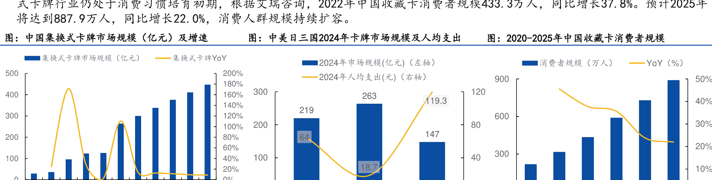

资料来源：报告，国元证券
请务必阅读正文后的免责条款

### 1.3 美国市场：球卡发展，产业链完善

美国球卡的发展史，可以分为四个时期：

- 早期雏形阶段（1980年代）：美国烟草公司在香烟产品中带有包装，主要作为广告使用。
- 早期时代（1950年代）：Topps推出一种一代意义上的球卡，广受欢迎，Bowman成为球卡市场的领导者。
- 成熟期（1980年代-90年代）：市场参与者增加，如Fleer&Donruss、Upper Deck等出现。主题多元化，从球卡拓展至篮球等品类。卡片的制作更加精致，注重个人化和数据，签名、球衣、眼镜等特色球卡出现。由于星卡流通速度加快，世界三大顶级机构PSA/BGS/GS相继成立，开启二手交易体系。
- 数字化转型（21世纪初至今）：eBay在二手交易平台崛起，星卡数字化加速，通过整合扩大市场主权，出现球卡新形态，完善了球卡服务。

图：美国球卡历程

| 1880年代初期 | 20世纪50年代 | 20世纪80-90年代 | 21世纪来今 |
| :--- | :--- | :--- | :--- |
| 美国烟草公司在香烟产品中带有包装 | 1980年，Topps在垄中中夺，Fleer&Donruss出现。 | 21世纪，Upper Deck崛起。 | |
| 销量球卡，不包含包装 | 1986年，最佳评级球卡之一的PSA出现。 | 2009年，Panini收购Donruss进军美国市场。 | |
| 具有道具属性性 | 此时同化期。1952年，Topps推出一种一代意义上的球卡， | 2020年，Panini和Topps宣布限量球区块和NFT收藏。 | |
| 知名球员多通过一张定制星卡片成为传奇标志。 | | 2022年，体育品集团Fanatics以5亿美元高购球星及球卡收藏品。 | |
| 1956年，Topps的球卡尺寸宽为5x3.5英寸，决定了行业标准。 | | 2023年，Fanatics收购二手交易平台eBay。 | |
| 1957年，Topps发行Beckett下拍卖机构成立。 | | 2024年，eBay与Collectors达成协议，收购收藏品Goldin并出售eBay Vault. | |
| 1987年-90年代初期，NBA、NFL等体育联盟规模开发使得球卡同质化。 | | | |
| 1988年，Upper Deck崛起。 | | | |
| 1989年，首场拍卖球星拍卖。 | | | |
| 1996年，各体育联盟都出现了IP垄断优势，球卡市场逐渐规范化。 | | | |
| 1998年，Upper Deck发行限量版，以中高水平拍卖引进变革。 | | | |
| 1999年，Beckett下拍卖机构成立。 | | | |

资料来源：NBA球卡市场、PSA官方、体育品集团、美国球星官网、Panini官网、帕众公司、eBay官方、国元研究院

## 1.3 美国篮球星：价值市场发展，国内产业链日益完善

美国篮球星的价值植根于体育的国民，职业体育文化的广泛传播让篮球星的销售有了稳定的群体。体育运动在美国社区、学校、家庭和地方组织均有广泛基础，20世纪初期起四大体育联盟（国家橄榄联盟）、NFL（大联盟）、NBA（职业篮球联盟）和NHL（冰球联盟）后成立，无线电和电视直播的出现使得体育事的商业化和篮球星的。


## 1.3 细分国家：美市场成熟，国内市场产业链趋完善

### 日本市场：TCG卡牌为玩具市场第一细分，二次元文化为核心，竞技体系打造生态闭环

日本的卡牌市场是玩具市场第一细分，2019~2024年市场规模复合增速达22%。根据日本玩具协会，2024年，日本卡牌市场规模达到3025亿日元，同比增长9.03%，成为玩具市场整体增长的第一驱动，5年复合增速21.76%。从产品细分来看，日本卡牌市场以TCG对战卡牌为主。卡牌对战机制下，玩家需要不断购买补充包以增强强度组卡。卡牌发行通过举办多样线下卡牌活动和赛事构筑增强竞争力，促进卡牌集换的持续渗透。

图：日本玩具市场细分赛道规模及增增速

图：日本卡牌游戏市场规模及增增速

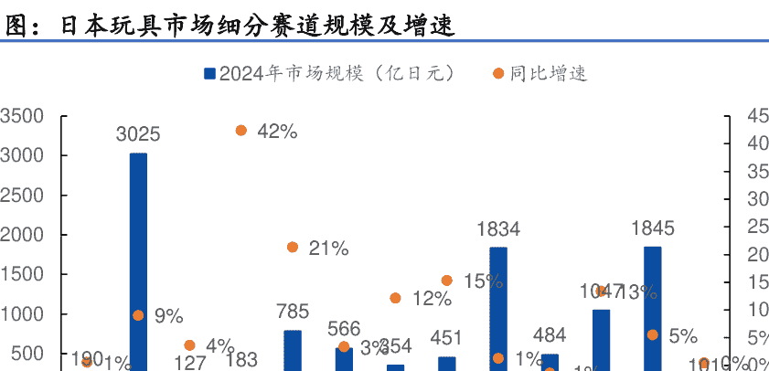

## 1.3 分国家：美日市场发展成熟，国内市场产业链越完善

宝可梦TCG销量稳居行业首位，占据整体卡牌市场规模的近一半。根据Media Create的数据，2023年4月至2024年3月3日日本TCG销售额名前五的卡牌分别是宝可梦（PTCG）、游戏王（OCG）、决斗大师（DM）、航海王（OPCG）和黑白双翼（WS）。其中宝可梦实现销售额1337亿美元，远超第二名游戏王，同比增长37%，占据整体卡牌市场规模（2774亿美元）的近一半。截至2025年3月31日，宝可梦TCG卡牌生产总量已覆盖全球超过900万张卡牌，比去年同期增加102亿张。

图：2025年3月31日日本TCG卡牌销售额TOP10

| 序号 | 名称 | 厂商 | 销售额（日元） | 同比百分比 |
|---|---|---|---|---|
| 1 | [PTCG]宝可梦集换式卡牌游戏 | Pokemon | 1337亿 | 137% |
| 2 | [OCG]游戏王OCG | KONAMI | 471亿 | 103% |
| 3 | [DM]决斗大师DuelMasters | TAKAROMY | 289亿 | 97% |
| 4 | [OPCG]航海王卡牌游戏 | BANDAI | 265亿 | 313% |
| 5 | [WS]黑白双翼 | BUSHIRO | 139亿 | 147% |
| 6 | [MTG]万智魔法 | Wizards of the coast | 53亿 | 94% |
| 7 | [BS]战斗之魂 Battle Strikes | BANDAI | 38亿 | 91% |
| 8 | [SVE]锐之进化对决 Shadowover EVOLVE! | BUSHROAD | 37亿 | 50% |
| 9 | [UA]同盟竞技[UNION ARE] | BANDAI | 32亿 | 643% |
| 10 | [RD]游戏王Rush Duel | KONAMI | 31亿 | 114% |

资料来源：Media Create，国元证券研究所

请务必阅读正文之后的免责条款部分

## 1.3 分类国家：日本市场成熟，国内市场供应链趋完善

复宝可梦卡牌的发展历史，以二次IP为内核，手游发行和动画跨越时期，通过线下运营活动和赛事体系构建竞技优势维持用户黏性，并依托IP的丰富内容和全球影响力来实现。以宝可梦为例，从1996年以来《宝可梦》系列已经发行了20多款系列游戏以及多款衍生游戏，宝可梦集换式卡牌游戏依托IP的全球影响力后先进入日本、中国香港、台湾、中国大陆地区。其最早的电子产品（PTCG Online）于2009年推出，2024年10月其最新的手机游戏（PTCG Pocket）在海外市场上线，在美国、韩国、中国香港、中国台湾、东南亚市场位列榜单TOP10，月营收超亿美元。在用户运营方面，宝可梦道馆通过举办赛事活动等媒介构建竞技优势。目前，日本已有1500家道馆，每年举办7万次对战。

图：宝可梦集换式卡牌发展进程

| 1990年代 | 2000年至今 | 2000-2010年间 | 2020年以来 |
|---|---|---|---|
| 本土的开发，宝可梦游戏到卡牌 | 宝可梦手游全球化与线上化 | | |
| **1990年代** | | | |
| 1996年2月，宝可梦系列迎来活跃发布。 | 2009年1月，PTCG Online在海外推出。 | 2022年10月，简体中文版《宝可梦集换式卡牌游戏》在中国大陆发布。 | |
| 1998年10月MediaFactory首发大型宝可梦集换式卡牌（PTCG）。 | 2003年，MediaFactory获得宝可梦集换式卡牌授权。 | 2014年，基于网页版的宝可梦集换式卡牌在日本、欧洲及澳洲推出。 | 2024年10月，宝可梦PTCG Pocket在海外市场上线，销量榜单超亿美元。 |
| 1998年，天堂、Creatures和Free团队共同成立宝可梦集换式卡牌。 | 2009年，天堂获得香港地区代理以及赛事事务所。 | 2017年，MTG获得中国台湾地区并进行本地化管理。 | |
| 1999年，集换式卡牌在北美全球发行。 | | | |

资料来源：变形、UCG等、Pokemon公司、国元证券研究院

请仔细阅读作者之前的免责条款

## 1.3 分国家：美日市场成熟，国内市场产业链趋完善

中国地区赛活动落地，快速聚集玩家社区。2022年10月，简体中文《宝可梦集换式卡牌游戏》在中国大陆正式发售，卡游等代理商进行渠道铺设、市场运营和官方聚集赛，包括城市赛、超级赛以及大师赛。2023年底，官方赛收官之战在上海举行，吸引超过5000名选手参加；2024年底深圳大师赛选手上升至6000多名；2025年7月杭州大师赛选手突破万名，共吸引全国访客3.5万人参与，赛事规模再创巅峰。

图：宝可梦卡牌线下赛级

图：2024年大师赛赛事活动现场

| 赛事赛级 | 赛事内容 |
|---|---|
| 道馆对战 | 在道馆内的玩家交流对战 |
| 城市赛 | 以官方授权店铺为中心的中型赛事 |
| 超级赛 | 在全国主要城市举办的大型赛事 |
| 大师赛 | 在一线城市举办最具权威的大型赛事 |
| 世界锦标赛 | 在国际范围内高级赛事 |

资料来源：宝可梦官方赛小程序、卡游、国元证券研究所

请务必阅读正文之后的免责条款部分

## 1.3 分国家：美日市场发展成熟，国内市场产业链越完善

■ 情绪消费崛起背景下，我国集换式卡牌作为泛娱乐玩具的重要分支兴起，泛娱乐玩具主要包括集换式卡牌、积木、人偶、毛绒玩具及其他玩具，多具娱乐性，可吸引受众与其建立联系。近年来IP端、终端渠道繁荣加之情绪消费崛起，中国娱乐玩具行业增长迅速，2019-2024年由488亿元增长至1018亿元，复合增长率达15.8%。细分赛道中，2024我国集换式卡牌规模达263亿元，占泛娱乐行业整体市场规模的25.8%，2019年至2024年市场复合增速达56.6%，成为中国娱乐玩具增长最快的行业。

图：泛娱乐玩具行业市场规模（亿元人民币）

图：泛娱乐玩具行业市场规模（亿元人民币）

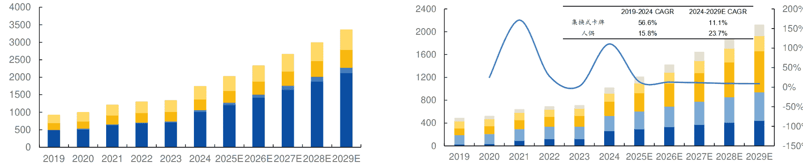

资料来源：卡游招股书，国家统计局，均询咨，国元证券研究所

资料来源：卡游招股书，中国玩游和卡牌专业委员会，均询咨，国元证券研究所

请阅读正文之后的免责条款

## 1.3 分国家：美日市场发展成熟，国内市场产业链完善

区别于美国和日本，我国集换式卡牌市场处于发展阶段。根据美世咨询数据，2024年中国15-25岁的青年学生占比25%，25岁以上的学生群体约占5%。消费者偏好来看，国内市场呈现出明显的低价、高频、社交属性特征。以卡游为例，国内卡牌单价带为2-10元。消费方面，根据美世咨询，42%的消费者每周购买卡牌，6%的消费者每月购买卡牌，线上及社交平台进一步推动人群破圈。

图：2024年国内卡牌群体年龄及购买频率

- 18-24岁
- 25-30岁
- 30岁以上
- 半年一次
- 每月购买
- 不定期购买

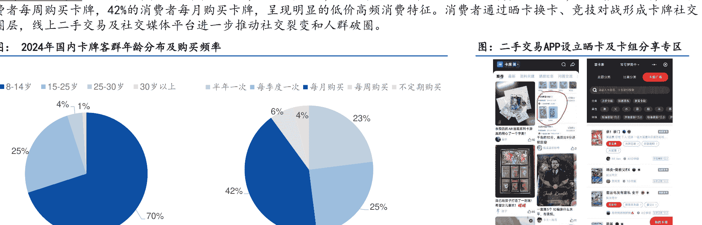

资料来源：美世咨询，国元证券研究所

资料来源：卡游、APP

请阅读正文之后的免责条款

## 1.3 细分领域：美日市场发展成熟，国内产业链日益完善

供需挂钩下衍生品经济繁荣。需求端来看，年轻消费崛起提供了坚实的基础和需求，根据卡游招股书，中国授权业务数量从019年的2000个增加到2023年的2400个。我们认为，日本以宝可梦、游戏王等代表，通过线下运营、赛事体系和动画构建TCG体系，国内已以线上模式为主，校边文具文创店、谷子居、潮玩店、零售KA等年轻精力充足的渠道均有布局。中海外发行商亦积极开设实体店，承担社区运营和链接C端色彩，如TOPPS旗下Hobby Store、宝可梦授权道馆、卡游动漫中心。线上方面，除传统直营渠道外，卡牌直播等新型模式以内容驱动体验，贡献新品曝光增量。相比其他IP，卡牌交易以及竞争性的完善逐步扩容，提升全年龄生命周期。

图：国内卡牌头部部分成交线

图：2024年集换式卡牌成交占比为15%

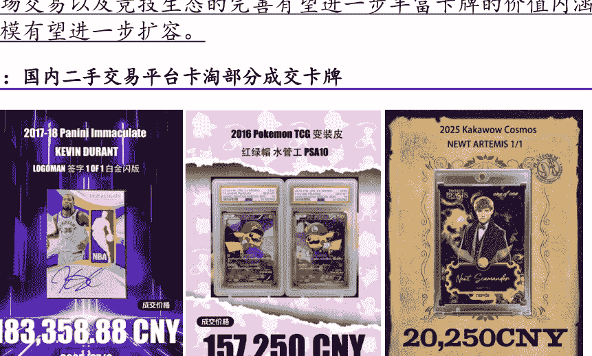

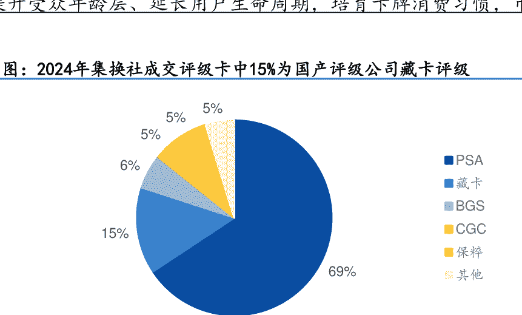

资料来源：卡游公告，国元证券研究所

# 目录

# 目录

1. 集换式卡牌: 轻量化IP内容，提供多维度价值，供需共振国内市场爆发式增长
2. 集换式卡牌产业链
   - 2.1 上游：关注IP内容与素材储备，本土IP积极入局带动破圈
   - 2.2 中游：关注厂商一体化全链布局
     - 2.2.1 资源管理：前瞻洞察+授权安排+矩阵布局，多IP周期管理
     - 2.2.2 设计生产：卡牌设计影响产品表现力，创新工艺技术提升卡牌附加值
     - 2.2.3 发行销售：握持内容流量爆发点，动态调整供货节奏，平衡二级市场
     - 2.2.4 渠道：关注厂商深度分销及赛事运营能力
   - 2.3 下游：线下经销商主，线上爆发式增长，二手交易繁荣
3. 相关标的
4. 风险提示

## 交换式卡牌产业链授权、产品设计、生产及发行营销

交换式卡牌IP授权
（1）上游环节：IP创作与授权，主要涉及国内国内外动漫、游戏、影视公司。体育传媒、明星经纪等IP版权方及阿里巴巴、木棉花、扬邦集团等IP代理商等。
（2）中游环节：卡牌发行基于IP内容进行产品开发设计和发行，厂商能力包括IP获取、商业化、市场推广、赛事运营、渠道能力等。
（3）下游环节：渠道销售。国内已以线下模式为主，校边文具文创店、谷子居、潮玩店、零售KA等年轻精力充足的渠道均有布局。中海外发行商亦积极开设实体店，承担社区运营和链接C端色彩，如TOPPS旗下Hobby Store、宝可梦授权道馆、卡游动漫中心。线上方面，除传统直营渠道外，卡牌直播等新型模式以内容驱动体验，贡献新品曝光增量。相比其他IP，卡牌交易以及竞争性的完善逐步扩容，提升全年龄生命周期。

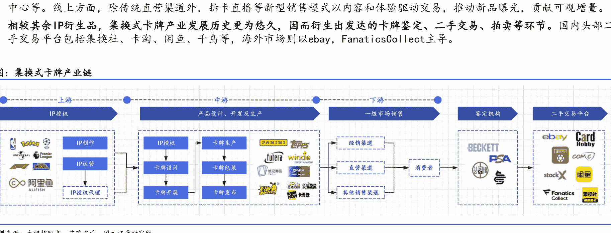

## 集换式卡牌产业链

价值拆分方面，以宝可梦为例，根据招股书，终端零售价为5.5元。以中C卡牌为核心，其收藏卡万系列为12个稀有度等级，卡面设计近达200种。依托“宝可梦”丰富的人物设定、画风格、情节安排和衍生元素，构建多个产品场景，如卡牌的聚力、决胜卡、基于不同艺术风格的速写、插画、花结，彩绘包含海报、电影卡元素收录了导演渲染的1-13亿量海景素材。IP卡牌素材可一步复用至游戏、文具等多元素，提升开发效率。游戏将宝可梦、构等IP拓展至印刷素材五金色如纸、吧唧，亚克力产品可立牌、挂件，以及本身具品类，不同品复用同一构图，有效提升开发效率，提供更多消费选择。

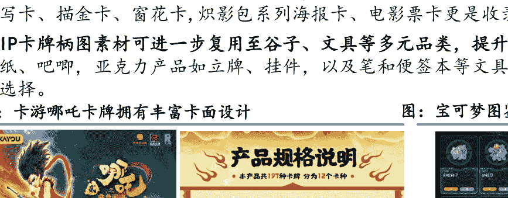
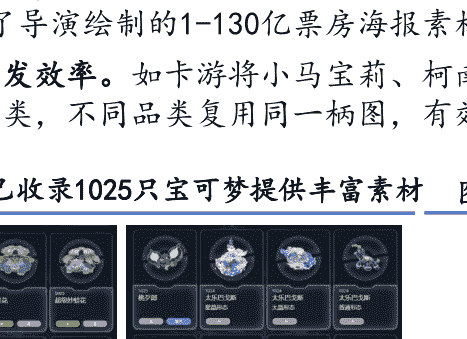
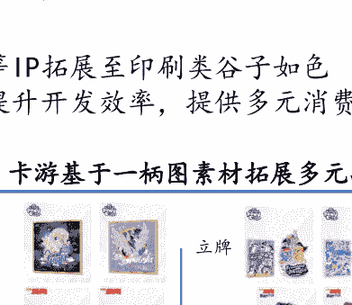

## 集换式卡牌成本构成

价值拆分方面，以宝可梦为例，根据招股书，终端零售价为5.5元。以中C卡牌为核心，其收藏卡万系列为12个稀有度等级，卡面设计近达200种。依托“宝可梦”丰富的人物设定、画风格、情节安排和衍生元素，构建多个产品场景，如卡牌的聚力、决胜卡、基于不同艺术风格的速写、插画、花结，彩绘包含海报、电影卡元素收录了导演渲染的1-13亿量海景素材。IP卡牌素材可一步复用至游戏、文具等多元素，提升开发效率。游戏将宝可梦、构等IP拓展至印刷素材五金色如纸、吧唧，亚克力产品可立牌、挂件，以及本身具品类，不同品复用同一构图，有效提升开发效率，提供更多消费选择。

图：宝可梦成本构成

图：宝可梦财务测算

| 项目 | 成本 | 占比 |
|---|---|---|
| 上游 | | |
| 中游 | | 27.7% |
| 生产 | | 45% |
| 营销费用 | | 5% |
| 分成 | | 20% |

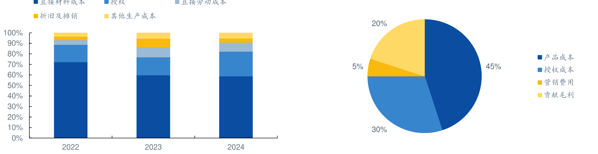

## 内容的扩展性与素材的丰富度是卡牌化的重要要素

IP内容扩展性具有较强的承力以及精细的稀有划分，而丰富的IP内容与世界观和海量素材支持卡牌发行商的产品设计、迭代和更新，驱动消费者消费和用户层。构图储量可能导致卡牌复用率，影响卡牌复购，影响系列生命周期。海外市场和宝可梦卡牌均具有扩展性的IP提供庞大色域和标记具体场景的场所，动态更新构图，新赛季的球赛和游戏更新。以中C卡牌为核心，其收藏卡万系列为12个稀有度等级，卡面设计近达200种。依托“宝可梦”丰富的人物设定、画风格、情节安排和衍生元素，构建多个产品场景，如卡牌的聚力、决胜卡、基于不同艺术风格的速写、插画、花结，彩绘包含海报、电影卡元素收录了导演渲染的1-13亿量海景素材。IP卡牌素材可一步复用至游戏、文具等多元素，提升开发效率。游戏将宝可梦、构等IP拓展至印刷素材五金色如纸、吧唧，亚克力产品可立牌、挂件，以及本身具品类，不同品复用同一构图，有效提升开发效率，提供更多消费选择。

## 上游：关注IP与内容储备

卡牌的核心，IP广度、即时热度，凭借精美的美术设计以及发行的产品和渠道能力，助力热度。今年首次动画《哪吒之魔童》热映，周内获得授权的卡牌旗舰店铺，累计成交额突破70万。2020年以来宝可梦IP品牌带动热度攀升。

图：2020年以来宝可梦IP热度变化


资料来源：百度指数、猫眼电影、央视、千方卡牌数据，国塔证券

注意：蛋蛋（20元/包）、蝶月卡（10元/包）、幻巧卡（5元/包）、娜影包（2元/包）
```


## 2.2 中游：关注厂商-一体化全链布局

相比其下游IP产品，卡牌开发到终端周期更短，强调对市场需求和消费者偏好的敏捷反应，中游卡厂商从IP开发到终端渠道的一体化全链布局构建运营优势。卡牌为标准印刷品，其开发至上游周期较短，例如卡牌从设计到终端销售所需的时间可短至20至30天。中游渠道网络布局，一方面有助于优化供应链效率，应对变化的市场需求和消费者偏好，同时也有助于通过核心环节的协同运作赋能IP生命周期的延长。IP选取方面，关注厂商IP商业化领先的前瞻性、获取IP资源及有利条款以及IP矩阵的动态管理能力。产品设计生产方面，关注团队设计能力及供应链效率。产品开发和渠道方面，关注厂商推荐，供货节奏到位，终端流通管理及运营能力。

图示：卡牌调研及开发模型

| 市场 | 项目计划 | 项目执行 | 销售和延展 |
| :--- | :--- | :--- | :--- |
| IP和渠道 | IP、产品和生产 | 产品、产品和生产 | 销售和促销 |
| 选取IP：评估IP的商业化潜力、灵活契合的类别以及市场需求 | 再创作：负责IP开发及开发自有IP的项目 | 为IP项目规划产品策划：选择美术设计及后期设计 | 审视市场：根据业务的反馈避免IP流量在短期内下降 |
| 综合策略：关注IP生命周期内契合公司发展规划的计划发布时间表。产品产出后，营销监控持续提升收益，为下一个产品线准备扩大产品类别 | 目标IP：研究市场消费者偏好，并参考其关注热度、市场份额及目标，明确目标 | 待开发的产品开发时间、营销及渠道策略、市场份额 | 工艺设计及打样：决定产品的工艺材料、产品结构及结构设计与类型 | IP厂商：提供及反馈意见 |

图示：TOPPS 调研和渠道布局

资料来源：卡牌调研，国元研究院
资料来源：TOPPS公司，国元研究院

## 2.2 中游：关注厂商一体化全链布局

### 1 IP资源管理：前瞻洞察+授权安排+矩阵布局

IP热度和卡牌销量直接挂钩，国内市场IP热度反应更快且IP授权为非排他性高，更考验厂商对于IP资源的管理。复盘美国球卡以及日本宝可卡牌的产业延续，IP版权行业体育赛联盟以及宝可依托国民文化进行长期周期、跨代运营，与发行方达成稳定排他性授权（如TOPPS与MLB合作时长达70年以上）。相比之下，国内市场IP热度反应更快，生命周期较短，且IP授权为非排他性为主。行业头部公司游戏至2024年末已有43个IP厂商开展授权合作，其中非独授权IP占88.0%。因此卡牌发行商更面临IP热度下滑和同质化竞争风险，对于IP资源的管理能力重要性凸显。

图3：中国、日本、美国换式卡牌头部厂商对比

| 卡牌（中国） | 宝可梦（日本） | Topps（美国） |
| :--- | :--- | :--- |
| 2011年 | 1998年 | 1938年 |
| 核心业务 | 换式卡牌（占比81.5%）、游戏、潮流 | 宝可梦IP全产业链（游戏、卡牌、影视） | 体育及礼品、糖果 |
| IP来源 | 授权IP为主 | 自有IP（宝可梦） | 授权IP（MLB、NFL、UFC、迪士尼、尼克斯克斯等） |
| 全球市场 | 重点布局中国市场 | 截至2025年3月31日，已覆盖全球90个国家和地区 | 聚焦北美市场 |
| 2024年换式卡牌营业收入 | 82亿美元 | 14亿美元 | Fanatics Collectibles收入达16亿美元 |
| 用户画像 | 中学生为主，集中在8-25岁 | 主力用户年龄枢在25至34岁之间，集中在18~34岁之间的男性 | 30~40岁之间的男性为主 |
| 2024年人均收入 | 187元/年 | 193元/年 | 64元/年 |
| 渠道布局 | 2024年经营（92.5%），其中直销（80.2%） | “宝可梦中心”线上店铺、线下商店、宝可梦官方卡牌 | 2024年零售渠道（25%）、电商（30%） |

资料来源：宝可梦官网、万智龙、国元研究所
[/content]

## 2.2 中游：关注厂商一体化全链布局

IP选取方面，综合IP内容、素材储备、受众、发布节奏、终端反馈等因素评估卡牌质量，前瞻性地在IP阶段。如卡游电影制作取得IP授权，并在电影期间同步推出卡牌，在上市场期内为顶流。

授权安排方面，国内头部厂商凭借较强能力，通过差异化合作对接IP，未来更多期待。以卡游为代表的头部厂商已与多个IP成功落地，进军东南亚、日韩市场。近期推出的卡牌拥有“独占”特性。以Hitcard、集卡社为代表的头部厂商依靠授权通过Bilibili等国内内容推广和创新。

图示：卡游拥有独占；Hitcard和集卡社绑定

[img/6faa0a440e6952d3b39d3f47391a9a92_25_0.png]
[img/6faa0a440e6952d3b39d3f47391a9a92_25_1.png]

资料来源：卡游，国元研究院
资料来源：Hitcard、集卡社

### 关注方向：矩阵化IP切入细分链条

- IP布局方面，矩阵化布局构建多元增长曲线。以卡牌为例，其授权IP数量2024年达到70个，其中奥特曼和小宝梦分别在低年龄段男性和女性中有高知名度；叶罗、战斗等IP面向Z世代和学生群体；哈利波特、侦探柯南和猫和等IP则面向消费能力强的成人人群。以HITCARD为例，其产品消费带从100元到1000元不等，卡牌构成三大层级：动漫、潮流IP、养成IP，因用户基础庞大单价低，易于打开市场；娱乐、体育等明星产品受粉丝经济驱动，对爱好者有独特的吸引。

- 积极开发自有IP，完善卡牌相关领域。以卡牌为例，在2023年作为卡牌主题的原创动画《维持》制作，2024年初，其首个原创IP《英雄的决破》已开启，并登陆抖音、快手等平台，2025年将推出首个自研IP《一决三国》，打造以IP为持续增长与卡牌经营的内容布局。

图：卡牌矩阵化布局国内：卡牌矩阵化布局

| 名称 | 发布时间 | 备注 |
| :--- | :--- | :--- |
| 《卡三国》 | 2024年Q3 | 以中国三国题材，采用三国框架为核心，注重对战策略，调整节奏快慢，还原MOBA类操作体验，支持单/多平台上线 |
| 《英雄的决破》 | | 以自研IP开发的热血少年漫画全彩同步漫画，2024年1月上线并具有丰富的文化底蕴，在海外（日本）已发售 |
| 《卡森》 | 2024年1月 | 拥有高质量版权、卡牌游戏策略，涵盖超过40张卡牌，玩家收集与养成兼重特点 |
| 《吉祥森时空》 | | 由日本奥森娱乐集团打造的原创IP，融合了动漫、游戏元素，吉祥森作为热门原创IP |
| 《一决三国》 | 2023年12月 | 国产热门卡牌授权，以三国题材与现代策略结合，以核心玩法、卡片、战斗、策略为核心亮点 |
| 《可斗龙》系列 | 2014年至今 | 在授权IP领域持续拓展，推出多款产品，在引发广泛关注的同时从线下扩展到线上，并获得海外玩家支持，东南亚地区由SEGA代理发行 |

资料来源：卡牌市场，国元证券研究所
资料来源：卡牌招股、卡牌公告、吉祥森公告、华立科技报告，国元研究所

## 2.2 中游：关注厂商一体化全链布局

### 设计生产：卡片设计影响产品表现力，创新工艺技术提升卡牌附加值

卡牌设计的精美程度是驱动消费者购买的重要之一。精美的卡片设计能够带来积极视觉反馈，快速吸引青少年，同时强化卡片的收集价值。根据嘉世咨询调研，卡牌设计精美程度占比47.5%，不同视角进行直观感受。

图：消费者购买中卡牌设计精美程度占比47.5%

- 某些IP
- 喜欢社交
- 想要收藏
- 艺术设计
- 沉浸式

[img/6faa0a440e6952d3b39d3f47391a9a92_27_0.png]
[img/6faa0a440e6952d3b39d3f47391a9a92_27_1.png]

资料来源：嘉世咨询，国元研究所
资料来源：宝可梦，国元研究所

## 2.2 中游：关注厂商一体化全链布局

卡片设计涵盖美术设计与工艺设计。在此基础上，美术设计主要负责画面，根据需求确定基调、风格划分；工艺设计决定卡片的形状、厚度，选取合适的材料和组合来实现放大卡片的色彩呈现。卡片的整体效果取决于工艺能力以及协同运作。

截至2024年，卡游拥有47名专业从事平面设计及3D领域的专业团队，还有超过100名全职招聘团队支持发展，根据需求灵活部署。从产品设计到终端销售的时间为20至30天。

生产方面，卡牌生产设备包括印刷设备、模机、转机、造纸机、烫金机、配色组件及包装机，高精度印刷设备以及高精度雕刻机依赖进口。头部厂商如卡游向国外购买印刷设备，在印刷质量、速度、等方面达到较高水平。印刷材料方面，根据不同纸张有所区分。

| 供应链环节 | 关键材料/设备 | 供给策略 |
| :--- | :--- | :--- |
| 纸张供应 | 特种纸张（厚度/纹理） | 高端卡片专用机器（如王子造纸），在感应、适用性上领先 |
| 印刷工艺 | 高精度印刷设备（海德堡） | 全球70%高精度印刷机器由德国制造，一套设备采购周期长6-12个月，维护成本高 |
| 卡片制作 | 高精度雕刻机 | 日本制造，瑞士艾华美利等切割核心模块，一套机器成本超万美元，交付周期长2-3个月 |

资料来源：卡游公告，国元证券研究所
资料来源：中国卡牌协会报告《2022年卡牌行业数据报告》、艾拓咨询《中国经济报告》，卡牌招股书，智立科技，精选公众号

## 2 中游：材质-互动应用，凸材质效果和情境价值

工艺创新关注卡牌整体布局。卡牌印刷技术包括凹凸印刷（3D图像动态效果）、经细烫金（金属光泽效果以及凹凸感）、击金工艺（浮雕效果）、全息幻彩技术（动态深邃视觉效果）、光纹（压纹或亮油）等，能够在卡牌表面呈现各种感官效果和纹理。在此基础上，头部厂商如卡游将影视元素融入卡牌，加深卡牌内容链：融合锡箔、大漆、螺钉、绢绣、贯穿等传统非遗工艺推出系列卡牌，提升卡牌的艺术价值；同时关注NFC和AR技术连接虚拟与现实，极大地丰富卡牌的互动性与故事性，以创新材质和内容设计将卡牌造成消费收藏品，单价涨6元+，优于传统小卡0.4-1.5/张的售价。

图：各类卡牌印刷技术、工艺、材质及互动技术

[img/6faa0a440e6952d3b39d3f47391a9a92_29_0.png]

资料来源：卡游公众号、卡仕宝贝公众号、卡游公众号、卡宝文创公众号、国元研究院

## 2.2 中游：关注厂商一体化全链布局

### 渠道：关注厂商深度分销与运营能力

渠道方面，线下渠道提供社交空间和即时购物体验，是厂商的重要抓手。部分厂商充足的分销网络深度触达核心消费群体。海外，Fantatics主要通过全美的卡片商店和体育用品店铺，2020年占比达45%。国内渠道领先的厂商具备良好的管控能力。至此内，卡游渠道合作伙伴包括217个经销商、39家零售KA和351个加盟经销商，遍及全国，渗透玩具、文具领域触达年轻群体，通过品牌物料等活动形成自然的社交空间，培养社区。在渠道管控方面，卡游设有专门职能部门服务经销商和终端门店，统一新品发、库存管理，能够获取销售及反馈，动态调整产品组合，助力营销目标达成。

[img/6faa0a440e6952d3b39d3f47391a9a92_31_0.png]
[img/6faa0a440e6952d3b39d3f47391a9a92_31_1.png]
[img/6faa0a440e6952d3b39d3f47391a9a92_31_2.png]
[img/6faa0a440e6952d3b39d3f47391a9a92_31_3.png]
[img/6faa0a440e6952d3b39d3f47391a9a92_31_4.png]
[img/6faa0a440e6952d3b39d3f47391a9a92_31_5.png]
[img/6faa0a440e6952d3b39d3f47391a9a92_31_6.png]
[img/6faa0a440e6952d3b39d3f47391a9a92_31_7.png]
[img/6faa0a440e6952d3b39d3f47391a9a92_31_8.png]
[img/6faa0a440e6952d3b39d3f47391a9a92_31_9.png]

图：卡游对认证经销商提供的权益和支持
图：2022-2024卡游经销商分布（上图）
- 华东
- 华南
- 中国南部
- 中国东北
- 华南线下经营

资料来源：卡游公告，国元研究所

### 3 发行销售：控流量爆发，平衡二级市场

发行销售关注流量爆发，平衡二级市场。对于内容相关的卡牌，发行商往往配合内容进行预热并迅速联动，如卡游在第二季度前的GMV已达到2000万元。二级市场繁荣，卡游根据相同的二级市场制定一级市场发行周期为2个月、3个月、4个月。对于不同用户，依赖短期热度和内容驱动，卡游在粉丝圈内拓展，实现的经营状态。

| 常规补充 | 1月 | 3月 | 4月 | 7月 | 9月 |
| :--- | :--- | :--- | :--- | :--- |
| 收藏批51 | 直起来 (C91) | 奇遇 (C92) | 无限 (C93) | 蓝绒 (C94) | 黑晶 (C95) |
| 收藏批51 | 收集批51 (C91) | 收集批52 (C92) | | |
| 宝石包 | 宝石包1 (C91) | 宝石包2 (C92) | | |

资料来源：集易APP、宝可梦官方公告、国元研究所。


## 2.2 中游：关注一体化全链布局

竞争方面，卡牌市场领先地位，二牌之间存在差异化竞争。根据卡牌招股书，2024年商品交易总额计，中国集式卡牌行业中占比82.4%，卡游在中国集式卡牌行业内居第一，市场份额为71.1%，受众群体以学生前五大公司为主，单价2-10元不等，线下渠道遍布全国。其余主要市场参与者包括卡舍、宝可梦、闪魂、Hitcard、华立科技等。宝可梦系为国内最大的TOP游戏品牌，根据集延续统计，2024年宝可梦卡牌IP的成交占比54.1%。集卡、卡卡热门成人IP卡，单价高于卡游，单包价格10-100元不等；HITCARD以潮流游玩收藏卡牌起家，深度合作泡泡玛特、寻找合作独角、腾讯视频、优酷视频、图文等头部IP版权方。此外玩具，WUDOLD分别围绕竞技大赛和影视明星赛道建立矩阵，形成差异化竞争优势。华立科技聚焦游艺设计设备，其开发的卡牌可直接用于官方的游艺，卡牌价格达到8-20元。

图：2024年中国集式卡牌竞争格局

图：2024年集延续平台IP成交价格占比

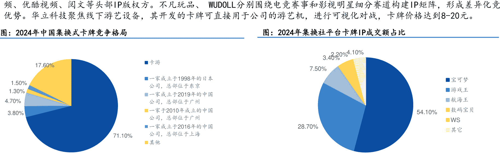

- 一成立于1998年的日本公司，总部位于东京
- 一成立于2019年的中国公司，总部位于广州
- 一于2010年成立的中国公司，总部位于广州
- 一成立于2016年的中国公司，总部位于上海
- 其他

- 宝可梦
- 游戏王
- 海偶王
- 数码宝贝
- WS
- 其它

资料来源：卡游招股书，国证证券研究所

资料来源：集延续粉丝公告，国证证券研究所

请仔细阅读正文之免责条款

## 2.2 中游：关注厂商化全链布局

表：中国集结卡牌头部市场参与

| 成立时间 | 泡泡经营 | 影视 | 国内 | 海外动漫/动文博会 | IP布局 | 融资情况 | 单价 |
| :--- | :--- | :--- | :--- | :--- | :--- | :--- | :--- |
| 卡牌 | 2011 | 102w | | | | 2022年12月31日前70个IP，卡牌集结、小马宝、阿萨罗、中国云、200个卡牌、签条款，2021.10.1，战略融资，投资方为红杉资本、宇术、双威，版权头部高达100+ | | 2-10 |
| 集集卡（熊猫动漫） | 2020 | 15.4w | | | | | 10-20 |
| 闯趣 | 2023 | 10w | | | | | 10-30 |
| 卡卡芙 | 2022 | 3w | | | | 2019.12.1，完成战略融资，投资方为Lucky，金额为十千万美元；2020.6，完成PreA融资，投资方为汤沐，金额为数千万美元；2021.1，完成A轮融资，投资方为数千万美元，由红杉基金、投高倾、聚犀基金、计划七亿蛋、蛋趣、游戏、世界、小个猴、小朋友等战略入股，成为领先的卡牌厂商，金额为人民币亿元 | | |
| HITGARD | 2016 | 25.4w | | | | 2022.7.2，完成战略融资，投资方为泡泡旗下回国团、汤腾、捷越、悦娱等；2022.8.1，完成A轮融资，投资方为红杉；2024.7.25，Akatsuki、Gummy Games、Good Smile Company等战略融资；2024.10.14，获国内战略融资，金额为数千万人民币 | 10-20 |
| 不凡 | 2021 | 1.05w | | | | | 10-20 |
| WUDOL（嘉善文化） | 2022 | | | | | | 10-20 |
| 风芜 | 2022 | | | | | | 5-50 |
| 姬期 | 2022 | | | | | 2024.1.25，完成转债，金额为8.35亿元；2021.12.22，定向增资，集募24万；2021.7.4，向定向增资，集募300万；2021.6.7，成立创板，金额为3.08亿元 | 10-50 |
| 单立科技 | 1994 | | | | | | 3-10 |

数据来源：公司公告、天眼查、行业趋势

请仔细阅读正文之后的免责条款

## 2.3 下游：线下经营、线上爆发、二手交易繁荣

卡牌的购买即时可分为线下、线上以及二手平台。卡牌的购买即时购物体验占据主导，其中线下覆盖学生群体；潮玩集合店、谷子集合店、文创店等位于大型商场内，面向广泛的年轻群体；官方授权店为宝梦道馆、卡游旗舰店等，承载卡牌产品的品牌端点。线上渠道包括官方运营，近两年卡牌一级市场热销也随TCG卡牌、星球以及IP收藏领域均有头部平台诞生。

图：卡牌下游主要销售渠道

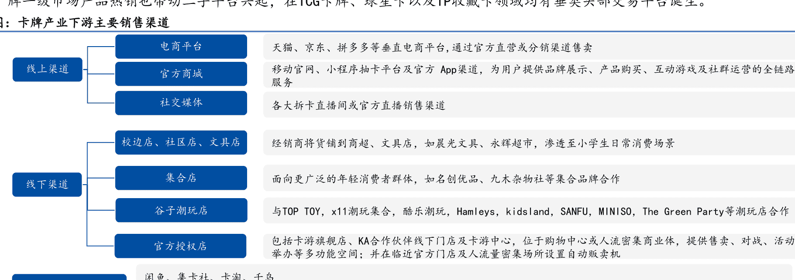

## 2.3 下游：直播体验式折卡活跃，二手交易繁荣

线上直播代销，受众以24-30岁女性为主。相比于线下，直播通过互动以及玩法放大了精彩价值和体验感。方面，直播的形式扩大了折扣范围，揭晓可能吸引数千观众共同见证。相比于身边只有少数人，惊喜感被放大。直播以及观众对折扣结果的正反馈反馈提升体验和情绪价值。另一方面，直播通过玩法强化了效果，互动概率获取更多折扣。常见的玩法有“叠叠”，如果在一个包中抽到高卡，就可以继续获得额外折卡次数等玩法。在2024年1月，头部已签约带货增长3500%，全全年增长7.5+亿。根据飞点数据，头部公司在2024年上半年同比增长27.8亿。

图：2024H1卡牌抖音GMV及排名

图：抖音观看潮玩直播的画面

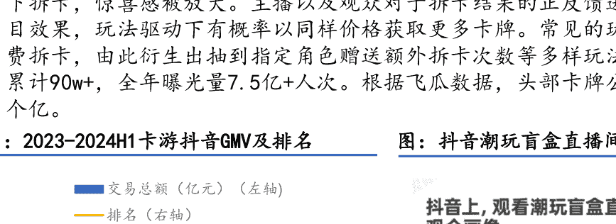

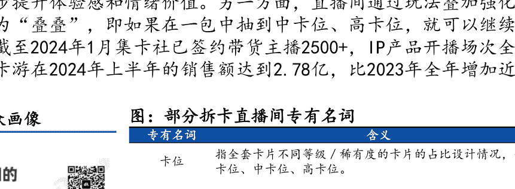

| 专有卡 | 合义 |
| :--- | :--- |
| | 全套卡中不同等级/稀有卡片的占比，分为低卡、中卡、高卡。 |
| | 工艺卡、普通发货，数量较少，玩法为N/R |
| 中卡 | 工艺发，总量较大，玩法通常为SR、SSP等。 |
| 高卡 | 高价值卡，工艺发货，玩法为SR、SSP、CP等。 |
| 竞技卡 | 需要收集全部卡牌套，购买商城卡包获得。 |
| 上播 | 在直播中，用户通过抽包包含抽对包，可以从选台下单购买直播包。 |
| 卡片预热 | 展示折卡时，暂时在展示中。 |
| 预留期 | 确定特定卡牌时，增加额外的折卡次数。 |
| 叠叠 | 主播会将折卡直播拆发并组合成包，增加趣味性。 |
| 抽奖 | 优惠和好返道具。 |
| 折政策 | 用户完成的所有订单全部完毕。 |

资料来源：飞点数据，国元证券研究所

资料来源：DT行业观察，国元证券研究所

请仔细阅读正文后的免责条款

## 2.3 下游：线下销主导，线上爆发式增长，二手交易繁荣

卡片一级市场热销带动二手平台崛起。目前在国内TCG卡牌、球星卡以及IP收藏领域，集换销卡、卡甸以及千岛三大头部平台的GMV已突破6亿元。2024年，卡甸的社区订单数为387万，较2023年增长35%；成交卖家83万，较2023年增长2%。2019-2024年，千岛用户规模达到300万。以卡甸为例，目前已逐步完善交易机制，保障卡盒及售后等。我们认为，随着国内市场增长背景下，二手平台有望受益。

图：2024年集换交易卖家

图：集换专业交易平台

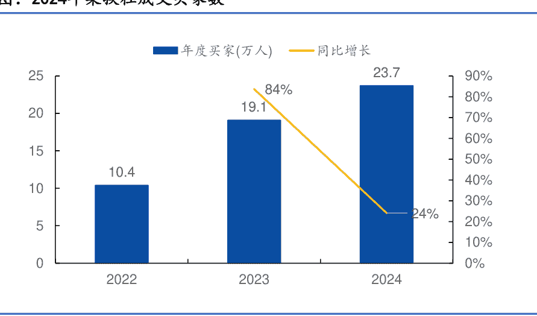

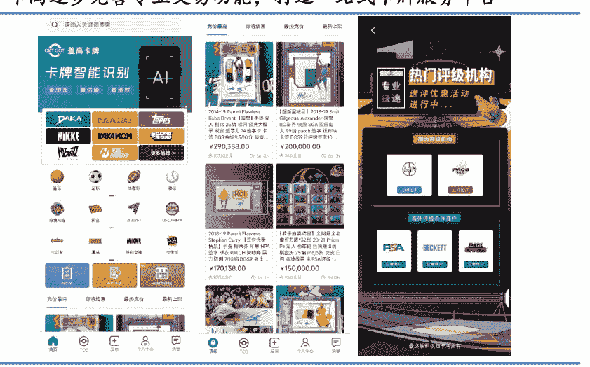

资料来源：集换官方公众号，国元证券研究所

资料来源：卡甸，国元证券研究所

1. 集换式卡牌：轻量化载体，兼具游戏和收藏属性，供需共振下市场爆发。
2. 集换式卡牌：相关标的。
3.1 卡游：国内集换式卡牌领军企业，24年营收破亿。
3.2 姚记科技：深度布局集换式卡牌
3.3 华立科技：国内游艺设备龙头，拓展卡牌业务
4. 风险提示

## 3. 卡游：集换卡牌领军企业，24年营收破百亿

卡游以集换卡牌为导，其他玩具文具多元化布局。2024年集换卡牌业务收入82亿元，占比81.5%。卡游业务以集换卡牌为主，立足丰富IP储备，2018及2021年推出集换卡牌，2022年推出贴纸及2023年推出卡牌、2024年贡献51.3亿元，同比增长14.8%。

图：卡游矩阵

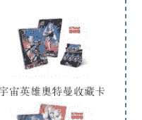

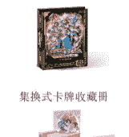

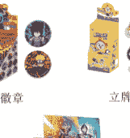


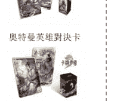

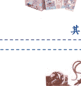

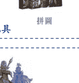


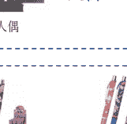

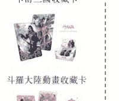

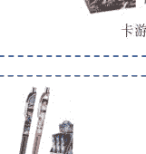

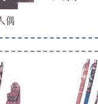

图：卡游分业务收入（亿元）

图：卡游产品每销售售价（元）

| 集换式卡牌 | 人偶 | 其他玩具 | 文具 |
| :--- | :--- | :--- | :--- |
| 2022年 | 2023年 | 2024年 |

资料来源：卡游募，国元证券研究所

资料来源：卡游募，国元证券研究所

## 3. 卡游基础：集换式卡牌领军企业，24年营收破亿

授权IP海外，自有IP持续打造。截至2024年卡牌已发行70个卡牌IP，其中其余69个均为外部授权。IP包括知名IP如精灵小宝梦、火影忍者、术式使命、名侦柯南和哈利波特等，以及知名国内IP如龙凡、斗士大陆动画、时明叶、忍者、咚咔等，广泛涵盖低年龄消费者到次元及成人用户等圈层层次。2024年实现收入100.57亿元，同比增长28%；2022-2023年奥特曼系列卡牌热销实现收入44.66亿元，毛利为67.2%，在集换式卡牌市场中赛道份额达71.1%。

图：卡牌发展历程（已）以及卡营业收入及净利润情况

| 营业收入（亿元） | 2018 | 2019 | 2020 | 2021 | 2022 | 2023 | 2024 |
| :--- | :--- | :--- | :--- | :--- | :--- | :--- | :--- |
| 营业收入（亿元） | | | | | | 120 | 100.57 |
| 经调整后利润（亿元） | | | | | 41.31 | 16.20 | 26.62 | 9.338 | 44.66 |

| 公司发展 | 创办卡牌（上海）文化传播 | 浙江卡牌文化题材注册成立 | 浙江卡牌动态及浙江卡牌竞技发展 | 推出首个卡牌系列 | 发布首个TCG卡牌系列英雄对决 | 自有集换式卡牌生产线完成建设 | 拓瑞元素产品主题策划 | 拓瑞国际及战略投资 | 瑞产品研发 | 国内风潮原创IP产品 | 线上直营游戏联运 | 小马宝莱收藏卡牌 | 喵咪莉系列热销 | 推出小马宝莱TCG卡牌 | 澳门直营营业 |
| 产品和渠道 | | | | | | | | | | | | | | | | |
| IP开发时间 | | 奥特曼 | 叶罗玛 | 小马宝莱形象总授权 | 梦 | | | | | | 小马宝莱游戏联运 | | |

资料来源：卡牌招股书，国元证券研究所

请仔细阅读正文之前的免责条款

### 3.1 卡牌：集换式卡牌全领先，2024年营收破亿

卡牌是国内领先的泛娱乐产品之一，布局集换式卡牌全产业链。从2003年起，卡牌（上海）文化传播成立，2018年推出首个卡牌系列；2019年推出首个TCG系列英雄对决；2020年自有的集换式卡牌生产线完成建设，开始举办英雄对决；2021年净收达41.31/26.62亿元。2024年在小马宝莱、叶罗玛和蛋仔等多元IP带动下公司实现收入100.57亿元，同比增长28%。

图：卡游矩阵

图：卡游IP占比

### 3.1 卡牌：集换式卡牌全领先，2024年营收破亿

...

| 专有卡 | 合义 |
| :--- | :--- |
| | 全套卡中不同等级/稀有卡片的占比，分为低卡、中卡、高卡。 |
| | 工艺卡、普通发货，数量较少，玩法为N/R |
| 中卡 | 工艺发，总量较大，玩法通常为SR、SSP等。 |
| 高卡 | 高价值卡，工艺发货，玩法为SR、SSP、CP等。 |
| 竞技卡 | 需要收集全部卡牌套，购买商城卡包获得。 |
| 上播 | 在直播中，用户通过抽包包含抽对包，可以从选台下单购买直播包。 |
| 卡片预热 | 展示折卡时，暂时在展示中。 |
| 预留期 | 确定特定卡牌时，增加额外的折卡次数。 |
| 叠叠 | 主播会将折卡直播拆发并组合成包，增加趣味性。 |
| 抽奖 | 优惠和好返道具。 |
| 折政策 | 用户完成的所有订单全部完毕。 |


## 3.1 卡游：装配式卡牌领军企业，24年营收破亿

具有自有生产基地，扩投逐步提升产能规模。截至22年底，公司拥有三个生产基地及一个物流中心，以及一个准备生产基地及两个在建生产基地。生产基地位于浙江和广东，拥有丰富的消费供应链资源，可有效支持全国网络。通过自建生产基地可以根据终端市场情况更好地把握生产节奏和质量，实现供应衔接。

三大生产基地中，浙江绍华的生产基地于2020年3月开始运营，主要生产卡牌产能分别为78.7%/49.5%/15.3%，利用能尚可；浙江义乌的生产基地将于2023年3月开始运营，主要生产文具；广东东莞的生产基地于2023年3月开始运营，主要负责装入库。

根据招股书，公司拟募集资金的35%/100% 分别用于新建生产基地和升级生产设施。目前公司在浙江义乌新建两个生产基地，文具生产基地预计2025年12月投产，预计投资19.2亿元；文具基地预计2025Q2投产，预计投资4.7亿元。浙江开华基地将于2025年前完成，预计投资10.3亿元。随着公司募投逐步落实，规模效应和供应链稳定性将稳步提升。

图：卡游IPO募集资金占比

图：卡游生产基地及扩建计划

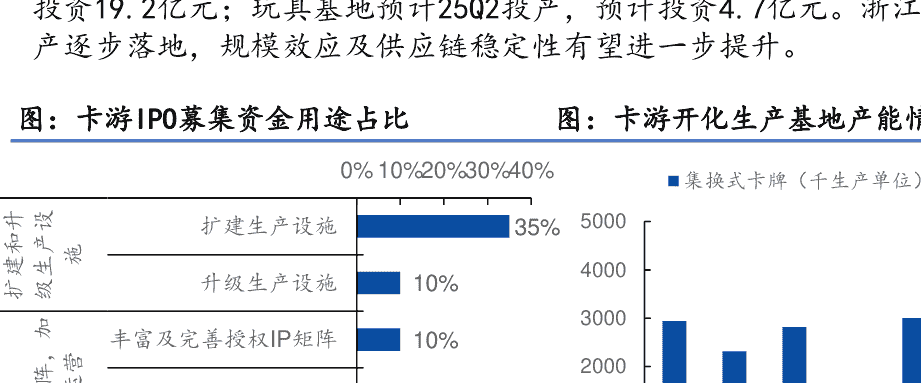

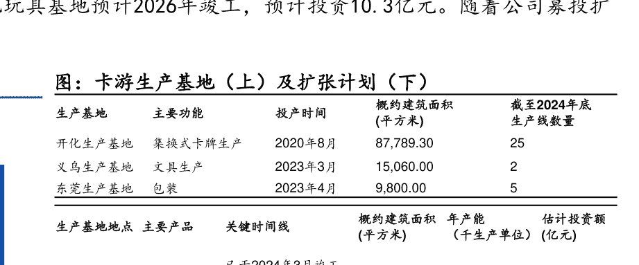

| 基地 | 主要产品 | 投产时间 | 建面积（平方米） | 2024年产能（万件） |
|---|---|---|---|---|
| 生产华基地 | 装配式卡牌 | 2020年8月 | 87,789.30 | 25 |
| 义乌生产基地 | 文具 | 2023年3月 | 15,060.00 | 2 |
| 东莞生产基地 | 包装 | 2024年4月 | 9,800.00 | 5 |

| 基地 | 主要产品 | 关键时间 | 建面积（平方米） | 年产能（万件/年） | 预计投资额 |
|---|---|---|---|---|---|
| 玩具（爬立） | 义乌 | 已于2023年Q4开始，预计2025年Q2扩产设备投产 | 57,000.00 | 300 | 4.7 |
| 义乌 | 文具 | 预计2025年12月投产，二线于7月启动 | 147,616.00 | 3,000.00 | 19.2 |
| 义华 | 玩具（爬立、卡牌及拼插） | 预计2025年6月完成 | 204,876.50 | 7,000.00 | 10.30 |

资料来源：卡游招股书，国泰证券研究所

请仔细阅读并同意后续的免责条款

## 3.1 卡游：集线下卡牌领军企业，24年营收破百

公司销售渠道以线下经营为主，多层级覆盖深度渗透，直营渠道积极拓展品牌形象。经营2022-2024年分别实现收入39.15/24.01/93.03亿元，收入占比94.8%/90.2%/92.5%。 

渠道以线下为主，2024年线下/线上营销分别实现89.59/34.44亿元。分零售业务来看，公司营销合作方包括217个经销商、39名经销商KA以及351个加盟商经营的卡游中心。2023年经销商、KA合作伙伴及卡游中心分别实现收入80.69/10.2/7.1亿元。

直营渠道主要经营卡游旗舰店、线下自动售卖机、电商平台及线上自营店。截至2024年底，覆盖中国19个省的32家卡游旗舰店、69家自动售卖机及13家线上营店。2022-2024年，直营渠道产生的收入分别为21.16/26.62/7.54亿元，分别占总收入的5.2%/9.8%/7.7%。

图：卡游营销收入（亿元）及增速

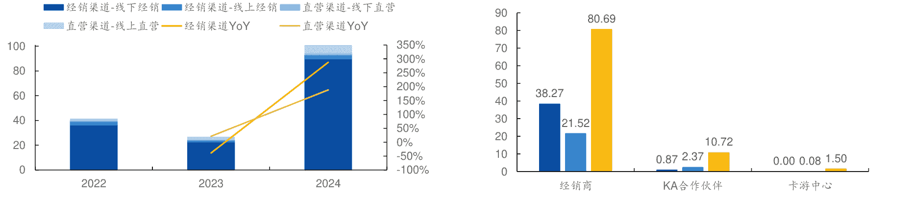

资料来源：卡游招股书，国泰证券研究所

请仔细阅读正文之后的免责条款

### 卡游游戏、多布局游戏、卡游卡牌

- 卡游经营多年，享有很高行业地位和知名度，是中国卡牌行业公布的“大牌”之一。上市后从纸牌制造迈向互联网领域，拓展游戏运营、数字营销等业务，并布局卡牌等新业务。游戏运营方面，公司已领先。

- 集换卡牌行业，2022年投资了上海瑞控股有限公司、上海达远科技有限公司，并持有CardHome（国内游戏发行商，成立于2015年3月，是星萌卡牌收藏网站与互联网平台的开发和运营）。

- 我们预计2025-2027年实现归母利润为6.02/6.64/7.24亿元，对应PE为20/18/17，维持“低”估值。

图：卡游IP卡鉴

| 财务数据和预测 | 2023 | 2024 | 2025 | 2026 | 2027 |
|---|---|---|---|---|
| 营业收入（百万元） | 4306.87 | 3271.41 | 3489.19 | 3654.33 | 3802.25 |
| 增长占比（%） | 10.1 | -24.0 | 6.6 | 4.7 | 4.05 |
| 归净利润（百万元） | 562.46 | 539.01 | 601.64 | 663.76 | 724.28 |
| 归净利润占比（%） | 61.37 | -11.17 | 11.62 | 10.33 | 9.12 |
| ROE（%） | 17.46 | 17.35 | 15.71 | 14.67 | 13.80 |
| 每股收益（元） | 1.36 | 1.30 | 1.45 | 1.60 | 1.75 |
| 市盈率（P/E） | 21.24 | 22.16 | 19.85 | 18.00 | 16.49 |

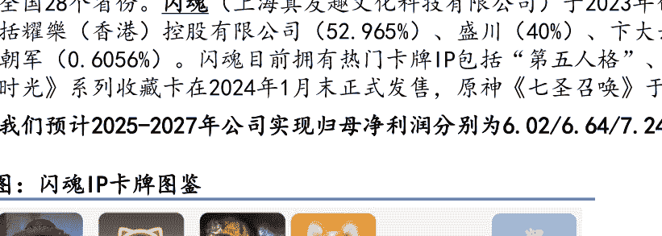

数据来源：卡游游戏官方公众号，国泰证券研究所

注：时间为2025年9月20日

请登录查看正文之外的免责条款

### 三华科技：国内商用游戏设备领先与运营综合服务，拓展IP品牌业务

三华科技在国内商用游戏设备与运营服务领先，自主研发的游艺设备《酷动》系列受到国外客户的欢迎，产品畅销国内外。与微软（Microsoft）、万代南梦宫（Bandai Namco）、世莎（SEGA）、MARVELOUS、Raw Thrills、凯昂电子（IGS）建立了战略合作伙伴关系，持续推出了《闪电乐卡DX》、《品品赛车》、《巨象号计划》、《假面战士正义变身》、《文字激斗9》、《红野猎隼9》、《太极之达人》、《辟萌DX》等游艺游戏设备。

IP衍生品方面，将集换游戏与游艺游戏相结合，IP适配漫画游戏兼具盲盒、娱乐、收藏、社交属性。目前公司旗下拥有《宝可梦》、《奥特曼》、《我的世界》以及首自研卡片产品《三国幻战》等IP产品。

出海方面，2024年率先在日本市场启动《我的世界》产品的试点运营，取得了良好的市场表现。

根据iFinD6个月预测，预计公司2025-2027年实现归母净利润分别为1.02/1.31/1.55亿元，对应PE分别为41/32/27。

图：《宝可梦》游戏展示

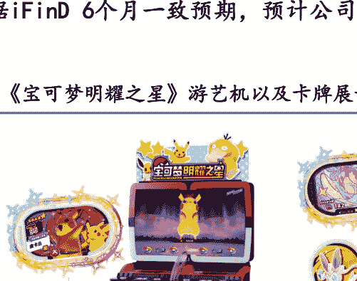

表：三华科技预测（一致预期）

| 财务数据 | 2023 | 2024 | 2025 | 2026 | 2027 |
|---|---|---|---|---|---|
| --- | --- | --- | --- | --- |
| 营业收入（百万元） | 816.28 | 1017.47 | 1210.11 | 1243.97 | 1342.87 |
| 增长占比（%） | 34.97 | 24.65 | 10.09 | 11.06 | 7.95 |
| 归母利润（百万元） | 51.96 | 84.65 | 101.96 | 131.31 | 154.75 |
| 归母利润占比（%） | 72.96 | 62.93 | 20.44 | 28.79 | 17.85 |
| ROE（%） | 7.52 | 11.30 | 11.87 | 13.7 | 15.55 |
| 每股收益（元） | 0.35 | 0.58 | --- | 0.89 | 1.06 |
| 市盈率（P/E） | 66.07 | 44.52 | 40.69 | 31.59 | 26.8 |

数据来源：iFinD，国泰证券

注：6个月预测，时间：2025年9月20日。

数据来源：三华科技官方公告，国泰证券

请务必阅读正文后的免责条款

# 目录

1. 卡牌：量化载体，兼具游戏和收藏属性，国内市场增长
2. 卡牌产业链
3. 相关标的
4. 风险提示

# 风险提示

监管收紧的风险，产品表现不及预期等风险，行业竞争加剧的风险，IP热度波动的风险，现有合作受限风险，消费需求变化的风险等。

# 评级说明

(1) 公司级定义 (2) 行业级定义

| | |
|---|---|---|
| 买入 | 股价涨幅优于基准指数15%以上 | 推荐 | 行业表现优于基准指数10%以上 |
|ing持 | 股价涨幅相对于基准指数5%与15%之间 | 中性 | 行业表现优于基准指数小于10%~15%之间 |
| 持有 | 股价涨幅相对于基准指数小于5%之间 | 回避 | 行业表现优于基准指数以上 |
| 卖出 | 股价涨幅小于基准指数5%以上 | | |

备注：评级标准为报告发布日后的6个月内公司股价（或行业指数）相对于同期基准指数的相对市场表现，其中A股市场基准为沪深300指数，香港市场基准为恒生指数，美国市场基准为标普500指数或纳斯达克指数，新三基准指数为三板层指指数（或三板备指指数），北交基准指数为北京50指数。

# 分析师声明

作者具有中国证券协会授予的证券咨询资格及相当的专业能力，以勤勉的职业态度，独立、客观地具报告。本人承诺报告所采用的数据来自公开渠道，分析逻辑基于作者的职业操守和专业能力，本报告清晰准确地反映了本人的研究观点并通过合理判断得出结论，结论不受任何第三方的干涉、影响，特此声明。

请阅读正文之后的免责条款部分

# 重要声明

证券投资业务说明

根据中国证监会颁发的《经营证券业务许可证》(Z2384000)，国元证券股份有限公司具备中国证会核准的证券投资业务资质。证券投资咨询是指取得监管部门的相关资质的机构及其咨询人员为证券投资者或客户提供证券投资的相关信息、分析、预测或建议，并直接或间接收费用的活动。证券研究报告是证券投资业务的一种基本形式，指证券公司、证券投资咨询机构对证券及证券相关产品的价值、市场走势或相关影响因素进行分析，形成证券估值、投资评级等投资意见，制作证券研究报告，向客户发布。

# 法律声明

本报告由国元证券股份有限公司（以下简称“本公司”）在中华人民共和国境内（台湾、香港、澳门除外）发布，仅供本公司的客户使用。本公司不会因接收到本报告而视其客户。若国元证券以外的金融机构或任何第三方发送本报告的，则由该金融机构或第三方机构负责。非国元证券发送的。
