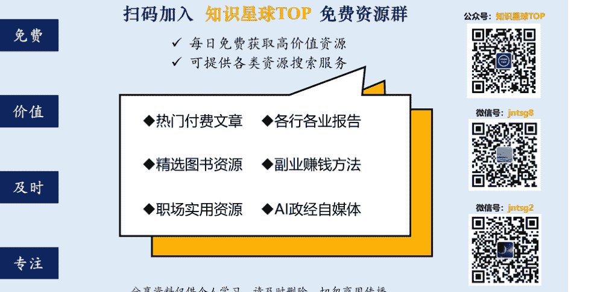

# 一个情感问题

20250412 达叔

## 提问：

达叔您好，

一个情感问题请教教您

本人女（农村），31岁，工作普通，收入一般；到了结婚的年龄，以下两位建议选择哪里：

男1：全家一直生活在上海，小我一岁，同济在职硕士（为升职做基础），上海海企（央企），工作稳定，月薪万多，临贷还房，一代步车，家里有一兄弟，和男1非同省，有8个月感情基础。

喜欢男1性格，相处开心，自律；但是家里强烈反对：有一弟弟（怕以后养孩子有问题，距离远），长相高一般，收入一般。

男2：相亲认识，大我四岁，211硕士，新能源行业（深圳），年薪40，目前无房无车，预计可购200W房子，还需要房贷，农村男，父母年纪大，有一姐。

加微信jtsg2 免费资料群

一妹，相处三个月，我对付出意愿多，体贴，看着挺喜欢我的。
不喜欢男2，相处无感，但家里满意：长相小帅，薪资高，离家近。

以上两位自己深知，选择其一，就是过不同的人生：

- 1、选择男1，但是需要父母同意
- 2、选择男2，需要自己说服自己

任选一个都痛苦，希望达叔给建议，万谢。

达叔：你这道题目，达叔不太会。放出出来，你听听在情感方面，其他星友的答案。

达叔很好奇的点是，你，农村出身，31岁，工作普通，收入一般，还有这两个优秀的男生对你都很好，意要你。你这个家伙，应该是漂亮的姑娘。祝你幸福。人生很长，你幸福才是最重要的。

问：

- 1 婚姻美满得一定的物质基础。
- 2 找一个喜欢的，你付出的就少。找你喜欢的，你付出的就要多。
- 3 31岁的女生如果想结婚得抓紧时间了。

女儿比你大四岁，作为你的长辈倾向选男2。

问：谈婚联运对人很重要。男2与你生活阅历相似。

问：男1算上海土著，上海人多数是歧外地人的。

匿名用户回复：男1，外省，初中高中大学不在上海，其他时间在上海，相普通，性格是我喜欢的，也喜欢我，主要是家里不同意。

肖立兰（检测鉴定*）：相处无感怎么一起度过长岁月？虽然婚姻和爱情不一样，但是相处的感觉还是重要的。男1家庭条件也不差，家里反对的理由是因为他有弟弟，老人孩子自己帮不了忙？带孩子不要自己的事儿？

匿名用户回复肖立兰（检测鉴定*）：没有说不帮带，父母觉得可能还有一个儿子，没有全部的精力带孩子吧，男二确实相处无感，有时候甚至有些讨厌。

红莉：如果我选，男1，带孩子有钱找姥婆，去月子中心，还能避免婆媳矛盾这个千古难题，人生漫漫，男2你现在就无感，婚后可能更无感，各种鸡毛蒜皮会加大矛盾，综合来选男1，个人观点，仅供参考。

老黄（新药进步体验）：

- 1 以前只知道女方有“扶魔”，现在才知道男方有兄弟也是强烈减分项。
- 2 男方的兄弟姐妹是否对你们造成影响，重要的是看男方是否无条件“扶持”。如果只是女方，也是一样。
- 3 仅仅因为男方父母可能无法帮忙带小孩反对，反过来想，以后男方父母年纪大了，需要付出，你们就没人分担了。
- 4 仔细一看，男2有姐跟妹妹呀，难道就不会影响带小孩了？题主自己也是女方，难道父母等出嫁以后就不管了？如果是这样，题主老公以后会管父母妈妈？
- 5 题主所述，男1收入一般，长相高一般，题主反而更喜欢，说明主也实在。父母的顾虑真的是对方有兄弟？再想办法深入交流一下，看看父母是否有其他顾虑，看看有没有道理，能不能解决？
