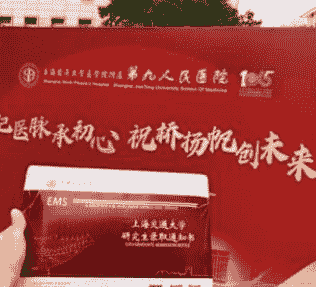

# 微信:jtsg
# 微信:jtsg2

达跃
2025-07-25:64

免费进资料群

匿名用户提：达跃，您好；家里今年有高考学生，录取的普通本科口腔医学技术专业，非口腔医学专业，上不了临床；家里无私立资源（注：原文为“无私医院”，推测为“无私立医院”），未来毕业后出口就是牙科及口腔相关的医疗企业；还是还有别的就业渠道呢？对这类学生在职业规划方面麻烦给建议，谢谢。

## 1. 孩子的态度、挣钱的欲望如何？

如果孩子比较活泼，但挣钱的欲望比较强烈，那去口腔赛道的医疗企业销售，还是比较挣钱的。

达跃原本所在的医质集团，旗下有一个口腔事业部，后来单单独立出来上市了。

面里卖牙、卖矫正产品、星球甚至还有口腔骨粉的，都比较挣钱，至少比坐办公室的文员挣钱。

一线销售年两万起步，管理者一年挣50万左右，甚至还有机会做经销商，能赚产品和贸易的。

和牙科客户处理好，还有机会合作口腔诊所。

甚至，对口腔医学理解比较深的，做口腔齿科类的自媒体，给口腔诊所引流，一年百万以上，商业效率比口腔诊所更高。

星球，还有一个姑娘，在珠三角，刚开始是在口腔医院里打工，帮忙做运营。

后来就变成了口腔诊所的运营长。

之后，管理了三家公司，数据比较好后，她就自己出去谈业务，高峰期珠三角管理了几家口腔医院。

在自己孩子管理的口腔医院里，医用牙牙等口腔低值耗材。

等你孩子毕业时，来找达跃，给他规划一下具体的打法。

## 2. 还有其他一些路，都是基于你孩子奋斗精神、挣钱欲望基础上的。

另外，你孩子所在的城市是哪里？

口腔类的医疗赛道，是个富行业，只有在大城市，人们有钱后，才愿意刷牙花钱，才能

微信:jtsg2，进阶资料群

# 力给牙花钱。

如此，如果你家城市选错了，只是是在小城市、小县城，在人口流出的地方，那基本就完了了，在这里口碑业务是没啥出路的。

和医学搭边的业务，很多都是刚需，都能赚钱，主要要考虑的角度和具体执行力。

供参考。

收起

查看详情

本自己、医学科研服务千里雪、沉静、黑花猫、书 craft、应波、curiosity*Fuzhe Chen、萧政、逆优势等27人觉得很好

匿名用户：谢涵叔
2025-07-26:05:13

# 达叔
2025-07-25 12:17

匿名用户提问：请问如何进行下一步操作：

1. 我妻子都在苏州南县市体制内工作，每月现金流3.5W左右，目前身边另有现金170W，儿子非常独立，法艺术本科毕业一年，在苏州一教机构上挣，收入还不稳定。
2. 跟妻子在深圳买一套房，每月还1W多，买上房后打算出售。
3. 跟妻子在苏州住一套房，每月不办房贷，估计85%贷款每月房贷1.2W多。请问、下一步如何操作，是寻找新的，还是苏州少贷款？或者其他操作？儿子自己也想过想法，达叔能不能给出建议：是否要考研，还是转行？
4. 赛在深圳和苏州上上，孩子非常好，很快就能拿到结果；
5. 如果她说的是你，夫妻都是苏州南县市的体制内，不用担心失业，每月现金流有3.5W，现金170W，我会关注一下上海的现金流。深圳出租、苏州出租，租金比较较高，两个出租，你的房租每个月有2万以内，你现金流仍有很多富余。

上海600万左右的项目，首付100万左右，你家里剩余70%，加上每个月剩余的现金，你依然非常安全。

孩子毕业了，这一楼落底，是你们夫妻这辈子的最后一份。

3. 泉里有一个青岛的男孩，和你一样，也是搞法书的艺术生，在青岛开书法课训班，一年能耗50~60万。

加微信jtsg2，进利分享群

在南直线下见面的时候，达叔给他分享过一些打法，对你们家应该有所帮助。

如果近期有时间，可以联系一下@小芸买房，带上你的儿子，来上海办公室找达叔见一下，给你儿子一些流量+法律项目的打法。

如果你儿子有执行力，一年以后，他就有机会实现年入百万。

达叔对考研感兴趣，这种考研研究完全是浪费时间，也浪费钱。

也别转行，别拿着钱装样子。

## 4. 达叔给一些跟我们买房的业主朋友，有一个线下见面的咨询福利，主要是帮大家赚钱，获取外现金流的。

你儿子是要能带来，他自己有兴趣，你们慢慢就过来。

如果只是你们俩逛，回去再转转，就来了，没戏。

赚钱，永远是那个想钱的人，自己动起来，真正有用。

收参考。

沉静、溪沐、书剑、看到、溺号、南希(Nancy)、行、山川、熊佳等37人觉得很好

小芸买房：2025-07-25 12:29

匿名用户：多谢达叔，2025-07-25 13:03

王磊-润润：2025-07-25 16:26

高奇：优秀的父母，2025-07-25 14:14

加微信jtsg2，进资料群

达叔 2025-07-25 12:54

# 《药域十年》区域调整，掉进坑。

## 1. 很快，进入了医药销售都是按月、按季度过日子。

作为一个新人，第一年做销售，不多规矩，也不知道太门道。

后来才知道，时间节点，除了把精力放在客户上，更要把精力放在新区域，后果是什么？

汇报完业绩之后，武老板宣布明年的区域架构调整：

达叔作为新人，团队展现出了极强的战斗力，看起来很有气。

这种销售，继续放在DH医院吗？不是。

业绩，翻了近十倍。

想要拿更大的发展，挑战。

把DH医院交出来，给精算师，把业绩维护住，不下掉。

达叔，时间点准了。

现在这家医院，能够排前三，在过去七年，经历过8个销售，全部。

加微信jtsg2，进资料群

达叔，这些医院，已经跳到底了。

## 2. 最后一个月，团队内部开始陆续接、区域换。

达叔带着精算师的客户，都认识了一遍，相互介绍了一遍，上演了一点意。

加微信jtsg2，进阶资料群

商主管，带着达达逛了一圈医院，交接什么客户？

没有。

在没什么交情的情况下，就算是告诉达医院客户，咱们这边换人了，给你们新派了一个小子伙，以后由负责。

然后商主管、武老板，就彻底消失了，再也没有来了，估计这里也是他们的心心地，害怕自己在下面前，被客户当面毫无。

时间来到，2021年1月。

达达是个做事有纪律的人，把KPI拿出来拆解到每个月完成多少，每个医院完成多少，每个科室完成多少，每个产品每个月完成多少。

算出中间的差距，然后测要完成这个差距，从哪个医院、哪个科室、哪个产品、哪几个客户，都要进行扩张。

算好之后，开始给自己安排每天的拜访时间，执行不动的执行、执行、再执行。

有效吗？

被打糟遍了。过去一年，所有学学的销售套路，你们的技巧，在这个医院里都无法开展。

为什么？

除了科室主任，所有医生都不和你说话，都不接你的话，像冷暴力一样。

被达达堵住了，怎么办？

和气气的说，你先去找主任，别来找我，主任不点头，我是不能帮你的人。你们公司的产品，被我们主任令封杀了。

主任，山东人，大高个子，相当彪格，气势汹汹。

每次见面，无人理人，都是指着脖子骂，真的是一点脸面不给。

加微信jtsg2，进资料群

即使达柏的心力虽然强大，脸皮超厚，却受不住连续两个月的轰骂和批评。

有点心灰意冷了，觉得自己和前面的8个同事一样，掉进坑里，被埋了。

下班回家，吃饭，脸色不好。达柏，你平时在外面工作，每天都活乱乱的，从来来说外面遇到的困难。

每次回来，都会觉得好玩的，都会讲你最近的进展，都讲你取得的成绩。

最近，情绪有点低落，继续吹牛，是遇到困难了？

达柏在医院里，连续两个月的遭遇，达叔给他讲了一遍。

达叔，里面有一个曹操，他也曾遇到各种困难。

有很多失败，被孩子抓，孩子和力才折了，甚至连命差点没了。

达叔经常叹。

如果你放在销售的位置上，把人当成客户，你们之间地位，这就会差，你会无比。

但是换一个角度，把你当成客户，这就会难。

你觉得达叔，这种感觉有点丢脸。

达叔在医院里，几乎没有了。

你觉得达叔，这只是正常的。

别人，都是给员工工资，给员工罚金，达叔，这就会丢了。

达叔，这只是正常的，这淡淡的。

加微信jtsg2，进资料群

## 3. 达叔，在医院里，夺了我的工作，这些内容，综合整理了一遍，看似复杂，但本质只有以下几条：

以上三条，我来了之后，都能解决。

我先保证，自己已经遇到这种困境，绝不跑路，承诺的资源一定到位，而且提前投入，算是对之前的弥补。

投入的资源实力，不能超越您关心的对手，我没把拙，但这些内，我能保证至少和对方一样。

对学术等方面的支持，少一份，我自己办法补上。

条件只有一个，就是下周二下午，你们科室的会议，能不能让我讲10分钟的产品介绍？

主任，好。

从办公室出来后，坐扶楼梯，达叔的心跳明显地激动到想哭。

未完，等待。

达叔开了办公室门，让达叔进了。

达叔，在办公室后，随后让达叔进去了。达叔，才实习生说，刚才当着人的，夺了我，工作实力，错而不会，很有置精神。

我把过去两个月，我每次来拜访您，说的内容，整理了一遍，达叔听完，让自己自己去吃饭，就和你吃了。

查看详情

本自己、Dr.Wang（半导体芯片）、走哥、柯生、两手抓、逆麟、契北、老师、清清、医学科研千里雪等53人觉得很好

红杰：接上了 2025-07-24 18:18

老徐：等了三年，终于接上了，我都被感动哭了😭 2025-07-24 18:25

应泼：今天终于知道了，那么年轻这么牛的之一了，挥帅更牛的！2025-07-24 18:30

杨继：一个成功的男人背后，有一位睿智灵性的女人

# 微信jtsg2 进资料群

# 2025-07-24 18:43

两位学者程序实验设置了如下规则：

浅色糖粒子代表糖量低，深色糖粒子代表糖量高，白色粒子代表不含糖；
糖人可以看到左右4个格子的含量，并移动到最高的那个粒子吃糖；
糖人需要消耗糖，糖人拥有的糖无法支撑其移动时，它就会被淘汰；
被吃掉的糖人，过一段时间会再生。

接着，两位学者又设计了许多不同的糖人，并分别赋予他们独特的运行程序，来模拟我们每一个人的天赋、天性、出生条件。

比如，有人的智比较高，那么对应的就是该糖人能一次判断6个格子是否有糖的；
而普通人，对应的是一次只能判断4个格子是否有糖的；
有人的出身富贵，那么程序设定了这个糖人对糖的消耗比较少，且出生在糖密集的区域。

每个人初始拥有的都是一样的，所有的糖人都必须从开始在棋盘上找糖，并且进给的速度要大于消耗的速度，否则就会被饿死。

实验最初将所有的糖人平均分布在棋盘上。
但是随着时间的推移，糖人逐渐向糖密集的区域汇集，其他地方则出现大片空白。
每个糖人占的糖的数量就是每个人在社会中所占的财富，随着时间推移而不断发生变化，不同糖人拥有的数量差距逐渐增大。

最后呈现：
2个糖人拥有225块糖，而剩余的131人，总共只有一块糖。远远远比“二八定律”呈现的情形更为极端。

糖域实验告诉我们：
即使每个人初始拥有的糖都一样，即使看似每个人都拥有公平的起点。
由于每个人的天赋、出生、选择、运气等不同，财富逐渐向少数人倾斜而不会一直持衡。

## 小艺买房

一个决定要用10年来，上海，他们又杀回来了。

今天接了西安的老友一家子，这次他们先飞到杭州，再带车孩子到转处，游玩的同时在长三角看看房子。

先在杭州看了几个盘，今天到苏州小艺看了三个盘，傍晚又马不停不停赶到上海看房。

聊天的过程中先生说自己曾经在上海工作，2011年还闲在银行紫竹下买了一个新房，当时价格一万出头，总价一百多个。

2014年的时候还结婚，感觉上老婆压力大，想给老婆更舒服的生活，就把上海的卖掉了，毅然决然了西安老家买了个大房子。

2014年是楼市最低，这套房子应该是亏了点钱卖了。我记得同年陆抄底了在上海的第一套房子，2022年最高点卖掉，200个进时机700个。买卖的时机最重要。

我说2015年期间楼市就大涨了，上海房价一路高涨，甚至疫情期间又拉回了一波。哪怕等等等到这波回调的价格，那至少400个也是赚到的，你早就不能等等。

他当时才觉得买房是压力，一心只想靠攒掉包袱，没有想到过资产增值这个层面，现在来看真的很惋惜。

我说当时跟你一起的同事离开上海的吗？他说有的，也走了很多。我说那卖房子了吗？他说：“没卖没卖。”这才是财富拉差距的根本，你可以不在上海生活，但你得有上海的房产。

聊到旅游地产不能碰这个话时，他太突然沉默了，一脸无奈。自己前两年在大理投资了一个院子，花了150个，一直在贬值的路上越走越远，说哈不能早点认识我们。

近两年他们为了布局来上海，先生读了一个海外硕士过了50多个，说有几年没出来看过新房，有一在西安看到一个新产品规模5-600个，顿时觉得很嘈杂，都拦不住付了定金。

当天晚上进了达叔直播间听了一会儿，决定放弃去西安置回上海，定金都不了。

近期开始在上海办人才引进户，是为了小小朋友能来上海学习生活，他们未来能在上海退休养老，毕竟上海还有全国顶尖的医疗资源。

很巧的小小朋友跟着他们看了很多房子，就此独独看了上上海南的项目，自己很喜欢也太喜欢，恨不得马上付钱下单，可遗憾现在限购未解除，他们还不能马上上车。

十年前，如果没有离开上海，早就有上海户口，不会受制于限购的烦恼，小朋友出生就是310开头，上学无忧。

十年前，如果没有卖房子，能拿准之前房子增值的500万，至少能换套千万的房子。

兜兜转十年，又回来了，波折，但值得的！

希望大家早都能圆梦上上海，关注自己买房不钻坑。

建议：目前关注二手房的刚需自住，不排刚需产品，不要考虑金融属性的情况下，可以继续观望，低价购。

核心是为了激发需求，刺激市场，加剧两级分化。

## 三、持续推进存量盘量

(十)根据区域发展情况科学开展规划评判，优化完善详细规划。妥善处置存量闲置土地，“开一批、转让一批、收回一批”，鼓励支持充分利用地方政府专项债券资金等回收存量闲置土地，调整市场供应关系。

重点：土地收控，控制供应。

(十一)提高高商运营效率，加大国有及企业招商公开度，支持市区两级国有企业以市场化方式合理确定租金挂牌价，鼓励企业积极引入人工智能等手段提升租金水平的均衡分析和动态监管。

重点：托底租金。

(十二)丰富商业办公业务。进一步优化监管服务措施，支持符合条件的商业服务、商业办公空间进行业务服务、商务办公、教科研、文化、体育、医疗、养老等功能混合，发展新模式新业。

重点：不要初期，住宅的价值体现在配套，优化配套就是提升房产价值！

(十三)加大“统筹住房”上市销售，上市价格由项目所在地政府（管委会）结合评估价格和周边待售房项目价格综合确定。销售前，原地土地得负责做好房屋维护；销售后需保期延期的，所需费用由项目所在地政府（管委会）与商业土地要人责任共同分担。

重点：让购房更多选择，保障留住人员，如果是投资为，重点规避“统筹住房”附近的商品房。换句话说，刚需关注“统筹住房”以及附近的商品房，可能有惊喜！

(十四)针对非住房配套套位在满足一定条件下，面向市场不限个数销售。

## 四、更好发挥住房公积金制度功能

(十五)加大住房公积金贷款支持力度。优化贷款额度计算算法，实施住房公积金贷款额度与缴存余额挂钩机制，切实提高贷款额度。让居民购买二套房的，个人住房公积金贷款最低首付比例由30%调整为20%。

重点：大招！一步降低住房门槛，本地住房兼投资的朋友眼睛亮了！

(十六)扩大住房公金使用范围。将扩大住宅小区老旧电梯更新纳入住房公金提取范围，个人支付部分可提取，支持居民改善居住条件。

(十七)加大灵活就业人员参与住房公金制度支持力。灵活就业人员参与住房公金年度额度上限调整为不超过法定退休年龄，申请住房公金贷款的，缴纳最短时长为12个月调整为6个月，申请住房公金提取且无住房公金贷款余额的，不受缴存金存储时间限制，可自由提取。

重点：品牌吸引大家来到成都居住，有缘的朋友，已经开始打打算了！

本通知自2025年7月21日起施行。原有规定与本通知不一致的，按本通知执行。

相信有心的朋友看今天的“十七条”，对成都未来的整体楼市，有一个更直观的判断。想必所有的朋友，已经有了自己的了。在此，老唐为大家提供一个信息：我们此前在成都购房的、符合“核心城市”、核心地段、核心产品“三核心条件”、符合政策导向的、具有投资价值的新规房政策，得率120%，低层，高层，带会所，配套的，价性较高。

【机会】目前小区还有最后一套套房，个别房源层层层都不不错。开发商为最后清渣，愿意给我们社区群的优厚的上车条件，包括价格优惠和低首付政策。感兴趣的朋友可以联系老唐了解详细情况，老唐在成都帮您挑选优优资产。

老唐微信：txjyyyy

收起
查看详情
七点三分、五竹、南琦（Nancy）、信发致远、AA豪哥、叮芯、小艺买房、广州楼市新字、朱维林美家健康、广州中理罗罗老师等28人觉得很满意。
成都老唐：老唐微信：txjyyyy

# 微信jntsg2，进资料分享群

# 达叔

2025-07-02 匿名用户问：达叔好！我是今年加入星球的星友，看了您的文章收益良好，关于职业方向的想法，目前有些转型困惑：

- 一、背景现状
  - 96年，建筑设计背景。
  - 工作经历：阿里巴巴国际经理，毕业后在顺丰工作多年。
  - 最近：顺丰销售助理，绩效加薪难，加班多。
  - 资金储备：半年费。
  - 核心诉求：摆脱职场，建立资产、可持续、有复利的“一人公司”模式（从0到创业）。

- 二、纠结的方向与卡点
  - 选项1：跨境电商培训
    - 困难：出海趋势、天花板高（身边同事和朋友有千万案例）。
    - 优势：教学经验、朋友资源。
    - 卡点：投入时间（最少6个月），无法快速验证。
  - 选项2：房产+自媒体
    - 困难：高值客户的服务切口，没有成功案例，建筑设计背景。
    - 优势：运营经验。
    - 卡点：信任积累（时间），房产中介标准低。
  - 选项3：香港留学/身份
    - 困难：高值客户的服务切口，政策不稳定、办证周期长。
    - 卡点：无法快速验证。

# 微信jntsg2，进资料分享群

# 三、疑问

①在现有资源/资金情况下，我的考虑是否有局限性，或是否有其他选择？
②考虑是否正确，是从长远发展当下赛道，还是从当下已有的能力探索一人公司？
③面对验证周期的方向，如何最小化试错？

1. 96年的，29岁了，之前的主要工作是在阿里巴巴、顺丰。你身边的同事、朋友都在贸易领域拿到了一些成就，百万、千万规模的。按照达叔的原理，一般建议30岁左右的人轻易跨到不熟悉的领域。在熟悉的领域都拿不到结果的人，跑到不熟悉的领域概率不到不到。

2. 从你的描述里，我是急着要身份，收入波动大，很难稳定的现金流。房产和留学身份都是不稳定的，你都很愁，且没有人带你，你在这两个赛道里拿到结果的概率，要在外贸里面还要低很多。房产中介介入的行业标准很低，正是因为入门门槛比较可怕，整个行业混杂、大浪淘，你未必能过去。除非，你自己会流量。你的建筑背景，只是一个小的加项，这么多年没用这个知识，未必能拿出流量角度。如果你有流量的思维，能够获得流量的话，你现在买房、香港身份，都能拿到大结果。

3. 先研究，你之前的同事、朋友都做出了海外业务，他们为什么没去房产中介、香港留学身份？肯定是有原因的。再次研究，这几个人中，有谁愿意带你一把的？比起你带着资源来找你合作做跨境培训，这是现金流比较稳定，先收钱再办。

4. 轻资产、可持续、有复利的“一人公司”业务模式。你就好好研究自媒体的打法，只有这种模式才能符合你的诉求，前面三个都不太符合。但做自媒体的难度系数是极高的，只是门槛低而已。前段时间，达叔在广州办了专门的“第二增长曲线线下”，里面有一些广州的星友参与了，你可以链接一下，让他们给你分享一点。

5. 如果你达叔是你，你就会和有资源的朋友做出实体业务，晚上回家做自媒体，经营自己的IP，靠流量获取流量和信誉。哪个能跑通、哪个能跑起来，就拼命扩大哪个业务。

当然，还有重要的一个路径：自己稍微发一下，就够了。留下所有精力，去搞自己的男人，让他努力奋斗，去赚钱给你，别把自己搞得那么辛苦。供参考。

收起
中国硕导师老师、老张、五竹、补助助理生*三代签字李*沉静、Hmily、雷雷-润滑油小付、启帆、何Claire港锁*余辰在职研等49人觉得不错。
查看详情
道一建筑设计：前同，从去年建筑设计，转行做产销行业中，每天发视频招钩子，干了两年，效果不错。

# 微信jntsg2，进资料分享群

# 星球密度——孩子的觉醒和女人的迁迁

大家好，我是磊叔。一个想和大家一起慢慢变强的家伙。今天周末，和大家一聊近期接触到的事以及观察到的事，所思所想。

1. 流量的变化
达叔在第二条曲线见面的时候，大家充分分享了几个流量端正在发生的小趋势，做自媒体的星友要抓到新的红利期，有机会再度崛起。看到一个现象，要意考虑背后是否发生了趋势性的变化，自己别掉队。
比如，一些大V开始订阅流量100万的文章；比如，一些小号在订阅不大的情况下，会有机会快速增长，利用了算法的机制；背后有一个小号逻辑，只有身其中、有洞察能力的个人，会有感地抓到这个小机会。努力自己停下操作，开始在游戏里，就能就能感知到游戏规则的变化。流量增长精准，才能抓到有利于自己的规则趋势。你自己有能力洞察到这个机会，好好研究一些新的变化；自己没有能力洞察到，就去。

2. 一个公司。你是我看到的，核心理念是低成本、小规模商业闭环，尽量找到第一意愿为你付费的客户，不是一个个人，不是单纯追求结果，而是关注获利能力，团队。“流量+产品+营销+思维+个人IP”或许是个方向。

# 加微信intjs2，资料分类分享

# 祝顺利

匿名用户：谢达达，也感谢各位同学的建议，思路更清晰了，很有帮助。
余淼在求职签：香港留学和身份，应该至少3-5年窗口红利期。可以加个V，我们有不错的香港留学和身份交付资源可以交流。

# 达达回复一建设计：我正在测试，你可以对齐一下数据

达叔
2025-07-17:11:28

赵照亚坝问：师叔佑好，来报喜，我考上了上海交通大学口腔种植专硕，过几天将开始在九南院医院区实习了。

导师是主任医师，师兄，九南院和北京院都有出诊，主院是北京院，面对先天缺畸患者我正种种植联合治疗，和我负责正当。科研作为小老板，有补助两个老大下手的硕士，博士，博后。我是他手第一个交招生的学生，往前两个导师直诸于我，属于友校培训，一位已经毕业。

面对新人阶段，我的规划是走技术路线，做自媒体前任，给患者信任，营造良好的口碑。

争取读博，争取去上海三甲医院。有些选择和建议想请教。

+ 问题
1. 临床，科研，具备什么强度，参与星内均衡医疗治疗项目的选题？当前最优先的目标是什么？
   - 我的理解是成为能独当一面的医，快速学习，主动汇报，老师好之后，再考虑其他的思路。来源：24020723 谭国豪，自体本身是流量放大器，把技术做好，再谈其他。

2. 临床和科研如何更好平衡，哪一个更重要？
   - 作为资深，白长期来看，不走技术路线的，商业化的上限极限非常高。

3. 确定要目标后，有没有提高效率的方法？
   - 我的想法，确定不打动的目标，安排好时间（250314提名），预留出时间去去做最重要的事（250530提名，给自己每天1-2小时的闲整时间）。

4. 达叔在销售渠道提到到新人，需要留意与人的利益关系，熟悉程度。我如何解相关信息，感觉自己直接去找人可能太胆了，而另人刘8了解到到的情况其实很面大。
   - （250604提名）

5. 达叔在先前的回答里看到报告，从现在去多接触她有医疗资源的姑娘，成了，强强联系，不能还能让她让她推助她者（250604提名，交洁科室，医院里，学姐，学妹，哪个导师的女儿）。

6. 当前状态下的人际关系是我重点关注的，这个方案的卡在于我处不知道，我怎么了解？

7. 其他达叔想的。

# 加微信信ntsg2，进资料分享群

# 祝联邦越能越，事业蒸蒸日上

+ 1. 筹善学业取得重大进展，欢迎来上海发展。成为导师的第一个正式大弟子，导师从心态上也会对你非常重视，以后导师不断进步，你作为师门大弟子也会获得不断进步，生态位非常好。

+ 2. 优先级：
跟着导师好好学习，先把学业学好，在上海的医疗竞争是非常激烈的，技术和学术是你的立身之本。
你不要学那个蛋，她是负面案例，是三心意的案例，她在任何一个组织里，心太野、太急、没有忠诚和生态位的意识，眼里只有自己的利益。
她按照目前的发展，她这辈子都能赚上一小钱，你别要学她。
口腔领域，临床科研更重要，你技术好、有服务意识+经营流量和信任的意识，你在上海未来就能屹足，赚到目标。
科研是很少人才才能走路的路，是那些有钻研精神、能做冷板装、能甘其一辈子奉献科学界的人，甚至还有耐天，才能才出来。
你，对自己要有清晰的自我认识，天天脑子里都是想着钱，甚至还觉得蛋那种学法还是个不错的模式，你就不能在科研上有大成果。

+ 3. 确定目标，提高效率的方法，就是矫视疾病、就是结索、打抓架，日积月异、每年赚一个小钱。
不要到处闯撞，要读书、要贵人、做事，先提高自己的阅读品、提高对人的品位和要求。
抓到一把牌子了，别天天和底层人混在一起，要和有发展的人一起发展。

# 微信jntg2，进资资料分群

4. 利益关系，等到了新单位，你把脑子和眼睛闭上，把脑子闭上，安安静静的观察半年。
在这半年时间里，先把自己和导导师的关系，彻底绑定在带上，解决深度信任。
这是你第一步，也是最关键的利益关系。
你得到导师的信任后，他自己就会开始给你讲述其他的利益关系，不需要八卦，也不要去参与八卦。
任何一个的八卦，大部分都是错的，参与八卦人的，都没啥好下场。

5. 欢迎来上海发展，祝学业顺利。期待你学成之后，能在上海取得更大成果，服务星球里更多的人。
最后要叮嘱的，个性过分鲜明是一把双刃剑，别表现得太急功利，你的导师未必喜欢。
去新单位，说实话，多观察，多做事。
以上内容，供参考。

收起

陈S、五竹、沉静、小溪、余@在职考研、中硕导师王卉老师、柳-全国中医药园区联盟、泥罐子高布n斯、78人觉得赞。4. 利益关系，等到了新单位，你把脑子和眼睛闭上，把脑子闭上，安安静静的观察半年。
在这半年时间里，先把自己和导导师的关系，彻底绑定在带上，解决深度信任。
这是你第一步，也是最关键的利益关系。
你得到导师的信任后，他自己就会开始给你讲述其他的利益关系，不需要八卦，也不要去参与八卦。
任何一个的八卦，大部分都是错的，参与八卦人的，都没啥好下场。

5. 欢迎来上海发展，祝学业顺利。期待你学成之后，能在上海取得更大成果，服务星球里更多的人。
最后要叮嘱的，个性过分鲜明是一把双刃剑，别表现得太急功利，你的导师未必喜欢。
去新单位，说实话，多观察，多做事。
以上内容，供参考。

# 加微信ntsg2，进资料分享群

匿名用户问：达福，好，加入星球一直学习成长。1. 时间管理：新增业务量。匿名用户：达福，好，加入星球请教个问题，达福，如何安排时间？匿名用户：达福，好，加入星球请教个问题，达福，如何安排时间？匿名用户：达福，好，加入星球请教个问题，达福，如何安排时间？匿名用户：达福，好，加入星球请教个问题，达福，如何安排时间？匿名用户：达福，好，加入星球请教个问题，达福，如何安排时间？匿名用户：达福，好，加入星球请教个问题，达福，如何安排时间？匿名用户：达福，好，加入星球请教个问题，达福，如何安排时间？

## 1. 时间管理
原则：
- A、达叔之前另一个医生，写过一篇如何管理时间的，写的非常详细，你可以搜一一下。
- B、如果是销售，手里有很多客户要应对，自己提炼话术，大部分内容都是固定的，可以放在输入法的。
- C、和上配合，多利用公司的人、多利用公司的资源，逻辑也是对的。
- D、自己对区域进行划分，按照自己的销量、未来的划分成四个象限，把时间花在对象限里。
用时间、金钱，测试区域是否更多时间、是否更多投入，用数字指导自己的投入，别凭感觉，感觉容易错。

有了颜色分析的工具，多用来分析自己是什么颜色，客户是什么颜色，你的老师是什么颜色，你手下是什么颜色。你看了半文章，在看到众多信息的情况下，分析不出结果是什么颜色，你就是没掌握这个工具，分析了个寂寞。星球里，如果会用这个工具，可以回答一下，你们觉得达叔是什么颜色，绝大部分都是的。

如果你你是敏感型人格，觉得自己直属主管走了，把自己的业务做好，然后积极向上，这是对的。但要明确一点，决定你是否升职人是主管级别的，甚至不是地区经理级别的，他们只有建议权，没有决策权。你去研究一下，在你们公司，有销售团队决策权的，是大区经理级别的，还是销售总监级别的。

## 2. 如何升管？之前有行业，第一是打算离开比较保守，清楚机会还是准，第二是不愿意离开上海，销售区域，同时也提升自己技术+团队忠诚。
- 1. 靠，创业成功；每年赚了十几万。
- 2. 能够取得更大的成果，任何方面的问题，随时交流和连接。

如果你在自己利用分享、管理工具的使用机会，利用月会、季度会、近期开展的半年会窗口期，多创造请教别人的机会。
- 能一对一，是最好的。
- 两个人在场，也是可以的。
- 如果对方也在上海，尝试在周末单独约一下，把对方当成大客户，提前做一下工作，对你肯定是有帮助的。功夫在辈后，不在前台的流程。

5. 在大公司里，不离开始都是正确的，销售好区域、大区域也是正确的。对团队的忠诚，是很难量化的，也没有人太感受。对某个领导的忠诚，对方是可以感受到的。团队和组织，都是由一个具体的构成的，在表达忠诚的时候，少提团队，多提人。以上内容，研究清楚，会大帮助你升职加薪。

# 加微信ntsg2，进资料分享群

## 1. 时间管理
匿名用户问：达福，好，加入星球一直学习成长。1. 时间管理：新增业务量。匿名用户：达福，好，加入星球请教个问题，达福，如何安排时间？

## 2. 目标确定与效率
匿名用户问：达福，如何安排时间？
- 1. 目标达成，清楚机会。
- 2. 目标达成，落空了，不及预期。
如果你仔细研究过这些文章，背后的套路是什么？无论什么政策，都偏视的角度去解答：无论在哪个公司打工，都在背后吐槽老板有问题，会最聪明。放在医疗行业里，一个公司最底层的销售，他眼中拼命的工作是什么？背着包，一天拜20个客户。
- 他能理解董事长在办公室讨论策略吗？不能。
- 他理解财务总监管理现金，在半年的时候，更新报销制度对公司的意义什么？不能。
- 他理解销售总监在半年的时候，制定的战略方向，砍掉基层的销售团队，放弃。销售眼里，这些事，都没有实实在，他们一天跑20个客户的有用。
但从来没过，他既拿少的工资，又吃最多的苦，每次裁员，被先挨掉。钱，从来不骗人的，谁更重要，谁无法被替代，谁就能拿到报酬。
一个公司，上半年业绩完成的不错，增长了5%的目标，在普通人看来，是超额完成了。

# Part2 历史
### 五次转折
- 1949年以前，东大的创业团队，走的是农村包围城市战略，从各省县城，一路到了陕北。
- 1949年以后，公司重心，就开始从农村转向城市，这不是人的意志，而是经济规律决定的。
- 1950年代，进入大城市，在东北拿到了哈尔滨之大，开心了。
- 1962年、1963年，在这之前，本来想搞，结果恰恰垮了，生产资料给了一些，计划一停了。
- 1978年，又是谨慎的老板出门，进行公司重组，战略调整，加强城市建设，在这里，奠定了基础。
- 1998年开始房改，取消，正式开始。2001年加入WTO，市场化全面落地。
- 2004年招拍挂，土地拍卖，全面实施。经济起飞，城镇起飞，房价也开始起飞。
- 2008年房价危机，2009年后推出万亿，随后一路升，被锤了。
- 2010年，立马就推出限购、限货等限制性措施。连续出了很多套，十条堵不住，再加新国八条，堵不住继续政策，限购+限价各种组合拳。
- 过了两年，房价终于憋住了。
- 2014年，把房价捏住后，大家开心了。2014年7月，又开始解除限购。
- 2015年，高管们又开了一次关于城市的大会。随后，库存开始，棚改开始，全国范围内的房价上涨，剧烈再次昂。

# Part3 形势比人强
选择并不多。谁不想把公司业绩做得大做强的同时，还能把其他方面也照顾得很周到，方面都满意？都想，但做不到。
你绩效越大越强，就得多发工资，就得把资产价格搞高，就得让员工不仅有职场收入，还要有资产型收入。
否则，这群人就挑挑挑，不买你们公司股票，也不买你们公司的其他资产，甚至消费都停了。
2025年，时隔十年，高管在业绩承压的情况下，再开一次关于城市的重大会议，就是要行业领先。也是对过去几年，倒车接人的错误，公司管理层已经努力过了，倒车接人的太远了，要重新踩油，去赶路了。
不能为了多接个人上车，把公司开车开到哪里的地给弄坏了。
东大的城镇化率，达到了67%。有人认为，已经到了头了，已经没有更大的潜力了。和世界横向对比，东大目前的城镇化率，只是相当于日本的1960年代。
当公司在高速发展时，所有的地区的分公司、所有的员工，都能拿到资源，都能拿到销售费用，都能得到发展业务。

# 加微信jntg2，进资料分享群

# 预充针（PFS）生产线1ml

安硒瓶生产线1ml、2ml、10ml

- 2)口服固体生产线
片剂、胶囊、颗粒剂

- 3)口服液体生产线
60ml、100ml

6. 热门GLP-1多肽原料/制剂的头部供应商，能力、质量高。
拉鲁谐帕、柯美鲁鲁、赛勃鲁帕、瑞鲁鲁胜、卡格列阵……

欢迎医药行业同行、代理、进口贸易专家们联系合作。

翰宇行业CDMO项目总监联系方式：1858845708（手机微信信号）

## 医疗系列星友资源对接

深圳翰宇医药股份有限公司介绍（CDMO）-202507.pdf

医疗系列 星友对接

查看详情

德川JAPAN、王老师|中物理、启伯、WW、广州高中物理罗老师、雷子、广州市义新宇、重庆-李奎、五竹、余淼#在职研讨中24人都觉得得很

达叔：给加个，祝顺利。
2025-07-16 20:46

易兽回复达叔：谢谢达叔！
2025-07-16 21:57

达叔
2025-07-16 15:14

匿名用户提问：达叔你好，请教一下育儿。我先承认自己就是喜欢手机，不求上，给儿子做了榜样。现在儿子也跟我一模一样。我很无奈，打妈妈好说都试过了没用的。现在六年级，开始叛逆了，经过这么多年养儿子几乎玩死了我。明年又买了奥德长征金沙难逸200w，将能带来好运吗？

1. 达叔非常认真的，你把这个家伙说了，两三遍，每一看，就笑一次。

如果你不是故意的，你绝对有一种天然的幽默感，就前言不接后的问题，放到敞口说上，都是一个好架子。

厉睿。

加微信jtsg272，进资料分享群

2. 喜欢手机，是人之常情，不喜欢手机，亦是变态。

达叔也喜欢刷手机，但达叔刷手机，绝大部分时间都是为了学习知识、找素材，偶尔也能看到一些喜欢刷段子、小姐姐跳舞。

如果你喜欢刷手机，只是为了让自己快乐，有啥好的呢，难道今天你不刷手机，多出来的时间，就有更伟大的事情么？

没刷手机的时候，你大概就是打牌、麻将、撸酒、KTV，反正不是用来读书，也不用来干其他的第二曲线。

既然都是乐于心，都是自己开心，刷手机比KTV、打麻将等，都已经是节约很多钱了。

这是进步，不是退步。

站在这个角度上，你啥好责的。

至于你儿子，和你你一样，你有啥好无奈的？

儿子和你你一点都不一样，长得像个外国人，性格这么好，你是更开心，还是更无奈？

3. 孩子不会像父母嘴里说的，而是会学父母的学。

你有时间看个电影《功夫娃娃》，里面马凡涵的角色，她也刷手机，但在她刷手机的时候，还知道拿本书捂着。

你是不是连章书都捂着，都愧得？

如果是的话，你也够够的，没把自己儿子当外人，把真面目暴露了，传的是真绝活。

4. 叛逆期，鸡捣，恨意。

这三点，你就别担忧了。

孩子如果只是和你一样喜欢刷手机，这还算不上叛逆，如果这都算叛逆的话，你三十岁了难道也是叛逆期？

肯定不是。

鸡捣，你这还逗顺和回来蹦蹦跳的状态，除了打算打他一下孩子，也不可能是严肃认真的鸡娃娃。

# 加微信jnts27，进资料分享群

娃。

你更没有认真地鸡娃，否则鸡娃一直到现在，都不可能摸过手机，连你手机的密码都不知道，打着手机都没玩。

所以，你家的娃也不会因为鸡娃而理你，最多是为你打孩子而理你。

别自己给自己带帽子。

5. 在上海，能买得起中环附近的房子，近1000万的资产，没出去泡妞，没出去抢购，没出去打牌，还能掏空养了还自费一下，算是很好的父母。

你研究下图沪湖排行榜的家庭财富分布情况，你们大概概率在2%的地位。

和你孩子说，你在上海，买了千万左右的房子，你有资格躺平，你有资格躺平，他是没有躺平资格的。

是否你再加他一个二弟或妹妹，大号养闲了，可以再搞一个。

6. 达叔看了下金沙滩规划，有地产，有商业，环到外环之间，位置不错，唯一的缺点是在普京、是20年前了，应该能够上海大盘。

既然已经好了，就安心的住，以后肯定能赚钱的。

7. 如果你是冲着育儿话题来的，达叔之前的精选问答文档，已经给星里各位星友分享了，你可以翻一下，里面应该有一些答案，对你有点帮助。

祝顺利。

| 2024年中国社会财富分布表 | | 排名 | A | B | C | D |
| :--- | :--- | :--- | :--- | :--- | :--- |
| 中上 | | | | |
| | | | | |
| | | | | |
| | | | | |
| | | | | |
| | | | | |
| | | | | |
| | | | | |
| | | | | |
| | | | | |
| | | | | |
| | | | | |
| | | | | |
| | | | | |
| | | | | |
| | | | | |
| | | | | |
| | | | | |
| | | | | |

| 06-2025年上海房价 | | | | |
| :--- | | | | | |

## 经济发展机制

### 一、政治特点
我国政治特点是“层层复制”：中央主要的政治架构，即人大、政协等省、市、县三级，所谓“四班子”。
人大（立法监督）、政协（执政）、政府（行政执行）。

### 二、规模经济：谁的地盘谁干
1. 外部性：谁的地盘谁干
2. 信息优势：谁的地盘谁干
3. 激励相容：谁的地盘谁干

### 三、分税改革
1949年统收收支：中央在财政收支上统一调度，各级地方政府作为执行机构。
1978年财政包干：中央每年核定省的财政收入及财政支出，结余归地方支配。
1993年分税：将税分为中央税、地方税和共享税，中央获得大部分的财政收入。

### 四、政府债
抓生产：
①地方政府招商引资：成立城投公司，替地方政府跟银行贷款。后来替地方政府进行土地开发（路、桥、公园...）。同时承建工业园区和产业园区。
②地方政府委托招商引资：直接划出一片土地出来，委托企业开发产业园区，并委托其进行招商引资。
抓地：
政府出土地获得收入→投入到城市基础设施建设（通过“城投公司”借债建设）→提升住房生活质量和营商水平→人口聚集到城市→推动住房需求增加→推动房价上涨→提高土地需求及价格→使得政府土地收入进一步增加→投入更多钱到城市建设（向银行贷款）→地方政府经济GDP指标提高→官员升。

### 五、政府债务
政府还债关键在于土地让收入，如果土地上涨，债务链还能运转。如果地价涨了，会导致政府负债越来越多，最终导致债务链停滞，带来巨大的债务危机。

### 六、应对危机
①债务置换：
一是，地方政府发行低利率的债券，去替换城投高利率的利息，减少城投债务；
二是，中央发行低利率的债券来替换地方政府高利率的债券，将债务向中央进行转移支付。
②推动城投转型：城投依赖政府补贴、政策扶持，导致能力较差，需要提高其市场化能力。
③改革贷款机制：限制银行和各类融资平台向城投的贷款。
④问责官员：对过度负债的行为追究身责，避免官员大规模举债，过度要求GDP业绩。

---

## 案例分析：上海

坐标上海，目前家庭收入50万左右，2套房，1套商铺：

1. 2014年买入，浦西某户，买200万，目前市值300万，出租。
2. 2019年买入，浦东房，买500万，目前市值600万，自住。
3. 2020年买入，小区附近的商铺，买90万，目前市值50万，前景有限。

**达叔的建议：**

1. 资产状况：
A. 2014年买入的，很多城市涨了100%以上，上海涨了20%左右。
B. 2019年买入的，浦东价格较为坚挺，即便其他城市在回调，上海基本涨。
C. 普通人很难买到浦东，买90万的，几乎没有涨。

2. 按照达叔的研究：
沟通来看，你们整体风格是偏保守的，不追求杠杆，也不太追求结果，也一直在关注政策变化。等上海行情起来，那就先把手里的浦东老房子处理掉，进行置换，换一个700万左右的新房，大概概率还能上涨。

3. 时间维度：
短期（年内）和长期（年后）。如果你家里两套房，至少要换一套住宅，等再考虑。

还是有配4套房的，不算真的有钱，加油。

这次我是助助活动，主要身份是学生，作为主讲的达叔，辛苦程度可想而了。

全程没有休息，从上午9点多分享到5点多，从5点多一点点评到9点，达叔的案例和视角我听得直拍大腿，太精彩了。

早在酒店吃早餐醒到，还让我看着是不是不想上气泡了，话说太多，太辛苦了。

### 1、邻近可能

达叔在活动一开始的时候，就跟大家强调，如果说今天的活动如果让你记住一件事，就是“相邻可能”。

为什么相邻可能这么重要，是因为你的资源，你的经历都是宝贵的资源。

你不可能脱离自己熟悉的行业，就像达叔的定位：医疗+自媒体链接+房产。

自己本身就做外企总监，有10年的沉淀和积累，用自己熟悉的行业有源源不断的素材。

房产达叔自己赚过钱，也做了深入的研究，医疗和房产都是熟悉的，加上自媒体就是相邻。

写自己熟悉的东西才真实，也是信任前后的重要点。

你不能去造谣，写自己不熟悉的东西，容易被流量反噬。

解决了素材来源，也可以用自己的职业积累的快速进入项目阶段，提高变效率。

我也是这样的，从程序员做到研发总监，做IT、房产、自媒体的相邻。

IT是我的起点，房产是我的专业和项目，自媒体是我的放大器。

### 2、赚钱是有目的的

做事情特别重要，一开始就明确的，才能少走弯路，更快靠到结果。

比如第二曲线目的是什么？第二条曲线目的是增加现金流，并排除单一收入来源。

明确了目的，那么用什么工具要看着让你舒服，怎么让你高效。

加微信intjs52，进资料分享群。

而不是纠结于用什么工具，比如有些人刚开始就容易陷入一定要把流量，把自媒体做起来，最后才考虑赚钱，赚钱效率低不说，还有可能赚不起来。

因为自媒体的门槛是信息密度，你的经历和思想没有深度是很难征服高单价客户的。

既然是赚钱，那自媒体就不是必选项。

达叔分享了利用生态位、产品、服务等诸多的案例。

我记得有两个，一个利用国内外一个信息差，卖药赚钱；一个利用欧洲和国内的信息差，一个集装箱，一个单业务几百万。

对他们来说要不要自媒体吗？不需要的，所以一定要明确自己的目的。

就如达叔和我合作产业业务，达叔在流量和解决信任上的效率比我高多了，那我就做好深圳、广州的流量承，做好服务，一样可以赚到。

理解生态位，做好自己擅长的，利用优势和更强的合作，才是更明智的选择。

记住，形式不重要，重要的是成长的、舒适的、赚钱效率。

### 3、利他是高能力

“利他”大家经常听到的，那你没有想过对方有没有可能做到。

不是对对方不想，而是对方能力上做到，或者阶段性的可以做到，环境一变马上就能挂或者变成屠龙少年。

大部分人可能都没有想过，特别是从商业的角度。

利他是一种高级的能力，一开始就要从商业框架上考虑好的。

搭建好赚钱线，东方不卖流量，有课程，有社群，有项目，有投资，是一套组合拳。

比达叔出过书，有课程，有社群，做到不亏。

加微信jnts2，进资料分享群。

如果你的每一项业务都赚钱，不赔钱，就可以做长远的布局，做长期的投资。

践行一起慢慢变富，要不利他就是一句空话。

如果你的业务模式是只卖广告，只卖课程，只做培训，生存本身就会成为问题，效率就会大打折扣。

不赔钱是业务模式上非常重要的一点，会有朋友说一些我比较熟悉的业务就是致命的缺陷，容易赔钱，还是大钱，这种业务就不是好业务。

还有关于无线素材、对话、时间管理、作品意思、百万成神、搬运工等的精彩分享。

我也做了满的笔记，感兴趣的可以找交流。

一整天的活动听下来，我觉得这个信息密度，做一个两个三天的线下课，卖五六千也是没问题的。

结果还有3个小时左右的现场咨询，这个价值不要大家知道。

更狠的是，还有4份利，还有超名额。

上午在去机场的路上，还跟达叔说这不是一次简单的第二曲线，这是培养、筛选潜在合作者的标准影响影响力的人，和有发展的人一起发展。

一起慢慢变富。

我是猎财师。

达叔广发合伙。

帕纳房产管家创始人。

目前深圳、广州项目还有少量房源，小面积的货量只有不到20套，大面积直接接20万，有五万预算的动作要快一点。

微信jntsg2，进资料分享群。

核心区域近期也有优质楼源出来，我们筛选了几个价位，从300万到1500万的产品都有，欢迎私络咨询购房。

外地团购可享受专车带看、包租、装修团购、出售、置换、金融一站式服务，让大家省钱。

团队两个月整理的《2024-2024深圳、广州楼市十系列》。如果你想理想投资，私聊我领取。

深圳、广州一站式买房（新房团购、二手房）融资服务
+V:yuanancaishi02

（注：此处后续为大量用户反馈及案例分析，已按要求纠正错别字并合并段落）

[此处省略重复的反馈信息内容，保持原文逻辑与内容完整性]
... 

我看达叔每天写3000字，1小时就能完成，而且每天不断。达叔说自己不愁灵感方法：

反思自己，一篇不到2000字的文章，要3小时。真的不快。虽然有AI，但是初稿还得自己写，纯AI输出的没法看。我知道写作能力的提升不能一而就，才写了一年后，写也不太好。对达叔的写作方法非常好，希望能够借鉴学习。

感谢达叔！

- 1. 首先，恭喜你体内的持续，还能在副业上获得成果，还能让AI的脑暴实现第二曲线的增长，非常好。

其次，作为一个体制内的人，在不错的情况下，除了工作的挫折，很少见到真实世界的险恶。经历过事情，欢迎来到真实的野蛮世界。

尤其是第二条，对你未来教育子女，对你下一步的财富增长，会有巨大的帮助。

早点经历，早点看清，是好事坏事，不要气气鼓的，要庆幸自己来到、看到、经历、感受到。

- 2. 被盗版、被躲骂、被抄袭、被矮毁、被大号洗稿，甚至被你同事投诉、举报，是你做大强都必须要经历的事情。

你没有流量，你的课没涨量、你的副业赚不到钱，你没关注，你就不会有这些烦恼。

但只要能起来，就百分百都会面临这样的情况，无人幸免。

达叔在微信小店里，出了个销售额，666元，卖了700左右，从后台查浏览，被人点嫖了1.5万次。

甚至还有一些读者，张崩溃的朋友圈，低价卖达叔的课程，达叔看到了，有找他麻烦吗？

没有。

默默在他的微信上注销，加入了两个字“危险”，就结束了。

达叔为啥和他们撕逼？

逸缓，本身是一种侥望；
盗版，本身是一种认可。

## 加微信jnts2，进阶资料分享群

比如，包括周星驰在台的爆发，在大陆爆发，所有人都知道他们，都有影响力，都听过他们的歌，都看过他们的电影。

但是都是看的盗版。

如果当年没有盗版，这些人就像样不到大陆的钱，但却失去了自己的第二增长曲线，失去了对大陆群人的影响力。

放在你的处理处，按照经济学的定价规律，那把盗版的人，就不是你的顾客，你就没有能力覆盖他们，也没有影响到他们。

比如，你的定价是222元，他们的支付能力就是2元，你们原本是两个阶层的，但通过那些盗版的人，额外帮你实现了影响力。

你感觉，盗版的伤害了你，让你损失了222元，这是一个错误，那个买盗版的人，自始至终不是你的客户。

反而是你买了盗版课程的，你觉得课程不够，还有可能真的会来关注你的账号，给你增流量，等他长大后，还能成为你的客户。

比如，当年我们看着周星驰盗版的，长大后，有了钱，都就欠了周星驰一张电影票。

在盗版无法禁止、难以禁止的情况下，以上的思路，会不会让你心里好受一些？

那些盗版的人，你是你影响力的放大器。

- 3. 时间、精力、权力

很多人仿诸、抄袭盗版，甚至盗版了课程，我为何不去捣围？

节约自己的时间，保护自己的心，对垃圾人要进行物理隔离，不要和恶魔斗，否则容易把自己心态毁掉。

你最大的关注，应该放在自己的时间管理上，把自己的付费用户照顾好，链接优质的人，和有发展的一起发展。

- 4. 差异化竞争：

要把课程内容细化信息分层，比如增加一些答疑、实操课、下课、峰值规律，只有买

## 加微信jnts52，进阶资料群

到正版的人，才能享受到这个内容。

以此，来和防盗版形成差异化竞争。

这个动作本身，只能减少盗版，不会彻底绝盗版，预期上还不能太差了。

- 5. 学员反馈。

针对给你负面反馈的学员，要谨慎、谨慎、再谨慎。这种给你负面反馈的学员，告诉你，你被盗版的学员，是危险的人物。

他为什么会看到你盗版的内容？

因为他也喜欢在盗版市场里逛逛，一个长期只逛正规市场的人，眼睛里压根就没有盗版的世界。

他告诉你，所以这个客户本身就是危险的客户，大部分都是经营客户，都不会知道你被盗版了。

他看到盗版后，为什么要告诉你？

比如，一个读者看到你在骂你，截图告诉你，你一整天的心情都会变得非常糟糕。

这个人对你来说，就不是来帮你的，而是来骂你的。这个骂你的内容，在事实上，就是他传给你的，没有他，你就不会受到影响。

所以，要警惕一切给你负面反馈的人，分清好人、坏人，他是坏人，不是好。

- 6. 以上的内容，你听不进去，还在你关心的诉求：

这些盗版的人，怎么治？

隔离一个头部付费群，他们是各种盗版的重灾区，以前他们也没有理会，今年开始重视了。

动作是：

保留证据，请律师团队，全部起诉。律师师傅，被他们起起了几十家，一个都被赢了。

现在大厂对知识产权保护很好，你杀个微缴，把一个盗版的养进去，让对方索款、道歉，以此防自己的社群，以引起效果。

## 微信jntsg2，进阶资料分群

大幅度减少你被盗版的概率。

搞盗版的人，都是小生意，赚不了几个钱，会盗版很多人，不会容易惹怒一个脾气很大的人，风险系数不对等。

如果这个动作，能让你心仪好一些，你可以借一下，星球里也有律师，你们链接下。

- 7. 百万成神。

达叔在自媒体的路上，看过一个理论，叫“百万成神”，只要你坚持输出，先写到百万字，你的创作就会非常丝滑，效率就会很高。

这是一个头部大V写过的感悟，达叔看到了，坚信了，坚持了一段时间，验证这个理论有效的。

今天分享给你，刚上闹，街校疾行，先干他一百万，自然就能成神。

没有其他的技巧？

有的。

达叔的创作方法论，是自己摸出来的，在第二增长曲线。
