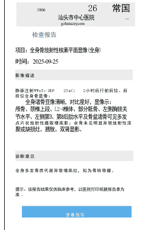

2025-10-10:20:15

# 星球密度——说话要尽量量积

大家好，我是达叔。

一个想和大家一起慢慢变富的家伙。

最近达娣在坐准上，达叔除了了一点工作之外，其他时间基本都老老实实的带着孩子。

昨晚，达娣说：“你知道这个月嫂每个月到手的工资是多少吗？”

“每天只有260元，一个月一万都不到。”

“如果两个孩子中间没有几个月闲隙，我们我们几个月就挤在某个宿舍房间，打地铺，辛辛苦苦。”

“哪里人？”

“苏州沛县的。”

“大多岁数了？”

“35岁，1990年生，孩子10岁，离婚了，老公跑路了，把孩子留给了她。”

她在沛工作，一个月的工资就只有3000块左右，养不活孩子。有一心，交钱找过了一个月嫂培训中心，包就业的那种。学完之后，让她选两个城市，一个是上海，一个是苏州。

她选了上海，收入更高。反正都是背井离乡，都是青春时期拿价筹换钱，哪里换的多，就去哪里。把孩子扔给了她妈妈带，自己就来上海两年了。感觉在上海赚钱还是比比城容易。

## 加微信号top28688，免费进群资料

她听到你女儿交流学习，差点眼泪都掉了，因为她女老师来找她，她要是回去落级学习，就要一起挨罚。

第二天忙完，吃晚饭，月葵在套旁边边沙发上，正在带孩子。

达叔问：“你在老家里之前是干啥的？”

月葵说，自己干了一段时间行政工作，在这之前还干过几年搞桥资的金融业务，那个时候很赚钱，一个月也能挣一万多。那个店的老板是个牙医，他家租的一直是牙医。后来他觉得挣钱太慢了，就在连城开了餐厅，积累了资金、人脉，就开始做过桥垫子的金融业务。

“我是一个业务经理，经手的单子一般都是几万，最多是几万的业务，收1-2%的服务费。”

“坏账率高吗？”

“老板做了筛选，50个人中应该会有两个，除了房产抵押，还有房屋设备抵押，经常跑路的人，连城房子和设备都不要了。”

“后来怎么不做了？”

“之后，连城整个经济都崩了，餐饮倒闭，行业倒闭，连城里的人钱几乎都崩了，诚信都坏了。不是我们一个金融倒闭了，是整个连城的金融桥接业务都崩了。”

达叔说，在上海这样的大城市，整个城市依然丰富，有传统产业的，有搞芯片的，飞机、生物医药、游戏、电商、人工智能。2500万人口，总有人能拿到钱，资产价格总有人接盘，很难维持。但在小县城，能赚钱的产业就没几个，比如你们连城钱几乎都是石磨的，他们连城都是水晶的、酒水的。其他的有钱的，就是开一个餐厅，做一类农产品，再加上一个教科卫生体制内中等收入，就没其他产业了。

加微信号top26888，免费资料群

生态很脆弱，但背后的银行的风控、放贷标准几乎是一致的。小城的房价，表现怎么样？

“高端小区还是近万一平，其他都是4000左右，也没有再继续跌了。”

“这是现实吗？”

“是。但另一个现实是，大城市的价格是基于高频成交的价格，高频成交的流动性代表价格可以被验证。在一个县城里，一个月的成交量是多少套，一个小区一年都未能成交一两套房子，非常低频。很多人没发现，站在2025年，大几千、一万万的房子，换到徐州、甚至换到省会都能买到房子的。再过10年后，资产价格就会进一步拉开差距。”

交流了一会后，达叔觉得这个月的思路还算清楚，随口说：“为啥选择做？”月葵觉得，因为不想脑子。你看，带个孩子多轻松，不用太花心思，不用骗来去。从小就想找一个工作，达叔给她反馈，这就是目标，不用脑子。

随后交流完，达叔回到自己的房间。达叔问：“你昨天忍不住了？”

加微信号top26888，免费资料群

你不能给她介绍吗？还是你觉得，工资高，不容易累。老大哥，这么可怜。达叔说，要尊重她人命运，不要看到。

供参考：关注达叔，一起慢慢富。

山川、小小、医生、一念、大熊、柯亚兰（鉴定）、肖芳、朱林、健康、应波。阿刚（财务/公证）:看了就想到这句话：法便宜，道卖，师不顺路，不忙。只要在对方准备、配合、“主动”时发生链接，保护了受者不被忽略。

加微信号top26888，免费资料群

## 辅助生&三代

2025-10-10 11:38

达叔：我想请教一个关于风险的问题。达叔好。因为孩子多又少阅读，但是一年级就近了。我最近两年非常努力了，干了几万字，从指南、国家标准到各种英文文献、新技术、新产品、公众号文章、案例等等。孩子的近视和眼轴都控制住了。

学会了去年走在近视防控的大路上。为了沉淀下来精华信息，也试着做了个关于近视防控的知识星球（星球名字直接显示我的名字，我本人一直叫它“眼镜的鸟”），有200多人付费了。有近视防控前沿的眼科医生、视光师和视光主任作为合伙人，还有几个厉害的资质。我自己土木相关专业，没有视光和眼睛方面的资质。知识星球前我就删除了几个，理由是问题不能出现视验报告、处方等内容。比如大家去测（医院或视光店都有机器，甚至自己能买机器），医院会给配方大家去外面测，大家直接把这个发上来。我的问题是，这对我来说风险吗？对其他人呢？

合伙说应该没有视验报告方面的资质。我也没有，虽然合伙人都有视光资质。我给星球上传了视光合伙人的证件。另外，去考虑眼镜师或者近视防控师之类的，我的学习能力可能也没有问题，不过我不在视光行业内。如果有风险，又没法规，那这个星球我就不要了。虽说是所学所知，只是给可以的粉丝输出一下，但我完全没有理由去冒这种风险，就算说也要在这个平台上。

1. 你这种是学霸本尊，一个土木相关专业的，竟然搞起来了近视防控，还圈了流量，经营着了一个小星球，很牛。在达叔看来，没啥太麻烦，是没有风险的。

加微信top28688，免费资料群

你只是在一个叫“知识星球”的知识分享平台分享知识，你又不看不病。结合达叔公众号文章，始终加上一句话：“代表本人观点，一定不对”。这句话开始是没有的，后来被合规部特殊要求加入上去的。你可以改成：以上信息交流，不构成任何医疗建议和意见，请到正规医疗机构进行治疗。

## 2. 近视手术、眼视道，如果你能做出流量来，都是比较值钱的赛道

达叔在星球里也做过一个关于大航海项目，给一些星球介绍近视手术的业务。如果你在这个赛道赚到足够的钱，可以继续。根据你的土木专业转向，利用自己专业的赛道进行拓展，得到更大的结果。供参考：山川、大鹿、Maxis、检测、肖亚兰、一念、小王雷、抹平视认知症。谢谢达叔。之前很多年都在园林设计工作，上市公司，做得非常棒。今年我在家里休息，如果有需要都可以联系。微信：2025-10-10 12:20

2025-10-10 11:34

2025-10-10 11:17

2025-10-10 11:38

2025-10-10 11:21

2025-10-10 11:12

2025-10-10 14:02

2025-10-10 17:23

2025-10-10 17:17

2025-10-10 20:15

## 在美国跑过的“共享儿子”项目

大家好，我是达叔。

一个想和大家一起慢慢变富的家伙。

今天某医疗从业者寻找达叔聊起一个在美国看到的共享儿子项目，公司名叫Papa，在在美国创立的公司。创始人是干啥的？

Andrew Parker根据自己的经历，工作忙，没时间照顾自己有早期老年痴呆的长辈，在网上寻找帮助。

“需要照顾所有的老人吗？”

“不是。很多老年人不需要全天的专业护理，在日常生活中陪伴和协助方面，有巨大的需求缺口。”

他就搞了这个PapaCom，核心模式是：链接老年人与年轻陪伴者（主要是大学生），本质和滴滴一样，解决信息不对称、信用不对称，高效匹配。

很多老年人需要医疗、康养、养老的人可以一起研究。如果你有合适的想法，抽空给达叔发相关信息说明你的优势，线下达叔会优先挑选一些内部选手进行内测。关注达叔，一起慢慢变富。线下见面城市合伙计划。

关键业务：
- A、招募、审核、培训年轻人
- B、市场拓展、签约
- C、运营和服务质量控制

收入来源：会员费用。目前公司已经扩张到多个州取得了成绩。

把时间换成货币，解决最核心的问题：信任和公平。南京对志愿者的信用记录进行审查，也是要确保双方服务的真实性和质量，一个失信者想干啥都很困难。南京还给时间银行设置了退出机制。理论上，志愿者存在时间银行里的钱，只有本人到60岁才能兑换服务。但如果你愿意，你也可以把时间转给本人的配偶、直系亲属，甚至捐赠出去。这个大学生要是离开南京了，注销这个账户，怎么办？南京还会按照全日制工资标准的10%，给你做一次性奖励兑付。

只有南京在操作这个时间银行的项目中？肯定不是。国内的头部城市、上海、北京、成都、深圳、杭州等很多城市都有试点，绝大部分都是当地盘手在做，不是商业型机构。业务要增强权力结构，在欧美的很多市场，渗透到基础治理的机构几乎都是民间协会组织+商业机构。在东大，涉及到居民健康、养老、社区服务的几乎都是被社区居委会+商业机构。

## Steven Nie

2025-10-09 12:55

大家好我是Steven，在苏州企业任公共事务总监，微信信号：Jiaj-87

寻求以下资源和合作：
一、IPO相关
1. 浙江省或南京资源
2. 浙江省网信办资源（与情绪相关）

二、创新药国家级重大课题（我司有相关产品可申报或合作），课题如下：
1. 治疗实体瘤的新型/多功能抗体药物
2. 靶向胰腺癌的化学创新药物
3. 实体瘤免疫治疗的抗体偶联药物
4. 治疗难治性皮肤疾病的特色创新药物
5. 预防呼吸道合胞病毒的新药物和疫苗

有以上可以联系我，祝大家一起慢慢变富。

上学的时候，一个级几百人，在学校里让年级几百人都关注非常困难，但是在网络
上就有可能，这就是时代的红利。

想到这里，痛定思痛，8月份开始写公众号，主要写本专业的技术文章，其它类别的我
不会会写。

我的缺点是不善言辞，优点是喜欢研究技术，善于写技术类文章，常从一线研发，很能
get到技术人员的痛点，擅长把技术问题清楚明白。

技术文章是有需要要求的，写错了误导别人，所以要反复调整资料，比较耗时
慢，慢到也没有过日期。

达达信任信任前，我所知道要用心经营，不追热点，只写技术类文章，暂时保持垂直和专
注，避免非专业人士关注。
每一都是用心描写，保证质量。

微信对于粉丝公众号还是比较好的，都会推送文章给关注的，两个月下来，每
每天都有零零的粉丝关注，昨天粉丝数量涨到500，在达达星球里发文纪念一下。

非常感谢达叔对我潜移默化的指导。

关于未来怎么走，先把文章写好。

500粉丝是一个小小的起点，细分行业，在小小的领域发声。

吸引五湖四海的华人，链接每一个的人，每一个具体的项目。

祝达叔和各位老友中秋快乐，团家欢乐，幸福永远，慢慢成长。

收起

查看详情

五竹、我心永恒、Hmily、巨3D志彬、王老师中物理、道一种建筑设计、生财集结号、nWuliw、持平视视认知差距、奔跑的海等41个人觉得很费

达叔：加个个，节日快乐，祝顺利
2025-10-06 23:26

小鸥回复达叔：谢谢达叔
2025-10-07 08:08

# 加微信信号top28688，免费资料群

# 财生集结号：发一条链接
2025-10-09 15:44

达叔
2025-10-05 14:26

匿名用户提问：达叔您好，入学两年第一次提问，是关于医学学生读硕之后未来如何选择向您请教达叔，以下是我的基本情况：

+ 一：我家的妹妹，大学期间读的医学专业（吉林大学自学医学），本科学习期间表现良好，多次获得奖学金，成绩稳定在名次前18%，去年研究生保研到首都医大天坛医院，今年开学后又遇到了一个问题，对我来说迷茫很痛苦，因为两家关系良好，且在北京，国内医疗行业圈里算不上小忙，涉及到孩子打算，代为问：

+ 二：她是妹妹描述的基本情况：
本科就读大学临床医学，研究生保研到首都医大天坛医院，导师是硕。

今年开学后发现我导师被“派遣”外地，经多方得知，导师不好的原因是被患者举报（原因在于导师）导致的院方处理结果。

导师获取招生名的项目是与其他方的，80%由对方完成，我方提供数据。而且在本人开学后该项目已经结束。30万的科研经费只有14万，让我自己进行科研课题并完成，对于大部分学生来说很有优势。根据打探发现导师科研能力非常弱。

目前的困惑的：

+ 1. 科研不知道怎么办，想做临床医学，导师不支持，基础科研经费不足且没有出来成果，影响我未来来申博。

+ 2. 本人在神经外科，进医院后看到很多老师，同门们的状态非常非常非常好。考虑是否退选择专业方向

+ 3. 无经费和科研项目、文章发表，那么本人的期间水平不高，没有作用，如何申博

+ 4. 申博的方向我想问导师姐，建议我去香港，去香港的文章要求严苛，鉴于目前情况，有现实难度。

+ 5. 导师极爱画大饼，不可靠，未来感觉也很难导师帮联系申博
核心问题：导师缺位，学术指导、科研课题和未来发展的路中断了。

我未来前景打算：

+ 1. 国内读博，多渠道寻找导师

+ 2. 硕士毕业后

+ 3. 申请留学PhD，竞争激烈，在没有导师和科研培养的现状下，该如何规划

备注：跟妹妹多次沟通，对医学就业行业兴趣不大，不想留医学也是想做科研，不想加微信top28688，免费进资科群

# 微临床

当时高考分数649分，大学报志愿是刚疫情，医学的比较好，这个分数没有报到特别的大学，但是人比较确实，从小到大都是医学类型，高考发挥异常，一般是680~690分）。坐标山东东沂县，请诸各位位友指导

+ 1. 你加入世纪2年了，你们俩关系比较好，你妹妹去年去研究生培养，从北京来了北京首都科天天津医院

达叔近在今年在天津、北京分别办过一场线下见面会，每场都是三四十人参加，其中有北京、天津医学领域的导师、博导

知道我们这个社群，是医疗+房产的赛道，里面有一半是医疗赛道的，为啥不带她来参加?

除了医疗领域的专家，世界上有些专门搞医疗的，都有参加线下活动，其中有北京，为啥不带她来参加？

知道我们这个社群，是医疗+房产的赛道，里面有一半是医疗赛道的，为啥不带她来参加?

除了医疗领域的专家，世界上有些专门搞医疗的，都有参加线下活动，其中有北京，为啥不带她来参加？

+ 1. 你加入世纪2年了，你们俩关系比较好，你妹妹去年去研究生培养，从北京来了北京首都科天天津医院

达叔近在今年在天津、北京分别办过一场线下见面会，每场都是三四十人参加，其中有北京、天津医学领域的导师、博导

其中一条线就是，人在30岁之前、压力不大、精力无限。

在30岁之后，成家立业、有老下有小、事业里也变成顶梁柱，压力往上走、精力向下，形成了错配。

相当于财富和年龄，年轻的时候欲望大、想买的东西多、想给自己、给心爱的人买很多东西，但没钱；等等到中老年了，积累了财富，但心老了，欲望没变了。

财富和年龄的错配关系，产生了金融业务，用金融工具把未来提到老年年的，枉年轻时花。

在精力管理上，没有多少人研究精力管理，也没有多少工具，这是他讲的背景。后面很多内容还都忘记了，只记得多寡睡、少喝酒、别纵欲之类。

## 2. 网络上流行的睡眠时间8小时，可能是错的

每个人对睡眠时间的要求不一样，有的人比较少，有人对睡眠时间要求较高。赵叔属于后者。

如果赵叔出差一周，回家的肯是要倒头就睡，几乎能够睡半天。从小我就慵着睡觉，睡了足了之后，整个人的精神状态和脑子就会很好。一旦不睡觉，脑子就不转动。

对压力也是如此，压力遇到，就往沙发上躺、就躺在沙发上，打开手机，听某个课程，一边注意精力，一边慢慢进入睡眠状态。

赵叔没买车之前，坐地铁，人在地铁里上下班坐着、站着，都能睡觉。买车后，尤其是最近几年35岁以后，突然发现睡眠不足，下午开车容易打瞌，就很危险。就开始找办法，来避免这种危险。

赵叔找到了两个方法：

方案A：开车，听书、听课，能让叔叔兴奋，不容易睡着。有助于大幅提高睡眠质量，相同的睡眠时间，精力更好，可以止肝、可以让你晚上不跑起来上厕所，还有一些其他好处。

以上是叔叔正在做的方案。

## 知识星球TOP
添加微信资源分享群免费入群：微信top28688

| 序号 | 公号/星球/社群 | 原价 | 领域 |
|---|---|---|---|
| 1 | 生财有木 | 2765/年 | 副业，搞钱 |
| 2 | 众宗吃瓜群 | 365/年 | 时政，历史 |
| 3 | 记忆巷/望树西风 | 365/年 | 成长 |
| 4 | 欧洲金轨 | 328/年 | 时政，历史 |
| 5 | 卢克文青云会 | 699/年 | 时政，社会 |
| 6 | 体内主任 | 599/年 | 体制，职场 |
| 7 | 局外人的视界 | 669/年 | 金融，时政 |
| 8 | 溯泽异昂 | 4166/年 | 财富，成长 |
| 9 | 守夜人总司令 | 599/年 | 时政，经济 |
| 10 | 江宁知府 | 365/年 | 时政，国际 |
| 11 | 政堂/顾子明 | 568/年 | 时政，经济 |
| 12 | 唐书 | 1399/年 | 金融，财富 |
| 13 | 大树乡谈 | 199/年 | 时政，成长 |
| 14 | 水库欧大 | 10000/年 | 房产，经济 |
| 15 | 洪灏宏观策略 | 4376/年 | 经济，搞钱 |
| 16 | 金企鉴/海南山 | 4576/年 | 股票，行研 |
| 17 | 猫哥的世界 | 299/年 | 时政，社会 |
| 18 | 飞莱龙 | 3600/年 | 股市，经济 |
| 19 | 米联诸闻 | 599/年 | 经济，金融 |
| 20 | 茶财经 | 300/年 | 房产，股票 |
| 21 | 赢在八小时之外 | 765/年 | 成长，职场 |

## 达叔的商业逻辑

达叔认为：
- 很多聪明人，执行力差。
- 很多聪明人，懂道理，但做不到。
- 很多聪明人，有信息，但没有筛选。
- 很多聪明人，有目标，但没有方法。

达叔的建议：
- 找到自己的优势，发挥长处即可，不用去补短板。
- 融入成熟的团队结构，做好自己的部分即可。
- 你要的是结果，而不是过程。

## 伯克希（Berkshire）的投资纪律

伯克希这家公司，1984年成立以来，400次左右投资，几乎没有失手。

A. 只选技术驱动公司：
- 只选某个细分赛道排名第一或第二的公司。
- 只选头部城市、顶级行政区。

B. 规模合适：
- 从不和微软、特斯拉、谷歌、丰田等世界巨头竞争，只选细分赛道的“软柿子”。
- 从不选热门巨头竞争，早期买个整个市场只有3亿美元，慢慢扩张。

C. 价格便宜：
- 不会立刻买，而是长期等标的公司犯错误、价格暴跌，随后再抄底。

D. 能够管理：
- 搞了一套DBS的工具箱，非常复杂，上有百个工具模型。
- 从丰田那边靠的，主要用来筛选标的、投资并购、生产制造、管理和销售。
- 只有能管理的、驾驭了的才会买入。

## 关于政府部门业绩与企业不是一条心的回复

Elena：我任上市公司财务总监9年，遇到过很多问题。
1. **地方政府的关系上**：虽没有明确，某部门是垂直部门，虽然地方政府有管理权，但对某些部门的专业指导很像。对于某部门更看的是垂直意见，这是沟通成本高的直接原因。
2. **作用上**：其实是起到了作用。有些问题摆在面上来说，无奈的可以，国家政策可以，只要涉及到某部门的专业问题，某些部门说不行。这不是让我给你解决问题，你这是在给我穿鞋。
3. **收入确认上**：与6的问题，还要看包含相同内容，但通过理解，似乎无法说服对方。认为很多时候的内容可以参考，因为很多业务的特殊性，很难说是格式要求。

达叔：给个例子，内容很精彩。

最后，股东只承担了1/3的赔偿责任(保证金无效，担保人有过错过的，承担1/3的责任)。

收起

查看详情

二师姐、如行、陈同学大儿龙博士、广州楼窦新字、五竹、春、大鹿露客行、广州高中物理老师、Awj、一念等21人觉得很贵

达叔：加个，感谢专业的分享
2025-09-30 16:58

程全 | 不良资产处置：感谢达叔。祝达叔和星友节快乐
2025-09-30 13:59

达叔
2025-09-30 13:59

匿名用户提问：达叔，您好。

92年的，目前在一个人生的关键节点，差点希望能得到您的指导。

我是山西农村人家，高中中学18岁就开始煤矿下井干了三年，期间自己也开过宝store。

偶然遇到机会在网上做两个月赚了十万，担心被抓就没撤了，15年我就就职回了老家城，县城买了保养品赚了十万。

16年后引流推广到了一万，在县城买了房子和宝马，后面遇到风控号封了，又去找新项目，项目净亏了大十万，然后开始挣负债，中介也做过很多项目。

后车房都买了，23年项目月入了左右万，因结大哥邀请（中介认识的，现在我负两万）去合，结果我自己也中了。然后我就在杭州发展了，现在抖音带货有红利，我花了千几万学习，第一场直播就赚了2万8。我觉得靠运气不是稳定的，教学训练别人比我挣钱，转向一个IP项目培训，用三个月换月万收益，结果看到有人带钱几万，想博一博就又去带货了，结果导致诸业务亏损。

带钱不是稳定，28月被又大哥邀请合做项目（当时月利几十万，有风险）。我想看着愁愁脸，今年伙操作抖音音视频，由于平台风控和终端违规，这个月这个项目被抓了，因为对接是他的，我负责研究项目，还好关系找摆了，这项目来没钱，但是损失了大半年时间。

# 加微信sign308，免费进资料群

这么多年我觉得自己很努力，但是一直没赚到钱，目前没房还负55万，其中18万是网贷。

我总结这几年是因为自己认知不足导致负债快速翻身，我接触的项目不是有风险就是短平快没积累，也没有够复利。

我朋友在教学机构教数学，我自己学习能力擅长引流，她教学，提分还是刚的，这一个行业又赚钱，又符合达说的复利原则，有积累能多年，所以我计划自己单干，租房子自己开小黑班。

【想请教您几个问题】

- 1. 基于我的能力，培养是否我当下是最最优的选择？
- 2. 若专注教学，可以计划设想业务可行发展路径。每个阶段聚焦哪些关键目标？
- 3. 我容易受他人影响。还应该建立哪些可行的风控机制？如何设定阶段目标以防偏离？
- 4. 之前大哥的邀请我多次中断业务并亏钱，我想和她保持距离，但现实中难以完全割。以后如何避免情绪干扰业务判断？
- 5. 我意识到到认知不足是过去失败的根源。希望提升业务洞察力和决策能力。像我这样的创业者，提升认知应该聚焦哪几个维度？
- 1. 从从小开始业务、选择业务的时候，始终都在不断复盘。从我的文字里，看到的描述比比较很多，复盘和自己复训的内容不够。

你92年的，达资站在你的位下，帮你复盘一下：

- A、我今年33岁了，山西农村，还没结婚，有一个教域的朋友，我之前做一些工作，提出来自己的核心能力是搞流量。

一个完整的经营是：项目赚钱+流量放大+风险控制。

- B、之前做过的生意复盘：
  - 控域，赚了钱，但是底层底，赚的少的，一旦困难彻底清零了，不干了；
  - 开润宝店，在网上卖假货，2个月赚了15万，害怕被抓，不干了；
  - 城域保健品，赚了十万，也有风险，不干了；

# 加微信号top28688，免费资料群

- 引流推广，赚了百万，在县城买房、买房，项目出现风险，号被封了；
- 以后倒市，被收割，亏了大十几万，卖房卖车，开始负债；
- 跟拜大哥，去合肥项目，大哥负债两百万，项目失败；
- 去杭州直播带货、个人IP培训，都赚钱；
- 又跟大哥去合肥做新项目，项目失败；
- 回太原朋友做抖音项目，有风险，朋友被抓，自己有幸脱；
- 目前33岁，从18岁一路奋斗了15年，无房、无车、负债55，总结唯一安全+赚钱时期，就是在杭州做互联网直播+培训；
- 跟人合作的，都亏钱。

总结唯一安全+赚钱时期，就是在杭州做互联网直播+培训；

跟人合作的，都亏钱。

项目有风险的，要么被抓，要么被封。

下一步，我努力的方向是什么？

找一个靠的赚钱，通过互联网搞流量，把项目放大。一切灰色的项目都不碰，一切靠谱的人，全部拉黑，不在外。

更深一步是什么？

过去15年，始终在灰色项目里，没有学历，圈子。

总结唯一安全+赚钱时期，就是在杭州做互联网直播+培训。

一个经营是：一个完整的经营是：
- 项目赚钱
- 流量放大
- 风险控制

一个完整的经营是：项目赚钱+流量放大+风险控制。

- 教育行业，是一个刚需，是长期的。
- 教学，提分还是刚的。
- 这一个行业又赚钱，又符合达说的复利原则，有积累能多年。

所以我计划自己单干，租房子自己开小黑班。

- 1. 基于我的能力，培养是否我当下是最最优的选择？
- 2. 若专注教学，可以计划设想业务可行发展路径。每个阶段聚焦哪些关键目标？
- 3. 我容易受他人影响。还应该建立哪些可行的风控机制？如何设定阶段目标以防偏离？
- 4. 之前大哥的邀请我多次中断业务并亏钱，我想和她保持距离，但现实中难以完全割。以后如何避免情绪干扰业务判断？
- 5. 我意识到到认知不足是过去失败的根源。希望提升业务洞察力和决策能力。像我这样的创业者，提升认知应该聚焦哪几个维度？
- 1. 从从小开始业务、选择业务的时候，始终都在不断复盘。从我的文字里，看到的描述比比较很多，复盘和自己复训的内容不够。

你92年的，达资站在你的位下，帮你复盘一下：

- A、我今年33岁了，山西农村，还没结婚，有一个教域的朋友，我之前做一些工作，提出来自己的核心能力是搞流量。

一个完整的经营是：项目赚钱+流量放大+风险控制。

- B、之前做过的生意复盘：
  - 控域，赚了钱，但是底层底，赚的少的，一旦困难彻底清零了，不干了；
  - 开润宝店，在网上卖假货，2个月赚了15万，害怕被抓，不干了；
  - 城域保健品，赚了十万，也有风险，不干了；

# 加微信号top28688，免费资料群

- 引流推广，赚了百万，在县城买房、买房，项目出现风险，号被封了；
- 以后倒市，被收割，亏了大十几万，卖房卖车，开始负债；
- 跟拜大哥，去合肥项目，大哥负债两百万，项目失败；
- 去杭州直播带货、个人IP培训，都赚钱；
- 又跟大哥去合肥做新项目，项目失败；
- 回太原朋友做抖音项目，有风险，朋友被抓，自己有幸脱；
- 目前33岁，从18岁一路奋斗了15年，无房、无车、负债55，总结唯一安全+赚钱时期，就是在杭州做互联网直播+培训；
- 跟人合作的，都亏钱。

总结唯一安全+赚钱时期，就是在杭州做互联网直播+培训。

下一步，我努力的方向是什么？

找一个靠的赚钱，通过互联网搞流量，把项目放大。一切灰色的项目都不碰，一切靠谱的人，全部拉黑，不在外。

更深一步是什么？

过去15年，始终在灰色项目里，没有学历，圈子。

总结唯一安全+赚钱时期，就是在杭州做互联网直播+培训。

一个完整的经营是：一个完整的经营是：
- 项目赚钱
- 流量放大
- 风险控制

一个完整的经营是：项目赚钱+流量放大+风险控制。

- 教育行业，是一个刚需，是长期的。
- 教学，提分还是刚的。
- 这一个行业又赚钱，又符合达说的复利原则，有积累能多年。

所以我计划自己单干，租房子自己开小黑班。

- 1. 基于我的能力，培养是否我当下是最最优的选择？
- 2. 若专注教学，可以计划设想业务可行发展路径。每个阶段聚焦哪些关键目标？
- 3. 我容易受他人影响。还应该建立哪些可行的风控机制？如何设定阶段目标以防偏离？
- 4. 之前大哥的邀请我多次中断业务并亏钱，我想和她保持距离，但现实中难以完全割。以后如何避免情绪干扰业务判断？
- 5. 我意识到到认知不足是过去失败的根源。希望提升业务洞察力和决策能力。像我这样的创业者，提升认知应该聚焦哪几个维度？
- 1. 从从小开始业务、选择业务的时候，始终都在不断复盘。从我的文字里，看到的描述比比较很多，复盘和自己复训的内容不够。

你92年的，达资站在你的位下，帮你复盘一下：

- A、我今年33岁了，山西农村，还没结婚，有一个教域的朋友，我之前做一些工作，提出来自己的核心能力是搞流量。

一个完整的经营是：项目赚钱+流量放大+风险控制。

- B、之前做过的生意复盘：
  - 控域，赚了钱，但是底层底，赚的少的，一旦困难彻底清零了，不干了；
  - 开润宝店，在网上卖假货，2个月赚了15万，害怕被抓，不干了；
  - 城域保健品，赚了十万，也有风险，不干了；

### 3. 达叔的医疗和房产项目实例
- 医疗：厂家知道自己的产品很好，能卖百亿规模，绝大部分选择自营，都招经销商来帮他们。
- 房产：无论是达叔、还是卖房子都是找合作伙伴负责客户对接和销售。

医疗能卖百亿规模，绝大部分选择自营，都招经销商来帮他们。背后的逻辑，就是让一部分利润出去，把风险外包、把最脏最累、不合规的利益环节外包给经销商商，换取自己的安全和长期发展，事情不做尽。以房产业务为主，无论是达叔、还是卖房子都是找合作伙伴负责客户对接和销售。本质是，做自己的成本很大，节约自己的精力和注意力，只有合作才能赚到更多钱，才能更多城市和项目。放在你的身上，达叔即使把所有账号、所有流量交给你，你也会选择合伙人全倾腰，留着自己做。反而把生意越做越小。这就是吃了没化的、吃狗、干产，都赚不到大钱。马上就会上映一个金刚武威的电影《风林火山》，里面探讨了一段，一个叛毁的集团，赚再多的钱，在卖药蜀面前都是小生意。达叔在星球反复说，不要干产、不要被清零，要选择的项目，复利效应、有积累、慢变富，这是背后的逻辑。

4. 容易被他人影响，怎么办？物理隔离。你能自我克制，能够意识到自己容易受到他人影响，这是非常好的办法和能力，说明你有能力。用医学来解释，你就是对某个花产生过，每次接触发生就会变态反应，怎么办？物理隔离，是最好的方案，这是符合奥卡姆刻刀理论的，如无必要、勿增实体。

5. 你的能力强，很有战斗力，达叔在星球上看到了，心里想拉你一把。但是你没上大学，亏损，一直处于高负的阶段，完全符合达叔选择城市合伙人的标准。于是，达叔就不能和你合作。这就是达叔给自己已立的规矩，也是避免受到干扰。

6. 你有时间可以看一看《唤醒自己》、《让自己的人生永远有选择》系统的研究一下生意逻辑。祝顺利。

赵广提问：达叔，我是广东汕头的，18年父亲因患前列腺癌做了切除手术，近期发现病灶很多，晚期了，尿科医生的建议说是放疗意义不大，只用药物就好。请教一下达叔：这种情况下，放疗有没有意义？

加微信top2888，免费进资料群。

加微信号top2888，免费资料群。

加微信top2888，免费资料包。

no content 

十几年，日常有以下主要症状：胸痛、胸背痛、右手酸不起来、腹痛【很严重的】一年前发生过一次，是脚部痛到呼吸困难，过程大约10分钟，之后缓解，建议联系大学深圳医院结石胆炎，建议手术切除胆囊，并说年龄再大了，医院就不敢给我手术了。当时因为太疼也缓解了，老母就不愿意手术。

现在日常也是没有症状的，但是这种情况，该怎么办呢？看看建议我们做手术，那在深圳，有哪些推荐的医院和医生？感谢感谢！

1. 是否手术，你们自己主意，反正不会在这种问题上发表意见。

达叔以前有过急危症的胸痛中心，额外提意见：一定要重视病变，一定要按时吃药，否则会引起心疼。

遇到胸痛，不要耽误时间，一定要尽快去最近的医院胸中心就诊，错过黄金1小时，死率会升高，心肌损伤是不可逆的。

2. 如果要做手术的话，在深圳，中山大学附属医院胆胰外科陆杰涛主任祝顺利。

查看 详情

| 姓名 | 医院 | 部门 | 地区 |
| :--- | :--- | :--- | :--- |
| 陆杰涛 | 中山大学附属医院 | 胆胰外科 | 深圳 |
| 张广涛 | | 胆胰外科 | 北京 |
| 淼 | | 胆胰外科 | 广州 |
| 王谦 | | 胆胰外科 | |
| 柯 | | 胆胰外科 | |
| 苏 | | 胆胰外科 | |

- 昭昭：就算老了吧，居然都有问了，羡慕了。（2025-09-29）
- 陈：印象中胆石是一个很成熟的治疗方法。如果要做手术的话，确实非常常见的中医湿热，每年门诊量很大，可以看看。（2025-09-25）
- S：在道影，血管问题。
- 静水：可以考虑先做造影，排除一下血管问题，不容。（2025-09-26）
- 匿名用户提问：达叔你好，最近面临工作的压力，想请教一下达叔。本人女性，40岁。

# 加微信号top2688，免费资料群

现工作：IVD头部企业，从行业转型5年，市场部门负责人。离开后，公司多个销售总监分别跟我谈，对我的工作给予了很大的认可，让我留了下来。也跟公司老板谈了离职想法，老板表达了不舍，对目前工作状态满意，可以重新调整。

新工作：人工智能智能公司，属于行业内多人的团队。创始人是高校教授、博士、理工后，生物医学数据挖掘专家，拿过世界级奖项。和这位创始人已经熟悉几年了，是一位益友性质，只是认识的程度。前几个月通过这位老师重新联系上了。

- 达叔：该公司目前团队以技术研发为主，主要负责学院合作和项目。据创始人说，去年年收300万（已实现自我盈利，靠投资生存）。
- 阶段：创始人认为自己已经到位了，自主灵活拓展市场，认为我的专业经历完美契合，邀请我负责营销业务（不需要负责人）。
- 宇：在职考研等。
- 达叔：在上海、西安、北京等城市已经入职的。目前产品价格标定在150-300W；在骨科、医美专业的开发和应用，也有拓展计划。

他个人有一定的资源，需要人把这些资源落地。

现工作还没有提离职，我重新梳理拿出业务定位和规划，主动去跟老板谈方案。现在工作已经顺畅，同事熟悉，属于适应时期；目前IVD核心目标是能够落实长久价值。入职人工智能公司基本薪资涨30%，承诺期直接对接创始人，工作创造性，更能接触核心资源，提升自己。

还没有踏入新领域，总觉得技术日新月异，新公司能否突破行业发展壮大起来？到今年初，觉得是个难得的机会，想要迎接新挑战，但对未来有担忧，既担心自己能不能适应新环境，愿最好对伙伴们有帮助，也担心新公司不能接受市场的考验。

# 加微信号top2888，免费资料群

肯智慧达叔指点迷茫：

1. 星球，包括这位星友内在，要严肃认真一看达叔这个回答，顺序不能错。如果你在星球内提问，是否继续留在目前的IVD公司，继续市场部经理，还是人工智能智能公司，那就不要在离职之后再来。一旦你在公司里已经离职了，同事、老板都知道你要走，甚至还有人挽留，你犹豫了。这种情况你来问，除非对面个人是超级大坑，否则达叔一般都会劝走的。因为你是市场部，平时接触公司很多核心数据，你一旦要离职，老板在内心深处对你的信任基本上大打折扣。无论当下是否对你挽留，以后都很难坚持你要的工作，以后很难再给你更多钱。很多人在职场里离职，误认为只是一个正常的离开，但在很多老老板看来，你的主动离职是对个人和公司的否定。就相当于你妈妈扇了对方一下，往对方脸上吐了口水，对方很体面的擦了一下，你没有计较，你却以为能够和原来一样留下来，这是错误的。很少有老板格局如此大，很少有员工能力如此强，让老板真的打算放弃。闭上眼睛想一下，你是老板，手下的员工找你要离职，你内心的感觉。学会换位思考。

2. 目前的IVD行业、公司，已经过了扩张期，进入了大逃荒的时期。2024年，IV行业某头部行业交流的老板来见我，感叹达叔在2023年底发现以后IVD行业速减，展现收入也开始下降。达叔在2015年加入IV行业，见证过8年的快速扩张期。在扩张期，市场的作用非常大，需要定方向。一旦进入收缩期，市场的作用就会萎缩，公司能够保持现有业务深耕赛道。

# 加微信号top2888，免费资料群

传导到你身上，就是事业上的成就。传导到你身上，离职后他没有留痕。“离开送祝福”，这种在你老板身上，没看具体意思，达叔放到关系上，看着不能让你清醒点。和你老公，“离开送祝福”，并没有强烈挽留。

- 昭昭：就算老了吧，居然都有问了，羡慕了。
- 确实非常常见的中医湿热症，每年门诊量很大，可以看看。（2025-09-25）
- 陈：印象中胆石是一个很成熟的治疗方法。如果要做手术的话，确实非常常见的中医湿热，每年门诊量很大，可以看看。（2025-09-29）
- 静水：可以考虑先做造影，排除一下血管问题，不容。（2025-09-26）
- 匿名用户：达叔你好，最近面临工作的压力，想请教一下达叔。本人女性，40岁。

- 3. 人工智能医疗公司，如果是处于研发练阶段，达叔不建议你去。但这个公司营收已经到了300万，已经能够养活自己，正是需要发挥你价值的时候。人比较好，但这种收缩赛道，自身准备。
- 40岁，还是要在位子上一把。公司过了亏损期，还能涨薪30%以上，未来还有机会上市或被收购。
- 达叔：从连续的IVD赛道，追到新兴赛道，对你的职场发展应该更有利。按照达叔在线下，接触更多的客户，值得一搏。

- 达叔：如果可以的话，自己在市场负责的时候，自己主动承担一项销售业务，或者推荐一个靠谱的人来负责一块业务，把西、西南或某个大地区在自己手里作为自己的依据。
- 练习：想了解一下美工的产品应用（微信：lianianixi）。

1. 达叔可以明确的告诉他一件事：金融从业者做媒体，是商业效率最高、赚钱最多的人群。达叔经常在思考，我当年如果选择医疗行业，而是进入了银行，后来有银行的从业经验和案例，靠自己的思考能力，再加上自媒体流量放大，大概率比医疗行业拿到更大结果。所以，达叔在星球上，碰到银行金融行业的家伙，就会鼓励他们做一下。大家在网上看到的韭佛，他原来就是某行业做银行转型转型的自媒体，招财大牛的变现效率极高。银行人、医疗人、律师、公检法系统的人，既是专业人士，又不缺精彩，天然适合自媒体，讲故事，可以将工作转换成作品。
2. 公开信息的风险聚会有法律风险。
3. 按照我的信息收集及闲时计划，大概每周更新一个客户分析，频率不会过低。每天更新一个新客户的分析，工作量太大，我做不到。

- 达叔：如果你想清楚什么样的钱能赚，什么钱不能赚，你自己做风控，好。
- 达叔：如果你想清楚，公司名字，不要提到具体名字，这样给你减少很多麻烦。
- 达叔：如果你想清楚什么样的钱能赚，什么钱不能赚。
- 达叔：你研究一下账号，写很短的，这种容易被骗的。
- 达叔：你研究一下账号，分成几个赛道：医疗系列、房产系列、思考系列、经济系。
- 达叔：你研究一下账号，写很短的。
- 达叔：你研究一下账号，分成3-5份，发出来，利于流量获取。
- 达叔：如果你想清楚什么样的钱能赚，什么钱不能赚。
- 达叔：你研究一下账号，写很短的，这种是不对的。
- 达叔：如果你想清楚什么样的钱能赚，什么钱不能赚。
- 达叔：如果你想清楚什么样的钱能赚，什么钱不能赚。
- 达叔：如果你想清楚什么样的钱能赚，什么钱不能赚。
- 达叔：如果你想清楚什么样的钱能赚，什么钱不能赚。
- 达叔：如果你想清楚什么样的钱能赚，什么钱不能赚。
- 达叔：你研究一下账号，分类。
- 达叔：如果你想清楚什么样的钱能赚，什么钱不能赚。
- 达叔：是不对的。
- 达叔：如果你想清楚什么样的钱能赚，什么钱不能赚。
- 达叔：如果你想清楚什么样的钱能赚，什么钱不能赚。
- 达叔：如果你想清楚什么样的钱能赚，什么钱不能赚。
- 达叔：如果你想清楚什么样的钱能赚，什么钱不能赚。

- 达叔：治疗风险不大，但很大的道德风险。一般的医生不敢推荐，害怕担责，只有手里等级别的医生才敢推荐。
- 患者：只要还有正常的治疗手段，也没有几个家属让患者给新药做实验，心理负担很大。
- 水滴：在水滴筹上求助的患者，很多都是走投无路，彻底没钱的患者。他们既然没钱，还想治疗，就有机会被引入到新药实验的入组环节。毕竟是免费。
- 外人能看到这个业务吗？很难。
- 水滴：刚开始上线，能看到这块业务吗？看不到。

- 格华：爱启发，做一个金融人如何打造自己的IP。（2025-09-24）
- 达叔：大家好，我是达叔。一个想和大家一起慢慢变的家伙。最近见了三个合伙人：一个是某企业总经理，一个是珠三角来上海出差的星友，一个是某香港上市公司副总裁。外企总经理，手里拿着几百万，在普通的职场人看来，已经是天花板级人物了，年薪三百万。
- 会焦虑吗？会的。他焦虑的点是什么？自己很努力，团队和产品都很棒，但整个市场环境、政策发展、国产崛起，以及其他企业的应对，对自己不利。

- 西门子最近剥离了IVD业务，GE传出要卖掉中国业务，施贵等医药巨头把中国业务也卖掉了。
- 看到了什么？两边有脱钩的趋势。
- 能百分百脱钩呢？未必。但如果集团把其中一部分脱钩、把业务用掉，而你就是其中被用掉的一部分，历史的一粒灰，就会变成一把山，职场命运被改变。
- 过去20多年积累的身家里也有几万，可能躺平？很难。绝大部分在职场里卷赢、做上高管的人，都是事业心很强，想做事、闲不下来的人。更重要的是，无法接受年两三百万的现金流，突然断掉，就会严重影响自己的生活质量。
- 要谈什么？自己手里有的产品、项目，可能不能和达叔的流量合作。以及拆解了两个方向：一个是to B的业务，一个是to C的业务。
- To B业务：以IVD行业罗诊断老板黄柏兴为例，他近期也开通了视频，发了第一个作品，也开始做自媒体。
- 达叔：如果你想清楚什么样的钱能赚，什么钱不能赚。
- 达叔：如果你想清楚什么样的钱能赚，什么钱不能赚。
- 达叔：如果你想清楚什么样的钱能赚，什么钱不能赚。
- 达叔：如果你想清楚什么样的钱能赚，什么钱不能赚。
- 达叔：如果你想清楚什么样的钱能赚，什么钱不能赚。
- 达叔：如果你想清楚什么样的钱能赚，什么钱不能赚。
- 达叔：如果你想清楚什么样的钱能赚，什么钱不能赚。
- 达叔：如果你想清楚什么样的钱能赚，什么钱不能赚。
- 达叔：如果你想清楚什么样的钱能赚，什么钱不能赚。
- 达叔：如果你想清楚什么样的钱能赚，什么钱不能赚。
- 达叔：如果你想清楚什么样的钱能赚，什么钱不能赚。
- 达叔：如果你想清楚什么样的钱能赚，什么钱不能赚。
- 达叔：如果你想清楚什么样的钱能赚，什么钱不能赚。
- 达叔：如果你想清楚什么样的钱能赚，什么钱不能赚。

你和他没做过生意，如果他一年被起诉多次，次次还都是被告，那你和他合作，善终的可能性是极低的。

星友震寰

## 为什么？

她自己感悟，当年在国央企工作的时候，就是负责园区运营的，每个人驻企的背脊，都是她必须要衡衡的。

结果，等她自己做出来业务，反而忘记做这些动作了。

达叔给她讲了过去这些年，我身边人的狗血故事、自己经历的各种故事，都是血泪史。

劝她去香港后，第一件事是什么？

防骗。

否则，按照她目前的节奏，在香港可能不能赚到钱，倒是其次，最后被骗的概率是很大。

星球密语
查看详情

迎春、Closer、静水激流、黄广、活在未来、林林总总、Awj、王老师|中考物理、刘飞等等74人觉得很赞。

2025-09-23 15:34

## 自我介绍

达叔、各位朋友们。

开了2023年1月份加入达叔的知识星球，现在到快1000天了。

为什么今天才自我介绍？因为最近有事情跟我们的星球有关，跟达友有关关系。

本人女，坐北北京，工作是吾系女装店。

店铺规模不大，赛道有一个优势是不退货，这些年整体销售比较稳定。

加微信信号top28688，免费领取资料群。稳定，属于家庭收入的基石。

我是通过房产的朋友关注到达叔的公众号，在公上看了很多文章，在23年加入星球到现在。

因为达叔一开始的文章是医疗有关的，所以我平时只是看看一看。

但是对达叔的一些文章分享，对我对一些价值观和方法产生了共鸣。

后来达叔又发现规律了，对我产生了共鸣。

我一看，原来达叔长得这么周正，也加深了信任基础。

今年七月份我跟达叔团队的@猴帅师(三角房产团)在深圳买了一套房子。

我对买房子这件事一直很感兴趣，早期就给我微信取了名字叫“地主家的”，就是想当地。

在没有认识达叔之前的一些碎片化的信息，就让我有一种直觉，房产值得投资。

18年的时候我就把口落到了深圳，想着万一有限的情况，我可以在深圳买房子的。

这些我接手了几个深圳房产主，但是是到25年我才买到第一套房子的。

因为今年我生了孩子，宝物换，之前是实体。时间精力是非常有限的，可能有些妈妈明白，在小朋友上学之前的时间段，消耗量大的伴随期间，所以买房子这件事我特别希望有一个很信任的人帮我打理。

我常住在北京，我买过的房子，我对深圳一不了解，我也没有时间实地踩点和找中意的楼盘。

这类书和其他博主的感觉不一样，他的写作非常丰富，有很多数据分析的，从历史的角度，从现有的数据。他能解释关于贷款的问题，他可以说你睡得着是为了买，这个点是我产生共鸣的，因为很多博主会给你出的贷款计划，鼓励大杠杆，从理论上肯定说得了。

但我还是比较谨慎，我发现人是不一样的，承受贷款的能力和风险的能力不一样，达叔的观点是特别赞的。

后来我接触到深圳团的负责人和上海团，@小卖房给我的印象都很，我也不在上海准备了名字。成都团的老姨一刻没有见到，也加了微信联系。

25年半年，我卖掉了海学的学区，换到了朝阳大平房，这样就完成了北京两套房的升级，目标转向深圳。

## 加微信号top28688，免费资料群

6月份的时候我跟猎哥(珠山房产购团)通了一个电话，确定了大概买房的资金总额，然后我又看了一下直播。

嗯，面相也老了，地圈圆的。😅

7月带孩子老婆度假和看房子是一起。

因为我有深圳户口，所以我是可以买深圳的限区房。

猎哥带我先看了两个新房，再看两个二手房，结果看到第二套新房的时候，我们二手房不看了，就决定买一套新房。

我老公这个人个人很懂，他看到第二套房子的时候他就说第一套非常好，不用犹豫了，可以买下了。

从18到25年，能找到一个信任的专业的房介中我是多少的不容易。

所以我特别理解信任的前任重要。

我自己的生意也是我前任结果，口碑挺好、高度垂直、粘性很好。

再来说跟星莱有关的事情。

猎哥给我介绍了一个老友。友还想拍短视频。

我们现在已经跟这位老友见面了，大概的需求和项目推进已经在进行了，因为老友也是跨行业投资，他找了很久，找不到对的人。

达友也是深圳投资的业主，我也是。

他问你为什么没有在星球里面做一些我自己介绍？
我说以前就是做我演员的，总不能介绍老友去买女演员吧。

现在是不一样的，因为我们有一个新的公司。

新的业务可以跟达友们介绍一介绍。

我老公是国字单位的演员，跟我结婚以来，从演员转行做短剧。

去年我们开始正式制作短剧。

## 加微信号top28688，免费资料群
