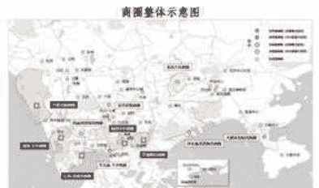

# 达叔

2025-03-22 21:23

星球密语-达叔周报+线下见面会成都站 星友资源

大家好，我是达叔。

一个想和大家一起一起慢慢变富的家伙。

达叔周报：

- 1, 达婶身体不舒服，从周日开始，放下所有工作，连续照顾三天，已康复；
- 2, 开始筹备成都、苏州、北京的线下见面会；
- 3, 出差，成功举办线下见面会-成都站；

成都的项目规产品：

- A、 成都的新规产品，容积率达到110%，120平方米的房子，送下来150m²,实得使用132m²、卷王之王；
- B、在成都的销量极好，过去两个个月，都能挤进成都的销量排名前5名
- C、豪宅设计，外立面扭扣+真石漆+大玻璃+园林+湖景
- D、价格，首的价格，高端圈逸的生活
- E、隔壁有成都第一梯队的学校，商业，轨道交通
- F、很好的金融政策，10万能上车，优势300万，三年前的持有成本只有50万

活动当天效果不错，感兴趣的快速链接@成都老唐

达叔线下见面会一成都站，星友资源如下：

- 1, 头部医疗外，全国商务业务负责人，某端产品，目标科室室内内科，要链接经销商资源，可以按照医院授权。产品有竞争力，在细分赛道第一名，利润空间巨大。加微信intsg2，免费进群资料分享。
- 2, 成都某某甲医院，神经内科医生，带老婆一起参加，老婆都是某医院的妇科医生。达叔一起交流了医生的三条路线：行政路线，技术路线，规划路线，以及医生名字+某个疾病名+某个城市，打造第一的个人IP；执行的好，有机会拿到大结果，收入可以翻10倍以上；
- 4, 四川，某科技软件公司，做技术软件和硬件集成，虚拟电厂等；
- 5, 某女，上次跟着团队买了房，自己过来听一下，买房的思路，方便心；
- 6, 神经内科医生，在成都，开了一个中医诊，做儿童生长发育赛道；
- 7, 某经济学自媒体博主，在成都电子大学毕业，入伍后去大学当老师，兼备校销，加入某媒体机构，来交流自媒体的打法和商业模式；
- 8, 消费领域老，做母婴类产品，生长发育，代理雀雀等产品，自己也有产品，分为母婴赛道和医疗赛道；
- 9, 头部白酒厂家，市场负责人，推出了一款定制的酒水，来找相关异业合作；
- 10, 水果生意，黄油果、加工等，给酸奶、奶店等机构提供产品，带老婆的，在上海有两套房，在成都、南阳有房，在研究置换；
- 11, 头部设计企业，拿过全球的设计奖，但不销售利润分配，来研究一下自媒体创作和商业模型搭建；
- 12, 女性美老师，顾德第一，还要做女性涂抹抗衰层产品；
- 13, 成人都，2009年进入二手房获证赛道，做到成都某区第一名；
- 14, 重庆过的，企业培训培训，拥有全国师资，也就是老师老师，介绍了成本和市场价，有兴趣可以合作。
- 15, 在重庆有建20-30套，包租楼，来研究一下成都。
- 16, 川大，大学生，20岁，挺劲的小伙，化学系，研究能源电池领域，星球里有很多赛道的高管，再过一年，可以优选这个小伙执行或招聘；
- 17, 西安过来的，2份就已经搞定了这个项目，西安头部医学编辑主领导，后转某医疗。

## 微信intjs2，免费获取资料分享

上市公司市场，现在市场和销售两边都在操作；

在西安有大量建仓，持有9套，千平；在成都都有一些持仓，主要来问儿子的工作选择问题，

- 18. 成都体制内工作，带先生某某，主要来问儿子的工作选择问题，儿子清华研后毕业，有几个offer做选择，有机会来上海；
- 19. 四川德佛来的，已经买了上一个项目，来看一下新的产品，孩子要去成都读书；
- 20. 成都体制内工作，别业没多久；
- 21. 医疗从业者，做医疗供应链，在过车上的房项目，来交流了一些医疗的增增法，达级分享了了一些可能；
- 22. 安银来的，医疗IV领域，还在做中医药补充业务；
- 23. 大学生，大四，口腔专业，来链接一下医疗资源，想去北京研读；
- 24. 云南人，中药学，医药某某室主任，在深圳十年，做了一个工业大麻的项目，在2025年4月有机会获批，在找化妆品，食品领域的厂家合作；
- 25. @镍捞师（珠三角集团），达广广城市合伙人，来成都看；
- 26. @擎帅（房集团团），达联广城市合伙人，来成都看；

还有几个，比较接近，以及介绍。成都项目感兴趣的，快速链接@成都老唐。下面一下：

- 1, 除了办成的线下会，周围很多城市的人，纷纷来洽谈，到目前为止几乎都被拒绝了。达叔的原则是，信任面前，慢慢选，选定伙人就不动了，保持长期合作。这个商业模式，是医疗行业深刻感悟的问题，厂家和经销商之间，有很多合伙者，十几年甚至十几年，都有。加微信intjs2，免费进群资料。

丝心没感觉，关心我工作的效率不能跟上他的商业效率

不是我忙，整个上海的同行都忙飞起来，带着量太大了。

3月二手成交量概率有望突破3w套。

都说上海楼市只是以价换量，其实不然，不少优质的小区早就开始领涨。

看了下某某，徐猛龙天地最近一套98平成交价780w，去年底同户型类似楼层成交价708w。

去年年底买入的这个小小伙伴是不是70万就睡到脸。

为什么单举这个例子？
去年底小小伙伴最多的就是蟠龙一期，到底买不买？徐还有那么多新房竞后，会不会会砸盘、破产？

跟我大家说，不要听太多网络上的声音，当接收的信息太太多，你的观点就会不断摆摇，极其不稳定，关键时刻非常难以判断。

应该是看价格，告诉我你看中的房子多少钱，我可以给你建议，价格合适就够。

可惜去年敢大抄底的人极少，机会错过了，就是错过了了……

还有很多品质表现非常好，那某些房子还在持续下行。远郊无地铁的新房，无学区老破小老老大，动迁房。

楼市分化愈演愈烈，有置换和购房需求的别直视。

加微信jntsg2，免费资料分享群

## 做好防御性的购买

看到不错的房子，加速换手。
有个老友X高管，置换需求，连跑两周小苏带他和他老婆看房子，他就对此感很强烈。

说为什么才一周房子越越少了？任何一个他们看中的新房可选房源都非常少，折扣也收回了很多。

他很焦虑，责怪自己那晚想到要置换。你说能起来已经赢大部分人了，很多人还在住在房子里跌不休的假象里，顺道告诉他了一些卖房策略。

也建议他趁着捡每一个出价的买家，见好就收，切勿因小失，为了卖2-3万多几个月，可能看中的房子涨价了，或者新房扣回了，几万就损失了。

聊聊，他立马与客户沟通退租事宜……

什么是执行力超强的典范？
上次文章讲了一达达组姐为了买房和老公商量贷款购房的故事。

昨天我陪她去签约，路上她跟我说自己把郊郊一套房子挂出去了，而且已经有家里在砍价了，就能出手。

她想过这种房子只会越来越值钱，还不置换成优质资产。

我说这回你老公反对反对吗？她说反对了，但他还是听老婆的。

短短一个月的时间，她们家的家庭资产打包被她优化了、再优化、再优化……真的太辛苦了。

加微信int5g2，免费资料分享群

昨晚在签合碰到开发商的领导在那签约，听到原来是有一些新的重磅利消息，所以这家伙连夜回来搞一场。

她知道这件事很开心，赶紧把好消息分享给她老公，顺便传达了选的值得信赖。

关注小艺，买房不踩坑
达叔助理V: 151211511003

达叔：穿越过去时期，多年以后，你会怀念、你会愿望再次回到2024-2025忙到没时间吃饭的人，生怕。
2025-03-19 09:34

+ Ivy桃之夭 回复 达叔: 回望野望
2025-03-19 21:02

+ 猿澳师(三角房产团购) 回复 达叔: 赞同
2025-03-20 09:50

+ 猿澳师(三角房产团购) : 不要听太多网络上的声音，当你接收的信息太太多，你的观点就会是不靠谱的，极其不稳定，关键时刻会影响当时的判断。这段时间很慎重，遇到不少，以为自己的跟路实操的，一了解结果全是在坑里转圈去问去，就没在正确的方向上。
2025-03-20 09:53

+ Steven Nie: 数据说话，看准行、跟人，比自己乱看乱停更有用。
2025-03-21 21:22

达叔线下见面会-成都、苏州：
2025年3月22日，周六，成都；3月29日，周六，苏州。
每场:30人左右，先到先得。
加微信intsg2，免费资料分享群

## 日程安排：

- 10:00 - 12:00 达叔楼市精+问答环节
- 12:00-13:30 午餐+星友介绍
- 14:00-17:00 看房项目，深入交流房产投资等业务。

费用：星球会员免费，非星1000元/人；星球会员免费，非星88元/人。

## 深圳房产的“反常规律”:租赁比越低，反而越买房

| 区域 | 000-001 | 000-002 | 000-003 |
| :--- | :--- | :--- | :--- |
| | | | |
| | | | |
| | | | |

## 成都老唐

 辐射和变化——当房子的价值重构对选购的启示

你看，房子那么多，谁来买啊？
这是我们所听到“刚需军”最常说的话，这句话说了对分之一。房子确实，但好房子不多，尤其是“新区+控地”，好的新房项目并不多。人们会去买房子，普通的产品确实不好卖。但并不是这个城市所有人都能买得起头部板块的新产品。所以当某个城市（比如成都）头部板块优质资产成交在不断攀升的情况下，有两种资产跟着受益。好的新房，面积越大，总价越高，购买力的高净值人群趋之若渴，倒逼很多人去接收价格更低的，或者相邻板块总价更低的新房。这就是头部板块的联动效应和抬价效应。那么两种资产，在同一周期内，哪个会涨，或者说哪个会涨更多，是我们投资者需要仔细考虑的问题。毕竟我们只是为了赚钱，为了更高的投资回报，可能已经有很多朋友在用脚投票了。先说结论，都会涨，但是相邻板块的新产品涨的更多，想象空间更大。历史和现实早已给了我的答案。以成都为例，今天的大都、高新、林家都，都受益于当年金融城的辐射和外溢。几年间，这两个板块的房价从一万多到四万，甚至马上上五万，涨幅超过200%。而一个周期内，金融城本身的二手房价涨幅，除了几个小区，其余大部分。

整个上海的房子都会涨，包括你这一套50万的房子，在上海算是中偏上的水平，别看胡八道。下次达叔在上海线下见面会，可以拉上学习一下，哪怕不是买房子的，听一下课程，看更多数据和逻辑。

达叔，你懂感，是正常的，说明你至少知道自己不知道，比自己不知道要很多。

因为你都十岁了，在头部医疗公司做销售总监，对管理公司有一定的认知，却对操盘更大的生意，毫无头脑？

在网上，很多人把理科工吹到天上去了，把文科低到土里，这里就是另一一种系统性的污染脑子。

工字不抬头，两千年前，就有清晰的认识：劳者治冶，劳者治于人。

你不学层设计，就会有很多奇奇怪的，你完全看不清，甚至都会越模糊。

正如，最近这段时间，出了两个：

- 一个是，广东地区，居民竟然可以用医保卡去买华为手表。
- 另一个是，昨天推出一个政策，不说公积金贷款利率会下降，还能拿公积金来当做买房首付。

你看到这两条消息，前后的新闻，请问这两个完全相同的新闻，背后有什么共同的逻辑？

如果你看不出来，你就不能掌握顶层设计的能力。

你会困惑，不是江湖情绪，医保基金不够用，怎么会这么多用？用来买华为手表，然后你就开始吐槽华为。

你也会觉得，公积金不是用来买贷款的，为什么现在又可以拿出来做买房首付了？

拥有规则，拥有改变规则的人，让你花钱了。

在创造机会，让你花钱，从而导致消费。

## Part2结构：拆开来看清晰

医疗领域，那医保资金紧张，一忙忙搞紧、砍价，把很多亿、千亿规模的行业，市场规模直接挤压90%，也是真的。

还有有钱，让邻居消费去买华为手表，不矛盾？

加微信intsg2，免费进资料分享群

达叔说，如果你理解的信息结构只是停留在这里这一步，两个动作，就很矛盾。

但如果你对医保结构懂得更多，在规则和框架下了解了更多，你就会发现，并不矛盾。

遇到问题，不要大而化之，要研究结构。

比如，研究杭州这个城市，你不能研究杭州流入了多少人口，然后就崇拜，觉得牛逼。

更要知道，流入的这三十万人，杭州十个区，谁获益最大？有人一人一口汤都没到。

就好比，对待医保，不能把医保当成一个整体，而是要把医保拆开，看着两个账户：

统筹账户 + 个人账户。

统筹账户，就是大家交钱，一起用的，由操盘手来统一调配。也就是说，公司给你的这一部分，你是无法提现，也不可继承，当操盘手上手时，当年明年就掉了。

当你把医保拆成两个部分，再来看具体的数字，你立马就明白了，你之前两个困惑，全部都合理。

医保资金紧张的是谁？

操盘手自己的统筹账户，他的资金紧张了，现在每年要支出3亿，而能收上来的钱却只有3.87亿。

随着老龄化加速，每年支出肯定比3亿越大，而能收到统筹账户的钱人越来越少，钱也会越来越少。

于是，操盘手看到了风险，提前布局，把集疗、DRGs等操作先抢起来，是拆修屋顶。

但是转型，操盘手发现，医保的个人账户还涨了1.44万，他的本反应是什么？

不是你钱不够，而是觉得你们这帮人怎么花钱、怎么不消费、怎么资金利用率这么低呢？

操盘手认为，规模这么大的是储蓄资金，要流动起来。

微信intsg2，免费进资料共享

就劝你们，拿出这部分医保账户里的钱，可以去买华为手表，能拉动消费。

除此之外，还做了些什么动作？

原本每年你给你交医保的时候，70%交给统筹账户，30%交给你个人账户。

2021年后，操盘手觉得你对自己的钱利用率不够高，就从源头给你中断了。公司给个人交的医保，全部纳入统筹账户，就别给个人账户了。

对方觉得，他们比你懂得这个钱该怎么用，也比你更急用钱。

当规则有利于自己时，就讲规则。

当规则不利于自己时，就改规则。

针对这个医保账户买手的事，不同地方的操盘手认知不同的，反应完全不同。

- 有人认为，华为拿下了医疗器械注册，可以用医保账户支付。
- 有人觉得，你这破坏游戏是消费的，不是医疗级的，真要看这个，会被误导，实际医疗价值存钱。
- 有人认为，这里的钱本来就是我的，我想买就买呀，你们管不着。

很明显，持有这种观点的人，对这个世界的游戏规则还有很多误解。

比如，公积金制度设计以及游戏规则更改。

## Part3设计

### 制度设计的来源、进展和结局

达叔今天在星球上遇到一个星友的问题，来问公积金的账户能不能取出用一下。

达叔说的关于公积金的来源、进展以及未来这个制度即将走向的结局，你之前了解了什么？

如果没有，就如同公积制度一样，都是设计出来的，利益毕竟会影响到你切身利益的，你自己都不研究。

加微信intsg2，免费资料分享群

那儿吃了，还能馋？

在市场，买菜为了便宜，和菜场吵起来，为了省钱，能拉动消费。

为了省钱这些事，每个月都在，系统性从你工资扣，系统性被分配。规模几万、用了能赚上百万的钱，你却。

你看不到对方初衷，用心，变形和结局，提前预判对方动作。想赚大钱，就懂了。公积金到目前为止，仍然被取消？在与论端，没人讨论。

在学术端，已经运行了几年。如同同样的人口政策，在与论端也都常，但在学术端，都在告诉者，要变。为了出来，公积金的管理，开放了很多限制，比如让你出来，就快快捞，说不定哪一年，把公积金的钱全部打到银行卡里都是可能的。正如如此，以前生扣，未来生补贴，完全相反的操作。而不是老百姓的困难。所以，老百姓要尽量把自己绑在操盘手上。完全相反，但目的完全相同，都是操盘手人为自己遇到了，需要不同的手段，来解决下的困难。

楼市如此，以前躺在地上，现在捧在心里，精心呵护，要如此。

加微信intsg2，免费进资料群

识者，为俊杰。关注达叔，一起慢慢富。

余豪@在职研、大鹰赛客、流量、陈同学北大硕士、五竹、木头人、秋水、挑战自我、强哥等。

达达：文章被撒了，星球埋底。

广州高中物理老师：手没完全相同，但目的完全相同。都是接盘手，为自己遇到了，不是老百姓的困难。

Caesar：公金余额不是一直能首付吗？

春哥@医疗AI技术服：大家好，自我介绍：
1. 复，北京海淀区。
2. 软件/互联网行业，公司成立10年，专精新技术，公司提供B端的AI及智能体服务。公司有一沉淀和积累。
3. 想接商务合作伙伴，对接医疗、政务、学校等行业的AI解决方案落地和实施。我们公司负责技术和实施，双方合作赢。
4. 希望达叔可以帮助链接我们的商务伙伴关系。

画画、余豪@在职研、陈同学北大硕士、猎狗、擎擎（房产集团）、同、广州楼市获新字、嘘、广州高中物理老师、黑白等。

春哥@医疗AI技术服微信：fengcaie

达达：给个加精，获接链接，最好把业务介绍的通俗易懂。

微信intsg2，免费进资料分享群

春哥@医疗IT技术回复：谢谢。

春哥@医疗IT技术补充AI解决方案场景：智能分析、智能融合、智能预测、医学影像智能诊断、智能影像辅助决策、专科医生智能辅助决策、医学影像辅助治疗、智能病房辅助决策、临床用药智能辅助、患者用药指导智能决策、中医临床智能辅助诊断等场景。国家卫生健、国家医药局、国家控局联合印发的《卫生健康人工智能场景指南》中，大部分用药，我们都能做。欢迎链接。

Tobin：想请问一个，就是我自己在上海的公积金要不要提取？

一个观点：公积金留一个额度就可以了，两三万即可。可以慢慢提出来通过租房的方式。提取出来自己存之后可以做自付。

另一个观点：公积金不方便随便提，公积金是公司整体的逻辑，而不是你买房的时候麻烦。有什么提取记录的啥的。因为不清楚公积金是怎样的乱逻辑，所以我不知道如何做。请恳求教诲。

1，在你回答我这个问题之前，先要弄明白“公积金制度”是是怎么来的，为什么会有这个制度，分清楚利弊之后，你自然就有了答案的。公积金制度的时间：
1991年，全国范围内开始试点；1999年，《住房公积金管理条例》出台，赋予了法律地位，确立了强制、专用的。注意，里面有强制属性，所有职工只要发工资，必须先交公积金和纳税一样。为什么是1999年？

1998年，开始搞房改，除了福利性的住房制度，全面开了商品，公积金是配套之一。也就是说，操盘手捏着你，强制把你工资里的一部分，存在一个特定的买房账户里，专款。你不买房，就是浪费了这个钱了。

加微信intsg2，免费资料分享

这种公积金，看着大家买房，这是威逼的手段。想达到让你买商品的目标，除了威逼，还有利：用公积金账户的钱，拿到的贷款，比商业贷款少1-2%。

公积金贷款是多少？
首套：2.85%
二套：3.25%
商业贷款购房利率，已经没有任何差距了，没有任何优势了。变成了只有倾斜，有利的政策，是扶贫济富的一个政策。所以对于你来说，如果不买房，贷款取出来用，哪怕放理财都是好的。如果你要是近期买房，你就别动了，可能会比房贷利率低一点，基本没有涨息。

4，这个公积金制度，正在走向消失的路上。收参考。房产系列、经济系列。

星语、余奈@在职考研、陈同学北大硕士、五竹、塞绥何、欢、艾艾、记忆犹豫@、画生等。

走哥：留贷款余额，其他的取出来，不会影响其他购房事宜。

Tobin：感谢回复。

不打瞌睡的狡主：加微信|intsg2|免费资料分享群

## 达线线下聚会：科技无论多少发，还是线下面对。

昨天参加了达线的线下聚，这是我第三次参加达线的线下聚。今天很幸运，被安排到了满减级的位置，早就跟达叔面对交流过了，仍然达叔的热气腾和精力充沛，这种活力的能量我们线下能更多接收。真的发现达友们有机会参加，就像我一天达过的达叔天天热闹，直播就知道达叔长什么样，我就想看到底的是什么在大家“关注”。昨天这个网红后，看来大家很有感。

星友们的达叔的雷介绍得很详细了，但是这个现场的亮点以及达叔评的精妙是没到的，他的线下的业务经验，也能面对理解。屡次参加线下聚以后，我是觉得科研人员对自己的要求太高了，大概对自己的生活有着大小或改变的产品，发现结果发现自己的东西还是，感觉做自己的东西一文不值，还好这些直白如自家的介绍是线下的，不是一个在深夜熬夜的孩子估计会造反了。

我是从科研工作的，之后以来离开，是知道自己不是科研的，没有兴趣。我是当年的实验室导师说，到底就是没有，没法没有仪器，买不起。回忆当年的感受：有些东西我做过之后，尴尬了，有些东西我发现，最终是，不是的科研的，研究过的东西，是有效的治疗。

达叔，秦皇帝，分析后，分析王安，这类人物，历史也。不是的，不是的，我们还是，未知。有些的，办的，顺利地办了。

达叔说过，为了拉动消费，把公积金的管理，开放了很多限制，比如你现在可以用来支付房租。

以及达叔周报：
- 1，某医疗急症从业者，合来的，介绍了了。
- 2，某医疗急症领域，交流。
- 3，某医疗急症领域，业务测试。
- 4，上海团队，二手房业务。
- 4（重复）某医疗急的，办的，到本地的。
- 5，金融行业，从西安来的，转行做一级市场。
- 6，山东，在西安读书，去广州发展，来杭州置业，某高校研究生，房地产领域专家。
- 7，杭州，在绍兴从银行转行，做了一个医药行业，做防范、消毒、手术。
- 8，在绍兴从事贸易业务，做面料、染料，老大是个头部芯片软件科学家，如果有半导体、芯片业务的对接，公司会有机会上市。
- 9，做IVD快速诊断业务，主要负责病毒检测、传染病毒检测，有公安系统的对接链接，还在销润剂的研究，自己研发，管理。
- 10，设计师，老师从美国回来，在头部医药公司带队从事医药研发，自己做了一个媒体，为创新药、内部研讨会，服务医药领域，市场从5%提高到30%。
- 11，山东带来的，医疗从业者，经销商老板，现金流充沛，孩子在海外，想给孩子提前置业。非常有意思。
- 12，医疗经销商老板，宁波来的，主要要做宁波妇幼。
- 13，前者的表妹，原本医药行业，从台州来杭州发展，进入了无人机、低空经济的圈，自己创业，给市引进商务。
- 14，江西，来浙江发展，医药行业上市公司负责人，手里有一些大专家资源，在骨科、肿瘤、麻醉领域。
- 15，山东，女，即将退休，来杭州，准备在杭州或上海给女孩置业。
- 16，山东的，某头部上市公司IVD全渠道销售负责人，在成都、深圳置业，在找资源，招经销商。
- 17，口腔领域，从广州来，口腔畸形矫治疗，覆盖公立医院和非口腔医疗。
- 18，山西，杭州发展，理科，做IVD技术工程师，检验仪器维护，重点是诊断产品，把医药产品推向乡村、农牧领域。
- 19，在杭州，做科研工作的，业务，在病案室，的销。
- 20，北京，某企全国销售，分享了银行日常业务，在银行之间的。

星友资源如下：
- 1，某医疗急症从业者，合来的，介绍了了。
- 2，某医疗急症领域，交流。
- 3，某医疗急症领域，业务测试。
- 4，上海团队，二手房业务。
- 5，金融行业，从西安来的，已经上车了，成都，转行做一级市场或二级市场。
- 6，山东，在西安读书，去广州发展，来杭州置业，某高校研究生，房地产领域专家。
- 7，杭州，在绍兴从银行转行，做了一个医药行业，做防范、消毒、手术。
- 8，在绍兴从事贸易业务，做面料、染料，老大是个头部芯片软件科学家，如果有半导体、芯片业务的对接，公司会有机会上市。
- 9，做IVD快速诊断业务，主要负责病毒检测、传染病毒检测，有公安系统的对接链接，还在销润剂的研究，自己研发，管理。
- 10，设计师，老师从美国回来，在头部医药公司带队从事医药研发，自己做了一个媒体，为创新药、内部研讨会，服务医药领域，市场从5%提高到30%。
- 11，山东带来的，医疗从业者，经销商老板，现金流充沛，孩子在海外，想给孩子提前置业。
- 12，医疗经销商老板，宁波来的，主要要做宁波妇幼。
- 13，前者的表妹，原本医药行业，从台州来杭州发展，进入了无人机、低空经济的圈，自己创业，给市引进商务。
- 14，江西，来浙江发展，医药行业上市公司负责人，手里有一些大专家资源，在骨科、肿瘤、麻醉领域。
- 15，山东，女，即将退休，来杭州，准备在杭州或上海给女孩置业。
- 16，山东的，某头部上市公司IVD全渠道销售负责人，在成都、深圳置业，在找资源，招经销商。

加微信intsg2 免费进资料群

31, 原某头部公司做生物医药、科研发，后来自己创业做科技服务，服务农科技院、医疗科人员的产学研；

她老公是资产评估专家，全国第一，浙江负责人；

32, 杭州某头部高校副院长，在美国待了17年，回来做个人IP，单身，教育博士，手里有内外外合作校的校长和校长等资源；

如果家里有孩子教育问题、留学问题，可以链接：

她介绍业务后，包括拉在内，一桌里就有三个人对这个业务很感兴趣。

如果想卖球鞋，有人感兴趣，可以在圈区发1，如果数量足够，达达准备和这个姑娘合作后，推出相关业务，先从小范围测试一下，星友联其优势。

33, 某某头部医疗公司研发、质量管理负责人，老婆是做融资租赁业务的，对自媒体质感趣，达给分享了低流量+高客单的打法；

计划在上海买房；

34, 从杭州体制内出来，杭州某创业，在研究养老的赛道；

35, 从石油出来，做过科技公司，一些经营网络拍卖的资产，做过文旅地产项目亏损，手里有一些钱，买房、投资一些公司，还做了一个心理平台；

36, 从北京来过上海，单身，做民航、港口信息化业务，副业是减持等业务；

37, 达叔杭州圈合伙人 @杭州房产~小含；

38, 达股权上海团合伙人 @小芸买房；

时间比较胶，这次还有一些人没来及，可以自己补充。

杭州楼市最后一次限价，杭州楼市极热，地主频繁，产品极好，尽快行动。

以上资源，自己链接。

关注达，一起慢慢变强。

收起

线下会议 星友资源对接 星球运营 达达周报

# 加微信int5g2，免费获取资料分享

查看详情

记忆杭州新、阿刚、皮肤健康守护者、萧莉、靖婧（chen）、男生、黑配、杨子、裴薇谱、曙光等44人觉得很好

杭州房产小吴：了解杭州房产可加微信:ZDH52541

2025-03-15 22:13

1

# 剑桥：1

2025-03-15 22:39

1

财财经集锦：信息补充一下：我目前是出售公司持有广电总局颁发的《信息网络视听节目许可证》牌照，目前市场价在5000万元左右，咱们星推荐买家，可以获得10%佣金回报。VX:1563110001

2025-03-15 22:55

1

# WW: 1

2025-03-15 22:55

# EricLee: 1

2025-03-15 22:57

# 王瑾：1

2025-03-15 22:59

# 阿奇：1

2025-03-15 23:03

公众号-南京F蜀：想链接4号，在合肥做质控控品产业业务的星友。

2025-03-15 23:16

查看更多评论

# 桀棠

2025-03-13 22:04

# 深圳的奇幻之旅

从没有法动身到深圳，到现在成为深圳业主，房子出租，这通折腾总告算一段落了。从11月中旬到现在不到4个月的时间，中间还穿插了元旦和春节，深圳速度真的太快了。今天必须得来夺的深圳合伙人——陆师大哥。

第一次去深圳看房，坐飞机，大哥就带我去看新开发的商务房来接了我。真的是全程不用给自己操心，直接对接最靠谱的事儿，看现房，争取开发福利，大半天下来来一气全搞定，晚上还给我约定了。

（此处为跨页合并）

后来就是放款以后，去年去了深圳一趟，看房，竟然是明年就要入住。真的够了。回来几天，忙后找我买房，家具，装修，已经开始加微信int5g2，免费资料。

（此处为跨页合并）

开始后我签了合同。猛大哥自己宣传是外外客户享受包租、装修、置换、金融等一站式服务，我看不懂。

达达回复：回复，我只是服务，简直进入了他们团，找到了家沙发上上一辈，什么都不用再操心了。

（此处为跨页合并）

现在公司优势：时间现在比较好，可以花精力在副业上。遇到的问题是：你前面提到过利用自己的行业优势发展自己的第二条曲线。

达达回复：你加入经销商公司一年，还是销售公司，目前对公司养着你做还是亏的，你不想老老板多赚点钱。唯一的遗憾，就是我以为已经深了。

（此处为跨页合并）

现在我面对的，大多数公司的领导也熟悉。

思路一：一开始的规划是先进入医疗行业，在头部经理培养两年经验之后，脚到的好厂家去，高值耗材的厂家，按照经理的投入情况后应该会越来越近，想让快做好创业增加资金。

思路二：现在只在推销到交付比较快的赛道上，专注发展主业。问题：现在的简历很难找到好的产品厂家，只能去代理厂商层级。现在的状态。个人还是倾向向思维，但不知道聚焦到哪个领域中。

感谢达叔：

1，你看了文章的，只是看了一点皮毛，没有认真的来看。

医疗是一个慢行业，是能干一辈子的行业，很少能进入医疗行业，立马就能赚大钱，都是从一线开始起来的。

立刻就想着就开始搞副业，不是你不能搞起副业，而是你可能距离被裁员不远了。眼神和动作，都会出卖的内心，在那些狐狸里面，心态要摆正，不要急功近利。就如此，也有一些年轻人来找达叔合作，但话多少动，达叔都能清晰的看到，对方是来试测的。

可能不能合作？也能。但只限在最低的限度内，不会给他任何资源，也不会给他任何加持。相反，如果遇到卖力气干的，是真心来帮刘叔的，我就一定想办法，给他更多资源，让他赚更多。你要证明你作为销售的价值，让刘叔不开，让客户不开。

达达回复：

匿名用户提问：达铭看了《被裁员》文章，文中提到对手对医疗的投入，从整体数据来看，在降低的，负增长。对自己事业有新的想法，请教。

背景：去年才进入了医疗行业，公司是迈机总代（公司代理了其他产品围绕呼吸、急症领域），在负责的区域去年差不多50万销量。疫情的时候公司卖了，现在呼吸机卖不动，签了呼吸吸入的产品靠着转型转化。

达达回复：达铭：没有让张姐休息，下次绝对满意。

（此处为跨页合并）

达铭：没有让张姐休息，下次绝对满意。

达达回复：达铭：回复

达达回复：回复。

达达回复，没问题。

达达回复：达铭：回复

达铭：没有让张姐休息，下次绝对满意。

达达回复，没问题。

达达回复：达铭：回复

达铭：没有让张姐休息，下次绝对满意。

达达回复，没问题。

达达回复：达铭：回复

达铭：没有让张姐休息，下次绝对满意。

2. 案例A：刘叔有一个经销商，他手底下有一个销售，在外面做私单。经销商老板说，他在我这里，每年只能赚30万左右，能帮我赚20万，按照道理，我应该给他。现在，他在外面偷偷赚了，干得很劲，还欠我。

达达回复：达铭，刘叔也会容忍你。你有价值的时候，即使在外面做单，高级任何一方，抽出的枢纽，能够彻底改变你的命运。

达达回复：案例B：刘叔在文中提到很多经销商，都是自己勤奋，被客户上了，随手给他一些单子，自己积累，形成了财富结构，发了。刚加入医疗一年多，哪个合作？别说，你的老板都认识，只要把闺蜜搞定，不是怎样搞得住？

达达回复：案例C：达远在职场做农的时候，也会给经销商们做培训，遇到积极聪明的销售，忍不住就挖到家里，做自己的下了。很多时候，达远从经销商那里挖了很多。如果你和你合作很久，都不给你搬了，你就得思考一下，是不是家里哪里出了问题？

达达回复：达远已经是国内顶尖了，在这个公司好好做，凡杀出一一点业绩，很多公司都会抢着你要。最后提醒你一下：你是给老板、客户、创造价值的，不是去薅羊毛。你要证明你的能力+忠诚，之后必然会有贵人提携。供参考。

匿名用户：感谢达远指导，我会慢慢对待的。

业务：让我对外面的世界多了一点了解。

木头人：差点之，达远一直慢慢“变富”。

八亿烧：达远的评论是一逻辑。

# 达叔星球密密——别触碰别人的利益

大家好，我是达叔。一个想和大家一起慢慢变富的家伙。最近连续发生几个意思的事，不方便在文章里写，就在知识星球里写一下具体的感受。

1，隔壁某个头部社群，因为做的业务雷同，相互之间断裂起来，都指责对方的抄袭行为。是谁先起的攻击？小的那一方。有读者问，达叔你觉得是谁的问题？达叔说，我这个赛道并不熟悉。但对先被攻击的，那个头部社群负责人很熟悉，线下见过几次，过的深度交流，思想也很深刻，对产品和运营都有深刻洞见。他应该不是抄袭的，大概率是一个被抄袭的。这个判断做出后，很快头部社群的创始人，就开始在自己的社群里进行了反击，甚至要拿法律武器，开始保护自己了。达叔在以前就发现过这个问题，问过他，你的社群里，很多人都在薅流量、抄袭你。对方来说，一般只抄外表，认不到内核的，都是做不大的，抄不明白。真正的强者，我们会抛出橄榄，把对方纳入我们的阵营，一起合作。如果合作了，在合理的容忍度内，就可以放任，毕竟对方也是会员，也是花了钱的。如果超出容忍度，就清除。

哪些是超出容忍度的？一种谎骗，一种是损害了核心利益。这次抄者、还主动发起挑煽的，在某某意义上就是损害了对方的核心利益，要被反噬了。

问题是，为什么有些人，明明是抄者、某个模式、某个思想的获者，却总是忍不住对内容提供者，发起主动的挑煽？在心理学上，就是弑父性。对方给他的帮助这么巨大，得到的惠益巨大，他在心理上接受不了自己完全活在对方的阴影下，就要心理意义上的“弑父”，要把对方干掉。至少要勃，才能让自己心里安得。这种心理，不是在某个特定群体存在，在地圈、在科技圈、在整个人类的群体里，都是一种广泛的现象。所以，对一些人好，要控制制度，不要把自己搞死，对方就咬你。另外要警惕这些人，有缺陷，边界感极差，总觉得全世界应该围绕着转，经营出来的群体，充满了负性。作为一个做了十多年业务的人，每年见人，可以非常负责的。达叔说，这业务不是容易的。

做大就容易翻车，不容易的。达叔说，这业务不是好生意。这个模式不能做大，赚点小。一旦做大就容易翻车，不会被客户信任，存在巨大的安全隐患。这就进入了一个死胡同，如果流量不大，他就很难赚钱，如果流量大了，就容易崩。

达叔说，这是一个刚需，市场规模足够大，而且。加微信intts2，免费进资料群。

物价上涨难道不是坏事？

那是你觉得的。

央行觉得物价不涨，才是坏事。

通胀其实就是物价全面、持续的上涨，在涨价的预期下，人们会担心“未来更贵”从而提前消费。

商家这时候利可观，就会扩大生产、增加招募，这又一步增加了就业、收入和居民消费。

通缩，则是相反的，物价全面、持续地下跌。

这会导致居民不花钱，进而有效需求不足，这时候企业为了争夺客户、打起价格战，然后企业挣不到钱，又会裁员，加大失业，最后大家挣不到钱，有效需求就更低，形成一个恶性循环。

通胀和通缩的本质，其实就是“钱在哪里”的问题。

经济通胀，就是钱躺在银行里；
而经济通缩，则是钱流在市场中。

最近这几年，价格不断波动，很多行业都在降价求生，企业投资和居民消费都很谨慎。

结果就是经济体中的货币高达300万亿，超过180万亿的资金，都沉淀了银行中，没有流入市场。

简单来说，就是经济体并不是没钱，而是钱被“冻”住了。

央行就得办法，把这些沉淀的资金“出”银行体系，进入市场流通起来。

第一步，降低利率，利率从5%的高位，一路降低到现在的1.5%。
这背后的想法是，利少了，钱就不存在动力了；

第二步，增加市场上的货币供应量：
从2021年到今天，广义货币量（简单解释就是市场上的钱，就是M2）从200万亿突破到了300万亿，释放出来的超过了100万亿。

这些措施效果并不理想，利率低了，大家存钱的热情并没有下降。

同时，虽然放了更多的钱出来，钱在市场上流转了一圈，大部分被收回到银行吃利息了，体现在数据上，就是居民存款历史上首次超过了150万亿。

央行第三步，就被迫开始推动物价上涨。

从单一的维持价格特征，变成了促进物价合理回升。作为把握货币政策的重要考量，很多经济学家也做了这个动作，称之为温和再通胀。

之所以如此，是因为2000年到2018年的这一轮通胀周期中，货币已经“通胀”过了一轮了。

温和再通胀不是一件事情，它让人们基于涨价的预期，担心未来会更贵，从而提前消费，带来投资和消费的活力：

同时，国家还能更好地应对外部的冲击，加快中国建设“内部循环”体系；

对企业来说，也能从激烈的价格战中脱颖，喘一口气，商业生态更友好。

其次，地方面临的一大难题就是债务问题。债务的规模普遍为超过100万亿，还要花费，压力确实很大。

但只要维持3%的通胀率，只需15~20年的时间，这么多的地方债务，就能有效化解。

这样的本质，是通过提高物价，让债务变成“不值钱”。钱都不值钱，债务就不会被稀释了吗？

从经济、债务来说，从产业的角度来看，你万不要低估央行以及政府推动物价上涨的决心，会是一个长期的、持续性的政策导向。

去年的时候掀了一波水、电、燃气的涨潮，这是国家试图通过推动基础物价上涨，带来了整体价格上涨。

但效果其实并不好，言论声也有点大。

此外，从去年下半年开始，国家调整了“价格策略”，从单一的价格调整，转向财政、货币、基建、预期管理等多个领域的“组合”。

用系统、更协同的方式，推动物价稳定和再通胀。

央行要把你的存款，从银行端出来，给你在消费方面有补贴，让你在资产方面，让你选择配置储蓄友好资产，让核心城市的房产等。

在这一轮温和通胀里，财富就是这样重新分配的。

---
五竹、记忆沈新、稳进、WW、朱红、张帐、阿杰、中确领导师老师、EricLee、朱维林美家康66人觉得很满意

达达：这个文章，昨晚排视版，被审过，在星球头部留底。2025-03-13 10:54
银财师（三角房地产集团）：2025-03-13 22:55

## 深圳核心区限购开放时机：一场财富大逃还即将上演

今天，深圳楼的朋友们炸了——“核心区仅剩6街道”的传闻疯狂刷屏。

若消息属真，这正是深圳2010年限购以来最猛烈的松绑！嗅敏锐的资金早已抬头：上周深圳二手房单周成交1812套，创三年新高，核心区优质房源暴涨15%，业主有意搬仓出售。

“不是松绑，是政策导向。”一位投资住房人士说，深圳正在用最精准的“手术刀”切割市场：开放区域流动性，锁死核心区成为后堡，让高净值人群的财富在稀缺资产中避险与增值的双向奔赴。

这项政策调整后，深圳的市场呈现了两个：2024年GDP高达5.8%（制造业拉动）。但房地产一直是经济支柱（GDP8.2%），让“购房”重新奔跑，开放限购已成。

## 政策转型：从“城市区域”到“街道”

限购松绑已经进化到精细化调控。核心区名额爆：保留6个街道（福田、南山、罗湖、宝安、龙岗、等地）。

这些区域无天花板：核心区均价10万+/，深圳湾超10万+/，占全市权重。

## 政策背后的博弈：核心区筑底

| 区域 | 核心区均价 | 2024年占比 | 市场状态 |
| :--- | :--- | :--- | :--- |
| 福田 | 80万+ | 7% | 核心区 |
| 南山 | 90万+ | 10% | 核心区 |
| 罗湖 | 70万+ | 5% | 核心区 |
| 宝安 | 50万+ | 6% | 核心区 |
| 龙岗 | 40万+ | 10% | 核心区 |
| 深圳湾 | 120万+ | 3% | 核心区 |
| 周边 | 30万+ | - | 周围 |

## 市场真相：核心区涨逻辑

1. 核心区：土地溢价突破70%，开发者争抢最后的安全垫。
2. 非核心区：供应过剩，流动性泡沫。

## 富豪启示：人的生死边界

- 高值玩家：抢核心区，顶级资产，未来或家族信托底座。
- 改善中产：“警惕”核心区陷阱，区域可能出现捡漏，缺乏稀缺支撑。
- 刚需群体：保障红利刚开启。人才房均价5万/㎡，周边商品房8万+，商品房解放“重构市场”。共有产权房刚刚入市。

政策松弛已经开始，核心资产的价值重估是终局。

看着这些数据：深圳每平方米GDP产出1.5亿元，上海的2倍，北京的3倍。深圳房价成为“全球资产避险池”。天价在哪里？人不知道，但历史证明，每次调整都是最好的买入机会。

在深圳，买房不是选择，而是必答。这次核心松弛可能是普通人最后一次上车的机会。错过了这班，下一班车就要涨票了。

深圳市就像这班车一列一列不断加速，每一个站点都会下车，更多人挤拼命往上车。这次核心松弛不是来了，而是要加速了。你是选择在站台上观望，还是选择进车占座位？答案，在你手里。

在深圳，所有“最佳时机”都是事后总结。当政策官宣时，你面对将是全国卖家——他们带着厚厚的资金，和更果断的杀决心。

关注公众号“松鼠读西游”
我是猿财师
达达深圳、广州楼豪投资合人
陆佑房产管家创始人

回复“1”领取资资源
深圳、广州一站买房（新房、二手房）融资服务 +V:yuancaishi02

我们团队最近在做深圳楼豪的十年系列，用真实的数据辅助大家投资，让投资的确定性更大一些。

目前《2014-2024深圳十年房价涨幅系列》，已经整理完毕，信息量很大和很多人的直觉都不一样。

有些数据也戳到了我，相信这些会对投资的达有所收获，需要的我私聊。

目前购购项目还有少量源，买旧即享，直接降低成本，还可以享受外围购优惠，需要的达友可以微信联系我。

加微信intsg2，免费进资料分享

外地客户还可享受包租、装修、出售、置换、金融等一站式服务，让大家省心又赚钱

五竹、记忆沈新、稳进、WW、朱红、张帐、阿杰、中确领导师老师、EricLee、朱维林美家康66人觉得很满意

秦：达叔：孩子今年高三，性格内向，理科（物理化学地理）坐标河南，平时成绩还算及线，高考可以办本科或大专。现在通过这种关系可以进入铁路系统，担心后悔吗？

达叔：根据孩子情况，参加铁路系统，有合适的方向：
1. 铁路车辆维护
2. 铁路供电技术
3. 交通运营管理
4. 高速施工
5. 铁路机械应用
哪个更有前景？铁路发展是否有影响？

达叔：铁路系统并不熟悉，家里只有一个同学，当年读了河北某某职业大学，结果进入了铁路系统，现在情况如何？一年能赚多少钱？

达叔：请问，有朋友在深圳的飞地——深山合作区有两栋大楼，建的挺漂亮的，对于如何找租客有什么什么建议吗？

两个完全不同的问题。如果是让他帮你找租客的，让他给你介绍清楚租客的要求：A、是整租，还是可以分层，还是可以彻底拆租，是否可以给二房出租，每一种都是潜在的解决办法；B、你帮你找到租客，给你的提成比例是多少？支付租金周期如何？租客找你，有哪些租金优惠和奖励？

产业园区、独栋公寓的楼，背后玩法超级，和普通人租房子完全不一样。普通租客，租租房子，几千块一个月。

达叔：铁路系统封闭内，工资高，还能出其他的副业。缺点：寂寞；优点：薪水高。

律师哥：铁道交通工作年后，面试着问一遍，说的不一定，可以参考：
1. 进入铁路系统
2. 铁路道交通专业
3. 铁路供电技术，万一进不了铁路系统，这个专业在社会上还能找到工作。

达叔：铁路系统封闭内，工资高，还能出其他的副业。缺点：寂寞；优点：薪水高。

律师哥：铁道交通工作年后，面试着问一遍，说的不一定，可以参考：
1. 进入铁路系统
2. 铁道交通专业
3. 铁路供电技术，万一进不了铁路系统，这个专业在社会上还能找到工作。

大音：好天好多加人，还是以前的贴子被翻出来了吗？原来有客户咨询高考事宜。感谢达叔推荐。我们学校属于中远，属于央企之下，因为本科上还待不久，相对于我们这个学校的毕业生就特别公司迎啦。当然其中也是等着我们的毕业生补充船队了。我的v是1506393607

深圳、广州一站式房（新房、二手房）融资服务
+V: yuancaishi02

收起

查看详情

强哥、大鳄赛行、溜子准布斯、旭朗、朱维林美家健康、营养、猴财师（三角房产团）、中医硕士王老师、陆一二、广州高中物理罗罗老师等27人觉得很赞

邓炎
2025-03-11 15:26

4月8-11日上海CM期间，我们在展会现场举办3场医疗技术研讨会，欢迎广大朋友：

- 1、4月9日上午《连续血糖监测CGM技术研讨会》
- 2、4月9日下午《吻合器技术研讨会》
- 3、4月10日上午《医疗涂层技术研讨会》

可加我微信13714312670

收起

医疗系列

查看详情

曙光、诗语无意、朱维林美家健康、广州高中物理罗罗老师、强哥、皮肤健康守护、中医硕士王老师、星语、猴财师（三角房产团）等19人觉得很赞

达磊：给个精，祝顺利
2025-03-11 18:35

邓炎 回复达磊：谢谢达磊
2025-03-11 18:38

加微信+ntsg2，免费进交流资料分享

# Ivy桃花妄妖：文学学习了，不大

2025-03-10 11:19

# 达叔
2025-03-10 14:17

匿名用户提问：达叔，您好！
介绍一下背景：我们是生命科学领域欧美美妆家，前十年一直是在国外研发和生产，将增长本土化：我们在大陆有注册的外商独资企业只是进出口贸易方式，我们中国员工对经销商负责售后，经销商的购销合同和进出口都是国外公司签订并用外币结算，并从国外接货，国内公司并没有财产，服务性责任。

这几年我们在国内不断打折，市场份额逐渐萎缩，实际上我国的市场容量容易被扩大，本土企业发展很缓慢。所以国外头部很局限，是继续被动被本土企业蚕食并最终退出市场，还是主动增加到国外市场。

总部有一个建议就是产品国产化，一是为了对国内招标投标的需求的种类限制，二是为了降低成本，把更多的中低端客户纳入目标客户而不是之前只做有限的高端客户。

我的问题就是：如何实现国产化？如何在国内的一些市场限制？
总部的意见是寻找国内的工厂组装成好产品（主要研发是在国外），现有的外商独资企业国内工厂采购，再销售给经销商，全程用人民币结算。但是我觉得这样虽然降低了一些成本，却没有避开国外品牌限制的问题。就好比现在国内企业招投标车一样，把轿车和合资品牌限制，直接不给报价的。但是如果要全面国产化，国外头部又该如何控制风险？

谢谢！

这是一个非常经典的细分赛道头部企业，这几年你遇到的棘手问题，在中文互联网里，应该是对过的最合适了，最好的办法。

达叔 2015-2023年，在异界世界500强的头部企业，整个公司高层面临的选择，和你们几几乎一致。

选择的方案：

- 方案A：保持现状，过几年被国产彻底退出市场，这一点你自己已经看到了，不是你们所想到的，所以以后就不再讨论了；

- 方案B：在国内工厂代工，组装产品，研发自己保留，你们给代工厂下单订单购买，业务交给经销商，全程人民币结算。

加微信+ntsg2，免费获取资料分享

这个方案，你们总部都想到了。

这个方案的优点是，自己成本可控，不需要大额投入，甚至不需要大量库存，可以根据订单反向给代理工厂下单，让经销商提前销售预测。

你们看到的缺点是：没有进入过品牌限制，这是最重要的缺点。

因为你们可以在国内成立一个公司，拿国产的注册，招标的时候是以注册证书上的字来填的，甚至可以弄一个本土品牌。

达妥原本的集团里，其中一个乳颜切割国品牌，就是走着这条路线，找了一个杭州代工做牌子生产。

代工的老板，一旦发现一个细分赛道，看到你感兴趣，就会自己搞一个品牌，直接把你抄家了。

另外，经销商知道你在国内找了一个代工厂，也会找这个代工厂，一起搞一个品牌，继续开。

这些都是潜在的风险。

有其他方案？

# 方案C：

你们总部，自己下场，在国内找城市，大概率是苏州，自己拿地、建厂、生产，自己的销售团队，加大对国内的投入。

很多医疗和生命科学的头部企业，都是这么干的，但这个考虑你们总部对国内市场的策略核心。

目前看来，你们总部大概不同意，因为你们一直到现在，都在国内没有建管理团队，全部靠经销商，是随缘抬跑路的路子。

所以方案C，对你们来说，要求太大了。

# 方案D：在国内直接买一个竞争对手。

你们是外企，是世界企业，现金流充足的，对行业的认知也比较高。

加微信+ntsg2，免费资料分享

在全球范围内，只是在中国，被本土品牌挑战了。

而这些挑战，你们在国内选一个品牌入股，达叔身边很多头部流式细胞、贝克曼、希森等，他们一边挑战巨头，一边活得非常困难，资金匮乏、市场小也上不了。

最后的出口是什么？

方案E：代理产品。

如果你觉得方案D，需要花费很多钱，自己舍不得，怎么办？

在国内找一个有研发能力，但销售能力差，几乎没有渠道建设的国内竞争，把他们的全国推广签下。

以上几个方案，你可以在国内找到最安全的操作。

如果感兴趣，有机会给达叔发信息，说一下具体的产品，帮你面对面理一下。祝顺利。

收起

加微信+ntsg2，免费资料分享

星远、小伙伴、艾文、光、艾凡、诗语无意、三角、皮肤守护者等觉得很满意

冰莉：方案非常全面，地
2025-03-10 14:53

匿名用户：达叔是神人，三妥妥
2025-03-10 18:50

匿名用户：非常感谢达叔如此迅速的回复和全面的方案，把研发留在国外，不嫌钱，之前购买了，CEO离了；加上去年业绩持续，又旧重，所以方案A谁都不想要的。方案B可以在国内成立一个公司，这一点我们也是想到的，但是总部可能很难同意，因为大率是不信做法，风险不可控。您的计划让总部妥协一下，这样就不会被推迟了，所以方案似乎合适，但没看到总部有购买并入的意向。方案D，目前是有国内本土企业，有一家抢了高管过去，这有点差距，大概后续竞争合作。方案E目前没有推迟，我们会建议留一下，给总部报备案。这几天公司内部讨论一下，如果领导同意，一定当面请教达叔。

2025-03-10 19:51

达叔 回复匿名用户：
2025-03-10 21:06

# 2025-03-09 22:27

石师傅 Sha* 提问：请问达叔，我母亲五十岁，只要稍微喝一点酒，血压非常低（有低血压跌到三十四），人接后会伏状态，要很久才过来，有时候很累。现在家里人想好找困难。请问达叔，上海医生医院长看这类病症？应该吃什么药？有推荐的？感谢提供信息！

1、还是不够呀，否则早就停喝了；
2、酒本身对血管有扩张作用，血管扩张之后，就可能出现低血压，也就是酒精引起低血压，导致一些人晕厥和体质

微信jtsg2，免费获取资料分享

3、一般都是去医院先查心搏，完善心脏增厚，可以去复大学附属中山医院心内科，找个医生挂先查。或者去上海市第一医院心内科找汪芳主任。具体医生也可以查出来适应症再造。祝顺利。

收起

杭州新@八晓柒、谢岑无、姚师梓、三角房产集团、皮肤健康守护者、中硕导师王老师、同学、大霆睿衍、锦 JAPAN、陈同学北大矮士等29人觉得不错

昭焰：威成还是妥命！
2023-05-09 21:37

石师傅 Sara Shi: 好的，感谢达叔，很专业的建议。没错，鲁这边适酒文化太离谱了，可他们身体好的时候不准吃一点就好了。他这病是慢慢变的，最近一年才忽然起起来。市县医疗水平一般，陪诊也不错患者或者医生不当事（之前有告诉吃过这个药又治了），他也有意来大城市上海看看，所以我想到让他疑惑关于上海的医疗途径。再次感谢达叔，我感谢医疗体验。
2023-05-09 21:54

达叔 回复石师傅: 吧健康和生命重要，是不负责任的，达叔身边有很多山东人，不，就是因为特别重视健康，所以才做到了滴不沾（也不喝酒），即使在我我家聚会时量很另，他也能坚持不从众。不同人的东西在眼里实在太不一样了。

律师石哥：达叔的回答是一针见血？
2023-05-09 22:34

石师傅Sara Shi 回复 昭焰: 我其实不能理解他们为什么要那么多酒！就我我家亲戚看到的，比我的在当地工作的人们，我好像见过滴不沾的。不是在体内还是外外，“都为兵”（我样本较少）另一方面，达叔说了我们老哥（外地人）就是因为特别重视健康，所以才做到了滴不沾（也不喝酒），即使在我我家聚会时量很另，他也能坚持不从众。不同人的东西在眼里实在太不一样了。
2023-05-10 01:02

石师傅Sara Shi 回复 昭焰: 赞同。我改天问一下他到底是怎么想的。
2023-05-10 01:18
