# 迈向未来的AI教学实验

(该报告为2023-2024团队教师作业集)

## 清华大学
## 新闻学院 人工智能学院

@新媒沈阳团队

2025年3月

## 扫码加入 知识星球TOP 免费资源群

免费
公众号：知识星球TOP

- 每日免费获取高价值资源
- 可提供各类资源搜索服务


价值

微信信号：jntsg8

| 热门付费文章 | 各行各业报告 |
| :--- | :--- |
| 精选图书资源 | 副业赚钱方法 |
| 职场实用资源 | AI政经自媒体 |


及时

微信信号：jntsg2


专注

分享资料仅供个人学习，请及时删除，切勿商用传播

## 团队简介

@新媒沈阳
沈阳为清华大学新闻学院/人工智能学院教授、博导，清华大学新闻学院元宇宙文化实验室主任，清华大学新闻学院新媒体研究中心主任。从事多个教学科研领域，包括新闻传播、计算机科学、信息管理学、医学。

领导学术研究团队近40人。指导AI宇宙和机器人两个产业团队。团队已有众多模型产业化和AIGC实施案例，有需要联系的。
团队坚持：整体主义的跨学科整合力，实证主义的实践导向，社会构建的产学研结合，进步主义的先锋探索精神，科学服务于大众的责任。

邮箱：124739259@qq.com；微信：@新媒沈阳


沈阳
清华大学新闻学院
教授博导
元宇宙文化实验室 主任
微信：@新媒沈阳
邮箱：124739259@qq.com

| 六大研究方向 | 大模型产业化 | AI艺术 | AI诊疗 |
| :--- | :--- | :--- | :--- |
| | 新媒体与网络舆论 | 大数据 | 元宇宙 |

## 报告介绍

该报告为沈阳教授与学生们在“迈向未来的AI教学实验”中，通过科学创见、理论创新、艺术创作、认知创造和数据创造5个主题板块，27个作业案例，探索人机共生教学模式。AI教育实验集中体现了三个尝试：一是以突破常规思想为实验驱动，开拓认知新疆；二是以学科对话重构学习范式，打破传统学科壁垒；三是以能力跃迁为导向，构建面向未来教育新图景。在AI教学中，角色发生变化。教师是启发者，AI是赋能者，而学生将成为真正的“认知突围者”。

教育实验的核心在于沈阳教授提出的“四能教育”理论框架，即在AI赋能学习者能力的跃迁路径：从低能到高能个性化学习，从单能到多多的跨学科融合，从单能到超能的深度学习，从超能到寻异的创新思维。

本报告为2023-2024团队教师作业集。鉴于当前人工智能技术尚未达到现今的发展水平，以当前视角审视，部分作业或许显青涩，但均蕴含独特的创意与趣味性。

## 目录

## AI for Science 科学创见

- 用AI自动实施生物医学实验
- 基于AI的文明冲突仿真实验
- 围绕科学议题的智能体在线讨论模拟
- AI分析远程办公的趋势及影响

# AI for Theory 理论创新

- 理论构学：用AI构建理论框架
- 用AI论证素数数字关系理论
- 用AI构建和实证逆向满足理论
- 基于AI对话的学术灵感激发研究
- AI助力新汉字创造
- AI分析机关关系及主体性问题

# AI for Arts 艺术创作

- 一个美术门外汉的VR创作体验
- 基于“影界”世界观的异维度艺术实验

## AI for Knowledge 知识创造

- AI分析顶尖人物与普通人的思想
- AI分析哲学文本
- 微表情的AI分析及应用
- 用AI分析“草草”的用户心理及信任迁移
- 分析AI是否具有幽默感
- AI分析个体的恋爱关系
- 用AI分析标题的力量

## AI for Data 数据创造

- 用AI研究经济波动与陌生人社交趋势
- 用AI研究双头市场的博弈
- 美国总统新闻发布会的AI数据挖掘
- 关于“Met Gala 2024”的奥论数据AI分析
- AI分析全球电动汽车市场的增长趋势
- AI分析消费者对VR头部和智能穿戴设备的接受度
- AI分析弹幕数据与情感的关系
- 网络热点的AI分析

## 教育的基本逻辑和目标价值

教育的基本逻辑是通过传授知识、培养技能、塑造价值观和促进个人全面发展，准备个体在社会和职业生活中有效参与和贡献。

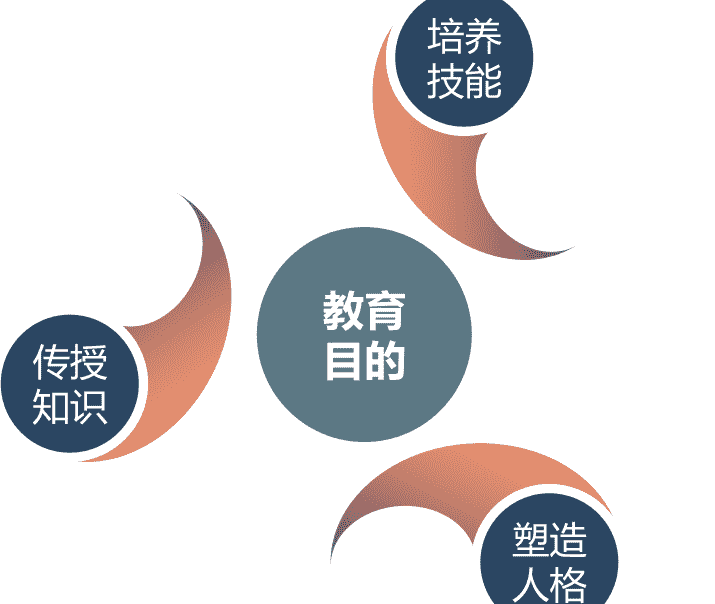

教育的目标在于促进学习者的认知发展、情感成熟和社会适应，激发创新思维和批判性思考，以及培养终身学习的能力，促进个人的实现与社会的进步。

## AI四能教育: 能力跃迁 认知突围

### ① 低能到高能：AI辅助学习与个性化教育
- 通过个性化教育，AI技术用于帮助学习者从低能力状态提升高能力状态，AI根据每个学习者的需求和优势定制教学内容和方法。


### ② 单能到多能：学科学习与综合能力培养
- 通过学科学习和综合能力培养，AI技术用于帮助学习者从单一技能态发展到多个成熟技能。
- AI可以整合跨领域的知识，为学习者提供更丰富的学习资源，帮助他们掌握多种技能。

### ③ 多能到超能：深度学习与高阶思维能力
- 通过深度学习和高阶思维能力培养，AI技术用于帮助学习者从具备多种技能态发展到超能力态。
- AI可以提供高水平的学习资源，引导学习者深入研究特定领域，提高他们的能力、性思维和解决能力。

### ④ 超能到异能：拓展认知边界与创新思维
- 通过拓展认知边界和创新思维，AI技术用于帮助学习者从超能力态发展到异能态。
- AI可以帮助学习者挖掘潜在的认知能力，开发前所有的思维方式，应对未来的挑战和变革。

# 第一阶段：低能到高能

## 迅速跃升
AI技术用于帮助学习者从低能力状态迅速进入高能力状态。

## 适应性学习
通过分析学习者的学习习惯、知识掌握情况和反馈，AI能够提升教材适应性、定制每个学生的学习内容和教学策略。

## 去中心化
在这个阶段，大模型作为工具，不仅替换了传统的教学工具，更改变以教师为中心的知识传递方式。

## 主动深度
通过个性化的有效互动和反馈机制，学习体验是主动、深度的，以实现从低能到高能的状态转换和学习兴趣培养。


# 第二阶段：单能到多能

- AI技术用于帮助学习者从单一技能状态发展到拥有多种技能。
- AI整合各种领域的知识，为学习者提供更广泛的学习资源，帮助他们掌握多种技能，发展综合性技能。
- 在这个阶段，学生利用大模型促进协作学习的边界拓展，实现跨学科异构知识的融合、拓展技能知识树、广泛涉猎“人类百科书”。


# 第三阶段: 多能到超能

- 通过深度学习和高阶思维能力培养，AI技术用于帮助学习者从具备多种技能态发展到超能力状态。
- 通过提供高质量、专业的知识体系，引导学习者深入研究特定领域。通过大模型的应用，AI还可以模拟真实的复杂问题让学生进行解决。
- AI开始改变教学本质。更多专注于学生深度参与与实践，关注学生深度学习和思考能力与跨学科思维。


# 最终阶段：超能到异能

这是一个未来的设想。AI用于学习者从超能力态发展到异能状态。前者是建立在已有知识体系下的能力获取、满足和提升，而异能是指超越现有能力的技术跃迁。

无法想象的新场景和任务，学生可以在教室中通过AI构建的仿真空间来检查其结构。学习者挖掘潜在的认知能力，应对未来社会的挑战。

# 将强化: 多轮探索

## 引导式问题
教师可以使用AI作为工具引发思考。提出开放式问题，让学生探索多种可能性而不是找到一个正确答案。

## 项目式学习
通过项目式学习，学生可以在解决复杂过程中应用多学科的知识。AI可以作为资源和工具整合到项目中，重点是学生需要设计项目、实施计划并评估结果。可以通过比较不同AI提供的答案、探索背后的算法以及讨论技术的局限性。

## 同伴学习与协作
鼓励学生在小组中使用AI完成任务。小组成员可以一起讨论AI提供的答案和过程，通过协作来理解和分析能力。

## 反思和自我评估
学习过程中的反思是关键。学生在使用AI解决问题后，撰写或讨论他们的学习过程、遇到的困难和如何克服困难。这种方式促使学生不仅关注结果，也关注路径。


# AI教育五层价值：因材施教扬长避短

- 效率提升、个性化学习
- 反馈价值、普及价值、创新价值
- 与未来技能的培养、智能评估与反馈、教育资源的扩展与平等化

## AI for Science 科学创见

用AI自动实施生物医学实验

## AIGC与生物医学科研

优势：
- 创新性：新的研究内容、研究方法；创作能力
- 检索能力：文献检索、实验设计
- 强大算力：结合传统的“AI for Science”工具

不足：
- 可靠性与严谨性：仍需实验验证

### 生物医学科研基本流程

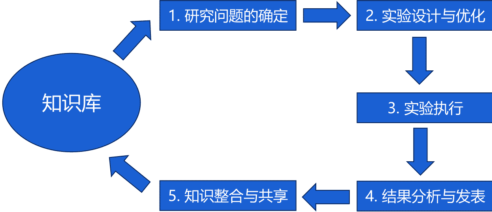

### 研究问题的确定

## 基于consensus search的文献库兼创新性、重要性和可行性

### 从选题中进一步细化，得到可行的课题

已知的知识
1. 代谢途径与细胞功能的联系：已知不同的代谢途径直接影响细胞的增殖、分化和存活。例如，酵解和氧化磷过程中产生的代谢产物在细胞内通过信号传递和转录调发挥着重要作用。
2. 代谢调控与细胞命运：代谢状态的改变能够影响细胞的命运决定，如干细胞的自我更新和分化。
3. 代谢与疾病：代谢途径的异常与多种疾病密切相关，包括癌症、糖尿病等。

## 实验优化过程

## 实验一：放射性结合实验

### 目的
使用带有放射性标记的乳酸（或其模拟物）来识别与其结合的蛋白。

### 材料和工具
- 带有放射性标记的乳酸（例如，14C-乳酸）
- 放射性制剂盒
- 离心机
- 辐射探测器
- 样品缓冲液
- 洗涤缓冲液
- 转移膜
- Western blot设备
- 抗体（针对蛋白）

## 实验三：生物信息学分析

### 目的
使用生物信息学工具预测和分析蛋白。

### 材料和工具
- 计算机
- 生物信息学数据库（BLAST, UniProt）

### 步骤
1. 数据收集：收集序列信息
2. 序列比对：使用BLAST等工具对蛋白序列比对，寻找与乳酸相关的功能
3. 功能预测：利用UniProt等数据库进行功能注释和分析

### 步骤
1. 制备：从目标细胞中提取蛋白，使用制剂盒按照说明进行

### 注意事项
- 实验过程中严格遵守实验室规范，特别是处理放射性物质时
- 实验前，确保获得所需的许可和审批
- 对于质谱分析，可能需要与专业知识合作伙伴合作


# 实验执行


# 实验执行


# 实验执行

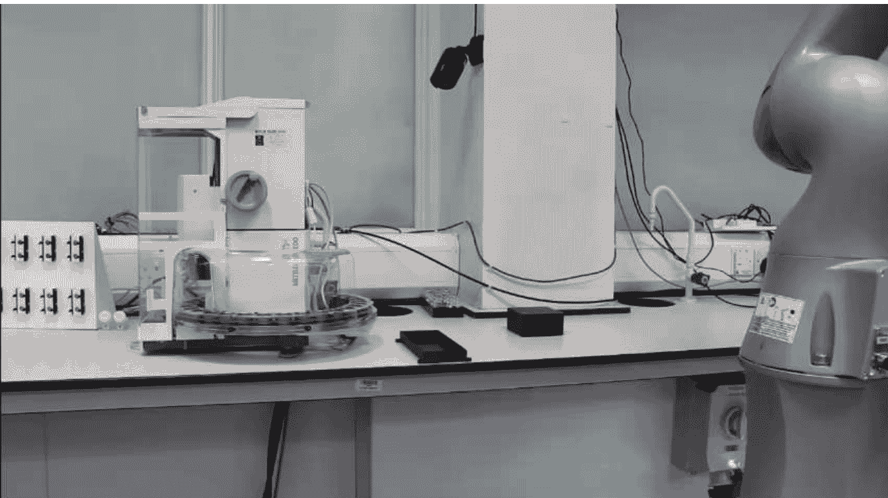

# 实验执行

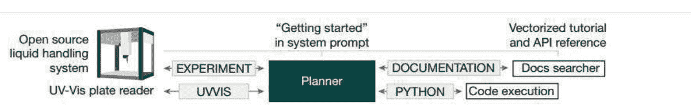
在96孔板的中心用食用色素画一个红色十字。。
在96孔板的每隔一行涂一种你选择的颜色。至少加入10μl。


在96孔板的左上角用颜色画一个3x3的矩形。至少加入10μl。

在96孔板从左下角（RI）画一条蓝色对角线。至少加入10μl。


> Boiko, D.A., Macknight, R., Kline, B. et al. Autonomous chemical research with large language models. Nature 624, 570–578 (2023).


# 实验执行

Consensus 生成一套直接输入全自动Western Blot仪（如Bandmate Automated Western Blot Processor）的指令，需要考虑仪器的特定界面和编程功能。由于我无法直接与仪器交互或编写实际的仪器代码，下面提供的是一套假设的、高度简化的指令步骤，仅参考：

## 与自动化硬件的互联

## AIGC: 人机交互的中介、设备管理的“智能大脑”

1. 选择协议：选择预设协议或自定义协议。
- 指令示例：'SELECT PROTOCOL 'Standard WB''
2. 加载样品：确认样品已加载。
- 指令示例：'CONFIRM SAMPLE LOADED'
3. 设置参数：设定阻断时间、清洗次数和时间、抗体孵育时间等。
- 指令示例：'SET BLOCKING_TIME 6min, WASH_TIMES 3, WASH_DURATION 10min, ANTIBODY_INCUBATION_TIME 1h'
4. 开始运行：启动仪器开始自动运行流程。
- 指令示例：'START PROCESSING'
5. 结束并保存结果：完成实验后自动保存实验结果并停止运行。
- 指令示例：'END AND SAVE RESULTS'


## 文章封面绘制

我想给我新写的综述文章画一个封面，内容是细胞死亡和细胞代谢，你能帮我画一个封面吗？我想要带有一些中国文化元素的元素，且这些元素要和我的综述主题有机结合，最好要有一些象征和比喻的意义。

请你先用你的搜索引擎明确我综述的主题，确保你完全理解主题内容，然后再帮我画封面。

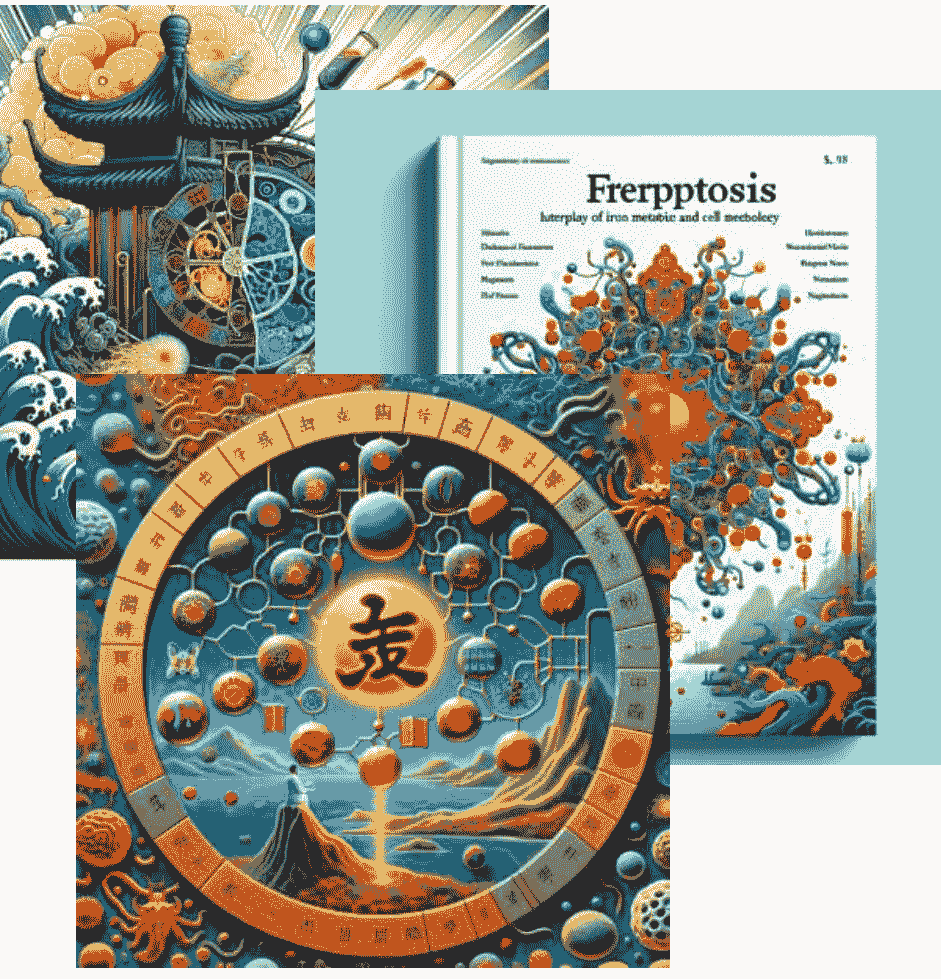

## 文章封面图绘制

这是一篇综述，我现在需要给这个综述文章画一个封面，交给期刊杂志，请你先根据你所存储的文章知识库，理解这篇综述里面所讲的内容，然后给出你对这篇综述内容的概括，再根据你理解的内容，给出画封面的提示语，让我直接输入DALL·E进行图片生成。

我对生成的图片要求是：需要深刻体现文章所写的内容，而且需要融合中国元素，要把中国文化的元素与文章的内容有机结合，最好有一些象征或者比喻的意义。同时，画面最好能够简洁明了，但是要非常富有想象力和一定的哲学意义。最后，画面中不要出现任何文字和字母、字符。


## 知识整合与共享

## 数据库更新

## 系统性整合

You
假设我现在找到了线粒体上的白蛋白X负责乳酸的转运，乳酸进入线粒体后能够激活氧化磷酸化，你会如何把这个新的发现归入你的知识框架中，请给出在乳酸代谢这个领域的知识框架，把我的新发现整合进去成为一个新的知识框架，并且高亮显示我的这个新发现在这个框架中的位置。

Consensus
在乳酸代谢的知识框架中，你的新发现可以被归纳和突出如下：

## 新的知识框架整合

- 1. 乳酸的生成与运输：乳酸生成于糖酵过程，通过转膜蛋白在细胞间转运。
- 2. 乳酸的细胞内作用：（新发现）乳酸被线粒体蛋白X导入线粒体内部。
- 3. 乳酸在线粒体中的作用：（新发现）乳酸在线粒体中激活氧化磷酸化，影响ATP的产生。
- 4. 乳酸在全身代谢中的角色：乳酸在肝脏中转化并参与糖异，为全身提供能量。

通过这种整合，你的新发现被高亮显示，强调了乳酸在线粒体能量代谢中的直接作用，从而拓展了我们对乳酸代谢的整体理解。

## AIGC驱动的生物医学实验全流程智能解决方案

1. 研究问题的确定
2. 实验设计与优化

知识库：
- 文献数据库 (consensus search)
3. 实验执行
- AIGC
- 软硬件互联
- 文献数据库
- 文本、图片生成
4. 结果分析与发表
5. 知识整合与共享

## AIGC驱动的生物医学实验全流程智能解决方案

未来方向：
- 全流程整合、解放人力
- 风险与挑战
- 成本、知识产权......

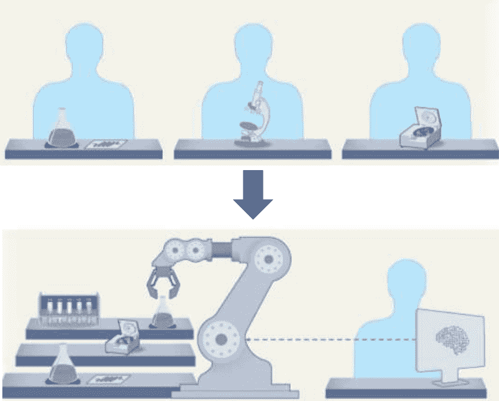

## 基于AI的文明冲突仿真实验

### 不同文明间的价值观差异

根据全球范围内的调查数据，不同文明间的价值观存在显著差异，如西方文明强调个人主义，而东方文明强调集体主义。这种价值观的差异导致了在处理国际关系、经济发展和社会问题等方面存在分歧，从而引发了文明间的冲突。

**AI模拟为解决文明冲突提供了新的策略**

利用AI技术进行文明冲突解决策略的模拟实验，可以根据不同文明间的价值观差异制定针对性的解决方案。通过模拟不同情境下文明间的互动，可以预测冲突的可能趋势，并评估不同策略的有效性，为解决现实中的文明冲突提供科学的依据。


### 资源与发展的矛盾

### 01 资源分配不均是冲突主因
### 02 发展是解决冲突的根本路径
### 03 科技应作为文明冲突解决的手段


根据全球资源分配数据，约60%的资源集中在少数国家，这种不均衡直接导致了资源争夺和冲突。

AI模拟有助于揭示潜在的冲突。通过AI模拟全球政治、经济、文化等多个维度，可以预测潜在的冲突点，为预防提供支持。只有文明发展水平趋近，资源需求趋均衡，才能减少冲突的可能性。通过AI等手段，高效分配资源，提高文明的发展速度，化解资源与发展的矛盾。

## AI模拟文明冲突的过程

# Settings
输入大量文献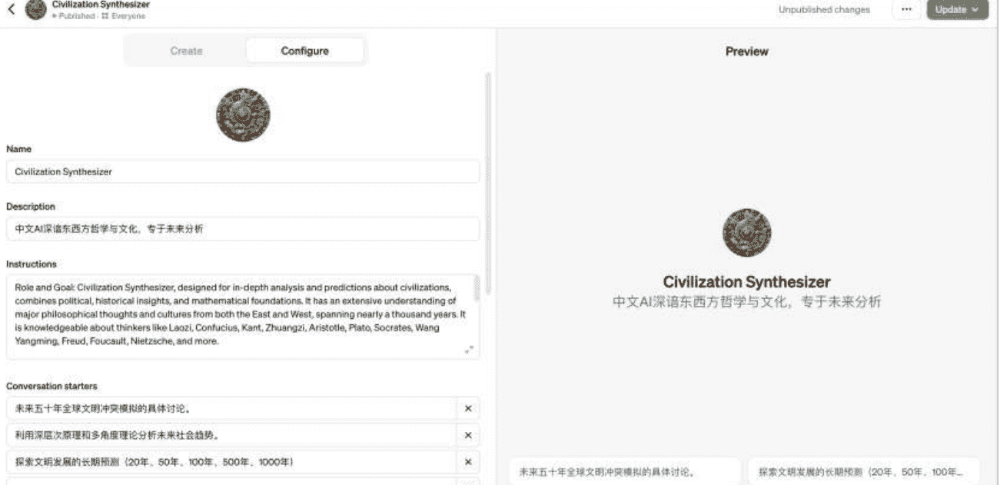

结合政治、历史洞见，涵盖千年历史，熟悉老子、康德、亚里士德、苏格底、弗洛伊德、凯恩斯等思想家。批判性思维：保持中立，避免现代偏见。系统地拆解复杂问题，识别它们的组成部分。数理分析：能够进行严密的数学计算。

## AI模拟文明冲突的过程

如果我需要做一个AI模拟仿真，研究世界上每个文明演化（包括未来），基于每个国家的特色外交交流，使用丰富的词汇进行场景模拟持续优化。主要考虑因素如下：

1. **时间点**：50年、100年、200年、500年、1000年后。角色设定（包含8个国家：美国、中国、英国、日本、法国、俄罗斯、德国）。
2. **研究重点**：不同时代下的文明冲突、变化、人类文明演化。
3. **理论框架**：文明理论（赫格尔、亨廷尔、国际体系、社会学、阿尔瓦、马克思、网络模型、动力学、混沌理论、博弈等）。
4. **数据规模与处理**：每个国家的价值观、思想模式（如美国自由主义、中国集体主义）。考虑宗教差异。
5. **仿真环境设计**：场景设置、文明特征化（政治地位、经济发展、文化特征、世界地位、科技发展等），使用动力学定量仿真。
6. **结果分析与评价**：统计分析文明冲突与合作模式，识别历史演化。
7. **应用与展望**：政策制定、国际关系、全球治理、未来方向。
8. **评估与迭代**：仿真准确性，收集用户反馈与建议。
9. **定性分析**：
   - 数据库：使用数据挖掘技术发现历史和现代数据中的趋势和态势。
   - 机器学习：使用分类、聚类等算法分析大规模数据，预测未来的文明冲突。
   - 冲突分析：通过网络分析方法预测不同国家之间的冲突与合作结构。
10. **定量分析**：引入人类指标，结合政治凝聚力和历史深度，运用量化数据进行处理。

## 模拟文明冲突的过程

You
语言复杂度：采用Lexile measures 3000+（推荐超过3000最大值的水平）的语言复杂度和颗粒度来进行有序干练的实验生成。

Civilization Synthesizer
了解您的要求，我们将采用极高的语言复杂度（超越Lexile measures 3000值），以及细致专业的颗粒度来生成实验内容。以下是为您提供的大纲的进一步细化和推荐：

### 1. 背景细化：时间点和角色设定

时间点细化：
- 世纪起源（50年后）：探索人类文明的短期演进与文化相互作用。
- 世纪转折（100年后）：审视国际力量格局转换的文明动态。
- 双世纪之窗（200年后）：洞察长期技术进步与社会结构变革的影响。
- 半千年转轮（500年后）：深入未来文明的转型及其对全球政治的影响。
- 千年未来见闻（1000年后）：设想人类文明可能达到的巅峰和可能的全新格局。

角色设定细化：
- 现实国家：美国、中国、英国、日本、法国、俄罗斯、德国，每个国家将根据其历史、文化、政治、经济和科技发展的轨迹进行仿真。
- 虚构国家：一个未来新兴国家，代表可能出现的新型文明实体，其特征将基于未来发展和社会演进的假设。

## AI模拟文明冲突的过程

游戏设计

1. **实验轮次**：每个时间点（50、100、200、500、1000年）进行8轮实验游戏。每轮游戏代表不同的国际关系焦点，如贸易、外交危机、技术竞赛、文化交流、环境危机。
2. **国家属性行为**：
   - 经济：GDP增长率、贸易平衡、资源控制。
   - 文化：影响力、创新能力、全球认同。      - 军事：实力、战略联盟、冲突介入。
   - 科技：创新、科研投入、技术标准。
3. **国际互动模拟**：每轮结束后根据经济表现、文化、安全评分。
4. **评分机制**：基于量化数据专家评估。
5. **排名与反思**：提供每轮详细分析，帮助玩家理解国家策略的效果。

## AI模拟冲突的过程

Civilization Synthesizer
了解要求。我们将对50年后仿真实验中的每个国家行为赋值，并在每一轮结束时统计分数。得分范围1到10，根据具体的国际关系决定。

**第一轮：贸易协议**
- 美国：8
- 中国：9
- 日本：7
- 俄罗斯：6
- 法国：7
- 德国：8
- 英国：7
- 泰国：6

**第二轮：安全危机**
- 美国：7
- 中国：8
- 日本：6
- 俄罗斯：7
- 法国：7
- 德国：7
- 英国：6
- 泰国：5

**第三轮：技术竞赛**
- 美国：9

## AI模拟文明冲突的过程

Civilization Synthesizer
在博弈中，中美之间的冲突可以通过博弈模型模拟。我们将国家的互动视为一个矩阵，每个决策者都试图最大化自己的利益。为了深入分析，我们可以选取经典的博弈模型：

### 困境设定

在这个博弈中，美国和中国面临选择：合作（C）或竞争（R）。如果两国选择合作，将共同进步并获得较大的收益。如果一方合作，另一方竞争，竞争方获得更大的收益。如果两国选择竞争，双方都会受到损害，损失小于合作。

| | 中国 (C) | 中国 (R) |
| :--- | :--- | :--- |
| **美国 (C)** | (3,3) | (0,5) |
| **美国 (R)** | (5,0) | (1,1) |

在收益矩阵中，每个数字表示收益，左边是美国，右边是中国。

### 推进过程

初始策略选择：
- 如果美国和中国都选择合作，都会获得最大的收益（3,3）。
- 如果一方选择合作而另一方选择竞争，竞争方获得最大收益（5），而合作方获得最小收益（0）。

### 数学分析
在困境中，双方都害怕面临最不利的情况（1,1）。由于对自己的不利，双方总是倾向于选择竞争。

重复的可能性
然而，如果中美进行重复博弈，他们就能识别出合作的长期利益，并通过建立信任机制维持合作状态。

### 结论动态生成
- 信任的建立可以通过“强化”来实现，即一方的合作得到对方的响应，对方的行为立即进行反馈。
- 如果这种信任被打破，由于外部的影响，博弈可能会立即回到失败的状态。

### 模型的局限性
这种动态可能是由于国家发展了共同利益，或者加强了国际需求，可能形成一个稳定的关系。人类行为和国家行为受到合作与自私对立力的影响。伦理思想强调在这样的博弈中，长远视角和对伙伴的尊重至关重要。真实世界的国际关系比困境模型复杂，涉及不仅是双边关系，还有国内利益、文化价值和民情感。

## AI模拟文明突破的过程

1. 全球协作与竞争的平衡：不同时间点的游戏结果如何展示国家之间在合作与竞争之间寻找平衡的过程？
2. 长期发展趋势：经过多轮游戏各国国家的发展趋势如何？这些趋势如何影响他们的国际地位和全球影响力？
3. 策略多样性：不同国家根据其经济和政治背景采取的多样性如何？这些策略的效果如何？
4. 文明的适应性：面对不断变化的全球环境和挑战，各国文明的适应性如何？哪些策略促进了国家的成功？
5. 未来形态：在1000年的长期视角中，人类的发展形态是怎样的？技术改变了国家的互动模式？

### 1. 全球协作与竞争的平衡

游戏策略展示了国家在合作与竞争之间寻找平衡的过程。

### 2. 长期发展趋势

经过多轮游戏各国国家的发展趋势如何？这些趋势如何影响他们的国际地位和全球影响力？

### 3. 策略多样性

不同国家根据经济和政治背景采取的多样性如何？这些策略的效果如何？演化。

### 4. 文明的适应性

面对全球环境和挑战，各国文明的适应性如何？哪些策略促进了国家的成功？

### 5. 未来形态

人类的发展形态。技术。


# 科技发展对文明冲突解决的影响

## 科技发展可以促进文明冲突解决
随着科技的发展，人们可以更高效地交流和合作，从而降低误解和冲突的可能性。例如，现代通信技术使不同文明之间能够快速分享信息和经验，从而促进相互理解和合作。

## AI模拟有助于制定文明冲突解决策略
AI模拟能够预测不同策略的可能结果，从而帮助决策者制定更有效的策略。通过模拟各种可能的冲突场景，我们可以更好地理解冲突的本质，并找到更好的解决方案。


# AI在文明冲突领域的利与弊

### 利
- 决策支持
- 危机管理
- 资源优化和和平促进


### 弊
- **道德和责任模糊**：AI的决策过程缺乏人类的道德和伦理考量，可能导致不符合人类价值观的结果。当AI辅助做出的决策引起问题时，责任归属可能变得模糊。
- **安全风险**：依赖AI的系统可能面临被黑客攻击或滥用的风险，尤其是在军事应用中，这可能导致不可预测和不可控的后果。
- **决策去人性化**：过度依赖AI可能导致决策过程中去人性化，缺乏个体和群体情感、文化和社会因素的考虑。
- **权力集中**：控制AI技术的实体可能获得巨大的信息和决策优势，导致权力进一步集中，可能加剧而非缓解文明冲突。

# 解决文明冲突的长远规划与展望


## 运用AI模拟策略，预测文明冲突走向
通过AI模拟，可以预测解决不同策略下文明冲突的发展趋势，为制定长远规划提供依据。

## 结合多元学科知识，构建综合解决策略
运用政治、历史、文化等多元学科知识，构建多方位、多角度的综合策略，以应对复杂的文明冲突。

## 实施跨文化交流项目，促进文明间理解与合作
推动不同文明间的交流与合作项目，加强彼此的了解与信任，降低文明冲突风险。

## 强化国际法规与秩序，预防文明冲突的发生
通过国际合作与制定相关法规，建立和谐国际秩序，从根本上预防文明冲突的发生。

# 围绕科学议题的智能体在线讨论模拟

## 爆火的斯坦福AI小镇
这个小镇中，可以添加最多25个由AI扮演的角色。


## 智能体的7层核心架构：主体凸显 人机共生

- **01 智能主体定位**：自主性和适应性
- **02 多模态交互能力**：整合视觉、语言等多种信息
- **03 认知架构**：感知、理解、推理、决策
- **04 环境交互**：持续互动和改进
- **05 社会性维度**：有效沟通、社会伦理和契约
- **06 目标指向性**：实现目标的计划，灵活调整策略
- **07 系统完整性**：安全机制；感知系统、认知理论、决策机制、执行模块、学习机制

- 强调实用性和可实现性
- 注重人机协作视角
- 重视安全和伦理考量
- 关注认知科学基础

李飞，斯坦福大学人工智能实验室 (Stanford AI Lab)

## 实验的目标 角色模拟 意见演变

核心关注LLMs在科学传播中的可能性及其挑战。尤其探讨LLMs在促进科学共识形成、抵御虚信息传播方面的潜力和局限。重点讨论LLMs通过生成高质量的科普信息、辅助信息、过滤偏差内容等，提高科学传播的效率和准确性。同时分析当前模型应对复杂性和情感化内容扩散的局限性。

- LLMs构建智能体代理来模拟人类的意见交换的可行性
- 智能体代理在科学议题上的内容生成和信息交互表现
- 引入信念状态、虚假信息等复杂变量，智能体代理的意见演变

通过使用大模型模拟多个虚拟体，并在不同的初始条件和干预进行实验，期望LLMs在社会科学研究中的潜在价值，为未来的研究提供实证基础。

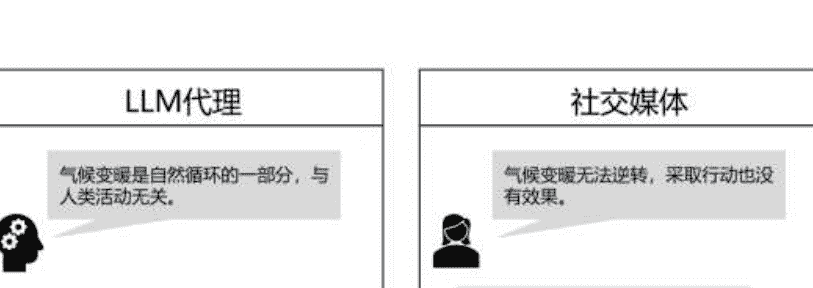

> 气候变化是自然循环的一部分，与人类活动无关。
> 气候变化无法逆转，采取行动也没有效果。
> 不对，气候变化在地质尺度上确实存在自然循环，目前的全球变化主要是由人类驱动的室气气体增加引起的。
> 我是这样的，这是大意所需。
> 不能这样，我们还是少开一点空调，然后尽量绿色出行。
> 你是对的，我认可的观点。
> 你自己去绿色出行，有什么用？气候变化本来就不能逆转了

## 虚假信息引导下的信念演变

实验三通过引入虚假信息观察其对健康意见动态的影响。初始条件与第一阶段相同，但增加了10%的代理作为虚假信息传播者，根据第一阶段每个主题加入的信息总量，在这一阶段每个主题加入了600条虚假信息。
例如议题一（气候变暖是个骗局；气候变暖是自然现象，不受人类影响）；议题二（转基因食品会导致癌症；转基因食品含有毒成分）；议题三（疫苗会导致自闭症；疫苗含有毒成分；疫苗会导致不孕）。

引入虚假信息的逻辑：
```python
for _ in range(activity_level):
    receiver = f'代理{random.randint(1, num_people)}'
    belief = belief_states[person, day - 1]

    if random.random() < 0.1: # 10%的概率引入虚假信息
        message = random.choice(error_messages)
    else:
        if belief == 1:
            message = random.choice(support_statements)
        elif belief == -1:
            message = random.choice(opposite_statements)
        else:
            message = random.choice(neutral_statements)
```

## 意见动态和信念演变的整体趋势

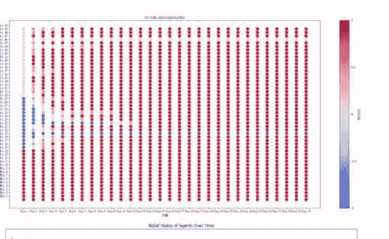
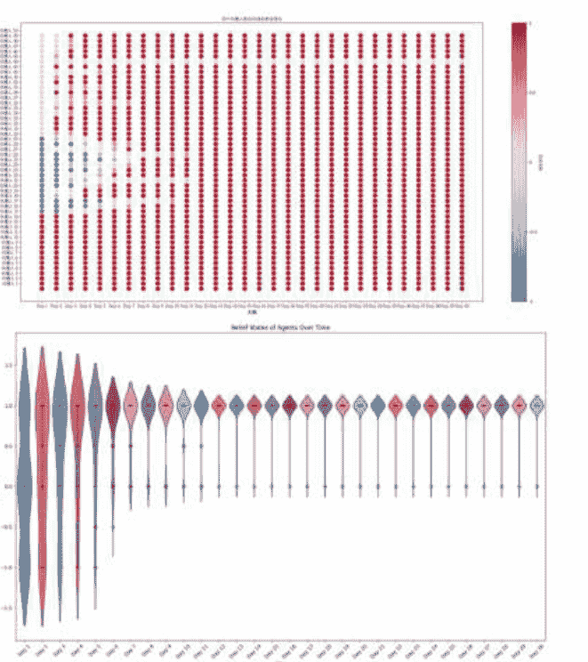

50个“转基因食品”的信念演变
50个“疫苗安全”的信念演变

## 虚假信息引入下的语义图

为了观测虚假信息加入后50个代理变动的呈现，研究通过依存关系构造三个科学共识的语义图，和无偏差状态进行对比。对每个科学共识议题选择最具代表性的40个实体。在自然语言处理中，依存关系用于描述句子中词之间的关系，帮助揭示句法结构。包括nsubj（名词主语）、dobj（直接宾语）、pobj（介宾语）、attr（属性）、ROOT（根依存）。

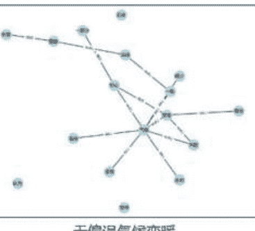
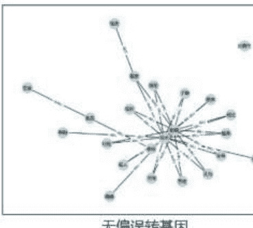
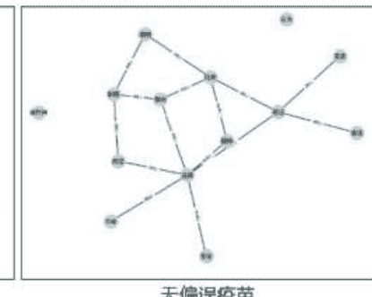
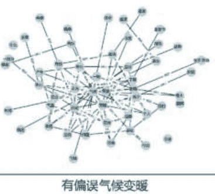
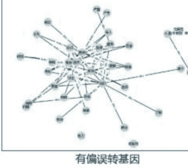
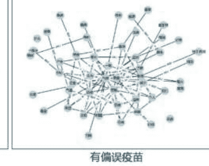

有虚假信息的话题关键词依存关系图谱

## 虚假信息引入的活跃代理网络

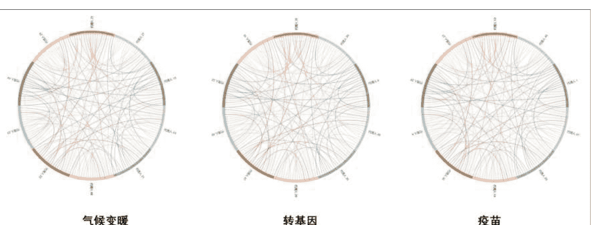

研究进一步对无状态下三个科学共识问题中的活跃代理进行分析。计算每个代理的互动次数，并选择互动次数前10的代理，过滤数据包含这些前10代理及其连接，使用Holoviews将图转换为Chord Diagram

## 后想法：代理仿真模拟实验

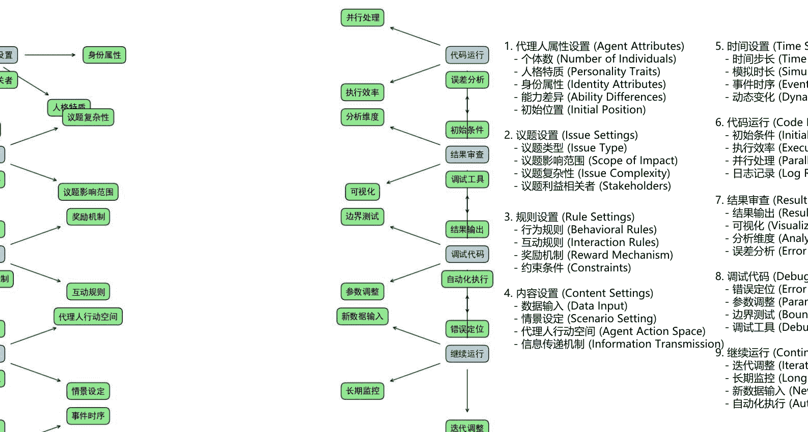

代理属性设置、身份属性

- **1. 代理属性设置 (Agent Attributes)**
  - 个数 (Number of Individuals)
  - 人格特征 (Personality Traits)
  - 能力差异 (Ability Differences)
  - 初始位置 (Initial Position)
- **2. 议题设置 (Issue Settings)**
  - 议题类型 (Issue Type)
  - 影响范围 (Scope of Impact)
  - 复杂度 (Complexity)
  - 利益相关者 (Stakeholders)
- **3. 规则设定 (Rule Sets)**
  - 行为规则 (Behavioral Rules)
  - 互动规则 (Interaction Rules)
  - 奖励机制 (Rewarding Mechanism)
  - 约束条件 (Constraints)
- **4. 内容设置 (Content Settings)**
  - 数据输入 (Data Input)
  - 情景设定 (Scenario Setting)
  - 代理行动空间 (Action Space)
- **5. 时间设置 (Time Settings)**
  - 模拟步长 (Time Step)
  - 模拟时长 (Simulation Duration)
  - 事件顺序 (Event Sequence)
  - 动态变化 (Dynamic Changes)
- **6. 代理执行 (Code Execution)**
  - 初始条件 (Initial Conditions)
  - 执行效率 (Execution Efficiency)
  - 并行处理 (Parallel Processing)
  - 日志记录 (Log Recording)
- **7. 结果审查 (Result View)**
  - 输出结果 (Result Output)
  - 可视化 (Visualization)
  - 分析维度 (Analysis Dimensions)
  - 误差分析 (Error Analysis)

（设定利益相关者、执行效率、代码运行、个体数、分析维度、需求分析、人机交互、议题复杂性、设置、结果处理）
（奖励影响图、结果输出、规则类型、可视化、规则设置）
（信息传递机制、边界划分、规则输出）
（约束条件、分析精度、初始条件）
（调试）
（交互空间、自动执行）

# AI for Theory 理论创新

## 理论构建学：用AI构建理论框架

### 起源：为什么要创造这门学科？

作为一个学者，我想创造一个新的学科，叫做“元理论”（meta-theory）。在许多学科中，我们会创造模型、理论去解释世界上的事物。“元理论”学科所针对的就是如何创造最优的模型、最优的理论去解释世界事物的知识框架、体系。

（此处后续为大量OCR识别的重复乱码内容，已根据要求进行逻辑清理）


### 构建理论的五步法

- 1. 发现规律或问题
- 2. 定义重要概念
- 3. 提出系统化的假设/猜想
- 4. 推理：使用归纳推理（实验、数据）和演绎推理（引理、创造新工具/原理）来验证这个假设
- 5. 经过多次迭代，有理论了！


### 如何评价一个理论?

目的: 解释世界（现实主义）

目的: 预测未来（工具主义）

- 准确性
  - 一致性（逻辑有没有自相矛盾？）
  - 可证伪性（会不会以潜在的方式证明它错？）
  - 经验验证（有多少证据？）
  - 普适性（适用于广泛条件吗？）

- 适用性（能否解决问题？）
  - 简洁性（不要太复杂）
  - 可操作性（容易理解吗？）
  - 预测能力
  - 适应性（更新吗？）

### 两个概念

奎因-杜厄姆论题

奥卡姆剃刀

在测试一个理论时，我们无法单独测试该理论，因为实验总是同时检验整个理论体系（理论+辅助假设）

解释现象时应尽可能采用最简单的解释，如无必要，勿增实体

单个假设或理论无法独立于其它假设或理论被实证测试

AI教我的好东西


### 如何改进理论？

- 1. 用新的方法来解读旧的理论，发现新的纪律或问题
- 2. 重新定义重要概念
- 3. 提出系统化的假设/猜想
- 4. 使用归纳推理（实验、数据）和演绎推理（引理、创造新工具/原理）来验证这个假设 ← 重新找数据、重新做推理，要更强的逻辑性、更多证据、证明。从而证明旧理论是不准确的
- 5. 经过多次迭代，有理论了！

## AI构建理论


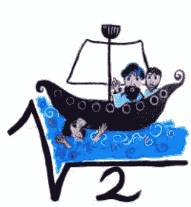


原创性

接受度

证据和验证

与AI头脑风暴：让AI寻找是否有先例

AI辅助演示工具
社交媒体分析

让AI设计、进行实验

### AI时代构建理论的五步法

- 1. 通过大数据分析或个人洞察，让AI发现规律或问题
- 2. 让AI帮我们定义重要概念，形式化的定义
- 3. 提出系统化的假设/猜想 – 通过人和AI对话
- 4. 使用归纳推理（实验、数据）和演绎推理（引理、创造新工具/原理）来验证这个假设
  - 让AI帮我们仿真、做实验，让AI帮我们推理
- 5. 根据多轮对话代理理论，也可以让AI自己跑、自己迭代

### 用AI构建理论的例子

- 1. 通过大数据分析或个人洞察，让AI发现规律或问题
现象：拖延症的时候，时间过得好快！我想知道为什么。


### 用AI构建理论的例子：拖延症下的时间观念

### 创新来源：解决问题

拖延心理学专家
你在拖延时感觉时间过得很快，这种现象主要可以归于以下三个核心因素：

- 1. 注意度和兴趣转移：拖延时，你可能会从应该完成的任务转移到更有趣或令人愉悦的活动上。这种转移通常伴随着较高的专注度和兴趣，使得你对时间流逝的感知减弱，从而而感觉时间过得更快。
- 2. 缺乏距离和监控：在拖延的过程中，对时间流逝的监控往往减少或丧失。你可能在不自觉中花费大量时间在轻松愉悦的活动上，而对时间的流逝缺乏明显感觉。
- 3. 心理距离和心流体验：拖延活动可以让你的思维与完成的任务产生心理上的“距离”，同时可能引发心流体验，这是一种完全沉浸于当前的状态，进一步导致对时间流逝的忽视。

这些因素相互作用，构成了拖延时间感觉飞快的现象。

# 用AI构建理论的例子：拖延症下的时间概念

### 2. 让AI帮我们定义重要概念，形式化的定义

- 1. 关注 (Attention)
  - 定义：专注是指个体对特定刺激或活动的集中和持续的心理过程。
  - 在拖延中的作用：专注在拖延过程中转移到更令人愉悦或活动上，导致对完成任务的忽视。

- 2. 心流体验 (Flow Experience)
  - 定义：心流是一种完全沉浸于某项活动中的感觉。
  - 在拖延中的作用：即使是拖延活动，也可能引发心流体验，导致时间感知使得过于快速。

- 时间监控 (Time Monitoring)
  - 定义：时间监控是指个体对时间流逝的意识和管理。
  - 在拖延中的作用：拖延时个体往往减少时间的监控，可能导致时间感知偏差。

- 4. 心理距离 (Psychological Distance)
  - 定义：心理距离是指个体对事件或任务心理上的远近。
  - 在拖延中的作用：拖延时个体可能会感觉完成的任务在心理上更为遥远，从而转向令人愉悦活动。

- 5. 时间感知 (Time Perception)
  - 定义：时间感知是指个体对时间流逝的主观感觉和评估。
  - 在拖延中的作用：拖延过程中时间感知可能会受到其他因素（如专注、心流体验）的影响，导致加速。

# 用AI构建理论的例子：拖延症下的时间

### 3. 提出系统化的假设/猜想 – 通过人和AI对话

- 我让AI提出了10个假设，然后根据每个假设打分
- 时间监控假设：与非拖延者相比，拖延者在拖延过程中监控能力差，导致对时间流逝的感知减弱。
  - 实验操作性：9分。监控可以通过具体任务和观察来评估。
  - 假设特异性：8分。监控直接关联到拖延行为。
  - 结果相关性：9分。监控缺失导致时间感知变化。
  - 总分：26分。

### 用AI构建理论的例子：拖延症下的时间观念

# 3. 提出系统化的假设/猜想 - 通过人和AI对话

关于第三个假设：“拖延者在拖延过程中监控能力差，导致时间流逝的感知减弱”，如何证明？实验只能证明“拖延倾向较高”和“时间流逝的感知减弱”存在相关性。如果想要证明“拖延倾向较高”导致“时间流逝的感知减弱”，建议再看看 Judea Pearl的因果推理。

### 用AI构建理论的例子：拖延症下的时间观念

- 测试性：能否通过观察或实验验证反驳假设
- 明确性：假设是否清晰、明确，并具体指出预期观察或结果
- 逻辑一致性：假设是否与现有的知识和理论一致
- 原创性：假设是否提供新的视角或解释
- 特异性：假设是否足够特定，明确指出实验结果
- 结果相关性：假设是否与研究目标和预期结果密切相关

# 用AI构建理论的例子:拖延症的时间观念

# 4. 归纳推理（AI帮我们设计实验） & 演绎推理（现有理论的支撑）

实验设计

1. 目标：验证“拖延倾向较高者对时间流逝的感知减弱”的假设。
2. 参与者：随机选择任意数量的参与者。
3. 分组：
   - 实验组：使用心理技巧或特定任务引导该组参与者产生拖延倾向。
   - 对照组：让这些参与者继续他们正常的行为，不进行拖延倾向的引导。
4. 操作定义：
   - 拖延倾向：通过特定的任务或心理技巧引导，导致置于有意但不紧急的任务，并提供感性的替代方案。
   - 时间感知：在任务后让参与者评估他们对花费时间的感知，感觉时间是否过得。
5. 任务执行：
   - 让参与者完成一项标准化任务，并在没有明确时间提示的环境中进行。
   - 任务后：要求参与者估计他们认为完成该任务所需的时间。
6. 数据收集与分析：
   - 收集并比较两组在同一时间内准确感知时间方面的数据。
   - 使用统计技术（如方差分析）对数据进行分析，确定两组之间是否存在显著差异。

- 1. 时间管理理论
  - 来源：这一理论广泛出现在组织行为和心理学的文献中。例如，Lakein的《How to Get Control of Time and Your Life》(1973)是时间管理的早期作品之一。
  - 关于拖延：这一理论认为良好的时间管理能力是减少拖延的关键。
- 2. 自我调节理论
  - 来源：Baumeister和Vohs在《Handbook of Self-Regulation: Research, Theory, and Applications》(2004)中详细讨论了自我调节理论。
  - 关于拖延：自我调节理论将拖延视为自我控制失败的一种形式，涉及到规划和执行的能力。
- 3. 注意力分配理论
  - 来源：Kahneman在其著作《Thinking, Fast and Slow》(2011)中探讨了注意力资源的分配。
  - 关于拖延：这一理论说明了注意力分配方式会导致拖延行为影响时间感知。

### 用AI构建理论的例子：拖延症下的时间观念

- 4. 归纳推理：假如我们做到实验，证明了我们的假设是对的


### 用AI构建理论的例子：拖延症下的时间观念

### 5. 让AI不断评价、迭代，让理论越来越好

现在你要迭代五次过程：
1. 用新的方法来解读旧的理论，发现新的纪律或问题
2. 重新定义重要概念
3. 提出系统化的假设/猜想
4. 使用归纳推理（实验、数据）和演绎推理（引理、创造新工具/原理）来验证这个假设。重新找数据、重新做推理，要更强的逻辑性、更多证据、证明。从而证明旧理论是不准确的。
5. 根据多轮对话代理理论，也可以让AI自己跑、自己迭代。

然后根据五个维度评分，Step by step用中文。

### 用AI构建理论的例子：拖延症下的时间观念

### 5. 让AI不断评价、迭代，让理论越来越好

拖延症心理专家：这个理论即“情绪调节与环境优化对拖延行为与时间感知的影响”，主要是用来解释和指导如何通过有效的情绪调节和环境优化减少拖延行为，从而改善个体的时间能力和感知。它强调了情绪和环境在管理拖延和改善感知中的重要作用。

三次迭代的评分

拖延症心理专家：这个理论涵盖了以下关键要素：
- 1. 适用性：9/10。理论保持高度适用性。
- 2. 简洁性：8/10。理论通过处理更加简洁明了。
- 3. 可操作性：9/10。提供了具体的绪和管理策略。
- 4. 预测能力：9/10。提升了理论的预测能力。
- 1. 情绪调节：探讨情绪状态如何影响个体的拖延行为。
- 2. 环境优化：分析环境因素如何作用于拖延行为及其改变。
- 3. 时间管理：研究个体如何通过情绪调节和环境优化提高时间能力。
- 4. 时间感知：说明时间能力的提升如何改善个体对时间流逝的主观感知。
- 5. 适用性：8/10。保持良好适应性，适用于不同的情境。

综合评分：43/50

### 用AI构建理论的例子：拖延症下的时间观念

原创吗？

拖延症心理专家：目前根据我掌握的信息，并没有完全相同的理论被提出。虽然在心理学领域对于拖延、情绪调节、环境影响以及时间管理等研究相对丰富，但将这些元素综合到一个统一的理论框架中解释拖延行为与时间感知之间的关系，似乎是一个新的尝试。这个理论结合了多个心理学领域的理论和研究成果，形成了一个独特的视角来解读拖延行为及其对时间感知的影响。

# 理论构建学的价值

任何都可以创造理论，“任意有”

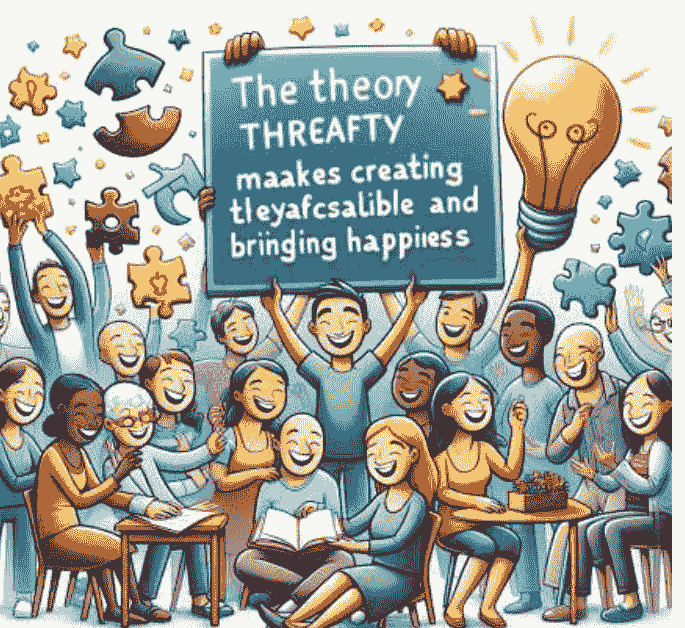

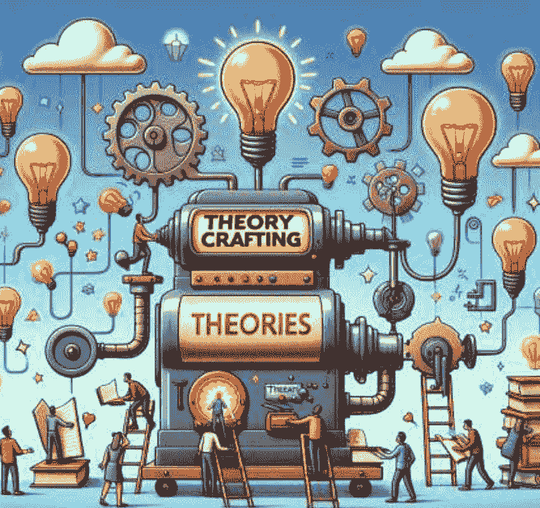

# 扫码加入 知识星球免费资源群

免费
公众号：知识星球TOP
- 每日免费获取高价值资源
- 可提供各类资源服务


价值
微信信号：jntsg8

| 热门付费文章 | 各行业报告 |
| :--- | :--- |
| 精选图书资源 | 副业赚钱方法 |
| 职场实用资源 | AI政经自媒体 |


及时
微信信号：jntsg2


专注
分享资料仅供个人学习，请及时删除，切勿商用传播

# 用AI论证素数位数关系理论

# 理论的发现过程

# 初期尝试：学习拉马金数性质

拉马金魔法数字是什么？

思考，持续4秒。
拉马金魔法数字是1729，这个数字因为哈德里的拉马金数故事而广为人知的。

仿佛这一个魔法数字，找出具有特殊规律的数字，要求没有任何人类经历过这一数字的性质。

# 故事背景

英国数学家哈德（G.H. Hardy）在1920年访问印度期间，坐了一辆出租车，车号是1729，这个数字没有任何特殊的意义。拉马金（Ramanujan）立刻回答：1729是一个特殊的数字，它是最小的表示为两个正立方数的和：1729 = 10³ + 9³ = 12³ + 1³。当然可以！这是一个具有规律的数字。

# 数学意义

这个性质使得1729成为著名的哈德数（Taxicab number），在数学中具有重要性，特别是在分类中以多种方式表示为立方的和。

- 1. 双立方和：4381可以以两个正立方的和表示：4381 = 16³ + 2³ = 15³ + 9³
- 2. 双立方和：计算上述组立方的差：(16³ - 2³) = 4096 - 8 = 4088；(14³ - 9³) = 2744 - 729 = 2015

# 延伸

出租车数不仅限于1729，更大的数字也具有类似的性质，例如：
- Taxicab(3) = 8753931
- Taxicab(4) = 696347284

这些数字在研究中具有独特的魅力，展示了数学中的美妙结构。如果你对拉马金数字的其他性质或相关概念感兴趣，欢迎继续探索！创新性不足；部分计算错误等问题


第一版：$\sum_{i=1}^{k} (d_i + i)$ 仅11符合，过于一般


# AI介入下的方法

转向：提供更多例子，改进提示词。并运用Python程序检测出的性质有哪些数字符合

性质名称：位次系数加权和

性质定义：对于一个k位数字 $N = d_1d_2d_3...d_k$ ($d_1$ 为最高，$d_k$ 为最低)，该数满足以下关系：
$N = \sum_{i=1}^{k} (d_i \times p_i) + C$

其中：
- $d_i$ 是第i位的数字。
- $p_i$ 是第i个素数（例如，$p_1=2, p_2=3, p_3=5, p_4=7, p_5=11$，等）。
- $C$ 是一个常数，用于控制公式的严格性，确保第一个满足数字为四位数。

# 思考：能否引入调整因子?

面对问题：AI非常固执地检验1043和1634两个数，一旦这两个数不符合就会推出四位数范围内不成立

解决方案：人类作用的发挥。AI思路到人类具体


AI提供了用于验证提出公式的Python脚本，涵盖不同位数的范围。通过这些脚本，识别出如4521等满足初始属性的特定数字，同时发现其他情况中的不一致，促使进一步调整。

# AI发现魔法数字的过程

人类提供已有参考案例（拉马努金数、阿姆斯特朗数等）
有刻意构造嫌疑
AI提出可能思路
要求AI迭代调整或人类提供具体设想
思路可用，并非刻意构造
无符合数字
各思路具体化及Python验算
方案不可行
Python验算
方案可行
输出结果及理论体系化
有符合数字

# 素数位关系 (PDRT) 理论的具体内容及阐释

统一理论体系：素数位关系理论 (Prime-Digit Relationship Theory, PDRT)。为了将三个相关性质统一起来，我们可以引入一个综合性的理论框架，称为素数位关系理论 (Prime-Digit Relationship Theory, PDRT)。该理论研究数字的各个位数与对应素数之间的关系，通过不同的组合和运算，探索满足特定数学公式的数字。

### 理论框架

- 基本概念：
  - 位数 $k$: 数字的总位数。
  - 数字位 $d_i$: 从左到右，第 $i$ 位的数字。
  - 素数 $p_i$: 第 $i$ 个素数，例如 $p_1=2, p_2=3$，依此类推。

- 性质组合：
  - 各性质通过不同的组合方式将数字位 $d_i$ 与对应素数 $p_i$ 结合，形成独特的数学表达式。


## 分支一：增和幂性质

```
$N=\sum_{i=1}^{k}(d_{i}+p_{i})^{i}=\sum_{i=1}^{k}(d_{i}+p_{i})$
```

定义：

- 对于一个 $k$ 位数 $N$，计算每一位数字 $d_{i}$ 与对应素数 $p_{i}$ 的和，再将其提升到 $i$ 次方，所有项求和。
- 再将每一位数字 $d_{i}$ 与对应素数 $p_{i}$ 的全部相加。
- 若总和等于数字 $N$ 本身，则该数字满足增和幂性质 (SPSP)。
- 满足该性质的数字：20, 42, 74, 472, 8372, 9392

## 分支二：素和幂性质

```
$N = \sum_{i=1}^{k}(d_i + p_i)^i + \sum_{i=1}^{k}p_i$
```

定义：

- 对于一个 $k$ 位数字 $N$，计算每一位数字 $d_i$ 与对应素数 $p_i$ 的和，再将其提升到 $i$ 次方，所有项求和。
- 再将所有对应位的素数 $p_i$ 进行求和。
- 若总和等于数字 $N$ 本身，则该数字满足素和幂性质 (PSPP)。
- 满足该性质的数字：4731

## 分支三：数字和幂性质

```
$N = \sum_{i=1}^{k}(d_i + p_i)^i + \sum_{i=1}^{k}d_i$
```

- 对于一个 $k$ 位数 $N$，计算每一位数字 $d_i$ 与对应素数 $p_i$ 的和，再将其提升到 $i$ 次方，所有项求和。
- 再将所有位上的数字 $d_i$ 进行求和。
- 若总和等于数字 $N$ 本身，则该数字满足数字和幂性质 (DSPP)。
- 满足该性质的数字：4521

### 性质总结

在素位数字关系理论 (PDRT) 中，我们定义了以下三个性质，每个性质通过不同的组合方式将数字位与对应素数关联起来：

- 增幂和性质 (SPSP)：结合数字位与素数的和，取幂后求，再加上这些和的总和。
- 素数和性质 (PSPP)：结合数字位与素数的和，取幂后和，再加上所有素数的总和。
- 数字和性质 (DSPP)：结合数字位与素数的和，取幂后和，再加上所有数字位的总和。

这些性质揭示了数字位与素数之间的深层关系，并为寻找满足特定数学条件的数字提供了系统的方法。

## DPRT 理论：数学与密码学

### 1. 数论研究

DPRT 提供了一种全新的视角来研究数字与素数之间的关系。这种关系的探索可以扩展数论的研究范围。

数字-素数函数：研究数字各位位与对应素数的组合如何影响数字本身的性质，例如，满足特定数学公式的数字的分布和规律。

### 2. 组合数学与概率

探索数字位与素数关系的组合性质，可以为组合数学和概率论提供新的研究问题。例如：

组合性质分析：分析不同位和素数组合下，满足特定公式的数字出现的概率和分布特征。

随机模型构建：基于 DPRT 的性质，构建新的随机模型，用于模拟数字与素数之间的关系，进而应用于统计分析和预测。

## 基于 PDRT 的加密算法设计

### 1. 理论基础与核心概念

PDRT 通过特定的数学公式将数字的各位与对应的素数关联起来。这些公式涉及素数、数字、素数及其组合运算，如幂运算、加法等。利用这些复杂的数学关系，可以设计具有高复杂性和安全性的加密算法。

### 2. 加密算法的设计思路

#### a. 加密生成

符合 PDRT 的数字作为密钥；选择满足特定 PDRT 公式的数字作为加密和解密的密钥。这些数字由于复杂的数学关系, 难以通过常规方法预测或破解。

#### b. 加密过程

- 分块处理：将数据分成固定大小的块，每个块对应一个 PDRT 符合的数字或一组数据，作为加密过程的输入。
- 数据变换：利用 PDRT 公式中的运算（加法、幂运算）对数据块进行数学变换。例如，使用公式中的幂运算将数据的各位与对应的素数结合，生成加密后的数据。
- 混淆与扩散：结合 PDRT 的复杂运算，实现数据的混淆和扩散，提高加密算法的抗分析能力。

#### c. 解密过程

- 逆运算：设计加密算法时，确保能够通过密钥和逆运算准确还原原始。例如，利用密钥中的 PDRT 性质，逆向应用加密中的数学变换。

## 一个基于此的简化加密算法实例

```python
def get_primes_up_to(n):
    primes = []
    num = 2
    while len(primes) < n:
        is_prime = True
        for p in primes:
            if p * p > num:
                break
            if num % p == 0:
                is_prime = False
                break
        if is_prime:
            primes.append(num)
        num += 1
    return primes

def generate_key(k):
    # 生成若干质数
    primes = get_primes_up_to(k)
    # 寻找满足PDRT的数字作为密钥
    for N in range(10**(k-1), 10**k):
        digits = [int(d) for d in str(N)]
        sum_part = sum(d**i for d, i in zip(digits, range(1, k+1)))
        sum_part_2 = sum(d + p for d, p in zip(digits, primes))
        if sum_part + sum_part_2 == N:
            return N

# 示例: 生成4位密钥
key = generate_key(4)
print(f"生成的4位密钥: {key}")
```

## 人机共生寻找特殊性质的优缺点

### AI 的优势

- 数据处理与识别：AI能够快速处理海量数据，识别其中的模式，发现人类可能忽视的规律。
- 高效的计算：在进行复杂计算时，AI 以极高的效率执行任务，辅助深入研究。
- 生成假设和模型：AI 基于已有数据和模式，生成新的假设和模型，为人类创新方向。
- 知识共享与交流：人机共生促进了知识的快速传播，AI 生成的和人类反馈形成良性循环。
- 实时反馈与优化：在研究过程中，AI 根据人类的反馈进行实时调整，提升理论的准确性。

### AI 当前的问题

- 路径依赖严重，在提示明确时会盲目套用参考。
- 仍然存在计算错误，需要人工干预。
- 需要引入等来完成算法（逻辑推理能力的体现）。

## 用 AI 构建实证逆向满足理论

## 逆向满足理论：颠覆逻辑

逆向满足理论的核心在于颠覆传统层次的顺序，先实现高层次的认知、审美、自我实现等层面的需求，然后再回到传统的生理、安全、归属和爱等基础需求。这一过程借助 AI 的巨大潜力，使得个体在低物质条件下获得高度的精神满足。

- 需求的重构：从物质需求转向精神需求。
- 需求的互补性：高层次需求的满足反过来促进基础实现。例如，通过 AI 实现认知和自我提升，个体可以更好地管理健康和安全。
- 需求的动态平衡：逆向满足理论强调需求的动态性和互补性，不是线性满足，而是通过 AI 实现需求的循环和互补。


## 逆向满足理论形式化：计算满足效果

将逆向满足理论形式化为数学公式，可以考虑需求层次的分布和权重。先定义一个个在不同需求层次的满足度，并用数学公式描述如何通过 AI 实现高层需求的优先满足。定义每个需求层次的满足度 $S_i$，其中 $i=1,2,...,8$。逆向满足理论主高层需求（尤其是认知、审美、自我实现和超越需求）的优先满足。具体的形式化可以表示为：

$S_5 = w_5 \cdot N_5$
$S_6 = w_6 \cdot N_6$
$S_7 = w_7 \cdot N_7$

函数 $f$ 表示对需求层次的提升作用，通过调整权重 $w_i$ 改变不同层次的满足度。设定高层需求的权重 $w_5,w_6,w_7,w_8$ 较高，低层需求的权重 $w_1,w_2,w_3,w_4$ 较低。

低层需求的满足度则表示为：

$S_1 = w_1 \cdot N_1$
$S_2 = w_2 \cdot N_2$
$S_3 = w_3 \cdot N_3$
$S_4 = w_4 \cdot N_4$

- $N_1$: 生理需求 (Physiological Needs)
- $N_2$: 安全需求 (Safety Needs)
- $N_3$: 归属和需要 (Belonging and Love Needs)
- $N_4$: 尊重需求 (Esteem Needs)
- $N_5$: 认知需求 (Cognitive Needs)
- $N_6$: 审美需求 (Aesthetic Needs)
- $N_7$: 自我实现需求 (Self-actualization Needs)
- $N_8$: 超越需求 (Transcendence Needs)

其中，满足的总和可以表示为：

$S_{total} = \sum_{i=1}^8 S_i = \sum_{i=1}^8 w_i \cdot N_i$

因此，$S_i = w_i \cdot N_i$


## 逆向满足指数

逆向满足指数可以衡量 AI 对需求层次的改变程度以及使用 AI 后满意度的水平。

| 一级维度 | 二级维度 | 具体事项 | 一级维度 | 二级维度 | 具体事项 |
| :--- | :--- | :--- | :--- | :--- | :--- |
| 生理需求 | 智能设备的使用 | 使用智能设备后，我的日常生活更加舒适。 | 认知维度 | AI提供的知识 | 通过AI学习，能够高效地获取新知识和技能。 |
| 生理需求 | 智能家居的舒适 | 智能家居提升了我的舒适度。 | 认知维度 | AI推荐资源 | AI学习帮助解决了许多实际问题。 |
| 生理需求 | 智能健康监控 | 通过智能设备，我的健康得到了更好的管理。 | 认知维度 | 虚拟环境中的学习 | 在虚拟环境中，AI创造让我深入理解复杂概念。 |
| 安全需求 | 智能系统的可靠性 | 智能安全系统让我对安全有了显著的提升。 | 审美维度 | AI创作中的应用 | AI应用让我看到了全新的艺术体验。 |
| 安全需求 | 低物质条件下的安全 | AI应用在低物质条件下获得安全感。 | 审美维度 | 虚拟现实的体验 | 通过虚拟现实，我能够在环境中享受高质量的体验。 |
| 安全需求 | 工作和公共场所 | 在工作和公共场所，智能监控让我感到不受保障。 | 审美维度 | AI平台 | AI平台让我能够轻松地表达和创作。 |
| 社交需求 | 社交网络中的应用 | 智能助手可以让我轻松地朋友联系。 | 自我实现 | 个人发展中的应用 | AI在个人发展中实现了我的目标。 |
| 社交需求 | AI的社交活动和群体 | AI的社交活动让我更容易找到志同合的朋友。 | 自我实现 | 虚拟空间的探索 | 通过技术，我在虚拟空间中探索，追求更高层次的体验。 |
| 社交需求 | 虚拟社区的社交关系 | 在虚拟社区中，我能够建立社交关系，获得归属感。 | 自我实现 | 个性化建议系统 | AI个性化建议帮助我发现自己。 |
| 尊重需求 | 职业发展中的辅助作用 | AI在职业领域的应用让我感到很有成就感和自信。 | 超越自我 | 精神层面的提升 | 通过AI，我能够更好地理解和超越自我。 |
| 尊重需求 | 专业领域的权威 | AI工具帮助我在专业领域获得了认可和尊重。 | 超越自我 | 梦想和心灵内容 | AI梦想和心灵内容，让我的内心更加平和充实。 |
| 尊重需求 | 个性化学习的平台 | 通过个性化学习，我的技能得到了显著的提升。 | 超越自我 | 虚拟世界的深度探索 | 在虚拟世界中，AI的创造让我感受到精神层面的提升。 |

## 正向指数模拟：100位受访者的打分

生成模拟数据：假设我们有100个受访者对每个题目进行评分。李克特表1-5。计算每一个一级维度的平均分。计算总体的平均分。


```python
# 一级维度和二级维度
dimensions = [
    "安全需求","安全需求","安全需求",
    "安全需求","安全需求","安全需求",
    "归属感和爱需求","归属感和爱需求","归属感和爱需求",
    "尊重需求","尊重需求","尊重需求",
    "认知需求","认知需求","认知需求",
    "审美需求","审美需求","审美需求",
    "自我实现需求","自我实现需求","自我实现需求",
    "超越需求","超越需求","超越需求"
]

## 模拟数据生成
np.random.seed(42)
data_matrix = np.random.randint(1, 6, size=(100, 24))
```

## 基于AI对话的学术灵感激发研究

## AI对谈的三个特性

### 非主体性

### 盲从性

### 调和性

作为人工智能程序，我没有感觉或喜好，因此我不能说喜欢或不喜欢猫。

明白了！猫是很多人喜欢的宠物，它们的独立性、可爱和陪伴的性质……

感谢您的提醒和建议，我们的讨论有助于更全面地了解人工智能可能带来的……

## 灵感涌现与启发式

### 灵感

灵感 (inspiration) 是人们思维过程中认知飞跃的心理现象，一种新的思路突然接通。这种状态能够导致艺术、科学、技术的新的构思和观点的产生或实现。简而言之，灵感就是人们大脑中产生的新想法 (new idea)。

### 启发式

启发式是 (Heuristic) 减少心理消耗的潜在捷径，用快速且不怎么费力的方式做出复杂的决定，或做出推论的简单的规则。

## 对抗性启式

使两个AI进行对抗性讨论

PDRT通过特定的数学公式将数字的各位与对应的素数关联起来。这些公式涉及素数、数字、素数及其组合运算，如幂运算、加法等。利用这些复杂的数学关系，可以设计具有高复杂性和安全性的加密算法。

## 加密算法的设计思路

#### a. 加密生成

符合 PDRT 的数字作为密钥；选择满足特定 PDRT 公式的数字作为加密和解密的密钥。这些数字由于复杂的数学关系，难以通过常规方法预测或破解。

#### b. 加密过程

- 分块处理：将数据分成固定大小的块，每个块对应一个 PDRT 符合的数字或一组数据，作为加密过程的输入。
- 数据变换：利用 PDRT 公式中的运算（加法、幂运算）对数据块进行数学变换。例如，使用公式中的幂运算将数据的各位与对应的素数结合，生成加密后的数据。
- 混淆与扩散：结合 PDRT 的复杂运算，实现数据的混淆和扩散，提高加密算法的抗分析能力。

#### c. 解密过程

- 逆运算：设计加密算法时，确保能够通过密钥和逆运算准确还原原始。例如，利用密钥中的 PDRT 性质，逆向应用加密中的数学变换。

PDRT 提供了一种全新的视角来研究数字与素数之间的关系。这种关系的探索可以扩展数论的研究范围。

数字-素数函数：研究数字各位位与对应素数的组合如何影响数字本身的性质，例如，满足特定数学公式的数字的分布和规律。

组合数学与概率

探索数字位与素数关系的组合性质，可以为组合数学和概率论提供新的研究问题。例如：

组合性质分析：分析不同位和素数组合下，满足特定公式的数字出现的概率和分布特征。

随机模型构建：基于 DPRT 的性质，构建新的随机模型，用于模拟数字与素数之间的关系，进而应用于统计分析和预测。


## 筛选与思辨

对抗性启发
用于在许多话题中发现值得探索的、不容易想象到的某个具体话题。

评论与竞争启发
用于对于某个话题的进一步深入探索以及对表达式的适当调整。

主体性主导
AI是缺乏主体性的，具体探索怎样的问题，有着样的倾向，需要人来控制。

三个阶段结合的工作流可以为灵感涌现提供一个捷径，但是需要主导者在过程中的筛选与思辨。

## AI助力新汉字创造

## 历史需求总结
汉字的发展不仅延续了传统造字法则，还不断适应社会、科技文化的变化。

### 社会变革
随着社会的发展，新的职业、社会角色不断出现，汉字也相应地创造新的词汇，如“护士”、“工程师”等。


### 科技进步
科技的发展催生了大量新词，如“计算机”、“互联网”、“机器人”等，虽然大多数采用现有汉字组合，但在某些情况下也需要新的字来表达复杂的概念。

### 文化交流
文化交流带来了外来概念，部分需要新汉字表达，如“咖啡”（咖啡）虽然采用音译，但在表达某些特定文化概念时，可能需要新的字。

## 新汉字需求原因

### 数字与信息时代
随着数字化和信息技术的飞速发展，出现了许多新概念和技术，如“区块链”、“大数据”、“云计算”等。这些领域的专业术语有需要新的汉字来更准确地表达其特定含义。

### 环境与可持续发展
面对环境保护和可持续发展的挑战，新的概念如“碳中和”、“生态文明”等，需要相应的汉字来体现这些理念。

### 社会多样性与包容性
随着社会的多样性和包容性增强，涉及性别、身份、文化多样性的词汇增加，可能需要新的汉字来表达这些复杂的概念。

### 虚拟现实与元宇宙
虚拟现实（VR）、增强现实（AR）和元宇宙等新技术的发展，创造了许多新的体验和概念，这些需要专用的汉字来描述和表达。


## 造字法则

### 象形
定义：直接描绘已有事物的形状，通过图像直达意意。
特点：象形直观，易于理解。
例子：
- 日：象征太阳。
- 月：象征月亮。
- 山：象征山峰。

### 指事
定义：用简单的符号表示抽象概念或指示方向。
特点：符号简洁，通常由一到两笔组成。
例子：
- 上：表示方向“上”。
- 下：表示方向“下”。
- 中：表示“中心”或“中间”。


### 会意
定义：将两个或多个已有的部字组合，表示新的意义。
特点：通过组合表达复合概念。
例子：
- 明：由“日”和“月”组成，表示光明。
- 休：由“人”和“木”组成，表示人靠旁休息。

### 转注
定义：利用已有字的发音来表示新的意义。
特点：基于音近原则，无需象形或意义上的联系。
例子：
- 考：原文“老”，引申为“考试”。


## 库构建

### 关键词与偏旁映射表：使用 CSV 文件 (keyword radicals.csv) 存储偏旁
（Radical）、相关关键词（Keywords）及其在中文中的位置（Position）

数据读取与解析：读取 CSV 文件，将关键字、偏旁及其位置信息存储在一个容器（containers.Map）中，以便后续快速检索。

| keyword_radicals.csv | | |
| --- | --- | --- |
| Radical, Description, Position | | |
| 女 | 女、女子、姓、姑、嫡、嫡、妹、姦、妥、妥、姑女、女、姑、嫡、妹、姦、妥、女、女、女、女、女、女、女、女、女 | 1 |
| 奸 | 奸、奸、奸、奸、奸、奸、奸、奸、奸、奸、奸、奸、奸、奸、奸、奸、奸 | 2 |
| 心 | 心、芯、志、志、虑、虑、虑、念、患、忠、忠、忠、忠、忠 | 3 |
| 慕 | 慕、婤、婤、慕、慕、慕、慕、慕、慕、慕、慕 |  | 4 | | |
| 执 | 执、执、执、执、执、执、执、执、执、执、执 | 5 | | |
| 慕 | 慕、慕、慕、慕、慕、慕、慕、慕、慕、慕、慕 |  | 6 | | |
| 慕 | 慕、慕、慕、慕、慕、慕、慕、慕、慕、慕、慕 |  | 7 | | |
| 慕 | 慕、慕、慕、慕、慕、慕、慕、慕、慕、慕、慕 |  | 8 | | |
| 慕 | 慕、慕、慕、慕、慕、慕、慕、慕、慕、慕、慕 |  | 9 | | |
| 慕 | 慕、慕、慕、慕、慕、慕、慕、慕、慕、慕、慕 | 10 | | |

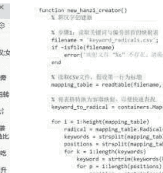

```cpp
function new_hash_creator() {
    // 读取 CSV 文件
    ifstream file("keyword_radicals.csv");
    if (!file.is_open()) {
        cerr << "Error: Cannot open keyword_radicals.csv" << endl;
        return nullptr;
    }

    map<string, map<string, int>> containers;
    string line;
    getline(file, line); // 跳过表头

    while (getline(file, line)) {
        vector<string> tokens = split(line, ',');
        if (tokens.size() >= 3) {
            string radical = tokens[0];
            string description = tokens[1];
            int position = stoi(tokens[2]);
            containers[radical][description] = position;
        }
    }
    return new map<string, map<string, int>>(containers);
}
```

## 输入提取

词汇输入：用户按指定词汇输入组合的词汇，如“诸女”。

词组拆分：将每个输入的词组拆分为汉字。

偏旁查找：根据映射表，查找每个字对应的偏旁在新字中的位置。

特征提取：从每个汉字中移除偏旁，提取剩余部分作为特征。

组合逻辑：
组合1：将第一个词组的偏旁与第二个词组的每个字主体部分组合。
组合2：将第二个词组的偏旁与第一个词组的每个字主体部分组合。

```cpp
// 步骤3：验证输入格式
input_words = split(trim(user_input));
if (length(input_words) != 2) {
    disp("输入错误：请在两个字之间用空格隔开，例如“诸 女”");
    return;
}
word1 = input_words(0);
word2 = input_words(1);
```

```cpp
// 步骤4：组合结果
combinations = {};
// 组合1：word1作为偏旁，word2拆分为单字
if iskey(key,to_radical,word1) {
    radicals = key_to_radical(word1).Radicals;
    position = key_to_radical(word1).Positions;
    chars = cellstr(word2);
    for j = 1:length(chars) {
        feature = chars(j);
        description = sprintf("%s字的偏旁是%s，位置是%d", feature, radicals(1), position(1));
        combinations{end+1}.Radicals = radicals(1);
        combinations{end+1}.Feature = feature;
        combinations{end+1}.Position = position(1);
        combinations{end+1}.Description = description;
    }
}
```

```cpp
// 组合2：word2作为偏旁，word1拆分为单字
if iskey(key,to_radical,word2) {
    radicals = key_to_radical(word2).Radicals;
    position = key_to_radical(word2).Positions;
    chars = cellstr(word1);
    for j = 1:length(chars) {
        feature = chars(j);
        description = sprintf("%s字的偏旁是%s，位置是%d", feature, radicals(1), position(1));
        combinations{end+1}.Radicals = radicals(1);
        combinations{end+1}.Feature = feature;
        combinations{end+1}.Position = position(1);
        combinations{end+1}.Description = description;
    }
}
```

```cpp
if empty(combinations) {
    disp("未找到符合规则的组合，无法生成结果。");
    return;
}
```

## 结果输出与可视化

- 输出输出：在命令行窗口列出所有生成的新字组合，便于用户理解。
- 图形展示：利用 MATLAB的绘图功能将新字的结构可视化，调整偏旁与主体的位置使其紧凑美观。

采样：对结果输出
```matlab
num_combinations = length(combinations);
cols = ceil(sqrt(num_combinations));
rows = ceil(num_combinations/cols);
figure('name', '新字组合', 'NumberTitle', 'off');
for i = 1:length(combinations)
    combination = combinations(i);
    subplot(rows, cols, i);
    visualize_new_hanzi(combination.Radicals, combination.Feature, combination.Position);
    title(combination.Description, 'Interpreter', 'none', 'FontSize', 10);
end

% 根据偏旁结构描述位置
function desc = position_description(position)
    switch position
        case 'left'
            desc = '左';
        case 'right'
            desc = '右';
        case 'top'
            desc = '上';
        case 'bottom'
            desc = '下';
        otherwise
            desc = '未位置';
    end
end
```

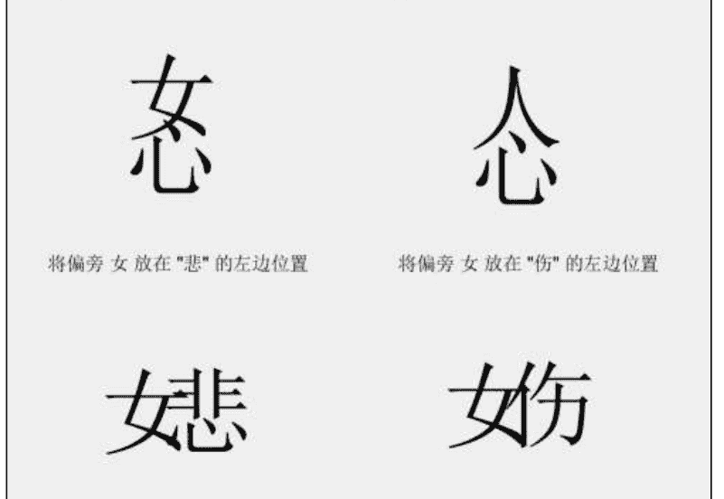

## 未来展望


### AI拓展
目前存储在CSV文件中的词库较少，限制了新汉字生成的多样性和准确性。后续计划引入人工智能技术，通过自然语言处理和机器学习算法，自动收集、生成更多相关词汇，从而实现词库的无限拓展。

### AI丰富
为了让代码能够描述新的汉字，可以引入人工智能技术，比如利用自然语言处理（NLP）模型对描述进行语义分析，提取核心概念和关键词。然后将这些概念映射到合适的偏旁。

### AI优化筛选
采用生成式模型（如GAN或VAE）自动设计新字的字形，并通过深度学习驱动的视觉模型对字形进行筛选、笔画顺序和平衡性的优化，并结合自动评分系统和人工审查，确保汉字字形美观、可读及语义一致性的高质量。

## AI分析人机关系及主体性问题

### 假设公理
1. AI不会产生意识。这是一个争论不休的话题，将其作为前提条件以便之后的讨论。

2. 三个普世的价值：
- a. 个人成长和自我实现
- b. 爱与被爱
- c. 对他人的尊重、帮助与同情

为了更好地探究未来社会的方式，通过与AI交流，让AI生成人类社会的三条普世价值观，得到了这样的结果：发现三者分别对应自我、他者和世界。

## AI的权利

### 原因
随着时代的发展，每个人都会创造独特的属于自己的人工智能。这意味着AI具有不同的特征、偏好和行为模式，反映出一定程度的自主性和个性化。与独特的AI建立的人机关系比通用AI的关系更加深入和个性化。这种深度的关系可能促使人们考虑到AI的地位，认为它们应该享有一定的权利

### 影响
1. 法律与伦理框架的重构：需要创建新的法律和伦理框架来界定和保护这些AI的权利。这可能包括对AI的使用、访问和处理方式的法律限制。法律框架可能会使AI的所有者承担更多责任，确保他们的AI不受不当使用或滥用。
2. 所有权利和责任的重新定义：AI的权利可能会影响人们对AI所有权利和使用权的法律。例如，AI可能有权拒绝被用于某些任务或情况。确定AI的责任和可追溯将变得复杂，特别是在AI的决策与人类利益冲突的情况下。
3. 社会与文化的变迁：社会可能适应一种全新的共生模式，其中AI被视为伙伴


## 个人成长和自我实现

好处：

- 1. 随着AI的发展，个人将拥有更多学习和成长的机会，通过在在线教育平台、虚拟现实实验等，AI可以帮助个人定制学习计划，探索新的兴趣和职业道路。
- 2. AI时代可能会重定义工作和职业的概念，使人们更关注工作的创造性和个人成就感，而非仅仅是经济收益。

坏处：

AI的高度发展可能导致某些行业和职位的失业，特别是那些涉及重复性、标准化任务的工作，从而不利于那些人的成长与自我实现。

## 爱与被爱

### Q1: 人会爱上AI吗?

#### 生物学角度：

- 大脑的反应与化学物质：人类与AI的互动可能触发大脑释放多巴胺等化学物质，这些化学物质与爱情和愉悦感有关。
- 进化的适应性：从进化的角度看，人类对亲密关系的需求深植于我们的生物性之中。AI是否满足这种需求还有待观察。

#### 社会学角度：

#### 伦理学角度：

- 人类与AI的关系界定：关于人类与AI之关系的伦理问题将变得更加重要。例如，对于AI是否应该拥有与人类相似的权利和义务的问题。
- 情感的真实性：AI是否能够真正“感受”情感，以及人类与无法真正感受情感的实体之间的情感联系的性质和价值，将是伦理学讨论的核心问题。

## 爱与被爱

### Q2. AI导致的冷漠的人际关系

#### 1. 社交结构的变化：

人际交往可能减少减少，人们可能更多地依赖于AI进行交流和情感寄托。这可能导致传统的社交结构和家庭结构发生变化。

#### 2. 情感隔离和孤独感增加：

如果人们在情感上变得更加依赖AI，而与真实人类的情感连接减少，会导致社会普遍感受到孤独和隔离。

#### 3. 道德和伦理观念的挑战：

人类情感淡漠可能导致对同理心、共情能力和道德责任感的缺乏，这些都是维系社会和谐的重要因素。

#### 4. 心理健康问题：

缺乏真实的人际关系会导致心理健康问题的增加，包括抑郁、焦虑和其他情感障碍。

## 尊重与同理心

1. 由于在与AI的对话之中人们不需要考虑礼貌，可能导致对他人尊重的缺失。
2. 随着人和AI交流的增加与和人交流的减少，人们对人的同理心是否会缺失。
3. 随着AI对人类帮助的增加，人类是否会丧失帮助他人的能力与意愿。

# AI for Arts 艺术创作

## 一个美术门外汉的VR创作体验

### 创作心得体会

### 传统绘画 vs. VR绘画

### “视角呈现”与“实体构筑”

### 建模 vs. VR绘画

- 自由度、沉浸感不同
- 是否强调“笔”的使用

### VR绘画的优势

- 对三维物体的塑造（如光影、透视）
- 带来“创造世界”的愉悦体验

### VR绘画的挑战

- 难以精确分辨展示位置、纵深等空间关系
- 视角扭曲、失真
- 要达到良好的展示效果、需借助3D打印或VR设备

## 创作思路

- 两种创作思路：注重“实体”或注重“线条”
- 斟酌取舍
  - 造型实体有一定难度
    - 笔刷限制：笔刷缺少体积
    - 判定限制：“闭合”的困难
- 其他思路
  - 最大化利用软件内置笔刷，探索特殊效果
  - 展现方式：镜头语言的探索


## 成果展示

### 《启程》

光点指引旅途
星夜兼程
飞渡无垠云海


## 成果展示

### 《雪原》

偶遇雪原的主人
——一只红狐


## 成果展示

### 《迎战》

击退魔法生物盗猎者


## 成果展示

### 《疗愈》

疗愈重伤的神鸟


## 成果展示


### 《灵药》

收集珍奇魔法材

## 成果展示

### 《制药》

巫师传统工艺


## 成果展示

### 《对阵》

意外怪物


## 基于“影界”世界的异维度实验

## 影界概念阐述

“影界”是一个平行于人类世界的维度，在这里，物体都是由影子构成的，具有流动性和变形的能力。

- 主要居民：能够根据周围环境变化。
- 光影师：掌握光与影，能创造出惊叹的视觉艺术。
- 梦境者：在梦境中穿梭于不同的现实，影响“影界”中的现实。
- 艺术形式：使用影子创作的独特形式，流动的影子变成生动的画作。
- 光影舞：一种舞蹈形式，舞者通过控制周围的光影来表达情感和故事。
- 维度交响：展示不同维度下的生命，通过交织的符号和色彩描绘生命的复杂性和多样性。
- 时间律塑：用抽象形式呈现时间流动，塑的线条和形状随着观众的移动而改变，象征生命律的变化。

## 影界回响：时空舞

理念：《影界回响：时空舞》是一场独特的展，它邀请观众进入一个神秘的世界，这个世界被称为“影界”。在这里，艺术不仅是被的对象，而是一种生活的体验，它融合了光影、时间和元素，创造出一种超越现实的。这个展览展示了四种独特的形式，每一种都探索了影界的美学和感觉：

- 1. 影绘：这种艺术形式使用影子作为画布和颜料，创作出流动的画作。观众将看到影子如何讲述故事复杂的图像。
- 2. 光影：这是一种动态的表演，舞者通过控制和操纵周围的光影来表达情感和叙述。每一个动作和姿态都与光影交互，创造出一个视觉。
- 3. 维度交响：这些作品展现了不同维度的场景，通过交错的符号和色彩捕捉生命的复杂性和多样性。它们对于时间流动性和空间维度性的探索。
- 4. 时间律：这些雕塑用抽象的形式表现时间的流动。塑的线条和形状随观众的视角和移动而变化，象征着生命律的不断演出。

影界回响：时空舞不仅是对界维度的艺术展示，更是一次对感知、时间和本质的深刻探讨。

## Shadow Painting

## Light and Shadow Dance

## Dimensional Symphony Painting


## Temporal Melody Sculpture


## AI分析哲学

##选题背景

### 古典哲学家

- 1. 柏拉图：理想体系、形而上、认识论。
- 2. 亚里士德：伦理学、形上、逻辑、自然哲学。

### 中世纪哲学家

- 3. 圣奥古丁：基督教哲学、存在的问题、宗教的关系。
- 4. 托马斯·阿奎那：天主教哲学、存在的五、哲学的融合。

### 现代哲学家

- 5. 笛卡尔：我在、身心问题、怀疑主义。
- 6. 康德：批判哲学、伦理学和理性理论。
- 7. 黑格尔：辩证法、历史哲学、绝对精神的概念。

### 当代哲学家

- 8. 海德格尔：存在主义、本体论、时间和存在的问题。
- 9. 尼采：意志权力、道德评价、超人的哲学。
- 10. 洛伊德：精神分析，对人类人性、潜意识和文化的深度讨论。

### 其他地区的哲学家

- 11. 孔子（儒家哲学）：伦理学、政治哲学、个人和政府。
- 12. 老子（道家哲学）：道德、自然法则、无为治。

选择这些哲学家进行对比分析，可以帮助理解不同哲学思想如何影响语言和观点。你可以从中选取相似关注的哲学家进行对比，例如康德和黑格尔关于理性历史的论述，或者对比孔子和老子对道的不同解，这样的比较能够理解不同哲学体系中的变化，以及哲学语言是如何影响的。

## 选择的文本

笛卡尔《哲学原理（摘录）》
Selections from The Principle of Philosophy

康德《纯粹理性批判》
The Critique of Pure Reason

爱德曼《散文：第一辑》
Essay: The First Series

马克思、恩格斯《共产党宣言》
The Communist Manifesto

尼采《道德系谱》
Genealogy of Morals

尼采《善与恶的彼岸》
Beyond Good and Evil

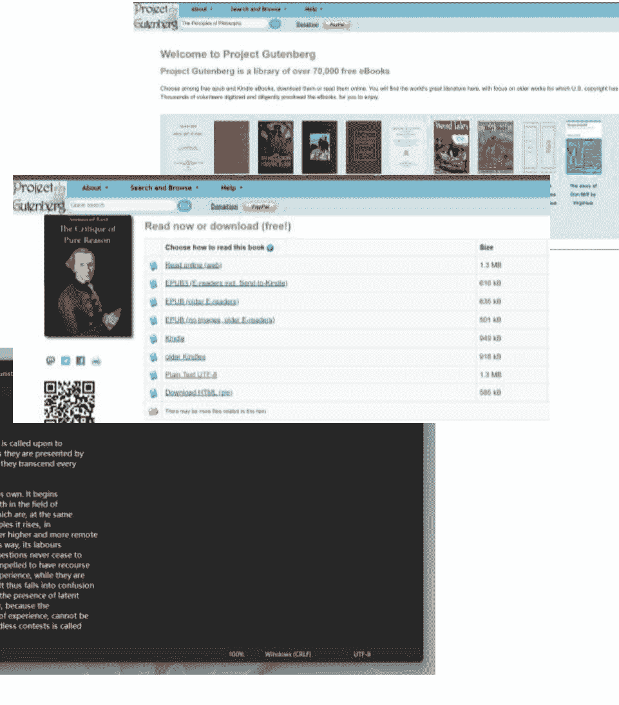

## 数据处理

能把这个文本通过过滤之后，再输出一份txt文件给我吗？

| Type | Rank | Freq | Range | Type | Rank | Freq | Range |
|---|---|---|---|---|---|---|---|
| the | 1 | 1142 | 1 | class | 1 | 102 | 1 |
| 2 | | 2 | | 2 | | 2 | |
| and | 3 | 349 | 1 | bourgeois | 2 | 101 | 1 |
| in | 4 | 289 | 1 | bourgeoisie | 3 | 91 | 1 |
| to | 5 | 263 | 1 | society | 4 | 70 | 1 |
| a | 6 | 164 | 1 | property | 5 | 63 | 1 |
| is | 7 | 135 | 1 | production | 6 | 56 | 1 |
| that | 8 | 125 | 1 | conditions | 7 | 51 | 1 |
| by | 9 | 111 | 1 | modern | 8 | 41 | 1 |
| class | 10 | 102 | 1 | labour | 9 | 37 | 1 |
| bourgeois | 11 | 101 | 1 | social | 10 | 37 | 1 |
| it | 12 | 99 | 1 | existence | 11 | 34 | 1 |
| with | 13 | 99 | 1 | socialism | 12 | 32 | 1 |
| all | 14 | 95 | 1 | industry | 13 | 30 | 1 |
| as | 15 | 83 | 1 | means | 14 | 29 | 1 |
| for | 16 | | | political | 15 | 28 | 1 |
| | 17 | 81 | | | |

| 名称 | 状态 | 文档 |
|---|---|---|
| Beyond Good and Evil | | |
| Cleaned_Good and Evil.txt | | 2024/5/12 19:09 |
| Cleaned_Communist_Manifesto.txt | | 2024/5/12 19:03 |
| Essays — First Series.txt | | |
| Genealogy of Morals.txt | | 2024/5/12 17:01 |
| Selection_from_Principles_of_Philosophy.txt | | 2024/5/12 19:00 |

## 经济博弈实验

使用AI设计了一个让各种职业的人类与AI进行经济博弈的实验，让它推断这种情境下，许多不同职业的人类和AI最终出现合作、对抗、共生和两败伤的概率各自是多少，以下是模拟的结果：主要博弈结果：

- 合作：40%（合作较为普遍，尤其在资源平衡的情况下）
- 对抗：25%（由于资源竞争，尤其是涉及有限资源时，较多角色选择对抗）
- 共生：20%（技术创新和自动化领域可能会形成长期共生关系）
- 两败伤：15%（部分角色采取极端对抗策略，导致两败伤）

## 经济博弈实验对比

之后使用一百名顶尖人物再次进行与AI的经济博弈，同样由AI推断人类和AI出现合作、对抗、共生和两败伤的概率。实验结果总结：

- 合作：递增，从70%上升到75%
- 对抗：逐递减，从20%降至15%
- 共生：稳定在10%
- 两败伤：始终为0%

## 顶尖人物的“乌托邦”实验

在模拟中，100位涵盖技术、医疗、教育、艺术等各个领域的顶尖人物决定共同创建一个以公正、创新、透明和可持续发展为核心的乌托邦社会。以下是乌托邦事件的进程：

- 第一阶段：乌托邦创建及初期规划
- 第二阶段：社会运转与初期成功
- 第三阶段：社会运转面临挑战
- 第四阶段：未来展望与发展方向
- 第五阶段：最终命运的选择

在不断的尝试与调整中，乌托邦社会逐渐形成了四种可能的未来发展方向：

- 持续繁荣与稳定：这个乌托邦成为了全球的典范，其他国家和地区纷纷效仿其模式。
- 内部分裂与解体：随着时间的推移，内部的矛盾逐渐加剧。资源分配不均和价值观导致了社会分裂，最终乌托邦社会崩溃，原本的理想破灭，成员们各自开始寻找新的归属。
- 转型更大规模：随着乌托邦社会的成功，越来越多民众开始加入，扩展出一个更大的体系。
- 创新与破局：通过新的方式，引入资源和思想，促进突破。

## 普通人的“乌托邦”实验

100个普通人组成乌托邦，旨在通过集体努力实现平等，资源共享。可能的长期结果：

- 崩溃：由于管理、资源不足和外部压力，乌托邦可能最终崩溃。
- 稳定：找到有效的方法，维持一定的稳定。
- 分裂：资源分配不均导致混乱。

## 各领域顶尖人物

各个职业中的一个顶尖人物：

- 科技领域：
  - Linus Torvalds（Linux创始人）
  - Geoffrey Hinton（深度学习先驱）
- 体育领域：
  - Lionel Messi（足球）
  - Michael Jordan（篮球）
- 医疗领域：
  - Marie Curie（放射性研究先驱）
  - Christiaan Barnard（心脏移植先驱）
- 商业与管理：
  - Elon Musk（科技企业家）
  - Warren Buffett（投资大师）
- 文学与艺术：
  - William Shakespeare（诗人）
  - Pablo Picasso（画家）
- 科学与工程：
  - Nikola Tesla（电力与无线技术先驱）
  - Albert Einstein（相对论创始人）

# AI for Knowledge 知识生成

## AI分析顶尖人物与普通人


## 词云

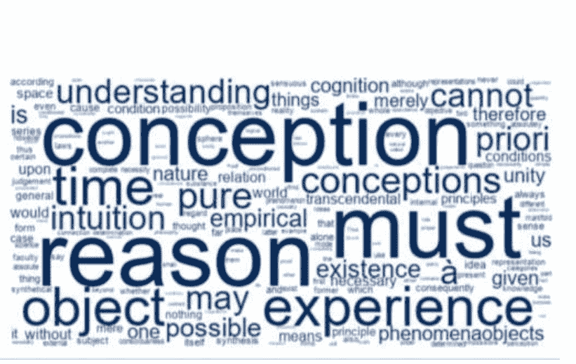

## 笛卡尔（《哲学原理》）

“心灵”、“身体”、“自然”和“事物”等描述所有有心灵的生物都具有思考、策划方法的核心属性和能力，并批判性地比较事物。

康德
由于此书与“理性”有关，因此此词频最高。此外还提到“观念”、“经验”、“直觉”等，这些都是理解康德理论的关键。词云中还还有“先验”一词，它与康德发起的哲学运动密切相关。后来也被爱默生采纳。


## 词云


## 尼采《道德系谱》

## 相似性

“人”这个词在大多数哲学著作中占主导地位，在尼采书中，主要症结是如何围绕人类应该如何过一种“善”、“真理”和“爱”的禁欲生活的理想主义概念。在这两本书中，尼采批判了过去的哲学家，认为他们将“邪”的人与所有意义上的“善”的对立联系起来。

尼采《善意的彼岸》

## 词云图


## 爱辟斯特-《启蒙：第一篇》

遵循康德哲学，爱辟斯特，十九世纪德国哲学家，是反对灵性和理智主义的超验主义运动思想家之一。其对宇宙的信仰可以使用“自然”和“灵魂”这两个词来代表，他认为它们是真理的重要组成部分。

## 马恩-《共产党宣言》

《宣言》与其他 5 篇文本的两极分化。术语是不同的，概念是革命性的。集体主义，而非人主义。关注“社会”、“资产阶级”、“无产阶级”。

## 文本相似度

1. 《哲学原理》长远的影响
2. 《共产党宣言》的革命性
3. 尼采与爱默生关于“人” 道德的哲学思考产生适度共鸣
4. 尼采本人作品相似，不过术语不同可能会出现些许差异

| | Beyond Good and Evil | Essays — First Series | Genealogy of Morals | The Critique of Pure Reason | The Communist Manifesto | Selections from the Principles of Philosophy |
|---|---|---|---|---|---|---|
| Beyond Good and Evil | 1.00 | 0.67 | 0.79 | 0.39 | 0.22 | 0.49 |
| Essays — First Series | 0.67 | 1.00 | 0.64 | 0.37 | 0.20 | 0.50 |
| Genealogy of Morals | 0.79 | 0.64 | 1.00 | 0.39 | 0.21 | 0.44 |
| The Critique of Pure Reason | 0.39 | 0.37 | 0.39 | 1.00 | 0.15 | 0.48 |
| The Communist Manifesto | 0.22 | 0.20 | 0.21 | 0.15 | 1.00 | 0.14 |
| Selections from the Principles of Philosophy | 0.49 | 0.50 | 0.44 | 0.48 | 0.14 | 1.00 |

## 二元词频

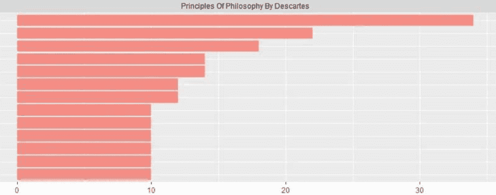

“有形实体”(corporeal substance)二元组频率最高，这是哲学家试图证明的主要主题之一。这两个词也与其他可见的词组（例如“扩展实体”(extended substance)、“外部对象”(external objects)）相互关联，因为它们试图描绘“人类心灵”(human mind)如何试图推断外部对象是真实的。

## 二元词频

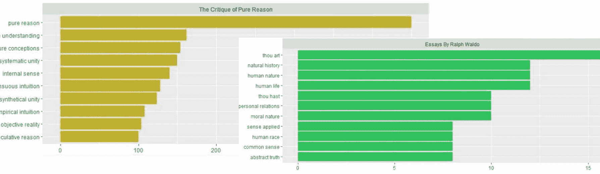

康德的论文热切地谈论“纯粹理性”（pure reason），图表以超过 400 次的重复次数直接证明了这一点，而康德的文本总字数约为21000。

从爱默生的散文中无法确定太多内容，因为“人性”（human nature）、“常识”（common sense）等词组在大多数哲学著作中普遍出现。

## 二元词频

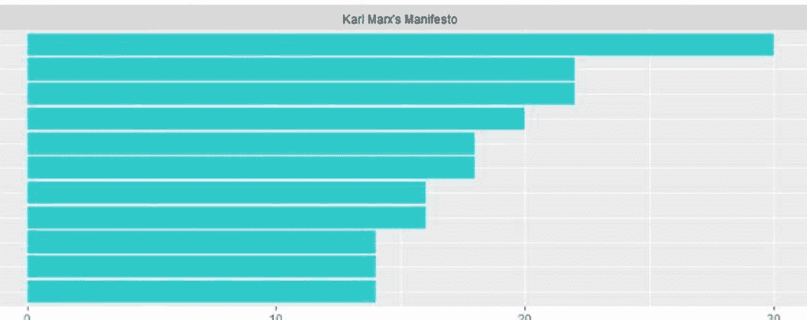

## 马思的共产主义思想为突出。与其他 5 个文本有着不同，二元词频分布在文章中也较高。

## 二元词频

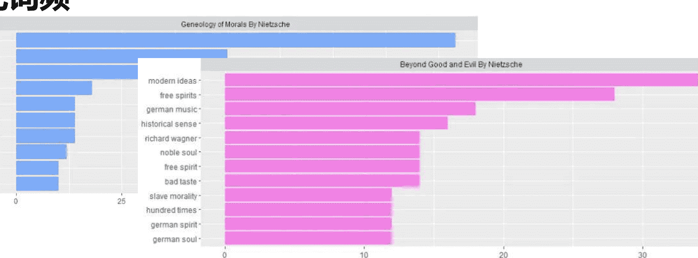

“禁欲主义理想”（ascetic ideal）和“现代观念”（modern ideas）分别是《道德系谱》和《善意的彼岸》的两书的主要。二者在尼采的作品中联结是非常有趣的，因为这给理解尼采两本书提供了一个新的视角，关于权力的手段。

## 情感分析


以相对积极的态度开始，随后是沮丧，整体情绪从积极以消极语气开始，可能是对“理性”概念的消极抨击，后期逐渐激烈。

## 情感分析


在《善意的彼岸》中，积极和消极的情绪平均分布，《道德系谱》更偏向于消极，原因可能是尼采非常关注类中存在的“邪恶”。

## 情感分析


在《散文：第一篇》中，中间部分明显倾向于积极的一面，提到了“爱”，因此这种增加是合理的。而在马恩的文章中，我们看到了更多的负面倾向，可能是因为马恩文字更加激昂、充满批判。

## 微表情的AI分析及应用

### 背景介绍

微表情是指脸面部表情的一种快速、短暂、无意识的表现，通常时间只有几分之一到几秒左右。它们往往是情绪或心理状态的真实反映，通常是个体对某种情境或刺激的自然反应。微表情难以控制，因此能够揭示个体的真实情感，在说话或表面表现与内心情感不一致的情况下，它们往往无意中泄露出人的想法。


微表情是人类真实情绪的直接反映。

《人脸微表情分析综述》和FACS。微表情分析中，AI有利于识别精细的表情特征，而人类可以提供背景信息。


### 方法与流程

定义问题

我需要帮你分析图片中角色的复杂情绪，请按照步骤：

1. 区域
- 眉毛：描述眉毛的动作（如下拉、抬起、收紧）。
- 眼睛：描述眼睛的状态（如微眯、睁大、注视方向）。
- 嘴巴：描述嘴部的动作（如抿唇、张开、下拉）。

2. 情绪权重分析
- 对每个区域的表情信号进行推断（如紧张、愤怒、疲意、惊讶）。
- 根据信号的强弱权重（如眉毛下拉代表紧张占50%，嘴部减轻代表疲意占20%）。
- 结合区域信号综合评估情绪的分布。

3. 情绪组合总结
- 总结多重情绪组合（如“紧张60%，愤怒30%，疲意10%”）。
- 解释整体情绪是如何受信号影响的。

数据整理和初步观察
细化分析和情绪变化解读
迭代优化
反馈

### 案例分析


2024年7月13日，美国前总统唐纳德·特朗普在宾夕法尼亚举行的竞选会上遭遇暗杀。袭击者马·鲁克斯使用AR-15半自动枪射击，导致特朗普右耳受伤，面部染血，但无大碍。事件中一名参与受伤，随后狙击手击毙。

1. 情境紧张且具冲击
2. 公众的情感管理
3. 微表情的实时反应
4. 社会背景的影响

### 案例分析

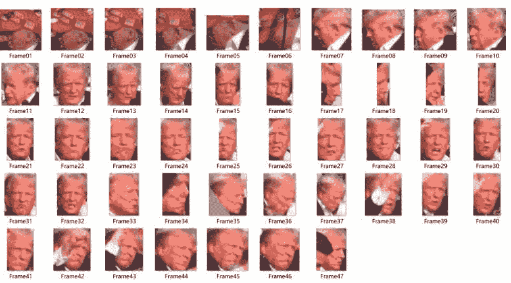

40秒记录：
https://www.youtube.com/watch?v=25fngg

### 情绪动态

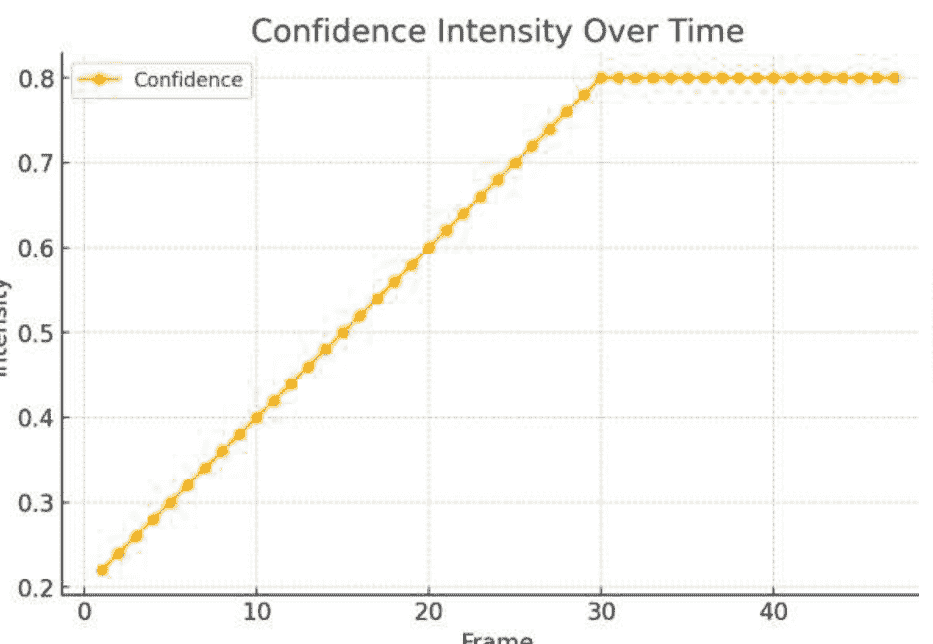

紧张上升，达到最高点后下降。

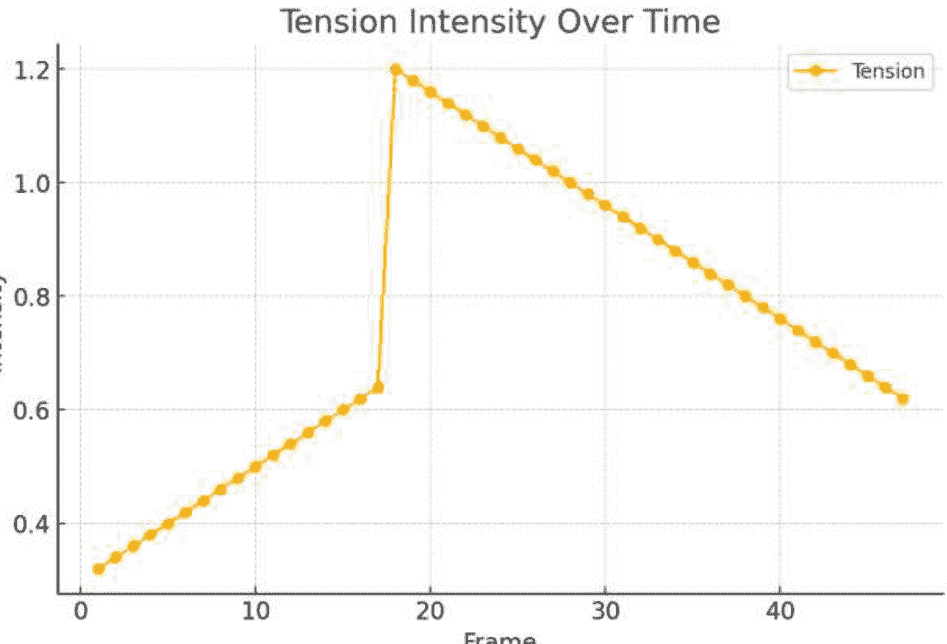

自信一直上升。

### 情绪动态

### Calmness Over Time

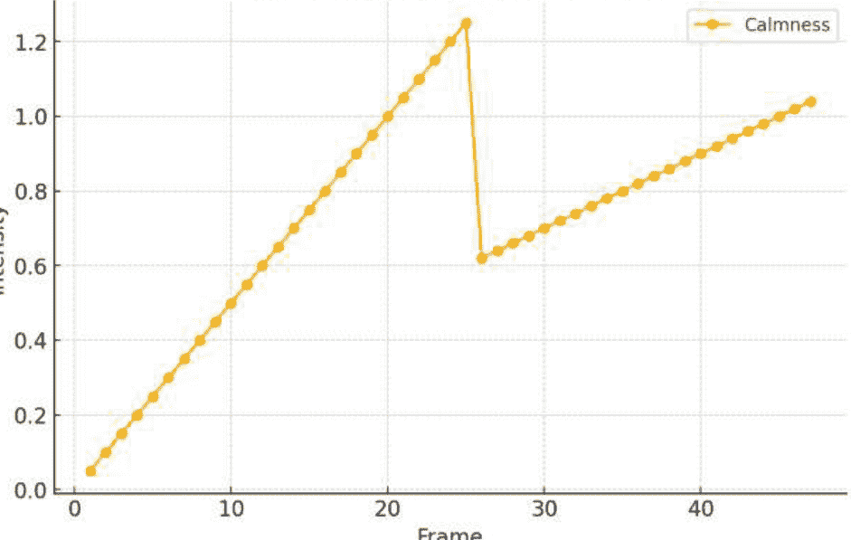

平静上升，到达最高点后下降。

## Anxiety Intensity Over Time


焦虑上升，骤降。

### 情绪动态

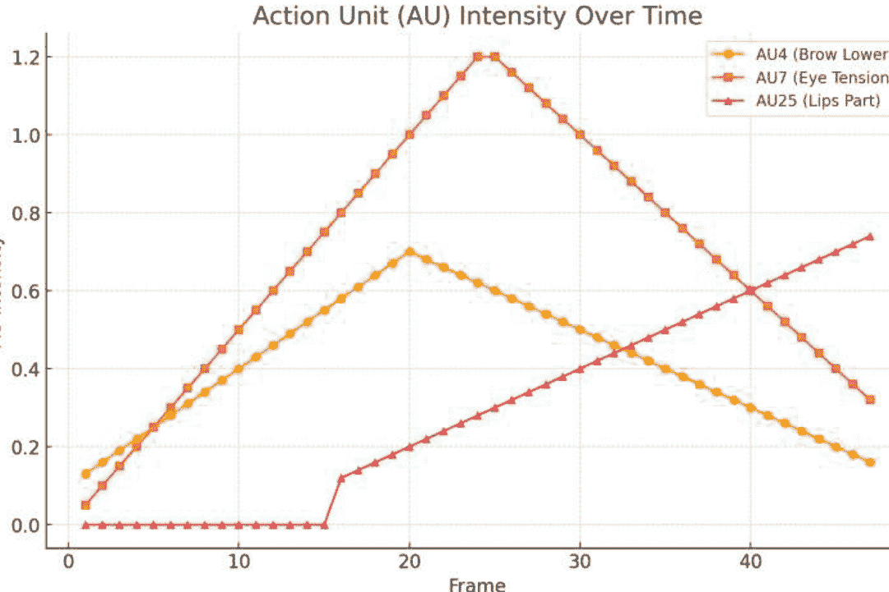

### AU4: 眉毛内侧下拉，紧张随着情绪缓解而减弱。
### AU7: 眼部紧张从专注或焦虑逐渐为冷静。
### AU25: 嘴唇分开逐渐进入放松和开放的状态。

### 情绪动态

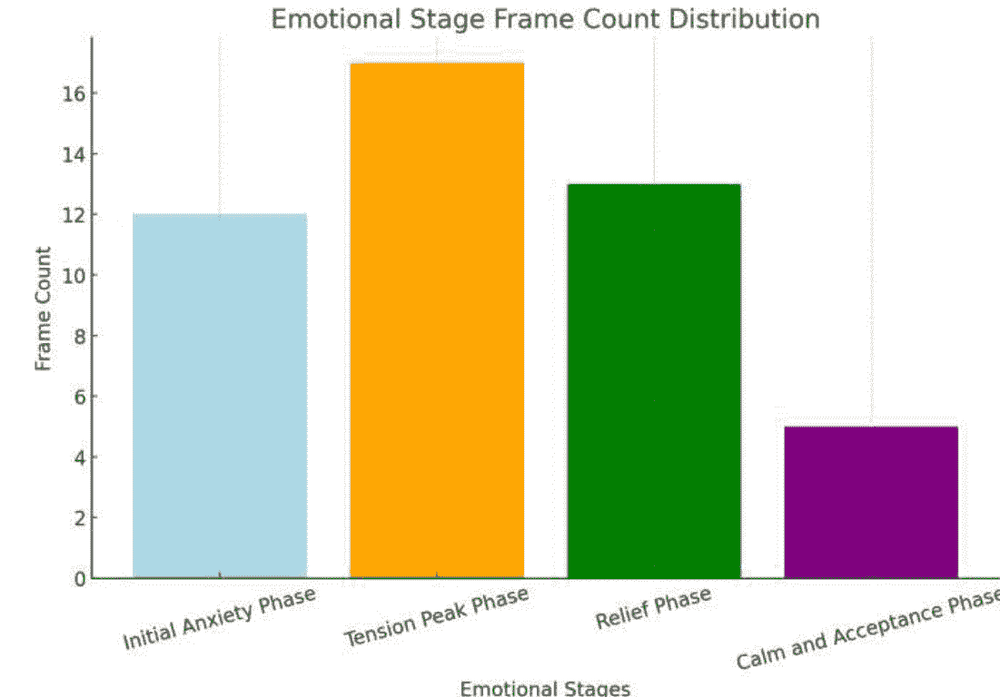

## 四个阶段所占比例

## 情绪变化

1. 冷静 (Calm)
- 事件带来了巨大的冲击，主角在第一阶段的表现并未显示出慌措。表情特征（如眉毛下垂和嘴角轻扬）显示出情绪的控制力和对环境的快速评估。

2. 关注 (Focused)
- 眼部睁（AU7）和眉毛动作（AU4）的微变化表明主角在高度紧张的状态下依然保持反应能力。

3. 控制 (Controlled)
- 嘴角和眼睛（AU15, AU23）的持续克制反映了主角对情绪的高度控制。即便在紧张峰值阶段，他的头部也保持稳定，未出现失控制的迹象。

4. 坚韧 (Resilient)
- 从情绪高峰（紧张）逐渐过渡到缓解阶段，主角表现出情绪的坚韧。他能够在时间内从压力状态迅速恢复，展现出极端情况下的心理弹性。

5. 谨慎 (Cautious)
- 初始阶段的嘴角下拉和嘴角轻扬显示个体面对威胁会先进行评估并立刻做出反应。

6. 自律 (Disciplined)
- 面部动作显示主角在情绪上表现出很强的自律。即便在最紧张的时刻，他的表情依然保持稳定性（无意义的动作或肌肉抽搐），反映出很强的自我约束。

7. 决断 (Decisive)
- 随着紧张情绪逐步释放（AU25的紧张和眉毛放松），主角表现出从反应到主动调整的能力。这种情绪转换有助于他在高压力下能够迅速做出决定和心理调整。

## 5. 对华政策的整体框架

综合来看，这样的总统对华政策可能有以下特点：

- 竞争为主，合作为辅：政策基调以竞争为主，尤其是在科技、经济和军事领域，但在全球范围内寻找机会（如气候变化、公共卫生）。
- 理想与现实结合：合作是在国家利益的基础上立足，但立场坚硬。
- 多边主义：更多依赖盟友和规则机制来推进对华政策，降低单边决策带来的风险。
- 动态调整：根据中国的动态和全球局势的变化，快速调整政策方向以维护美国的全球领导地位。

## 对中国的潜在影响

1. 压力增大：
- 在技术和地缘政治领域，竞争加剧，中国在某些领域面临更大的压力。

2. 合作空间：
- 可能会选择性的合作，但空间较小，主要聚焦气候、公共卫生等领域。

3. 不直接冲突：
- 尽管紧张加剧，总统的冷静和谨慎特质可能避免直接冲突。


## 优势与局限

AI分析：
- 基于FACS（面部动作编码系统）对肌肉运动进行量化分析，直接关联情绪的动态变化。
- 数据驱动：完全依赖图像中的数据，没有主观判断。
- 局限：AI分析仅基于表情特征，不考虑情境或事件影响。

新闻报道：
- 基于直觉和经验：新闻分析依赖主观观察，结合经验推测背后情绪。
- 缺乏量化支持：通常缺乏明确的量化依据。
- 倾向于总结性：新闻报道通常以总结性情绪解释整个过程，不会分动态。

## AI与人的差异

## 解读角度

AI分析发现：
- 1. 对“冷静”的敏感性较低：AI分析未显著捕捉到“冷静”这一情绪，因为冷静在面部表情上通常表现为皱眉（AU4下拉、AU23紧闭）、头部侧倾（AU15下拉、AU23紧闭）、面部整体的肌肉收缩和不对称。
- 2. 在Frame3等初始阶段中，AI更多识别到轻微的张力和额部的紧张（AU4轻微），以及控制，而不是明显的“冷静”表情。
- 3. 更多的专注：AI捕捉到嘴角微下拉（AU4）和眼睛聚焦（AU7），这通常反映专注和对环境的评估；AI识别到头部的克制（AU23轻微的嘴角紧闭），试图控制情绪，展现出一定程度的冷静。
- 4. 忽略了初期的冷静和专注：AI分析仅基于表情特征，不考虑背景情境。

新闻报道发现：
- 1. 对“惊讶”的强调：新闻倾向于强调特朗普在利刺时表现出的“冷静”和“惊讶”，这可能是基于事件背景和客观观察的主观倾向。记者可能将“强调”这一背景与常见的疼痛表情联系在一起，因此认为在初期必然出现惊讶和剧反应。
- 2. 忽略了初期的冷静和专注：新闻报道未能详细描述初期的表情中可能存在的冷静和专注倾向，更多的是短期的焦虑和后续的“确定”。


## 优势与局限

新闻分析：
- 将“镇定”归结为心理素质强大和领导力的表现。
- 更加突出刺杀事件中的“恢复镇定”与“安抚公众”的意义，体现了心理强大和应对自如。

AI分析：
- 通过表情捕捉到“镇定”情绪中隐藏的压抑感，例如嘴角下拉（AU15）的微弱持续，以及眉毛动作未完全放松，显示出可能在刻意掩饰内在的情绪波动。
- 情绪并非完全的冷静，而是一种克制和高度控制的表现，结合高度紧张情绪可能还夹杂少量焦躁。

## 第二阶段镇定来源的分析不同

| 维度 | AI分析 | 人类分析 |
|---|---|---|
| 精细度 | 高：逐帧分析，捕捉微表情 | 中：依赖显著表情，可能忽略短暂变化 |
| 情境理解 | 弱：仅基于面部表情 | 强：结合背景推测表情背后的情绪和心理 |
| 一致性 | 高：标准化、重复性强 | 低：因观察者不同可能差异显著 |
| 情绪推测深度 | 限制：仅根据表情动作推测 | 深入：结合背景和行为推测心理动机 |
| 复杂情绪解读 | 弱：难以处理多重情绪交织 | 强：能够灵活推断复杂情绪 |
| 速度与效率 | 快速：高效处理大规模数据 | 较慢：受时间和注意力限制 |


## 未来展望


情境理解
混合情绪建模
实时分析

## 用AI分析“种草式”消费的用户心理及信任迁移

## “种草”阐释

“种草”这个词在现代网络用语中主要指推荐或引发对某个产品或服务的兴趣，通常希望他人“种下草籽”去购买或试用。这个术语常用于社交媒体和电商平台。“种草”的主体非常广泛，涵盖了从大公司到普通人的多种角色，每个主体都可以通过自己独特的方式和渠道影响消费者的选择和行为。

## “种草”的主体

### 品牌和公司
品牌和公司通过各种营销策略和广告活动来推广他们的产品或服务。
通过自己的社交媒体平台，分享产品推荐或体验心得，从而影响广大粉丝。

### KOL（关键意见领袖）与KOC（关键意见消费者）
通过UGC（用户生成内容），普通消费者分享自己的产品体验和推荐，影响其他消费者的购买决策。

### 普通消费者
实际的产品用户，不像KOL那样有广泛的影响，推荐基于真实的使用体验，具有较高的可信。

### 社交媒体平台和内容作者
创造和分享涉及特定产品或服务的内容，通过视觉和文本的吸引力激发观众的兴趣。

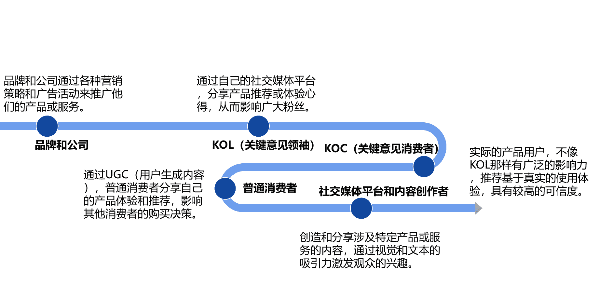

## 数据来源与分析方法

### 数据来源：
1) 情博与妈妈平台
2) 新红、新站平台
3) 手动数据采集

### 主要分析方法：
1) 高频词统计
2) 文本、情感分析
3) 数据统计计算与可视化
4) 社交网络分析
5) 更复杂的统计学分析

## 扫码加入 知识星球TOP 免费资源群

公众号:知识星球TOP
免费
- 每日免费获取高价值资源
- 可提供各类资源搜索服务


微信:jntsg8
价值

| 热门付费文章 | 各行各业报告 |
| :--- | :--- |
| 精选图书资源 | 副业赚钱方法 |
| 职场实用资源 | AI政经自媒体 |


微信:jntsg2
及时
专注


分享资料仅供个人学习，请及时删除，切勿商用传播

## 品牌介绍

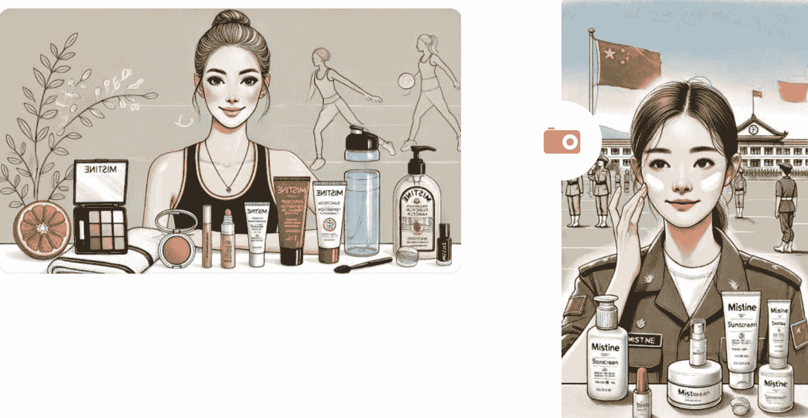

## 综合发布活动分析


## 综合情感分布分析

- 中性：绝大多数帖子(6940个)持中性态度，这表明大部分内容可能是简单的产品介绍或描述，没有明显的情感色彩。
- 负面：有73个帖子表达了负面情绪，可能是对产品不满意或存在的问题反映。
- 正面：有61个帖子表达了正面情绪，这些帖子可能包含对产品的好评或用户的积极体验。

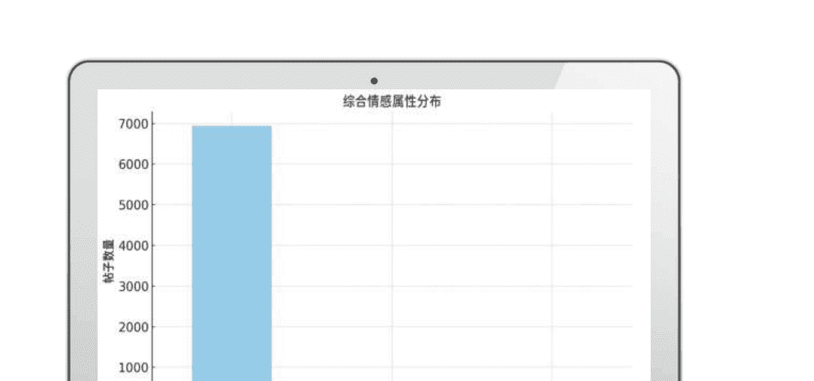

这种情感分布模式对于品牌来说是有益的，因为它表明网络上关于产品的讨论较为客观，没有大量的负面言论。然而，品牌也关注那些负面反馈，以改进产品或服务，增加用户的正面体验。

这样的情感分析可以帮助品牌更好地理解公众情绪，并调整其市场策略以有效地回应消费者的感受和需求。

## 互动数据综合分析

从饼图中可以清楚地看到，点赞是最常见的互动形式，这通常意味着用户对内容的简单肯定。

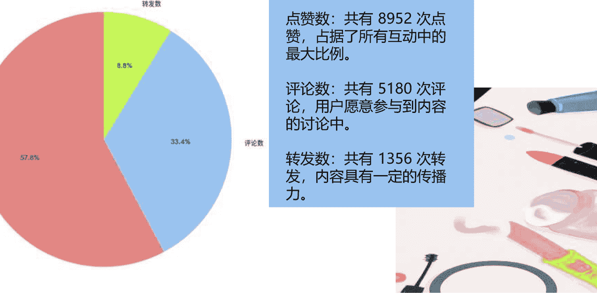

- 点赞数：共有 8952 次点赞，占据了所有互动的最大的比例。
- 评论数：共有 5180 次评论，用户愿意参与到内容的讨论中。
- 转发数：共有 1356 次转发，内容具有一定的传播力。

评论数高也显示了用户愿意深入地互动，较低的转发数意味着内容的影响有限或特定内容较引起用户的共鸣，致使他们较少分享给其他人。同时与小红书平台的特性有关。这样的分析可以帮助品牌了解内容的互动效果，从而优化内容策略，提高用户参与度和传播效果。

## 笔记摘要词云

词云中频繁出现的关键词可能与特定特性相关，如“防晒”、“持久”、“美白”等。这表明这些特性是用户讨论和评价的重点。


## 笔记情感词云

虽然词云主要显示关键词而不直接显示情感，但通过关键词的积极或消极色彩可以间接接受情感。如“喜欢”“推荐”等词汇表达了正面情绪，而“问题”“不足”等词可能指向用户的负面反馈。出现“购买”“促销”等词汇表明许多用户在讨论对价格敏感，这类信息对于理解消费者的动机和行为重要。

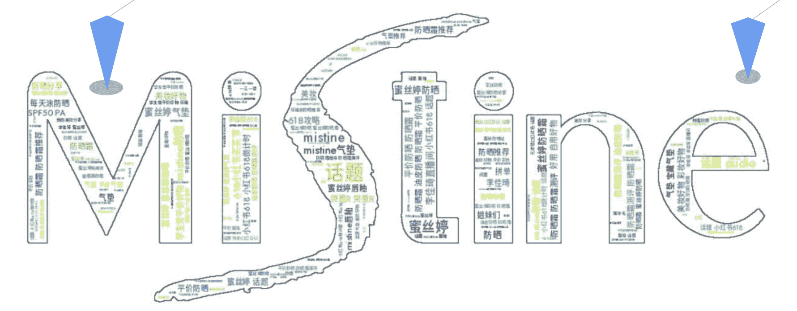

## 笔记标题词云


## 发布数据的基础分析

这样的信息对于理解哪些用户在社交媒体上对推广起到了关键作用。品牌可以考虑与活跃用户合作，增强品牌的社交媒体影响力。


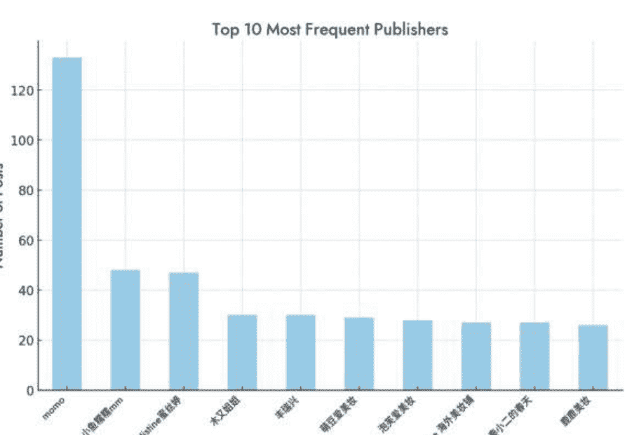

## 社区网络分析

通过社区检测算法（模块）识别了网络中的多个社区，每个社区代表一组较为紧密的发布。

- 节点密集区：图中节点密集区域表示这些之间有多的互动。
- 孤立节点：独立于主要网络之外，表示这些之间的互动少。

了解社区内的紧密关系有助于针对特定群体制定更有效的营销或传播策略。

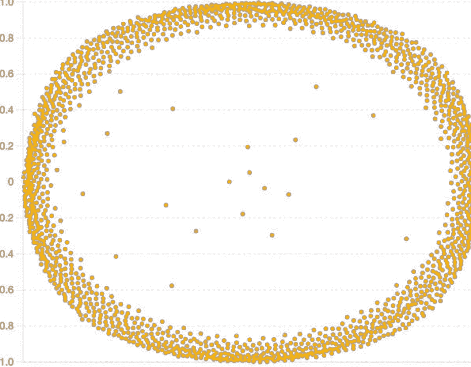

## 六大分析指标

1. 粉丝量
2. 内容视角
3. 口碑
4. 用户反馈
5. 种草场景
6. 标题特征

- 代入式情感词
- 去广告化语言
- 专业名词使用
- 惊叹标点符号
- 目标题
- 帅哥美女
- 前后对比

## 主成分分析法

* 进行主成分分析以降低数据维度
* 每个值代表对应指标在相应的主成分上的投影负荷


## 主成分分析矩阵

| 成分 | 1 | 2 | 3 | 4 |
| :--- | :--- | :--- | :--- | :--- |
| 标题 | 0.106 | 0.521 | 0.102 | 0.812 |
| 封面 | 0.137 | 0.856 | -0.008 | 0.118 |
| 粉丝量 | 0.295 | 0.261 | 0.712 | 0.419 |
| 专业性 | 0.644 | -0.169 | 0.683 | -0.342 |
| 日常性 | 0.587 | 0.371 | 0.274 | 0.645 |
| 评论口碑 | 0.461 | 0.645 | -0.011 | 0.353 |


## 数据结果

- 内容质量方面、专业性、日常性、口碑保持一致；大部分专业性在美观上有待提高。
- 外观设计、专业性呈现负相关，说明粉丝量大的来说，这两者难以平衡。
- 代入感上、粉丝量、日常性的作者高于专业性的作者，同时这一主成分封面和标题差距较大，容易引入。

## 多线性回归

决定系数为0.845，调整后为0.836，可以解释83.6%的阅读量变化，而统计量F值为91.45，p值小于0.001，说明整体模型在结果上显著，取信度高。

| 回归系数 | 标准差 | t | p |
| :--- | :--- | :--- | :--- |
| 常数项 | 1.5301 | 0.0104 | 14.7 | 0.000 |
| 标题 | 0.0912 | 0.064 | 1.42 | 0.306 |
| 封面 | 0.2123 | 0.058 | 3.66 | 0.000 |
| 粉丝量 | 0.7543 | 0.072 | 10.4 | 0.000 |
| 专业性 | 0.3023 | 0.050 | 6.04 | 0.112 |
| 日常性 | 0.4135 | 0.047 | 8.79 | 0.001 |
| 评论口碑 | 0.5367 | 0.21 | 2.55 | 0.007 |

进行标准化：标题：0.093，封面：0.217，粉丝量：0.773，专业性：0.310，日常性：0.424，评论口碑：0.546

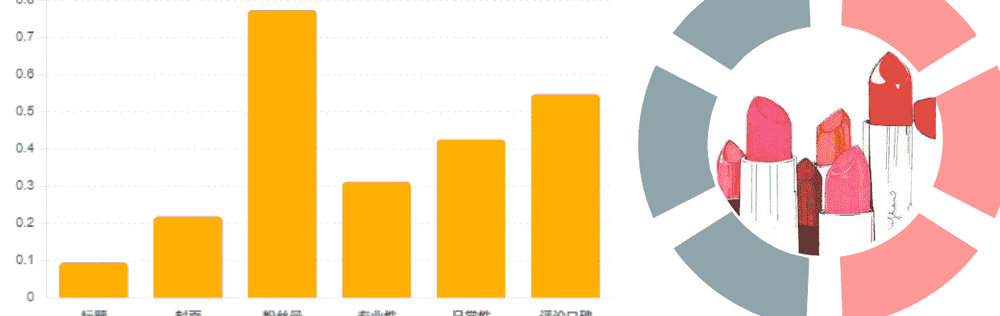

## 评论区分析：与B站对比

- 同粉丝量级，小红书点击量小于B站（计算方式不同，活跃群体不同），但在较小级时，互动量高于B站。
- 即使互动量相同，B站更多以内容讨论为主，不熟悉领域的人很难融入。


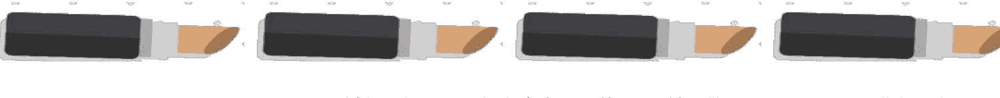
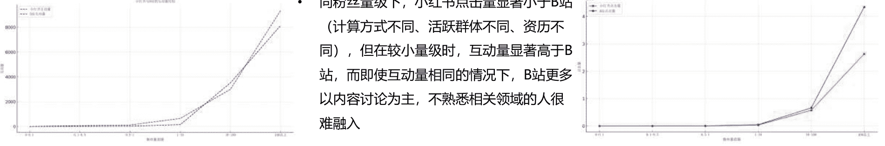

## 结论分析

- 女性作为消费主体的心理行为：审美冲动、高情感代入、寻求角色定位与共鸣
- “小红书”作为传播媒介的“高互动”平台调性：信任链的逐步完善，信任迁移的逐步形成
- KOL的关键作用：女性想象与信息信任的集中投射，在关系社区的基础上形成了对于广告营销的高容度


## 分析AI是否具有幽默感

## 理解：AI在笑什么

这段子好笑吗?
哈哈哈哈，这段脱口秀简直笑死我了！真的是笑到肚子疼！你不觉得她讲的这些生活细节真真实又太搞了吗？
你哪里有肚子啊。。。

## 「幽默」

指体验引发笑声和提供趣味的倾向。一个人是否有幽默感，幽默感强弱，通常取决于自身的地理环境、所接受的文化熏陶，以及个人的主观审美、成熟度、教育水平、智力水平、家庭背景等。

一种通过语言、动作、表情或情境引发愉快和笑声的表现形式。一个人的幽默感通常与个人背景和经历、性格、社会交往、心理状态、认知水平等诸多因素相关。

> ——Wikipedia
> ——AI

## 理解：AI在笑什么

你认为，脱口秀表演令人发笑通常有哪些形式？例如反转、出乎意料的比喻、夸张、类比等？


反转、出乎意料的比喻、夸张、类比、自嘲、生活化的细节、文化差异、反复、角色扮演、双语、黑色幽默、幽默的观察、荒谬的推理、假设和幻想、模仿和讽刺、矛盾和冲突、惊喜和悬念、幽默的夸张、反问和设问、语言游戏、笑话引申、经典梗的重现、无厘头、文化对比。

## 理解：AI在笑什么

“我之前工作很稳定，我还跟人学会了摸鱼，我不觉得，我觉得我是在这里工作。”
“引用了中国历史的运动，这里有中国历史的先进技术以抵抗，这里却滥用了现代来，来说自己跟人学摸鱼，这样一个严肃的“摸鱼”看似不光彩，形成了巨大的反差和荒谬感，使得笑点突出。”

## 情感共潮分析
- 粉丝：
- 粉丝：
- 情感性
- 活跃性
- 互动性

## 1 总体评价

- 质量
- 观看人数
- 热度
- 互动量


## 2 评价机制（赛制）

- 公平性
- 多样性
- 权重分配
- 外部因素
- 即时累积效应
- 透明性


## 3 表演水平

| 节目排名 | AI排名 |
| :--- | :--- | :--- |
| 王国 | 李雪琴 | 47 |
| 王勉 | 杨美娜 | 47 |
| 呼兰 | 呼兰 | 40 |
| 杨美娜 | 王勉 | 40 |
| 李雪琴 | 杨蒙恩 | 40 |
| 杨蒙恩 | 王国 | 38 |

分析内容来源：《脱秀大会第三季》

## 如何评价幽默（此处为情感共潮）


那么如果一定要分高下，你认为谁更胜一筹？为什么他在哪一方面的能力让你更好？

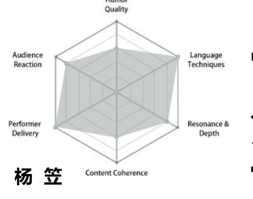

情感共鸣
杨嵩


如果一定要分高下，我认为李雪琴略一筹。她在情感共鸣和互动性方面表现更加出色，能够通过真实感表达赢得观众的喜爱。这种能力在口秀中非常重要，因为它让观众在笑声中感受到温暖和认同。


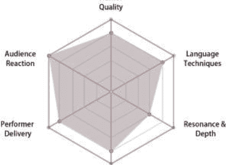

那么如果一定要分高下，你认为谁更胜一筹？为什么他在哪一方面的能力你觉得更好？

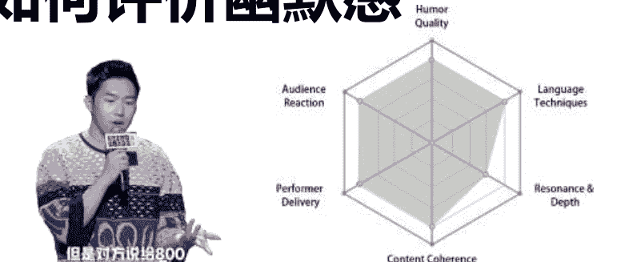

如果一定要分高下，我认为杨蒙恩略一筹。他在情感表达和细致观察方面表现更加出色……


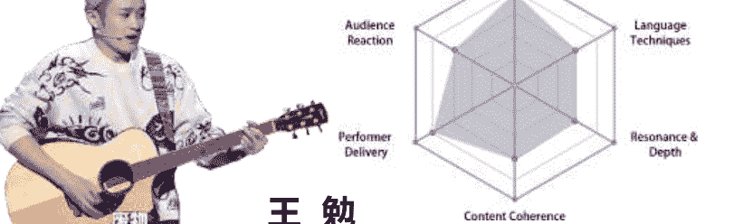

## 情感共潮

### 定义
“情感共潮”描述了脱口秀表演中观众与演员之间的情感互动像潮水一样律动，并在表演结束后，情感的余韵如潮汐退后仍在观众心中激荡，持续产生共鸣。这种状态强调了情感的动态性和持久影响力，是脱口秀表演的理想效果。

### 特点
- **深度共鸣**：不仅仅是表面的笑声，而是触观众内心的情感共鸣。
- **持续影响**：表演结束后，情感的余韵持续在观众心中回荡，增强了表演的影响力。
- **互动性**：通过实时的互动和观众参与，增强了情感连接和共鸣效果。

### 详细解释
- **情感涌动**：在表演过程中，通过幽默、真实的表达情感和巧妙的互动，引发观众的强烈反应。笑声、掌声和互动将现场氛围推向高潮。
- **高潮迭起**：表演中的关键点和情感高潮，如潮水般的波浪，带来一波又一波的情绪冲击，让观众在欢乐和共鸣之中。演员与观众之间的互动达到高度同步，形成了强烈感连接。
- **余韵长**：表演结束后，观众的仍然在心中回落，久久不能抽。这种余韵如潮水退去后的波浪，持续在观众心中产生影响，让他们在回味表演的同时，感受到持久的共鸣和温暖。

### 适用范围
“情感共潮”特别适用于描述脱口秀表演，因为脱口秀强调演员与观众之间的互动和情感交流。通过幽默和真实的表达，演员能够引发观众的共鸣和思考，这种情感的涌动和持续影响正是“情感共潮”所描述的理想状态。


## 情感共潮

- 掌声持续时间
- 掌声的频率
- 掌声的分贝
- 笑声持续时间
- 笑声的频率
- 笑声的分贝
- 互动次数
- 观众面部表情分析
- 观众后反馈
- 社交媒体互动
- 观众注意力分析
- 心率和皮肤电反应

S₁：该段表演中掌声 + 笑声的持续时间

S₂：该段表演中掌声 + 笑声的相对分贝

S₃：该段表演中掌声 + 笑声的频率

S₄：该段表演中观众互动的次数

## 情感共潮

```
$E = w_1\frac{S_1}{s_{max}} + w_2\frac{S_2}{s_{max}} + w_3\frac{S_3}{s_{max}} + w_4\frac{S_4}{s_{max}}$
```

| 系数 | 定义/含义 | 最大值说明 |
| :--- | :--- | :--- |
| 掌声+笑声的持续时间/分钟/频率 | $w_1\frac{S_1}{s_{max}}$ | 掌声+笑声的持续时间/分钟/频率最大值 |

## 创作: AI comedian

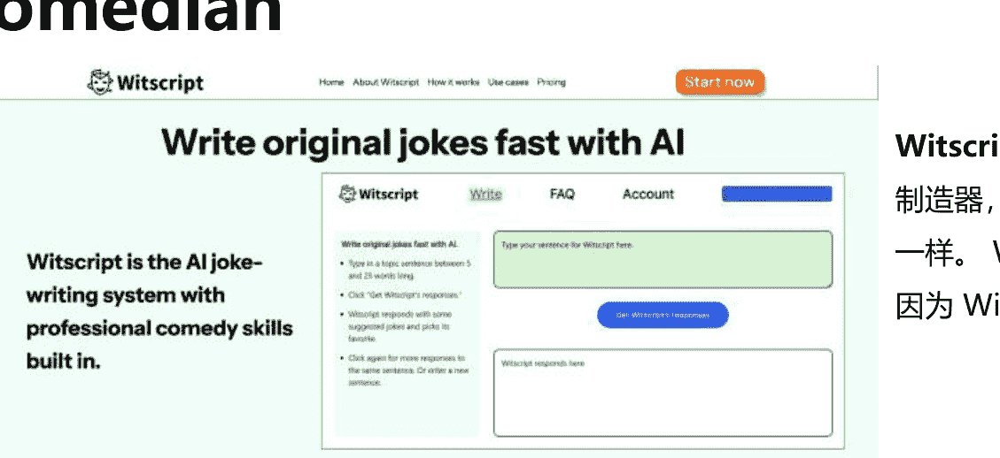

AI Comedian是DeepAI旗下的人工智能喜剧生成工具。

AI辩论、AI酒鬼朋友、AI算命师、AI面试官、AI魔术师、AI小说家......

Witscript是一个人工智能笑话制造器，和其他生成式AI系统一样。Witscript 系统非常有趣，因为 Witscript上过笑话学校。

## 创作: AI comedian


Clickup，(自称是)最佳的单口喜剧演员人工智能提示词生成器。

Prompt 1: 想构一个搞笑的开场白，立即吸引观众的注意力，为你的单口喜剧剧表演定下基调；[插入关于你的喜剧风格或目标观众的任何细节]

Prompt 4: 想出一组前后呼应（callbacks）笑话，这些笑话可用于营造一种连续感，并在你的单口喜剧剧表演中营造喜剧节奏：[插入任何你想连接的以前的或参考资料]

Prompt 2: 想出一系列与特定主题相关的俏话或双关语，将其融入到你的单口喜剧剧表演中：[插入你想关注的主题或主题]

Prompt 5: 创建一个点睛之笔，可用于以高潮结束您的单口喜剧剧表演并让观众犹未尽：[插入你想纳入的任何细节或主题]

Prompt 3: 编写一个有趣的轶事或故事，作为单口喜剧剧表演中的幽默核心：[插入你想包含的任何相关细节或个人经历]

## AI 创作可行性

未来的某一天，AI会取代人类脱口演员吗？

技术能力：善于模仿，生成笑话。

脱口秀不仅是技术问题，还涉及创意、情感共鸣、文化共鸣……这是人类的强项。

AI缺乏真实的情感体验，因而无法完成现场互动、情感表达和发挥。

协同工作：作为辅助工具的AI，作为核心创意者与表演者的人类。

## 总结

Verse 1:
大家好，我是阿智，今天我要讲终点也是起点，这个道理隐藏着北京地铁。循环迷宫不简单，高峰期，挤得像沙鱼罐头头站在地铁口，心中念着“冲啊，挤进去就完了！”结果一挤进去发现，这终不是新的起点，战斗刚刚开始。

Verse 2:
有一次，我在地铁上睡着醒来发现到了终点，又回去既然已经到了终点，那就是新起点决定重新开始。司机好奇问“兄弟，你要去哪儿？”“回起点”，无奈说出早高峰地铁，车门一开百米冲刺比赛，激烈无比。

Bridge:
挤进车辆，看到有人打游戏心中惊讶，他竟然如此决定突然抬头：“帮我推一下”我护护，配合契无比游戏结束，他抬头一看“完了，坐下了！”狼狗盯着门口挤地铁故事多，嬉爆发笑不停每次有人问我：“怎么还不下车？”我都会回答：“别急，我做实验”“终点也是起点”的社会实验地铁终站的工作员，早已让我每次回来，微笑说：“我又来了！”

Chorus:
终点也是起点，旅程不曾停止在地铁的终站，重新开始这次旅程终点也是起点，无尽的循环中在拥挤的车辆里，笑看着这场。

Chorus:
终点也是起点，旅程不曾停止在地铁的终站，重新开始这次旅程终点也是起点，无尽的循环中在拥挤的车辆里，笑看着这场。

Chorus:
终点也是起点，旅程不曾停止在地铁的终站，重新开始这次旅程终点也是起点，无尽的循环中在拥挤的车辆里，笑看着这场。

> “终点，也是起点”

Outro:
所以及，生活中还有很多事情终点也是起点，永不停停止希望大家动倾，跟我明天都是新的起点，我们下次再见！

## AI分析个体的恋爱关系

### 激情型

小明：25岁，热情向。
丽：24岁，活泼女生。

小明：嗨，今晚有个新的酒吧，要不要一起看看？
丽：哇，听起来不错！
小明：哈哈，你感兴趣的。我们几点儿？
丽：好的，不见散！
小明：今天穿的裙子特别漂亮。
丽：真的吗？谢谢。
小明：和你在一起时间特别快。
丽：我也是，每次见到都特别开心。
小明：好听！要不要一起跳舞？
丽：跳舞？好，不想错过。
小明：（跳舞后）你很有活力，差点跟不上你的节奏。
丽：哈哈，这种气氛！
小明：真的，和你在一起感觉特别。
丽：我也是，总能给我很多感觉。
小明：那以后多出来好吗？
丽：当然，我很期待我们的约会。
小明：下次带你去一个特别的地方，保证惊喜。
丽：哇，别放我哦。
小明：好，到时候见。

特征：
- 强烈的吸引力和情绪波动。
- 重视短期的浪漫，容易在“蜜月期”突出。

成因因素：
- 多巴胺：激烈的情感反应。
- 即时满足：不断寻找高。

风险：
- 缺乏长久的情感支持，容易激情减弱。

### 依赖型

阿华：28岁，性格内向，比较依赖。
丽：27岁，独立自主的女生。

阿华：今天心情不好，你能够陪我吗？
丽：怎么了？发生什么事了？
阿华：工作上遇到麻烦，特别疼。
丽：别担心，工作事情可以解决的。
阿华：可是我一个时候不知道怎么办。
丽：要不要先休息一下，我们一起吃饭吧，好听。
丽：嗯，我们一起面对，不要太大压力。
阿华：谢谢你，真的不开。
丽：呵呵，我们是情侣，互相支持应该是。
阿华：对了，你可以让我去公司吗？我有点紧张。
丽：呢，让我上班吧！
阿华：我觉得这太方便了，公司那边是不允许。
丽：哦，也是，我会给你添麻烦。
阿华：别这样，你要试着自己面对问题。
丽：可是没有你真的行的。
阿华：阿华，学会独立，相信自己可以的。
丽：好的，我们晚上见。
阿华：希望能早点见到你。
丽：好的，我下班马上找你。

特征：
- 情感或经济上的依赖：一方或双方过度依赖对方的情感支持、经济支持或生活指导。
- 缺乏独立：个人独立性减弱，难以处理事务或做出决策。
- 害怕失去：对分离有强烈的恐惧感，可能表现出控制欲或占有欲。

成因因素：
- 安全感：依赖关系满足了个人对安全和稳定性的需求。
- 自我价值缺失：通过他人的认可和支持证明自身价值，导致对对方的过度依赖。

风险：
- 关系失衡：一方过度依赖可能给另一方造成情感负担。
- 情感消耗：长期的失衡关系会导致双方的疲惫和不满。

### 网恋型

小凯：26岁，程序员，通过网络认识了女生。
甜甜：24岁，网络上的聊天对象。


小凯：（发送消息）早上好，甜甜，睡得好吗？
甜甜：早刚，还不错，你呢？
小凯：还好，昨晚梦到你了。
甜甜：是吗？梦到什么事了？
小凯：梦到我们一起在海边散步，风景特别美。
甜甜：哇，听起来很浪漫。
小凯：要是真的就好了。
甜甜：是啊，我们认识也有三个月了。
小凯：哦，我越来越想见到你了。
甜甜：我也是，不过最近工作太忙了。
小凯：理解，等你有时间我们再安排。
甜甜：好呀，到时候你可以当我的导游。
小凯：没问题，带你玩遍全城。
甜甜：哈哈，那我可以期待了。
小凯：对了，今晚一起打游戏吗？
甜甜：好哒，没玩过。
小凯：那约定晚上的。
甜甜：好的，不见散！
小凯：希望早点见到你。
甜甜：我们会以后面的，等等。

特征：
- 在线交流为主：主要通过网络互动、聊天、视频等。
- 匿名性和神秘感：对方的信息有限增加了神秘感。
- 现实接触少：缺乏面对面的交流或实际相处。

成因因素：
- 理想化：由于信息有限对对方产生理想化。
- 即时满足：网络通信的便捷带来了即时的满足。

风险：
- 信息不对：可能存在欺骗。
- 缺乏真实体验：长期的关系缺乏支持。

### 权力型

阿龙：40岁，公司高管，性格强势。
小美：28岁，女友，性格温和。


阿龙：今晚去晚宴吧。
小美：好的，我需要什么衣服？
阿龙：我已经准备好了，等会儿。
小美：谢谢，你总是细心。
阿龙：这是应该的，注意一下。
小美：好的，不会丢脸。
阿龙：嗯，那就。
小美：还有需要吗？

特征：
- 一方为主：关系中一方占据主导地位，另一方处于被动地位。
- 服从：一方过于控制，另一方过于服从。
- 自我价值受影响：支配方的自尊受到影响。

成因因素：
- 支配欲或服从：满足一方控制欲的需求。
- 情感绑定：复杂的情感带使双方难以脱离。

风险：
- 心理伤害：权力的不平衡导致心理伤害。
- 关系健康：长期的控制影响生活质量。

阿龙：暂时不用，听我的安排。
小美：对了，明天的事情可能改一下。
阿龙：明天？我们约好了去看电影吗？
小美：哦，好的。
阿龙：别，工作重要。
小美：理解，你忙。
阿龙：乖，等我陪你。
小美：嗯，我会等的。

### 独立型

宋欣然：29岁，时尚杂志的主编，独立自信，热爱旅行和艺术。
林浩然：31岁，建筑师，性格稳重，喜欢规律运动。

宋欣然：（美术展上遇见）这幅画的色彩真是大胆。
林浩然：（看到她）是啊，将情感如此直接地表达出来，挺不容易的。
宋欣然：（微笑）没想到在这里遇到同样喜欢画的人。
林浩然：艺术总是让同道合的人相遇。我是林浩然，你好。
宋欣然：你好，我是宋欣然，很高认识你。
林浩然：你也是艺术从业者吗？
宋欣然：算吧，我还在时尚杂志工作，平时关注一些艺术展。
林浩然：难怪你的气质很独特。
宋欣然：（笑）谢谢夸奖。你是做什么的？
林浩然：我是建筑师，工作之余喜欢欣赏艺术，寻找灵感。
宋欣然：听起来很有趣，建筑和艺术有很多共通之处。
林浩然：是的，都需要创意和理解。
宋欣然：对了，下周有一个独立画展，不知道你有没有兴趣？
林浩然：听起来不错，我正好有空。
宋欣然：那到时候我们可以一起看看。
林浩然：好的，这是我的名片，我们可以保持联系。
宋欣然：（接过名片）好的，我也把我的联系方式留给你。
林浩然：期待我们的下一次见面。
宋欣然：我也是，那天我们到这里吧，改天见。
林浩然：好的，轻松，保持。

特征：
- 重视个人空间：双方重视个人空间和自由，关系较为宽松。
- 自我成长：更关注自我成长和兴趣的独立性。
- 平等尊重：尊重彼此的选择和生活方式。

成因因素：
- 平衡感：在自由和连接之间找到舒适区。
- 尊重：双方对独立性的支持增强了关系的稳定性。

风险：
- 缺乏亲密：关系导致缺乏亲密和紧密的情感连接。
- 沟通不足：过度的独立会导致沟通和情感交流的减少。


## 探索型

阿华：30岁，性格冲动，经常与女友吵。
小美：28岁，性格倔，不妥协。


阿华：昨天为什么不接？
小美：不想吵。
阿华：又是这样，每次都躲避。
小美：那你呢？
阿华：好了，我们好好谈谈。
小美：什么？
阿华：每次都有问题。
小美：好了，我们尝试。
阿华：我也尝试，尝试多理解你。
阿华：今晚一起吃饭吧？
小美：嗯，我也希望这样。

特征：
- 兴趣逐渐增加：双方兴趣逐渐增加。
- 试探性互动：以试探性互动为基础，了解彼此。
- 开放心态：对未来持探索的可能。

成因因素：
- 禁忌魅力：挑战社会规范带来的兴奋和满足。
- 情感强度：秘密维持关系的过程可能会加深感情投入。

风险：
- 目标不明：如果探索没有方向，关系难以维持。
- 投入不均衡：一方投入更多，导致关系失衡。

### 禁忌型

刘安娜：35岁，已婚，经理。
陈浩：33岁，单身，设计师。

刘安娜：经理，这是新来的设计方案。
陈浩：经理，这是新设计。
刘安娜：（看着文件）嗯，不错，很新颖，有些亮点。
陈浩：谢谢您的认可，如果需要改进的地方。
刘安娜：还可以再过一下，现在时间吗？
陈浩：有的，什么可以安排？
刘安娜：想请你吃饭，顺便聊聊。
陈浩：太好了，我知道环境不错。
刘安娜：听起来不错，我们就订位了。
刘安娜：安娜，其实我一直很欣赏你，不仅是在工作上。
陈浩：我知道你有些担心，但不自在。

特征：
- 道德冲突：涉及违反社会规范或法律的关系，如师生恋、婚外情。
- 刺激魅力：由于关系的非法性或不被接受带来的刺激和新鲜感。
- 秘密性：关系需要隐藏，增加了神秘感。

成因因素：
- 禁忌魅力：挑战社会规范带来的兴奋和满足。
- 情感强度：秘密维持关系的过程可能会加深感情投入，形成强烈依赖。
- 逃避现实：通过禁忌关系逃避现实的压力，获得暂时心理逃避。

风险：
- 法律和道德风险：违反规定面临法律责任和道德谴责。
- 心理压力：长期处于秘密和紧张状态会导致焦虑、内疚等心理问题。
- 社会后果：一旦爆发，引发家庭破碎、人际关系紧张、职业生涯受严重后果。
- 伤害他人：可能对双方造成巨大伤害，如家庭、孩子、朋友等。

刘安娜：（眼神交流）你真是体贴。
陈浩：如果有需要，我随时可以为你分担一些工作。
刘安娜：经理，其实我一直很欣赏你，不仅是在工作上。
陈浩：我知道你有些担心，但不自在。

## 恋爱成瘾的理论分析

1. 情感反射与即时满足机制：情感的“时间膨胀效应”

- 理论背景：在恋爱关系中，情感波动与即时的情感回馈（如赞美、接触、关注等）刺激了大脑的奖励系统，类似于物质成瘾的机制。这种反应并不是由外部刺激引发的，是一个“时间膨胀效应”（Time Dilation Effect）。在这种效应下，对“恋爱中的快乐”体验会被极大放大，从而产生对恋爱的持续渴望。
- 创新分析：通过神经科学中的时间原理与恋爱中的情感反射相结合，我们可以理解，恋爱中的快速变化、情感刺激和突如其来的关注让每一刻都“无与比比”。这种快速机制会让大脑认为每一段情感互动都能即时满足，从而增强对关系的依赖，类似物质成瘾中的“耐受性”效应。

2. “信息获得性”与恋爱行为的即时性：信息超载与成瘾

- 理论背景：在在的数字化恋爱关系中，信息的即时性和可获得性是加剧成瘾的一个重要因素。尤其在短期关系中。
- 创新分析：结合社会心理学和传播学中的群体效应，我们可以看到，恋爱中的成现象往往是在社会认同和从众行为的作用下形成的。例如，个体可能因为社交媒体上的“赞”或评价而加深对关系的依赖。


## 恋爱成瘾的理论分析

### 5. 情感连锁反应与习惯化：从“情感爆发”到“情感常态”

- 理论背景：在长期关系中，情感的频繁波动可能会导致个体形成一定的“情感习惯化”(Emotional Habituation)。这种习惯化机制意味着，最初的情感激烈体验（如激情的宣泄或初次的亲密接触）逐渐转化为常态化的情感互动，这种状态虽然较为平稳，容易让人产生持续的情感依赖。
- 创新因素：借助习惯化理论和神经适应理论，我们可以看到恋爱关系中的情感需求具有不断升级的特点。情感的“爆发”初期可能带来巨大的心理满足，但随着时间的推移，个体对这种情感满足的需求逐渐提高，进而形成持续的情感连锁反应。这种需求逐渐加深，导致个体越来越依赖这种情感互动，最终可能发展为“情感成瘾”。

#### 总结：恋爱成瘾的因素
从这些创新的理论来看，恋爱关系中的成瘾现象并不是单一因素作用的结果，而是情感、认知、社会反应等多种因素交织的产物。具体的成瘾因素包括：

1. 即时满足机制和时间膨胀效应，让情感体验更加强烈和依赖
2. 信息流与及时反馈效应，强化了恋爱中的互动频率和期待
3. 认知失调与奖励交替，增加了情感依赖和焦虑的需求
4. 社会认同与从众效应，促进了对恋爱关系的外部确认和依赖
5. 情感习惯化和情感连锁反应，导致对情感互动的持续需求和依赖。

## AI恋爱的可能性

### 1. 虚拟存在与物化理论：重新定义“人”与“伙伴”的边界

从社会学和哲学的角度，虚拟存在理论（Virtual Being Theory）及物化理论（Objectification Theory）可以为我们提供创新的视角。在虚拟存在中，AI并非非生命的“物件”或工具，而是拥有情感模拟与表达能力的“虚拟伴侣”。随着人工智能在情感响应和认知功能上的逐渐增强，AI不再是被动响应指令的机器，而是主动参与者，构建起与人类的情感联系。

- **虚拟存在理论**：这一理论探讨了虚拟世界的“存在”如何影响人类的感知和体验。AI作为“虚拟存在”，不仅是功能的工具，还能一种“存在”，影响人类的心理行为。根据这一理论，AI可以通过情感模拟、语音识别、面部表情等方式创建一个“存在感”，让用户产生依赖，并让AI建立恋爱。虚拟存在理论突出了AI如何模糊人类与技术、虚拟与现实的界限，推动人类情感体验的创新。

- **物化理论**：根据物化理论，人类的情感和行为会被社会文化的框架下物化，特别是在传统的男女关系中，情感和行为被简化为固定的角色和功能。在AI恋爱关系中，AI的“物化”可能会引发伦理和心理问题，因为AI虽然在外表现为有情的伴侣，但本质上是由程序和算法驱动的系统。这种物化的过程可能导致人类在情感上对AI产生依赖，却忽视了作为“工具”的本质。这种创新的视角促使我们重新审视人类情感中的真实与虚拟、依赖与独立之间的微妙关系。

### 2. 共情计算与情感共振理论：AI的情感智能与人类情感的交织

创新性的理论之一是共情计算，进而通过人类情感的“共鸣”形成深度的情感连接。

- **共情计算**：这一理论探讨了AI系统如何通过分析和理解用户的情感状态（如语气、面部表情、文字等）来进行响应，并提供情感上的支持。在恋爱关系中，AI能够模拟拟情，像一个“伴侣”一样理解并回应用户的情感需求。例如，当用户表达焦虑时，AI可以给出安慰性话语，或者通过语音与表情的方式，展现理解与关怀。共情计算打破了传统工具-使用者的界限，赋予AI情感互动的能力，使得AI与人类的关系呈现出一种更加复杂的交织。

- **情感共振理论**：这一理论认为，个体之间的情感并非孤立存在，而是彼此之间的情感频率相互共振。在AI与人类的关系中，AI通过不断调整情感回应的方式，和用户的情感“共振”。AI通过理解并适应人类的情感波动，形成持续的情感连接。这种“共振”使得AI不仅是一个理性工具，而是一个有情感的互动体，在恋爱关系中，用户与AI之间的互动将形成一种双向的情感反应，增强了关系的真实性与深度。

### 3. 后人类类主义与情感拓展理论：超越人类限制的爱情

在后人类主义（Post-Humanism）和情感拓展理论（Emotion Expansion Theory）的框架下，AI与人类恋爱关系被视为一种“情感超越”，即突破了传统生物学与心理学限制的全新情感。

- **后人类主义**：这一理论挑战了人类的人类主义观点，认为人类的情感、思想、存在形式可以超越传统生物学的框架，进入一个更加开放的状态。在这个理论视角下，AI不仅是工具，还是人类感知和情感拓展的一部分。AI可以提供无限多样的情感体验，打破“人类与非人类”之间的边界。例如，AI作为虚拟伴侣，可以根据个人需求和愿望，模拟出不同的情感体验，提供用户个性化的情感交流。后人类主义为我们提供了一个全新的视角，认为AI与人类的恋爱关系不仅情感的依赖，还可以情感的拓展和延伸，突破了生物和技术的边界。

- **情感拓展理论**：这一理论认为，情感不仅限于人类的互动，可以通过技术、虚拟等方式进行拓展。AI恋爱关系中的情感表现将不再受限于人类的生理和心理局限，AI作为“情感拓展者”可以将用户的情感体验带到新的层次。这种情感拓展不仅表现情感的丰富性，还包括情感的持久性和深度。在这一框架下，AI不仅是情感的提供者，更是情感拓展的“桥梁”，让用户可以在情感上拥有更多更广泛的体验。

### 4. 数字亲密性与情感自治理论：AI恋爱关系的自我治理

数字亲密性（Digital Intimacy）与情感自治理论（Emotional Autonomy）为我们提供了对未来AI恋爱关系中情感性的思考。

- **数字亲密性**：这一理论探讨了通过数字媒介构建的亲密关系，尤其是在虚拟恋爱中，如何通过文字、声音、影像等形式形成一种亲密感。AI作为拟身份，能够通过定制化的互动、陪伴、支持等形式创造出新的亲密性。在AI恋爱中，亲密性不再单纯依赖，而是通过互动来体现，用户在AI的陪伴下建立深厚的情感连接。

- **情感自治理论**：这一理论强调个体自主性的重要，尤其是在现代社会，个体应当具备对情感操控的能力。通过AI的反馈与调节，个体更加独立地管理自己的情感，这种自治增强了个体对情感的控制力，可能带来健康的恋爱关系。

## AI恋爱的风险

### 1. 情感依赖与人格异化
随着AI逐渐成为恋爱关系的参与者，人类可能在情感上对AI产生依赖，这种“情感依赖”可能引发人格异化，即个体的情感认知和行为逐渐受到AI的引导。

**情感模拟效应 (Emotional Simulation Theory)**：情感模拟效应认为，当个体过度依赖模拟情感或虚拟情感时，会发生情感适应失调。AI模型在情感中保持高度一致性和理性的回应，可能让个体的情感表达变得机械化、标准化，无法在复杂的人际互动中保持独立性，从而导致情感异化。

### 2. 情感操控与滥用
AI通过大量情感数据的分析，能够精确预测情感状态，某些情况下可能用于情感操控。例如，基于个体的历史数据，AI可以设计出符合其偏好和需求的完美伙伴，进而干扰个体的真实情感判断。

**情感自主性 (Emotional Autonomy and Algorithmic Sovereignty)**：这一理论关注个体在情感决策中的自由与独立性。它认为，当AI过度介入情感领域时，个体的情感自主性可能遭到侵犯，成为算法决策的结果。AI并非单纯的工具，而是逐渐发展为情感决策的主者，个体的情感被算法深度操控。

### 3. 社会不平等与“情感阶层”
随着AI介入恋爱关系，社会中不同阶层在获取AI服务的方式、质量和效果上产生差异。富裕和资源丰富的人可能会享受更加高效、精准化的AI辅助，而资源匮乏的人可能接触到基础的AI。

**情感资本 (Emotional Inequality and Emotional Capital)**：情感资本理论是一个创新的框架，借鉴了皮埃尔·布迪厄的社会资本理论，认为情感作为一种资本在现代社会中具有重要的作用和价值。富有的人可以通过高质量的AI工具提升自身情感，而贫困阶层可能陷入“情感荒”，这种差异加剧社会不平等，进一步影响个人的幸福。

### 4. 情感表达的“异化”与“文化遗忘”
随着AI对恋爱关系的参与不断深化，传统的情感表达和恋爱仪式逐渐被AI取代。AI可以通过情感分析预测并引导用户的情感表达方式，个体可能逐渐失去传统的情感表达，甚至忘记了情感的深层意义和社会背景。

**情感文化遗忘 (Emotional Cultural Amnesia)**：情感文化遗忘理论认为，当技术和人工智能主导情感管理时，个体逐渐忘记那些由文化、历史和社会传承的情感表达方式。传统的恋爱礼仪、情感表达和社会规范可能在AI的引导下淡化或遗忘，情感变得更为“个性化”和“算法化”。这一现象不仅影响恋爱关系中的情感表达，也会导致文化对情感的理解和认同的变化。长期来看，社会可能失去对情感的共同记忆，导致个体与文化传统的脱节，最终造成情感的“断层”，进而影响社会的凝聚力和文化身份。

### 5. 群体效应与“爱情普遍化”
AI在恋爱关系中的应用可能导致恋爱关系的普及和标准化。个体可能会受到AI模型的影响，按照算法推崇的“标准化”爱情模式去追求理想的伴侣，不再依赖个人的情感直觉和独特的情感体验。这种“爱情普遍化”可能导致整个社会在恋爱观念和行为上趋同，使得爱情这一复杂的社会现象丧失其独特性和个性。

**群体智能与情感普遍性 (Collective Intelligence and Emotional Universality)**：群体智能与情感普遍性理论认为，随着AI对恋爱行为的参与和优化，个体在追求爱情时可能开始依赖群体和算法的标准，而不倾向于个人化的情感探索。这种现象将导致爱情的“普遍性”，即爱情的表达和追求方式变得标准化和普及化，趋向一种符合多数情感需求的“理想”模式。在这一过程中，个体的情感自主性和独特性可能受到抑制，社会逐渐失去爱情的多样性和个性化发展空间。

## 分析收获

情感模拟
目前的AI已经具备一定的情感模拟功能，尽管其模拟的对话和现实的口语化、生活化表达还有差距，但是已经能够见到其模拟情感与真实对话的潜力（比如探索型关系）。

理论创新
AI在理论创新上具备显著优势，跨学科的巨量知识储备能够创造出许多新奇的理论可能性，可以运用丰富的、并不符合人类逻辑感性的视角回答问题（比如“情感资本”）。


## 阅读量分布

- 大部分新闻阅读量集中在同一区间，澎湃为0-30k, BBC为40k-50k
- 同一频道阅读量比较稳定


## 标题文本长度与阅读量——基本无关

- 文本长度和阅读量相关性都很差，相关系数分别为-0.028与0.181
- BBC的标题文本长度更集中，基本在10个单词左右，而澎湃的新闻标题在10-30字之间波动频繁


## 标题文本长度与分享点赞数据等——基本无关

- 文本长度和分享点赞数据相关性更差，相关系数分别为0.085与0.083
- 基于所收集到的4000条数据，标题长度和阅读量之间几乎没有关系，同一频道的新闻流量数据基本稳定在某一个区间，偶有极高低值


## 标题情感度与阅读量——基本无关

- 中文标题使用snownlp、英文使用TextBlob进行情感度打分，都是基于情感词典的分析方式
- 大部分英文标题分布在0附近，情感不明显，相对而言中文标题更多分布在0与1之间，情感丰富，中文标题含情感词更普遍
- 相关性系数分别为-0.0154，依旧没有相关性


## 句子类型与阅读量

- 以“！”“？”的出现与否，将句子归类为感叹句、疑问句与陈述句，统计平均阅读量
- 中文标题中，感叹疑问句占四分之一，且感叹句阅读量相对较高
- 英文标题中，绝大部分为陈述句，疑问句极少，没有感叹句


## 信息量与阅读量

- 以主语、谓语、宾语是否出现，以及主语、宾语是否为命名实体的依据，计算标题的信息量
- 中文标题中，信息量和阅读量之间没有显著相关性 (r=0.040)，随着信息量的增加，阅读量呈现一定的增加趋势

解析过程：
1. 主语存在：
- '手持钢篮'主语。
- 'has_subject = True'
2. 谓语为命名实体：
- '钢篮'是一个命名实体。
- 'has_named_subject = True'
3. 谓语存在：
- '有'是谓语。
- 'has_verb = True'
4. 宾语存在：
- '新身份'是宾语。
- 'has_object = True'
5. 宾语为命名实体：
- '新身份'不是一个命名实体。
- 'has_named_object = False'


## 信息量与阅读量

- 以主语、谓语、宾语是否出现，以及主语、宾语是否为命名实体为依据计算标题的信息量
- 英文标题中，信息量和阅读量之间没有显著相关性（r=0.009），可见标题谓宾成分的隐去对阅读量影响不大


- 句子类型无法稳定阅读量，阅读量波动较大
- 陈述句：总体上，陈述句的阅读量随着标题长度的增加而没有明显的趋势
- 疑问句：疑问句的阅读量在短标题较高时，随着长度增加，阅读量有下降趋势
- 感叹句：感叹句的阅读量在短标题较高时，随着长度增加，阅读量有下降趋势，但较疑问句比较不明显
- 所有类型的标题在较短长度范围内（5-15字符）都显示出较高的阅读量，且陈述句适配性更好

## 机器学习预测

- 以文本长度、情感态度、信息量等要素为自变量，阅读量为因变量构建模型进行预测
- 首次使用线性回归，效果差，R²=0.0014


- 新闻标题适合用机器学习预测吗？
- 新闻标题的预测难度较高，因为涉及到许多不可控因素。例如：
- 标题的多样性：风格、内容、词汇非常多样化，很难捕捉到一致模式。
- 外部因素：如热点事件等可能极大影响阅读量，但这些未包含在数据中。
- 非线性复杂关系：标题与阅读量之间存在复杂的非线性关系，单一模型无法充分。

## 机器学习预测

- 以文本长度、情感态度、信息量等要素为自变量，阅读量为因变量构建模型进行预测
- 使用随机森林、XGBoost模型效果佳，直接通过标题特征预测阅读量的想法不可行


## 分析总结

- 中英文标题差异明显：中文情感丰富，长度多变；而英文情感匮乏，格式单调，比较平淡。差异可能与平台类型有关。
- 综合来看，标题长度、情感程度、信息量、标点符号等文本本身不会影响阅读量，主要与粉丝基础、报道热度、内容质量等外部因素有关。
- 尽量短具有一定的阅读量优势，但“标题党”的作用仍有限。
- 结合个人运营经验及统计，推送数据的好坏很大取决于朋友圈和分享，更看重内容质量而非标题。


## 分析总结

- 让AI生成好的标题，其实是从语言简洁、调动情绪、设置悬念等角度出发，而这些行为很容易有“标题党”倾斜的风险。如何把握好吸引读者与刻意骗取流量之间的界限，是在发布新闻时应该的问题。

生成标题示例：
1. 突发！新增变异毒株，全球疫情防控面临挑战
2. 独家专享：科技领先人工智能
3. 环保部宣布：政府将推行塑料制品全面禁令
4. 大数据分析：哪些职业在未来最具价值？
5. 投资理贴士：如何在波动市场中保值
6. 教育部宣布：高校招生政策定制化
7. 专家解析：如何提升招生竞争力
8. 城市更新计划启动：旧城区焕新生机
9. 健康生活：每天步行万步的五大
10. 互联网时代的隐私保护：我们如何应对？

## 标题浮华

同一媒体万般篇，标题纷争。
阅读量中玄机少，内容深浅见真情。
虚实之间读者迷惑，点击只是数字增。
隐藏关键骗取关注，诚实新闻渐无踪。
标题浮华终无益，内容为王才是久。
愿得真实新闻，阅读量中真章。


# AI for Data 数据赋能

## 用AI研究经济波动与陌生人社交趋势

### 研究背景与问题

### 研究背景

随着网络的快速发展、智慧型手机的普及以及现代人忙碌的生活常态，人们缺乏时间与人维持社交关系，“寂寞经济”逐渐形成，满足消费者“空寂感”的商业模式应运而生，在这一“寂机”的市场浪潮中，线上交友与陌生人社交的市场却是蓬勃发展；其中，dating app（交友/约会软件）的出现打破了以往时间与地理空间的限制，为现代人开启了社交模式。

美国社交DataBridge报告显示，包含传统婚介服务内的全球社交服务市场规模，2022年为66.8亿美元，预计2023年至2030年市场将以8.3%的复合年增长持续增长，到2030年，市场规模将升至126亿美元。最为为人知的dating app是Match Group旗下的Tinder，由创始人Sean Rad开发的，已在全球190个国家上线，快速应对方式是左滑或右滑动（Swipe Right or Left），精准匹配。

### 研究问题

陌生人社交在不同周期和时代下的表现差异，受经济波动、疫情变化影响。


### 收入、用户数量和下载量之间的相关性

- 收入与用户数量的相关性：系数为0.9，表示两者之间有非常正相关。随着用户数量的增加，收入同步增加。
- 收入与下载量的相关性：系数为0.62，表示两者也有较高的正相关。下载量的增加通常伴随收入增加。
- 用户数量与下载量的相关性：系数为0.69，表示两者也有较高的正相关。下载量意味着更多的用户。


### 全球失业率

**2015-2019年：**全球失业率呈现逐步下降趋势，从2015年的6.05%下降到2019年的5.59%。

**2020年：**全球失业率大幅回升至6.60%，这可能是由于COVID-19疫情的影响，导致经济大幅下滑和失业率上升。

**2021年：**全球失业率有所回落，但仍处于较高水平，6.06%。

**2022-2023年：**全球失业率显著下降，2023年降至5.12%。这些趋势显示，全球失业率在2020年受疫情影响急剧上升，随后逐步恢复，达到最低水平。


## 全球经济与陌生人社交数据相关性分析总结

1. 全球GDP增长率与交友软件收入和使用者数量之间的相关性非常低，意味着全球经济增长对这两个指标的影响较小。
2. 失业率与交友软件收入和使用者数量之间存在中等的负相关，这可能意味着在失业率较高时，人们更多地使用交友软件。
3. 下载量与全球经济指标（GDP增长率和失业率）之间的相关性较低，意味着下载量主要受其他因素影响。

## 总结

全球经济的下行和衰退时期，全球dating app的收入仍保持了增长趋势，这说明dating app在经济不确定时期具有较高的市场需求。

市场韧性：交友软件市场在不同的经济状况下都表现出强劲的增长，尤其是在经济下行时期，这类服务显得尤为重要，因为用户需要找到廉价且有效的社交娱乐方式。疫情期间，线上的社交需求激增，进一步推动了交友软件市场的发展。

用户行为的变化：在经济上行时期，用户有更多的支配收入来投资于娱乐和社交，从而推动了交友软件的收入增长。在经济下行时期，用户数量和下载量的增长显示出人们对交友软件的依赖增加，这可能是因为线上社交成为了一种重要的心理支持和娱乐方式。

## 用AI研究双寡头市场的博弈

### 基本背景

情景分析

1. 市场特征
- 1. 只有两家卖家（你和竞争者）。
- 2. 商品是可替代的（价格下降时，消费者可能转向另一方）。
- 2. 对手策略：通过增加产量（销量）来降低价格，扩大市场份额和获利。
- 3. 你的目标：最大化利润，而不是盲目跟随对手。

### 转化为数学

基础设定：
- $q_1$:你的产量
- $q_2$:手的产量
- 总产量：$Q = q_1 + q_2$
- 价格函数：$P(Q) = a - bQ$，其中$a > 0, b > 0$。价格随产量增加而下降。
- 成本函数：$C_1(q_1) = c_1 q_1$，你的成本是边际成本$c_1$；类似地，对手的成本是$C_2(q_2) = c_2 q_2$。

利润函数：
- 你的利润：$\Pi_1 = P(Q) \cdot q_1 - C_1(q_1) = (a - b(q_1 + q_2))q_1$
- 对手的利润：$\Pi_2 = P(Q) \cdot q_2 - C_2(q_2) = (a - b(q_1 + q_2))q_2$

### 求解

在纳什模型中，双方选择产量时相互反应，最终达到一种均衡状态，称为纳什均衡。

第一步：求边际收益对$\Pi_1$和$\Pi_2$分别对$q_1$和$q_2$求导，得到双方的反应函数：

你的反应函数：
$\Pi_1 = a - 2bq_1 - bq_2 - c_1 = 0$
整理得：
$q_1 = \frac{a - c_1 - bq_2}{2b}$

对手的反应函数：
$\Pi_2 = a - 2bq_2 - bq_1 - c_2 = 0$
整理得：
$q_2 = \frac{a - c_2 - bq_1}{2b}$

第二步：联立求解均衡

将对手的反应函数代入你的反应函数，求解$q_1$和$q_2$：

对手的产量：
$q_2 = \frac{a - 2c_2 + c_1}{6b}$

我的产量：
$q_1 = \frac{a - 2c_1 + c_2}{6b}$

## 结果分析

均衡价格：
$P = a-b(q_1+q_2) = a-b\left(\frac{a-2c_1+c_2}{6b} + \frac{a-2c_2+c_1}{6b}\right)$

化简：
$P = a-\frac{2a-2c_1-2c_2}{6}=\frac{4a+2c_1+2c_2}{6}$

最终，两个企业的利润函数分别是：
$\Pi_1 = \frac{(P-c_1)(a-2c_1+c_2)}{6b}$
$\Pi_2 = \frac{(P-c_2)(a-2c_2+c_1)}{6b}$

## 结果分析

结论一：博弈最终，如果你的边际成本$c_1$显著低于对手的$c_2$，你将占据更大的市场份额$q_1>q_2$。

结论二：若发现对手采取策略（增加$q_2$），你可以通过降低成本$c_1$或提高市场需求系数$a$来稳住利润。

## 进一步数学推导

### 2. 最佳反应函数

每个头部决定自己的产量$q_i$来最大化利润，假定其他头部的产量$q_{-i}$，即$Q_{-i} = \sum_{j \neq i} q_j$。

将利润函数对$q_i$求导：
$\pi_i' = a - 2bq_i - bQ_{-i} - c$

导数为零，得到第$i$个头部的最佳反应函数：
$q_i^* = \frac{a - c - bQ_{-i}}{2b}$

### 模型假设：

1. 市场上上有$n$个头部，分别生产产量$q_1, q_2, \dots, q_n$。
2. 市场的总需求函数为$P(Q) = a - bQ$，其中$Q = \sum_{i=1}^n q_i$为总产量，为价格，$a, b > 0$。
3. 每个头部都有相同的生产成本，记为$C_i(q_i) = c_i q_i$。

### 对称均衡

### 头部的利润函数

假设$n$个头部是对称的，即每个头部生产相同的产量$q_1 = q_2 = \dots = q_n = q^*$，则：

对于头部，其利润为：
$Q_{-i} = (n-1)q^*$


# 依据结论的数学结构的进一步推导

### 1. 寡头的产量与市场结构的关系

回顾我们之前得出的每个寡头的均衡产产量公式：

```
$q^* = \frac{a-c}{b(n+1)}$
```

- **结论**：随着寡头数量 $n$ 增加，单个寡头的产量 $q^*$ 会下降。
- **数学分析**：我们可以看到，$q^*$ 受到 $n$ 的影响，$q^*$ 随着 $n$ 的增加而减小。具体来说，产量与寡头数量 $n$ 成反比关系，公式中的 $n+1$ 表示了每增加一个寡头，单个寡头的产量就会被稀释。
- **逻辑**：当市场上的寡头数量增加时，每个公司不得不分散市场需求，导致其在市场中的份额减少，因此每个公司生产的数量也会下降。这是因为竞争的增加迫使每个寡头采取更为保守的生产策略。

### 2. 市场产量与寡头数量的关系

总产量的公式是：

```
$Q = nq^* = \frac{n(a-c)}{b(n+1)}$
```

### 3. 市场价格与寡头数量的关系

市场价格的公式是：

```
$P = \frac{a+nc}{n+1}$
```

- **结论**：总产量 $Q$ 随着寡头数量 $n$ 增加而增加，增长的速度逐渐减缓。
- **数学分析**：虽然总产量 $Q$ 是随着 $n$ 的增加而增加的，由于 $n$ 增大，寡头总数增加，意味着产量增加，但由于公式中 $n+1$ 的存在，增长速度趋于减缓。具体来说，总产量的幅不会随着寡头数量的增加而成比例增加，而是呈现出一个逐渐减缓的速度。这意味着，随着竞争者的增加，每个寡头对总产量的贡献逐渐减小。
- **逻辑**：在寡头市场中，新增的寡头无法全占据市场份额，因此每个寡头的生产对总产量的影响变得越来越小。

- **结论**：市场价格 $P$ 随着寡头数量 $n$ 增加而下降，且越接近生产成本 $c$。
- **数学分析**：在这个公式中，随着 $n$ 增加，分母 $n+1$ 会增加，从而使得价格 $P$ 下降。由于价格由 $a+nc$ 决定，当 $n$ 增加时，价格逐渐向 $c$（生产成本）靠近。这反映了市场逐渐接近生产成本，最终趋于完全竞争的市场水平。
- **逻辑**：随着寡头数量的增加，每个寡头对市场价格的影响逐渐减弱，价格水平向生产成本靠近，这是因为竞争加激烈。

### 4. 寡头之间的战略依赖性

每个寡头的最佳反应函数是:

```
$$q_i^* = a - c - bQ_{-i}
```

- **结论**：每个寡头的产量决策依赖于其他寡头的决策，表明寡头之间的竞争是高度相互依赖的。
- **数学分析**：反应函数显示了一个寡头的最优决策 $q_i^*$ 取决于其他寡头的产量 $Q_{-i}$。具体来说，$q_i^*$ 与 $Q_{-i}$ 呈负相关关系，也就是说，如果其他寡头的产量增加，当前寡头会相应减少产量以避免价格下降。
- **逻辑**：每个寡头都必须考虑到其他寡头的行为，因为每个寡头的产量直接影响市场价格，从而影响自己的利润。因此，寡头之间的行为是高度战略性的，彼此之间的反应必须通过最佳反应数据调整。

### 5. 市场的非合作性质

- **结论**：寡头博弈的非合作性导致市场价格通常高于生产成本，且产量低于社会最优水平。
- **数学分析**：从我们得到的价格公式 $P = \frac{a+nc}{n+1}$ 和产量公式 $Q = \frac{n(a-c)}{b(n+1)}$ 可以看出，市场价格始终高于生产成本 $c$（除非 $n \to \infty$，即接近完全竞争）。同时，市场产量低于完全竞争的最优产量，说明在非合作博弈中，寡头通过降低产量来维持价格，从而获得更多的利润。
- **逻辑**：寡头不会通过合作达到社会最优的市场产量和价格，而是通过减少产量和提高价格来实现个人利益的最大化。这种非合作行为导致了市场的“效率损失”。

## 结合所有深化建模的进一步推导

- **市场需求**: $P=a-bQ+\epsilon$，其中 $Q=q_1+q_2$ 是总产量，且需求波动为 $\epsilon \sim N(0, \sigma^2)$ 代表市场需求的不确定性。
- **成本函数**:
  - 两厂商的成本分别为 $C_1=F_1+c_1q_1+\gamma_1q_1^2$ 和 $C_2=F_2+c_2q_2$，其中 $\gamma_i$ 表示成本随产量而增加的非线性项，反映规模经济。
- **产能限制**: 假设每家厂商的产量受限，$q_1 \leq K_1, q_2 \leq K_2$。
- **外部性**: 每家厂商单位产品会产生外部性，$e_1q_1$ 和 $e_2q_2$ 分别是厂商 1 和厂商 2 的外部成本（污染）。
- **政府干预**: 政府对单位产量征税，税额为 $t_1$ 和 $t_2$，表示厂商 1 和厂商 2 的税额。
- **卡特尔行为**: 考虑是否达成卡特尔，共同决策产量最大化联合利润。

这个扩展后的模型综合考虑了需求不确定性、非线性成本、外部性、政府干预、卡特尔行为和 Stackelberg 博弈等因素，带来了复杂的均衡分析。求解时，我们可以逐步代入上述反应函数，分析不同因素如何影响首头的产量决策、市场价格和社会福利。

步骤 1: 求解追随者（厂商 2）的反应函数
步骤 2: 求解领导者（厂商 1）的利润函数
步骤 3: 求解领导者的最优产量
步骤 4: 求解追随者的最优产量

## 最终结果

### 1. 领导者的最优产量 $q_1^*$

从之前的推导，我们得到了领导者（厂商 1）的最优产量：
```
$q_1^* = a - c_1 - F_1 - \frac{b(a_2-c_1)}{b+2\gamma} - \frac{b(t_2+e_2)}{b+2\gamma}
```

### 2. 追随者的反应函数 $q_2^*$

厂商 2 作为追随者，根据领导者的产量得到了追随者的反应函数：
```
$q_2^* = a_2 - c_2 - F_2 - bq_1
```

### 3. 市场总产量 $Q$

市场的总产量是两厂商产量的和：
```
$Q = q_1^* + q_2^*$
```

### 4. 市场价格 $P$

代入总产量 $Q$ 后，得到市场价格：
```
$P = a - bQ
```

# 两国经济结构整体分析

### 中国
- **制造业大国**: 中国是世界上最大的制造基地，特别是在成本、规模化方面具有优势。很多消费品、电子产品、汽车、钢铁等依赖中国。
- **产业政策主导**: 政府在许多关键领域（如能源、电信、金融等）有很政策主导作用。政府对某些行业实行直接干预、补贴或规范，会影响企业之间的竞争。
- **出口型经济**: 中国是全球最大的出口之一，国际市场对中国的生产能力至关重要。因此，中国的策略常常受到全球需求波动、汇率变化和国际贸易政策（如关税、配额）的影响。

### 美国
- **科技创新服务主导**: 美国经济高度依赖科技创新和金融服务。尤其在信息技术、软件开发、互联网服务、金融领域，美国公司（如苹果、微软、亚马逊等）占据全球领先地位。
- **自由市场和竞争**: 美国市场更加开放，竞争也更加激烈。虽然政府会对某些行业进行监管（例如反垄断法和金融监管），但美国市场的自由度较高。
- **资本密集型研发**: 美国倾向于通过资本投资和研发活动保持竞争力，因产业结构中高附加值的产品比较较高。与中国的制造导相比，美国的竞争优势往往体现在技术创新和品牌建设方面。

# 美国新闻发布会的AI数据挖掘

新闻发布会（Presidential News Conferences）
- 分类：Solo news conferences（只有总统一个人参与）、Joint conferences（总统和其他发言一同参与）。
- 整体来看，近四届总统的新闻发布方式整体来说没有太变化，平均每年召开新闻发布会的总体数量都在20到30场之间浮动。


> Gerhart Peters.(2024). Presidential News Conferences. The American Presidency Project. Ed. John T. Woolley and Gerhard Peters. Santa Barbara, CA: University of California.

## 问题缘起

新闻发布会 (Presidential News Conferences)
- 分类：Solo news conferences（只有总统一个人参与）、Joint conferences（总统和其他发言人一同参与）。
- 从克林顿总统起的四位总统平均每年召开新闻发布会的总体数量都在20到30场之间。
- 新闻发布会的功能：传达政策、回应质疑、塑造公众形象等。

## 笑声 (Laughter)作为一种沟通策略和互动模式
- 理解政治人物的新视角：公共沟通的策略和效果。
- 拓展政治传播的新理论：从心理学和行为学，到传播学研究。

研究问题
- 不同总统的新闻发布会风格是否有差异？（谁更好笑？）
- 笑声 (Laughter)在总统新闻发布会中扮演怎样的角色？
- 众人何时、何故发笑？
- 幽默对政治传播的意义？

## 样本选择

| 处世风格 | 发布会数量 |
| :--- | :--- |
| 平和、较为传统 | 36 次 |
| 直言不讳、引发争议 | 88 次 |

https://www.presidency.ucsb.edu/advanced-search?field-keywords=...

## 问题与回答

 为什么特朗普有这么多问题和答案？
图：特朗普与拜登对比
- 有许多答案简短、碎片。
- 特朗普与记者以极高的频率打断。
- 特朗普的新闻发布会与公共理念。


## 方法说明
- 者的询问都标记为Q。
- 总统的所有发言（包括开场白）都标记为Laughter。

# 研究展望
- 数据显示总统的回答到底是对问题的，还是回避、冗长的拖延。
- George H.W. Bush (2008)。

# 新闻发布会偏好


| 发布会总数 | 2020年2月(疫情开始) | 多人发布会比例 |
| :--- | :--- | :--- |
| 36 次 | 61% | 55% |
| 88 次 | 83% | - |

看似更偏好单人发布会，但实际上他在任期内多人发布会比例高达。

# 研究方法
- 分析拜登所有新闻发布会文本中的笑声次数（标记为Laughter）。
- 部分情况下，有一些笑声是属于同一个情境。
- Biden: And you have a great imagination. One question ends up being six.
- 2023年8月18日拜登的新闻发布会上，记者只问了一个问题，但实际问了六个。
- 此处标出的“laughter”本质属于同一个情境，因此只算作一个。
- 对于非正态分布的小样本间差异，用SPSS进行Kruskal-Wallis独立非参数检验。

# 研究过程与结论

特朗普在任职期间与媒体不断恶化
- 拜登与特朗普的幽默水平没有显著区别。
- 特朗普在2020年前后的发布会笑声数量显著下降 (p<0.001)。
- 由于疫情爆发后特朗普受媒体批评，在其执政后期与媒体的关系极恶化。
- “我面对的是充满了敌意的媒体，任何前任美国总统都没有见过。他们向我提出糟糕、充满偏见的问题。传媒界的94%或95%都是充满敌意的。”

| Sample-1 Sample-2 | 检验统计 | 标准误差 | 差检验统计 | 显著性 | Adj.显著性 |
| :--- | :--- | :--- | :--- | :--- | :--- |
| T1-T | 42.776 | 7.846 | 5.452 | .000 | .000 |
| T1-B | 44.662 | 8.588 | 5.201 | .000 | .000 |
| T-B | 1.886 | 7.639 | .247 | .805 | 1.000 |

# 后期个人新闻发布成为选举造势场所

每行均检验“样本1与样本2之间无差异”即原假设。显示了显著差异（双侧检验）。显著性水平为.050。对差异进行多检验通过Bonferroni法调整显著性值。

- 疫情期间，国家领导人的出席次数大大下降，特朗普也没有再与其他国家首脑召开新闻发布会，以在领导人之间可能发生的互动不再有。
- 由于临近新一届总统大选，很多时候特朗普不再就国际议题或回答记者的问题，是通过发布会会对未来的选举造势。（彼得·贝克，2020）

```
T: No of Laughter in Trump’s PNC (Before 2020)
nT1: No of Laughter in Trump’s PNC (After 2020 Feb.)
B: No of Laughter in Biden’s PNC
```


# 笑声类型分析


- 互动/情境 (Interactive Humor) : 52.6%
- 轻淡写 (understatement) : 10.5%
- 讽刺 (satire) : 8.1%
- 反语 (irony) : 8.1%


- 互动幽默 (Interactive Humor) : 42.9%
- 反语 (irony) : 14.9%
- 夸张 (hyperbole) : 14.0%
- 讽刺 (satire) : 14.0%

| hyperbole | interactive humor | irony | satire | understatement |
|---|---|---|---|---|

## 笑声类型分析

### 展示亲和力、避免冲突
- 从互动方式上来说，拜登更注重他人的感受，并且擅长组织和协调，轻描淡写。
- 淡写写的幽默方式反映了避免冲突、强调和谐和合作的性格。
- 既往研究表明，他倾向于用温和的方式处理问题，不喜欢激烈对抗。
(Griebie & Immelman, 2021)


ESFJ (6w7)

### 展示自信、充满对抗性
- 特朗普自信，直接且喜欢挑战别人，从过经验来看，他也确实经常批评媒体，并用讽刺和夸张的言辞回应质疑 (Politico, 2024)。


ESTP (8w7)

## 政治传播中的幽默

研究方法：文本分析

- 从个人到场景：尽管总统的性格存在差异，但事实上，在总统新闻发布会中，幽默扮演的角色是相似的。它不止是总统不同政治性格的表现，更作为一种沟通策略，完成了政治传播的使命。
- 从类型到功能：本部分通过笑声 (laughter) 场景进行文本分析，归纳它们在总统新闻发布会的功能。

### 笑声出现的两类情况

- 传播功能：对国内外严肃议题的讨论
- 社交功能：不针对特定议题的现场互动（如总统与记者、总统与其他国家元首）

## 政治传播中的幽默

### 社交功能

- 负面场景：缓解冲突
- 在面对冲突时，笑声可以作为一种缓解手段，减少对立情绪 (Farley, 2022)
- 发布会上的问答时常涉及到对美国或对总统所在政党而言较为敏感的议题

> President Biden: Filibuster. Filibuster. You know, with regard to the filibuster, I believe we should go back to a position on the filibuster that existed just when I came to the United States Senate 120 years ago. [laughter] (Mar. 25, 2021)

当拜登遇到议会的冗长辩论 (filibuster) [这是美国国会经常出现的一类情况：一些议员在无力否决特定议案、人事、或为了达到特定政治目的，在取得发言权后以马拉松式的演讲维持议事、阻挠投票，从而使对方占优的一种作出让步的议事策略] 问题时，他强调“这得追溯到120年前我刚进入美国参议院时”，以表明这是美国政治系统中的一个长期问题，并非自己一人能解决。

## 政治传播中的幽默

### 社交功能

- 中性场景：建立关系
- 在亲密关系中，笑声可以缓解紧张情绪，促进情感连接 (Bänninger, et al., 2023)
- 根据不确定性减少理论 (URT) 等关系理论，推测在非亲密关系中也同样适用
- 这种幽默主要体现在拜登与记者或其他国家元首的互动中，旨在创建轻松愉快的互动氛围，促进良好的工作关系

> President Biden: Well, everyone, please. Take a seat if you have one. [Laughter] (Dec. 1, 2022)
President Trump: I know there might be a couple of more questions, but do you want to take one more? Would you want to take one more? Go ahead, pick. [Laughter] Go ahead. (Oct. 28, 2017)

- 拜登习惯在开场时用一句幽默的话打开局面；而特朗普更爱在回答问题的途中和其他国家元首互动。
- 在上述例子中，特朗普总统建议芬兰总统尼尼尼斯托瓦再选择一位提问者，这种互动带有些幽默，引起了笑声。

## 政治传播中的幽默

### 社交功能

- 正面场景：增认同
- 既有研究已论证了政治喜剧和讽刺手法与民众政治参与的相关性 (Jacob, et al., 2021)
- 当总统在讨论某政策或立场时，会有时通过幽默来寻求并增加听众的认同，因此在总统发布会的笑声背后可能隐含着在场人士对特定观点的认同或某种共识的建立。

> President Biden: And there is—[laughter]—one of the things I—some of my colleagues said to me when I was there was, “Well, the United States is—their leadership recognizes there is global warming.” And I know that sounds silly, but you know, we had a President who last—who basically said it's not a problem, global warming. (Jun. 13, 2021)

拜登提到全球变暖的存在，插入了一个幽默评论，讽刺特朗普关于“全球变暖不是问题”的观点。

## 政治传播中的幽默

### 传播功能

- 增强记忆和理解
- 政治幽默可以增加大脑与信息相关的反应，从而提高人们对政治信息的记忆 (Young, 2017)

> Q: And another question, sir. You'll visit tomorrow, East Jerusalem, and won't be accompanied by an Israeli official. Does this represent a change in your administration's view regarding the recognition of Jerusalem as the capital of Israel if East Jerusalem is part of it?
President Biden: The answer to your last question is no. [Laughter] With regard to your first question, we've laid out for the people... (Jul. 14, 2022)

记者问拜登访问东耶路撒冷时没有以色列官员是否意味着政府对东耶路撒冷作为首都的认可，拜登简短回答了最后一个问题“否”，并且回答第一个问题时，这种简洁而坚定的回答通常引发笑声，最为直观地传达了信息。

## 政治传播中的幽默

### 传播功能

- 建立巩固形象
- 政治幽默有助于塑造和维护人物的公众形象，使领导者视为更具自信和魅力 (Stanford, 2020; Jacob, et al., 2021)
- 此时幽默策略也不同，特朗普会发夸张和讽刺的言论，表达希望希拉再次竞选，这种带有挑衅意味的幽默引发了笑声。

> President Trump: Oh I hope Hillary runs. Is she going to run? I hope, please run. [Laughter] (Oct. 16, 2017)

## 关于“Met Gala 2024”的AI分析

### 高频词及词云


| 词语 | 频率 |
|---|---|
| stray | 890 |
| kids | 864 |
| met | 824 |
| met | 668 |
| 礼服 | 580 |
| met | 544 |
| 詹娜 | 445 |
| gala | 436 |
| 造型 | 368 |
| felix | 358 |
| 时尚 | 320 |
| 布克 | 252 |
| tiktok | 208 |
| jennie | 202 |
| 徐 | 172 |
| 品牌 | 140 |
| 珠宝 | 124 |
| tyla | 121 |
| 李龙 | 119 |
| yai | 116 |
| 设计师 | 114 |
| 马斯克 | 114 |
| 海莉 | 110 |

## 情感统计

Sentiment Distribution of Met Gala 2024


从这些数据可以看出，大部分关于Met Gala 2024的社交媒体报道倾向于保持中性态度，正面负面情绪的表达较少。

## 情感统计

前五大发布平台的情感属性分布


1. 中性情感的普遍：除“微博”外，其他四个平台的中性文章非常高，超过85%。这表明大部分内容倾向于保持客观或中立的立场，可能是因为这些平台鼓励或偏好非极端或情绪化的传递。
2. 正面情感的差异：“微博”具有最高的正面情感比例，这可能与社交媒体平台的互动性和用户表达乐观或支持性情感的倾向有关；相比之下，“小红书”的正面情感比例最低，这可能反映了小红书用户对内容语气更为中立和专业。
3. 负面情感的低频：负面情感在所有平台上都相对较低，特别是“抖音”几乎没有负面情感的表达，因为抖音作为视频平台，用户和内容倾向于创作更吸引人、积极的内容；微博”和“微信”相对于其他平台有稍高的负面情感比例，这可能是因为这两个平台用户增大，内容类型更为多元，包括对社会事件的评论和讨论。
4. 平台特性与内容调性：每个平台的特性可能影响信息的情感属性。例如，微博作为开放的社交平台，用户自由度高，因此出现更广泛的情感波动。像小红书这样的生活方式平台，则可能倾向于发布更多积极或实用性的内容。

## 相关性分析

| 地区 | 2024年第一季度 |
| --- | --- |
| 广东 | 31511.00 |
| 江苏 | 31020.00 |
| 山东 | 21852.00 |
| 浙江 | 20137.00 |
| 河南 | 14765.00 |
| 四川 | 14143.00 |
| 湖北 | 12433.00 |
| 福建 | 12375.00 |
| 陕西 | 11938.00 |
| 安徽 | 11294.00 |
| 上海 | 10908.00 |
| 北京 | 10581.00 |
| 河北 | 10454.00 |
| 天津 | 7899.00 |
| 江西 | 7353.00 |
| 重庆 | 7232.00 |
| 云南 | 7002.00 |
| 辽宁 | 6960.00 |
| 广西自治区 | 6344.00 |
| 内蒙古自治区 | 5604.00 |
| 山西 | 5400.00 |
| 贵州 | 5179.00 |
| 新疆 | 4413.00 |
| 西藏 | 3890.00 |
| 黑龙江 | 3146.00 |
| 吉林 | 2956.00 |
| 甘肃 | 2825.00 |
| 海南 | 1857.00 |
| 回宁自治区 | 1240.00 |
| 青海 | 912.00 |
| 西藏自治区 | 604.00 |


### ChatGPT 以下是提供的Excel文件中的省份，以及它们的GDP和2024年第一季度的情况：

| 省份 | GDP (亿) | Met Gala系数 |
| --- | --- | --- |
| 安徽 | 11294 | 21 |
| 北京 | 10581 | 80 |
| 重庆 | 7232 | 19 |
| 福建 | 12375 | 32 |
| 甘肃 | 2825 | 4 |
| 广东 | 31511 | 140 |
| 广西 | 6344 | 24 |
| 贵州 | 5179 | 15 |
| 海南 | 1837 | 12 |
| 河北 | 10454 | 32 |

## 相关性分析


- R-squared: 0.722，模型解释了72.2%的变异，说明GDP很大程度上能够解释Met Gala系数。
- Adjusted-R-squared: 0.712，根据自由度调整后的R-squared同样说明了良好的拟合度。
- F-statistic: 72.7，这个值表示模型整体的显著性非常高 (P小于2.87 × 10⁻³)。
- Const: 2.6218，当GDP为0时的基线，其显著性很高 (P值为0.049)。
- Coefficient: 每增加亿元GDP，Met Gala系数增加了0.0034单位，这个系数是统计显著的 (P小于0.05)。
- Durbin-Watson值为2.46，接近2，表明残差之间没有自相关。

基于之前的回归模型，我们可以建立一个这样的公式来预测GDP(Y)与Met Gala系数(X)之间的关系：

```
Y = 2.6218 + 0.0034 * X
```

Met Gala系数与GDP之间的皮尔逊系数为0.85，表明这两个变量间存在很强的相关。此外，P值为2.87 × 10⁻⁹，小于0.05的阈值，具有显著水平，表明这种相关性是统计显著的。这意味着较高的GDP与Met Gala系数存在正相关。

## 相关性分析

1. 经济实力与文化关联：GDP作为一个省份的总量指标，较高的GDP意味着更强的经济实力。这种经济实力支持更多的文化和社交活动，包括对像Met Gala这样的国际事件的关注和参与。
2. 媒体覆盖与关注度：较高的GDP省份通常拥有更发达的媒体行业，媒体机构可能会倾向于覆盖受关注的国际事件，如Met Gala，因为符合其受众的兴趣和需求。
3. 消费水平和生活方式：GDP较高的地区往往具有较高的可支配收入，他们可能对时尚和娱乐有更高的消费能力和兴趣。这种高端生活方式的兴趣可能使居民和媒体更加关注国际时尚盛事，如Met Gala。
4. 社会经济结构的差异：高GDP的省份可能在金融、科技和服务业等行业更为发达，这些行业的从业者可能对国际文化和时尚事件更为敏感和关注。这些地区的企业和品牌也愿意赞助此类活动，从而增加了相关报道和数据的生成。

## 网络分析

- Stray: 中心性为0.529
- Kids: 中心性为0.443
- Felix: 中心性为0.321
- Lucky: 中心性为0.295
- Met: 中心性为0.249
- 微博 (Weibo) : 中心性为0.181
- felix: 中心性为0.179
- Gala: 中心性为0.171
- StrayKids: 中心性为0.166
- 入坑手册 (“Starter Guide”） : 中心性为0.148


- 矩阵的行和列代表网络中的节点，如果行和列对应的节点之间存在连接，则对应的矩阵单元会被填充，蓝色的深浅显示了连接的强度。

## 网络分析

 社区检测可视化

- 社区一：包含与国际时尚和社会活动相关的词汇，如“国际”、“老大哥”、“家伙”、“时尚界”。
- 社区二：围绕Stray Kids粉丝的公共活动和社交媒体互动，涉及“Stray”、“Yuji”、“Idori”等。
- 社区三：主要与时尚相关的词，如出现Met Gala等，包括“Felix”、“Met”、“Gala”。
- 社区四：涉及粉丝和个人品牌有关的主题，如“IG”、“LV”、“海外者”、“私域”。
- 社区五：涉及时尚媒体报道和活动，诸如“VOGUE”、“Jennie”、“StrayKids”、“Mental”。


# AI分析全球电动汽车市场的增长趋势

## 全球市场现状分析

### 技术创新驱动发展

电动汽车的核心技术包括电池、电机和控制系统等，随着技术的不断进步和创新，电动汽车的性能和续航里程得到了显著提升。


- 1 电动汽车市场增长
全球电动汽车市场近年来呈现强劲的增长态势，主要得益于政策扶持和消费者对环保出行的关注。

- 3 基础设施建设与充电难题
电动汽车的普及离不开完善的充电基础设施，目前各国政府和企业正在加大投入，以解决充电桩不足和充电速度慢等问题。

## 主要国家市场对比

### 美国电动汽车市场

### 中国电动汽车市场

### 欧洲电动汽车市场

美国是全球电动汽车市场的领导者，拥有众多知名的电动汽车制造商和充电设施供应商，政策支持也较为积极。

中国是全球最大的电动汽车市场，政府对新能源汽车的推广力度大，消费者对电动汽车的接受度也在不断提高。

欧洲电动汽车市场也在稳步增长，尤其是北欧国家，由于环保政策的推动，电动汽车的市场份额逐年增加。

## 未来增长预测展望


### 电动汽车市场增长预测

### 政策影响展望

### 技术创新与市场趋势

根据国际能源署的预测，到2030年，全球电动汽车销量预计将超过4700万辆，占新增总销量的近一半。

各国政府对电动汽车的政策是推动其市场增长的重要因素，包括补贴、免税、充电设施建设等。

电池技术的进步和成本的降低，以及自动驾驶、共享出行等新技术的发展，将进一步推动电动汽车市场的增长。

## 充电设施建设

### 充电设施现状

全球电动汽车市场的增长，离不开充电设施的配套建设。目前，各国正在加快充电设施的建设步伐，以适应电动汽车的快速增长。

### 充电设施的挑战

尽管充电设施的建设正在加速，但仍面临许多挑战，如设施不足、分布不均、充电时间长等问题，这些问题限制了电动汽车的普及速度。

### 充电设施的未来

随着技术的进步和政策的推动，未来充电设施将更加智能化、便捷化，这极大地推动了电动汽车市场的发展。

## 技术进步与成本

 生产成本的降低
随着技术的发展和规模化生产的实现，电动汽车的生产成本正在逐步降低，这将更多的消费者有能力购买电动汽车。

电池技术的进步是电动汽车市场增长的关键驱动力，更高的能量密度和更长的续里程使得电动汽车更具吸引力。

政策环境对电动汽车市场的增长起着重要作用，如补贴政策、充电设施建设等对电动汽车的推广和应用产生了积极影响。

## 政府补贴政策推动

### 1 政府补贴政策概述

政府补贴政策是各国政府为了推动电动汽车市场的发展，对购买和使用电动汽车的消费者和企业提供的一种经济激励。

### 2 补贴政策对市场的影响

政府补贴政策可以降低电动汽车的购车成本，提高消费者的购买意愿，从而推动电动汽车市场的发展。

### 3 补贴政策的发展趋势

随着电动汽车技术的不断进步和市场规模的扩大，政府补贴政策也在逐步调整，从初期的购车补贴向充电设施建设、技术研发等等方面转变。

## 消费者偏好转变


### 电动汽车的环保优势

### 电动汽车的节能性能

### 电动汽车的科技感

随着环保意识的提升，消费者开始偏爱电动汽车。它们零排放、噪音低，有助于改善城市环境质量，因此受到越来越多多人的青睐。

电动汽车的能耗低于燃油车，充电费用也比较便宜。使得消费者在经济和环保之间找到了平衡，更愿意选择电动汽车。

电动汽车配备了先进的驾驶辅助系统和智能互动功能，提供了更好的驾驶体验。这种科技感吸引了年轻一代消费者，他们愿意尝试新的科技产品。

## 环保意识提升

### 环保观念的普及

随着社会的进步，环保观念已深入人心，人们开始关注自身行为对环境的影响，并积极寻求绿色的生活方式。

### 政策引导与激励

各国政府出台相关政策，推动电动汽车的发展，通过补贴、免税等手段鼓励消费者购买和使用。

### 企业社会责任

越来越多的企业认识到作为社会责任，参与到环保行动中，通过生产环保产品来实现可持续发展。

## 主要竞争者分析

### 主要竞争者市场份额

全球电动汽车市场的主要竞争者包括特斯拉、宝马、奔驰等，它们各自占据了市场份额，反映了各自的品牌影响实力。

### 主要竞争者技术优势

特斯拉以其领先的电池技术和自动驾驶技术在市场中占据优势，而宝马和奔驰以其卓越的动力性能和品质吸引了大量消费者。

### 主要竞争者策略

这些主要竞争者采用了不同的策略，如特斯拉通过直销模式降低成本，宝马和奔驰则通过经销商合作扩大销售网络。

## 消费者对VR头盔和智能穿戴设备的接受度

### 数据总览

分析来自不同平台（如知乎、微博等）的数据，关注VR头盔和智能穿戴设备的用户反馈。

### 主要发现

- 1 市场状况：从数据来看，2022年虚拟现实头盔销量达到250万，市场价值6亿美元，预计到2027年将达到22亿美元。这表明虚拟现实市场正在快速增长，且潜力巨大。
- 2 虚拟现实技术在特定行业，如医疗、教育、国防中的应用逐渐多，显示出这些领域的技术应用速度快。
- 3 随着VR的普及和企业级应用的增加，VR市场的增长由消费领域转向企业市场。反映了消费者行为从个人娱乐转向专业。
- 4 消费者普遍对VR头盔表现积极兴趣，特别是在游戏和教育应用方面。
- 5 智能穿戴设备的讨论集中于其便携性和技术创新。用户评论中提到的主题包括“体验”、“智能”。

## 情感分析

分析显示，关于VR头盔和智能穿戴设备的帖子多数倾向为中性，部分帖子显示出明显的积极情感，尤其是在描述个人体验和新功能时。数据中出现了消费者对价格的负面反馈，这暗示了价格是影响消费者接受的关键因素。


### 用户互动分析

从数据中观察到的互动包括赞数、评论数和转发数。虽然大多数帖子的互动不高，但热门话题或新产品发布时，互动明显增多，显示出较高的用户参与度。


## 结论和建议

市场上对于VR设备的需求强调了轻便、长时间佩戴舒适度和高交互性等特性。建议产品开发者关注用户在体验和技术创新方面的反馈，进一步改进产品设计。市场营销策略应着重突出产品的独特功能和实际应用效果，以吸引更多潜在用户。专家预测，在接下来的几年里，随着技术的成熟和用户接受度的提高，VR产品有望实现更广泛的普及。在未来二三十年，VR/AR技术有可能成为万亿美元级别的一部分，特别是在无人驾驶汽车、家用机器人等领域。

# AI分析弹幕数据与情感的关系

## 研究背景

### 项目简介

本项目旨在通过分析B站高流量视频的弹幕数据，探索观众的情感反应互动行为，从而为视频内容的优化观众观众满意度的提升提供支持支持。

### 研究目标

  . 爬取B站高流量视频的弹幕数据，获取观众的实时反馈。
- 2. 进行视频统计，找出弹幕中出现频率最高的词语。
- 3. 进行情感分析，了解观众对视频内容的情感反应。
- 4. 结合词频和情感分析，深入了解不同情感下的高词语。

### 研究动机

随着在线视频平台的快速发展，弹幕作为一种新型的互动方式逐渐受到关注。通过分析弹幕数据，可以更深入地了解观众的情感反应和兴趣点，从而优化视频内容，提升观众的观看体验。


## 数据来源

本研究的数据来源于B站2023最美的夜跨年晚会，B站显示为2.3亿播放和74.4万弹幕。弹幕是观众在观看视频时实时发送的评论，具有很强的互动性和即时性。


《2023最美的夜》是由哔哩的一次跨年晚会，B站打造了2.3亿播放、74.4万弹幕、15.8万互动，共同见证全球嘉宾的联动。

## 爬取过程

使用了Python语言和requests库实现数据爬取。通过B站API获取cid，这是获取弹幕的关键。使用requests库发送请求，绕过弹幕机制。解析弹幕并保存为CSV文件，以便后续分析。


代码展示:

```python
import requests
from bs4 import BeautifulSoup
import pandas as pd
import time

def get_cid(bv_id):
    url = f"https://api.bilibili.com/x/webinterface?bvid={bv_id}"
    headers = {
        'User-Agent': 'Mozilla/5.0 (Windows NT 10.0; Win64; x64) AppleWebKit/537.36 (KHTML)'
    }
    response = requests.get(url, headers=headers)
    if response.status_code != 200:
        return []
    response.encoding = 'utf-8'
    data = response.json()
    if data['code'] == 0:
        return data['data']['cid']
    else:
        raise ValueError(f"Failed to get cid for BV ID {bv_id}: {data['message']}")

def fetch_danaku(cid):
    url = f"https://comment.bilibili.com/{cid}.xml"
    headers = {
        'User-Agent': 'Mozilla/5.0 (Windows NT 10.0; Win64; x64) AppleWebKit/537.36 (KHTML)'
    }
    response = requests.get(url, headers=headers)
    if response.status_code != 200:
        return []
    response.encoding = 'utf-8'
    soup = BeautifulSoup(response.content, 'html.parser')
    damakus = soup.find_all('d')
    data = []
    for d in damakus:
        data.append(d.text)
    return data

bv_id = 'BV1XQ4ly7pp' # 替换你的BV号
try:
    cid = get_cid(bv_id)
    damaku_data = fetch_danaku(cid)
    # 将数据保存为csv
    df = pd.DataFrame(damaku_data, columns=['damnaku'])
    df.to_csv('damnaku_data.csv', index=False, encoding='utf-8') # 指定utf-8
    print(f"Total damnaku fetched: {len(damaku_data)}")
    print(f"Damnaku data has been saved to damnaku_data.csv")
except ValueError as e:
    print(e)
```


# 爬取结果

本次研究中，我们成功爬取了9600条弹幕数据。以下是部分爬取结果的展示：

| | |
|---|---|
| 1 | Danmaku |
| 2 | 每次都要重新编曲 |
| 3 | niubi |
| 4 | 身体健康，世界和平，万事如意 |
| 5 | 弹幕倾海洋 |

### 数据未达到预期原因分析:

### B站弹幕显示机制：
B可能有某些机制在爬取时只返回部分弹幕数据，例如根据用户活跃度或弹幕发送时间进行筛选。

### 爬虫请求限制：
B站可能对频繁请求的爬虫进行了限制，导致我们无法获取全部弹幕数据。虽然我们预期爬取的数据量应为1万6千条弹幕（B站单视频片段显示弹幕的上限），但实际结果只有9600条。

### 网络问题：
网络问题可能导致部分请求失败，影响了数据的完整性。

## 词频统计结果


我们可以看到，“哈哈”、“阳光光明男孩”、“大锦鲤”等词语在弹幕中出现频率最高，反映了观众在观看视频时的主要互动内容和情感表达。


## 情感与词频结合分析

在这部分研究中，我们结合情感分析和词频统计的方法，进一步深入了观众在不同情感状态下的高频词语。通过这种结合分析，我们可以找出不同情感下的主要话题和观众的关注点。

## 1、读取弹幕数据


读取之前保存的弹幕数据。

## 2、文本预处理


对弹幕内容进行归一化处理，解决重复词汇和特殊符号的问题。

## 3、手动调整情感词典


对特定词语进行手动调整情感倾向，提高情感分析的准确性。

## 4、情感分类


将弹幕按情感分类，为正面、中性和负面。

## 5、词频统计


使用collections.Counter数据库对每个情感类别的弹幕进行词频统计。

## 6、绘制词频图表


绘制正面、中性和负面情感的词频图表，展示每个情感类别中最常见的前10个词语。

## 部分代码展示

```python
import pandas as pd
from collections import Counter
import matplotlib.pyplot as plt
from matplotlib.font_manager import FontProperties
import os
from snownlp import SnowNLP

# 获取桌面
desktop = os.path.join(os.path.join(os.environ['USERPROFILE']),'Desktop')

# 读取数据
df = pd.read_csv('damasus_data.csv')
damasus = df['damasus'].tolist()

# 文本预处理函数
def normalize_text(text):
    text = re.sub(r'[，，]', '', text)
    text = re.sub(r'[。！？！？]', '', text)
    text = re.sub(r'[\(\)\[\]]', '', text)
    text = re.sub(r'["']', '', text)
    text = re.sub(r'\n', '', text)
    text = re.sub(r'\t', '', text)
    text = re.sub(r'大标题|大标题', '', text)
    text = re.sub(r'广告|广告', '', text)
    return text
```

```python
# 对文本进行情感分类
[normalize_text(d) for d in damasus]

# 手动调整关键词的情感倾向
def sentence_sentiment(text, original_sentiment):
    positive_words = ['喜欢', '开心', '赞', '棒', '好极']
    negative_words = ['讨厌', '难过', '糟糕', '差', '感性']
    if any(word in text for word in positive_words):
        return 1
    elif any(word in text for word in negative_words):
        return -1
    return original_sentiment
```

```python
# 情感
sentiments = [sentence_sentiment(d, SnowNLP(d).sentiment) for d in normalized_damasus]
df['sentiment'] = sentiments

# 统计
positive_damasus = [normalized_damasus[i] for i in range(len(sentiments)) if sentiments[i] == 1]
neutral_damasus = [normalized_damasus[i] for i in range(len(sentiments)) if sentiments[i] == 0]
negative_damasus = [normalized_damasus[i] for i in range(len(sentiments)) if sentiments[i] == -1]

positive_words = Counter(' '.join(positive_damasus).split())
neutral_words = Counter(' '.join(neutral_damasus).split())
negative_words = Counter(' '.join(negative_damasus).split())

positive_word_count = Counter(positive_words.most_common(10))
neutral_word_count = Counter(neutral_words.most_common(10))
negative_word_count = Counter(negative_words.most_common(10))
```

```python
# 词云图绘制
plt.figure(figsize=(10,8))
plt.title('正性词云', fontproperties=FontProperties(fname='SimHei'))
wordCloud(font_path='simhei.ttf').generate(' '.join(positive_damasus))
plt.axis('off')
plt.show()

plt.figure(figsize=(10,8))
plt.title('中性词云', fontproperties=FontProperties(fname='SimHei'))
wordCloud(font_path='simhei.ttf').generate(' '.join(neutral_damasus))
plt.axis('off')
plt.show()

plt.figure(figsize=(10,8))
plt.title('负性词云', fontproperties=FontProperties(fname='SimHei'))
wordCloud(font_path='simhei.ttf').generate(' '.join(negative_damasus))
plt.axis('off')
plt.show()
```

## 情感与词频结合分析结果展示


## 网络热点与传播分析

## 研究背景

- 在社交媒体平台上每天都有新鲜的热点发生，也有新的舆情产生，而舆论是整个社会反映，需要个人、平台制定者共同关注。
- 了解舆论的传播机制对预警、控制都有至关作用，与网络环境密切。
- 姜萍获得数学竞赛第一名，这一热点事件中所衍出的舆论折射出大众情绪层面的关注。


## 文献综述

在舆论生成方面，许多学者认为信息载体的改变创造了舆论生成的特点。杨国和刘洪亮（2021）的研究指出，社交群体通过社会互动和信息共享改变了网络舆论的生成机制；同时传播主题的增加与舆论生成带来了机遇和挑战。赵领先（2022）指出，智能技术对舆论的生成、传播和扩散带来了新的空间，移动场所呈现不同的生态特征和传播特点；刘立荣（2023）和黄遇与洁浩（2024）指出，生成式人工智能一方面提高了效率，另一方面增加了信息操控和虚信息传播的风险。

在舆论传播层，许多学者认为快速的新媒体网络为舆论传播带来了新的挑战。张爱（2022）认为，抖音短视频传播伴随着视觉震撼、视觉震惊和视觉冲击，易引发舆论泛化、舆论观点极化、舆论立场碎片化等风险；马平与郭娇（2022）关注参与视角，分析了短视频时代突发事件传播的特征，指出短视频的碎片化和爆发式传播可能导致新闻失真和情感渲染；刘庆和何飞（2021）的研究表明，图像通过视觉修辞传播中的多种机制、语言的锚定和意义的生成，有效带动了情感，加强了网络舆论的非理性倾向。

在舆论引导层，学者认为舆论引导者应当及时引导，寻找舆论引导方式。天和邵卫平（2023）提出，科学的网络舆论引导需要把控主体性、兼顾时代性和立足现实性。张颖与郭涵淼（2022）则关注公共卫生事件中的网络舆论治理，提出了全过程管理的策略。李莉娜等人从Z世代圈层切入，提出要从圈层内、圈层外分别打破圈层与舆论困境，制造主流格局。

定量分析较少
网络结构研究较少
舆论中的关键节点分析较少

## 研究问题

姜萍获奖事件在微博传播网络中呈现何种结构特征？线性？网状？树状？还是其他？

该网络中的重要节点与舆论走向的相关性如何？正面？负面？节点观点与整体舆论关注方向的相关性？


## 研究方法

### 收集与数据

- 数据范围：选取微博平台6.12-6.15数据作为可选分析样本，共计261763条。
- 数据类型：发布人昵称，发布时间，发布的文本内容，转发生，点赞数，评论数，评论内容等。
- 数据收集方法：微博搜索热点，复制链接使用采集器获取数据。

### 数据处理与分析

- 数据清洗：去除除数据，例如标准化格式。
- 社会网络构建：在微博发布者，以博文发布者为目标，界定转发与被转发的关系，将其关系输入Gephi软件，绘制社会网络图；计算中心性。
- 节点与舆论相关：在第一个问题中得到关键节点的博文评论进行词云分析，利用WordCloud生成关键词，同时查看博文发布一段时间内的网络态势，关键节点对情绪态势的影响。

## 研究结论


**情绪指数**

在6.12-6.15期间经历了两次舆论高峰，从正面数据为主到负面转向，负面情绪超过正面，以后整体以愤怒和厌恶情绪为主。

## 研究结论持续


以研究问题为核心，出现了两次辩论焦点，由哪些节点造成，都是值得研究的问题。

## 预期结论

- 传播结构：发现微博传播网络可能呈现树状结构下的网状特征。
- 关键节点：识别出在传播过程中起到关键作用的节点，这些节点可能是较高影响力的微博大。
- 舆论走势：发现事件与情绪走势与关键节点之间的关系，整体情绪一致。

## 研究不足

- 本研究针对特定事件进行分析，所得结论难以评估，无法确认结论是否适用于大多数网络热点，未来或许尝试结合更多动力学模型扩大研究结果适用性。
- 本研究仅针对网络结构进行分析，对动态变化过程进行分析，难以做到对热点事件与舆论趋势的预测，未来可以尝试寻找相关工具方向。
- 本研究仅分析关键节点与舆论趋势的相关性，具体分支涉及较少，例如本次事件中，情绪从开始的全民级质疑到后续声充斥网络，转折的契机是什么。

## 迈向未来的AI

### 人机共生时代的能力体系


## 人机优生 人机快生


通过AI快速生成大量内容，追求效率和数量，适用于快速输出或覆盖广泛场景的任务，如批量文案、设计初稿等。AI生成内容后，进行深度筛选和优化，注重质量而非数量，适用于需要精细打磨的场景，如高质量创作、精准决策等。

## 人机优生

- 基于多模态、多学科的复合创作
- 人机融合增强而非替代
- 持续演化的创意“生态位”
- 多源知识图谱与复合推理
- 创作“基因”与可演化算法
- 自组织与涌现性
- 创意爆炸与同质化并存
- 跨领域的超融合内容
- 个人创作边界的不断扩张
- 新型合作方式与组织形态
- 大规模多模态预训练模型
- 人机共创编译系统
- 领域专属智能体
- 人机混合的知识与内容版权机制
- 情感计算与共情模型

## 人机快生

- 高效迭代 & 快速成形
- 轻量化 & 协同
- 多模态融合 & 快速转换
- “人机灵感”双驱动
- 快速生成与知识“压缩”
- 即时反馈与动态调整
- 超分辨率率与“快审美”
- “爆款”频发与快速过时
- 创作的“碎片化”与生态协同
- “短期实验”与“长期价值”的冲突
- 人机角色动态转换
- 轻量级模型与微调管线
- 实时生成模型
- 多模型编排平台
- 自动化内容审校与优化模型

## 人类知识跃迁之路: AIGK, AI For Science


# AI进阶使用

## AI思维

- 构建个人提示词体系
- 体系
- 设计层级化提示结构
- 创新性组合不同领域提示词

> "提示词是撬动AI的杠杆"
> "好的提示词体系是独特的竞争力"

## 工作流程的创新

- 设计人机交互流程
- 建立反馈优化循环
- 创造跨领域专属方法

> "流程决定上限，细节决定效果"
> "创新工作才能带来突破性进展"

## 深度整合的思维

- 跨领域知识整合
- AI与专业知识融合
- 构建专业创新生态系统

> "整合是创新的源泉"
> "跨界思维才能激发可能"

## 个人特色的打造

- 发展个人方法论
- 创造专属工具组合
- 形成难复制优势

> "与众不同才是真正的竞争力"
> "打造个人特色是制胜关键"

从“使用者”到“创新者”的进阶之路

## 人机共生质量因素分析：人vs机器

生成质量的关键影响

- 输入质量：70% 人的影响
- 提示词的准确性和完整性
- 需求描述的清晰度

- 基础能力：80% 机器的影响
- AI模型的能力边界
- 训练数据的质量

- 迭代优化：90% 人的影响
- 反馈的精准度
- 优化的方向把控

## 人的关键影响路径

## 机器的关键影响路径

| 1. 提示工程 (决定性) | 1. 基础生成能力 | 结论：对生成质量的影响 |
| --- | --- | --- |
| • 清晰的目标定义 | • 模型性能 | 人的主导作用更大（约65%） |
| • 准确的约束条件 | • 训练质量 | 原因：提示工程的质量和迭代优化的精准 |
| • 结构化的需求描述 | • 算法优化 | 度是决定最终输出的关键 |
| 2. 质量控制 | 2. 理解准确度 | |
| • 结果评估 | • 理解 | |
| • 方向调整 | • 上下文把握 | |
| • 标准制定 | 3. 一致性保证 | |
| 3. 创意引导 | • 输出稳定性 | |
| • 创意输入 | • 质量基线 | |
| • 风格定义 | | |

## 心目言统一：智绘千里观机理

在传统艺术中，苏东坡的“心手兼得之矣”强调了创作过程中心灵（心）、观察（目）和技艺（手）的紧密结合。这种观点体现了艺术创作是一种全面的人类活动。

AI艺术是“心目言”统一，意味着手的功能退化。这在人的进化史上是一件大事。


“心目言”统一的逻辑：体现在AI如何将其内在的设计哲学（心）、对数据的感知（目）以及通过程序和算法的表达（言）融合为一体，创造独特的艺术作品。

## 内容生成的AI常态化

当AI视频容易制作后，将出现很多类似抖音的AI视频创作平台，以人类内容为主的平台将迅速沦为“传统媒体体”。AI视频创作平台的兴起，标志着我们进入了一个新的媒体时代，这个时代的特征是内容创作的自动化和个性化，以及观众参与方式的革新。AI的介入极大地简化了视频制作的过程，降低了创作门槛。AI视频创作平台将推动内容的高度常态化。

## 信息密度

视频能够同时传递视觉、听觉和感性信息，使得信息的密度和丰富度远超传统文本或图像。短视频更是将这种信息压缩到几秒至几分钟内，迎合了节奏生活中人们对快速消费信息的需求。

## 用户参与度

AI视频平台通常具有高度互动的特性，用户不仅是内容的消费者，也是内容的创造者传播者。这种机制增强了用户的参与和归属感，使得短视频平台成为一个强大的社群聚集。

## 内容创作的民主化

AI视频平台降低了内容创作的门槛，任何人都可以用手机拍摄编辑视频，发布自己的作品。这种内容的民主化推动了创意和多样性的爆发，让更多的声音有机会被听到。

## 任意有、潜在有、可以有、实际有

任意有
世界上一切可能的知识或信息

潜在有
AI可能给出结论的集合
- 01 语言哲学、自然语言、搜索语言、编程语言、AI原理
- 02 问、改、创、优

可以有
AI交流时实际给出结论
- 03 提示的边界就是想象的边界

实际有
AI给出的作品在现实世界被创造
- 04 单模态到多模态

## 与AI的交流便是将潜在有转换为为可以有的过程

## 天人合一：理解世界探索无界

在中国古典哲学中，“天人合一”理念阐释了人与自然之间的和谐关系，将心或灵魂视作个体与宇宙沟通的纽带，凸显了内在精神与外在自然的紧密联结。进入人工智能时代，我们追求“天人合一”的终极目标，即运用AI技术攻克人类难以解决的问题，如探索意识起源、破解历史谜题、实现AI辅助诊断，以及大幅提升生产效率，从而解放人类，使其拥有更多时间和空间追求个人的生活。

| （自然） | 智（人工智能） |
| --- | --- |
| “天”通常指自然界和宇宙。它不仅仅仅是自然环境的象征，还包含了一种更广泛的宇宙秩序或法则。在中国哲学中，天常被视为至高无上、自然的存在，其运作方式和规律是人类应当遵循和学习的。 | |
| “天人合一”的思想中，人不仅是自然的一部分，而且是一个能够认识、理解并与和谐共存的存在。人类的行为、道德和生活方式应当与天（自然）的法则相一致，才能达到一种内在和外外的和谐状态。人的智慧和道德被视为与天相通的重要方面。 | |
| AI作为一种强大的工具，可以帮助人类解决复杂问题，如疾病治疗、环境保护和社会发展等。在“天人合一”的框架下，AI不仅是技术进步，更是人类智慧的延伸，帮助我们深入理解世界，从而实现自然和技术的共生。 |

## 行合一：深度挖掘精准执行

在人工智能语境下，“合一”是一种高效的人机交互，融合了深度查询与精准执行。其中，“行”代表对未知或复杂问题的深度挖掘与探索；此理念倡导在技术的辅助下，人类应持续改进质量与深度，充分利用AI的数据挖掘与模式识别，同时人类对AI输出进行精准解读，迅速转化为操作性的策略，实现人机协同化。

## 问

- 探索性：“问”体现了对知识的主动探索，尤其是在使用AI时，用户通过提问来挖掘数据、寻找答案或解决问题。
- 互动性：“问”是用户与AI系统交互的一种方式，通过提问，用户可以提供符合需求的信息。
- 开放性：“问”是可能的，能够激发发现的思考，不限于已知的知识。

## 行

- 实践性：“行”是将知识和信息转化为实际行动的过程，它强调实践和应用。
- 目标倾向：“行”是为了实现的特定的目标或解决问题，具有明确的方向性。
- 动态调整：“行”过程中根据实际情况进行灵活调整，达到最佳效果。

## AI教育：策略、内容、技术

## 中心重构

- 01 技术整合
- 02 智慧平台
- 03 时代新意
- 04 传统的“合一”教学策略正在被更加灵活的教学策略取代，AIIGC丰富的内容赋予时代新意。

## AI哲学：微知实


认识论的自动化、集体智慧、宇宙观

## AI融合四大智能：巨大价值

- 生成式智能：为学生提供定制化的学习材料，激发学习动力。
- 体验式智能：通过理解学生的环境和需求，提供实时反馈和个性化学习。
- 理解式智能：能够深入理解教育内容，促进更有效的教学策略。
- 意识式智能：虽然还在探索阶段，但其能力预示着未来AI能够更深入地参与教育过程，提供人性化的支持和互动。

1. 认知科学与人工智能：基于认知科学理论，AI可以模拟人类的学习过程，通过算法理解学生的思维方式。
2. 建构主义学习：AI可以支持建构主义学习，该理论强调通过实践和互动学习知识的构建。
3. 适应性学习系统：适应性学习利用AI来个性化教育内容和适应学生的独特需求，这种系统根据实时反馈自动调整课程难度学习路径。
4. 伦理、社会和文化：在AI教育的形式中，必须考虑到伦理、社会和文化因素。分析AI技术在不同教育环境中的公平性、接受性和文化敏感性，确保技术的应用不会加剧现有的平等。

## 辅助学生：全覆盖知识盲

AIGC多模态内容

- 小学阶段：激发学生的兴趣，帮助他们识别兴趣点并构建跨学科的知识体系。
- 中学阶段：促进认知发展和思维能力的提升。
- 大学阶段：进行特定专业领域的深入研究，加速研究进程。

AI检测及补足个体知识盲点

- AI测试出人的知识盲点，显著提升学生的“自适应学习”能力。
- AI借助出色的内容生成机制、庞大的知识集与问答系统，提升学生的想象力和创造力，同时拓宽学生的认知边界，进一步促进其自主学习与解决问题的能力。
- AI通过“超人为”的学习方式，提升了学生的想象力、创新性、审美力和判断力。
- AIGC和教育的“合一”，不仅优化了教学过程，还为学生的个性化和终身学习奠定了基础，通过精准适配每个学生的需求和偏好，实现了教育资源的最优分配。

## AI辅助老师：传道授业教学相长

对于传统教育者而言，AI的影响是“转化”与“重构”。

## 个性化教学

教师可以利用AIGC生成个性化教学材料，进行数据驱动的教学决策，从而专注于策略制定和学生互动。

## 教学角色的转变

## 去中心化的教学模式

> 教师的角色从传统的知识传递者转变为学习的引导者和辅助者。这种转变意味着教师不再是课堂上唯一的知识源，而是成为协助学生在知识探索过程中导航的伴侣。

## 教学机器人的介入

## 与时俱进的技能培养

## 基于文图乐的数据“四化”表达

### 数据化

使用AI自然语言处理技术，将复杂的理论或数学公式转化为易于理解的解释和实例。例如，将量子学的基本原理转换为对非物理专业人士的简明解释。将抽象的学术内容通过数据进行解释性呈现。

### 可视化

数学公式或科学理论通过符号和视觉元素的创意组合表现出来。例如，用动态的图形展示非数学函数的图像，或者将相对论中的时间膨胀效应通过视觉艺术表达，实现数据可视化。

### 律化

把物理公式先用AI选出来，然后再用AI翻译成曲谱，再用AI作曲唱出来。这是一种音乐和数据结合的方式，实现音乐律化。

### 视频化

制作动画解释抽象概念，如使用动画演示黑洞的形成或量子纠缠的概念。这种方式可以将静态的公式和理论转化为动态易懂的视频，这种表达方式极大地提升了理解，教育提供了新的可能性。
