## 2025 通向AGI之路 
## 全球人工智能展望报告

指导机构：天津市人工智能学会、深圳市人工智能行业协会
撰写机构：至顶智库
支持机构：中关村科学城公司、至顶科技、与非网

## 知识星球TOP

汇聚全网高价值资源
打造TOP级分享社群

+ ◆ 付费文章 ◆ 付费社群
◆ 时政&国际 ◆ 副业&搞钱
◆ 财经&市场 ◆ 行业报告

时政·历史·职场·体制·自媒体
学习·军事·软件·影视·社会学

公众号:知识星球TOP 微信:top28688 微信:top28388


添加微信 免费进群

## 报告背景

当前，人工智能正朝着AI的方向迈进。伴随技术突破与产业应用的深度融合，人工智能进入全新发展阶段。

2025年被视为“智能体元年”，AI Agent已成为驱动产业变革的核心力量。智能体通过自主任务规划、动态决策与闭环执行，实现了从被动响应指令到主动解决复杂问题的跨越。与此同时，各类AI硬件迎来新一代升级，从轻量化眼镜到便携AI录音卡，硬件设备在便携性与场景适配性方面不断突破。“多模态模型”一步打破技术边界，实现语言理解、视觉识别、音频处理等核心能力的深度融合。“世界模型”演变为更为重要的角色。

在此背景下，天津人工智能学会、中关村科学公司、深圳市人工智能行业协会、至顶科技、至顶智库与非互联网发布《通向AGI之路——2025年全球人工智能展望报告》。报告从AI特征出发，全面总结全球人工智能产业的主要参与者、典型产品和应用，对AI发展的关键领域、核心技术进行分析解析，并呈现当前关注较高的智能体、AI硬件及应用发展。最后，对AI的未来发展方向进行展望。报告为政府部门、行业从业者、教育工作者以及社会公众更好地了解2025年全球人工智能的发展进展，以及探索向AGI的前进路径提供参考。

## 报告支持专家

- 中国信通院人工智能研究所副工程师—王蓝韬
- 达观数据董事长兼CEO—陈运文
- 至顶科技CEO兼总编辑—高飞
- LangGPT社区创始人—一云中江树
- 明略科技副总裁兼研发团队负责人—李梦林
- 明略科技高级产品总监/DeepMiner产品负责人—黄楠
- Plug and Play璞跃中国基金合伙人—朱晓雯
- Plug and Play璞跃中国投研负责人—杨钩

## 报告目录

+ 1. AI演进路径与产业概况
+ 2. 迈向AGI的关键领域
+ 3. 智能体技术与应用进展
+ 4. 智能硬件与典型AI应用
+ 5. 全球AI企业最新布局
+ 6. AGI未来发展路径探究

# 1. AI演进路径与产业概况

人工智能演进路径
- 何为通用人工智能
- 人工智能全景图谱
- 人工智能发展路线图

## 1.1 通用人工智能成为AI演进的关键节点

### 超级人工智能
Artificial Super Intelligence

### 通用人工智能
Artificial General Intelligence

### 弱人工智能
Artificial Narrow Intelligence

- 在所有领域拥有超人类能力的智能
- 在特定领域具有感知能力的智能
- 在特定领域达到人类认知的能力

- 自主创新
- 自主实现
- 自主学习
- 跨领域
- 任务专用
- 不迁移

**量子神经网络 (QNN):** 基于量子力学设计的新型模型，将传统神经网络架构与量子计算技术结合，核心机制引入量子避免色散比特的早期衰减，提升计算效率。


**全模型 (WBE):** 通过通用模型重塑大脑的认知能力，包含神经网络融合和泛化测试。


**自我改进 (RSI):** 在无人干预下，实现自主增强能力，目标包含算法修改和改进。

**世界模型:** 实现AGI的关键之一，世界模型融合理解、规划与持久记忆。

**具备智能:** 实现AGI的关键之一，其智能的本质让AI从虚假的信息向真实的处理。


**AlphaGo:** 2016年3月，AlphaGo与围棋大师最终击败卡斯洛夫。1997年5月，“深蓝”首次击败人类冠军卡斯洛夫。
资料来源：至顶智能

## 1.2 何为通用人工智能 (AGI)

OpenAI联合创始人兼执行官Sam Altman表示，AGI是一个能够在人类水平上解决许多领域复杂系统的。

Meta首席科学家Yann LeCun提出，“先进机器智能”(Advanced Machine Intelligence, AMI)不追求通用性，而是一种能够理解物理世界、具备推理规划能力、拥有持久记忆的智能。

Anthropic创始人首席执行官Dario Amodei认为，AGI拥有完善的数字接口，可以自主规划并长期执行任务，没有物理实体连接，训练百万个示例每个示例独立运行。

Google DeepMind联合创始人兼执行官Demis Hassabis提出，真正的AGI需要证明该系统能做到历史上优秀人类做到的事情。

## 1.3 通用人工智能何时到来

关于AGI落地时间，全球人工智能领域的业内代表做出预测。xAI创始人Elon Musk较为乐观，他认为AGI初具雏形，有望在2026年到来。Google DeepMind联合创始人兼执行官Hassabis与Meta首席科学家Yann LeCun认为AGI会在2030到2035年到来。图灵奖主Geoffrey Hinton则持相对保守的立场，预测AG将在2030到2045年到来。

## 1.4 2025全球人工智能全景图谱

2025年全球人工智能全景图谱包含应用层、模型层以及基础设施。其中，应用层广泛涵盖各细分领域，涉及智能体、智能助手、智能硬件、具智能、C端/B端各类应用；模型层包含多模态基础模型、图像模型、视频模型、语音模型、推理模型、开源模型；基础设施涵盖AI芯片、AI服务器、AI计算集群、开发服务。图中涉及各领域具有代表性的AI应用、AI硬件、AI模型以及典型企业，为读者提供更为详尽的参考信息。

### 2025年全球人工智能全景图谱

| | | | | | | | | | |
| :--- | :--- | :--- | :--- | :--- | :--- | :--- | :--- | :--- | :--- |
| | | | | 应用硬件层 | | | | | |
| 通用智能体 | 编程智能体 | 办公智能体 | 营销智能体 | 金融智能体 | 医疗智能体 | 客服智能体 | HR智能体 | 工业智能体 | |
| 19 | 10 | 26 | | 6 | 6 | | 7 | 6 | |
| 智能体开发平台 | 智能助手 | AI机器 | 眼镜&录音 | AI PC | 智能汽车 | 具智能体 | AI搜索 | AI办公 | |
| 44 | 31 | 11 | 13 | 7 | 7 | 10 | 14 | 26 | |
| AI写作 | AI镜像 | AI视频 | AI音乐 | AI+营销 | AI医疗 | AI+金融 | AI教育 | 14 | 20 | 22 | 15 | 16 |
| | | | | | | 模型层 | | | | |
| 多模态基础模型 | 图像模型 | 视频模型 | 语音模型 | 推理模型 | 开源模型 | | | | |
| 17 | 7 | 9 | 8 | 25 | 23 | | | | |
| | | | | | 基础设施 | | | | |
| | | | | AI芯片 | AI服务器 | AI计算集群 | 开发平台 | 数据服务 | |
| | | | | 13 | 5 | 9 | 10 | 10 | |

注：数字代表图谱涉及的企业、产品或模型数量。
资料来源：至顶智库整理。

## 2025全球人工智能全景图谱——智能体(AI Agent)

| 通用智能体 | 编程智能体 | 应用智能体 |
| :--- | :--- | :--- |
| Manus | MiniMax | Lenovo |
| 万象 | KUNUN | HONOR |
| Baidu | Tencent Agents | NoCode |
| | | | | | | | | | | | | | |
| | | | | | | | | | | | | | |
| | | | | | | | | | | | | | |
| | | | | | | | | | | | | | |
| | | | | | | | | | | | | | |
| | | | | | | | | | | | | | |
| | | | | | | | | | | | | | | |
| | | | | | | | | | | | | | | |
| | | | | | | | | | | | | | | | |
| | | | | | | | | | | | | | | | |
| | | | | | | | | | | | | | | | |
| | | | | | | | | | | | | | | | |
| | | | | | | | | | | | | | | | |
| | | | | | | | | | | | | | | | |
| | | | | | | | | | | | | | | | |
| | | | | | | | | | | | | | | | |
| | | | | | | | | | | | | | | | |
| | | | | | | | | | | | | | | | |
| | | | | | | | | | | | | | | | |
| | | | | | | | | | | | | | | | |
| | | | | | | | | | | | | | | | |
| | | | | | | | | | | | | | | | |
| | | | | | | | | | | | | | | | | |
| | | | | | | | | | | | | | | | | |
| | | | | | | | | | | | | | | | | |
| | | | | | | | | | | | | | | | | |
| | | | | | | | | | | | | | | | | |
| | | | | | | | | | | | | | | | | |
| | | | | | | | | | | | | | | | | |
| | | | | | | | | | | | | | | | | |
| | | | | | | | | | | | | | | | | |
| | | | | | | | | | | | | | | | | |
| | | | | | | | | | | | | | | | | |
| | | | | | | | | | | | | | | | | |
| | | | | | | | | | | | | | | | | |
| | | | | | | | | | | | | | | | | |
| | | | | | | | | | | | | | | | | |
| | | | | | | | | | | | | | | | | |
| | | | | | | | | | | | | | | | | |
| | | | | | | | | | | | | | | | | |
| | | | | | | | | | | | | | | | | |
| | | | | | | | | | | | | | | | | |
| | | | | | | | | | | | | | | | | |
| | | | | | | | | | | | | | | | | |
| | | | | | | | | | | | | | | | | |
| | | | | | | | | | | | | | | | | |
| | | | | | | | | | | | | | | | | |
| | | | | | | | | | | | | | | | | |
| | | | | | | | | | | | | | | | | |
| | | | | | | | | | | | | | | | | | | | | | | | | | | | | | | | | | | | | | | | | | | | | | | | | | | | | | | | | | | | | | | | | | | | | | | | | | | | | | | | | | | | | | | | | | | | | | | | | | | | | | | | | | | | | | | | | | | | | | | | | | | | | | | | | | |
| | | | | | | | | | | | | | | | | | | | | | | | | | | | | | | | | | | | |
| | | | | | | | | | | | | | | | | | | | | | | | | | | | | | | | | | | | | | | | | | | | | | | | | | | | | | | | | | | | | | | | | | | | | | | | | | | | | | |
| | | | | | | | | | | | | | | | | | | | | | | | | | | | | | | | | | | | | | | | | | | | | | | | | | | | | | | | | | | | | | | | | | | | | | | | | | | | | | | | | | | | | | | | | | | | | | | | | | | | | | | | | | | | | | | | | | | | | | | | | | | | | | | | | | | | | | | | | | | | | | | | | | | | | | | | | | | | | | | | | | | | | | | | | | | | | | | | | | | | | | | | | | | | | | | | | | | | | | | | | | | | | | | | | | | | | | | | | | | | | | | | | | | | | | | | | | | | | | | | | | | | | | | | | | | | | | | | | | | | | | | | | | | | | | | | | | | | | | | | | | | | | | | | | | | | | | | | | | | | | | | | | | | | | | | | | | | | | | | | | | | | | | | | | | | | | | | | | | | | | | | | | | | | | | | | | | | | | | | | | | | | | | | | | | | | | | | | | | | | | | | | | | | | | | | | | | | | | | | | | | | | | | | | | | | | | | | | | | | | | | | | | | | | | | | | | | | | | | | | | | | | | | | | | | | | | | | | | | | | | | | | | | | | | | | | | | | | | | | | | | | | | | | | | | | | | | | | | | | | | | | | | | | | |

| 智能智能体 | 编程智能体 | 应用智能体 |
| :--- | :--- | :--- |
| SAP | Microsoft | DevRev |
| Alisera | Decagon | HubSpot |
| Lutra | Basis | workist |
| Joulie Agents | Researcher Analyst | Search Agent |
| Bardeen Agent | AI Agent | Meeting Agent |
| Rox Agent | Workagent Agent |
| Lenovo | 旷世AI | 请问我答 |
| 飞书智能 | 讯飞云 | Shadow AI |
| 百度数据 | 数据分析 | 差智能体 |
| CoMI Agent | 差智能体 | 差智能 |


  智能 | | |  | | | | | | | | | | | | | | | | | | | | | | | | | | | | | | | | | | | | | | | | | | | | | | | | | | | | | | | | | | | | | | | | | | | | | | | | | | | | | | | | | | | | | | | | | | | | | | | | | | | 

## 营销智能体

| wordlife | Woizy.Pro | QUALIFIED | jasper | ARTISAN |
| :--- | :--- | :--- | :--- | :--- |
| WordLife AI | AI Sales Agents | DSR | Ava sales agents | |

## 金融智能体

| lyzr | CONCURSE | Assist Health | Synthop |
| :--- | :--- | :--- | :--- |
| AI Banker Agent | Roots' AI Agents | Concourse's AI Agents | Hippopator AI Agents | AI Agents |

## 医疗智能体

| regime | xaver | Tencent智影 | 有效 | QFIN | thoughtful.ai | HeyR AI | 无极Limit |
| :--- | :--- | :--- | :--- | :--- | :--- | :--- | :--- |
| Auto-Pilot Agents | Xaver AI agent | 智能云Agent | DeepMiner | 有效智能体 | AI Agent | 智能合规助手 | GPT & Copilot | AI Agents | Center Agent | 医疗智能体 |

## 游戏智能体

| COGNIZY | Sense | Clerk Chat | aliventic | Borderless | LAIYE | | | Moonh's AI Recruiter | SIEMENS | Industrial Copilot Industrial Agents | 创新智能 | 设备维护智能体 | SIE | 赛博竞技智能体 |
| :--- | :--- | :--- | :--- | :--- | :--- | :--- | :--- | :--- | :--- | :--- | :--- | :--- | :--- |
| Voice Agents | Agent Echo | Clerk Agent | agentic AI Agents | Borderless AI | 候选人优选智能体 | iBuilder | Max | 机器人 | | 工业运营智能体 | 运营智能体 | 设备维护智能体 | 赛博竞技智能体 |

## 2025全球人工智能全景谱-智能体平台与智能助手

| AWS | NVIDIA | Microsoft | Crewabase | Dify | UiPath | AUTOMATION | copy.ai | wizr.ai | SIERRA | Indem | Composable |
| :--- | :--- | :--- | :--- | :--- | :--- | :--- | :--- | :--- | :--- | :--- | :--- |
| Amazon AgentCore | NVIDIA NeMo | Azure AI Foundry | Agentforce 3 | Dify | SAP Pathfinder Agents | ANYWHERE | AI Agent Studio | GTM Platform | Wizter Enterprise Platform | Agent OS | AI Studio | Engineering Multi-Agent AI Systems |

| ElevenLabs | Movewinds | Decagon | Bricklayer | n8n | workato | agent | beam |
| :--- | :--- | :--- | :--- | :--- | :--- | :--- | :--- |
| Dust Developer Platform | Conversational AI | Agent Studio | Midpland Platform | Agent Operating Procedures (AOPs) | Bricklayer AI | AI | Workato ONE | AgentX | Beam Platform |

## 智能助手

| 扣子 | 云 | 腾讯元 | 东方 | HUAWEI | 网蓝 | 讯宇星辰 | 智谱清晰 | VUGLUN |
| :--- | :--- | :--- | :--- | :--- | :--- | :--- | :--- | :--- |
| Signature扣子开放平台 | 百度心智能平台 | 阿里百象平台 | 腾讯元智能体平台 | JoyAgent | 小开开放平台 | 句子手机 | 讯宇星辰智能体平台 | 智谱清晰 | SkyAgents开放平台 |

| OPPO | 问犀答 | Link-AI | 天工 | BetterYeah | 酷语妈妈 | 谱子手机 | OpenAI | LINER |
| :--- | :--- | :--- | :--- | :--- | :--- | :--- | :--- | :--- |
| OPPO智能体平台 | Gnomic智能体平台 | 极类AI智能体 | 星辰智能体平台 | BetterYeah AI开发平台 | 智能体平台 | 莱言智能体平台 | TyrcionAI | |

| Microsoft | Google | Meta | Siri | amazon alexa | SAMSUNG | OpenAI | ANTHROPIC | xAI |
| :--- | :--- | :--- | :--- | :--- | :--- | :--- | :--- | :--- |
| Copilot | Gemini | Meta AI | Alexa | | Bixby | ChatGPT | Claude | Grok |

| Kimi | 豆音 | 豆包 | 通义 | 腾讯元 | 讯飞火大 | DeepSeek | MiniMax | 智谱清言 | 浑界AI | 宇宙助手 |
| 天工 | 雨露 | 河小白 | 心灵AI助手 | 华之 | WPS 灵犀 | 灵犀灵音助手 | 小艺 | 超级小爱 | 小步助手 |


# 2025全球人工智能全景图——硬件&具身&AI搜索&AI办公

## 智能硬件

| AI手机 | AI眼镜 | AI 求职设备 |
| --- | --- | --- |
| Google SAMSUNG HUAWEI vivo mi | Meta RayNeo Redmi 奇特 PLAUD.AI 钉钉 |
| oppo HONOR Lenovo 腾讯 ZTE中国 MEIZU | HUAWEI MEIZU lawaken INN 出门问岗 大 IFLYTER |

## AI PC

## 智能汽车

| | |
| --- | --- |
| HP Dell ASUS Lenovo 腾讯 HUAWEI | TESLA X BYD AUTO |

## 具身智能

| | |
| --- | --- |
| Boston Dynamics TESLA 宇界 1X | UNITREE GALBOT ROBOTERA 国际大动力 UBTECH FORURIER 博利智能 |
| Boston Dynamics Tesla Figure Technologies 字宇科技 河河通用 犀足机器人 连动力量 优必选 博利智能 |

## AI搜索

| | | | |
| --- | --- | --- | --- |
| Google AI Mode 开启AI搜索 Microsoft Bing 知道 | perplexity Perplexity | 秘寻AI 秘场AI搜索 SeekAll.ai SeekAll Suppr搜索文献 | 知乎直答 百度百度智能 博 Miku Miku AI搜索 |

## AI办公

| | | |
| --- | --- | --- |
| HelpLook LAVENDER beautiful.ai | 钉钉 讯飞文档 百度文库 WPS AI 365AI办公 |
| 万知 讯译智文 CHATEEXCEL ChatExcel Notion VERSE XMind 脑图插件 InMindMaster GitMind |
| AIPPT iSlide 轻竹办公 笔格PPT 智者PPT 邦思AI MINDSHOW 会秀 会谱 灵AI |

资料来源：企业/产品/排序权重不分准确，至智源库公开资料智能整理。

# 2025全球人工智能全景图——AI写作与图像&音视频&音乐

## AI写作

- HyperWrite
- 新华妙笔
- 树极AI
- LONGSHOT
- ProWritingAI
- 墨笔AI
- 讯写作
- 火山写作

## AI图像

- Midjourney
- Figma
- Picsart
- fotor
- Artbreeder
- FREEepik
- Canva
- 稳定定AI
- 墨力
- Pixso
- 美国设计
- 小站
- 创界站

## AI视频

- runway
- Pika
- Luma AI
- HeyGen
- synthesis
- descript
- VEED
- 清晰·AI视频
- 小智
- 360环
- 元素速剪
- Clipify
- Video

## AI音乐

- X Studio
- ACE Studio
- TME studio
- Mureka
- 海域音乐
- 反谱
- 阿海天音
- 歌词AI写作
- 和弦

## AI音频

- ElevenLabs
- RESEMBLE.AI
- WellSaid
- MURF AI
- PlayAI
- 可剪音频
- 魔工坊
- 蓝天
- 月亮配音
- 音界

资料来源：企业/产品/应用领域不分先后，至顶智库合公开资料

# 2025全球人工智能全景图—AI+营销与医疗&教育

## AI+营销

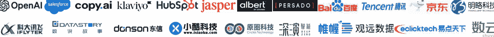

## AI+医疗


## AI+金融


## AI+教育


资料来源：企业/产品/应用排序不分先后，至顶智库结合公开资料整理经理。

# 2025全球人工智能全景图多模态模型

## 多模态基础模型

- GPT-5
- Gemini 2.5 Pro
- Liama 4
- Grok 4
- Mistral Medium 3
- Pixtral Large
- Mistral 3.1
- 文心4.5系列
- 豆包1.6
- Hunyuan-Large-Vision
- CoGenAV
- MiniMax-VL-01
- MiniCPM-V 4.5
- SenseNova V6.5
- Skywork UniPic 2.0
- GLM-4V-Flash
- 跃AI Step 3

## 图像模型

- DALL-E 3
- Gemini 2.5 Flash Image (Nano Banana)
- Stable Diffusion 3.5
- Aurora
- Streamream 4.0
- HunyuanImage 2.1
- CogView-4
- Sora
- Veo 3
- Gen-4
- Wan2.2
- 豆包·视频生成模型 Seedance 1.0
- 混合视频生成模型
- 可灵活2.0视频生成模型
- Hailuo 02
- Vidu 2.0
- MuseNet
- Lyria
- Stable Audio 2.0
- 豆包·实时模型
- MiniMax Speech
- GLM-ASR

## 视频模型

## 语音模型

资料来源：主要2024年10月推出的各类模型，至顶智库公开资料整理。

# 2025全球人工智能全景图——推理模型 & 开模型

| 推理模型 | | | |
| --- | --- | --- | --- |
| GPT-5 Thinking | Gemini 2.5 Pro | Claude 4 | Llama 4 |
| Grok 4 | Magistral | Claude Sonnet 4 | LFM2 |
| 文心X1 ERNIE-4.5-21B-A3-Thinking | Qwen3wQ-32B | Phi-4-reasoning | LFM7-8B |
| Deepseek-V3.1 Deepseek-R1 | 讯飞星X1 | Hunyuan-A13B | doubao-seed-1.6 |
| MiniMax-M1 | GLM-4.5 | SenseNova V6 | Kimi K2 |
| Skywork-OR1 | 跃AI Step 3 | Gemma 3 | Llama  |
| GPT-OSS | Mistral 3.1 | Pixtral Large |
| 文心4.5系列 ERNIE-4.5-21B-A3-Thinking | Hunyuan-A13B Hunyuan-MT-7B | Qwen3wQ-32B | Deepseek-V3 Deepseek-R1 |
| MiniMax-M1 | GLM-4.5 | Skywork-OR1 SkyworkUniPic 2.0 | Kimi K2 |
| CogVideoX v1.5 CogAgent-9B | Matrix-3D

资料来源：主要2024年10月推出的各类模型，至顶智库结合资料整理。

# 2025全球人工智能全景图—AI基础设施

| AI芯片 | AI服务 | AI计算集群 | 开发平台 | 数据服务 |
| --- | --- | --- | --- | --- |
| NVIDIA | Dell Technologies | Google Cloud | Google Cloud | Appen |
| AMD | Hewlett Packard Enterprise | aws | aws | scale |
| Google Cloud | inspur 灵鲲 | Microsoft Azure | Microsoft Azure | ALEION |
| aws | H3C | Meta | 阿里云 | sama |
| Meta | Lenovo 联想 | 阿里云 | 百度智能 | gretel |
| intel | 百度智能 | 讯讯 | 海天源 |
| Qualcomm | | 讯讯 | 火山引擎 | 京星 |
| | | 华为 | 华为 | 灵飞科技 |
| Cambricon | | 商汤 | STARDUST | |
| METAX | | | | |
| 芯驰科技 | | | | |

资料来源：企业/产品/应用不分先后，至顶智库公开资料整理。
©2025.9 ZD Insights insights.zhiding.com


## 1.5 全球人工智能发展路线（2024-2025）

| | | | | | | | | | | | |
| --- | --- | --- | --- | --- | --- | --- | --- | --- | --- | --- | --- |
| 2024 | 10.24 | 10.25 | 11.5 | 11.8 | 11.18 | 11.20 | 12.3 | 12.4 | 12.5 | 12.9 | 12.11 |
| LFM-7 | 1.20 | 1.16 | 11.15 | 12.26 | 12.18 | 12.13 | 12.11 | 发布开发者 | | | |
| 2025 | 2.2 | | | | | | | | | | | |
| Phi-4 | | | | | | | | | | | | |
| 发布深度检索 | | | | | | | | | | | | |
| Gemini 2.0 Flash-Lite | | | | | | | | | | | | |
| Magic-64B | | | | | | | | | | | | |
| 文心-4.5 | | | | | | | | | | | | |
| 文心模型-X.1 | | | | | | | | | | | | |
| NVIDIA GR00-IN1 | | | | | | | | | | | | |
| 2.14 | | | | | | | | | | | | | |
| 2.19 | | | | | | | | | | | | | |
| 2.25 | | | | | | | | | | | | | |
| 3.3 | | | | | | | | | | | | | |
| 3.6 | | | | | | | | | | | | | |
| 3.13 | | | | | | | | | | | | | |
| 3.17 | | | | | | | | | | | | | |
| 3.18 | | | | | | | | | | | | | |
| 3 | | | | | | | | | | | | | | |
| 4.1 | | | | | | | | | | | | | |
| 4.11 | | | | | | | | | | | | | |
| 4.14 | | | | | | | | | | | | | |
| 4.18 | | | | | | | | | | | | | |
| 4.22 | | | | | | | | | | | | | |
| 4.24 | | | | | | | | | | | | | |
| 4.28 | | | | | | | | | | | | | |
| 4.30 | | | | | | | | | | | | | |
| 4.5 | | | | | | | | | | | | | |
| 5.7 | | | | | | | | | | | | | |
| 5.13 | | | | | | | | | | | | | |
| 5.14 | | | | | | | | | | | | | |
| 5.16 | | | | | | | | | | | | | |
| 5.19 | | | | | | | | | | | | | |
| 5.21 | | | | | | | | | | | | | |
| 5.22 | | | | | | | | | | | | | |
| 5.28 | | | | | | | | | | | | | |
| 6.3 | | | | | | | | | | | | | |
| 6.10 | | | | | | | | | | | | | |
| 6.11 | | | | | | | | | | | | | |
| 6.17 | | | | | | | | | | | | | |
| 6.18 | | | | | | | | | | | | | |
| 6.19 | | | | | | | | | | | | | |
| 6.20 | | | | | | | | | | | | | |

- 讯飞星火4.0 Turbo
- GLM-Voice 语言模型（开源）
- Copilot v1.5模型（开源）
- Pixtral Large 多模态模型（开源）
- 元恺视频生成模型（开源）
- Genie 2 世界生成模型
- o1/o1 Pro
- GLM-4V 多模态模型
- 混元Hunyuan3.0 生成模型（开源）
- Qwen2.5-Coder 代码模型（开源）
- 放开 Sora 生成模型
- Hailuo 1V-01-Live 生视频
- OpenSearch 通用智能
- Aurora 生成模型
- Gemini 2 Project Astra Project Maker
- DeepSeek-R1 理理模型（开源）
- T2A-01 序列模型
- GLM-4-All11 大语言模型X1
- GLM-4-Plus 视觉理解模型
- Skywork o11 多模态模型（开源）
- DeepSeek-V3 理理模型（开源）
- FastHuan99 视频模型
- 交互：视觉、理解模型包含生成模型

- Qwen-2.5-VL 视觉理解模型
- Qwen-2.5-Max 多模态模型
- MiniMax-Text-01 文本生成
- MiniMax-V-01 多模态模型（开源）
- Coganpt-9B 智能模型（开源）
- Gemini Robotics VLA 模型 Gemini Robotics-
- Veo 2 视频生成模型 图像生成模型 多模态生成模型
- Phi-4
- Gemini 2.0 Flash-Lite 多模态模型
- Magic-64B Phi-mini-instruction 多模态模型
- Wan-2.1 视频生成（开源）多模态模型
- Manus 智能体
- Matrix-3D
- Skywork-R1 SkyworkUniPic 2.0 Kimi K2
- Claude 3.7 Sonet Claude-4 S
GPT-4 Turbo
- Mistral3.1 Skywork-R12 多模态模型（开源）
- Matrix-Zero 可交互式生成模型

## 1.5 全球人工智能发展路线（2024-2025）

| | | | | | | | | | | | | |
| --- | --- | --- | --- | --- | --- | --- | --- | --- | --- | --- | --- |
| 3.21 | 3.25 | 3.26 | 3.27 | 3.28 | 3.31 | 4.5 | 4.10 | 4.13 | 4.16 | 4.17 |
| Wan2.1-VACE-13B 视觉生成模型(开源) | Seed-1.5-Vi 多模态理解模型 思考模型 | Seedance 1.0 互实时语音模型(开源) | MiniMax-M1 混合推理模型 | Hailuo 02 视觉生成模型 | Haiku Video Agent 视频智能体 |

| T1推理模型 | Gemini 2.5 | Murmur V6生成模型 | Qwen2.5-OpenRI(开源) | QVB-MAX-视频模型 | 通用语言模型 | Llama 3 Maverick SenseNova V6 Skywork-01 多模态推理(开源) | Phi-4-reasoning 推理模型（开源） 逻辑学习模型 | GPT-41 GPT-4-mini GPT-4-nano 互包1.5视觉思考模型 | 互包1.5Transformer 3D生成模型 | Mistral M3 多模态模型 通用具智能模型 | Qwen3混合推理模型 | 端侧语言模型(开源) |
| | | | 5.13 | 5.19 | 5.7 | 5.7 | 4.30 | 4.28 | 4.25 | 4.24 | 4.18 | 4.22 |
| | Matrix-Chain 语音生成模型 空智能模型(开源) | Hunyuan-Vision 多模态生成模型（开源） 百度文言Flow 通用智能模型 | Nano VL 多模态视觉语言模型 | CoedEmbed 嵌入模型 | Magistral 推理模型 | Cosmos Predict-2 世界级通用模型 | 文心一言 多模态模型 深度理解智能模型 | Gemini 2.5 Flash-Lite 火山v.3 Skywork-2.0 3D生成模型 |
| | 5.21 | 5.22 | 5.28 | 6.3 | 6.10 | 6.11 | 6.17 | 6.18 | 6.19 | 6.20 |
| Seed-Coder 代码生成模型(开源) | T1-Vision 视觉理解推理模型 元流通用 | KUNL 超文本智能模型 | 通用语音表征模型 元源智谱生成模型 | CoGenAV 多模态语音表征模型 | Mistral | 火焰大量模型1.6 互视觉生成模型 Seedance 1.0 互实时语音模型(开源) | MiniMax-M1 混合推理模型 | Hailuo 02 视觉生成模型 | Haiku Video Agent 视频智能体 |

# 1.5 人智能发展路线图（2024-2025）

- Gemini CLI 编程智能模型（开源）
- Gemma 3n 混合推理模型（开源）
- 文心4.5系列模型（开源）
- GLM-4V-Thinking（开源）
- Skyward-R2 Reward-Agent（开源）
- Hunyuan-PolyGen 3D生大模型
- Skyward-R1 3.0 多模态推理模型（开源）
- LFM
- Kimi K2 基础模型（开源）
- ChatGPT Agent
- LFM2-VL
- Queen VLO 多模态理解生成模型
- GLM-45S 视觉理解模型（开源）
- MiniSpeech 2.5 语音生成模型
- Genie 3 世界模型
- Claude 4.1
- Hunyuan尺寸 融合理解模型系列（开源）


## 2.2 推理路径：通过算法机制提升模型能力

大模型基于一套系统化技术路径提升其推理能力。以思维链（CoT）为基础实现分步推理，通过自我反馈和情境记忆形成动态轨迹机制，并借助一致性校验确保逻辑一致性。在训练层面，采用监督微调（SFT）与人类反馈强化学习（RLHF）相结合的方式，借助优势估计和终端奖励完成策略更新。同时，引入对抗性奖励信号、KL惩罚以及价值函数训练来实现策略优化的目标。

### 推理时路径（Inference-time Reasoning）

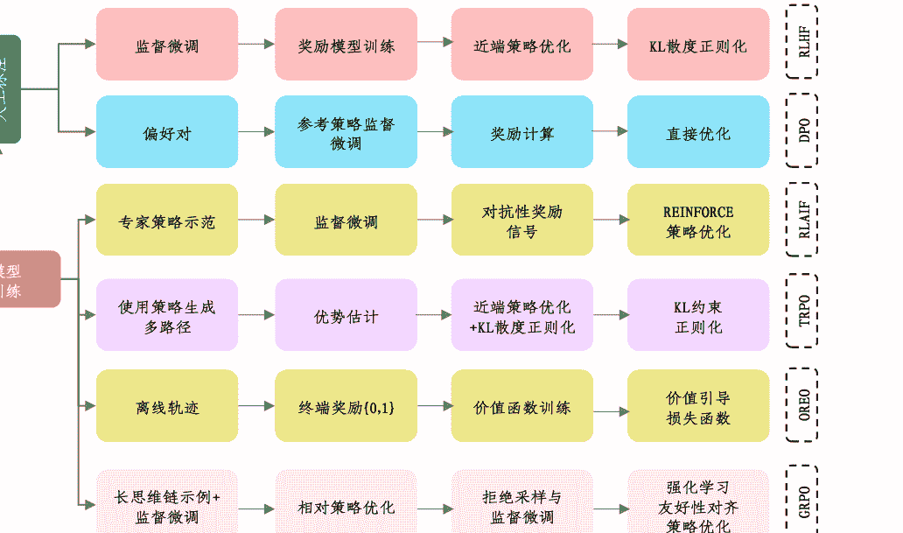

资料来源：LLM Post-Training: A Deep Dive into Reasoning Large Language Models，至顶智能

## 2.2 推理路径：多样式增强模型对复杂任务的能力

大模型通过多种推理路径适应不同任务需求。基础范包括输出（Direct）和思维链（CoT）推理。一致性（Self-consistency）与多思维链（Multiple CoT）通过生成多条推理路径并采用投票机制，为不确定任务提供方案。面对需要路径探索的复杂任务，思维树（ToT）引入树状结构，支持分支评估与回溯机制。最新提出的思维图（GoT）则突破了树状结构的限制，利用图结构实现路径的动态聚合与信息重组，为更复杂的非线性问题提供更优的解决思路。

### 模型推理路径

| Direct | CoT | Self-consistency | Multiple CoT | ToT | GoT |
| :--- | :--- | :--- | :--- | :--- | :--- |
| 输入 | 输入 | 输入 | 输入 | 输入 | 输入 |
| 输出 | | | | | |
| | | 投票机制 | | | |

资料来源：LLM Post-Training: A Deep Dive into Reasoning Large Language Models，至至顶智库整理编译。

## 2.3 混合专家架构 (MoE): 推动推理效率与模型性能突破

MoE(Mixture of Experts)架构中，输入数据通过前馈神经网络(Feed-Forward Neural Network, FFNN)与激活函数处理，由门控机制为每个专家分配激活概率。在稠密MoE架构中，所有专家均被参与计算，最终输出为各专家结果的加和；在稀疏MoE架构中，仅激活其中若干专家（如图激活FFNN），以提高推理效率并降低计算资源开销。该机制实现在保持模型性能的同时，优化推理效率，适用于大规模参数部署。近年来，大模型已并入MoE架构以提升参数利用率和训练扩展性。

### 混合专家架构 (MoE) 原理

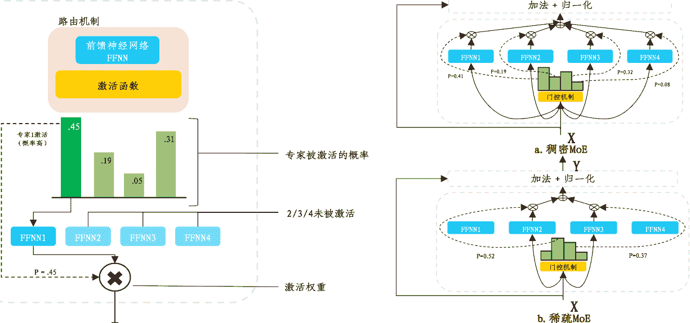

资料来源：Maarten Grootendorst，混合专家模型(MoE) 到底是什么？，至顶智库解析

## 2.4 模型蒸馏：压缩计算复杂度，实现模型高性能轻量化部署

模型蒸馏是指将复杂模型（教师模型）的知识迁移到小型模型（学生模型）的技术，其核心目标是在保持模型性能的同时，显著降低小型模型的计算复杂度和存储需求，使模型更适合在资源受限的环境中部署。教师模型规模大，性能较高，但在计算和存储资源上存在较大压力；学生模型结构较为简单，通过模仿教师模型输出的软标签（概率分布）学习知识和表示能力，软标签包含类别相似性和内在关系等更多信息，有助于学生模型捕捉潜在特征并提升泛化能力。在实际应用中，DeepSeek-R1对Qwen和Llama等开源模型进行蒸馏，得到更高效率的小模型，显著降低推理成本。此外，诸如DistillBERT、TinyBERT以及MobileBERT模型都采用蒸馏技术，用在保持高性能的同时提升效率，推动轻量化模型的发展和普及。

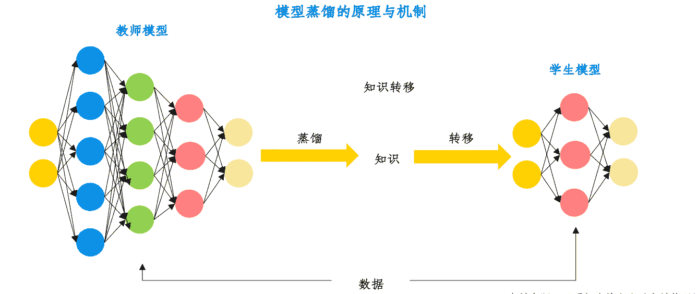

资料来源：至智库公开材料整理

### 主流模型的后训练过程已普遍采用强化学习方法

当前，主流大模型利用强化学习技术进一步提效。强化学习作为机器学习领域的核心之一，由智能体、环境、状态、行为、奖励及策略六大核心组成。与监督学习和无监督学习不同，强化学习是指智能体通过执行动作影响环境，并根据环境反馈的奖励来调整策略，以便在未来获得更好的决策。目前主流模型的后训练过程均已采用相关强化学习方法进行优化。

### 强化学习核心要素

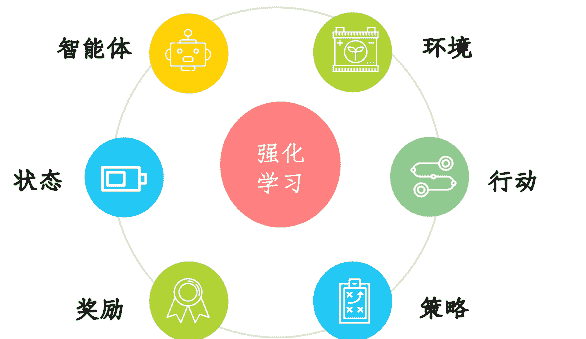

### 强化学习通用流程

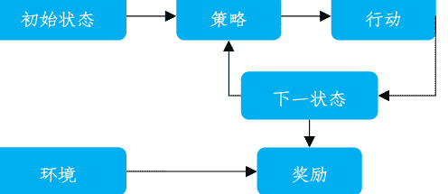

| 模型 | 企业 | 强化学习方法 |
| :--- | :--- | :--- |
| DeepSeek-R1 | deepseek | RL through CoT |
| Kimi-l1.5 | | RL through CoT |
| o1 | OpenAI | RL through CoT |
| Hermes 3 | NOURS | DPO |
| Athene-70B | Neuxflow | DPO |
| Starling-7B | Berkeley | RLAIF,PPO |
| Gemma2 | Google | RLHF |
| Qwen2 | Alibaba | DPO |
| Llama 3 | Meta | DPO |
| Nemotron-4 340B | NVIDIA | DPO,RPO |
| ChatGLM | 智谱·清 | ChatGLM-RLHF |
| DeepSeek-V2 | deepseek | GRPO |

资料来源：Reinforcement Learning Enhanced LLMs: A Survey，至智库整理。

## 2.5 传统与强化学习成为大模型提效“双轮”

主流大模型在后训练阶段采用的强化学习方法主要包含两类。一类是传统强化学习方法如人类反馈强化学习（RLHF）和AI反馈强化学习（RLAIF）；另一类是强化学习方法如直接偏好优化（DPO）和奖励优化（RPO）。强化学习在大模型训练中经历三阶段，即奖励模型训练、偏好微调和策略优化。大模型可突破单一预答案的局限，动态适配不同偏好，生成合理、符合上下文且高质量的内容，更加贴合用户期望。


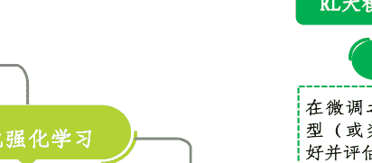

| RLHF | RLAIF | DPO | RPO |
| :--- | :--- | :--- | :--- |
| 人类标注对LLM的排序，用顺序训练奖励模型，再基于奖励模型优化LLM，核心是“直接对人类偏好”。 | AI标注对LLM的排序，训练奖励模型，基于奖励模型对齐LLM，解决“人类标注成本高、效率低”的问题。 | 无需标注，独立训练奖励模型，通过梯度下降优化策略，数据化计算，核心目标是让模型输出符合人类偏好。 | 在DPO基础上加上奖励机制，训练一个奖励模型，逐步提升LLM输出的质量与一致性。 |

资料来源：Reinforcement Learning Enhanced LLMs: A Survey，来自智库整理。

## 2.6 海外科技巨头引领高性能芯片发展

近年来，AI芯片已成为人工智能发展的核心引擎，在大模型训练和推理中，算力、内存带宽和互联决定迭代速度。当前，国际芯片正围绕高性能计算、低精度和系统优化开展激烈竞争。NVIDIA凭借其Blackwell架构与Rubin架构维持在训练和推理市场的领先地位；Google依托TPU深度硬件垂直整合，强化其云计算能力；AWS通过自研Trainium芯片和Inferentia芯片的协同，提供云端算力解决方案。

### 全球AI市场

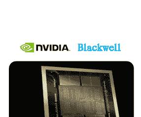
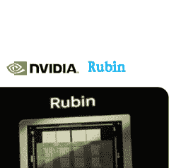

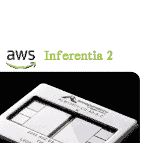

- 2024年，NVIDIA推出Blackwell架构，适用于大规模推理，采用先进工艺拥有208亿晶体，效能实现跨越，GPU训练能力是Hopper的65倍，更能大幅提升。
- 2025年，NVIDIA公布下一代超级芯片 Vera Rubin：整体性能是GB300 NVL72的3倍，集成288GB HBM3、13TB/s显存带宽，单身实现900倍Hopper的性能；Rubin Ultra计算面积提升64倍，性能提升至100 TFLOPS，HBM容量高达1024GB。
- 2025年，Google推出第七代 TPU Ironpod：算力上限超过464 TFLOPS；相比第六代 TPU Trillium，在训练效率上实现2倍提升，Cloud TPU提升高达30倍；为了让性能极致，定制扩展性最强的加速器，首款为推理芯片的设计。
- 2022年，AWS发布第二代推理芯片Inferentia2架构与Rubin 1相似，但NeuronLink-v2接口更少，每次推理成本可降低40%，延迟更短；Inferentia2可以更大规模部署。
- 2023年，AWS推出第二代训练芯片Trainium 2：专为高性能芯片训练基础和大语言模型构建，性能是上一代的4倍，性能提升3倍；基于 Trainium 2的Amazon EC2实例可以构建模型，实例支持16个Trainium单元用于训练数千上万个模型。

资料来源：至顶首页联合报告整理。

## 2.7 国内AI芯片持续创新，训练推理并行

当前，国内AI芯片正值国产化战略速度加速，以华为昇腾910C、昆仑仞P800、沐曦C600为代表，在推理和轻量化训练场景中实现规模化落地。与国外追求绝对峰值不同，国内企业更注重架构自主性与性能优化，并通过软硬深度垂直整合和性价比优势抢占市场。总体而言，国内AI芯片仍受到外部环境制约，但目前已取得显著进展。长来看，先进制造、软件生态、硬件稳定性以及基础架构原创性创新仍将是未来需要持续攻坚的重点领域。

### 国内主流AI芯片示例

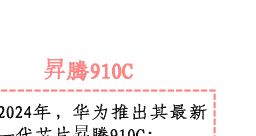

- 昇腾910C
- 2024年，华为推出其最新一代AI芯片910C，采用先进工艺制造7nm工艺，起步即实现更高位宽、更强的训练和推理速度。
- 2025年，华为的910C在Ascend Matrix 384集群上实现，从国产的资源供给者模式转型，多方面发力。
- P800
- 2025年，昆仑仞发布第三代AI芯片P800，显存性能优于同类，单卡性能提升20%~50%，支持大模型快速迭代。
- 沐曦C600
- 2025年，沐曦发布首代通用产品沐曦C600，软硬件垂直整合，满足大模型训练和推理需求。
- L600
- 2025年，领先推出第四代训练芯片L600，配备HBM3高性能显存，拥有44GB容量，3.6TB/s带宽；其中昇腾800实现万级计算，单卡8TB/s带宽。


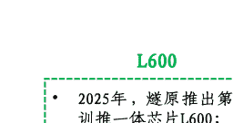


资料来源：至智库联合简报。

## 2.8 海外云厂商持续加大基建

近年来，海外云厂商的资本开支持续增长。以AWS、Google、Meta为主的云厂商纷纷掀起浪潮，2025年资本支出预计达到1050亿、850亿、750亿；国内云厂商阿里巴巴、腾讯、百度2024年资本开支分别达到848亿、768亿、1亿元。

### 国外云厂商2023-2025年资本开支（单位：亿美元）

### 国内云厂商2023-2024年资本开支（单位：亿元）

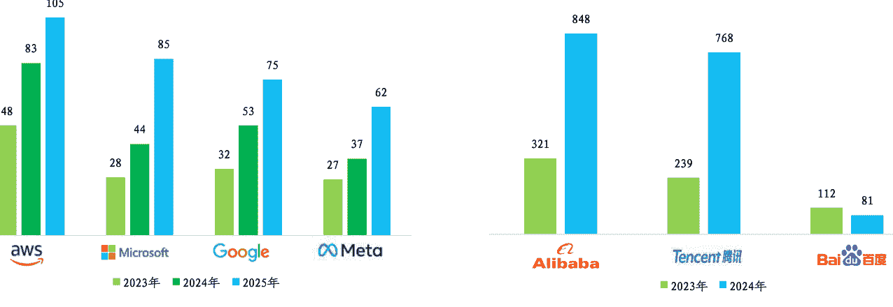

## 2.9 美国科技巨头持续加码算力

美国科技巨头积极推进算中心建设，AI需求不断增长。以OpenAI、Google、Microsoft和Meta为主的云厂商在AI基础设施领域加大力度，刷新基建新高。OpenAI主导的“Stargate”项目累计投入达500亿美元；Google年度支出达750亿美元；Meta计划将“Hyperion”集群投入100亿美元。以上数据反映美国通过大规模投资和技术创新，不断巩固其在全球范围内领先地位。此外，美国算力领域的主体日益多元，成为助力AI落地的重要力量。

### 美国科技巨头智能建设情况

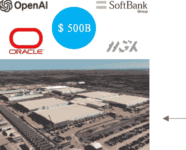


2025年1月，OpenAI宣布正式启动“Stargate”AI基建项目，该项目位于得克萨斯州，目前投入达1000亿美元，以实现AI训练的目标。

2025年8月，Google宣布将在未来两年投资90亿美元，用于俄克拉马州的云和人工智能基础设施，服务于新数据中心建设与现有设施扩建。

2025年7月，Meta发布将于路易斯安纳州开展的“Hyperion”规划，预计投资100亿美元，将进一步扩展AI的基础设施，支持更复杂的模型训练和推理。

> 资料来源：至顶智库结合公开资料整理。

## 2.10 国内超节点方案推进AI计算集群性能新突破

超节点是一种通过单节点增加数据计数，具有极高带宽互连、纵向扩展与集成化等优势的方案，在性能、成本、组网、运维等方面表现出来。超节点能够提供高带宽互连与低时延，有效支撑并计算任务，缩短模型训练周期，提升整体可靠性。华为推出的 Atlas 900 A3 SuperPod（昇腾384个超节点），通过总线技术实现384个NPU之间大带宽低时延互连，资源调度能够满足AI训练与推理需求；浪潮信息发布的元SD200，可以实现机内运行超大模型，在大模型训练同时与多智能体交互时实时与均衡；云芯发布的超节点方案通过硬件创新领先全升级互联带宽，支持IB/RoCE跨域延传输，助力万卡级建设。超节点方案正推动AI集群更高效的方向。

### 超节点特点

- 单节点增加加点
- 纵向扩展
- 集成化

### 超节点案例

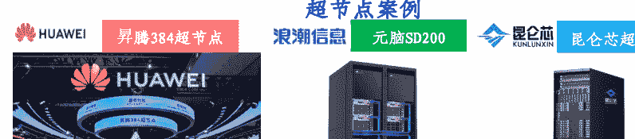

2025年7月，华为为华推出昇腾384个超节点即 Atlas 900 A3 SuperPod；n产品基于超节点架构，节点间带宽提升15倍，通信时延下降10ms，千亿参数训练可缩短至2天内，实现基础架构工程化。

2025年8月，浪潮信息面向万亿模型训练发布RSD200超节点服务器，基于集群架构，采用多机三维网（3D Mesh）结构实现机内运行超大模型CPUGPU融合，完美适配国产GPU。

2025年4月，昆仑芯推出超节点新品，为AI集群提供性能提升及关键解决方案：通过灵活构架超节点，实现全通用带宽互连，适配MoE大模型训练效率提升5倍，参数训练效率提升1倍；n助力万卡级智算集群支持。

数据来源：华为、浪潮信息、昆仑芯、京东智发布超节点行业报告。

insights.zid.cn


## 2.11 开源生态加速AGI时代到来

近年来，开源生态成为推动AGI发展的核心引擎。中国AI企业密集开源高性能模型，如阿里通义Qwen3系列、DeepSeek-R1等。通过开放架构与训练策略，企业可降低算法依赖性成本；开源驱动的技术民主化进程有望打破行业垄断，构建差异化生态；开源社区汇聚全球开发者协作，以“生态飞轮”效应加速技术迭代，使AGI产业真正实现共享。

## 开源生态对于产业发展的重要意义

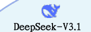


- 推动技术普惠打破智能垄断
- 模型开源降低研发门槛，促进AI技术民主化，打破应用壁垒，使中小企业共享红利，以更低成本参与AI研发，从而加速技术迭代。


- 构建生态飞轮形成良性循环

企业通过开源代码，吸引开发者优化算法，从而使得技术迭代加速，更多人参与其中，最终开源生态不断完善。


模型能力能够帮助企业应对封锁、技术瓶颈等挑战，通过模型、权重、推理算法的全面开放，企业得以实现产业转型，提升生态竞争力。


中国开源模型挑战美国开源垄断，避免AI技术封锁，各国基于各自优势的差异化竞争，形成互补的全球格局。

资料来源：至顶智库合AI智能报告。

# 3.智能体技术及应用进展

智能体特征
智能体技术架构
- 通用智能体
- 行业智能体
- 企业智能体
- MCP协议
- A2A协议

## 3.1 智能体特征：自主感知、规划执行

智能体（AI Agent）是一种基于大模型的高自主性智能系统，可凭借强大的理解能力与内容生成能力对环境的实时感知，并通过自主规划与调度工具完成复杂目标。智能体具备记忆、自主规划与工具调度等复杂任务四大核心能力。任务处理范围、自主程度、记忆、工具使用等等方面实现突破，相较于AI助理，智能体在目标导向、交互维度、任务处理等方面实现突破，凭借其自身的自主感知与规划执行能力，能够从智能体自主解决复杂场景的转变。

## 智能体核心特征：助理与智能体对比

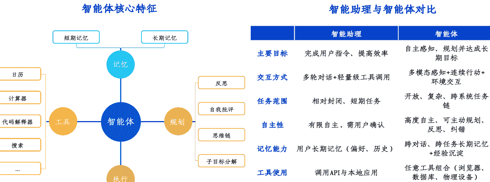
资料来源：至顶智库公开资料。资料来源：至顶智库公开资料。

## 3.2 技术架构：涵盖感知、认知与执行

智能体的技术架构主要由感知、认知与执行三大模块组成。其中，感知模块负责处理环境数据，接收用户输入以及动态反馈进行解析；认知模块分为情感、记忆、目标等智能体的认知基础；执行模块协同运转，使智能体能够完成“感知—规划—工具调用—反思”的全，最后将任务结果输出到物理世界。

## 智能体技术架构

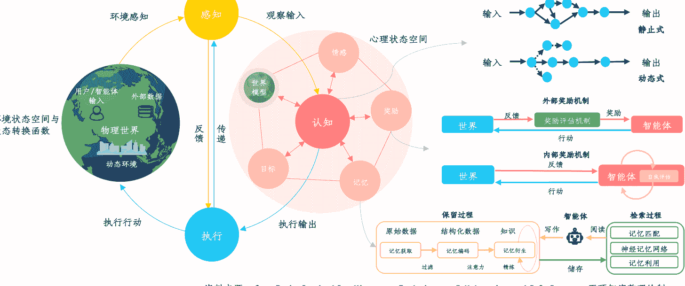
资料来源：Inspired Intelligence to Collaborative and Safe Systems, 至顶智库。

## 3.3 多智能体体系：实现任务的并行处理与信息整合

多智能体通过主导智能体协同子智能体进行调度，实现任务的并行处理与信息整合。以Anthropic多智能体架构为例，以主导智能体为核心，依托搜索、模型调度协议(MCP)、记忆及搜索子智能体完成工作。主导智能体可调用子智能体执行任务，记忆模块在整个过程中持续存储并保持上下文连贯性与一致性。用户请求在系统内部经多个智能体进行查找与增强后，生成最终报告。

## 多智能体架构

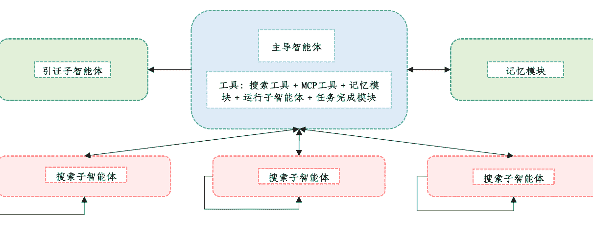
资料来源: How we built multi-agent system, Anthropic, 至顶智库。

## 3.4 通用智能：应用场景化，需求适配

通用智能已广泛覆盖生活的场景。涵盖数据分析、教育、编程、生产力等多元任务，提升日常办公效率；涉及战略制定、内容创作、辅助助手等个性化场景，为用户提供精准决策，体现了“全场景覆盖、全需求适配”。

## ChatGPT 应用案例——拟定出行计划

了解用户需求，在附近寻找一家高餐厅，并选择一个空闲的时间。根据用户需求规划行程如下：
1. 寻找适合聚餐人群且用户未尝试过的高餐厅。
2. 使用Google Calendar检查用户的日程安排并确定空闲时间。
3. 通过OpenTable网页在空闲时间进行预约。

- 投资分析
- 市场分析
- 数据可视化
- 课程设计
- 学习建议
- 知识专家
- 深度研究
- 行业分析
- 文献综述
- 旅游安排
- 团建策划
- 日程管理
- 策略规划
- 创作
- 智能播客
- 绘画大师
- 脚本编写
- 写作助手

通过GPT调用内部工具和API完成任务：
1. 通过搜索2025年7月，解析可选的餐厅；并在附近好吃的餐厅确认预约。
2. 访问订单，并使用API请求用户的Google Calendar进行预约，并将预约事项添加到用户的Google Calendar。

最后以行程的形式，将预留的时间、地点等结果提供给用户查看。

- 应用设计
- 游戏开发
- 商品对比
- 健康助手
- 财务管理
- 装修指南
- 编程
- 生活

资料来源：至顶智库公开数据集。
©2025 9D Insights 智能体.39

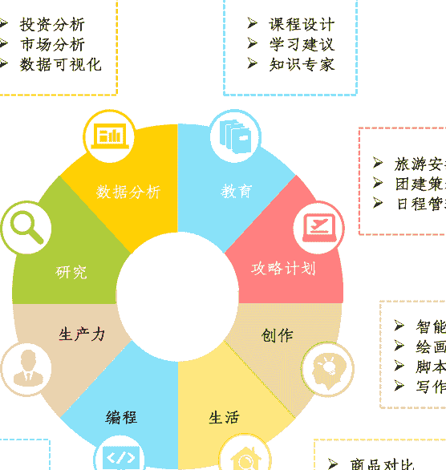

## 3.5 行业智能体：应用领域持续拓宽，场景创新不断深化

当前，行业智能体应用领域持续拓宽，场景创新不断深化。智能体凭借“环境感知—自主决策”在金融、医疗、教育、政务、电信等领域得到广泛应用，显著提升各行业效率并创造新服务模式。在金融领域，智能体根据金融机构的独特需求对业务进行深度定制，具有高度的针对性和专业性；在工业领域，智能体成为行业发展的“数字大脑”，推动新型工业化的核心引擎；在教育领域，智能体为师生提供个性化、实时性的服务。

## 行业智能体典型应用场景

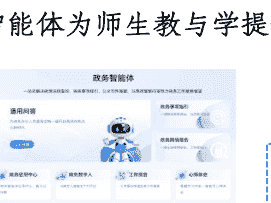

工业领域，西门子发布的Industrial Copilot设计功能，可独立执行规划、生成工作流程。教育领域，大讯飞火智能体与学生对话、设计多个环节、提高思考能力，教师只需下指令。政务领域，中国移动的政务智能体功能聚合、检索、指导、个性化办理并提供支撑，推动业务决策。


法律领域，联合集团通过法律智能体检索、咨询等功能，提升工作效率。用户能够查阅材料、生成法律意见。医疗领域，Healthcare Agent能够处理许多耗时任务，包括病例预测、随访等，也可根据需求提供服务。

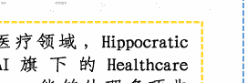
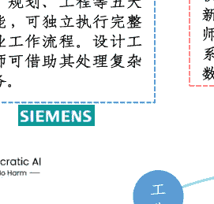
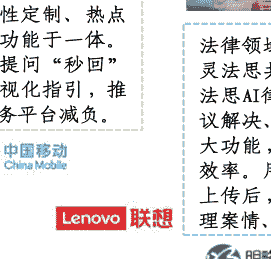

金融领域，蚂蚁Copilot & Agent覆盖知识管理、实时分析、客服中心等业务分析。营销领域，智能体包含视觉理解、数据处理、挖掘，提升效率，推动精准决策落地。

资料来源：至顶智库公开报告整理。

## 3.6 企业智能：优化各部门工作流，智能化升级

企业智能具备任务处理能力，作为自主能力的“数字员工”，为企业级提供多样化解决方案。一方面，不同行业领先者适配自身工作流。在制造业中，企业智能能够优化生产流程；在互联网行业中，企业智能可用于研发并帮助业务。另一方面，企业内部办公场景中，智能体可作为后台助手处理行政、人力资源、财务管理等工作。企业智能展现出广泛应用价值，成为数字化转型和效率提升的关键要素。

## 企业智能在企业内部的应用示例

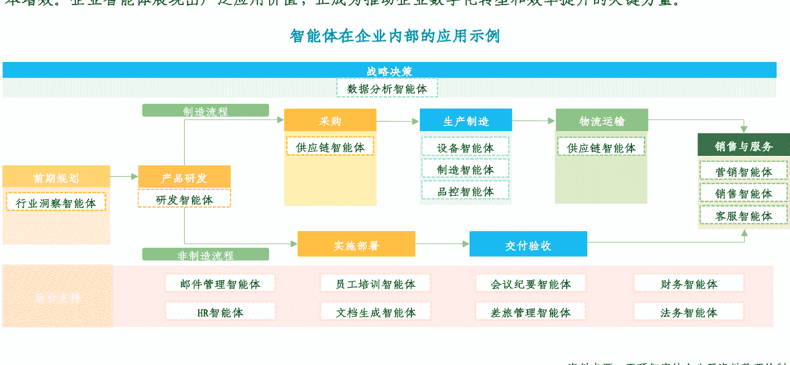

## 3.7 MCP协议：助力AI模型与不同数据源和工具无缝交互

MCP (Model Context Protocol)是由Anthropic提出的一套标准化交互协议，旨在创建一个通用标准，使AI程序的开发和集成更加简单，使得开发者能够以一致的方式将数据源、工具和功能链接到AI模型，为Agent开发支持。作为重要交互，MCP使得AI模型和应用开发进一步解耦，显著降低Agent的开发门槛。MCP Server标准化规范，本质上为模型和智能体提供更精细、量化的工具调用能力，降低对复杂工具的调用门槛。

## MCP架构主要特征

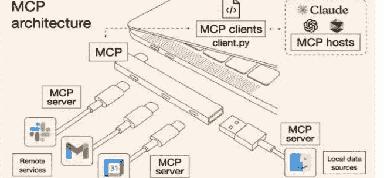

MCP架构主要由MCP主机、MCP客户端和MCP服务器三部分组成。AI客户端实现与外部工具及数据源无缝通信：由用户发起一系列Prompt，MCP主机上运行的MCP客户端，向MCP服务器发送初始请求，结合数据源（远程服务、数据库、本地文件等），通过选择、API调用等操作将初始请求与通知等操作传递，MCP主机、客户端、服务器三个核心组件间通过无缝通信，实现AI应用与外部工具和数据的交互，满足用户需求。

## 3.8 A2A协议：助力智能体实现横向协作

2025年4月，Google发布A2A（Agent2Agent Protocol）开源框架协议，旨在促进不同智能体之间的横向协作。该协议可在无需框架或供应商的情况下实现智能体在不同生态系统间的协作，借此推动智能体在更广泛场景中的落地。A2A协议帮助智能体从孤立的系统和应用程序完成协作，进一步提升智能体的自主性和生产力。此外，A2A协议支持视频音频等多种交互模态，能高效处理任务又能支持深度研究。与MCP协议不同，A2A协议侧重解决大规模Agent部署问题，是对纵向解决智能体交互调用问题的MCP协议的有效补充。

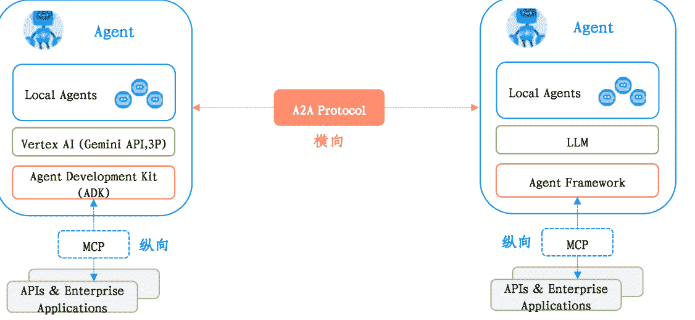
资料来源：至顶智库结合公开资料整理编制。
insights.zhiding.com

## 3.9 Anthropic: Claude 变革方式

Claude是由Anthropic开发的全能智能体。通过自然语言帮助开发者高效编写代码、调试和管理等。从架构来看，Claude由核心引擎、执行层和交互层组成。核心引擎充当“大脑”的作用，协调工作；交互层是接口；执行层负责环境交互、收集信息。在功能上，Claude直接解析代码、纠错等能力突破。

## Claude示例一

```
// I want to do this, can you explain it?
// If I analyze the structure and provide high-level explanation
// By refactoring the components, how is it?
```

## Claude示例二
```
// Can you open GitHub issues related to this.
// If I want to open specific list
```

## Claude示例三
```
// Refactor the project to show how they interact
// I am starting by refactoring the mentioned components.
// Graph:
// src/components/index.js
// Found 9 files
```
Claude直接对代码库与上下文关系的深度解析。
资料来源：Anthropic, 博客介绍。

## 3.10 小米科技：商业分析智能体为精准决策赋能

小米科技为数据智能软件，为用户提供数据分析为核心服务。基于大模型构建的商业分析智能体，拥有多智能协作能力，具备智能规划、数据连接、预置知识和报告生成等功能。小米科技领先产品协同同力，旨在推动全球智能化进程。

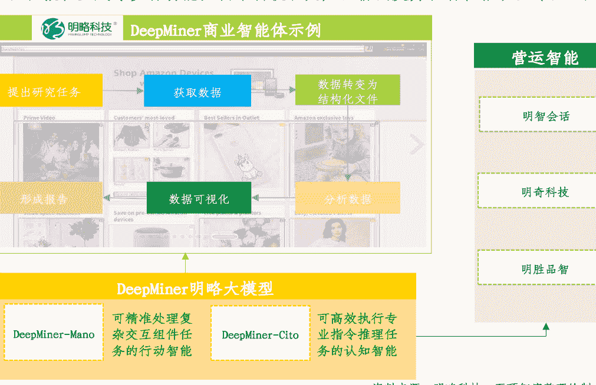
©2025 9D Insights 资料来源：至顶智库编译。insights.zhiding.com

# 4.智能硬件及应用进展

- AI眼镜
- AI手机
- AI PC
- 智能汽车
- Deep Research
- AI编程

## 智能硬件：AI眼镜

Meta、小米、奇克、雷鸟、Rokid、影目等推出新款AI眼镜，产品销量爆发式增长。Meta发布的AI眼镜时尚外观和实用功能，在全球范围内引发关注。在2025年人工智能大会上，推出的AI眼镜具有许多重塑：硬件层面，系统重构，采用双芯设计；AI能力层面，实现从基础指令到自然对话系统的跨越；生态整合，深度融合支付宝生态，为用户带来更智能、便捷的穿戴体验。奇克在硬件领域的积累，通过多种通信技术，打造好用的AI眼镜。

## 主流AI眼镜对比

| 品牌及型号 | 功能 | 计算平台 | 性能 |
| --- | --- | --- | --- |
| Meta AI眼镜 | 助手、音乐播放、免提通话、翻译 | 骁AR1 | 典型续航4h |
| 小米AI眼镜 | 助手、语音通话、支付 | 骁AR1+处理器 | 典型续航8.6h |
| 奇克AI眼镜 | 助手、语音通话、出行、导航、购物、翻译 | 奇克AR1+低功耗处理器 | |
| 雷鸟X3 Pro | 助手、音乐播放、导航、翻译 | 骁AR1 | 5h长时播放、3h音乐播放、6h视频播放 |
| Rokid Glasses | 助手、音乐播放、导航、翻译 | 骁AR1 | 12日日常使用、4h连续实用、6h音乐播放 |
| 影目INMO AIR3 | 助手、导航、翻译、购物、社交 | 莱光视界穿戴 | 典型续航3h |

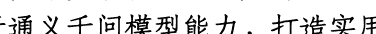


- 助手：使用Meta基于实时环境提供一系列建议和口碑
- 拍摄：按下快键或唤醒“Hey Meta”，即可拍出更高质量的图片和视频


## 智能硬件：AI手机

AI手机的应用场景不断拓展，智能化不断增强。国内主流手机厂商不断创新，三星、小米、华为、OPPO、vivo等推出各类AI功能的新机型。相关AI能力涵盖从基础功能（如文案写作、图像生成）到进阶功能（如识别问答、自动导航）等等方面。具体来看，苹果的Visual Intelligence通过拍照并结合AI模型提供信息反馈；小米的自动导航通过识别消息的地理位置并自动发送至地实现导航。


- 写作工具（Writing Tools）：支持“改写（Rewrite）”、“校对（Proofread）”和“摘要（Summarize）”功能。
- 图像创作与生成：可以通过文字描述生成图像，支持绘画、抠图和涂鸦等功能。
- 视觉识别（Visual Intelligence）：在iPhone 15/16 Pro更新机型中，支持实时识别物体并发送ChatGPT进行查询。
- 语义理解提升：提升语义处理能力，使其更理解能力及更自然的对话体验；支持文字输入。在屏屏时根据上下文请求等交互。

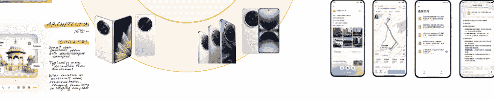

资料来源：至智库结合公开AI趋势。

## 4.3 智能性能：AI PC

AI领域中，国内外厂商已相继推出一系列AI产品。现有AI PC呈现内嵌智能体、端侧部署大模型，进一步提升用户在工作和学习场景中的智能体验。同时，端侧模型+个人云的部署保证了AI工作的高性能、低成本与随时随用的特性，保障用户的数据隐私。联想已形成涵盖笔记本、台式机、工作站与服务器的全方位产品矩阵，不断丰富软件生态，展现AI PC在各类场景应用的广阔空间。

## 2025 AI PC趋势特征

| 产品类型 | 产品型号 | 功能优势 |
| :--- | :--- | :--- |
| 笔记本 | YOGA AI 15 Aura | 原生支持超感智能体，基于本地算力运行，通过大模型的操作方式在执行工作中完成AI任务。同时与云端扩展大模型，在响应复杂交互任务时能够得到理想效果。 |
| | YOGA Pro 14 | |
| | YOGA 360 14 | |
| | ThinkPad P12i/P14i/X1 Carbon | |
| | ThinkBook 14p/16p | |
| | ThinkCentre P900/P900c | 为开发者定制、微调和推荐新一代AI模型提供强大的支持。 |
| | Neo Ultra | |
| | M460 | |
| | T490 | |
| | ThinkStation PX | |
| | ThinkStation P7/P78 | |
| | ThinkStation P6220/P520 | 为丰富客户的HPC和AI计算、科学计算、AI训练、大规模模型等场景提供强大的支持。 |
| 服务器 | ThinkSystem | |

AI PC通过内嵌智能体，为用户提供个性化智能服务，实现多模态自然交互、个人大模型部署以及本地知识库搭建一套连接。针对法律行业部门，法律智能体包含“争议解决、法律咨询、合规管理、合同管理、知识产权、公司法律、运营管理、项目管理”八大核心功能。

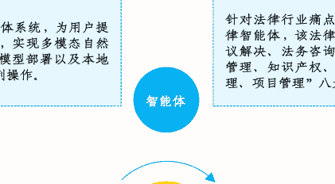

AI PC在个人与公共两个方面与大模型深度融合，形成融合式AI PC，同时通过端侧大模型+个人云的部署实现“高性能、低成本、安全可靠”难以兼得。

AI PC在端侧设备上实现大模型的部署与运行，用户基于端侧模型完成任务的撰写、处理等一系列任务，充分保障数据隐私与高可用性。

资料来源：至顶智联合报告。

## 4.4 智能汽车：端到端自动驾驶技术体系

端到端自动驾驶为高级别自动驾驶提供新的技术路径。基于统一的神经网络从传感器数据输入直接到控制指令输出的连续学习与决策过程，核心要素体现在数据采集、训练算法、模型设计训练、模型压缩等方面。端到端驾驶模型依赖数据闭环性能持续提升；训练算法旨在通过数据闭环建立从传感器输入到驾驶规划控制指令的映射，提升自动驾驶系统性能和安全性；模型设计训练分为“分块模型”和“单模型架构”两种；模型压缩主要包括模型剪枝、模型量化和编译优化，旨在降低网络计算需求，提升车载计算平台的运行速度。

## 端到端自动驾驶技术体系

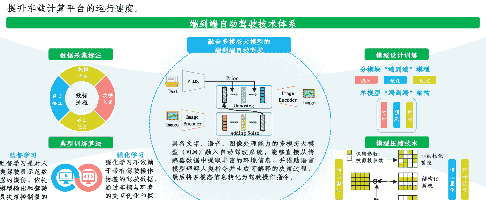

具有文字、语音、图像处理能力的多模态模型（VLM）能够自动驾驶系统从传感器数据中提取丰富的信息，并帮助语言模型理解指令并生成可解释的决策过程，最后将更多信息转化为驾驶决策指令。

监督学习是对历史驾驶数据样本的拟合，模型输出与人类控制策略的差异对驾驶模型进行迭代改进。

资料来源：李华、江龙等：汽车智能驾驶技术发展与趋势展望，前瞻科技，至顶头部结合公开资料。

## 4.4 智能汽车：端到端自动驾驶进展——VLA模型

视觉-语言-动作模型（VLA）由VLM模型演变为，结合了视觉、语言和动作三种能力，旨在实现从感知输入直接到控制输出的完整闭环，不仅关注环境感知，关注规划与控制问题。Waymo发布的EMMA模型具备处理文本、图像、视频等多模态输入，将驾驶任务定义为视觉问答（VQA）问题，最终生成多种驾驶输出（如规划轨迹、感知语义、道路像素元素等）。EMMA充分利用Google Gemini模型积累的世界知识，更好地理解驾驶过程中的动态变化，作为VLA模型在自动驾驶领域的初步实践。

## Waymo: EMMA端到端自动驾驶模型架构

| Driving rationale |
| --- |
| Critical objects: cyclist at [10.32,46.6], vehicle at [8.41,-3.01] |
| Behavior description: The cyclist is currently stopping at the intersection; The observed vehicle is currently moving in the same direction, and its future trajectory suggests it will continue straight. |
| Meta decision: Keep speed. |

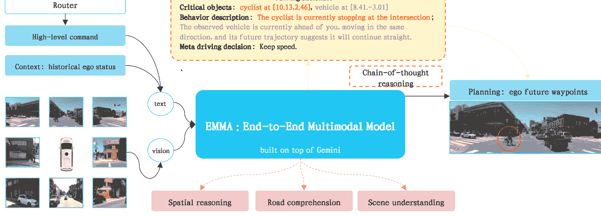

来源：EMMA: End-to-End Multimodal Model For Autonomous Driving, Waymo，至顶智结合公开资料。

## 4.5 Deep Research（深度研究）从信息搜集到深度洞察

Deep Research（深度研究）核心价值在于突破传统检索局限，实现信息搜集到深度洞察。由任务拆解、信息检索、分析推理、交叉验证与结果输出五个核心步骤构成，成为现代（如研究人员、分析师、决策者）不可或缺的智能伙伴，能够大幅提升效率与认知。

## Deep Research主要工作流程

Deep Research示例：行业报告

生成汽车行业过去年的报告并附带相关的表格。

```
ChatGPT
Can you make a research report on how the automotive industry changed in the past years, use tables where necessary?
To make sure the reports meet your expectations, please clarify few things:
1. I am interested in changes in the automotive industry, or specific region?
2. Should the focus be on automakers, or electric vehicle manufacturers?
3. What details do you want to include in terms of sales figures, trends, or performance metrics?
```

# Five Years in Transformation of the Automotive Industry (2020-2025)

Introduction: The automotive industry has undergone dramatic changes from 2020 to 2025. With the shift from internal combustion engines to electric vehicles, many companies have pivoted their strategies to adapt. This report examines the impact of autonomous driving and electric vehicle breakthroughs as well as consumer preferences, regulations, and the final market landscape.

运用知识图谱进行深度分析并根据新信息完善结构大纲、论文、图表等，结论确保专业性。

2 检索高质量信息

www.wikipedia.org
www.factorystats.com
www.ericsson.com
nat.review.com
www.experian.com
www.deloitte.com
www.mcksey.com
www.reuters.com
www.jpmorgan.com
www.forbes.com
www.caresofglobal.com
www.techkapital.com

## 4.6 AI编程：从辅助工具到智能体，重构软件范式

当前，AI编程正在深刻重构软件范式，其核心能力已超越传统辅助工具，形成AI编程全解决方案。从全球视角来看，AI编程已进入规模化应用，国外以基础模型创新和自主开发为主，重视通用性与开发者体验；国内重视工程化工具链，强调落地性与本土化适配，形成差异化格局。从编程环节来看，基于大规模预训练模型的代码生成系统能够准确理解意图，完成从自然语言描述到可执行代码的转换，同时支持多种编程语言和复杂算法实现，可针对特定代码库提供优化建议，实现代码补全、错误识别到代码优化的闭环。

## 国内主流AI编程应用及分布

| 功能分类 | 代码平台 |
|---|---|
| 国外 | GitHub Copilot, Tabnine |
| 国外 | Cursor, GitHub Copilot |
| 国内 | 通义灵码, CodeGeeX |
| 国内 | 百度文心码, 智谱CodeGeeX |

| 功能分类 | 插件 |
|---|---|
| 国外 | AWS CodeWhisperer, OpenAI Codex Agent |
| 国外 | Amazon CodeWhisperer, Tabnine |
| 国内 | 通义灵码, 华语AIAgent |
| 国内 | 百度文心码, 华为AIAgent |

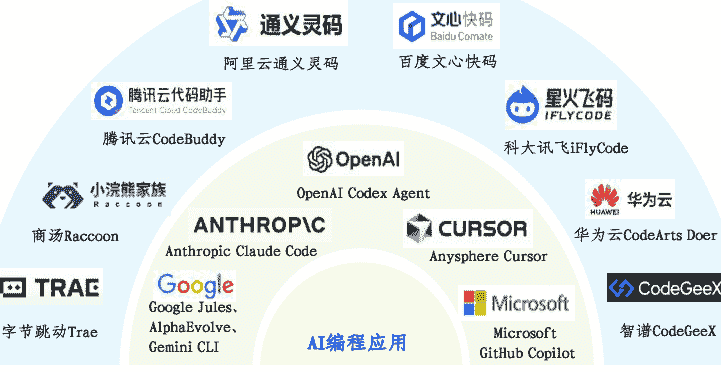

资料来源：至顶智库结合官方资料整理。

# 5.全球AI企业最新布局

- NVIDIA
- Google
- OpenAI
- Anthropic
- 阿里巴巴
- DeepSeek

## 5.1 NVIDIA: 全球领先的人工智能基础设施供应商

NVIDIA发布的AI高性能芯片及计算设备，作为全球人工智能发展的关键基础设施，持续发挥重要作用。2022年以来，NVIDIA继续推出Hopper架构的高性能芯片产品线涵盖H100 Tensor Core GPU、Blackwell Ultra GPU。2025推出的AI芯片产品线，计划在2026年发布下一一代AI芯片，Rubin提供50 PFLOPS密集FP4计算能力，而Rubin的密集FP4浮点运算性能能够提升至100PFLOPS，AI性能将有大幅提升，持续推动大规模计算及AI模型训练和推理的能力。


第四代架构与AI深度融合，芯片内核速度极快，每个通道支持多线程处理（SM）的深度。Blackwell架构带来了AI性能的大幅提升，符合国际标准、可靠性、真实性、博弈。

资料来源：NVIDIA官网，至顶智。


## 5.1 NVIDIA：全球领先的人工智能基础设施提供商

NVIDIA提供完整方案助力智能驾驶和具智能发展。汽车场景中，NVIDIA为汽车智能化提供三类计算机系统：用于AI模型训练的DGX、用于测试驾驶和生成合成数据的Omniverse以及车载计算机DRIVE AG。利用Omniverse和Cosmos创建的“AI数据工厂”，通过合成驾驶场景大幅扩展训练数据。NVIDIA将数百次的驾驶场景扩展为数十亿的有效里程，增大实现安全和全自动驾驶所需的数据集规模。机器人场景中，Isaac GR0涵盖机器人基础模型、运动与合成系统、仿真框架等，帮助开发者从少数类数据中产生大规模数据集，推动具智能快速发展。

- NVIDIA智能驾驶三类计算机系统
- NVIDIA.GR0T运动合成系统

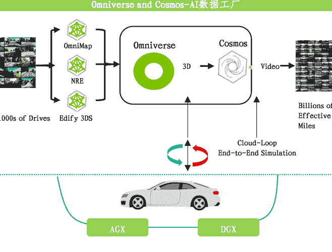

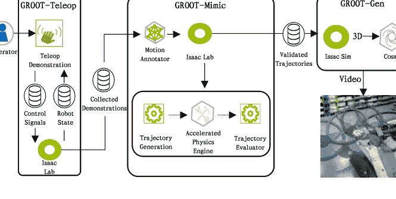

1) 操作人员使用Apple Vision进入数字孪生系统；
2) 操作人员通过少量合成运动轨迹演示操控动作；
3) 通过Isaac GROT运动合成将少量运动轨迹扩展为更大规模的数据集；
4) 利用Isaac Sim和Cosmos所构建的GROT-Gen进行3D仿真交互；
5) 在软件系统中进行测试训练，最终部署到物理机器人。

资料智库整理。
资料来源：NVIDIA, CES 2025，至顶智库整理。

## 5.2 Google: “硬件—平台—模型—应用”全位构建生态

Google的人工智能布局已形成四层协同发展的完整生态，包括硬件层、平台层、模型层以及应用层。2025年，Google持续推动四个层面的产品研发与更新，在各层面分别实现一系列重大创新。其中模型层面，Google先后推出Gemini 2.0系列以及Gemini 2.5系列语言模型，在多模理解、推理能力上实现跨越提升；应用层，Google积极响应AGI发展热潮，推出了Gemini CLI、Project Mariner等一系列自主性的AI Agent产品。

| 应用层 | | | | | |
| :--- | :--- | :--- | :--- | :--- | :--- |
| NotebookLM | Google Maps | Whisk | Gemini CLI | AlphaEvolve | |
| Career Dreamer | Google Workspace | Google Chrome | Jules | Project Mariner | |
| 模型层 | | | | | |
| Gemini 2.5 Pro | Gemini Robotics | Veo 3 | Imagen 4 | |
| Gemini 2.5 Flash | Gemini Diffusion | Alpha Genome | MedLM | Lyra 2 | |
| 平台层 | | | | | |
| Flow | Gemini Code Assist | Beam | Google Cloud | Vertex AI | AI co-scientist | Google Agentspace |
| 硬件层 | 硬件产品 | | | | | |
| TPU | Tensor | Project Aura | Pixel (Bones/Watches) | Fitbit | Google Nest | Chromebooks |

资料来源：Google，至顶智库结合公开资料整理。

## 5.2 Google: 基于 Gemini 2.5 模型底座，持续增强多模态能力

2025年6月17日，Google正式发布Gemini 2.5 Pro、Gemini 2.5 Flash，并推出Gemini 2.5 Flash-Lite实验版。2.5模型采用稀MoE（Mixture-of-Experts）架构，支持文本、视觉和音频输入的多模态处理。2025年8月26日，Google发布重磅语言模型Gemini 2.5 Flash Image (Nano Banana)，在图像质量、编辑控制和应用质量上有大幅改进，不仅可以对人物和宠物进行精准编辑，保持其特征，还能实现多合成、多轮修改与风格迁移等复杂操作，并融入现实世界知识。

| Gemini 2.5 模型介绍 | |
| :--- | :--- |
| Gemini 2.5 Pro | Gemini 2.5 Flash | |
| Gemini 2.5 Pro是目前谷歌最智能的模型，在推理方面领先一系列基准测试达到SOTA水平；编程方面，在Gemini 2.0的基础上实现了巨大的模型飞跃——Gemini 2.5 Pro擅长创建极具吸引力的网页应用和代码类应用程序，以及代码转换和编译。同时，Gemini 2.5 Pro新增了“Deep Think”增强推理模型，模型能够在输出之前进行多种假设，并极大提升解决难题的能力。 | Gemini 2.5 Flash是一款基于蒸馏技术、尺寸更大的混合架构模型，在推理、多模态、代码和上下文上的性能上得到了改进，同时效率更高，且token使用量减少20%以上。同时，Google也推出了Gemini 2.5 Flash-Lite，是2.5模型中速度最快、性价比最高的一款，相比Flash-Lite，在数学、编码等方面性能提升。 |
| Gemini 2.5 Flash Image (Nano Banana) | |
| 支持同一环境下的渲染，展现多样性的效果，保持一致性。通过自然语言进行描述，即可删除、添加或修改人物、调整姿态等多样化操作。整合Gemini的知识，突破语义局限，能够理解并融合多种输入，通过一条指令显示特定布局，如网页重新设计或配色，生成极其丰富的细节。 | |

资料来源：Google、至顶智库联合材料。

## 5.3 OpenAI：从核心模型迭代到智能体演进，引领AI技术突破

OpenAI是全球领先的人工智能公司，其在大模型领域的突破进展闻名。公司致力于开发和推广安全、有益的AI技术。目前，OpenAI已推出一系列创新，包括ChatGPT、GPT-4o、OpenAI o3、o4-mini、GPT-5及Operator，实现了多模态模型与推理模型的升级，并在智能体领域实现全新突破。OpenAI于5月以65亿美元收购首届AI硬件初创公司。

- ChatGPT：结合深度研究的思考和分析能力、以及Operator的操作能力，能够从智能体技能库中选择合适的工具，利用自己的机器人系统完成任务。
- Codex：作为软件的智能体，可以执行各种任务，如编写代码、回答各类代码的问题、修复错误和提出请求；每项任务都在本地沙箱运行，并预留。


- GPT-4o：在GPT-4基础上改进，实现文本、语音、图像三种模态分析能力，模型实用化提升，实现更自然的人机交互。


- OpenAI o3 & o4-mini：与先推理模型版本相比体验更自然、对话感更强，尤其能够参考记忆与对话往返，回答更加个性化，更贴合需求。


- GPT-5：由GPT-5、GPT-5 mini、GPT-5 Pro三个版本构成，集成深度思考与日常任务于一体，根据用户需求，在编程、推理、多模态等方面展现。


- Operator：使用浏览器查看网页，用户可以在Operator中通过所有网站或特定网站自定义指令，实现个性化的工作流。

资料来源：至顶智库结合公开资料整理。
insights.zhiding.com
©2025. ZD Insights

## 5.3 OpenAI：从核心模型迭代到智能体演进，引领AI技术突破

2025年7月，OpenAI发布智能体ChatGPT，该产品将Operator的网站交互、Deep Research的信息整合，以及ChatGPT的智能推理与流式对话的三项优势完美结合。ChatGPT聚焦工作流迭代、交互和灵活性显著提升，实现智能能力的关键升级。同时，OpenAI发布o系列模型的最新成果，这让推理模型增长多模态理解，能够使用ChatGPT中的所有工具有效应对多面性问题，ChatGPT正在向更加自主方向演进的重要一步。

### OpenAI o3介绍及示例

ChatGPT能够自主使用多种工具进行规划，帮助人们完成复杂任务，例如自动浏览用户日程、生成PPT、运行代码等，还能访问Gmail、GitHub网站获取信息并解决问题，使用API访问各种应用。ChatGPT凭借强大的自主思考与行动能力，逐步拓展至日常和专业领域。

OpenAI通过强化学习训练模型使用工具，能够应对视觉推理等开放场景，此外，o3直接将图像引起思维，实现视觉推理与文本逻辑的结合，许多模态解决问题突出。


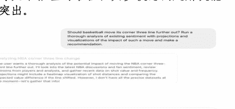

示例1：应用用户旅行路线规划和航班搜索的中，根据用户指令，在网页上行动并完成对应的操作。

示例2：执行查询报告，智能能够浏览、筛选结果，交付对应的幻片和结构化表格。

示例3：用户提供可视化的选项，根据用户指令反馈，轻松实现基于用户指令的任务。推理模型可以根据用户的情况进行预测，编写代码，生成图。

资料来源：至顶智库结合公开资料。

## 5.3 OpenAI:GPT-5实现多模态协同与推理能力

2025年8月，OpenAI发布最新一代多模态模型，包括GPT-5、GPT-5 mini和GPT-5 Pro三个版本，将推理模型与模型融为一体，由单一模型向多模态方向演进。此外，GPT-5在编程和代码、数学与逻辑推理等方面跨越，解决能力。发布标志着大模型从单一推理转向效率与智能阶段。GPT-5是一个协同工作的系统，由两个核心模型组成，并实时路由器（Real-time Router）根据用户指令计算调度。GPT-5 Pro是面向高级和企业级的，通过接入测试带来高质量答案。GPT-5 mini是GPT-5的轻量化版本，对核心功能保留的同时降低了资源消耗。Smart Efficient Model处理用户日常交互的深度推理模型。

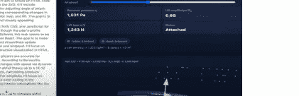


### 科学解释

GPT-5对用户指令进行详细解释，并根据要求调整任务、深度推理、代码生成、图形设计等关键环节，最后生成SVG交互图。GPT-5发挥强大的编程能力，根据输入的指令及时响应用户需求，完成完整代码，呈现网页并融入趣味游戏。语音功能可能通过接入ChatGPT学习模式，以辅助用户进行学习，实时为用户提供准确的、丰富的学习方式，实现语音无缝。

## 5.4 Anthropic：混合推理与多模态模型的行业领先

Anthropic成立于2021年，总部位于加州金山，是一个人工智能研发企业。Anthropic通过一套价值与行为准则，引导模型在生成时保持高一致性与可解释性，注重逻辑与低幻觉率的协同。旗下的Claude大型模型，已构建起层次分明、功能完善的产品矩阵。从轻量级部署的Haiku，到性价比优的Sonnet，再到旗舰级产品Opus，该系列涵盖多种应用需求，在长文档分析、复杂推理与多模态场景中表现亮眼。

### Claude 4

2025年4月，Anthropic推出Claude4大型模型。此系列包括旗舰型模型Claude Opus4和主力模型Claude Sonnet 4，为代码生成、高级推理和智能建立全新标准。作为混合模型的代表，Claude将传统大型模型和推理能力结合，为用户提供快速响应和深度思考两种模式，实现高效输出与高推理的有效平衡。

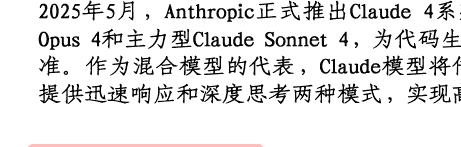

### Claude Opus 4

Claude Opus4的技术升级体现在编码和长期运行的智能体工作优化。作为最出色的编码模型，它擅长编码和复杂问题的解决，能够实现持续的独立运行。

### Claude Sonnet 4

Claude Sonnet 4在Claude Sonnet 3.7的基础上改进，重点在推理和逻辑能力方面，优化引起能力，加强了工具使用能力，有效兼顾功能性与实用性。适用于复杂分析和高要求的应用场景。

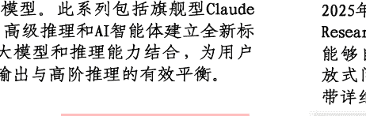

### Claude Research

2025年4月，Anthropic发布Claude Research功能。研究功能允许调用Claude进行检索和推理模型，能够自动响应用户问题并系统性解决开放式问题，为用户提供准确且全答案并附带脚注索引，质量更上一层。

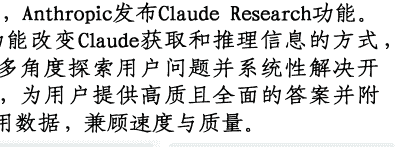

正如，Claude可以通过网络信息、表格等内容全方位搜索信息开展推理。

### Claude Code

2025年2月，Anthropic推出Claude Code。Code具有强大的编程能力，根据指令完成完整代码，呈现网页网站。

资料来源：至顶智能结合报告。
insights.zhiding.cn


# 6. AGI未来发展路径探究

- 世界模型
- 多模态模型
- 持续强化学习
- 非Transformer架构
- 具身智能

## 6.1 世界模型：从理解物理世界到预测未来变化

当前，世界模型成为人工智能加速AGI的关键驱动力。世界模型不仅能够理解物理世界的现状，还能预测其未来潜在的一系列动态变化。世界模型的应用场景已涵盖具身智能、自动驾驶、游戏开发及场景生成等领域，展现出广阔的应用潜力。从研发来看，全球主要科技企业和研究机构已推出多个世界模型，如Google发布的Genie 3、Meta发布的V-JEPA 2、达摩院发布的WorldVLA，从构筑创新到场景落地持续深化，推动人工智能发展迈向新阶段。

### 全球主流世界模型汇总

| 企业 | 模型 | 模型特征 | 应用场景 | 发布时间 |
|---|---|---|---|---|
| Google | Genie 3 | 模拟世界特性、模拟物理世界、动画建模、探索地点与历史背景、实时交互、长期一致性 | 具身智能、智能体、视频生成 | 2025.8 |
| Meta | V-JEPA 2 | 实现先进的环境理解与预测能力，并在环境中完成高质量路标规划与机器人控制 | 具身智能、可穿戴AI助手 | 2025.6 |
|  腾讯 | 混元3D世界模型1.0 | 3D场景生成、可导出mesh资产、场景可无缝编辑、场景可漫游体验 | 游戏场景研发、3D世界生成 | 2025.7 |
| 达摩院 DAMO ACADEMY | WorldVLA | 理解物理世界、动作建模、多模态交互 | 视频生成、具身智能、动作识别 | 2025.6 |
| 快手 | Matrix-Game 2.0 | 高效率实时交互序列生成、多场景多样化、物理一致性 | 虚拟游戏世界、具身智能、影视与宇宙内容生成 | 2025.8 |

## 6.1 自动驾驶成为世界模型的重要落地场景

随着世界模型技术架构的不断完善，其在自动驾驶领域的应用价值也日益显著。世界模型通过感知、预测和规划等模块，帮助自动驾驶车辆理解和预测复杂的交通环境，从而做出可靠的决策。世界模型通过摄像头、雷达及高精地图等传感器接收环境数据，并借助感知模型对数据进行处理，生成潜在空间表示，为规划、预测和模拟模型提供基础，从而完成下一步驾驶的规划与预测等场景理解操作；同时，端到端模型同时处理感知数据，以视频生成的方式模拟未来可能的状态，以支持自动驾驶车辆的决策过程。

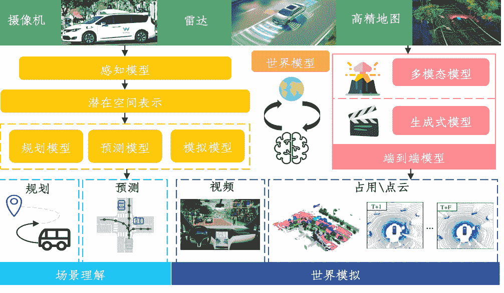

资料来源：Understanding World or Predicting Future? A Comprehensive Survey of World Models，至顶智库结合公开资料整理而成。

## 6.2 多模态模型：通过整合多源数据实现协同推理

多模态模型是一类能够整合文本、图像、视频等多源数据的模型，其核心在于突破单模态局限，通过跨模态交互实现信息融合与协同推理。此类模型多数依托Transformer架构，通过线性探测、稀疏自编码器等方法解析模态关联，主要包括对比类视觉语言模型、生成式视觉语言模型以及文本到图像扩散模型三大类，在应用层面，多模态模型覆盖图像生成、视觉问答、图像检索、模型编辑、可控生成等丰富场景，能够在复杂的任务中实现精准干预能力。

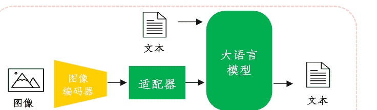

（此处为原文对应的图表结构说明）
- 生成式视觉-语言模型
- 非生成式视觉-语言模型
- 文本到图像生成模型

资料来源：A Survey on Mechanistic Interpretability for Multi-Modal Foundation Models，至顶智库结合公开资料整理。

## 6.3 持续强化学习：加速实现动态环境中的知识迁移

持续强化学习（CRL）是强化学习与持续学习的前沿领域，旨在使智能体在动态环境中通过序列化避免灾难性遗忘并实现知识迁移。该方法平衡稳定性、可塑性与扩展性，有利于实现终身学习。CRL方法围绕知识存储与迁移开展，主要分为四类：策略引导、经验引导、动态引导、奖励引导。

### 持续强化学习(CRL)示意图

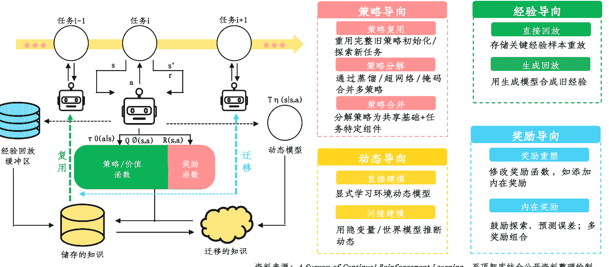

资料来源：A Survey of Continual Reinforcement Learning，至顶智库结合公开资料整理

## 6.4 非Transformer架构：突破之路

随着模型规模的扩大和应用范围的拓展，Transformer架构面临诸多挑战，而非Transformer架构呈现一条创新路径。目前非Transformer架构以状态空间模型与线性架构、液态神经网络、脑生架构、混合架构为代表。这些架构在并行计算、推理效率上表现优异，尤其在长序列任务上显著更好。

### 非Transformer架构发展

| 技术路径 | 架构 | 发布 | 时间 | 特点 |
|---|---|---|---|---|
| 状态空间模型与线性架构 | Mamba-2 | Carnegie Mellon University, Princeton University | 2024.5 | 利用更大的状态信息，训练速度更快，显著改进 |
| 原生卷积 | RWKV-7s | | 2025.7 | 实现类似MoE的优异性能，同时减少内存占用 |
| 线性处理 | RetNet | MSRA | 2023.7 | 基于线性保持（Retention）机制取代注意力机制，增加模型表达能力 |
| 液态神经网络架构 | LFM | Liquid AI | 2024.0 | 基于底层理论，低内存，速度快，灵活 |
| 脑电与仿生架构 | SSD | RockAI | 2024.1 | 利用类激活机制与架构，比Transformer具有更高的训练效率、更快的推理能力 |
| 混合架构与轻量化方案 | Hyena | Stanford University, MILA institute for AI | | 由多头注意力和门控机制组成，在上下文中出现 |

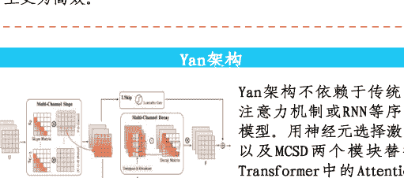

非Transformer架构不依赖传统的注意力机制，使用神经灵活选择替换Transformer中的注意力机制，并在训练效率、吞吐量、资源消耗和能力等多个维度优于Transformer模型。

## 6.5 Figure AI Helix：实时协作的“慢思考-快执行”具身架构

Helix是Figure提出的首个“双系统”视觉语言-行动（Vision-Language-Action）模型，用于实现人形机器人上半身的高频控制。它由两个核心部分组成：系统2（System2）是一个基于70亿参数的预训练视觉语言模型，对环境图像和自然语言指令进行场景理解与语义推理，并将关键信息压缩为一个连续的潜变量；系统1（System1）是一个约8000万参数的视觉-运动转换模型，将系统2的潜变量与机器人状态结合，输出包括手部姿态、手指动作以及躯干与头部控制在内的连续上半身动作。这种解耦架构使得系统能够在不同时间尺度上最优运行：系统2负责“慢思考”的高层目标推理，而系统1实现“快响应”的实时动作执行。

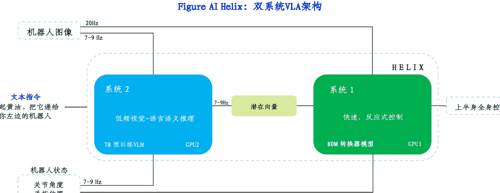

- 机器人图像：文本指令——拿起黄油，把它送给你左边的机器人
- 机器人状态：关节角度、手指位置

资料来源:Figure AI，至顶智库结合公开资料整理

## 6.6 智源RoboBrain 2.0：四大核心能力支撑长时间任务执行

RoboBrain 2.0 是智源最新发布的具身大脑，多项关键能力较前代有显著突破。在长时任务规划中能够将复杂任务拆解为多个子任务，并通过闭环反馈与监控检查完成情况，必要时重新规划。在空间理解上，新增复杂空间关系和距离推理，支持点指令与构线指令，显著提升操作区域识别和轨迹生成的准确度，整体性能提高超过17%。在时间理解上，通过轨迹预测增强执行的连续性与精确度。在场景记忆方面，能够对环境中物体的位置和属性进行构建与更新，为动态环境下的持续操作提供支持。同时，RoboBrain 2.0还具备多机器人、多环境协同规划能力，可以实现跨场景泛化与自主执行，为具身智能的发展奠定更加坚实的基础。

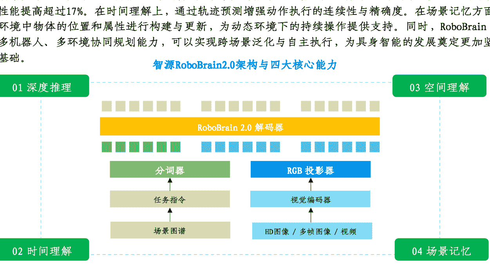

资料来源：智源研究院，至顶智库结合公开资料整理
