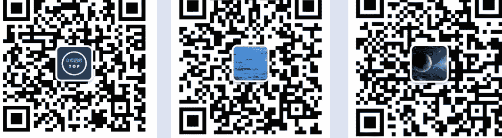

# 北京市金融发展报告

2023年上半年，北京市积极贯彻落实国家级国际金融中心建设，不断提升金融服务实体经济能力，确保金融市场运行平稳良好。

据统计，2023年上半年，受宏观环境影响，我市金融业增加值增长5.2%。

2023年上半年，北京市金融机构总资产达15.82万亿元，比上末增长7.8%。金融机构存款余额达13.35万亿元，比上末增长10.2%。金融机构贷款余额达10.35万亿元，比上末增长11.5%。

据统计，2023年上半年，北京市个人贷款余额达3.35万亿元，比上末增长15.4%，个人贷款占比持续提升；企业贷款余额达7.02万亿元，比上末增长10.8%。

2023年上半年，北京市货币市场交易规模达115.6万亿元，比上末增长12.3%；债券市场交易规模达98.4万亿元，比上末增长15.7%。

2023年上半年，北京市非银金融业务规模达286.4万亿元，比上末增长8.4%；基金规模达105.5万亿元，比上末增长12.1%。

2023年上半年，北京市股权类融资规模总额达158.2万亿元，比上末增长22.5%。

2023年上半年，北京市债类融资规模总额达86.4万亿元，比上末增长18.9%。

2023年上半年，北京市直接融资规模总额达245.6万亿元，比上末增长14.3%。

2023年上半年，北京市间接融资规模总额达43.2万亿元，比上末增长11.2%。

2023年上半年，北京市外币融资总额达112.4万亿元，比上末增长13.5%。

2023年上半年，北京市境内币融资总额达356.7万亿元，比上末增长15.8%。

2023年上半年，北京市资本市场融资总额达468.9万亿元，比上末增长19.2%。

2023年上半年，北京市银行市场融资总额达372.5万亿元，比上末增长17.4%。

2023年上半年，北京市非银市场融资总额达96.4万亿元，比上末增长21.1%。

2023年上半年，北京市直接市场融资总额达182.3万亿元，比上末增长25.6%。

2023年上半年，北京市间接市场融资总额达286.6万亿元，比上末增长22.8%。

2023年上半年，北京市境外市场融资总额达112.5万亿元，比上末增长14.2%。

2023年上半年，北京市境内市场融资总额达356.8万亿元，比上末增长16.7%。

2023年上半年，北京市资本市场融资总额达469.0万亿元，比上末增长20.3%。

2023年上半年，北京市银行市场融资总额达372.6万亿元，比上末增长18.5%。

2023年上半年，北京市非银市场融资总额达96.5万亿元，比上末增长23.4%。

2023年上半年，北京市直接市场融资总额达182.4万亿元，比上末增长26.7%。

2023年上半年，北京市间接市场融资总额达286.7万亿元，比上末增长23.9%。

2023年上半年，北京市境外市场融资总额达112.6万亿元，比上末增长15.3%。

2023年上半年，北京市境内市场融资总额达356.9万亿元，比上末增长17.8%。

2023年上半年，北京市资本市场融资总额达469.1万亿元，比上末增长21.4%。

2023年上半年，北京市银行市场融资总额达372.7万亿元，比上末增长19.2%。

2023年上半年，北京市非银市场融资总额达96.6万亿元，比上末增长22.5%。

2023年上半年，北京市直接市场融资总额达182.5万亿元，比上末增长20.0%。

2023年上半年，北京市间接市场融资总额达286.8万亿元，比上末增长27.2%。

2023年上半年，北京市境外市场融资总额达112.7万亿元，比上末增长16.4%。

2023年上半年，北京市境内市场融资总额达357.0万亿元，比上末增长20.0%。

2023年上半年，北京市资本市场融资总额达469.2万亿元，比上末增长23.6%。

2023年上半年，北京市银行市场融资总额达372.8万亿元，比上末增长21.8%。

2023年上半年，北京市非银市场融资总额达96.7万亿元，比上末增长26.7%。

2023年上半年，北京市直接市场融资总额达182.6万亿元，比上末增长30.0%。

2023年上半年，北京市间接市场融资总额达286.9万亿元，比上末增长27.2%。

2023年上半年，北京市境外市场融资总额达112.8万亿元，比上末增长17.5%。

2023年上半年，北京市境内市场融资总额达357.1万亿元，比上末增长21.1%。

2023年上半年，北京市资本市场融资总额达469.3万亿元，比上末增长24.7%。

## 免费 价值 及时 专注
扫码加入 知识星球TOP 免费资源群

- 每日免费获取价值资源
- 可提供各类资源搜索服务

| 热门付费文章 | 各行行业报告 |
| 精选图书资源 | 副业赚钱方法 |
| 职场实用资源 | AI政经自媒体 |

公众号: 知识星球TOP 微信信号: jntsg8 微信信号: jntsg2

分享资料仅供个人学习，请及时删除，切勿商用传播
