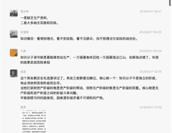

# 1.4 递归（Recursion）

## 什么是递归

递归就是调用自己。

递归的定义是：在函数内部调用函数本身。

```
int factorial(int n) {
    if (n <= 1) {
        return 1;
    } else {
        return n * factorial(n - 1);
    }
}
```

上面的代码是计算阶乘的递归。

### 递归的两个条件

递归函数必须包含两个条件：终止条件和递归条件。

终止条件是递归停止的条件。如果没有终止条件，递归将无限循环。

递归条件是递归函数调用自身的条件，并且每次调用都要比上一次调用更接近终止条件。

### 递归的优缺点

优点：代码简洁，易于理解和解决复杂问题。

缺点：执行效率较低，因为每次递归调用都会产生新的栈帧。

### 递归的应用场景

递归可以用于许多算法，如快速排序、归并排序、二叉树遍历等等。



### 斐波那契数列（Fibonacci Sequence）

斐波那契数列是一个特殊的数列，从第三项开始，每一个数都等于前两个数之和。

```
int fibonacci(int n) {
    if (n <= 1) {
        return n;
    } else {
        return fibonacci(n - 1) + fibonacci(n - 2);
    }
}
```

上面的代码使用递归计算斐波那契数列的第n个数。

但是，这个递归实现的效率非常低，因为它重复计算了许多子问题。

### 递归与迭代

递归和迭代都可以解决同一个问题，但它们各有优缺点。

递归代码通常更简洁，但消耗更多内存（栈空间）且速度较慢。

迭代代码效率更高，更节省内存，但逻辑可能更复杂。

### 总结

递归是一种强大的工具，但在使用时需要根据问题复杂性和性能需求来选择递归还是迭代。
