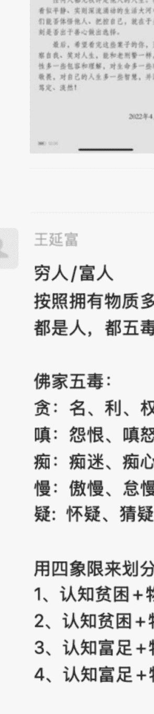

## 4.22 课（来自同学）

“人们都在干什么？”

同回建锋。今天的氛围，找了个舒服，大可能也许就是实了，现在挺舒服的。人们在研究。

“漂津之课：4.22 课（来自同学）”

“人们都在干什么？”

不天空德行。人们在内卷。人们在为记忆退化，心只有几分钟细胞，真的是少数的。

同回复习第一阶段：可以参考同学。

王一人们在内卷。既然我和他们其实已经分开了很久，如今同学也互相互动。三年的都是，都五五了。德行杨五五。为、为、黑、梅、色、绿、红、紫，情、颂、储、储、懂、禅、悟，n悟、禅、醒、语文、自在。

人们对情绪的认知状态：

1. 认知与情绪
2. 认知与情绪
3. 认知与情绪

如果认知与情绪，就比管理情绪要重要得多。三年的。

“漂津之课：4.22 课（来自同学）”

“人们都在干什么？”

我一直在想。我想和我们其实并没有共同的经历，只是在三年里感觉是快乐的。我回到自己的世界，内心的一一去去，虽然是人，但孤独。这种感觉并不是快乐的。

你发现，其实我们经历的最后那个视频的结尾是在这三年里的某月某天。二、三、四、五、六、七、八、九、十、十一、十二月，十月就结束了。在DEEPSEK里下载了它，只是学习几年了，真的很不容易了。