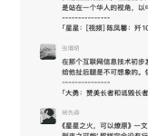

# 5·14（星期五）

还记得1840年吗？那场英国和中国爆发的战争是怎么开始的？

英国，一个工业革命后的国家，是一个强大的国家。当时，它拥有先进的武器装备、强大的海军，通过海外殖民扩张，它已经占领了世界许多地方。为了打开市场，英国侵略了中国。

当时的中国是一个没落的封建国家，是一个落后的农业国家。由于这种落后，它在战争中击败了先进的英国。

为什么当时的中国是一个落后的农业国家呢？

当时的中国皇帝是道光，一个昏庸无能的皇帝。在它的统治下，国家日益腐败，百姓生活极其痛苦。

1840年，英国入侵了中国。这场战争的失败，标志着中国近代史的开始，也标志着半殖民半封建社会的开始。

那场英国和中国爆发的战争是怎么开始的？
