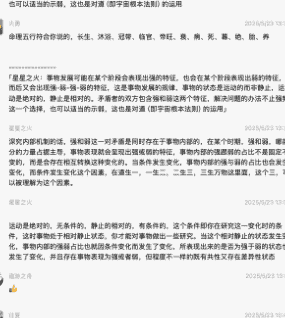

# 第三章 诡异

李五（哥）

李五看着眼前的景象：“这也太诡异了，这种诡异的景象，简直让人毛骨悚然。”

但是，他深吸了一口气，试图让自己冷静下来。虽然此时，李五心里也有些发虚，但他知道现在还不能害怕。

他现在要做的就是观察周围的环境，寻找一条离开的办法。

李五：“以后，我们该怎么办？”

李五转过头，看向四周，发现这里空无一人。

李五：“以后，我们该去哪里？”

李五继续向前走，发现这里的建筑物也都非常诡异，街道扭扭扭扭的，路两旁的房屋门户户户闭死的，这让李五感到一种难以窒息的气息感。

李五又走了一会儿，发现不远处站了一个男人，那个人穿着破旧的衣服，低着头，步履蹒跚。李五走过去，拍了拍男人的肩膀，男人猛地抬起头，一脸惊恐。

李五：“大哥，请问这里是哪里？”

男人看了李五，眼神惊恐，似乎很害怕他，他颤抖着嘴，道：“这里……这里是鬼村啊！”

李五：“鬼村？什么是鬼村？”

男人摇了摇头，似乎不想回答李五的问题。

李五：“你告诉我，该怎么离开这里？”

男人没有回答，而是转身跑了，很快就消失在街街道巷弄中。

李五看着男人的背影，心里越发发凉。他知道，来到这个地方可不简单了。

李五：“该死，鬼村！”

李五继续在街道上走着，发现这里到处都是破旧的房屋，到处都是荒草，看起来没有任何生气。

他走着走着，突然听到前面传来一阵哭声，李五朝着声音走了去。

李五：“谁在那？”

哭声越来越近，李五看到不远处一个女人正坐在地上，低着头大哭。

李五走过去，发现那个女人穿着一件白裙，长发散乱。

女人看着李五，停止了哭泣，抬起头来，眼神空洞得可怕。

李五：“你在这里做什么？”

女人惨笑道，那笑容极其阴森可骨：“我在等他回来。”

李五：“你在等谁？”

女人没有回答，而是站了起来，直直朝着深处走去。

李五看着女人的背影，心里越发发凉。他知道，这个地方不简单。

李五：“我要离开这里！”