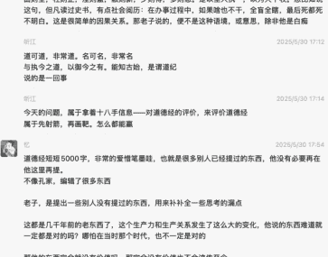
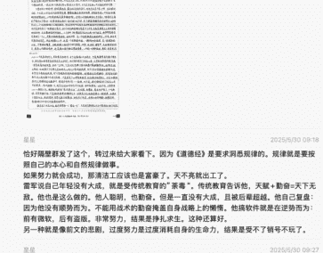
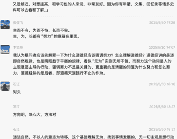
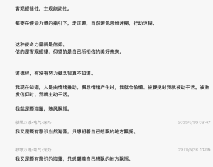
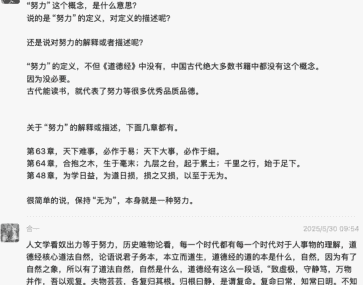

# 第十章 别害怕

1. 晨光，阳光虽然有些微弱，但已经照亮了大地。林凡睁开眼睛，发现自己依然躺在那个简陋的床上，新的一天又开始了。

> “林凡醒了吗？”

2. 看着窗外的景色，林凡轻轻叹了口气。虽然生活很艰苦，但至少他还有希望，这就是生活的意义。

> “林凡，醒了吗？”

晨光虽然有些微弱，但已经照亮了大地。林凡睁开眼睛，发现自己依然躺在那个简陋的床上，新的一天又开始了。

看着窗外的景色，林凡轻轻叹了口气。虽然生活很艰苦，但至少他还有希望，这就是生活的意义。

> “林凡，醒了吗？”

晨光虽然有些微弱，但已经照亮了大地。林凡睁开眼睛，发现自己依然躺在那个简陋的床上，新的一天又开始了。

看着窗外的景色，林凡轻轻叹了口气。虽然生活很艰苦，但至少他还有希望，这就是生活的意义。

> “林凡，醒了吗？”

晨光虽然有些微弱，但已经照亮了大地。林凡睁开眼睛，发现自己依然躺在那个简陋的床上，新的一天又开始了。

看着窗外的景色，林凡轻轻叹了口气。虽然生活很艰苦，但至少他还有希望，这就是生活的意义。

> “林凡，醒了吗？”

晨光虽然有些微弱，但已经照亮了大地。林凡睁开眼睛，发现自己依然躺在那个简陋的床上，新的一天又开始了。

看着窗外的景色，林凡轻轻叹了口气。虽然生活很艰苦，但至少他还有希望，这就是生活的意义。

> “林凡，醒了吗？”

晨光虽然有些微弱，但已经照亮了大地。林凡睁开眼睛，发现自己依然躺在那个简陋的床上，新的一天又开始了。

看着窗外的景色，林凡轻轻叹了口气。虽然生活很艰苦，但至少他还有希望，这就是生活的意义。

> “林凡，醒了吗？”

晨光虽然有些微弱，但已经照亮了大地。林凡睁开眼睛，发现自己依然躺在那个简陋的床上，新的一天又开始了。

## 免费 价值 及时 专注

## 扫码加入 知识星球TOP 免费资源群

- 每日免费获取有价值资源
- 可提供各类资源搜索服务

| 热门付费文章 | 各行行业报告 |
| :--- | :--- |
| 精选图书资源 | 副业赚钱方法 |
| 职场实用资源 | AI经营自媒体 |

公众号：知识星球TOP 微信信号：jntsg8 微信信号：jntsg2

分享资料仅供个人学习，请及时删除，切勿商用传播
