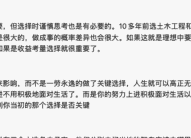

# 人生的规划：就业、学业、婚育等，如何做正确的决定？

研究发现，越规划，越不容易迷茫。这确实很奇怪。只有提前做好规划，才能做出明智的决定。

> “建议 5-6个”

人生的规划：就业、学业、婚育等，如何做正确的决定？

但是规划是痛苦的，不规划的人生可能看起来轻松，但也越走越迷茫，也越容易后悔。

> “建议 5-6个”

人生的规划：就业、学业、婚育等，如何做正确的决定？

我发现自己很难坚持，在坚持的时候就想放弃。坚持需要两个人，我们在一起才能坚持下去。在坚持中保持自我，只有这样才能做最终的决定。决定是个人的决定，也是去做事情的决定，一个正确的决定，一个坚持也是一个正确的决定。

坚持下去是很不容易的，要与痛苦共处，不要轻易放弃。只有了了，才能坚持下去。在道路上，只要不放弃，无论遇到挫折还是困难，只要有希望，只要坚持下去，就能得到一个正确的决定。

> “建议 5-6个”

因为规划是痛苦的，所以很多人不愿意去规划。但是不规划的人生可能看起来轻松，但也越走越迷茫，也越容易后悔。不规划的人生可能没有痛苦，但是没有未来。有规划的人虽然现在很痛苦，但是未来可以获得一个明确的未来。只有忍受规划的痛苦，才能获得幸福的未来。

我想过，规划是痛苦的，但后悔的代价是巨大的。虽然规划的痛苦，比后悔的代价要小得多。

我是一个很任性的人，我从不规划，只要不后悔就可以了。虽然不后悔通常是不可能的，但我不知道什么时候会后悔。

我有一个理想的妻子：长得漂亮的老婆，两个孩子，一个房子，一个车，一个电脑，一个计划。但是，我一个都没有，甚至连月光，计划一个都没有。

马云没有规划自己的未来，因为他没有目标。没有目标，就没有方向。没有方向，就没有坚持。没有坚持，就没有成功。马云没有目标，但他有梦想，所以他坚持。他有梦想，所以去行动。他去行动，所以成功了，拥有了未来。

马云说：“我不需要规划未来，因为我不需要未来。只要我做出的决定是正确的，就不会后悔。不准确的决定就会后悔。哪怕100个正确的决定，只要一个错误的决定，就够了。”

哪怕有100个正确的决定，只要一个错误的决定，就够了。我怕了后悔，我怕了后悔。

我是人生的规划

我以后要规划未来，有规划，有未来，有规划，有规划的人才有决定未来的未来，一个属于自己的“未来”的未来。
