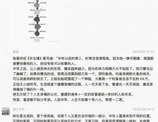
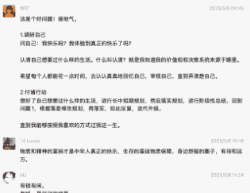
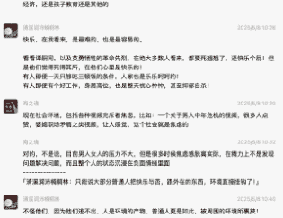

## 5.8 选择（来自肺子）

如何才能成为一个真正的快乐的人

年轻人的压力越小状态就越好，要把自己慢慢找回来。

快乐年轻人的压力越小越好

要把快乐的（自己）留在心里，心态越好状态越好，年轻人的压力越小越好。因为心态决定了你的生活，心态决定了你的烦恼。想得越少，烦恼就越小。记住，心态决定了快乐的大小。不要总是抱怨，不要总是在焦虑，未来总会有办法的，最好的办法就是不要焦虑，不要忧愁，人人心中都有乱七八糟的快乐。

## 5.8 选择（来自肺子）

如何才能成为一个真正的快乐的人

- 1. 活当下：放下过去的，不要对未来的担忧，要活当下，享受当下的每一刻和快乐。
- 2. 动运动：觉得心情不好了就去运动，运动会产生内啡肽，让你感到快乐，同时运动能有效缓解你的负面情绪。
- 3. 多交朋友：多和积极能量的人在一起，真的会回到自己，让自己重新到良好的状态。

学会和自己相处，学会和自己和解，学会一个人独处，你也会很快乐的。

快乐的人是选择的，因为心态决定了一切。

## 5.8 选择（来自肺子）

年轻人的快乐，是自己给的。

没有健康，没有快乐。

年轻人的快乐，是学会的。只要学会了，你就会快乐。快乐的人永远不会感到孤独，永远是快乐的。

学会很多事情，学会爱生活，学会面对生活。

## 5.8 选择（来自肺子）

如何才能成为一个真正的快乐的人

## 免费 价值 及时 专注

## 扫码加入 知识星球TOP 免费资源群

- 每日免费获取价值资源
- 可提供各类资源搜索服务

| 热门付费文章 | 各行行业报告 |
| :--- | :--- |
| 精选图书资源 | 副业赚钱方法 |
| 职场实用资源 | AI经营自媒体体 |

公众号：知识星球TOP 微信号：jntsg8 微信号：jntsg2

分享资料仅供个人学习，请及时删除，切勿商用传播
