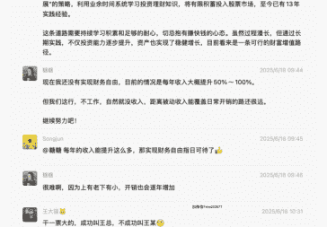

# 偶像理财.jpg

# 5 理财入门（自学）

## 什么是财务自由

财富的自由是一个过程，比拥有多少钱更重要。你越富有，内心越强大，财务自由越容易。

财务自由的定义，是你不再为了钱而奔波，而是有能力选择自己想要的时间。

## 什么是财务自由
财务自由的三个：消费、学习、梦想。

不需要被钱束缚，这三个吗？

一万、五十万、一百万、五百万、八百万、九百万、十百万、一千万、二千万、三千万、四万、二千万、三千万、四千万、五千万、亿。

小王

实现财务自由的捷径，就是减少开支。

### 财务自由不是多少钱
它取决于你对自由的“定义”

### 什么是财务自由（自学吗）
如果我月入过万，年收入过两百万，你觉得我自由了吗？他回答：“没有”。

“因为你没有欲望”

### 什么是欲望
就是你想要的东西

### 什么是自由
就是你想做的事

### 什么是财务自由？
就是你拥有足够的钱，去做你想做的事

### 财务自由的三个阶段
- 第一阶段：财务安全
- 第二阶段：财务自由
- 第三阶段：财务独立

什么是财务安全？
就是你的被动收入大于你的生活支出

什么是财务自由？
就是你的被动收入远大于你的生活支出

什么是财务独立？
就是你的被动收入远大于你的生活开支

月入四个数字
月入五个数字

如果你有1000万，你就有够买几只会下金蛋的鸭子

什么是财务安全？
就是你的被动收入大于你的生活支出

什么是财务自由？
就是你的被动收入远大于你的生活支出

什么是财务独立？
