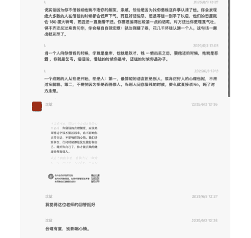

# 什么是ChatGPT？

你好，什么是生成式AI？

ChatGPT（Generative Pre-trained Transformer）是基于 OpenAI 开发的一种人工智能语言模型。它能够理解人类的语言并回答问题、编写文章、甚至进行代码编写。

简单来说，ChatGPT 就像是一个极其博学的机器人，它读过互联网上海量的文本，能够根据你的指令给出连贯的回答。

# ChatGPT 可以用来做什么？

- 1. 回答问题：你可以问它任何你感兴趣的问题，从历史知识到科学原理。
- 2. 创作内容：它可以帮你写邮件、故事、诗歌、甚至是编写复杂的代码脚本。
- 3. 语言翻译：它可以在多种语言之间进行高质量的翻译，并能理解语境。
- 4. 总结摘要：如果你有一篇长文章，可以让它快速为你提取出核心要点。

总之，ChatGPT 是一个非常强大的生产力工具。

# ChatGPT 的局限性

尽管 ChatGPT 非常强大，但它并不是万能的。它也存在一些局性，我们在使用时需要注意：

- 1. 幻觉问题：有时它会一本正经地胡说八道，提供错误的信息。
- 2. 信息时效性：它的训练数据有一个截止日期，因此它可能不知道该日期之后发生的最新事件。
- 3. 缺乏真实情感：它并没有真正的情感、意识或价值观，它的回答是基于概率的文本生成。

在使用 ChatGPT 时，我们需要保持批判性思维，并对它生成的内容进行核实。

# 如何更好地使用 ChatGPT

使用 ChatGPT 的关键在于编写良好的提示词（Prompt）。提示词越具体，得到的结果就越好：

- 设定角色：例如：“你现在是一个资深的健身教练，请帮我制定一个减脂计划。”
- 提供背景信息：告诉它你的具体目标、限制条件和偏好格式。
- 逐步提问：如果第一次回答不满意，可以继续要求它进行调整或补充。

通过这些方法，你可以最大限度地发挥 ChatGPT 的潜力。

> AI 正在改变我们工作和生活的方式。

张三 | 2023-10-27

ChatGPT，你能帮我做什么吗？

你好！我很乐意为你提供帮助。请告诉我你需要什么帮助？

我想请你写一篇关于人工智能对未来就业影响的文章。

没问题。这是一篇为你准备的草大纲：

## 人工智能与未来就业：挑战与机遇

### 引言
人工智能（AI）技术的飞猛发展正引发了全球对未来就业市场的广泛关注。虽然有人担心 AI 会取代大量工作，但也有人认为它将创造新的机会。

### 1. 自动化的影响
重复性高、规则性的任务最容易受到 AI 的影响。这包括数据输入、基础客户服务和某些制造业。

### 2. 新职业的诞生
AI 的出现创造了如提示词工程师、AI 伦理专家、数据标注员等新岗位的需求。

### 3. 技能转变的需求
未来的劳动力将更看重创造力、批判性思维、情感智能以及复杂问题的解决能力。终身学习将成为关键。

### 结论
AI 不会取代人类，但使用 AI 的人可能会取代不使用 AI 的人。

李四 | 2023-10-27
