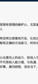

## 六、何处是家

在人生的旅途中，有些偶然的相遇其实是命运的转折点，它是一段新旅程的开始。

那是一个秋日的午后，我走在异乡的街道上，阳光并不刺眼，心里却感到一种莫名的空虚。

我走进一家街角的咖啡馆，空气里弥漫着咖啡的香气，这种味道让我感到了一丝宁静。

我坐下窗边，看着外面来来的人群，每个人都忙着自己的生活，脸上写满了疲惫或期待的表情。

我突然意识到，我们都在为了生活而奔波，却是否忘记了生活的本身？家究竟在哪里？

我点了一杯热咖啡，看着热气升腾，思绪渐渐飘远，想起了远方的故乡。

在那个瞬间，我突然明白，我们追寻的或许并不是一个地方，而是一种内心的归属感。

故乡，是父母的笑脸，是深夜做的饭的味道，是那个永远回去的童年时光。

但现实是，我们离故乡越来越远，在钢筋水泥的世界里挣扎，寻找属于自己的位置。

我喝了一口咖啡，苦涩的味道在舌尖化开，却也带给我了一丝清醒。

生活就像是一场漫长的跋涉，我们偶尔需要停下脚步，问问自己：我们要去哪里？

或许，家就在我们心中，只要心里还有爱和希望，哪里都是家。

走出咖啡馆，外外的阳光已经有些暗淡，街道上的灯火开始点亮。

我再次走入人群中，脚步变得比以前坚定了许多，因为我知道了方向。

每一个努力生活的人，都有值得被温柔以待的理由。

2023-10-12

我曾无数次在深夜里感到孤独和迷茫，怀疑自己所有的努力是否都有意义？

那些夜晚，窗外的月光很凉，仿佛在嘲笑我的无所措。

直到有一天，我遇到了一位老者，他告诉我了一些让我受益终生的话。

他说：“孩子，人一生的意义不在于终点，而在于路上的风景。”

我听后，内心久久平静，原来我一直太急于结果，而忽略了过程。

我开始学会观察当下的生活，感受路边的花，路过的风。

我发现，生活其实有很多美好，只要你愿意用心心去发现。

我不再仅仅为了未来而焦虑，而是开始经营当下的每天。

这种心态的变化让我变得前所未有的强大。

2023-10-15

有时候，我们经历一次突如其来的失去，才能看清原本的自己。

失去并不是失败，而是为了让我们重新开始，去寻找更适合自己的路。

我学会了与遗憾和解，学会了在痛苦中重新站起来。

现在的我，比以前更加坚韧，也更加从容。

生活总会有意外，但只要不放弃，总会有光亮。

2023-10-20

我开始写字，记录生活的点点滴滴，记录自己的成长。

文字是情感的出口，让我宣泄那些无法言说的压力。

在写作的过程中，我重新发现了许多从未察觉过的细节。

每一个字都是对灵魂的对话，每一段都是对生命的思考。

我希望通过这些文字，带给同样迷茫的人一点力量。

2023-10-25
