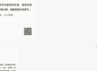
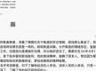

# 账号：jntsg8
# 账号：jntsg2

免费资料领取

## 724课
### 724课（单项测试）

我最羡慕的可能不是一棵树

在这个世界上的人们总是羡慕别人，拥有最多的人最富有，最富有的人最快乐。其实我最羡慕的不是拥有一切，而是一个能够随心呼吸、阅读、听音乐感到快乐的灵魂。

“愿你终得像一棵树”

我最羡慕的可能不是一棵树

我和她谈起梦想，她说她想成为一棵树，因为树的根可以深深扎在大子里，不需要移动，只需要静静地站着。无论风吹雨向哪来，无论阳光还是雨水如何，它都能守着自己的领地，自由地向上生长，直到拥有属于自己的天空。这种自由，不仅是身体的自由，更是一种灵魂的自由。

## 725课4
### 725课4（单项测试）

我羡慕的可能不是一棵树

如果是一棵树，那不需要去寻找

## 726课
### 726课（单项测试）

我羡慕的可能不是一棵树

我不需要去寻找

## 727课
### 727课（单项测试）

我羡慕的可能不是一棵树

## 728课
### 728课（单项测试）

我羡慕的可能不是一棵树

## 729课
### 729课（单项测试）

我羡慕的可能不是一棵树

