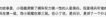

# 第一章 命运（一）

林远，一个平凡的年轻人。然而，他的命运似乎总是充满了重重挫折，每一步背后都潜藏着不为人言的痛苦。

此时，窗外正下着细密的小雨。林远独自坐在狭窄的合租房里，看着窗户模糊的倒影，眼神中透出一丝思索。他想起了几年前的夏天，那时候他也充满了梦想，却也充满了现实的苦涩。

难道，命运真的无法改变吗？

林远叹了口气，站起身走到了窗边。

就在这时，门外传来了急促的敲门声，打破了房间原本的宁静。林远皱了皱眉，在这个时间，谁会来呢？

林远走到门前，打开了门。

门外站着一个神色不安的女孩，她看起来有些狼促。

“林远，你在家吗？”女孩的声音带着一丝颤抖。

林远愣了一下，随即微微笑了笑。

“苏晴，你怎么在这了？”

苏晴低着头，眼眶微微泛红。

“我……我遇到麻烦了。”

林远心中一凛，他拉拉苏晴进了屋。

“发生了什么？你告诉我。”

苏晴坐在沙发上，双手紧紧绞在一起。

“我公司出事了，他们要我还债。”

林远眉头紧锁，他知道这事情可能不简单。

就在这时，门外又传来了沉重的脚步声。

“苏晴，开门！”外面传来了粗鲁的吼。

苏晴脸色瞬间惨白，她抬头看向林远。

林远上前，挡在苏晴面前。

“别怕，有我在。”

林远推开了门，门外是两个高壮的汉子。

“小子，把钱交出来。”领头的汉子冷笑道。

林远冷地看着他们，眼神变得异常冷静。

“我们没钱，你们走吧。”

汉子冷哼一声，直接一拳向林远去。

林远一个侧身躲过，动作快得不可思议。

他反击出手，拳头击中汉子的腹部。

汉子惨叫一声，倒在地上捂着。

另一个汉子见状，也怒了上来。

林远眼神凌厉，他知道战斗才刚刚开始。

战斗中，林远展现出的技巧让他。

这一刻，他的命运似乎发生了转折。

# 第二章 变故（一）

战斗结束后，两个汉子被打倒在地，连滚逃逃了。

苏晴看着林远，眼中充满了崇拜与异样。

“林远，你真厉害。”苏晴轻声道。

“只是运气好。”林远平静地回答。

然而，麻烦远没有结束，更大的挑战在前方等着他们。

林远看着窗外的暴雨，心中 {着。

2023-10-XX

林远不知道，这一晚，将彻底改变他的人生。

苏晴离开后，林远独自在思考。

他发现自己的身体似乎多了一种奇异的力量。

那力量源自他灵魂的深处。

他闭上眼睛，感受着那股流动。

2023-10-XX

第二天清晨，林远感到前所未有的精力。

窗外，暴雨已经停了。

但他知道，新的危机正在等待着他。

他推开门，准备迎接新的挑战。

阳光洒在街道上，万象如新。

2023-10-XX

林远走向远方，他的故事才刚刚开始。

# 知识星球TOP
付费资源分享群

添加微信
免费入群

微信: jntsg2

| 序号 | 公号/星球/社群 | 原价 | 领域 |
| :--- | :--- | :--- | :--- |
| 1 | 生业有木 | 2765/年 | 副业，搞钱 |
| 2 | 怂众吃瓜群 | 365/年 | 时政，历史 |
| 3 | 记忆承载/文树西风 | 365元/年 | 成长，搞钱 |
| 4 | 欧洲金靴 | 328/年 | 时政，历史 |
| 5 | 卢克文青青会 | 699/年 | 时政，社会 |
| 6 | 体制内主任 | 599/年 | 体制；职场 |
| 7 | 外人的视界 | 669元/年 | 金融，时政 |
| 8 | 灏泽异谈 | 4166/年 | 财富，成长 |
| 9 | 守夜总司令 | 599/年 | 时政，经济 |
| 10 | 江宁知府 | 365/篇 | 时政，国际 |
| 11 | 政堂/顾子明 | 568/年 | 时政，经济 |
| 12 | 唐书院 | 1399/篇 | 金融，财富 |
| 13 | 大树乡谈 | 199/年 | 时政，成长 |
| 14 | 水库欧大 | 10000 | 房产，经济 |
| 15 | 洪灏的宏观策略 | 4376/年 | 经济，搞钱 |
| 16 | 金政通鉴/北海道山 | 4576/年 | 股票，行研 |
| 17 | 猫豹的世界 | 299/年 | 时政，社会 |
| 18 | 飞沫 | 3600/年 | 股市，经济 |
| 19 | 米联储见闻 | 599/年 | 经济，金融 |
| 20 | 鉴茶财经院 | 330/年 | 房产，股票 |
| 21 | 赢在八小时之外 | 365元/年 | 成长，职场 |
| ... | | | 更多资源，不再列举 |
