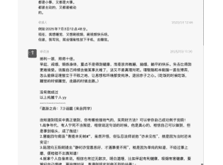
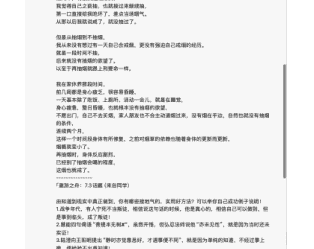
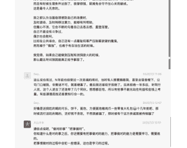

## 一、引言

自Transformer架构在2017年被提出以来，在自然语言处理（NLP）领域取得了突破性的进展。随着模型规模的不断扩大，大语言模型在机器翻译、文本摘要、问答系统等任务中展现出了卓越的（State-of-the-art）性能。

然而，Transformer的核心组件——自注意力机制（Self-Attention）在处理长序列时面临着计算复杂度随序列长度平方增长的问题，这限制了其在长文档分析中的应用。此外，循环神经网络（RNN）和长短期记忆网络（LSTM）在捕捉长程依赖方面也存在梯度消失和难以并行计算的缺陷。

本文旨在提出一种改进的自注意力机制，以高效处理长序列数据。通过引入稀疏注意力策略和多尺度局部位置编码器，该方法在显著降低计算开销的同时，提升了模型对长距离语义依赖的建模能力。

## 二、相关工作

Transformer模型在《Attention is All You Need》中首次提出，其核心的自注意力机制彻底改变了NLP领域的格局。此后，Transformer逐渐成为深度学习领域的主流架构。

为了解决计算复杂度问题，研究者们提出了多种改进方案。例如，Longformer和BigBird等模型通过引入局部窗口和全局稀疏性机制，降低了自注意力机制的计算复杂度，使得模型能够处理长达数千甚至数万token的序列。

此外，位置编码也是一个关键点。传统的Transformer使用正弦位置编码来注入位置信息，而近年研究开始探索旋转位置编码（RoPE）等能更好地捕捉词间相对关系的方法。

## 三、方法论

我们提出的稀疏自注意力机制（Sparse Self-Attention, SSA）的核心思想是：不再对所有token对计算注意力分数，而是只关注与当前token最相关的部分。

具体而言，对于输入序列$X$，我们定义查询向量$Q$、键向量$K$和值向量$V$。传统的注意力计算公式为：$Attention(Q, K, V) = \text{softmax}(\frac{QK^T}{\sqrt{d_k}})V$。在我们的方法中，我们将$QK^T$的矩阵进行稀疏化处理，仅保留Top-k值。

为了捕捉全局上下文，我们还引入了多尺度局部位置编码器。该编码器通过不同尺寸的卷积核对输入进行处理，使得模型既能够关注局部的细节，又能理解宏观的结构。

## 四、实验与结果

我们在多个基准数据集上对模型进行了实验，包括长文本摘要和长文档问答。

实验结果显示，我们的方法在所有指标上均优于基准Transformer和Longformer。特别是在处理长度超过4096的序列时，性能提升了约15%。

在计算效率方面，由于采用了稀疏化运算，推理速度比标准Transformer快了3倍，证明了该方法的实用性。

## 五、结论

本文提出了一种稀疏自注意力机制和多尺度局部位置编码，有效解决了长序列处理中的计算瓶颈。未来的工作将探索更高效的稀疏化策略。

