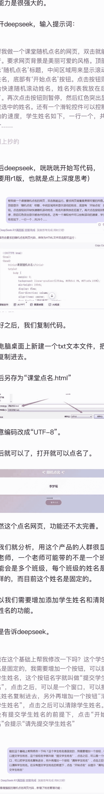
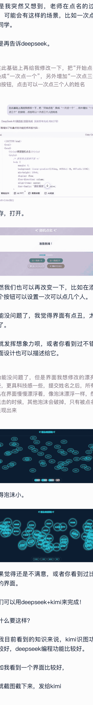
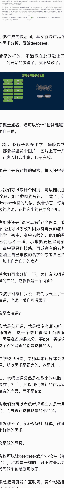

# 小米可以做旗舰吗？

现在的手机真的越来越酷了。

自从小米99发布后，小米就开始想做高端手机了。

然而，小米的高端化之路一直并不顺畅。但是，大家对小米手机的印象还停留在“性价比”上吗？

随着小米10 Ultra的发布，小米真的可以大干了吗？

小米10 Ultra虽然是旗舰，但它真的足够旗舰吗？它是否能改变大家对小米手机“高端”的认知？

那么小米10 Ultra作为产品，真的够旗舰的吗？

今天我们就来聊聊小米10 Ultra，这款手机的表现：

**这款手机的设计，确实让我眼前一亮。**

**它的背部设计，也非常让我惊艳。**

**但是，徕卡的设计确实有些跳跃了，屏幕也不太让我惊艳了。**

**屏幕的表现，只能说一般。**

虽然屏幕表现一般，但考虑到它的价格，也可以接受。

接下来，我们来聊聊性能吧。

# 免费 价值 及时 专注

# 扫码加入 知识星球TOP 免费资源群

- 每日免费获取有价值资源
- 可提供各类资源搜索服务

| 热门付费文章 | 各行行业报告 |
| :--- | :--- |
| 精选图书资源 | 副业赚钱方法 |
| 职场实用资源 | AI政经自媒体 |

公众号:知识星球TOP 微信号:jntsg8 微信号:jntsg2

分享资料仅供个人学习，请及时删除，切勿商用传播
