# 重塑医美格局：驾驭中国医美新潮流

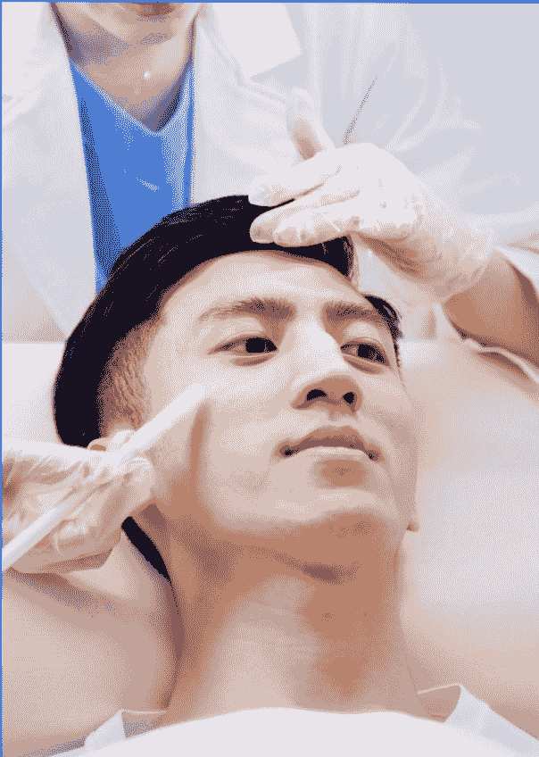

2025年11月

## 知识星球TOP
汇聚全网高价值资源
打造TOP级分享社群

+ ◆ 付费文章 ◆ 付费社群
时政&国际 ◆ 副业&搞钱
 财经&市场 ◆ 行业报告

时政·历史·职场·体制·自媒体学习·军事·软件·影音·社会学

公众号:知识星球TOP 微信:top28688 微信:top28388

添加微信 免费进群

## 摘要

在政府的支持下，中国美容行业迎来显著增长。
中国的医美行业正处于变革阶段，不断变为融合医疗、美容科技的全球性细分市场。随着业务的快速扩张、政策环境的优化以及消费群体的结构性变化，中国美容行业有望重塑医美的未来格局。

| 22.6% | 整形外科医生人数 | 主要细分领域 |
| :--- | :--- | :--- |
| 复合年增长率(2023-2030)(a),4,5 | 手术类：有(62.0%) | 非手术类：无创和微创(38.0%) |

截至2023年，中国医美行业的市场规模为人民币3,115亿元，预计到2030年将增长至人民币13,000亿元。根据2025年8月发布的调查，中国共有5,000名整形医生，医生占全球总数的8.5%。

| 关键驱动因素 | 可接受收入 | 主要趋势 |
| :--- | :--- | :--- |
| 人口老龄化 | 个性化服务 | |
| 年轻需求的增长 | 健康化的趋势 | |
| 社交媒体的影响 | 科学护肤 | |
| 人工智能 | 清洁标签实践 | |
| 轻医美热潮 | 水溶美容服务 | |

| 主要风险 | 人才短缺 | 非法渗透 | 虚假广告 | 上游 | 下游 | 中游 |
| :--- | :--- | :--- | :--- | :--- | :--- | :--- |

| 主要监管主题 | 增长支点 | 出于安全性和便利性的考虑 |
| :--- | :--- | :--- |
| 远程医疗的分散服务 | 消费者领域转向非手术项目 | |
| 再生医美 | 国内品牌扩张，注射领域 | |
| 订阅业务模式 | 人工领域尤为领先 | |
| 跨界业务 | 人工智能提升个性化体验 | |

注:(a)为预测数据。

## 目录

+ 摘要 02
+ 01 行业概况及背景信息 04
+ 02 行业动态 08
+ 03 利益相关者体系 18
+ 04 监管环境 20
+ 05 机构现状 23
+ 06 风险与挑战 26
+ 07 未来展望 31
+ 08 附录 34

## 01 行业概况及背景信息

### 中国医美行业迅速崛起，并已成为重要的新兴医美市场

### 行业概况

中国的医美行业迅速崛起，并随着日益增长的市场规模、日新月异的技术以及不断增长的消费者需求，成为全球关注的焦点。作为最具潜力的市场之一，中国医美行业呈现增长快速，医美需求持续上升，且精通技术的年轻消费者数量不断增长的特征。在政策和创新的推动下，中国医美行业正在重塑全球医美市场的未来。

### 主要分领域

根据中国卫生部的定义，医美美容，又称医美或美容医学，是一个通过手术、药物、医疗设备及其他无创技术来改变个人皮肤、面部和身体外观的专业领域。

- **非手术类**：这类项目旨在不破坏皮肤层级（无创）、激光光治疗，以及微针皮肤穿透技术（微创），如常见的注射项目。
- **手术类**：这类项目通常使用有创技术，例如改变面形的大小和形状、抽脂（去除身体特定部位的）、面部整形手术等。

#### 非手术类 VS 手术类

**注射**
透明质酸；肉毒毒素（肉毒杆菌）用于轮廓支撑（肉赘脸）和抗皱修复。

**能量类**
基于激光、超声波和射频技术的医美项目，包括激光和再生治疗等。

**皮肤管理**
通过化学剥脱处理去除皮肤外层的角质。

**面部改善**
如眼睑整形（用于眼皮整形）、鼻部整形（用于鼻子的调整和修复）等。

**假体植入与美容**
包括更换关节的骨植入物、丰胸手术以及其他类型的填充物。

**身型**
去除多余脂肪，如抽脂。

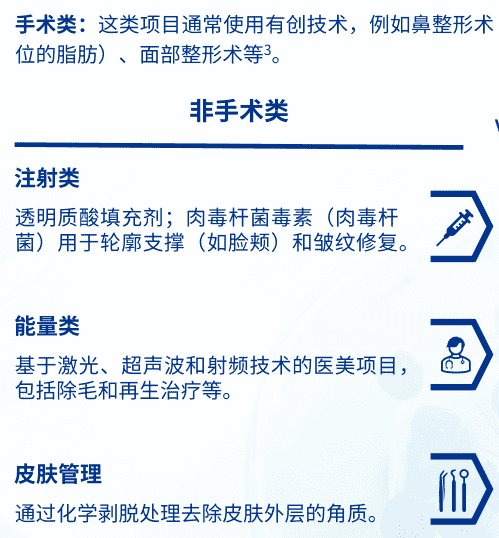

2023年，中国美容行业的价值为人民币3,115亿元，预计到2030年将突破人民币13,000亿元，非手术领域领先增长。

### 中国美容市场的规模及趋势

| 中国医美市场规模 (2016-2030F)(a,b),人民币亿元 | |
| :--- | :--- |
| 2016 | 84.1 |
| 2017 | 112.4 |
| 2018 | 144.8 |
| 2019 | 176.9 |
| 2021 | 227.4 |
| 2022 | 264.3 |
| 2023 | 311.5 |
| 2030F | 1300.0 |

2016-2023: 复合增长率:20.6% (b)
2023-2030F: 复合增长率:22.6% (b)

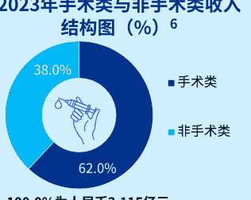

中国医美在过去十年中实现了指数级增长，预计到2030年仍保持上升趋势。

- 自2016年以来，在良好心态和高度自我意识的年轻一代推动下，医美行业表现出了增长。
- 2022年由于宏观环境限制加上新冠疫情，消费者支出意愿下降，导致医美行业放缓，但到2023年，随着消费支出回稳，医美行业开始出现增长。种种种类来看，风险较低的项目在中国医美市场中主导地位。
- 近期，由于风险低、恢复时间短和更易获取，非手术领域（尤其是皮肤护理和美容治疗）增长最为显著。

展望未来，随着非手术项目的增长和个性化服务的可见、社交媒体影响的提升，中国美容行业预计在2030年之前持续增长。消费者更趋向轻医美项目，这些项目具有高价值、方案多样化以及持续增长的趋势。值得注意的是，30岁以下的年轻人已成为主要的医美消费群体，亚洲医美市场中占比很大。这一代无疑是趋势的引领者，他们将继续投入到个人发展和外表改变。

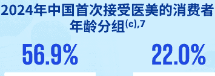

注：(a)来自数据源；(b)市场数据；(c)来源于2024年第一季的行业调研。

### 中国美容业潜力十足，并已成为全球新兴市场，其整形医生人数全球第三

若干全球指标的中国占比情况

| 2025年每1,000人预计接受美容的人数 (#) | 2024年整形外科医生世界前五个国家 (#) |
| :--- | :--- |
| 161.0 | 美国 7,752.0 |
| 98.0 | 巴西 6,497.0 |
| 91.0 | 中国 5,000.0 |
| 51.0 | 日本 4,000.0 |
| 32.0 | 韩国 2,808.0 |

资料来源: Chameleon Pharma | 资料来源:国际整形外科学会

根据2024年国际整形外科医生的调查，全球范围内，中国整形医生的人数第三。然而，与韩国和美国等国相比，中国的美容手术渗透率仍然较低。韩国和美国拥有数十年的发展和消费者信任基础，已建立起显著的医美优势。

- 中国拥有大量注册整形医生，但尚未接受专业培训的美容医生，非手术领域的人才尤为稀缺。
- 本，由于如何选择安全/认证的医生和适当美容项目的官方渠道相对封闭，导致中国消费者更多地通过社交媒体（如小红书和微信）获取信息，从而形成了网络驱动的决策模式。
- 另一个原因是消费者更倾向于境外（如韩国），这些地区的价格更具竞争力、美容技术更为成熟、且市场环境更好，为消费者提供了更广泛的医美选择。

| 2024年消费者前往中国进行医美的前五个国家 (%) | 2024年中国游客在韩国接受的医美占比 (%) |
| :--- | :--- |
| 37.7% | 医美护理 18.0% |
| 22.3% | 整形外科 11.0% |
| 8.7% | 其他美容服务 71.0% |
| 7.1% | |
| 3.3% | |
| 日本 美国 中国台湾 泰国 | |
| 100.0%是前往中国的120万海外国家 | 100.0%是前往韩国的260万中国游客 |

资料来源: 国际保险顾问, 泰国 | 资料来源:彭榜

重塑医美格局：筑驭中国医美新潮流

## 02 行业动态：驱动因素、趋势和挑战

©2025 普华永界事务所（普通合伙）-普华永会计事务所（中国）-普华永咨询（中国）有限公司-行业趋势与挑战报告。所有权，内部供。

### 行业驱动因素

- 经济因素：人均支配收入增长和中产阶级人数增加。
- 人口因素：老龄化人口、Z世代和中产消费者的需求。
- 技术因素：人工智能集成。
- 社会因素：社交媒体文化的兴起、消费者偏好。
- 监管因素：流程简化，且审批周期缩短。

2016年以来，中国的人均支配收入持续增长。随着经济和生活水平的提高，有能力购买美容等非必需服务的人口不断增加。根据外交部的数据，截至2024年，中国中产人口超过4亿（占全国40%以上），并预计未来十年内达到8亿。

| 影响因素 | 相关因素 | 影响时长 |
| :--- | :--- | :--- |
| 高 | 涉及全国、一线及二线城市 | 长期（≥4年） |

注：(A)为预测数据；(B)为基准数据。

此外，中国人口变化趋势推动着医美在全国范围内的普及。

### 人口因素

老龄化人口持续增加推动了抗衰和皮肤修复项目的增长，成为医美行业的关键因素。

- 老年消费者对医美项目的需求日益增长，例如肉毒毒素注射、胶蛋白、热玛吉和超声波等。相比传统手术类项目，这些项目恢复期更短、风险较低。

### 65岁及以上人口走势（2016-2030）

| 2016 | 2017 | 2018 | 2019 | 2020 | 2021 | 2022 | 2023 | 2024 | 2025 | 2026 | 2027 | 2028 | 2029 | 2030 |
| :--- | :--- | :--- | :--- | :--- | :--- | :--- | :--- | :--- | :--- | :--- | :--- | :--- | :--- | :--- |
| 10.5% | 11.0% | 11.5% | 12.1% | 12.6% | 13.2% | 13.8% | 14.3% | 14.7% | 14.9% | 15.1% | 15.6% | 16.5% | 17.5% | 18.3% |
| 147.3 | 155.1 | 163.4 | 171.7 | 180.3 | 188.4 | 196.4 | 203.7 | 208.1 | 215.2 | 221.3 | 228.4 | 231.8 | 238.1 | 244.8 | 256.4 |

(单位：百万) 占总人口的百分比

资料来源: Viewpoint, 经济智能数据

| 维度 | 地理性 | 影响时长 |
| :--- | :--- | :--- |
| 影响 | 涉及范围 | 长期（≥4年） |

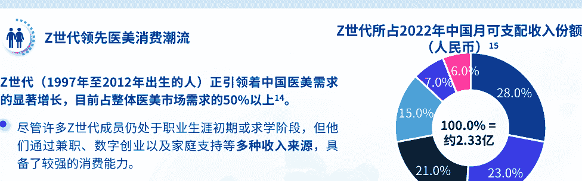

### Z世代年轻医美消费占比（人民币占比）

Z世代（1997年至2012年出生的人）正处于中国医美市场的需求增长期，目前中国医美市场的需求有望达到50%以上。

- 许多Z世代成员正处于职场初期或求职期，但他们通过社交、数字创意以及家庭支持等多种手段来积累了足够的消费能力。
- 不同于将医美项目视为针对性疾病的治疗，他们将其视为日常的自我护理。他们关注老化趋势并在早期使用肉毒毒素和胶蛋白以及光治疗等手段来维持。

| 维度 | 理性 | 影响时长 |
| :--- | :--- | :--- |
| 影响 | 全国范围、及三线城市 | 长期（≥4年） |
| (d) 影响程度 | | |

(a）热玛吉作为创新的抗衰项目，通过技术的应用，能够收缩胶蛋白并改善皮肤弹性和光泽。(b）超声波作为抗衰项目，通过无创聚焦技术，有效收紧皮肤并减少皱纹。(c）光治疗同类。

- 1001-5000 | 5001-7000 | 7000-9000 | 9000以上

资料来源：圣华咨询

### 男性消费者需求的增长以及技术的进步

### 男性医美领域的增长

男性消费者对医美的需求显著增长，这标志着以女性为主的医美市场正在发生变化。如今，男性消费者追求卓越，首次进行医美项目时特别倾向于注射肉毒毒素、微针、激光和光等项目。随着美容项目的安全性和效益不断提升，以及专门服务的增加，男性医美市场将保持增长。

| 影响因素 | 影响程度 | 地理因素 | 影响时长 |
| :--- | :--- | :--- | :--- |
| (a) | 社会接受度和支配收入较高的城市 | 中期（2-4年） |

### 技术因素

人工智能和机器学习能够准确诊断皮肤问题、实现个性化医美方案，并提升医美的体验。人工智能能够实时检测，通过分析高分辨率图像精准评估年龄、色素含量、皱纹及纹理异常等皮肤状况。这些项目利用机器学习生成详细的健康报告，使从业者能够根据用户的皮肤状况定制治疗方案。例如，通过人工智能技术，可以预测求美者对治疗或填充药物的反应，从而优化医美效果。人工智能机器人成为中国首个获得国家药品批准的国产机器人。

| 影响因素 | 影响程度 | 地理因素 | 影响时长 |
| :--- | :--- | :--- | :--- |
| 高 | 技术更先进的北京、上海和深圳一线城市 | 中期（2-4年） |

注：a)市场分析。

### 社交媒体影响力的不断提升、轻医美的兴起以及支持法的出现，为医美行业提供了更多机遇

### 社会文化因素

作为主要的社交媒体平台（尤其是小红书）的兴起，是推动医美行业发展的另一关键因素。以美为主的小红书在中国市场占有率高达80%（月活用户超过3亿），主要为一、二线城市的用户群体。超过80%的用户每天访问小红书平台，72%的用户对其内容非常熟悉。此外，该平台上90%的内容由用户产生。小红书的热关键词如“祛痘”、“透明肌”和激光祛”，反映了消费者对医美技术和治疗方案的高度关注。

| 影响因素 | 影响程度 | 地理因素 | 影响时长 |
| :--- | :--- | :--- | :--- |
| 高 | 消费者在活跃度高的一线和二线城市 | 短期（<2年） |

### 消费者偏好驱动因素

医美（非手术）项目发展强势劲头。医美/无创项目因肉毒毒素和透明质酸源充足，在Z世代中日益盛行。2018年至2023年，医美的市场规模从人民币502亿元增长到人民币1460亿元，消费者数量从740万增长到2350万。新氧和小红书等社交平台通过智能推荐、真实用户反馈和透明定价，进一步促进了医美的增长及普及。

| 影响因素 | 影响程度 | 地理因素 | 影响时长 |
| :--- | :--- | :--- | :--- |
| 高 | 城市中心，向周边城市辐射 | 短期（<2年） |

### 监管驱动因素

政府通过规范审批行为行业助力。中国不断完善监管环境，例如国家药品监督管理局加强了审批，并出台了一系列政策，为进口医美的本地化创造了宽松的环境。此外，中国大幅缩短了审批周期（从60个工作日减少到30个工作日），并加强了知识保护，以便企业提升医美业务的速度和便利性。

| 影响因素 | 影响程度 | 地理因素 | 影响时长 |
| :--- | :--- | :--- | :--- |
| 高 | 全范围内，尤其是一线等发达城市 | 中期（2-4年） |

### 将医美项目与精神健康结合，并提供科学护肤方案的健康文化正在兴起

### 健康文化的兴起

随着健康文化的兴起，以美为中心的医美行业正逐渐变为关注整体健康和自我护理的生态系统。

- 越来越多的中国消费者，其乃Z世代，正将医美项目融入其健康养方案。这种健康养方案侧重于表现的同时同时强调健康。
- 医所也在向健康消费转型
    - 作为一项经营咨询的行业，医所推出的个性化护方案能够帮助消费者改善皮肤状态，并促进医美治疗后的恢复。
- 中国的医所和供应商开始销售胶原蛋白饮料和肠道健康补充剂等健康品。
- 各大医美中心不再推出美容疗法、变、愉悦和康复等服务。

> 随着在医美日的日益盛行，越来越多的消费者越来越关注健康来提升外观的医美产品，例如健康、美容营养和局部解决方案。这是一种健康生活方式让消费者共享的健康全方位体验 - 格梅梅艾斯·Fisher，2025年2月

### 科学护肤

**科学护肤（经过临床测试，用医用级成分研制，医美术专用）在医美行业内日益盛行**

- 根据中国商业平台书籍的一份报告，60.0%的中国美偏好科技领先，促使各品牌产品更加注重品质的健康标准和实际效果。
- 2025年9月，土耳其高德曼在中国推出了医美术修护品牌阿拉斯汀（Alastin），标志科学护肤领域的重大进展。该品牌旨在为消费者在进行医美项目前、中、后期阶段提供皮肤支持。

消费者对于项目的功效仍有强烈支持，例如通过临床试验、成分透明化以及人工智能等方式进行筛选。这种趋势推出了一系列产品，例如 Key In，它开发了多种针对真皮修复的配方，以使产品达到最佳效果 - 英敏特女性及个人护理产品副总监，2025年1月

> 考虑医美行业的演变趋势，我认为从业者和专业人士有必要把握行业格局的各项技术和机会趋势。消费者对医美项目的需求持续上升，并愈发热于在繁忙生活中进行医美项目 —— Matt King, MediSpa.ai首席执行官，福斯医学委员会，2024年10月

### 中国医美行业的渗透率存在城市差异，一线城市领先，其他城市的医美需求在不断增长

按级别、城市和地区划分医美渗透率

中国医美行业城市级差异的影响，不同级别城市的消费者行为和市场热度存在差异。
随着医美认知和可支配收入的提高，医美需求从大都市中心向新兴城市中心辐射。
本节将通过两项关键指标，探讨不同级别城市和地区的渗透情况：

- 各级城市的需求人数
- 年度平均医美支出

### 各级城市渗透率矩阵

| | 一线 | 新一线 | 二线 |
| :--- | :--- | :--- | :--- |
| 高端分市场 | 4.9 | 15.9300 | |
| 大众消费市场 | 6.6 | 14.5190 | 7.5 |
| 三线 | | 6.1 | 4.4650 | 13.1750 |
| 四线 | | 5.6 | 3.9280 | |
| 五线 | 4.4 | 2.3340 | |

注: (a)求医美者人数以百万为单位；年度平均医美支出以人均为单位
数据来源：聚格，份城市分析

### 城市的级别的划分情况

- 一线：上海、北京、广州、广州
- 新一线：成都、杭州、重庆、武汉、西安
- 二线：石家庄、南京、哈尔滨、金华、南昌、长春等
- 三线：乌鲁木、呼浩、福州、州州、扬州等
- 四线：舟山、枣亚、泰泉、吉林等地
- 五线：庆州、盐城等

各级城市的营销策略:
- 高端市场（求美者人数、医美支出）：高端诊所和高端层级医美项目的理想源地。
- 大众市场（求美者人数、医美支出）：大规模实现盈利效果的医美方案。
- 高端市场（求美者人数、医美支出）：面向一线城市的富裕阶层，适合推广高品质产品。
- 新兴市场（求美者人数、医美支出）：消费者审美和可支配收入不断提升，具备长期增长潜力。

注：(a)份城市分析。

### 上海和北京仍然医美支出最高的城市，新一线城市成为推动医美行业增长的主力

2023年按要求人数划分的前十大城市（万人）

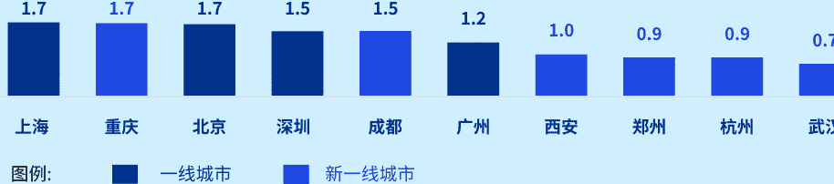

资料来源：夷杨

长期以来，上海和北京等一线城市一直是高端医美的消费中心；这意味着消费者有更多收入可用于医美等必要消费。这些地已逐渐变为新一线城市，后者正在成为医美行业增长的核心力量。

- 新一线和二线城市的生活成本和价格较低，意味着消费者有更多收入用于医美等消费。
- 成都、重庆、杭州、武汉和新一线城市中的“城市指南”（城市资源、竞争力评估）排名在前。
- 根据2025年的排名，成都凭借其在创新、居民活动和未来潜力方面的优异表现，成功跻新一线城市。
- 三线五线城市属于新兴市场，尽管高端医美基础乏且消费者意识较为薄，但随着社交影响力的提升，这些城市在未来迎来增长。

## 医美城市深度析

2023年医美者的区域分布（万人）地区平均医美支出（人民币）

| 地区 | 支出 |
| :--- | :--- |
| 北部 | 17326 |
| 东部 | 16494 |
| 中部 | 15703 |
| 西南 | 13649 |
| 南部 | 11422 |
| 东北 | 9931 |
| 西北 | 9231 |

资料来源：夷杨

包括上海等城市内的东地区，由于其巨大的人口规模和较高的消费水平，成为首选医美市场，该区域聚集了规模和消费能力。
包括北京等城市内的东北地区虽然人口较少，但对医美的消费意愿强烈，可支配较高，且倾向领先高端市场，因此地区平均医美支出最高。

## 重塑医美格局：驱动中国医美新潮流

## 03 利益相关者体系

© 2023 普华会计事务所（特殊普通会计事务所）－中国注册会计事务所、华信会计事务所（中国）－普华国际会计事务－普华会计事务所－所有公司的专业责任保险相关的业务审计报告中的内容，保留所有权利。

### 中国医美行业形成了一个横跨上、中、下游的多层次利益相关者体系

### 利益相关者体系和价值链

医美行业的结构非常复杂，涉及众多利益相关者。医美价值链涵盖了整个利益相关者体系，并横跨上、中、下游三个分市场。上游涉及主要原材料和医疗器械的制造和进口；中国的参与者提供手术治疗与美容项目的私立医美；下游为获客平台和终端客户。以下价值链图概述了每个市场的基本组成部分和参与者

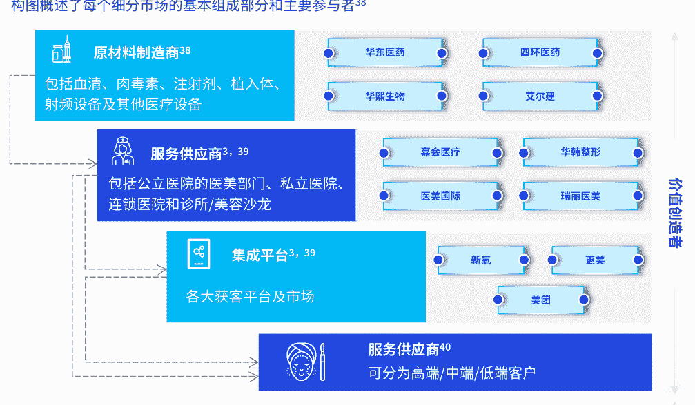

- 原材料制造$^{38}$ 包含胶、肉毒素、注射、植入等治疗设备及其他医疗设备
- 服务供应商$^{39,39}$
- 包括公立医院的医美部门、私立医院、连锁诊所和美容沙龙
- 集成平台$^{3,39}$
- 各聚客平台及市场
- 投资者$^{41,42}$
- 私募股权公司与头部制造、服务提供商和平台进行合作
- 政府$^{39}$
- 国家机构对整个价值链中的医美活动进行监管，以确保健康的发展和透明度
- 行业协会$^{43,44}$
- 中国整形美容协会等国家机构及类似的地方组织行业活动，并推广最佳医美实践

注：部分图表源自中国整形美容协会发布的《2021中国医美市场报告》、《数据源自中国国家统计局、中国信息有限公司、数据源自中国统计年鉴-医药行业报告、数据源自中国医美行业协会报告、以及与瑞美集团有限公司医美保险相关数据及全球行业统计指标的对比、平移。

## 04 监管环境

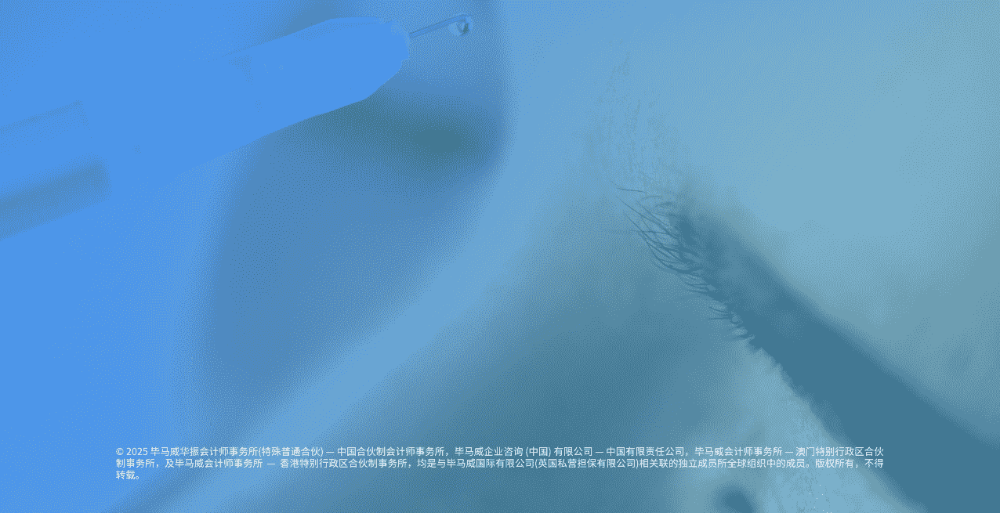

随着医疗行业的持续发展，国家政府对医美行业的各个环节都实施了一系列干预措施，以简化流程和完善运营的逻辑。

这些措施旨在提升行业价值并加大对行业的支持力度，涵盖原材料采购、设备和化妆品生产、价格监管、保障诚信和消费者保护等多个方面。医美监管体系由国家级机构为主，并与市场局紧密协调，确保监管的一致性和实施的落地。

| 国家级 | 本地 |
| :--- | :--- |
| 为国家级机构提供支持，确保检查并遵守相关法规和指南。 | 北京市药品监督管理局等机构 |
| 国家市场监督管理总局、国家药品监督管理局、国家卫生健康委员会、国家标准化研究院等 | |
| 上游 | - 器械注册制度（2023年）：将整形设备分类为高风险医疗器械，要求认证过程中明确说明其应用$^{44}$ - 《化妆品生产监督办法》（2022年）：要求企业产品安全和可溯性的生产$^{45}$ |
| 中游 | - 重组胶蛋白（2022年）：描述重组胶蛋白的标准、检测方法和质量，要求其具有发展的路径$^{6}$ - 《化妆品成分管理》（2021年）：要求列入目录的化妆品成分进行备案$^{7}$ - 医疗机构注册（2022年）：要求机构出示所需证书，定期检查。此外，建立了一个国家级监管和监测体系，对医用产品进行监测$^{8}$ |
| 下游 | - 服务定价（2022年）：发布涵盖医美整形服务指南，提高价格透明度 - 未成年整形规范（2022年）：规定18岁的未成年人进行整形手术必须父母同意 - 广告监管（2021年）：帮助企业获得适当许可，确保广告不会遭遇误导性宣传的风险$^{2}$ |

此外，中国正通过政策支持、鼓励创新和新医疗旅游等方式进行医美的发展。随着本土和外国人士的加入，医美行业呈现持续增长趋势。国家及地方政府、行业协会和非营利组织实施针对性政策，旨在提升研发水平、推动医疗旅游并提高服务质量，确保医美行业的稳定可持续增长。

| 政策/措施 | 概述 |
| :--- | :--- |
| 《医美化妆品原料规定》（2025年） | 支持在港等地享受优惠的医美市场。（注：此处内容在图片中显示不，根据内容推断） |
| 《北京市美容产业高质量发展三年计划（2024-2026年）2024年） | 加快进口供应的审批，进行严格的安全评估、加强知识产权保护并提供资金援助以减少对进口的依赖。 |
| 深圳医美（2023年） | 致力于将北京打造为健康美容领域的创新中心。该方案侧重于六大领域：发展专业化服务；增强知识产权创造；支持优质材料、设备和先进技术的应用；整合数字工具以及吸引全球投资 |
| 调研活动（2022年） | 作为深圳对医美的专业政策支持，旨在促进医美园区的发展，为其提供资金支持，并建立医美监管中心进行合规监管 |
| 《规范医美医疗相关产品和医美服务的通知》（2021年） | 由中国互联网金融协会联合 Aller Aesthetics合作，通过该活动推广双重标识，规范医美消费，消除消费隐性，并确保其安全 |
| 建立医美旅游试点中心（2023年） | 由中国互联网金融协会发起，旨在规范医美相关的金融产品。通过信誉制度和捆绑销售等行为，建立有利于医美消费的合性和可持续发展，保护消费者的权益 |
| 在海南设立国际旅游中心，成为全球领先的医疗旅游胜地之一。该先行项目提供包括医学疗法在内的专业医疗服务，通过实施税收和海关免政策，促进全球范围内的中心 |

## 05 机构现状

© 2023 华平基金行业报告中国医美行业报告。华平基金咨询（中国）有限公司版权所有。声明：华平基金行业报告仅供内部参考，不构成投资建议。华平基金行业报告免责声明：对使用报告相关的任何直接或间接损失不承担责任。投资建议，不适用。

### 私营机构（包括大型连锁医院、中等规模的医疗中心和诊所）是推动行业发展的主要力量

医院、诊所和医疗中心的业务规模

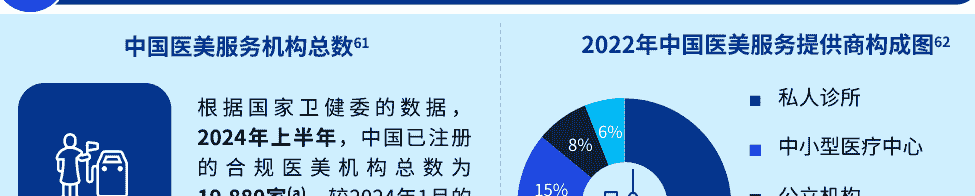

| 中国医美服务机构总数 | 2022年中国医美提供商构成 |
| :--- | :--- |
| 根据国家卫健委的数据，2024年上半年，中国已注册的合规医美机构总数为19,880家(A)，2024年1月的18,584家，增长率为7% | ■ 8% 私人诊所 ■ 15% 中型医疗中心 ■ 71% 公立机构 ■ 大型连锁医院  数据来源：前瞻产业研究院 |

2024年、北京、深圳、成都和广州城市的医美机构表现最优。
医美不再是缺乏监管的灰色服务，是在公立医院的推动下，逐渐成为可追踪、负责的医疗实践。SM美团队，2025年8月

| 机构名称 | 设施数量 | 服务 | 2024年销售（人民币百万） | 其他洞察 |
| :--- | :--- | :--- | :--- | :--- |
| 瑞丽美 | 4 | 提供美容、微美容 | 199.3 (+5.3) | 服务于广泛客户群体，在2024期间服务了48,000+客户 |
| 华锦整形 | 30+ | 涵盖皮肤美容和整形外科 | 1059.6 (-3.3) | 与学术界开展再生医学、整形外科和皮肤医学 |
| 胡丽 | 42 | 提供优质的无创医美项目 | 783.86 (+3.5) | 拥有覆盖29座城市的强大网络 |
| 美莱 | 36 | 提供全面的抗衰和医美解决方案 | 不适用 | 拥有知名品牌 |

注：(A)数字不包括公立机构。(B)分析均为均衡性，定义为行业领先者。(C)数据仅供参考。(D)未经许可，不得对内容进行传播或转载。

### 竞争能力

公立医院提供的医美服务有限，政府支持的医美机构主要集中在独立医院和大学附属医院等皮肤科和整形外科等部门。

| 机构名称 | 服务 | 其他洞察 |
| :--- | :--- | :--- |
| 四川大学华西医院 | 提供美容、皮肤科技术、整形手术和皮肤治疗 | 每年进行整形手术多达多次 |
| 中国医学科学院整形外科 | 提供面部美容、身体整形、激光治疗及其他美容服务 | 每年进行超过8次的整形和美容手术 |
| 广州市皮肤病医院 | 提供治疗痤和皮肤疾病的激光服务 | 每年的医美患者约10,000人 |
| 北大深圳整形与美容外科 | 提供面部美容手术、身体整形及其他并发症修复服务 | 每年门诊量达到2万人，手术达到5千次 |

### 行业参与者的主要趋势

- **战略联盟与合作**
    - 北京丽都：2024年8月收购知名医美医院以扩大市场。
    - 2024年5月宣布医美公司联盟（Pumen）推出新产品。
- **技术集成**
    - 2025年2月，该公司整合了DeepSeek的人工智能能力，为行业人士培训，并结合医疗设备实现IoT测试数据，实现精准患者分析。
- **获取产品的监管**
    - 2024年2月，梅尔引进菌素产品Queomin获得审批。它是中国获得菌素治疗的六家公司之一，其他包括华国集团、艾健和高源美。

所有分析均为示意性，不作为行为依据；相关数据具有公开性，供参考。

## 06 风险与挑战

### 合格专业人才持续短缺限制了服务量的提升和行业发展

当前不利因素

与其增长快速、消费者需求不断上升，中国医美行业仍面临诸多挑战，从而可能阻碍其长期可持续发展。
随着监管框架不断演变、质量控制的责任日益增加，加上消费者偏好的转变和压力的影响，以及新进入市场的参与者均面临重大风险。

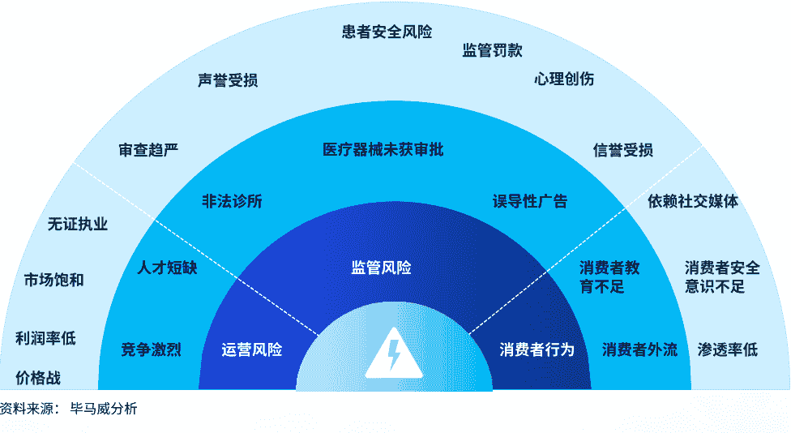

### 运营风险和挑战

人才短缺的人才问题，成为中国医美行业面临的一大主要挑战。

- 中国医美从业者数量约100万，具有资质的医师缺口约2万名(a)
- 执业医师的总数却以每年约10.0%的速度增长，而专项专业人员（如优质医师和训练素质的护士）的增长率仅为5.0%~8.0%，这些缺口限制了人才解决行业的问题。

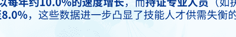

> （a）数据来自2025年4月由中国医美美容协会举办并在武汉举行的整形外科会议；(b) 华马威分析。

### 剧烈的市场竞争、非法医疗器持续扰乱市场稳定并危害求美者心健康

### 剧烈的市场竞争

目前，在中国运营的专业医美机构约2万家，国内医美市场已高度饱和。

激烈的竞争引发了价格上涨，挤压了利润空间，使得诊断难以实现持续的增长。

- 在2023年11月的疯狂活动（一项著名的购物盛宴）期间，各大直播间为促进销售，将玻尿填充剂的价格降至1999.0元/支（原价为9000.0元/支降至12000.0元/支）。

### 监管风险和挑战

非法医美对中国消费者的健康安全和整个医美行业的信誉构成了严峻的威胁。

- 根据2024年12月发布的《医疗美容行业白皮书》，医美行业有12.0%的诊所已经获得了经营许可。这些未获得许可的诊所通常在隐蔽或非正规的环境中，通过伪造证明、使用劣质材料和不安全的程序进行操作。
- 最高法院2023年12月发布的数据显示，2018年至2022年期间，法院审判非法医美刑事案件3800多起，定罪5700多起。

### 使用未获批医疗器械

未使用未获批医疗器械的现象在美容行业日益普遍。

- 在2023年8月的一个案例显示，包括广汉艾非整形外科医院内的几家诊所在法律上要求III类审批的项目（如光射治疗）时，使用了仅II类审批的器械。

### 误导性广告、医美消费外流以及缺乏安全意识等因素阻碍了国内医美行业的发展

### 误导性广告

误导性广告仍然是中国医美行业面临的一个主要问题。许多患者存在夸大疗效、伪造医美资质、推销未获产品等现象。

- 2025年上半年，中国市场监管机构查处了1000多起非法医疗案件，罚款金额超过1,280万元。
- 2025年7月，一名直播带播因对医美做出未经核实的声明而被罚款40万元并受到警告处分，这说明监管部门对非法广告的力度日益加强。

### 风险影响（高）

消费者行为的风险和挑战

### 消费者外流

选择国外医美服务的中国消费者人数增加，是因为在境外的医美服务价格更具竞争力，使用的设备更为先进，且遵守着更高的安全标准。

2024年，中国医美旅游游客占总人数的22.0%，这反映出大量消费者外流的趋势⁷。

### 风险影响（低）

### 消费者安全不足

许多医美消费者，尤其是年轻消费者，主要依赖小红书和新氧等社交平台来获取美容目的的相关信息，这些内容通常包括网络发布的未经核实的信息⁸。

- 在中国10级视频用户中，超过92.0%的人在线接触了相关内容，而这些内容通常包括网络发布的未经核实信息。
- 这种获取信息的趋势导致消费者的决策更多基于主审美和流行趋势，而不是安全性、相关资质或临床依据。

### 风险影响（高）

注：(A）华菁分析。

注：2023-华菁咨询行业报告（医美行业）-中国及全球医美市场预测，2024-2030-智研咨询有限公司，华菁咨询中国医美行业和趋势报告-华菁咨询有限公司，华菁咨询中国医美行业和趋势报告-华菁咨询有限公司，华菁咨询中国医美行业和趋势报告-华菁咨询有限公司，华菁咨询中国医美行业和趋势报告-华菁咨询有限公司。⁵

### 医学美容行业未来将面临数据隐私泄露、监管趋严、心理健康问题以及过度医疗等风险

## 前瞻性风险展望

中国美容行业的后期增长不仅依赖技术创新，还取决于其应对各种风险的能力。由于合规压力和道德问题，医美行业将迎来关键的转折点。

- 技术问题
  随着人工智能在医美服务中的应用越来越广泛，可能引发个人数据的法律问题
- 心理问题
  如果缺乏道德约束，医美行业可能会导致心理健康问题而受到消费者的强烈排斥，引发公众信任危机
- 持续监管
  不断的监管环境可能导致医美行业的准入度和运营成本增加，并抑制医美的创新热情
- 过度商业化
  过度提供和使用医美服务可能会引发消费者的健康风险

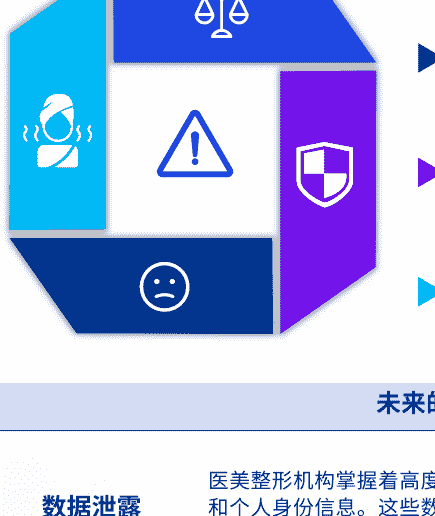

| 类别 | 内容/描述 |
| :--- | :--- |
| 数据 | 医美机构积累高度敏感的信息，包括个人生物特征、病史、照片、财务信息和个人身份信息。这些数据具有较高价值，可以被用于软件、欺诈或歧视，因此此类行业成为犯罪分子获取信息的目标 —— 华亚分析 |
| 过度医疗 | “过度使用医美产品会对健康产生不良影响。虽然注射、整形及其他医美项目可以改善外观，但不当或过度使用可能会感染、副作用等不良反应”——涛健，上海医学预防美容年会内科医生，2022年3月 |
| 心理问题 | “消费者的焦虑促进了美容行业的发展。如果不加以限制，整形可能可能出现审美焦虑，进而扭曲年轻一代的价值观”——郑强，中国卫生法务委员会，2021年9月 |
| 监管趋势 | “随着国家药品管理局的监管日益严格，未适应新环境的、其未获得医疗器械以外的药品将面临更大的运营困难”—— 美国美容会，2025年5月 |

07

未来展望

## 医疗美容、远程会诊以及业务模式的创新正在塑造医业的未来格局

### 创新新潮流

随着中国医业不断突破传统治疗方式，新一轮的创新与转型模式正在逐步重塑医业的未来格局。从技术突破到数字平台的应用，再到全球业务扩张，以数字趋势展现了医业实现智能增长的主要路径。

### 主要趋势

- 远程医疗下的分发服务
- 随着5G和卫星宽带网络在中城市和农村地区的普及，医美服务模式将从一城市诊所的集中模式转变为覆盖全中城市和农村地区的数字化分发模式
- 新型平台将提供更多人工智能咨询服务，允许患者远程接受个性化建议。

- 再生医学
- 再生医学通过干细胞应用于再生医学，通过促进胶原蛋白生成、修复组织和肌层头部，来恢复和修复皮肤活力。
- 外泌体（纳米级别的细胞颗粒，可作为皮肤再生的无细胞疗法）正研究作为未来干细胞治疗的无细胞替代品，有望促进医业的进一步发展。

- 诊式业务模式
- 基于方的未来可能会成为医业的新型业务模式，诊所将按月或季度提供订阅服务。
- 诊式模式有助于企业实现经常性经营，确保客户的忠诚，提高现金流。

- 跨境业务
- 随着南亚地区对医美需求的不断增长，中国医美企业将预计向东南亚进行业务拓展，增长有机会。
- 新型国际企业将通过特许经营合作伙伴来探索跨境业务。
- “特许经营模式将在未来医业的扩张中发挥重要作用。因此，我们计划在今年第四季度推出到三个特许经营中心进行试点”——金星，国际国际集团，2075年。

此外，先进治疗模式和医疗器械的重大机遇将为行业开辟新的增长领域。

展望未来：具有增长潜力的领域^{[a]}

| 类别 | 主要领域 | 潜力大小 | 依据 |
| :--- | :--- | :--- | :--- |
| 治疗模式 | 无创治疗 | ██████ | 具有安全性和便利方面的优势 |
| | 微创治疗 | ██████ | 恢复时间短 |
| | 有创治疗 | ██████ | 受消费者欢迎 |
| | 再生医美 | █████ | 具备长期效益和创新 |
| 技术 | 综合治疗 | █████ | 具有文化相关性，但足够的临床试验 |
| | 人工智能与机器学习 | ████ | 将促进个性化服务的增长 |
| | 智能诊所集成 | █████ | 依赖可靠的基础，但在细分市场可见 |
| 消费者细分 | 男性消费者 | █████ | 男性消费的需求日益增长，女性消费者渗透率较低 |
| | 医疗旅游 | ████ | 监管和地缘因素可能限制增长 |
| 市场竞争 | 本土品牌 | ████ | 本土品牌的成本、文化认同和信任度提高 |
| | 高端品牌 | ████ | 消费者需求旺盛，面临定价方面的挑战 |
| | | 快速增长 | - |
| | | 慢增长 | - |

注：(a)华菁分析，TCM是中医，IoT是物联网。©2025华菁及会计师事务所。医疗行业报告-华菁有限公司。医疗行业报告-华菁有限公司。保护权利。未经许可复制或传播。华菁分析。

08

附录

附录（1/5）

| No. | 出版名称 | 出版者 | 出版时间 | 链接 |
| :--- | :--- | :--- | :--- | :--- |
| 1 | Administrative Measures for Medical Aesthetic Services | Measures for the Administration of Medical Cosmetic | 2002 | Link |
| 2 | Current Status of China's Aesthetic Market Predicting 2025: A Panoramic View of China's Medical Aesthetics Industry | ITIS Network | 2025 | Link |
| 3 | China's Beauty Industry: Challenges, Trends, and Future current status of beauty industry (originally sourced from iResearch Institute) | Qianzhou Research Institute | 2025 | Link |
| 4 | iResearch Consulting: 2024 Dynamic Medicine Market, Outlook, and Expansion | Baidu | 2025 | Link |
| 5 | ISAPS international survey on aesthetic procedures | Macquarie | 2023 | Link |
| 6 | 17 Million Patients in International Society of Plastic Surgery survey | 2024 | Link |
| 7 | How Korea became the world's beauty clinic | Ministry of Health & Welfare of South Korea | 2025 | Link |
| 8 | China's Consumer Waves for Skincare (data sourced from Ministry of Health & Welfare of South Korea) | Think China | 2025 | Link |
| 9 | Ambassador to Canada China's Economy Rebounds with Sound Momentum | The Third Times | Bloomberg | Link |
| 10 | China's medical aesthetics industry is booming The secrets to the 5 billion CNY Gen Z market for monthly disposable income of Gen Z originally sourced from White Paper on New Consumption Trends | Economic Intelligence Unit | | |
| 11 | White Paper on Gen Consumer Power Trends: Chinese men are getting 'tweaks' | Ministry of Foreign Affairs | 2022 | Link |
| 12 | Intelligent Housecases-Edge Consulting | Octopus Media | 2021 | Link |
| 13 | 3D Skin Analysis at IMCAS 2025 | Utech Skin | 2025 | Link |

附录（2/5）

| No. | 出版名称 | 出版者 | 出版时间 | 链接 |
| :--- | :--- | :--- | :--- | :--- |
| 19 | China beauty sheet 2025 | Jing Daily Shanghai Food and Drug Administration | 2025 | [Link] |
| 20 | Full Support for New Development | | 2025 | [Link] |
| 21 | Medical Aesthetics Wallpaper: Xiaohongshu Marketing Insights | Octopus Media Group | 2024 | [Link] |
| 22 | Light beauty in China: the future of skincare? 2024 | The Chinese Pulse | 2024 | [Link] |
| 23 | Light medical beauty in China: A new era of aesthetics | Daxue Consulting | 2025 | [Link] |
| 24 | Interpretation of the NMP... | NMPA | 2025 | [Link] |
| 25 | Opinions of the General Office: Chinese Business Industry Trends in 2023 | NMPA | 2025 | [Link] |
| 26 | The New Wave of China's Beauty Industry | | 2024 | [Link] |
| 27 | To enhance the personalized treatment experience and satisfaction | MEIC | 2025 | [Link] |
| 28 | New trends in China's health and wellness industry | Sohu | 2023 | [Link] |
| 29 | Galderma launches Alastin in China YASO’s China Beauty Market Analysis – Part 1: Clean Beauty | China-Business Focus | 2025 | [Link] |
| 30 | The Rise of Chinese beauty brands | Galderma | 2025 | [Link] |
| 31 | Provisions for Supervision and Administration of Manufacturing and Marketing of Cosmetics | YASO | 2023 | [Link] |
| 32 | NMP Announcement on Updating the Catalogue of Raw Materials Banned for Cosmetics | Dr Rachel Hol | 2024 | [Link] |
| 33 | China Medical Spa Market Size, Trends and Forecasts 2031 | Mobility Research | 2025 | [Link] |
| 34 | The Future Of The Medical Spa And Aesthetics Industry | Forbes | 2024 | [Link] |
| 35 | China’s City Tiered | Glopen | 2025 | [Link] |
| 36 | Analysis of China's Medical Aesthetics Industry in 2024 (originally sourced from China Business Research Institute) | NetBase | 2024 | [Link] |
| 37 | | Qinzhou Research Institute | 2025 | Link |
| 38 | | | | |
| 39 | | | | |
| 40 | | | | |

## 目录（3/5）

| No. | 出版名称 | 出版者 | 出版时间 | 链接 |
| :--- | :--- | :--- | :--- | :--- |
| 44 | Matters for Guangdong Association of Plastics | Guangdong Association of Plastics | | |
| 45 | Matters for the Inventory of Existing Cosmetic (IECIC) | NMPA | | |
| 46 | Provisions for Supervision and Administration of Manufacturing and Marketing of Cosmetics | NMPA | | |
| 47 | | NMPA | | |
| 48 | Notice No. 22 of NMPA on Recombinant Collagen | NMPA | 2021 | |
| 49 | Issuing the Action Plan for Special Rectification of Medical Quality and Safety | NHC | 2025 | |
| 50 | Issuing the Work Plan for Special Rectification of Illegal Medical Aesthetics | China Government | 2025 | |
| 51 | Guidelines for the Establishment of Pricing Items for Cosmetic Medical Services | NMPA | 2025 | |
| 52 | Minors - Shanghai Municipality on the Protection of Minors Law Enforcement for Medical Beauty Advertising (originally sourced from SAMR) | Shanghai People’s Council | 2022 | |
| 53 | Three-Year Plan for High-Quality Development of the Health and Industry in Beijing | Hong Kong Trade Development Council | | |

重塑医美格局：筑中国医美新潮流

## 附录 (4/5)

| No. | 出版名称 | 出版者 | 出版时间 | 链接 |
|---|---|---|---|---|
| 62 | Competitive landscape of China’s s medical aesthetic industry in 2022 | Qianhan Industry Research Institute | | Link |
| 63 | Medical Aesthetics Sheds Its Gray Past as Public Hospitals Lead Industry Transformation | MSYMI | Aug 2025 | Link |
| 64 | Rainy Business Overview | Raily | | Link |
| 65 | Rainy Annual Report 2024 | Raily | | Link |
| 66 | Huahan Co. company profile | Eastmoney.com | | Link |
| 67 | Lancy Overview | Lancy | | Link |
| 68 | Lancy Annual Report 2024 | Lancy | | Link |
| 69 | Mylike | MyLike | | Link |
| 70 | How many branches of Meilai Surgery are there China | NaiKan | Jun 2025 | Link |
| 71 | Dermatology & Venology | West China Hospital Department of Plastic and Burn Surgery of West China Hospital | | Link |
| 72 | Plastic and Burn Surgery | Chinese Hospital Academy of Medical Sciences | | Link |
| 73 | Hospital Introduction | | | Link |
| 74 | Annual Report 2024 | Guangzhou Hospital | | Link |
| 75 | Department Introduction | Peking University Shenzhen Hospital | | Link |
| 76 | Acquires two hospitals for 580 million yuan in cash, accelerating its nationwide expansion (originally sourced from Lancy annual report) | Medbelove | Aug 2024 | Link |
| 77 | Jiahui Health & Estée Lauder Partnership in Aesthetic Care Recovery Research | Jiahui Health | Mar 2025 | Link |
| 78 | Hualong Beauty & Personal Care Weekly Report (originally sourced from Hualong Securities) | Sina | Mar 2025 | Link |
| 79 | China Botulin Toxin Market 2025 Medical Aesthetics Supply Analysis: Structural Shortage of Medical Aesthetics Professionals | Grand View Research | Sep 2024 | Link |
| 80 | China’s medical aesthetics market reaches breakthrough | Qianhan Industry Research Institute | Jul 2025 | Link |
| 81 | The Chaos in China’s Aesthetic | Asia News Network | May 2024 | Link |
| 82 | and Plastic Surgery Industry Urgently Needs to be Addressed | Springer | Dec 2024 | Link |
| 83 | Cases of illegal medical practice, but spreading to new areas | Supreme People’s Court | Dec 2023 | Link |
| 84 | CCTV Exposing Alarming Misuse of Devices in China’s Cosmetic Injection Industry (originally from CCTV) | Trending on Weibo | Aug 2025 | Link |

* 2025年中国医美行业报告所有权属于：中国医美容协会。本报告（中文版）由中国医美容协会发布，中国医美行业内严禁转载、复制、传播、发布等未经许可的任何行为。本报告包含受国家知识产权法保护的全球性信息，数据来源于中智。*

## 附录（5/5)

| No. | 出版名称 | 出版者 | 出版时间 | 链接 |
|---|---|---|---|---|
| 85 | China cracks down on fake medical advice with new rules for health influencers | South China Morning Post | Aug 2025 | [Link](#) |
| 86 | China State Administration for Market Regulation issued second batch of cases in the field of e-commerce (originally sourced from SAMR) | Digital Policy Alert | Jul 2025 | [Link](#) |
| 87 | China's consumer products hit Botox and skincare, driving costs down | Business Standard | Sep 2025 | [Link](#) |
| 88 | Does the pursuit of a perfect appearance by young people and their over-reliance on cosmetic products pose a risk? | Great Chinese Medicine | Mar 2024 | [Link](#) |
| 89 | China cracks down on cosmetic surgery to stop 'appearance anxiety' | Global Times | Sep 2021 | [Link](#) |
| 90 | Inside China Beauty Expo 2025: Trends Shaping the Future of the Beauty Industry | Kline company | May 2025 | [Link](#) |
| 91 | How the Healthy China 2030 Policy Promotes the Construction of a Rural Telemedicine Chronic Disease Management System | Studies in Social Science & Humanities | Mar 2025 | [Link](#) |
| 92 | The Future Of The Medical Spa And Aesthetics Industry | Forbes | Oct 2024 | [Link](#) |
| 93 | The milion dollar business opportunity for exosomes | Gene Online | Jan 2025 | [Link](#) |
| 94 | Chinese medicine regenerates regeneration in stem cell - based therapy | Stem cell research and therapy | Sep 2025 | [Link](#) |
| 95 | Special Report: 2025 China Medical Aesthetics Industry Research Report | The Paper | Aug 2025 | [Link](#) |
| 96 | Why Singapore and Southeast Asia is franchising's next big move | Global Franchise | Jul 2025 | [Link](#) |
