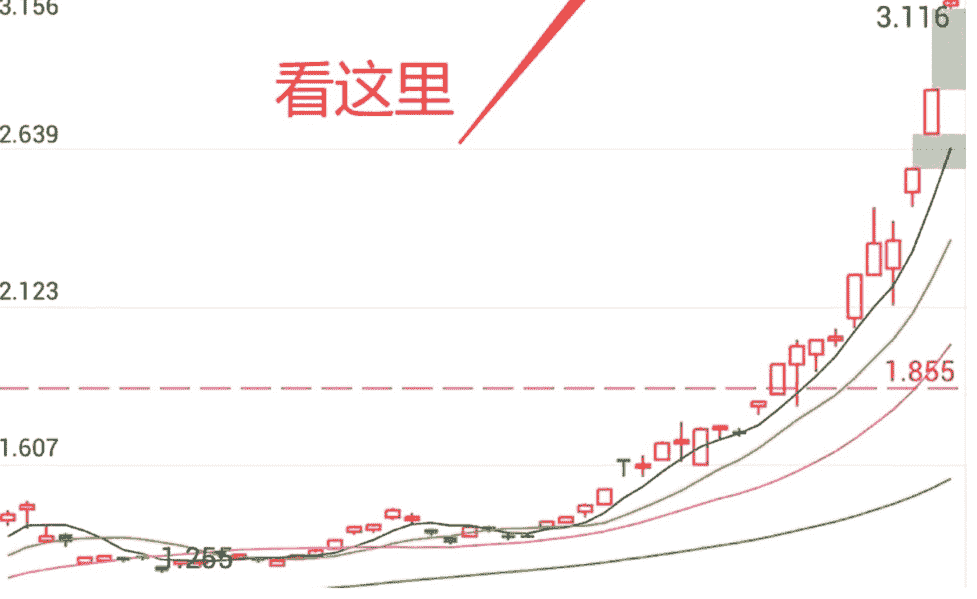

# 套系列5——LOF基金套利技巧

来自：重远投资视
2025年12月25日 09:00

最近白银LOF的套利很火，很多人在提问中问到了这个套利，本篇会详细解释下什么是LOF基金套利，以及该怎么操作。

这篇文章不仅适合白银LOF套利，也适合所有基金的套利，但会以这次大火的白银来举例。我们现在开始：

LOF基金有两个概念，净值和市价。

净值：基金资产减去负债后，按照基金份额平均分配后，得到的每一份的价格，就是净值，每天会更新一次。

市价：场内的实时交易价格，由买家和卖家交易博弈得到的价格。

当当净值和市价不一致时，便有套利机会，以白银LOF举例，大家看下方的图片：

## 国投银LOF(161226)
12-24 15:00:03
3.116
+0.283 +9.99%

今开 3.110 昨收 2.833 总额 6.48亿
最高 3.116 比例 0.40 总量 207.9万
最低 3.100 振幅 0.56% 溢价率 68.19%

分时 五日 日K 周月 周期
MA MA5: 2.639 10:2.340 20:1.999 60:1.559 叠加 前复权

图中有写明，溢价率为68%（大家也可以打开自己的券商APP，搜一下这个基金161226）。

也就是场价格比净值价格高68%。两者都是一个东西。

所以，以净值买入100元，就可以在场内168元卖出，获得68%的利润。但是，一般基金，对于你以净值买入的额度，是有限制的，比如这次白银LOF，一个账户就是500元的限额，也就是一个账户一天能套利300多元。

套利的流程如下：

T日收盘前卖申购，T+1日晚上能到账，T+2日一早就可以套利了。

申购位置，我们用证券宝宝演示：

## 新股/新债申购
- 国债逆回购：交易时间延长至15:30
- 场内基金：LOF、ETF
- 可转债专区：新债申购、新债日历
- 开放式基金：认购、申购、转托管
- ETF专区：低费率、部分T+0
- 场内申购T+2到账：套利，选这里
- 基金投：让专业的您的财富航
- 北证交易：这是场外的，要T+4到账，后文说

场内申购，T+2生效的，就是图中第一个红框圈的地方。在交易Tab里可以找到。

每个券商，场内申购的一一样，但一般都在券商APP的交易Tab里找到，如果找不到，电话问你券商的客服，让他们告诉你申购的位置。

好了，这里，最简单的套利流程就完成了。只要留够资金，你就可以持续套利，比如一周一购周三，周二买入周四，周三买入周五。

然后我们来谈套利技巧如何展开：

### 1) 套利方向
- a 净值 < 价格区间，套利方向为：净值申购在场内卖出，就是低价的买入，高价的卖出。
- b 如果净值 = 价格，则溢价为负，套利方向为：在场内买入并场内确认，就是低价买入，高价卖出。

### 2）时效性
- a 场内申购：如果是国内LOF（如白银LOF），则时效为T+2（T日申购，T+2卖出）；如果是国外LOF，涉及跨境结算，所以时效为T+3。
- b 场外申购：完整流程两步（以普通LOF为例）：
  - 场外申购：T日申购→T+1日确认→T+2日到账
  - 跨境托管：T+2日提交申请→T+4日到账并场内）
- c 赎回：对应溢价，套利方向为场内买入并赎回（场内可以当天买入并当天净值赎回，T+5到位）。

### 3）风险
风险主要来自两个：
- a 时效性风险：比如T日看到溢价是申购的，但两天内价格跌，甚至变成负数，T+2可能会亏损。一般来说，基于溢价3%以上，大部分可以盈利。
- b 流动性风险：这个要看LOF基金的交易量，如果太少，可能会出现场内没有对手盘卖不掉的情况。

### 4) 套利规模
套利规模说是维度限额，一张一天只能买500元。如果是账户维度的，套利规模就是账户总额：
- 一个账户：10元
- 三个账户：30元
- 六个账户：60元
- 七个账户：70元

有套利想法的，我建议大家先在白银LOF操作一遍，如果担心风险导致价格下跌，也可以少买一点。关键是熟悉这个流程，熟悉好了，再了解这些套利玩法。

最后，说LOF基金套利适合吗？我认为主要是资金不大，且有空时间的散户，因为你需要去操作，而且还有限额，一来就能买百到几千。LOF套利说到这里，有兴趣的可以手机上尝试，先熟悉流程。有不明白的，也可以留言区问。

12.25补充说：白银由于受到监管的影响，白LOF有大幅溢价，但每天涨跌限制是10%，即使跌两天依然存在溢价。但是如果出现连续跌，还没有买入对手盘，是无法卖出的。如果担心亏的，就不要下单，已经结束可以撤回。今天申购的都不用担心亏的，都可以撤回。对新手韭菜的同学，如果操作亏损，你就申购一个很少的，比如10元，这样即使亏损，对新手也不至于太离谱。

## 成交明细
成交时间: 10:30:01
委托类型: 普通交易
委托方向: 卖出
证券代码: 161226SZ
证券名称: 国投白银LOF
成交价格: 3.115
成交数量: 267份
成交金额: 831.71
股东号: ****
订单状态: 已成交

## 深度视野优质文集，链接优质社群，助你成功
全部包含以下内容：限时年费188/年
- 吃瓜群众粉丝文圈加时群对话（原价 365 元/年）
- 子明私享（会）内部文章（原价 568 元/年）
- 政事堂（原子明）费用内容加送顺子子明群聊
- 米联锦傲【作者米糕】（原价 599 元/年）
- 欧洲金雀会员专属文章（原价 328 元/年）
- 咕五厂内部圈文（原价 400 元/年）
- 卢克文青读书会专属文章（原价 699 元/年）
- 鉴茶知识星球（原价 3310 元/年）
- 猫哥的视界星球（原价 299 元/年）
- 财新周【独家新闻】原价 1498 元/年）
- 杨世光在钱（原价 2200 元/年）
- 森森财经星球（原价 1600 元/年）
- 源译付费文集（持续更新）

- 司马林解读毛选全套音频和全套书籍珍藏版无删减（原价2.3 万）
- 虚虚三部曲[民国梦、帝国争亡、不被理解的MAO]（原价 599 元）
- 卢克文知识星球文章（原价 268 元/年）
- 额外再送：守夜人司令星球、接魂魔王星球、生才有知识星球、三村边老王、三花九树文集、A视野、大树乡谈、江初视野、咩咩说、上海海学、西风、老端、汪在八小时之时、局外的视野、升值、老体制内等。
