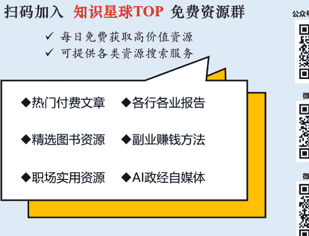
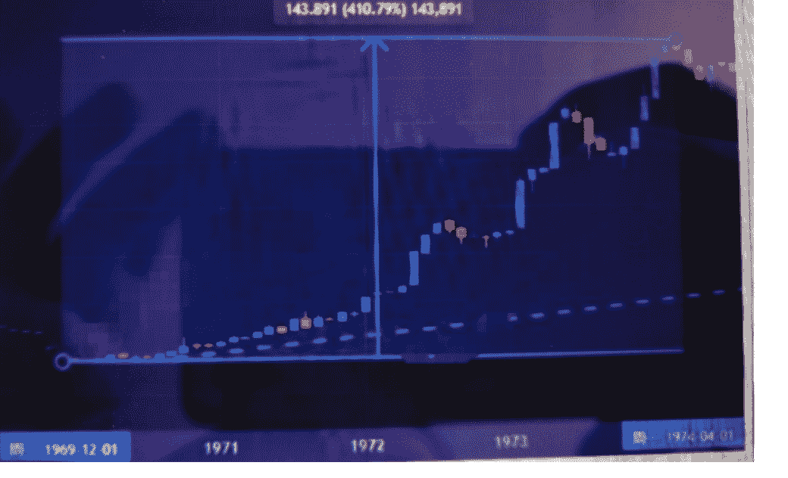
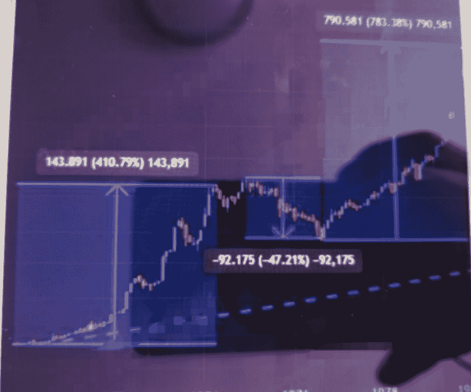
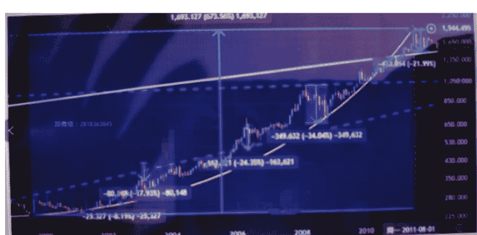
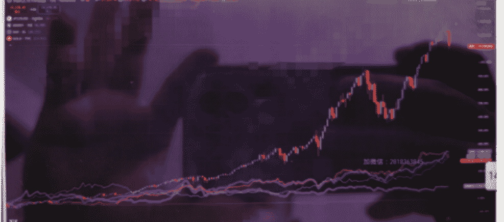

# 金政通鉴：新货币战争—总论

## 风险提示

我们其实每天都在投资，用我们自己的时间，投资到学习、工作、事业、兴趣，或者理财，哪个收益率高，哪个风险小，哪个领域就投入更多的精力和成本。逐渐的，每个人都会形成自己的投资方向和模式，千差万别。

投资，是一种预测，预测就有不确定性；研究，是尽可能找到最大概率的可能。在我们看来政治决定金融，驱动“全球区块轮动”：政治博弈产出结果了，会形成很长一段时间的资本流动趋势，毕竟，资产的价格是买出来的，顺应这个趋势，到“春的热带雨林”，水涨船高；等到博弈的局面发生变化，就去寻找下一个“春的热带雨林”。这春天长，就多待，那春天短，就少待，随行就市，随波逐流，只要看得见，也有来来自自如的洒脱和能力。

加微信 jntsg2，免费进资料群

中国必成为金融强国，会从产品“走出去”到类似80年代日本“渡边太太郎”“买下世界”的热潮，准备迎接接时代。《新货币战争》系列，是进阶的研究，无论在政治或金融研究方面都要更进一步，在这个系列中，AH相对次要，非 AH 市场的期货、加密、汇率是主要的。研究，是一切投资的前提和基础。研报，是我们投资研究的笔记。我们只分享研究，不涉及投资建议。

### 概述

我们在《新川普交易》中，分析了全球政治的“百年未有之大变局”。再深一层，“百年未有”百年以前是“一战”，而回顾百年以来，中间发生了那么多事情，甚至还不能与当下并论，足以说明“变局”的这个局，是全球巨大的趋势转折，始于美国反对美国，我们在《WARNING》中将两个美国定义为 U—1 与 U—2。

- U—1：美联储、华尔街、90年代崛起的以微软为代表的互联网巨头共同成的金融和科技“全球化”主导力量；他们在政治上的当下代表是民主党，以及 G7 国家延伸。
- U—2：支持特朗普的美国传统产业（能源、航空、消费等）企业、非精英英国（红脖子）、以马斯克为首的科技巨头新锐；他们在政治上的当下代表的是共和党。

以下两幅图，之前的报告也用过，这次讲透点。

法奥开幕，融合了很多历史上的故事，非常非常有内涵。不过，更核心的是文化挑战：LGBTQ 作为绝对主题，鼓励同性、混性、乱性、多性、变性，还有“黑崇拜”和极端女权主义，甚至讽刺耶稣——背后是一个巨大的政治力量——比如明确的犹太法兰克福学派、共济会、LVMH 集团等——这是 U—1 的巅峰盛会，以“白左”的“全面解放”来削弱“国家主义、民族主义”，以“绝对自由”来推动全球统一。

多国领导会磋商乌克兰问题
英国首相宣布支持乌克兰 4步骤

川普与泽斯基直直播，是一场谈好了“剧本”的表演；但是泽斯基临阵反水当着全球扫了皇的脸；随后，U—1 合众开始表演：这一回合显著削弱了川皇的权威。

U—1 和 U—2 这种“一刀切”的简单划分，只是便于全球政治博弈表面现象的解读。但实际情况要复杂，有点像诸葛家三兄弟作为投资在魏蜀吴分别押，这部分以后慢慢展开，现在的国内外博弈还远。

当下，摆在台上可以很明确看到的是，U—1 和 U—2 两个阵营在互相伤害：U—2 主导俄乌协议甚至让欧盟介入；U—1 操纵泽斯基破坏俄乌和谈。

政治决定金融。这种国际秩序的分裂，也正在造成金融秩序的分裂，也美元秩序的分裂。

# 一、背景知识

### （一）货币是权力

如果自己可以印钞票，这些钞票想买什么就买什么，想多少印多少，直到把世界买来，那该多少。这听起来像是疯人说梦，实际上美元现在就差不多这个状态。

这当然因为美国是目前世界上最强的国家，美元是目前这个世界上最高的权力表达，他几乎可以随意印刷，换世界上所有的物质财富（也包括精神财富）。

### （二）是权的权力

封建时代，货币发行权归王国；现在，归国家，具体是中央银行。但是美国的央行，美联储却是一家私人银行，至少看起来更像现代国家却用着封建王朝发币机制。

当然，通常的解释：虽然有法律制度，但有完备的法律制度，确保发行机制为国民福利考虑受政府控制。不过，如果我们是股东之一，为自己谋点福利应该不难，比如1%的美债规模，那也是3600亿美元，虽然有所有的制度设计，但想必办法总比困难多。何况，这些“股东”，来自华尔街，源自欧洲，甚至一些研究显示可能上溯自中世纪的中。

### （三）权力的崩塌

货币顺行的改革，印造“通货膨胀”，想印多少多少，导致了王朝覆灭。这种例子横贯中西，罗马也是。对于生物而言，“通胀”的定义，就是抢夺了你的生命。

### （四）货币的克星

货币始于统一，然后变成金、玉、银、铜，属于装饰。无论哪个文明，黄金都是财富本身，似乎成了人类的基因。美元体系如此精妙，构建了一个庞大而复杂的系统，指标掩盖了最基本的事实——每当这种时候，人们总会明白，回到所有能保值。

### （五）政治金融

当美元通发，引发了“反对美国”，这确实是百年未有的大变局。美国对美国，世界秩序要跟着调整。但这并不意味着物理战争。事实上，如果不是一战和二战，可能已经发生物理战争。我们将见证第三大战，但武器是政治金融，这种战争。

# 二、美元秩序

### （一）如果权力不能使用，为什么权力

美元秩序是一个进化发展的过程。美联储建立于一战以后，今天的美元建立于二战以后。

- 《纸牌屋》：金钱是生产力。
- 《权力的游戏》：万般皆幻，唯有阶梯是真实的。

美元秩序每一次进化，离不开“危机”。

### （二）美元秩序演化

#### 1.黄金美元

二战后，美国建立布雷顿体系，美元与黄金挂钩，各国货币与美元挂钩，以此建立世界贸易秩序。这个体系的准确解释是：美元以储备建立，实际上劫取了黄金成为货币王，通过汇率使其他国家成为美国的影子，这就是权力结构。

黄金美元=美元贬值=汇率秩序=货币王。如果不是为了“扩张”，为什么要当货币王？实际上布雷顿体系建立，美元一直在超发。然后，有了戴乐空美元，有了肯尼迪试图控制美元超发被杀。直到尼克松时代，布雷顿森林的谎言已经掩盖不住，黄金彻底脱钩，黄金一飞天。

黄金第一波涨了4倍，意味着美元贬值了75%。

#### 2.石油美元

失去了信用，那又怎样？真理掌握在射程内。美元脱钩黄金贬值后，爆发了两次“石油危机”，中东石油地区萎缩，美国开始主导全球石油。石油是工业发展离不开的原料。美元控制石油，就可以控制全球经济。需要理解美元对石油不仅是价格控制，还包括供给配备的控制。翻译过来：谁不用美元，谁不到石油。这个语境应该熟悉了。

通过控制石油，美国实现了黄金美元向石油美元的过渡。石油危机期间黄金大幅下跌，但随后仍然反映了美元的进一步贬值。1980年相比1970年，美元贬值了95%。

#### 3.贸易美元

这个阶段分成两部分：上半场81年至91年，苏联解体和日本泡沫破；下半场92年至2000年。上半场，通过美苏争霸，加强了“美元区”的一体化，以贸易秩序建立全球分，进而建立全球金融和经济秩序。苏联解体和日本泡沫破是要连起来看的，美国在当时重回巅峰，实现“双杀”。

下半场，苏日以后，92年欧盟成立，美欧竞争随之加剧，尤其是99年欧元发行后，美国爆发了00年互联网股灾；这也是要连起来看的，苏日之后，当时的老大和老二干了起来。布雷顿森林体系瓦解后，石油美元一步与全球贸易体系结合，宣称根据全球贸易需要印发美元，即贸易美元。翻译过来：我建立一套分配机制，服从我的，我带着你一起玩。

| 类型 | 国家/地区 |
| :--- | :--- |
| 消费国 | 美国（金融、科技、尖端产业）—G7 |
| 制造国 | 日本、亚洲四小龙 |
| 资源国 | 俄罗斯、沙特、非洲、南美等 |

WTO，可以翻译为世界秩序，或者世界生态，每个国家都根据美国的规则，落在特定的生态位上，执行分工，获得财富。对于大多数国家而言，加入WTO，加入“全球化”秩序，获得发展，投资带动就业。但是，当这个国家发展到一定阶段，WTO就会逾越。因为这些国家必须存在。

#### 4.债务美元

2001年至2012年，发行机制逐步脱离了贸易。2000年互联网泡沫爆发，2008年金融危机，引发了欧债，最终结果是欧盟被极大削弱，从那时起，走下坡路。这种“金融危机”变得耐人寻味。美国扩张了，另一方面是削弱了不少。

1971年以前，美元是挂钩，另一方面是全球的扩张，BRICS成立。

#### 5.股票美元

2013年至2024年，所谓的“量化宽松”（QE）的基础是美国的需要。翻译过来：我想印多少，我就印多少。约翰·康纳的名言：我们的美元是麻烦。

黄金脱钩以后，美元贬值，黄金上涨了6倍。

财富是基于实力的，单就经济而言，这个实力即包括科技，也包括制造和原材料。美国的极限施压，如果不成，就会被反噬；既然对中国科技封锁，如果中国不能从美国持续购买获得其他国家无法购买的东西，如尖端科技，那么对于制造中心而言，有什么必要继续忍受削割支撑美元。

易经里有一卦，山天大蓄，讲的是积累；这个积累，就是史积累，里面从“或跃在渊”到“飞龙在天”的积累。在《新交易》中，涉及领域更广，包括科技、贸易、产业、地缘政治架构下的全球格局。这使得对金融格局的理解会更加全面。毕竟讲了这么多，在这个局里，谁是纸牌屋里正坐在牌桌上的力量呢？

# 科技 # 川普

科技创造了制造对美国的霸权，而导致美国霸权变为“美元化趋势”不再“科技”。

让，，，，，，，，，，，，，，，，，，，，，，，，，，，，，，，，，，，，，，，，，，，，，，，，，，，，，，，，，，，，，，，，，，，，，，，，，，，，，，，，，，，，，，，，，，，，，，，，，，，，，，，，，，，，，，，，，，，，，，，，，，，，让中国卷成这样还要降本效的祸首？

次至如今：纳斯达克涨了118%，德国涨了80%，日经涨了62%，中国涨了68%。一段时间内的货币增量，在“全球板块轮动”，都集中到美股科技这块“春天的带雨林”，此长彼消。因此，这套体系逐渐演变为中国美元：中国能放多少血，美国就能繁荣多久，以中国制造之实，撑美国未来之虚。或者用一个更简单直白的画面：庄园说他奢靡的生活是因为他有科技，但他的衣食住行都来自于农奴的压榨。

# 6.中国美元

奥巴马开启的股，本质是脱虚向金融强国政策，但其可持续性前提是：美国控制全球产业链必须是分散的，从而实现各个击破和各个控制，轮流为美国放血。但是是中国全球唯一建立了最强大和完善的基础设施和产业配套，且实行国有资产和外汇管制等的公有制国家，使得中国能够成为全球制造中心。

加微信 jnts2，免费进阶资料群

美元金融体系中，所有可以用美元买的资产品种，无论股票、黄金、原油、大宗、加密货币、外汇，都有美元做空工具。在和平时期，这些资产的价格可以由市场决定，但在战时状态，短期内将被金融工具所控制——最经典的案例就是2020 年WTI 原油价格出现——37.63 美元/桶，在国内叫“原油宝事事件”，这是特朗普的一次战略威慑。

当美元长涨的叙事逻辑煽动，趋势走坏成为市场共识，这时就可以发动“恐慌”的掩护下做空一切：危机瞬间引爆（因此我们将反复关注VIX），资产抛售兑换美元，美元将获得最大的购买力，去抄底的母机。

与以往每次危机不同的是，这一次要同步摧毁所有的美元元挑战者——在社群中，我们讨论了很多BRICS 金币、特朗普的加密货币、人民币国际化以及黄金和石油。

两军对阵以待，很多人不响，只有“黑云压城城欲推”。

这张图，是以美股 SPX 刻画的“百年未有之大局”

1. 不要低估这次美股下跌的幅和跨度。
2. 不要低估货币战争对于世界秩序的深远影响。

### （三）新货币战争的主战场

南北战争以后，爆发了南北货币战争，至1907年金融危机，600家银行倒闭，失业率高达 18%，当时雄心壮志的老罗斯福仅能向 T.P.Morgan 财团借款 6500 万美元，并放弃反垄断法；尝到了作为一国债主的美味后，T.P.Morgan 每天在琢如同建筑起永恒的王座：1913年圣诞前夜，《联储备法案》在国会悄然通过，世界上唯一一家私人控股的国家中央行成立。

对于美国而言，这是百年基业，是不惜一切代价要捍卫的——以控制权为基础的全球美元金融体系。1963年6月4日，肯尼迪签署命令，要求财政部发行“白银”，以抗衡私人银行联储的货币发行。半年后，肯尼迪被刺杀。那一年，特朗普17岁。“肯尼迪遇刺”显然给了他极大的震撼，这位喊出“Time for Greatness”（开创伟大的）总统或许已经成为他的信仰，但当时他一定不会想到，61年后当子弹掠肩而过，78岁的他振臂呼喊“Make America Great Again”（再创伟大！）！那一刻，他一定想起了肯尼迪，他也一定知道，是谁干的。

对于特朗普政府，这一次必须在金融危机中收回货币控制权。“天下大势，分久必合，合久必分。” 天下统一于美元全球秩序，然美元和古罗马币、元币甚至津布币一样走向了货币泛滥的债务螺旋。

至“天子无德，春秋战国”，美国造的科技和金融霸权松动，长期被压制的制造和资源政权将奋力争取更加公平的地位，全球主要国家货币都进入基于实力“群雄逐鹿”的“后美元”时代。

### （四）新货币战争的大结局

美国发动“新金融危机”，意图迫特朗普向美国融资救经济，一如当年老罗斯福的“城下之盟”。与美联储和华尔街交易，放弃所谓的 MAGA 革命回归旧秩序。

不过，正如林肯以《宅地法》和《解黑奴隶宣言》让渡权力“一切可以团结的力量”并败为胜，特朗普也一样，他将争取美国国家的血盟，这就是《新普交易》。

回顾这场战争：
- 2016 年特朗普上台，旧秩序出现裂痕；
- 2020年拜登回归，以极端压制手段试图围旧秩序，但美国的合围失败，使旧美元秩序崩裂；
- 2024年特朗普回归，“第一枪”已经响起，双方都没有回路，这便是“没有退路，就是胜利之路”。

8年过去了，是时候发起三大战役了：

- 1. 黄金
黄金研报：根据我们多年研究，结合博弈，黄金在新货币战争爆发。

- 2. 加密
加密研报：加密让一夜暴富，特朗普极其重视，现在加密参战。

- 3. 汇率
汇率研报：美元、欧元、人民币、日元等，战后是改良秩序，还是颠覆秩序。汇率关系到每个人的财富管理。市场每天都在波动，但是，《新普交易》和《新货币战争》希望呈现的是一个周期更大回报的时代：成败，在于在此历史背景下，经历前所未有的机遇；不需要着急，有很多时间，也有机会，关键是做好准备。

6ca8be926a2564cd9d992c57c61ce819_24_png

2008 年，次贷危机后，美国以“股市美元”重塑世界金融格局，作为代表，费城半导体指数在2008至2024年的16年间，涨幅超过34倍。特朗普上台的100年前，爆发了第一次世界大战。战后，尽管英国仍然是名义的世界霸主，但美国已成为了世界第一强国。

无论对于美国，还是俄罗斯，或是中国，三足鼎立的局面将收敛到两虎相争，最终归于新的秩序。对于谁，现在都是那句话“没有退路，便是胜利之路”。我们的选择：与国运同同。

# 免费 价值 及时 专注

# 扫码加入 知识星球TOP 免费资源群

- 每日免费获取价值资源
- 可提供资源搜索服务

| 热门付费文章 | 各行行业报告 |
| 精选图书资源 | 副业赚钱方法 |
| 职场实用资源 | AI经营自媒体 |

公众号: 知识星球TOP 微信号: jntsg8 微信号: jntsg2

6ca8be926a2564cd9d992c57c61ce819_25_png

分享资料仅供个人学习，请及时删除，切勿商用传播
