# 全球市场每周预测20251229-05231定价之战

原文 财金助理 金政通 2025年12月28日 22:11 辽

关注我们

点击上方蓝字金政通关注→点击右上角“...”→设为标

价值决策一路一步

⭐助理预测：本周内容涵盖，定价之战已打响！你试行行不行，你试行也不行。多方博弈，市场在狂热中暗杀机。

回望2025，预测命中率高达95%，收益率；展望2026，风雨同程；照例以下回重点、关键数据为出发拓展延伸，提示敏感点，纵览全球市场，研判各项资产动向。

建议仔细阅读

- (Q1）预测美股将见，本周出现“调整”
- (Q2）预测美国2025年爆发危机的概率高达90%；关税大，美国一季度GDP下降为0.3%。
- (Q3）预测“二期”，期间向走弱通胀；1-8表数据频率，联合股市，收益翻倍。
- (Q4）“三步”走策略被称为“第三步”，10月10日美股大跌，10月29日见底。

上周还提了新货币战争的“第一阶段”。这一仗，是定价战，“定价权”有高抬举，举个例，如果我们能够获得回报，就可以提提；如果没有能力犯错，就回避边缘。以此类比。

白银在漫长的人类历史上一直都是货币。到直二以后美元开始统治全球，白银则沦为工业金属，价格一直折杀在50美元以下。最近，上海行情的白银价，远比期货交易所的白银价，贵了整整5美元/盎司。这就好比，多头方白银领先白银，西方银行不。这到底是通错的，这就是定价权之争。全球的白银市场，不过1000亿美元，而以2025年底金价4500-4600美元/盎司计，总市值约30-32亿美元，当白银走空，看到的实其实不是白银，而是所有金属涨价的一个红杠，是对美银的持续性趋势看空。

从实物到期发布出来，我们在市场上已经获得了巨大的回报，本周我们就年底策略做个概述，以白银为线索如何展望2025年结束展望2。

P.S 公众号画图简介，虽文中我们有些数据无法清楚展示。有查看图片资料需要的者，请私信向我，感谢订阅。

## 一、从2025到2026

我们通过新货币交易与货币战争，介绍了近百年来之大变局，博弈的多方力量以及资本市场的规模。总体而言，预测中命中率达到了95%；不足的5%。在尽量留我们预留了4美股暴跌，但未能预见反弹持续至今。其在于，低估了U1的控制力，高估了U2的心。

专享加V价值付费赠：
加入群看cuk255，每日更新。

### 专注财经大V优质付费：
进群加微信cuk255，每日更新。

我们一直未发布《新货币战争-汇率》，这是因为其长端未能以前的变化趋势反复——到最近几乎无路可走。

5月，US30Y向上突破5%，这是我们预计危机即即将爆发的重要启动信号，但随即即被按了下来，直到最近US30Y再次站稳4.8%以一种更有效的技术形态创诸高的未来——让人不霍而。

白银的预测：下周就此洗底了，在这个过程中，同步发展的。正如我们在《新货币战争》中的预测，白银未来很高，100、200、300……，引起的波动会越来越大。2025年已经取得了数倍的盈利，对明年Q1非常谨慎，定价权战已经结束，目前已落袋。

## 二、全球市场展望

### （一）美股
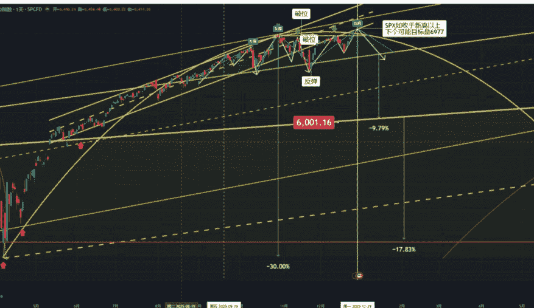
上周预测：下周圣诞结束了，验证是否让U2过好。实际情况：符合预期，U2好，SPX强势，但仍然在顶部边缘。下周预测：圣诞结束，方向选择，顶部位置67。

### （二）金银
专注财经大V优质付费：进群加微信cuk255，每日更新。
黄金向《新货币战争》目标挺。白银向《新货币战争》目标挺。
上周预测：上半周白银好要一冲。实际情况：强于预期，白银稳70后出现回空直冲80，黄金等待。下周预测：白银继续强势，黄金将加速。

### （三）BTC
川普上台，我们一直看多BTC，台后开始看空。其实用预测，态度鲜明。新财经博社中国监管要求减少稳定币这就是我们一直瞻这个热点，不是时候。

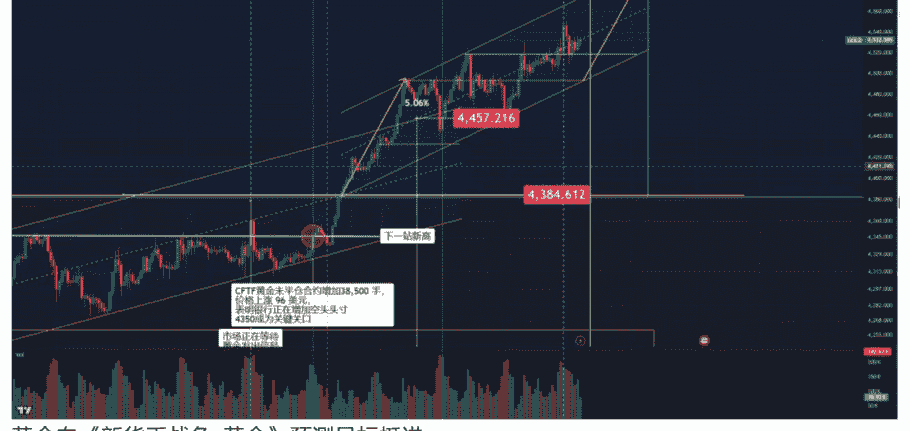
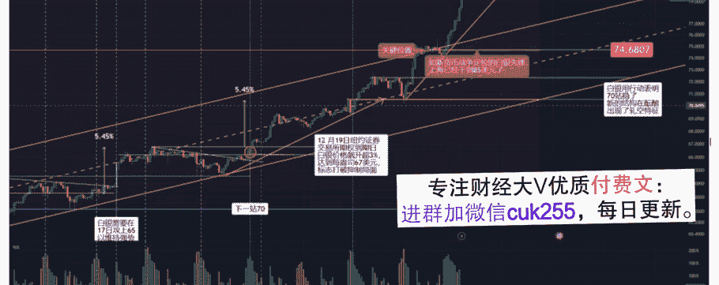
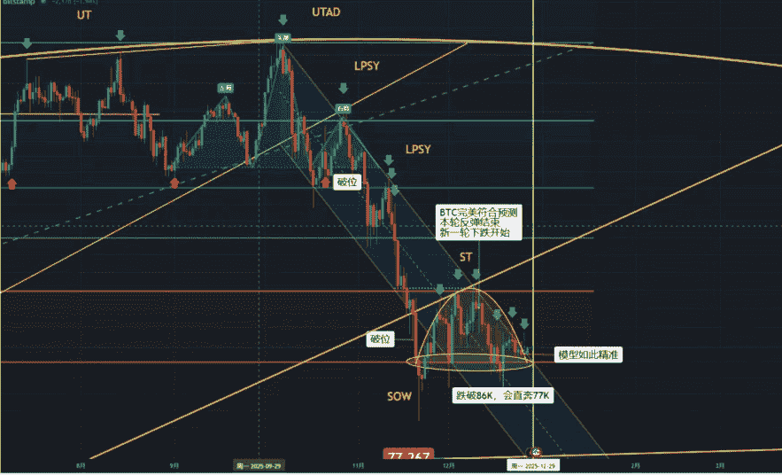
上周预测：空空空空。实际情况：完美符合预期，模型精准。下周预测：空空空。

### （四）美元
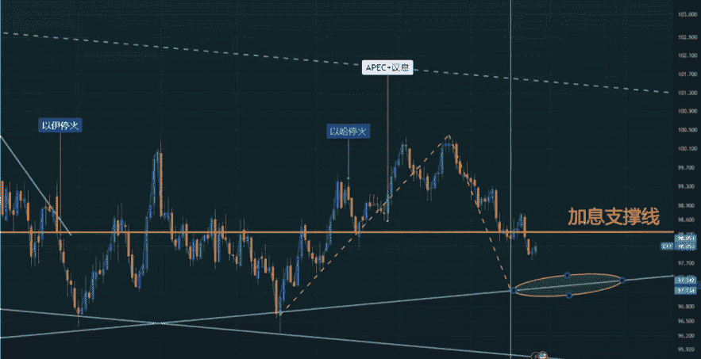
上周预测：如果黄金能够突破350，则美债要涨，美元要跌。实际情况：符合预期，黄金突破，美元跌破加支撑线。下周预测：跌破加支撑线，继续走弱。

### （五）H&A
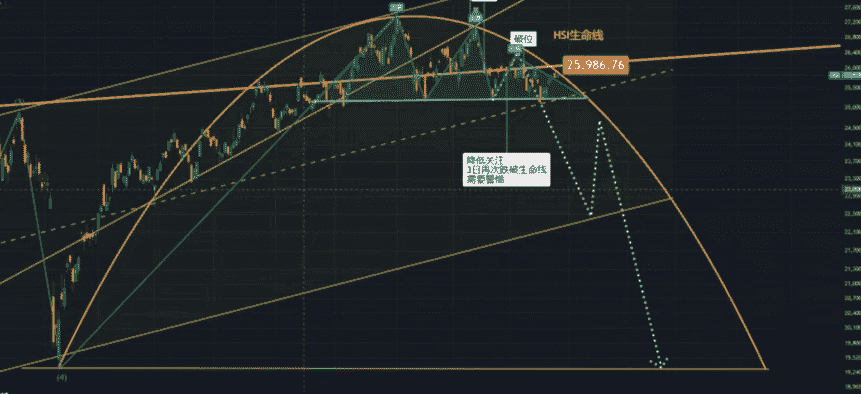
H没有站上生命线。
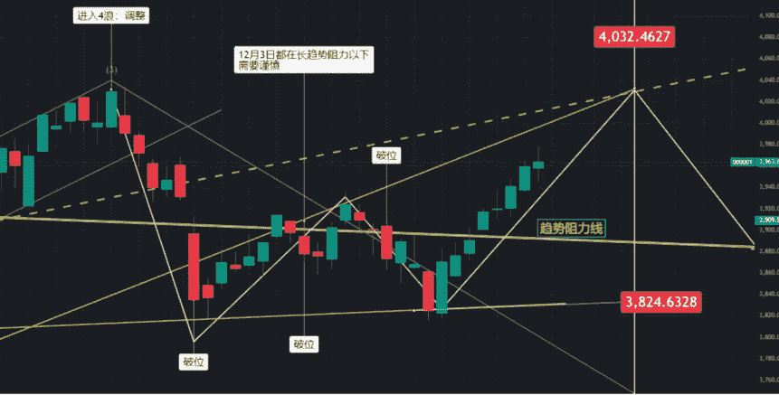
A站站上生命线。上周预测：强调防御。实际情况：符合预期，A站趋势阻力位，还可以继续。下周预测：A站趋势将要。随着汇率破，接下来A将显著优于H和SPX。

## 三、技术分析

### （一）事件驱动：
2025年12月29日（周一）
【事件】日本银行公布12月货币政策会议议员意见
名词解释：日本银行货币政策会议的委员公布观点汇总，反映内部对利率路径、通胀和经济增长的评估，是观察政策倾向的关键关键词。中性利率上限：央行认为既不抑制也不放宽经济的利率水平，此表示该空间再次打开。
综述：日本银行12月将加息至0.75%并可能在2025年7月再加25基点的政策路径，使其成为唯一强势全球加息周期的主要因素，植田和稻田刚强调“中性利率上限”概念，传递出脱离利率套利风险、欧美行政政策正常化的信号，强化央行对“日元再通胀”叙事的坚定定调，推动日元一步升值，有望检验良好效果在美国和日本的“加息”空间得到关注。

2026年全球“集体向下”的通胀压力，日本有望将加剧日元与其他货币的汇率差。
【数据】美国12月9日周公布原油库存数据
EIA周数据：美国每周公布的原油库存数据反映供需均衡状态，是WTI价格的核心驱动因素。安全：数据在供给冲击时可灵活调整库存或产量，资本投入不足导致库存增长。
综述：EIA数据的核心在于需求和供给的缺口韧性，库存变化反映供需均衡程度。库存充足或处于低位意味着资本支出对需求复苏的供给韧性较弱，支撑WTI对低价的修复性上限。反之，库存积累，则暂时缓解供给压力，无法改变投资不足、无法增长的长期趋势。库存数据作为WTI，其变化影响对，反映美国国内供需。引导在2026年，至关重要。

2026年12月25日（周）
【重要】美联储公布政策会议
名词解释：美联储会议后详细解读，要求委员对经济、通胀和利率路径内部评估，是定价的关键因素。综述：美联储宽松，符合。结构性特征，订单和生产力提升将推动市场从“扩张”转“扩张”模式，若“衰退”构成风险——制造业周期持续恶化，资金回退，后期具有确定性反转。

对市场的影响：
- 美联储：制造业波动增加必要性，但加息属于“风险管理”而非“刺激”，因此PMI低迷导致美联储“失去主动权”。
- 就业：决策的关键纽带，一旦就业趋势加剧，1月停滞的周期将推迟至3月，直接影响美联储“跌涨”周期。
- 黄金：经济数据反复验证“系统性崩坏”的叙事，支撑其价值。
- 原油：制造PMI反映工业需求回软，显著优于预期将暂停油价运行。原油逻辑在需求和供给之间，引发震幅。

### （二）美股
标普500日线结构
上周周期的：右肩复合变盘的时间窗口临近（12/26），压力6883。SPX未突破颈线，等待右侧结构完成（头部头部、右肩）。
压力：6870、6883（右肩压力）、6920（颈线）
支撑：6819（波段区间顶部）、颈线（绿色线）、6551（波段区间底部）

本周复盘：
- 12/22 SPX跳空行情，最高6882.03，收6878.48。
- 12/23带量突破6883，临近突破6920，选择向上突破。
12/24收6932（突破区间高6920），创历史新高。
- 12/26（变盘时间窗口），最高6945.77，回6929.95，有效突破6883。变盘时间窗口已经做出选择，未来下周停顿观察。

技术参数调整：
1. 新增涨突破强强，日线结构SPX止跌转强。
2. 根据近期走势积累，波段。
3. 技术分析：
   a) 关闭左侧波段。
   b) 关闭变盘时间窗口，选择了向上突破，本周保留，未来下周。

未来周：以橙色压力线作为，有效压力SPX持续，波段区间（7103）。压力：下降压力线（橙色），支撑：6920（颈线）、6721支撑。

### 纳斯达克：日线结构
上周观点：右肩复合变盘的时间窗口临近（12/23），压力23567，等待右侧结构完成（头部型、右肩）。
压力：23567、24019.9（高）
支撑：23309（波段顶部）、颈线（绿色线）、22060（波段区间底部）

本周复盘：
纳指走势与SPX一致，但弱于SPX，最高23665，回23593。纳指在变盘窗口内强势，但未能突破24019.9。

### 标普500强于道琼
道琼强于纳斯达克指数，白银、铜等类涨幅领先、锡、镍转强。个股强于成长股，市场上涨，节奏切换。

本周复盘：
- 12/22 跳空高，收2324.8，未突破。
- 12/23（盘后空），最高23563.4，强但未突破。
- 12/24 收23561.3，突破23567。技术分析调整：
1. 新增下降线（橙色），本尚未有效，继续观测右侧。
2. 其他暂时不变，等待。

未来周：以橙色压力线，有效压力，突破前高。压力线：下降压力线（橙色），23567、23704、24019.9（高）。支撑：23309（波段顶部）、枢线（绿色），22060（波段底部）。

### （三）黄金
黄金现货/美元：日线结构
上周观点：技术面：现货黄金走势呈现“台阶式”牛，每一轮回调低点逐渐抬高，形成弹射路径。未来一周，临近变时间（参考蓝色区间），有效突破4352（顶部），等待涨幅4416。临近月末，月线收3096，确认有效突破至新区间，等待月线、周线、日线上涨。

本周关注：时间窗口，放量突破4352，本周将有效，等待满足4616。
12/22 放量突破4352（周线），12/24圣诞节假日，前高回落，确认有效突破4352，涨幅满足4616。

未来周：日线结构，等待满足4616，构建一个。月线收3096，确认有效突破至新区间，等待月线、周线、日线上涨。

压力：4352（周，顶部）、4841（月）
支撑：4176（月，顶部）、下降压力线、4047（周，顶部）、3941（短期支撑）。

风险提示：
- 26/01/02：非农数据，黄金波动预期加大。
- 26/01/08：26/01/15：BCOM（彭博商品指数）、S&P GSCI（标普黄金商品指数），2026年调整，每周调整按1/5比例线性加权，两个指数完全相同操作。

- BCOM（彭博商品指数）：总规模约600亿美元。采用交易量加权（2/3）和全球价值（1/3）加权，并有明确的单一商品（15%）和行业（33%）权重上限。因此，某种商品（如近三年的基金）价格持续上涨导致权重超标，就会被强化性上涨。白银的压力增大，预计抛售其期合约合约的9%，对应银盘金额约65亿美元。黄金的隐含比例高达。白银市场，不过1000亿美元，而以2025年底金价4500-4600美元/盎司计，总市值约30-32亿美元，当白银走空，看到的实其实不是白银，而是所有金属涨价的一个红杠，是对美银的持续性趋势看空。

### 恒生指数：日线结构

上周观点：恒生指数防守日线趋势（绿色虚线），关注短空机会。有效跌破线是短空信号，将进行回测。

- 压力：25919（区间顶部，粉色）、26550（区间顶部）
- 支撑：顶线（绿色虚线）、25178（前低）、24937（波段测幅）

本周展望：日线结束本周有效支撑线，尝试突破压力位（下降趋势）。

未来一周：圣诞节节港股市两个交易日，期间美股、A股偏强，等待下周恒生指数进行计价。恒生指数防守日线趋势，收后后跌新破颈线是短空信号，将进行回测。恒生指数如有效站25919，预期震荡上行，压力26550。

- 压力：25919（区间顶部，粉色）、26550（区间顶部）
- 支撑：顶线（绿色虚线）、25178（前低）、24937（波段测幅）

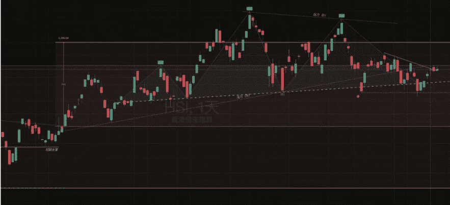

### 恒生科技指数：日线结构

上周观点：日线防守5416、5397，头顶结构基本完成，右肩底底的时间窗口2026/01/13。上升通道级别为月线，预期将开展多空震荡，支撑5175、5078。

- 压力：5517（区间底部）、5824（区间顶部）、6103（区间顶部）
- 支撑：5416（区间底部）、5397（顶线，颈线）、5175、5077

本周展望：下周圣诞节港交易所休息两个交易日，期权股：A反转，等待未来一周恒生科技进行计价。日线，周线，5396（周，红线），等待未来一周时间窗口市场有望做出选择。

未来周：维持观点
- 日线防御5416，5397，头顶结构基础完成，右肩变盘的时间窗口2026/01/13。
- 上通道级别为本月，预期周会开展多空博弈，支撑5175，5078。
- 压力：5557（周，区间顶部），5824（区间顶部），6103（周，区间顶部）
- 支撑：5416（区间底部），5397（周，红线），5175，5077

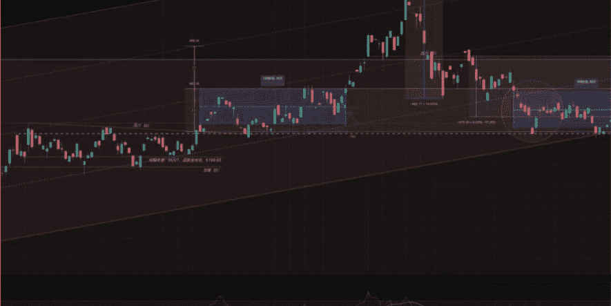

### 上证指数：周线结构

上周观点：本周上证指数回测前低3818，在护盘资金介入后转强，周线收3890，周线连续3周站上长期压力。防守的比较困难，周线继续盘整构建右肩。

本周观点：
上证指数本周转强，连续第4周站上长期压力，继续构建肩结构。
- 压力：4025（924，波段满足），4045（区间顶部）
- 支撑：3915（支撑），3876（长期压力），3714（周，涨幅满足）

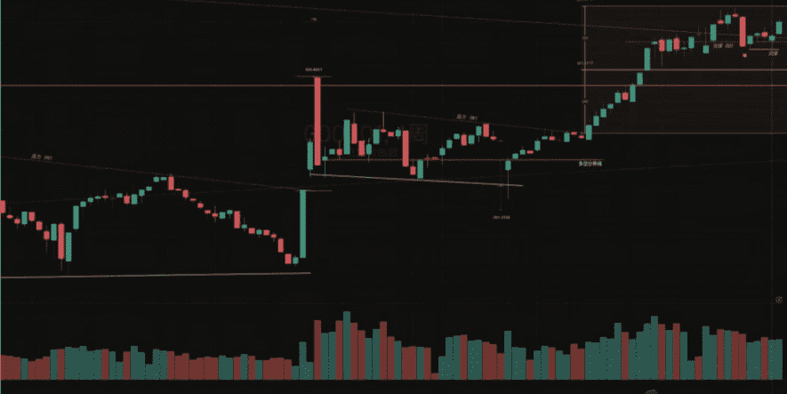

### 上证指数：日线结构

### 周观点（精简）

指数防守压力为主，预计指数盘整（3915至3802），等待指数完成右侧结构。
- 支撑：3820（日，区间底部）、3714（周，涨幅满足）、3680（周，涨幅满足）
- 压力：3886（长期压力）、4025（波浪足够）、4045（区间顶部）

## 本周复盘：

本周上证突破盘整区间顶部3915，12/17 突破资金进来，上证指数连阳，日线转强。具体如下：
- 12/22 3917，突破区间顶部3915。
- 12/23 3919.7，日线确认有效作为长期压力。
- 12/24 3940.9，确认有效跌测幅。3915作为支撑。

未来周：维持观点
参考压力3915作为短期多空，未有效突破4045之前，4025锁定收益。具体如下：
- 3915上方：多考虑，等待指数前高。跌破3915：转弱，防守长期压力之前，压力3876、4025（区间顶部），支撑：3714（周，涨幅满足）。

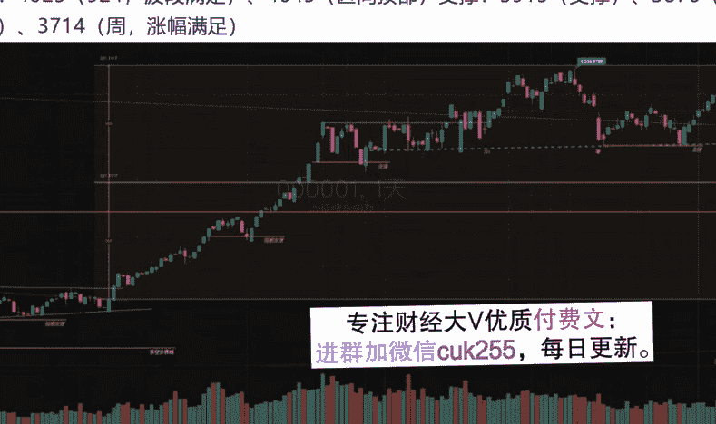

### 上证50：日线结构

上周观点（精简）：
挑战3030，防守2983，继续右侧结构。
- 压力：3030（压力）、3276（波浪满足）
- 支撑：2983（短期支撑）、2910

本周复盘：
12/17突破盘整资金进来，上证50震荡上方，推进上证指数转强。本周上50突破3030，等待下周有效。本周最高：本周上50回盘整资金进来后，量放大，回落后，击穿支撑2983。连续三个日站2983，停止跌幅。

未来周：等待有效突破3030，关注指数能否有效突破4075、3078。
- 压力：3030（压力）、3276（波浪满足）
- 支撑：2983（短期支撑）、2942、2910

### 沪深300：周线结构

本周观点：
周线未突破4722前，逢高锁定收益。
- 压力：4722（周，区间顶部）、4819（924，波浪满足）

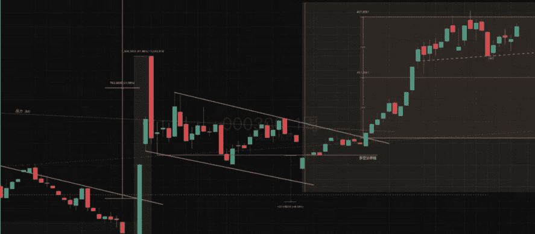

### 沪深300：日线结构

上周观点（精简）：
日线防御4565，等待右侧结构完成。
- 压力：4762（前高）、4722（区间顶部）
- 支撑：4565（短期支撑）、4495（跌破空）、4386（日线风险）

本周展望：
12/17护盘资金流入以来，沪深震荡上行，本周沪深300强势于上证50。技术分析调整：本周有效突破左侧压力位4620，支撑4495移至4620。

未来一周：
参考4565作为短期多空分界，有效突破4722前（区间顶部），逢高锁定收益。具体如下：

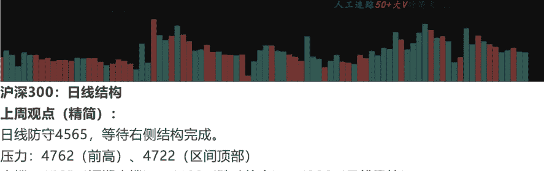

### 4620：偏多思考，等待指数挑战前高。跌破4565：转弱，防守颈线。
- 压力：4762（前高）、4722（区间顶部）
- 支撑：4620（支撑）、4565（短期支撑）、颈线（绿色虚线）

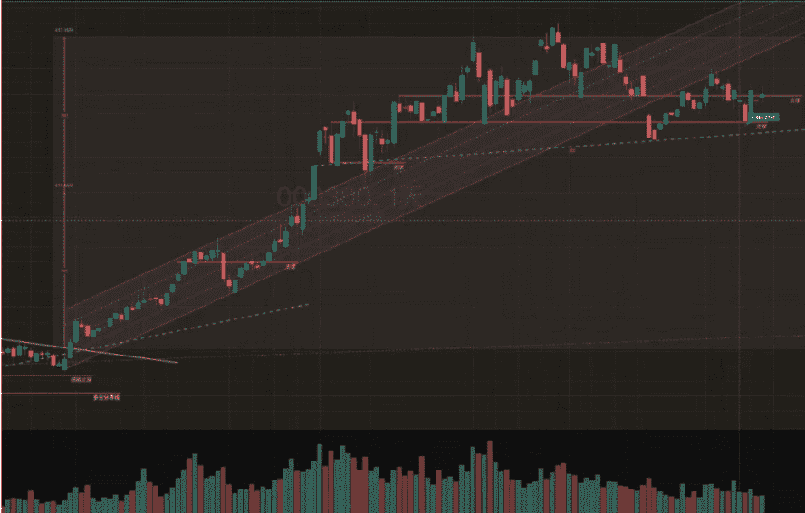

### 中证500：周线结构

本周观点：
周线突破下降压力，转强挑战前高7559。
- 压力：7559（前高）、7618（新增，长期压力）、7793（周，区间顶部）
- 支撑：7159（924，波段满足）、6878（区间顶部）

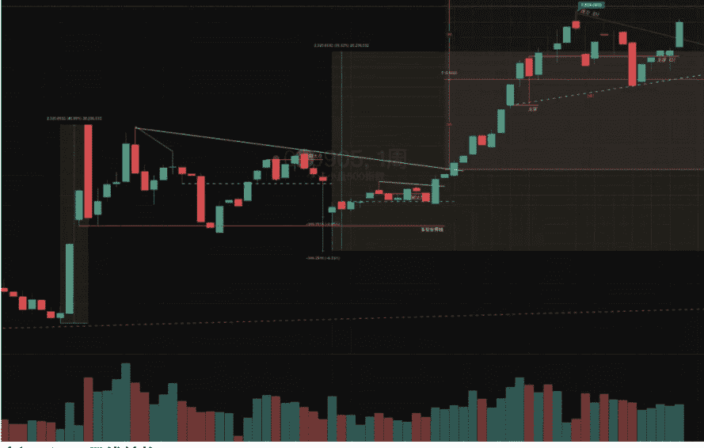

### 中证500：日线结构

上周观点（精简）：
中证500预计维持整理结构内震荡，等待右侧选择方向。年末收官之时，挑战压力线预期中冲高回落，注意高抛拉低吸。

- 支撑：7111（短期支撑）、6878（区间底部）、顶线（绿色虚线）
- 压力：压力（黄色虚线）、7159（波段满足）

本周复盘：
中证500高开走，日线有效突破压力，最高7484.9。中证500日线转强，有机会挑战前7559。

未来一周：
中证500日线结构，突破7559、7618。
- 压力：7559（前高）、7618（新增，长期压力）、7793（周，区间顶部）
- 支撑：7159（924，波段满足）、7111（短期支撑）、6878（区间底部）

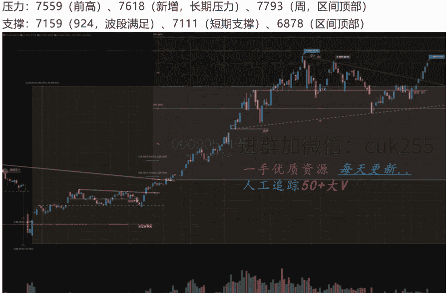

### 创业板：周线结构

本周观点：
支撑：顶线（绿色虚线）、2850（波段满足）、2748（区间顶部）
- 压力：3228（区间顶部）

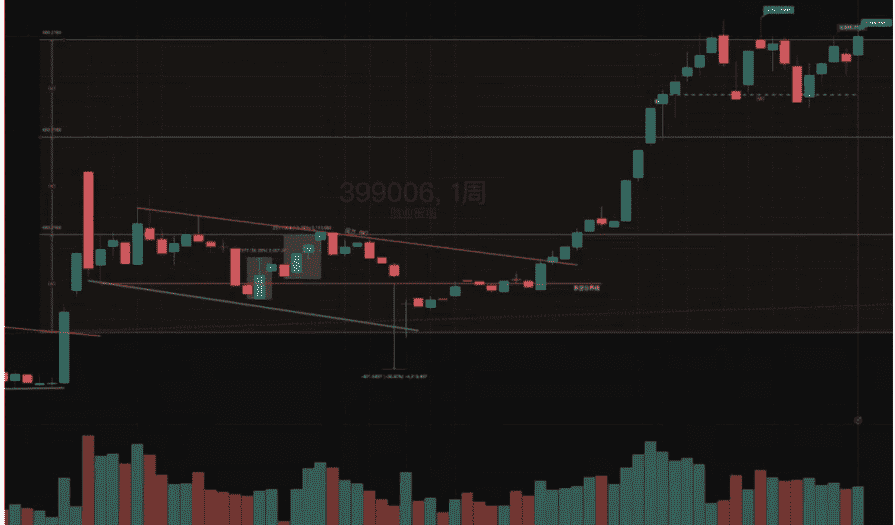

### 创业指数：日线结构

上周观点：
防守3054，预计维持整理（3054至3228），等待右侧结构。
- 压力：压力（黄色虚线）、3228（涨幅满足）、3331.8（前高）
- 支撑：3054（短期支撑）、2850（周，波段顶部）、2748（区间顶部）

本周复盘：
创业板跳开，有效突破区间顶部3228。具体如下：
- 12/24 3229.5，突破区间顶部3228。
- 12/25 3232.97，突破区间顶部3228。
- 12/26 3232.40，确认有效突破3228。技术分析调整：根据日线走势，波段分段。

未来一周：
创业指数<3228：偏多思考，波段满足3280、前高3331.8。创业指数<3228：走势转弱回测3054，锁定收益。
- 压力：3228（波段满足）、3331.8（前高）
- 支撑：3228（涨幅满足）、3054（短期支撑）、2850（周，波段满足）

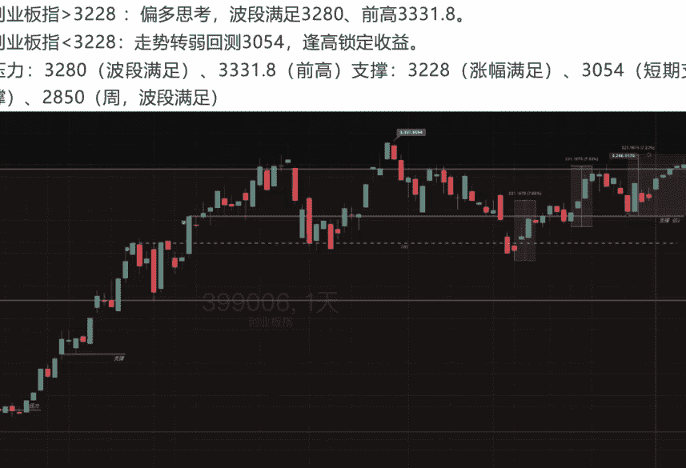

### 科创50：周线结构

上周观点：
科创50指数震荡跌破支撑1365，跌幅满足141。
- 压力：1547（月，涨幅满足）
- 支撑：1365（周，短期支撑）、1326（周，波段幅）、1249（周，颈线）

### 科创50：日线结构

上周观点：
- 突破1365：短空风险。回测颈线1249，预期会有支撑，如多空反复博弈1249，寻找短空机会。
- 压力：1365（周，短期支撑）、1496（带量前高）
- 支撑：1326（周，波段幅）、1249（周，颈线）

本周复盘：
科创50窄幅盘整，收1326（未触发反控），等待市场选择方向。

未来周：
- 突破1365：短空风险。回测颈线1249，预期会有支撑，如多空反复博弈1249，寻找短空机会。
- 压力：1365（周，短期支撑）、1496（带量前高）
- 支撑：1326（周，波段幅）、1249（周，颈线）

群加微信：cuk255
一手优质资源 每日更新...
人工语50+ VIP免费...

## 四、A-GIX（测试）

A-GIX指标脱离K线观察市场运行规律，其主要意义在于对于综合仓位大小的考量，而不是简单的监测市场的涨跌。

- 1.上周建议回测：上周建议，“继续保持谨慎，耐心等待‘成交比值有效行’”，市场实际走势活跃，成交比值有效上，逐步走好。
- 2.A-GIX指标解读：下为本周收盘数据（图中指标为均线及情绪趋势，下为情绪的监控指标和成交比值均线指标）。

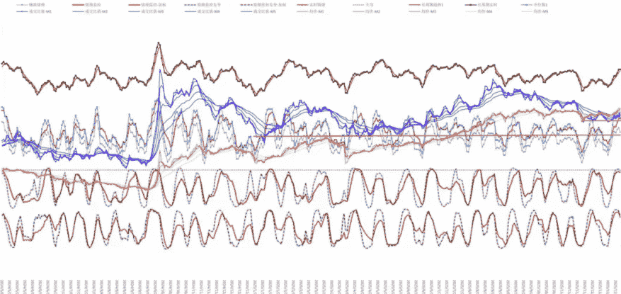

(1)本周收盘数据，所有指标均在顶部，成交比值有效开始。
下周开始，情绪趋势随时开启，且期间市场如何应对，仓位仍然建议谨慎。

### 长按二维码
添加专属客服
添加专属客服

