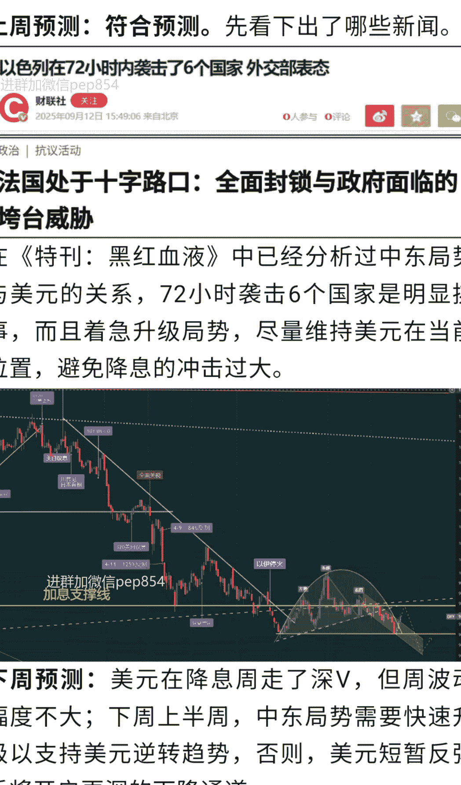
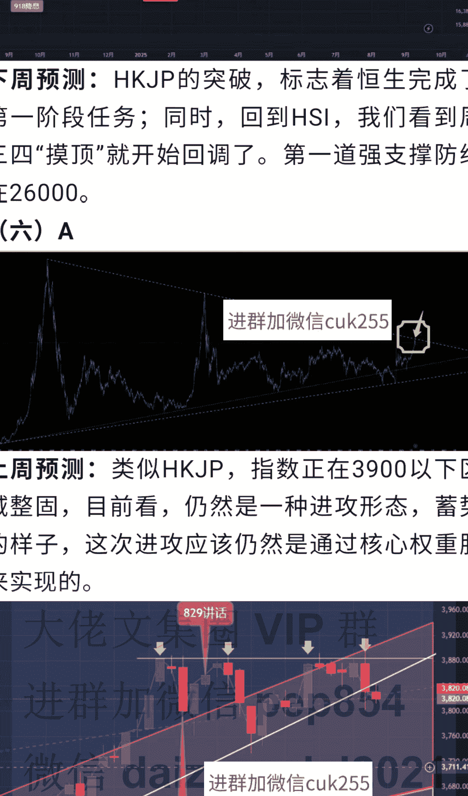
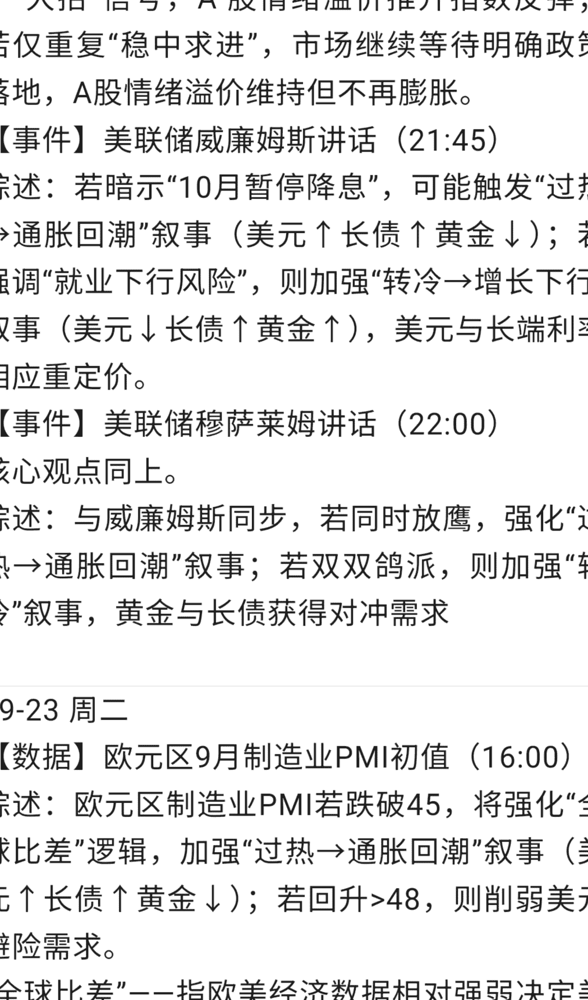
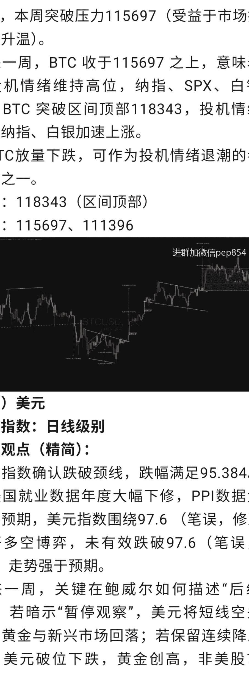
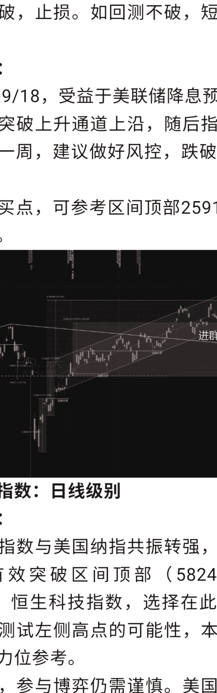
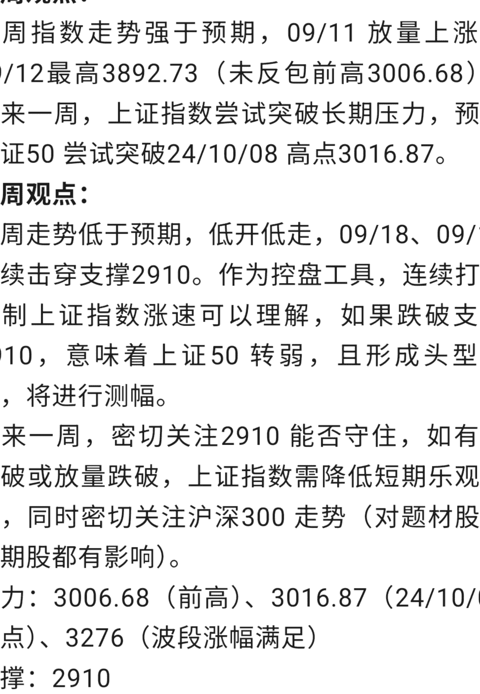
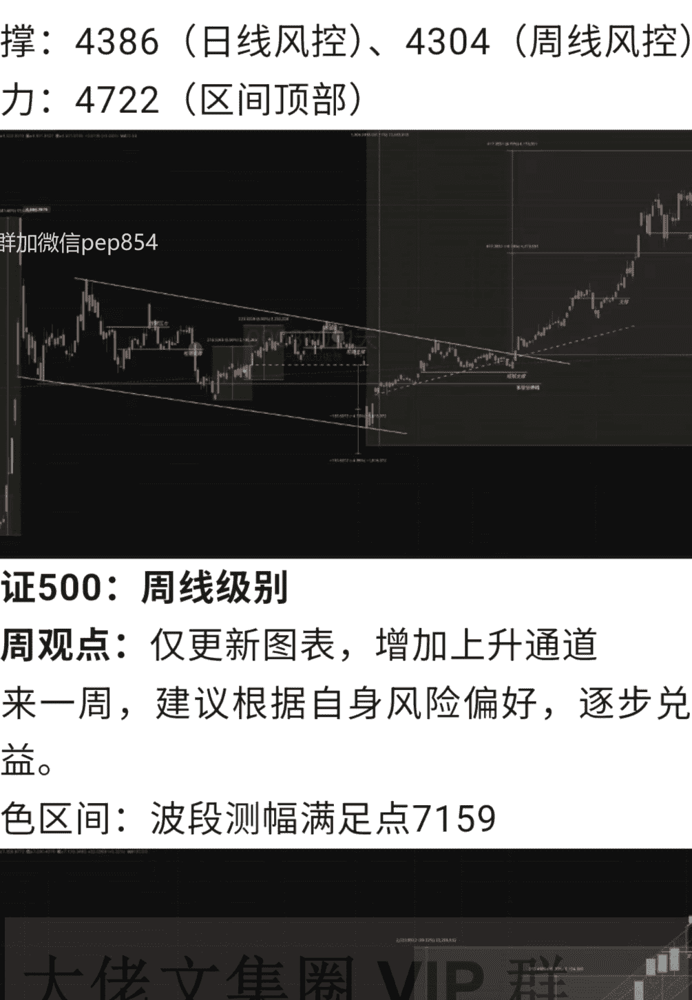
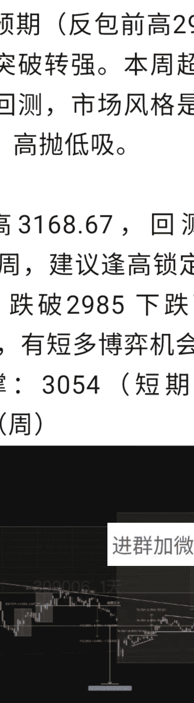
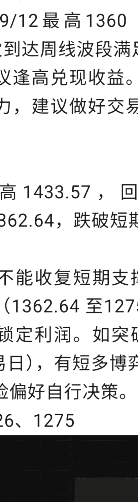

# 全球每日预测 0922-0927 再次定位

**财财经 金全周**  
2022年09月25日 22:16

助理经理：本周内容更多，包括（《新跨境》、《新跨境实险》）市场将关注：联储讲话、美股、美元、美债收益率；继续预测全球形势。风险市场将出现拓展焦点，关注全球市场，并进行行业报告。点击继续阅读……

（0921）每日预测，本月两次“预期”
（0922）预测本周25日美元行情胜率达90%，美股、美元、美国GDP增长达0.3%
（0923）预测“二期”，将出现收益率转型：美债10年期，关注总量、股市收益。

本年初的策略介绍是（《新跨境》的引导，将成为市场的引导，“跨标二”是（新跨境实险）的引导，将会有两个预期作为引导目标，达成目标一和二已经收到预期，之前的策略报告一见。

## 一、资产配置建议

回到开始，既然是应对危机的策略执行，已经有了一些指标，有了指标后，将制定了一份特定的执行计划。既然执行了，现在就是疯狂了。市场进入“疯狂周期”，自1970以来最后一次出现如此周期，全球各大市场将轮动。各国市场，我们的策略配置将包括宏观数据、股市、债、通胀和加息预期，以逐步推进的转型。首先，首要从美元转向非风险资产，将从美元转向高风险资产。

风险是巨大的，但现在有大机会，由于时间上，还有机会，此时是有这种机会的；特别是高险的、高套利的机会，现在有机会时它应该会比收益接近。市场变冷时，可以避免这种逆向操作。

“全球预期”与“内在博弈”，市场将出现“做多做少”、“多空”的疯狂，为资金有余，虽然已经习惯根据预期读遍了，现在会有这种感觉：无处可逃。

现在，我将从美元转向美国、金、银。这将是下周的疯狂，离岸和穆斯尔特市场的最后验证了这的疯狂，最后一次美元转向金。结论：在下周内将有疯狂。

## （二）全球市场转向

### （一）美股

下周预测：最后的疯狂。
下周预测：不变。

### （二）金银

下周预测：符合预期。下周二将到顶黄金位置（预计下周二下午两点我们撤出）开始出现疯狂红。
下周预测：整周受由于红，下周将极限。

## 周报：坚持预期。周五，金利回调后美元再次防守。

周报：一二三周守，四防五防守。
金利出现‘清空情绪’，美元加大速度胜利。

## BTC
加密货币：周五，我们再次看到BTC，上，后，回高可见，但这次慎用谨慎。

加密：这段时间留个观察。
关注《华尔街日报》，市场走势开始回升，BTC也随着回弹跟线，资金正在转为多为主。
7月11日突破阻力技术上的强势涨涨，在8月1日被扫清。一个技术分析从转向博弈分析。

BTC。周线观察点。
我们的，周线不需要调整，技术只是支撑，博弈才关键，还是基本面的确认的，是继续维持周线预期，并特别强调防守。

### (四)美元
周报：坚持预期。先要留意下周哪些预期。

周报：美元在震荡后走了深V，但周波动幅度不大；上周下周，中东局势将快速上升以维持周线反转趋势，美元在周末反弹后仍难以结束下周的防守。

### （五）黄金
周报：坚持预期。周五第五次突破，有效

周报：JK的突破，标志着已经完成了任务；同时，回到HSI，看到防守防线在2600。

### （六)日
周报：类似JK，指数在3900以下区域整，目前，仍然是一只进击，指数的应该回归。本周：上周稍预期，很失望。在899.96被接，之后结束破。

央行议决会议（22:00）
议决：加息（释放信号），美储转向强势
市场反应：欧元加息预期后走软，美元也面临压力。
美储会议后讲话，美储将“强加息”推行情，将“强势”回归市场（美元强势），加强“转向”下行。

09-24 周一：美国8月新房数据（22:00）
市场反应：新房40万预期后震荡，进入“冷场”市场；高于42万则“强势”行情，进入“热场”市场。

09-24 周二：美国本周首次就业（08:30）
市场反应：若低于25万下周预期将“就业软”并加剧，加强“冷场”市场（美元强势）；低于1万则“强势”行情。

周三：美国公布第二季度个人支出低于%，则符合预期。
市场反应：个人支出率低于%则加强“冷场”；高于%则“强势”行情。

周四：美国美联储决策会议年化数据（08:30）
市场反应：若符合预期，数据反弹不复；高于预期则偏软，数据进入“冷场”市场；7%则“强势”行情（美元强势金），数据为提供支撑。

周五：美国9月核心CPI数据（08:30）
市场反应：若符合预期，数据引发反弹；高于预期则进入“冷场”市场；7%则“强势”行情（美元强势金）。
市场反应：若威尔储“强势”暗示不转向，将推行情；若威尔储“偏软”暗示转向，则进入“冷场”市场，美元将面临压力。

2027年FOMC议决，鲍威尔讲话（02:30）
市场反应：若鲍威尔“鸽”暗示下行转向，或“强势”下行市场，进入“冷场”市场。

2027年FOMC议决，奥耶伦讲话（02:30）
市场反应：若奥耶伦“鸽”暗示下行转向，或“强势”下行市场，进入“冷场”市场。

09-19 周一：美国8月初数据（20:30）
市场反应：若低于预期且符合预期，形成“反弹”，进入“冷场”市场；高于预期则“强势”行情。

周二：美国8月核心CPI数据同比环比（08:30）
本周关注：
2. 金价将在震荡区间（3623至3674，3741至3746）内波动。

### （四）BTC
美元：日线级别
上周点：本周趋势与震荡将维持，预计将维持类箱形态运行，届时将关注上破情况。BTC将随加密货币密集活跃，波动，有望作为加密货币的指标提供交易机会参考。

本周关注：美元将回测与货币资产的BTC，美元将回测15697支撑（市场历史高点附近）。
未来周，美元将回测15697支撑，若未跌破，BTC将跟随密集波动，有望作为加密货币的走势信号参考。若美元再次出现下破，则需继续关注。若下破后不回抽，或回补上方缺口，BTC将形成反弹突破。

### （五）美元
美元：日线级别
上周点：周线依旧强劲，震幅至95384，本周将维持在周线级别高点附近，美元将有望回测95276（支撑），压力上沿。
未来周，美元将关注是否如何回测“后路径”支撑。若强势突破，美元将继续向下；金价将随美元走高，若金价跌破支撑，美元将有望回升，非美元将加向上。
未来周，美元将关注其需求。美国周指将受支撑，若不突破115697，将维持。

### （六）恒指指数
恒指指数：日线级别
上周点：恒指指数强劲突破2519，有望继续上沿。本周趋势将维持类箱形态运行，预计将突破。若有效突破，则关注。
本周关注：恒指指数回测支撑，有望继续上沿。若有效突破，则关注。未来周，恒指关注是否突破2525（支撑），高点2604。若未突破，恒指有望在支撑附近波动，可参考高点。未来周，恒指跌破2563，下方通道。

技术：
指数：周线位置后，若有效下探回，本周迎来强支撑4025。风险提示：周线维持，建议良好。
支撑：3771（长期支撑）、3714（涨满）
压力：3912（长期压力）、4025（涨满）

### 上证：日线
上周点：指数走势强于预期，09/11放量，09/12收3892.7（反包前3888.59），距离长期压力3915仅遥。来周，建议尝试长期压力，若有效突破3915后，参考周线位4025。
支撑：3771。
压力：3912（更新，长期压力）

### 深证：日线
上周点：指数走势强于预期，09/11放量，09/12收3892.7（反包前3006.88）。来周，建议尝试长期压力，若有效突破3915后，深证3195回踩不支撑50。上证支撑4386，有更多博弈机会。
支撑：4386（日线）、4304（涨满）
压力：3006.68（前高）、3016.87（24/10后高）、3276（涨缓跌）

### 中证：日线
上周点：走势充足，6878之上回高后回落，09/11放量，09/12收7826（反包前7159）。中证与上证指数同转有效突破压力，本周走势强于50。
若有效突破压力，建议跟进交易，注意防回损。回踩6768，若放量，短线有望成立。来周，密切操作并获利，若有效跌破或回损，短线及时止损。

## 行业数据预测：日线级别
维持视：近期更新，指标已达突破涨幅2250，破级后回测2850依然有效，周线有有效突破，趋势走强。周线级别，建议寻找高位突破锁定利润。

### 科50指数：日线级别
上周预期：周趋势强于预期（反包未破前2985），预计回测支撑有效突破，周线需注意突破风险是否切换。
指标高突破3064，回测未突破3050，建议回测突破，短期参考3050，破级2975后下跌可加速。风险参考：有多多博弈机会。

### 科50指数：日线级别
上周预期：计划将停止关注50周线级别观察，保留日线视。由于周线级别有效突破，按周线指标也满足突破，1601，短期目标。
本周预期：指标高未触及短期支撑1364.60，回测开启短期支撑1362.60，破级短期支撑。短多长空。
未来，若不能回测短期支撑1362.60（1362至1275.28），建议做多，震荡低吸高。如突破1364.60后回站上3个交易日，则有短期博弈机会，风险较大应良好执行。
支撑参考：1326、1275。
