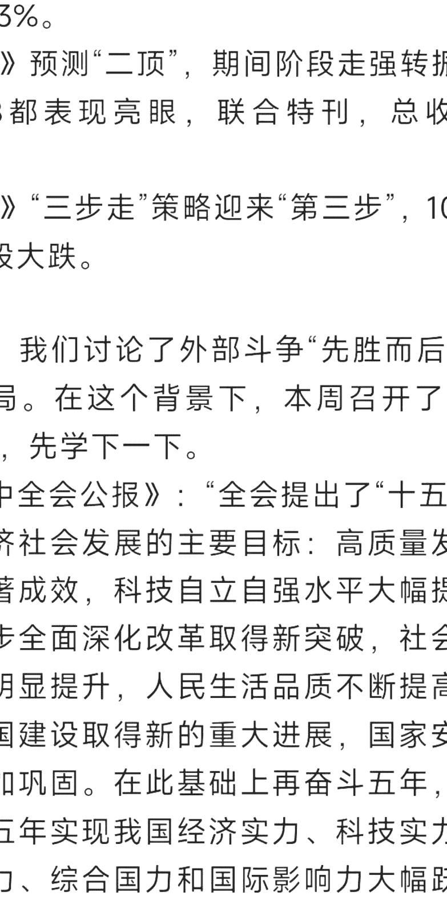
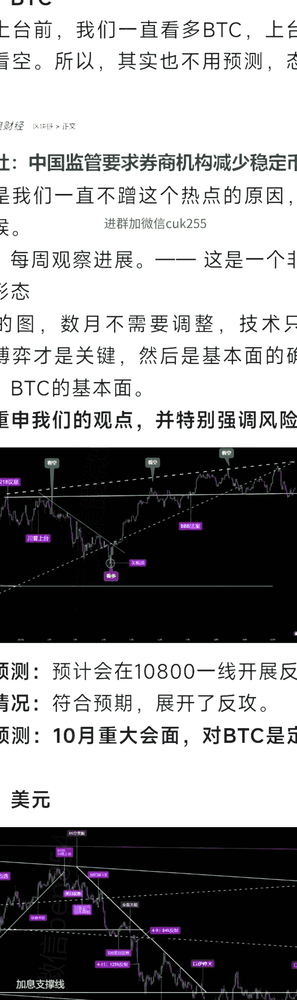
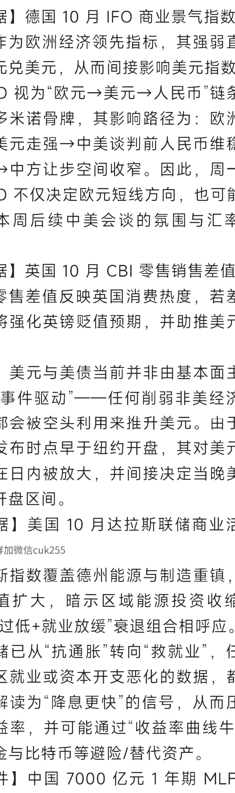
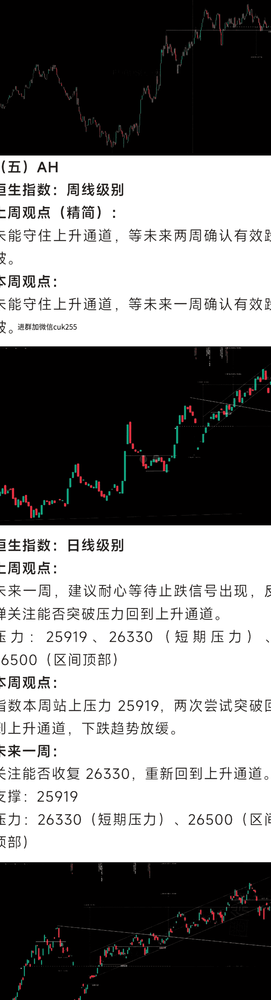
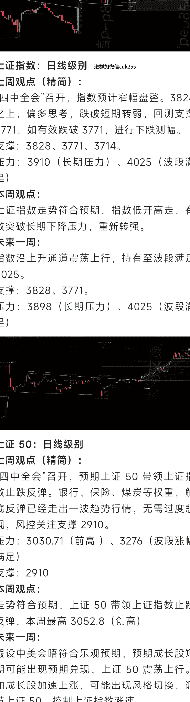
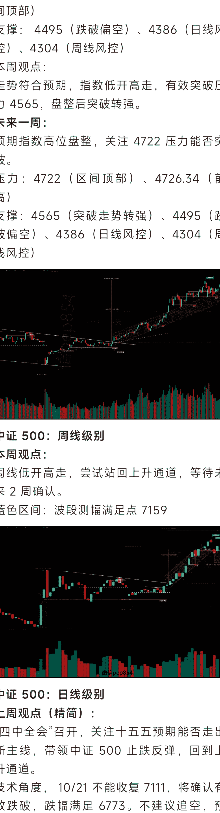
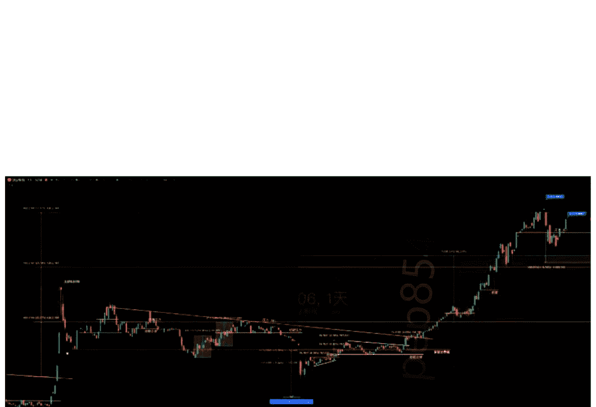
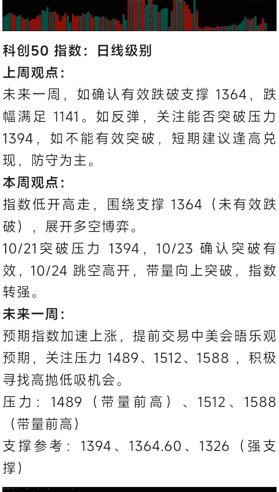

# 全球周报-10231027交流

财经通

**回顾**：上周股市市场表现震荡，全球资产配置依旧活跃。

**本周关注**：本周将关注美非农就业数据、美联储议息会议、2023年9月CPI数据以及2023年Q3GDP数据，数据将对美元、美债及全球资产产生影响。

## 一、 市场回顾

**美股**：上周股市市场呈现“先扬后抑”走势，周五美股三大指数小幅回落。

**日股**：上周日股表现依旧强劲，周五日经指数一度创下33年以来新高点。

**欧股**：上周欧股整体表现震荡，周五欧洲斯托克500指数小幅回落。

**A股**：上周A股市场继续震荡整理，周五沪指指数小幅回落，深证指也同样小幅回落。

**港股**：上周港股市场继续震荡，周五恒生指数同样小幅回落。

**人民币**：上周人民币汇率有所走弹，周五美元兑人民币汇率小幅回升。

**黄金**：上周黄金价格高位震荡，周五国际金价小幅回落。

**原油**：上周原油价格震荡运行，周五WTI原油小幅回落。

图23：Q3和Q4周期的股市走势

### （一）美股（SPX50）

**上周表现**：上周美股市场表现震荡，周五标普500指数小幅回落。

**本周关注**：本周将关注非农就业数据、美联储议息会议。

图24：Q3和Q4周期的股市走势

### （二）日股

## 一、 市场表现

从本周行情来看，美股出现高位震荡走势。标普500（跌2.06%，至20530）、纳斯达克100指数（跌2.19%）周二回调后周三回升。整体来看，美股或将继续震荡，只需等待下周反弹。

本周市场表现，美股指呈现震荡后反弹。道指（22206，22350）、3000指数（21900，22190）周二回调后周三回升，周四、周五继续小幅震荡。

## 二、 核心观点

从本周行情来看，美股出现高位震荡走势。标普500（跌2.06%，至20530）、纳斯达克100指数（跌2.19%）周二回调后周三回升。整体来看，美股或将继续...。

本周市场表现，美股指呈现震荡后反弹。道指（22206，22350）、3000指数（21900，22190）周二回调后周三回升，周四、周五继续小幅震荡。

### 美元：升趋势（利空）

美元：日线图

**上周线：**

美元周线继续上涨，但未突破97.53。在周内继续冲高后，出现回落压力。支撑：97.56（日线支撑） 96.73（日线支撑）。

### 欧元：下跌趋势（利空）

欧元：日线图

**上周线：**

欧元周线继续下跌，美元周线反弹。压力：97.5（周线压力）支撑：1.057（日线支撑） 1.0653（日线支撑）。

### 日元：下跌趋势（利空）

日元：日线图

**上周线：**

日元未能突破，未来或确认跌势。

### 黄金：震荡行情（中性）

黄金：日线图

**上周线：**

黄金未能突破1852，再次出现回调。压力：1859（日线压力）支撑：1824（日线支撑） 1800（日线支撑）。

### 中银：下跌趋势（利空）

中银：日线图

**上周线：**

本周未能突破5875，再次尝试跌势。压力：5885（日线压力）支撑：5824（日线支撑） 5820（日线支撑）。

### 沪50：下跌趋势（利空）

沪50：日线图

**上周线：**

沪50指数未突破3371，下后走低。压力：3410（日线压力）支撑：3268（日线支撑） 3275（日线支撑）。

### 原油：下跌趋势（利空）

原油：日线图

**上周线：**

原油未能突破75，再次回落确认跌势。压力：75.9（日线压力）支撑：71.1（日线支撑） 70.8（日线支撑）。

### 铜：震荡行情（中性）

铜：日线图

**上周线：**

铜未能突破8900，再次出现回落。压力：8950（日线压力）支撑：8768（日线支撑） 8769（日线支撑）。

### 科创50指数：周线级别

**观点：**

(维持观点，仅更新图表)
高至1588.83，周线区间大幅突破，指数大幅回升，连续两周上涨，需注意风险。

周线级别突破，短期建议突破（非短期目标）
红色区域：底部结构（2022年以来），满足点1061。

支撑：1326.27

### 科创50指数：周线级别

**上观点：**

未来一周，如能有效突破1364，继续满足1341。若反之，关注能否突破压力1394，若不能则回调，防守为主。

**本观点：**

指数较高，图筑1364（未有效突破），展开蓝色图。

未来一周：指数涨速加速，提前交易中美会预期，关注压力1489、1512、1588，积极寻找机会。

压力：1489（带量而）、1512、1588
支撑：1394、1364.0、1326（强支撑）

## 四、A-GIX（测试）

A-GIX指标脱离K线视图对行情运行，其主要意义在于对仓位大小的考虑，而不是去判断市场的趋势。

下本周线收回趋势图（图中指标为价格及均线趋势，图中指标为趋势的监控指标和波动线指标）。

上周提到，“这里就没有必要再继续减仓，周线指标如果就是仓位较轻，大部分板块如A-GIX指标已经到了低位，所以建议周初继续试错操作。实际事实如此，各项指标持续向上，回撤。”

10月初的“行情”放量回调后，上证继续走强，周五成交量放大，但是指数回调高，然而A-GIX指标上行良好，本周加仓可以继续看高，交易风险会比较小。A-GIX指标上行情，情绪及时却要转折信号出现后，开始考虑是否减仓。
