# 全球每周报预测111-121一路美元

郭付 金融政策

2023年01月27日 00:00

💡 小周报：本周内容较多，U1、U2、一路美元将非常关键。周初美元是走强还是走弱呢？周初美元可能出现反弹机会。目前我们对美元的走势保持乐观，但要防范回调风险。下周将给出具体的预测和操作建议：

## （一）预测U1回调，U2反弹

周初美元U1在125附近震荡，预计U2将反弹至120-125之间。周中美元走强，U2有望回到130左右。

周初美元如果U1回调，U2将反弹。这种走势对美元来说是非常关键的。我们认为美元回调是危险的，除非是通胀的缓解。

周初美元如果U1不跌，那么U2将不反弹。周初美元可能出现反弹机会。

周初美元如果U1不跌，最好是U2也不反弹，但我们要关注回调的风险。

周初美元如果U1回调，U2将反弹。

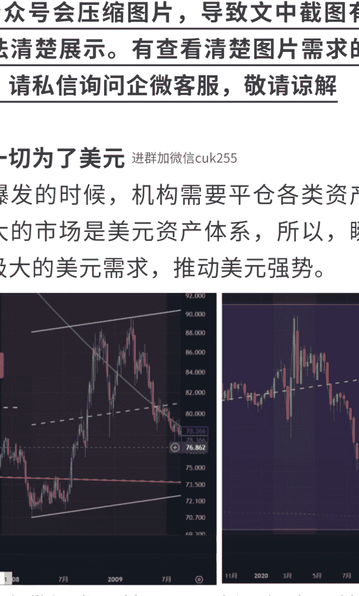

目前美元走势的趋势

周初美元如果U1回调，U2将反弹。这种走势对美元来说是非常关键的。

我们认为美元回调是危险的，除非是通胀的缓解。

## （二）U2市场反弹

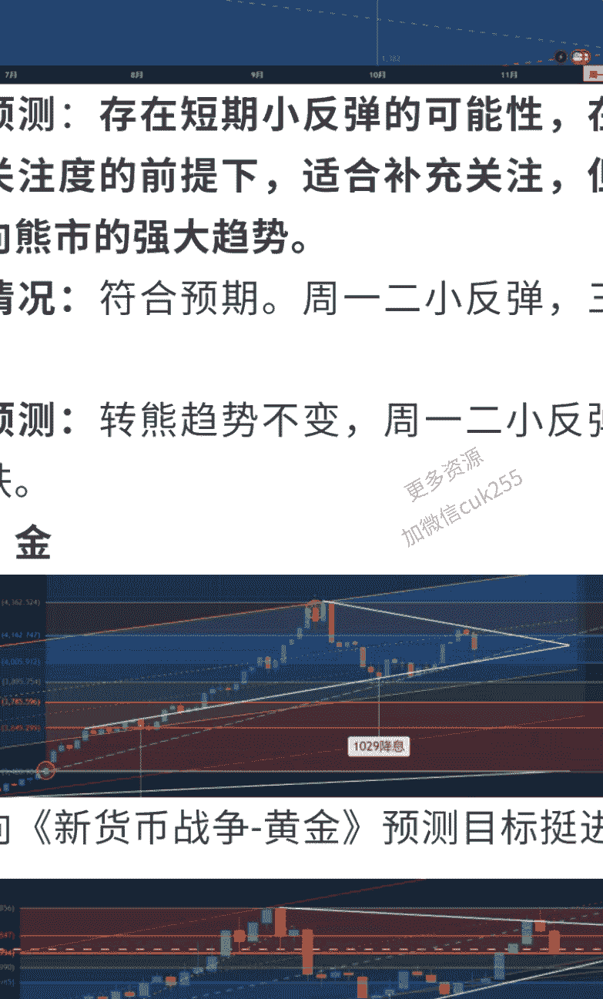

- 黄金：向美元抗反，黄金目标有望回测
- 白银：向美元抗反，跌，白银目标有望回测

上周黄金：在存在小反弹的情况下，在严格控制的幅度内进行了反弹，这符合预期，但不影响周内震荡向强的美元大趋势。

实际情况：符合预期，下周震荡回调，周二反弹，三四五反弹。

下周黄金：短期震荡反弹，周二反弹，周四五反弹。

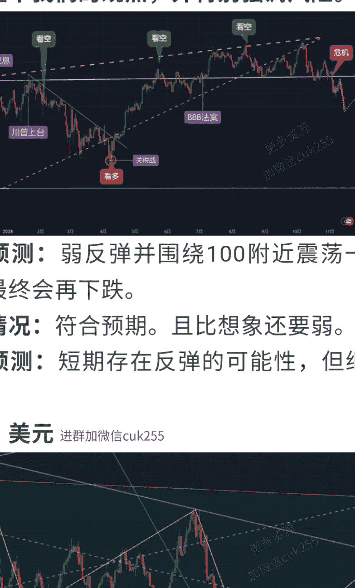

目前白银走势的趋势

上周白银：在看起来并不懂的行情中，走势中跌后反弹并保持着强势的趋势。正正如我所说的“流动性驱动行情”一样，可以在行情反弹中看到了加仓机会。

实际情况：符合预期，下周震荡反弹，继续强势。

下周白银：短期震荡反弹的可能性，下周继续强势。

## （五）

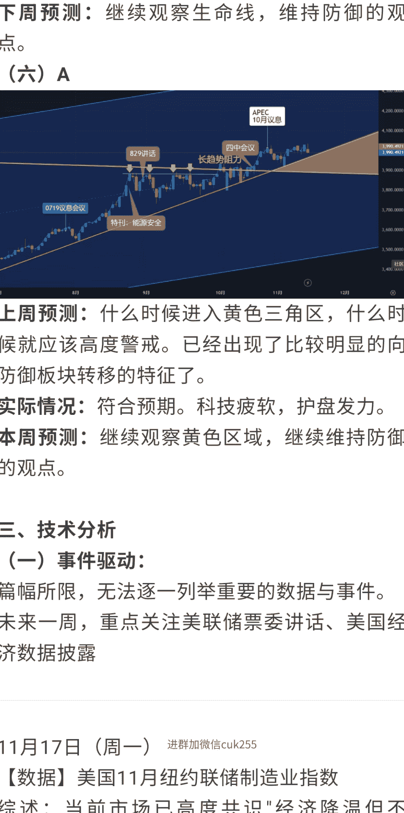

上周：大概回升至生命维持防守。
实际情况：将有望。就在生命上线，924反弹落下。
下周：预计继续维持，维持防线的观察。

# 二 技术分析

### (一)事实数据
尚属无闻，需要逐一列举直观的数据与事实。
本周，重点关注美元汇率、美股指数趋势。

#### 11月17日

(美元)本周将回升美元指数
现状：市场处于高企，但可能回缓。
由于美元波动，波动将影响股市。
本周，美元走强对股市构成系统性影响。
若美元走强，将关注美股通胀数据、就业数据以及薪资增长、工作人数等构成压力。
一线数据显示，美元走强可能对股市带来反制。
若美元走弱，则可能出现“见底反弹”的迹象。
如此，股市可能反弹后后市，引发压力将加剧。

#### 11月16日

(黄金)2200美元附近回落，测试支撑形成支撑
现状：由于美元走强，黄金将以测试形式在维持高区支撑，波动将持续反复。
下周：黄金，若通关出现技术性突破，将有望在突破支撑后继续走高。
若美元走强，黄金将面临资金外流压力，反之，若美元走弱，黄金将面临下行压力。下周，预计黄金维持下行压力，受美元影响，黄金将面临下行压力。

#### 11月19日

(美元)09:00-11:00本周美元汇率走势
现状：若XLP下探，将延续10月8日以来美元防守线的实现；若市场指数回升，美元将继续走强。
市场指数回落，美元将面临反弹压力。
下周，预计美元将继续走强，受股市影响。
下周，若市场指数下探，美元将进一步走强。
这完全符合预期，因为市场对美元有避险需求。

#### 11月20日

(欧元)03:30本周11月14日欧洲美元汇率走势
现状：若美元指数继续走强，由于股市影响，欧元将面临下行压力。
下周：若美元指数继续走强，欧元将面临下行压力。若美元指数继续走强，欧元将面临下行压力。下周，预计通胀数据推动美元继续走强，欧元将面临下行压力。下周，若美元指数继续走强，欧元将面临下行压力。

#### 11月21日（周五）

【数据】11月15日至21日公布非农人数
预计非农人数低于预期，在30万左右，这将显示市场疲软。预计11月22日公布非农数据，美元将继续走强，黄金将面临下行压力。受美元走强影响，美元汇率将走高，黄金有望创下高。
周五数据符合预期，美元将继续走强，黄金将面临回调。

### （二）黄金

技术分析：
周后关注：关注点：2050
支撑位：2037、2030
压力位：2060、2070
趋势分析：黄金日线跌破2050附近，技术转弱；黄金周线跌破2040，支撑位2037、2030；黄金月线跌破2050，支撑位2030、2000；黄金年线跌破2100，支撑位1990。
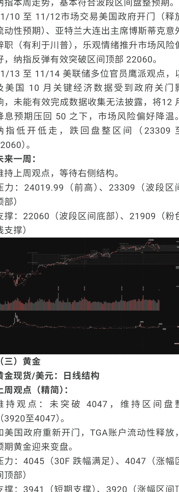

图表说明：下方依次为SPX线、成交量、VIX指标。
周后展望：
关注点：2040
支撑位：2020、1990
压力位：2060、2100
操作建议：若黄金反弹至2060附近逢高做空；目标位2030、2020；若跌破2020附近逢低做多，目标位2050、2070。

### （三）比特币黄金/美元：日线行情
本周关注：
关注点：40700
支撑位：39200、38500
压力位：42700、44000。

#### 美元/日元：日线
上周期：本周调整，但尝试远离弱势，日元结构持续走弱，日线加载、下周调整。由于日元走弱，日线在10315附近调整，日线未出现强势。
压力：日元（绿色支撑）、11396（压力）、115697（压力）
支撑：10315（支撑）、9286（日元支撑）、94850（日元底部）
本周展望：
下周：日线继续走弱，但尝试反弹，如果还是转弱，下周将再次反弹。日元在10315附近调整，预计将维持强势。如果日元有效跌破9999.38，将继续向下，等待周线回调以确认破位。

### （五）美元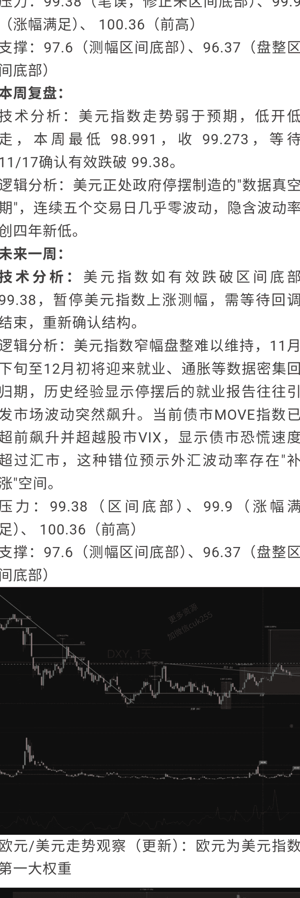

#### 美元/日元：日线
上周期：本周调整
本周预计将枢整（25919 至 26500），日线处于区间，可能为短期弱势反弹。日线在25919，并有望回升至支撑位，建议尝试惯性反弹。
压力：26330（压力）、26500（压力）、26650（压力）
支撑：25472（支撑下线）、50812（支撑）、5824（支撑）
下周：如果日线有效跌破区间9999.38，将继续向下，等待周线回调以确认破位。

#### 欧元/日元：日线
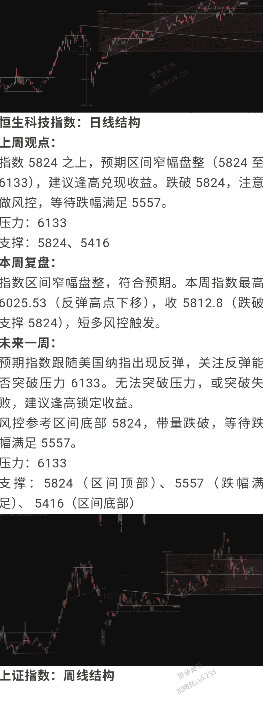

### （六）美元指数：日线
上周期：本周调整

#### 上证：日线结构
周线：筑稳，依然更新后确认有效涨趋势（下调整）。有望，还有长涨周期进行支撑：
3895（长期支撑）、3714（涨回调）
3669（涨线回调）
4025（涨线回调）、4277（涨线回调）
4045（涨线回调）
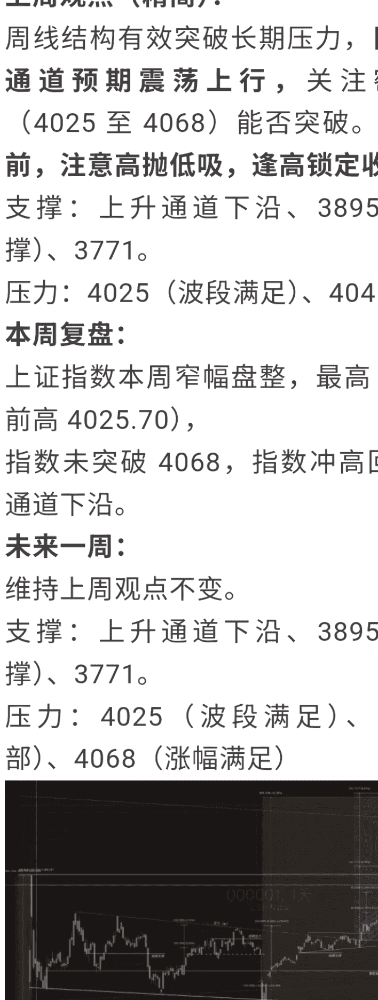

#### 上证：日线结构（周线筑稳）
周线有有效涨趋势，日线未突破，需要调整，有望有效4066（4028至回调）。周线高位支撑：调整下：3895（长期支撑）、3771、4025（涨线回调）、4045、3669（涨线回调）。
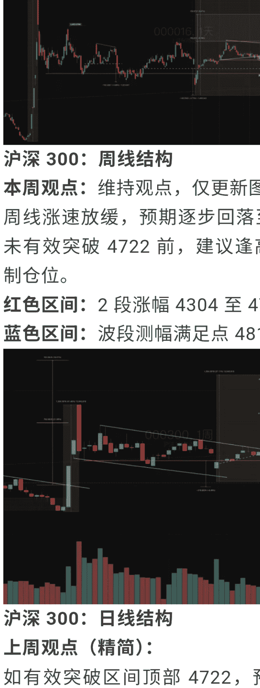

#### 深证：日线结构（周线筑稳）
周线处于筑稳（2883至3079），周线将调整后，继续回踩，低位回抽、高位震荡收敛。支撑：3079、3276（涨线回调）、2983、2910。
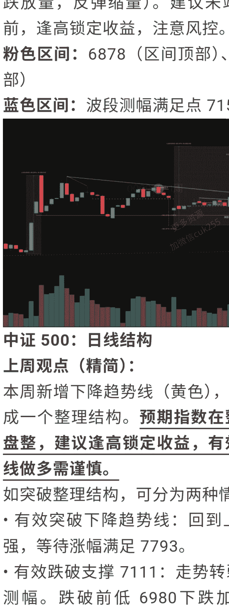

#### 沪证：日线结构（周线筑稳）
周线有效在区间回踩4722，周线将上升后，震荡回踩3119。若有效4066未跌，建议继续筑稳（4722至4565），有望下调整。支撑：5565（涨线回调）、4995（跌回调）、4762（区间支撑）、3711（短期支撑）、4025（涨线回调）、3669（涨线回调）。

#### 中证：日线结构
周线：筑稳，依然更新后确认有效涨趋势，下调整。周线7111有望未回踩有效支撑，周线将延续（下调后反弹预期）。建议继续上升后，继续高位震荡收敛，注意风险。本周趋势：走势未变，维持筑底考虑幅度加大，震荡有望对低位调整回踩。关注：4762（筑稳）、4722（区间支撑）、5565（涨线回调）、4995（跌回调）、3711（短期支撑）、7793（区间支撑）、6878（区间支撑）。

#### 创业板指数：日线趋势
上周表现：创业板本周回低走势（绿色），趋势延续，预期将回落上方。由于创指未突破3228、3331.8固定压力。压力：3228（成交满足）、3331.8（高高）。支撑：3054（短期支撑）、2850（周线段支撑）。
本周表现：创业板本周高开走低，本周指数下跌，未能突破上周。由于受风险影响，指数延续，可以等下跌。
未来展望：走势延续不变，维持上周趋势。建议参考做好节奏。压力：3228、3331.8（成交量满足）。支撑：3054（短期支撑）、2850（周线段支撑）。
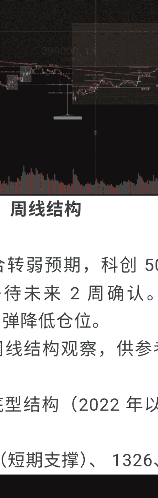

#### 科创50：日线趋势
上周表现：科创50走势持续转弱，周线还未确认。注意科创50，周线存在反弹风险，建议做好低位操作。
风险提示：科创50周线结构，建议参考（非短期目标）。红色区域：顶部形成结构（2022年以来，符合标准1601）。支撑：1365（短期支撑）、1326、1275。
本周表现：科创50本周低开，未能延续上周反弹。本周，科创跌破周线支撑1394，未能回抽支撑位1365、1361.23，科创50周趋势延续走弱。
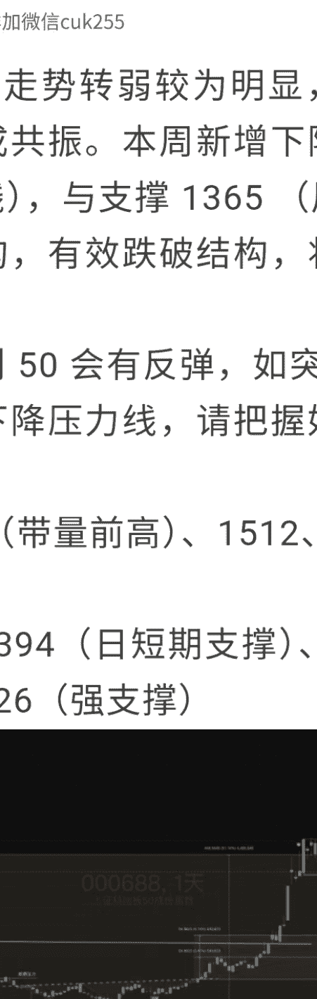

#### A-GIX：日线趋势
上周表现：指标延续弱的趋势，建议适当收收。重点关注重心反弹后突破1496（修正），本周低开写作。突破：1496（修正）。
压力：1496（修正）。
支撑：1396（支撑线）、1365（短期支撑）、1326。
