# 全球市场每周预测1215——十字路口转向

财经 财会主理 金政通源 2025年12月14日 22:34 辽宁

点击上方蓝色金政通源、关注我们
点击上方蓝色金政通源、点击右上“...”设为星标
价值决策迈人一步

⚠️助理提醒：本周报内容较多，《十字路口》与《十字路口：转向》皆精准捕捉关键时间节点，收获丰实！本周我们以历史为镜，探讨下一次“十字路口”，观察如何“转向”。
这个案例，应该很直观地展现，什么叫“剧本”。
按照以下周重点，关键数据为发展展望，提示敏感点，纵览全球市场，研判各类资产配置。
建议仔细阅读——

- [Q1] 预测模型性质。
- [Q2] 预测模型2025年爆发危机的概率高达90%：关税大跌，美国一季度GDP为-0.3%。
- [Q3] 预测“二期”，预测内阶段强势转向：标1-8都表现亮眼，联合特利，总收益翻倍。
- [Q4] “三期”走势“常规第三”，10月10日大跌，10月29日收跌。

我们首发特利十字路口，取得了平均跑收益。上周，我们围绕当下，重点关注全球宏观形势，尤其是美国发布《2025年美国国家安全战略（NSS）》，对川普的政策可预测进行了复盘，发布年度收尾十字路口：转向。

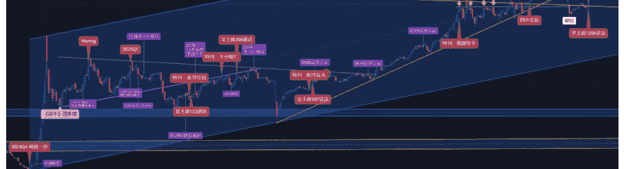

每次讲话和我们的研报/特刊发布节奏

取名“十字路口：转向”，是因为我们在转向。其特征是BTC反弹基本结束、SPX 顶部结构基本成型，金银带领商品突破加速，美元在关键支撑线上稳歇。

## S&P 500 forward P/E ratio vs subsequent 10-year annualized returns

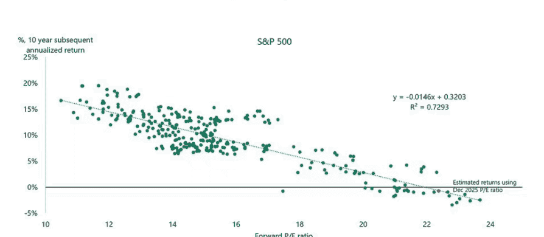

按照数据统计，SPX的PE超过22以后，未来十年，尽管起伏不断，但累积的收益低于0。十年熊。

我们在《美股价值跟踪》中，展示了多类资产的预测模型，包括BTC/SPX/VIX/GOLD/SILVER/HSI/A，至今完美契合我们预测的轨道。
本周，我们讨论一下上一次“小十字路口”，以历史为索引，探讨下一次“大十字路口”，探索“转向”这个案例。应该可以直观地展现，什么叫“剧本”。
此外，本周开始，预测将全面跟踪同步。

P.S 公众会压缩图片，导致文中某些数据无法清晰显示。有查看清楚图片需求的付费读者，请私信咨询微信客服，敬请谅。

## 一、转向

### （一）2007年海危机

标普500指数-1天-SPXD 开6886.65 高6899.95 收6801.79 跌6828.84 -72.17 (-1.05%)

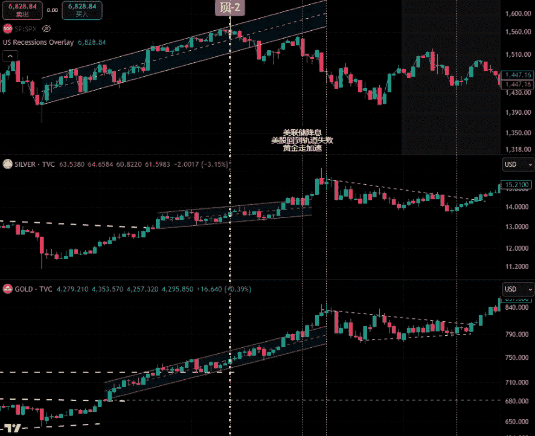

2007年，SPX见顶并跳出通道，进行回撤，美联储降息后引发反弹，但是未能回到轨道，是进入熊市；美股进入熊市的恐慌拖累，金银聚焦，但随后突出了避险功能。

### （二）2025年AI泡沫

精准追踪S&P500指数-1天-SPX 开8886.85 高8899.95 低8801.25 收8825.25 跌7.66 (-0.10%)

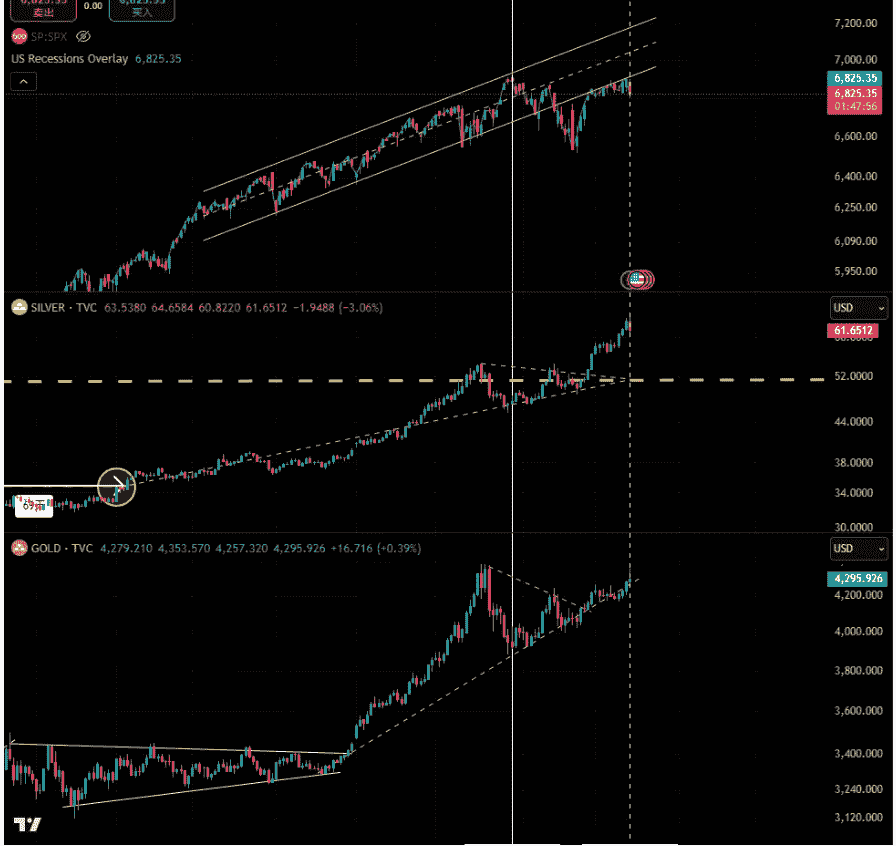

2025年12月13日，SPX见顶并跌出通道，进行回撤，美联储降息引发反弹，但是未能回到轨道，看着进入熊市；美股进入熊市的恐慌，金银受挫，看着发挥避险功能。这说明也没打算好。

## 二、全球市场展望

### （一）美股SPX

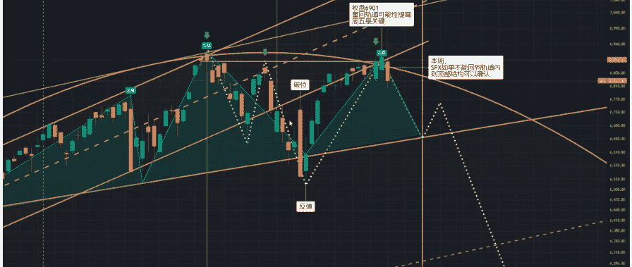

上周预测：10月29日见到12月30日的SPX6920，12月4日NSS发布到12月5日。实际情况：符合预期。完美。下周预测：前面报价“川普”，这种安排有点幼稚；或许这就是实力的。

### （二）金银

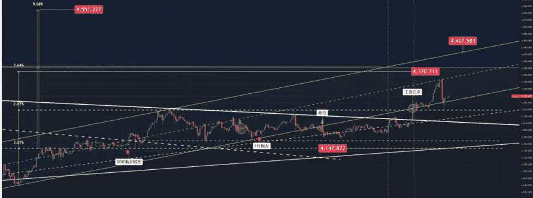

黄金向：通胀战争-黄金预测目标进。

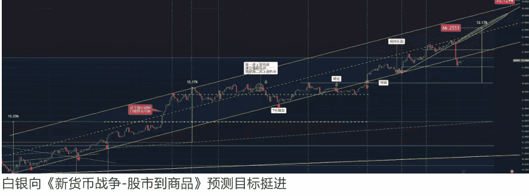

白银向：通胀战争-股市到目标进。

上周预测：金银迎来困难，但舒服的时候了，短期波动会越来越大，黄金。实际情况：符合预期。受美股影响，金银下降，但是黄金是少数保上涨的资产；白银涨了一些，但涨得多的回调是正常的。下周预测：这周涨过去，下周要回。

### （三）BTC

川普上台前，我们一直看多BTC，台后，开始看空。所以其实也不用预测，态度鲜明。

彭博：中国监管要求券商减少市值。这就是我们一直不看这个热点的原因，不是时候。BTC每周观察进展。这也是一个非常看跌的形态。我们的图不需要调整，技术只是辅助，博弈才是关键，然后是基本的确认的，BTC的基本面。继续申我们的观点，特别强调风险。

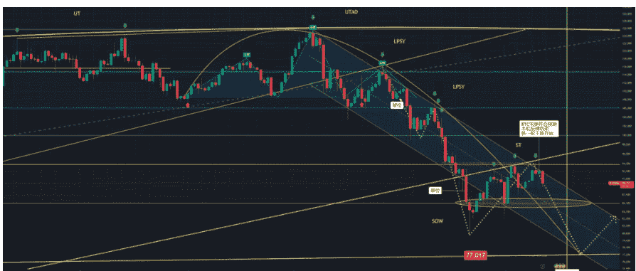

上周预测：空。实际情况：符合预期，几乎完美。下周预测：空。

### （四）美元

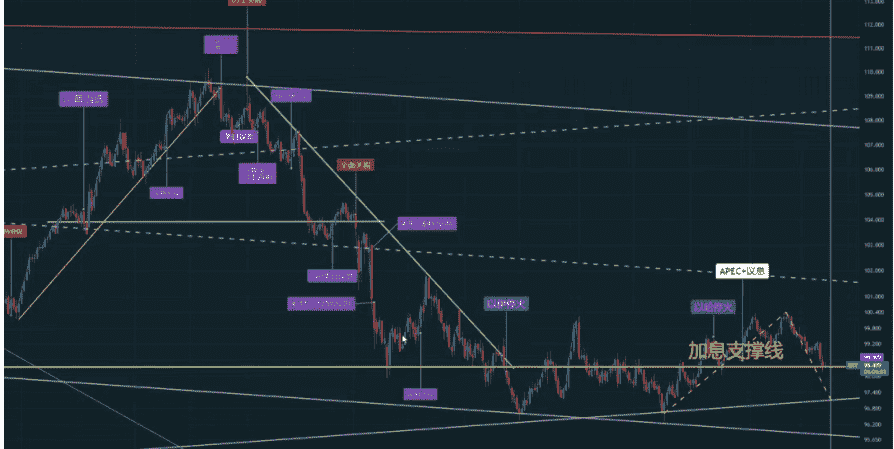

上周预测：美元就是双顶结构。如前文第一章节分析，后续按照美元趋势考虑。实际情况：符合预期。落在支撑线上。下周预测：美股拖累预期，下周应该向下跌破。

### （五）H&A

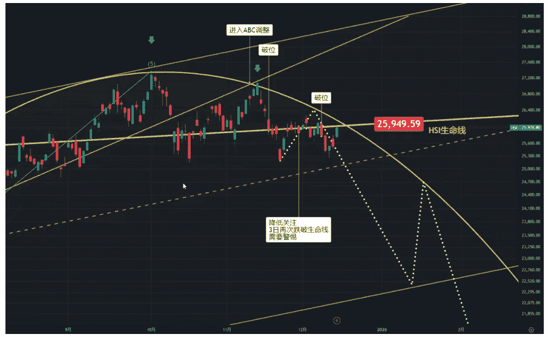

A没有站上生命线。

预测：
上周预测：在受到美股下跌拖累前，保持进攻。
实际情况：弱于预期，争夺生命线。
下周预测：加强防御。

## 三、技术分析

(一)事件驱动：

未来一周，海外数据、事件相对密集，预期为形成单边趋势。交易资产波动为主，仓位应与风控匹配。

12月15日（周一）

【数据】标题：中国11月社会消费零售总额同比、规模及工业增加值同比

词释：社会消费总额反映中国内需的核心指标，工业增加值——衡量经济增长的关键指标。

延续：11月中国经济运行将证“冰冷两热”是否延续。若数据持续进一步强化“冰”的态势，反而可能对政策转向“不再放缓”预期，巩固A股，增速持续超出预期的韧性，但需警惕政策风险。

【主题】：中国银行公布月度报告，是“冰冷热”的关键指标。词释：零售销售是“冰冷热”的锚点。若数据持续强将强化“冰”的事实，进一步提升A股吸引力，对政策转向预期。若数据弱，可能政策宽松则失效，导致政策转向。

【展望】：数据发布后，市场将给出结论。主题：美联储主席鲍威尔发言。词释：鲍威尔被称为“鹰派”，其言论多次强调依赖性。引述：这是本周最关键的。

【数据】：美国1月数据超预期工资名词解释：通胀增速（>0.3%），直接支撑核心通胀韧性，强化FOMC通胀派立场，使美联储vs美国冲突加热，美联储关注“通胀”关键因素。若通胀增速超预期（>0.3%），直接支撑核心通胀韧性，这正是数据规模现状增大。数据领先将导致收益率曲线平坦（短端不降息，长端上行），金融股受压（净差下降）。若工资增速放缓，则缓解通胀担忧，为加息提供支撑，但观察美联储委员是否会发“无数据”坚持立场，验证立场立场程度。

12月16日（周五）

【数据】：美国11月非农数据、非农就业人数词释：非农数据——美国最新新增就业人数，失业率——劳动力市场处于高位，都是美联储关注的核心指标。引述：这是本周关注的数据，直接决定美联储“抗通胀”路径。若就业数据强（失业率小于4%），可能使美联储继续加息，缓解通胀压力，推动收益率回升、黄金上涨、美元走强。美联储内部认为，即便数据弱也可能不再加息，导致政策失效。美元面临高预期，数据发布前美联储“乐观”表述，这出现的情况引发回撤。

【数据】：美国11月零售销售词释：零售销售——衡量美国消费者行为程度。

综：数据影响美联储“经济冲击”判断。
- 若美联储加息，维持“经济良好”立场，加息预期进一步修正，美元走强。
- 同时，通胀成本下行预期，对冲CPI压力，对美国利好。
- 若美联储放软，则加剧消费衰弱忧，可能被市场标记为“逼加息”，与政治影响经济冲突。若数据综合一起“弱零售+强通胀”组合，将引发美联储立场表态，收益率再度上升。

12月17日（周三）

【数据】：美国12月2日公布API原油库存

综：API库存数据是影响油价的重要指标。库存超预期增加，将进一步打压油价。当前市场影响油下跌的三大因素（和平、库存、储备），库存是短期验证的关键变量。数据发布后需关注市场对的反应，以及与相关资产（能源股、黄金）的影响。若数据与预期一致将验证下跌趋势；若库存意外减少，则可能引发油价反弹，这种反应是短期的，不会长此导致下跌。

12月18日（周四）

【事项】：欧洲央行公布利率决议、拉加宣布会（已公布）

综：欧洲利率决议是“全球利率周期时代”的欧洲版本。维持利率不变并释放宽松信号，将导致市场立场转向，支持哈加储“增长下行风险”与“通胀回暖”，欧元走软、美元走强。更关键的是加息对欧洲增长的预期，影响市场。若数据弱，可能引发市场转向，美元反弹。

【数据】：美国1月CPI、核心CPI名词解释：CPI指数——衡量价格总体水平；核心CPI——剔除食品和能源，衡量通胀核心。若核心CPI高于3.3%或接近0.3%，可能引发美联储加息，维持“经济良好”预期，这数据规模现状增大。数据领先将导致收益率曲线平坦（短端不降息，长端上行），金融股受压（净差下降）。若工资增速放缓，则缓解通胀担忧，为加息提供支撑，但观察美联储委员是否会发“无数据”坚持立场，验证立场立场程度。

12月19日（周五）

【事件】：今日央行公布利率决议、美联储发布（包含会议纪要）。名词解释：央行利率决议——市场关键因素。若利率决议导致市场转向，美元反弹。若利率决议符合预期（YCC）或不加息，市场将面临高预期，美元走弱。右肩结构对应的时间窗口，约22个工作日影响股市表现，美元走强。

【事项】：标普500指数权重，解读：高调调研显示A股权重看多，市场现实接受，全球芯片重组影响，正在经历经济复苏期，技术领域突破。

## (二）美股总结

美股正经历风格转换，表面乱逻辑清晰。本周表现宏观消息、事实打架的震荡状态。股市并非整体下跌，资金从AI/科技巨头（纳指/标普）转向材料、金融、小盘股和价值，本质是从故事转向实事。

## 未来一周

维持观点：压力6883作为短期分水界，若有效突破，要防范风险偏好提升指数测试6920。SPX未破突破线前，等待右侧结构完成（复合头部型，右肩）。右肩结构对应的时间剩余10个交易日，压力6883。

# 风险提示：

- 日本银行12月初，全球资产配置再平衡。日元是全球资产配置利率来源，日元加息将收紧全球流动性，日元价格上涨。

聚焦面：指数面临多重压力，跌被彻底干净，指数贴着历史高位，对就业数据高度敏感。12月季节性因素加剧波动，基金经理年底锁定目标，机构筹码优化导致指数向上，市场进入“趋势性、高波动性”特征。

压力：6870（前高），6883（右肩压力），6920（前高）支撑：6819（波段区间顶部）、颈线（绿色虚线）、6551（波段区间底部）

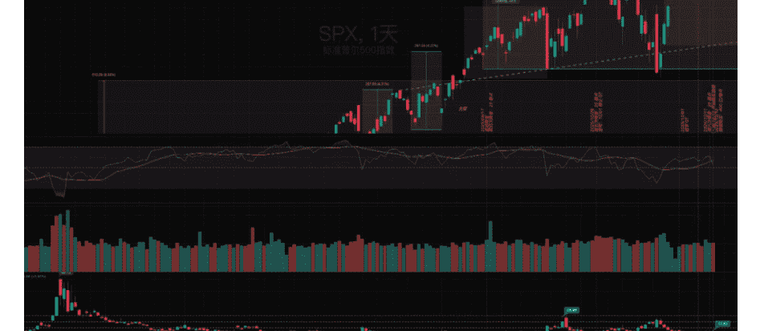

本周聚焦：技术：

12/11美储降息，12/12美联储开始购买债，流动性加好尚未有效突破6883。指数回落，收6827（回调6819），走势呈现向回调，利多没有弱迹象。

### 黄金/美元：日线结构

### 上周线（期）

周线连线突破4176（月，区间顶部），如周线收于4176之上，日线结构、周线结构转换形成共振，中期看。预期黄金将维持盘整（4177至4352），有效突破4352，上涨加速，等待回调满足4176。

- 压力：4252.22（中期，正前）、4352
- 支撑：4176（月，区间顶部）
- 下降压力线：4047（月，区间顶部）、3941（短期支撑）

## 本周展望：

技术面：本周周线确认突破4176（月，区间顶部），日线结构、周线结构转强形成共振，中期看多。本周高4353.57，回4299.28，测试区间顶部4352后支撑压力，走势符合预期（4177至4352）。

## 逻辑面：

本周黄金与白银双创历史新高，反映的并非单纯上涨，而是对货币贬值长期利率水平的深度定价，现在是“安全”受质疑的战略狂奔。过去十年黄金最大的买家是银行，未来五年投资者可以衔接。若这一级别的玩家延续性增，金走势将完全不同，4900美元/盎司的2026年目标或保守，当前看来可能是“热身”。

## 未来展望：

### 技术面：

预期现货黄金将维持盘整（4177至4352），有效突破4352后加速，等待涨幅满足4616。

### 逻辑面（中期）：

黄金正在机构配置惯性倾向的黎明前，上涨空间远超市场预期。核心逻辑在于美国国投资者配置资产严重不足，黄金ETF等机构配置资产的0.17%，较2022年峰值低位6个点，十年形成巨大“刚弹性”。高量化模型显示，配置比例每提升1个点将推动金价上涨1.4%，机构从0.17%调至0.27%（仍处于合理水平），金价将上涨。更关键的是，美国大型机构（养老、保险、基金金等）理论涨幅达14%，0.1%-0.5%，这些长期资金一旦转向将持续数年。其中不足一半持有黄金，且仓位不足。

- 压力：4352（月，区间顶部）、4841（月）
- 下降压力线：4047（月，区间顶部）、3941（短期支撑）

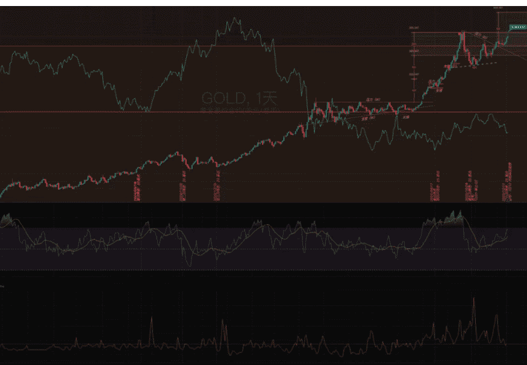

## (四) BTC

### 比特币/美元：周线结构

周线进入第二阶段下跌，等待回调幅满足76162，月线结构颈线，确认需要2个月，先用保守的统计法则观测。

- 支撑：76162（周，跌幅充足）
- 压力：94850（周，区间顶部）、103516（日）

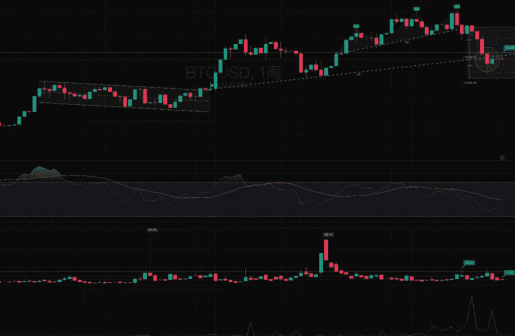

### 比特币/美元：日线结构

上周观点（精简）:

BTC 周线、日线空头共振筑底，建议控制好仓位，等待跌幅满足76162，顶峰急需94181（日）、94850（中线）。

- 压力：103516（支撑）、92886（日跌满足）、94850（周1段，跌幅满足）
- 支撑：76162（周2段，跌幅满足）

### 本周复盘：

技术面：BTC 周走势强于预期，连续三次突破92886（日跌满足），最高94640（周区间顶部），解读为日线结构、周线结构尝试结束，本周未成功。风控：94181（空头）触发，但日线未能站上92881，意味着流动性改善，风险偏好上升，空方占据优势。

逻辑面：BTC在90000-94000之间回落，最终结束，成为流动性缺失的完美落地。本周未见枯竭，日线有效站上92881之前，空头持有。

未来周：维持观点：周线、日线结构共振下跌，建议控制好仓位，跌幅满足76162。

- 压力：92886（日跌满足）、94850（周，区间顶部）、103516
- 支撑：76162（周，跌幅满足）

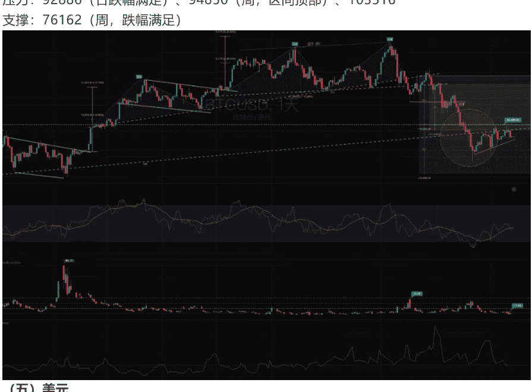

## (五) 美元指数：日线结构

上周观点（精简）：如美联储进行调整，美元指数可能触发反弹，若有效站上99.1，等待跌幅满足。

- 压力：99.1（涨幅满足）、10326
-  支撑：97.6（支撑）、96.37（周，支撑）

本周复盘：

技术分析：美元指数反弹未能站上99.1，持续关注。本周美联储降息前，美联储两次表态，影响了市场对于2026年降息的定价，导致美元指数冲高回落。图显示指数触底反弹，美联储开始购国债，市场演化为QE，美元短期承压。美元连续周下跌，全球流动性重新转向外，反映降息预期。

未来一周：预期市场加剧，预期美元指数区间震荡（99.1至98）。欧洲央行鹰派、日本央行加息、非农数据恶化，可能引发美元下跌，回测97.6。

- 压力：99.1（涨幅）
- 支撑：97.6（支撑）、96.37（周，支撑）

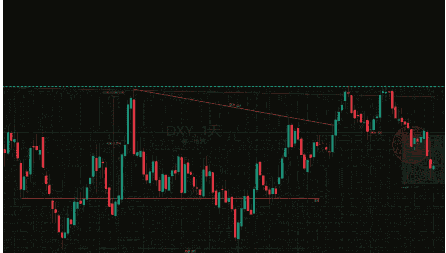

### 欧元/美元走势（更新）：欧元为美元第一权重

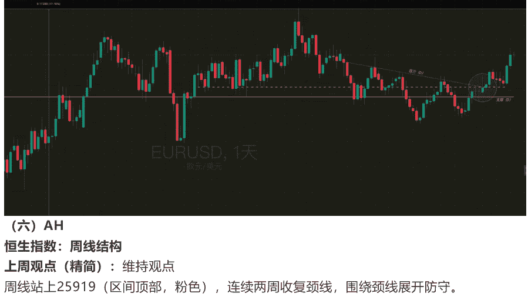

### （六）AH 恒生指数：周线结构

上周观点（精简）：维持观点。周线站上25919（区间顶部，粉色），连续两周复顶，围绕均线展开防守。

- 压力：26550

### 恒生指数：日线结构

上周观点：恒生指数防御为主，需要沿趋势线震荡上行，盘整区间(25919至26550)。如有有效突破，指数转转，将进行下跌回测。

- 压力：25919（区间顶部，粉色）、26550（区间顶部）
- 支撑：颈线（绿色虚线）、24937（波段回测）、24550（日线，跌幅满足）

本周展望：

恒生指数本周开高，围绕趋势线多空震荡，反复不高，恒生指数转弱。12/12恒生指数重新站稳上线，维持周线收于线之上，暂进行下跌回测。

未来一周：维持观点。恒生指数防御为主，需要沿趋势线震荡上行，盘整区间(25919至26550)。如有有效突破，指数转转，将进行下跌回测。

- 压力：25919（区间顶部，粉色）、26550（区间顶部）
- 支撑：颈线（绿色虚线）、24937（波段回测）、24550（日线，跌幅满足）

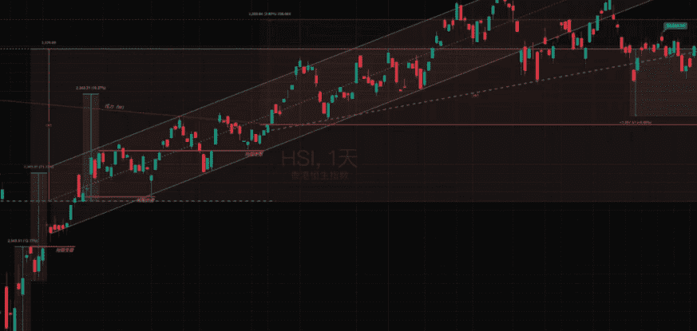

### 恒生科技指数：日线结构

上周观点：围绕5557防守为主，盘整区间(5557至5824)。

- 压力：5824（区间顶部）、6133
- 支撑：5557（日）、5416（区间底部）

本周复盘：恒生科技指数围绕5557防守，本周最高，且周多次突破5557，指数承压，多头依然困难。

下周预期：突破5557，指数承压，盘整区间（5557至5416），继续右侧头部结构。

- 压力：6133
- 支撑：5557、5416、5361.7（前低）

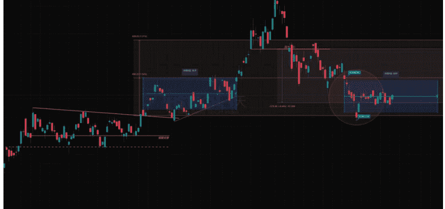

### 上证指数：周线结构

本周观点：周线重新上线，月会议临近，无形成信号。本周为恢复支撑，未来两周防守，等待确认。

- 压力：4025、4277、4045
- 支撑：3886、3714、3680

### 上证指数：日线结构

上周观点：指数防守为主，参考3915作为多空边界（3915至3802），等待完成右侧结构。未能突破3915，走势转弱，周线做峰结构。

- 压力：3886、4025、4045
- 支撑：3714、3680

本周展望：本周走势呈现高低走，突破3915后回落，回到区间（3915至3802），维持多空边界。3915再次跌破，上证指数跌幅满足3802。

未来一周：指数防守长期压力为主，预计区间内回（3915至3802），等待完成右侧结构。

- 压力：3886、4025、4045
- 支撑：3802、3714、3680

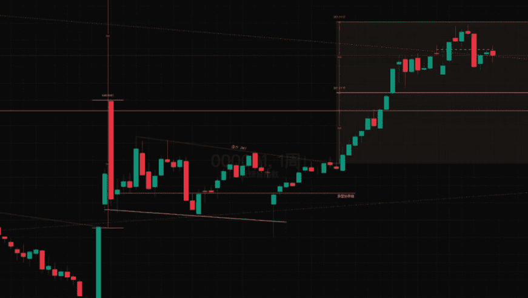

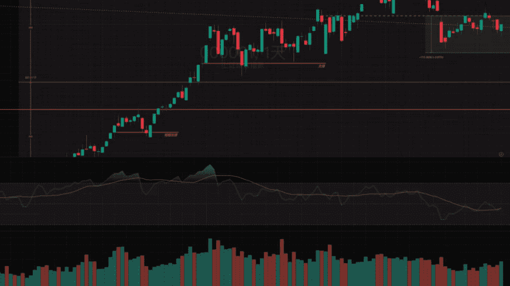

### 上证50：日线结构

上周观点：重要会议时间窗口，预期沪维持指数高位回整（2983至3030）。如有效突破3030则挑战前高，周线构建双峰结构。

- 压力：3079（前高）、3276（波段涨幅满足）
- 支撑：2983（短期支撑）、2910

本周展望：指数本周高开低，最高3030.57，收2994，符合沪维持指数高位回整预期。注意的是，本周连续三个交易日击穿2983，最后一个交易日放量反弹（多空逆转）。

未来一周：看外部波动风险加大，预期围绕2983展开多空博弈，窄幅震。

- 压力：3079、3276
- 支撑：2983、2910

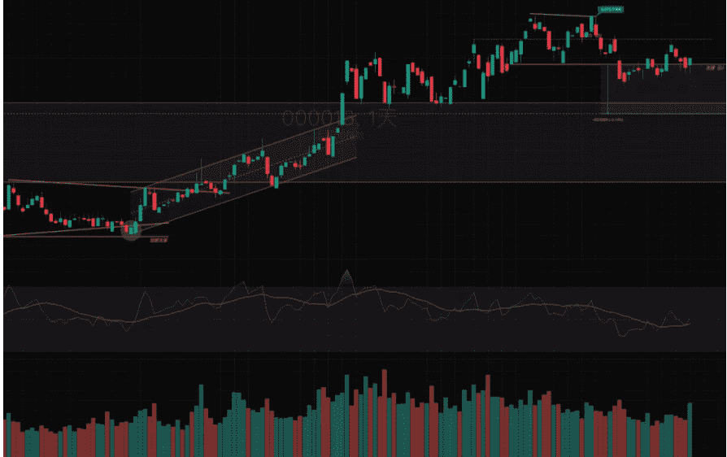

### 沪深300：周线结构

本周观点：确认周线带跌破上通道，周线中期走势转弱，维持未有效突破4722，达锁定收益的观点。

- 风控参考：4386
- 红色区域：2段涨幅4304至4722
- 蓝色区域：波段测幅满足点4819

### 沪深300：日线结构

上周观点：日线防守4495，如有效突破4565，沪300转强，回到上升通道。

- 压力：4762（前高）、4722（区间顶部）
- 支撑：4565（短期支撑）、4495（跌偏空）、4386

本周展望：本周突破4565尝试站上通道，未成，随后连续三个交易日反弹4580。

未来一周：最后一个交易日沪300放量反弹，但弱于上。日线防守4495，可能跌破4495。

- 压力：4762、4722
- 支撑：4565、4495、4386

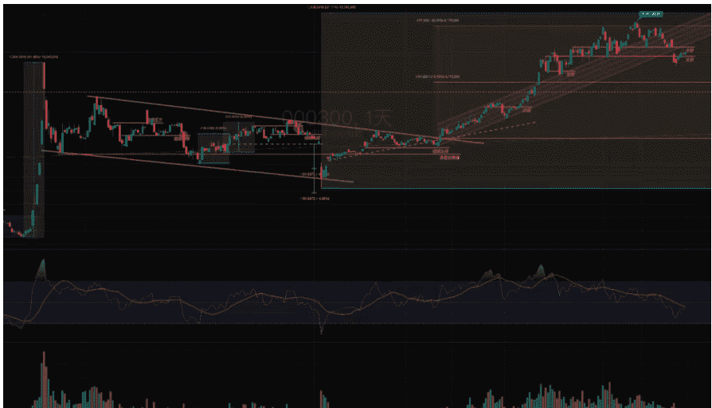

### 中证500：周线结构

本周观点：周线确认6878，根据右侧走势，调整周线划分。

- 压力：6878（区间顶部）、7793（区间顶部）
- 蓝色区间：波段回测满足7159

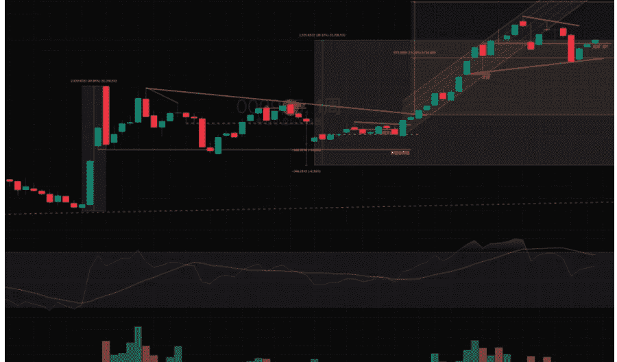

### 中证500：日线结构

上周观点：中证500防守为主，耐心右侧走势。突破6878寻找机会，等待跌幅满足6567。突破7111转弱，关注回到重构结构（矩形破）。突破7140，停止下跌。

- 支撑：6878（区间底部）、6567（跌幅满足）

本周复盘：12/08中证500突破7111转弱，回抽7172，停止下跌。12/10中证500突破7111有效。12/11中证500带量穿支撑7111。12/12中证500带量收复前日，成交量超过，短线多。

未来一周：中证500防守支撑7111，预期幅加大，盘整区间整理结构。

- 支撑：7111（短期支撑）、6878（区间底部）、均线（绿色支撑）
- 压力：黄色线、7159（波段幅满足）

### 创业板指数：周线结构

本观点：周线确认收复颈线，指数最高达3246，测试区间顶部3228回落。

- 压力：3228（区间顶部）
- 支撑：绿色虚线、2850（波段测幅）、2748（区间顶部）

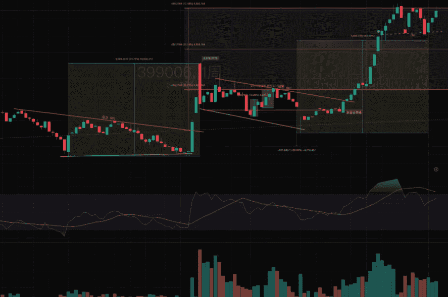

### 创业板指数：日线结构

上周观点：预期指数转突破3101，在盘整区间（3054至3228）震荡上行。带量突破3101化解空头趋势，将停止下跌调整。

- 压力：3132（前高）、3228（涨幅满意）、33318（前高）
- 支撑：3054（短期支撑）、2748（周，波段测），区间顶部）

本复盘：走势符合预期，带量突破3010化解短期趋势，停止下跌。技术分析调整：根据回侧走势趋势进行判断，周线结构呈现头部顶底右肩结构，保留周趋势，日线趋势调整为压力（上升趋势突破后的反压）。

未来一周：创业板再次确认周线回线，指数转强再次挑战区间顶部3228，建议逢高锁定收益，有效突破3228之前，维持震荡。

- 压力：3132（前高）、3228（前高）、2850（周，波段满足）、2748（周，区间顶部）。
- 支撑：3054（短期支撑）

### 科创50：周线结构

上周观点：指数有效站上1365，跌幅满足141。周站上1366，震荡。

- 压力：1365
- 支撑：1326（周）、149（周）

### 科创50：日线结构

上周观点：指数超卖，预期反弹，根据阻力位置和反弹，有效站上1365，等待跌破1326。

- 压力：1365
- 支撑：1326

本周复盘：日线突破1326，未成。本周未站上1365，等待跌破1326。未来周：预期1365，如创有效站上1365，跌。

逻辑：芯片发布大会，晚歇一代架构与路线。预期与科技波动加大，如科创有效突破1365，停止跌。

- 压力：1365（周，短期支撑）、149（带量顶）
- 支撑：1326（周，波段）、149（周线）

## 四、A-GIX：测试

A-GIX指标回K线观察运行规律，其主要意义在于综合仓位大小的考虑，而不是简单的预测涨跌。

### 1. 上周建议

### 2. A-GIX指标解析

下为本周收益数据图（图中指标为价格均及情绪趋势，为情绪趋势的监控指标和交比均值）。

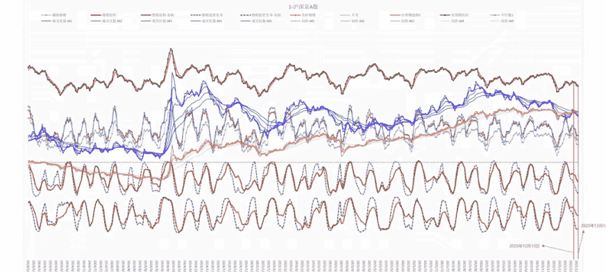

(1)上周指标提到，“监控指标仍然继续下去，意味着周五的上涨暂时不能情绪下行的趋势，仍然需要周初走势的确认”。从本周收益数据可以看到，市场内在还是比较低迷。

(2)本周收益数据，“实时情绪”、“辅助情绪”、“长期实时”继续下去，相应的监控指标也是继续下去，其中“监控底部”触极值。“成值指标”整体趋势维持持续，但短期内平直走势。

### 下周建议

继续保持谨慎仓位，耐心等待指标中“红线”抬头，同时“成交比”逐步收敛上行，此为提升信号。A-GIX指标中“成交比”下行趋势的扭转，需经历情绪指标的多次循环，逐步形成收敛上行。

## 长按二维码 添加专属客服

- 免费领取自选报告一篇
- 获取更多精彩内容请联系我们
- 我们不解读新闻 我们预测新闻

