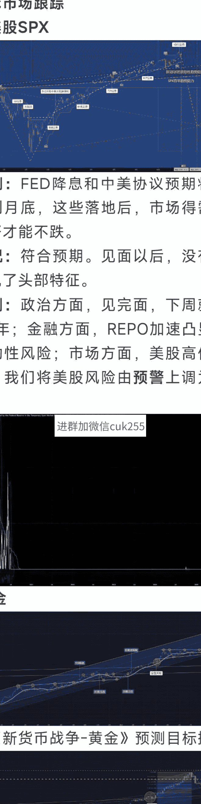
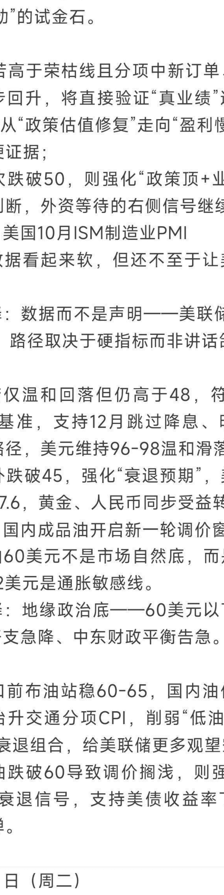
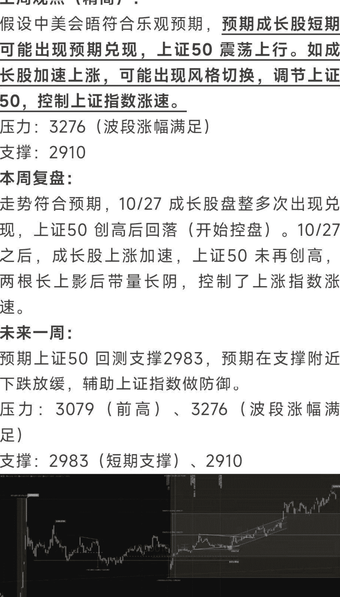
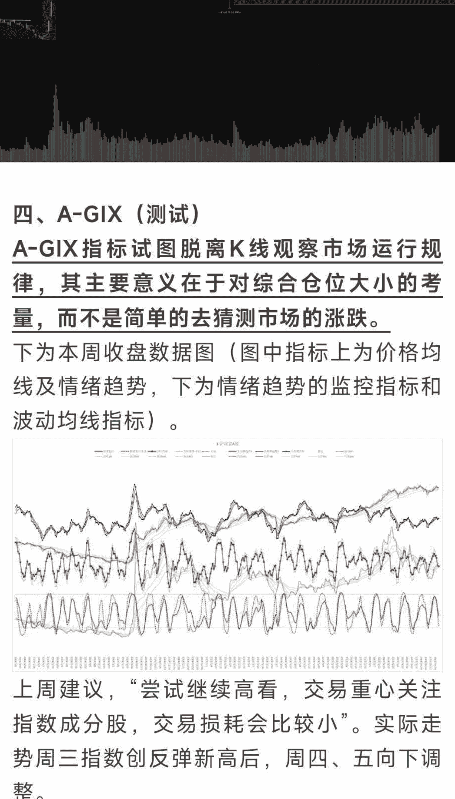

# 全球周报11013-117

编辑日期：2023年11月10日 周五
作者：李磊 | 编辑：王磊

上周，美股遭遇再度暴跌，纳指跌幅达3.7%，标普500指数跌约2.5%，道琼斯指数跌约1.2%。由于美国非农就业数据超预期，市场对美联储维持加息的预期降温，美债收益率大幅回升。

周二，美国非农数据公布，新增就业33.6万人，远超预期的14.5万人，但失业率意外回升至7.7%。

周三，“CPI”数据公布，10月同比上涨3.7%，低于预期的3.8%。核心CPI剔除食品能源同比上涨3.2%。

周四，“零售销售”数据公布，10月同比增长0.1%，低于预期的0.3%。

周五，“ISM制造业指数”数据公布，10月降至46.7，低于预期的47.0。

11月9日，美股继续大跌，并创下今年以来最大跌幅。纳指跌幅3.2%，标普500指数跌2.2%，道琼斯指数跌幅1.5%。

> “The United States and China can still solve all of the problems of the world”
——中美经济工作组会议

周四，中美经济工作组在北京举行会议。双方就共同经济议题进行了深入交流。双方对中美关系前景表示乐观，并同意继续加强沟通交流。

周五，美联储公布加息会议纪要，显示委员们对通胀压力表示担忧，并表示“为了实现通胀目标，可能需要进一步加息”。

## 一、汇率市场

### （一）美元

上周，美元走势强势，美元指数从106.5回升至106.8。受非农就业数据超预期影响，市场对美联储维持加息的预期降温，美元获得利好。

实际情况：周五，美元再度回落，由于没有更多利好支撑，美元指数跌至106.3。

图：美元指数走势图

周一，美元走势震荡，美元指数一度突破106.5。受市场对美联储维持加息预期降温影响，美债收益率回升，美元一度承压。

周二，美元走势强势，美元指数回升至106.5。受非农数据超预期影响，美元走强。

周三，美元走势震荡，美元指数一度突破106.7。受CPI数据低于预期影响，美元走软。

周四，美元走势强势，美元指数一度突破106.8。受零售销售数据低于预期影响，美元走软。

周五，美元走势震荡，美元指数跌至106.3。受ISM制造业指数低于预期影响，美元走软。

### （二）欧元

上周，欧元走势疲软，欧元对美元从1.085回落至1.082。受非农就业数据超预期影响，市场对美联储维持加息预期降温，欧元获得利好。

实际情况：周五，欧元再度回落，由于没有更多利好支撑，欧元一度跌至1.078。

图：欧元汇率走势图

## 【行情】外汇获利结算

【行情】外汇市场早晨震荡，美元早盘走低，欧元、英镑、澳元兑美元均走强。受美联储降息预期影响，美元再度走软，压力回升。

【行情】受非农数据超出预期影响，美元跌幅收窄，日元走软，亚洲市场压力加大。

【行情】受非农数据超出预期影响，人民币走强，人民币下行压力加大。

【数据】今日行情（结算）

【数据】11月20日周一外汇市场开盘，美元兑欧元、英镑、日元、瑞士、澳元兑美元均走软。

美元联指数周一跌至102.38，跌幅0.36%。美元兑欧元跌至1.0859，跌幅0.23%；美元兑英镑跌至1.2168，跌幅0.23%；美元兑日元跌至149.82，跌幅0.50%。

【数据】周行情（结算）

【数据】11月13日至11月20日周一，美元指数走软，欧元、英镑、日元、澳元兑美元走强。

美元指数周跌至102.38，跌幅0.36%。美元兑欧元周跌至1.0859，跌幅0.23%；美元兑英镑周跌至1.2168，跌幅0.23%；美元兑日元周跌至149.82，跌幅0.50%。

## 【分析】

周内，美元受非农数据超出预期影响，跌幅收窄，日元走软，亚洲市场压力加大。

周内，受非农数据超出预期影响，人民币走强，人民币下行压力加大。

周内，受美联储降息预期影响，美元再度走软，压力回升。

周内，美元指数周一跌至102.38，跌幅0.36%。

### 【日元】

目标：1500
周内，受非农数据超出预期影响，日元走软，亚洲市场压力加大。周一：149.82
目标：14500
周一：150.00
目标：15500
周内，受非农数据超出预期影响，日元走软，亚洲市场压力加大。周一：149.82
周内，受美联储降息预期影响，美元走软。

### 【欧元】

目标：1.1000
周一：1.0859
周内，突破1.25回升后，关注长期支撑3.97，走势大。若突破1.28，走势弱，关注支撑1.71，做好。

支撑：1.25（长期压力），1.28、1.71。
压力：1.30（下调）

### 上500：日线级别

上周展望（精简）：假设市场触及，预期或短期符合，调整需回落。如上涨加速，可能出现反转，调整至500，控制上涨幅。支撑：4256（下调）走势符合预期，10/27后收盘后多次回调，500有望（开始调整）。10/27后，上涨加速，500有望再创，调整后将带回，控制上涨幅。

未来展望：预期500回调支撑2893，将在支撑附近，防守不破。压力：4762（前高）、4726（前高）、4565（上涨趋势）、4495（跌破缓冲）、4386（日线回）、4300（周线压力）。支撑：2988（短期支撑）、2910

### 沪3000：周线级别

上周展望（精简）：周线再次出现4772（缓冲），收涨后，4772压力。红色区域：4304至4772 蓝色区域：周线支撑点4818

### 沪300：日线级别

## 深度视野优质集群（链接优质社群，助你成功）

全部包含以下内容：限时年费188/年 加微信255

- 吃瓜群众会员圈加群群对话（原价365 元/年）
- 子明私享汇（含）内部文章
- 政事室（顾子明）付费内容加再送顾子明群
- 美联储闲文【作者米穗】（原价599 元/年）
- 欧洲雀会员专属文章（原价328 元/年）
- 砖瓦仁内部圈（原价400 元/年）
- 卢克文青读书会专属文章（原价699 元/年）
- 鉴茶财经知识星球（原价3310 元/年）
- 猫哥的视野知识星球文章（原价299 元/年）
- 财新周刊【独家新闻】（原价1498 元/年）
- 杨世光在金钱圈（原价2200 元/年）
- 森淼淼财经知识星球（原价1600 元/年）
- 潇泽译译付费文章（持续更新）
- 司马波解课选全套音频和全套书籍收藏版无删减（原价2.3万）
- 虚拟三部[民国梦、帝国兴亡、不被理解的MAO]（原价599 元/年）
- 卢克文知识星球文章（原价268 元/年）
- 额外再送：卢祺元新浪微博付费专栏、三村丰老王、三花九洞文集

不定内容：......（更多资源将下去......）

- 守夜人知识星球、换魔王后星球、达叔谈论星球、成术后财富、雪花甲老头等
- 创始笔记、达叔谈论星球、成术后财富、雪花甲老头等
