# 全球市场每周预测1222—新币战争第一战役

原文 财会主理 金融通源 2025年12月21日 22:13 辽宁

点击上方蓝色金融通源，关注我们
点击上方蓝色金融通源，点击右上角“...”设为星标
价值决策领先一步

⭐今日主题：本周周报内容较多，回顾金银走势，完美按照《新币战争》剧本进行。近期全球股市的头部结构发生变化，今天我们重点聊一下，在金银强势和股市暴潮的背景下的防御策略。

按照以下重点事项、数据数据出发点拓展延伸，提示敏感点，纵览全球市场，研判各资产影响。
建议仔细阅读 ➡️

- <Q1>预测股市价值，2月出现“一型”
- <Q2>预测2025年股市爆发危机的风险：标-8代表表现类，联合托，总收益翻倍。美国一季度GDP为-0.3%
- <Q3>预测黄金“二型”，在10月10日美股大涨后
- <Q4>“黄金战争”迎来第三日”，第一战役在<新币战争》系列中，我们对黄金的预测在未来的12个月内，第一个台阶分布在3700到3600，黄金每盎司4500美元；第二个台阶将到6400美元（中期大选前后突破）”，发布时，黄金还没到3000；而现在，我们给出的路径是12月29日突破70，发布后，银不超35，现在是68了，比预测更强。

黄金一直被压住，由于追之差，就意味着美元一路上涨。压住了黄金，就压不住白银，就是现在的局面。这就是“黄金战争”，第一战役，金中军、银为中锋——一语中的年底，如果黄金能够被重新定义，这一步将开启未来对黄金的高频。

近期全球股市的头部结构发生变化，今天我们重点聊一下在金银强势和股市暴潮的背景下的防御策略。

P.S 公号压缩图片，图文中有些数据无法清晰。有查看清楚图片需求的读者，请私信我，领取 ➡️

## 一、第一战役

<从股市到商品>讲了很多原理和预测，具体提前到：
既然金银强势，那么金矿银业预期必然是好的。尤其，10月16日金矿银期金现货新高以来开始调整重心，金矿银到了新的强度，而金矿银价只是修复。

## 深度视野VIP群 人工进50+A 付费群加微信cukk255 微信5558

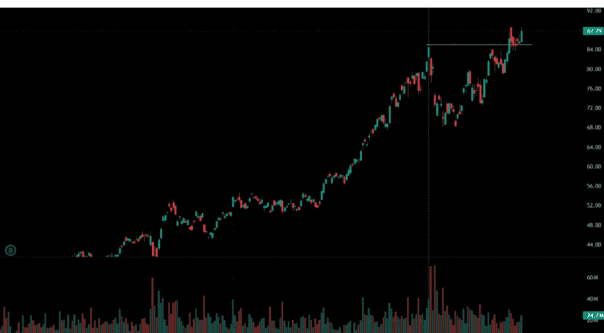

## GDX金矿银ETF突破

市场近期头部结构对整体环境都有影响，这是拖延金银矿的主要原因。但是，如果金银下周一起突破，那么金银矿概率将开始成为市场团体防守突破的共识了。待这一次金银矿完成突破，也标志着货币战争的第一战线完成。

## 二、全球市场跟踪

### （一）美SPX

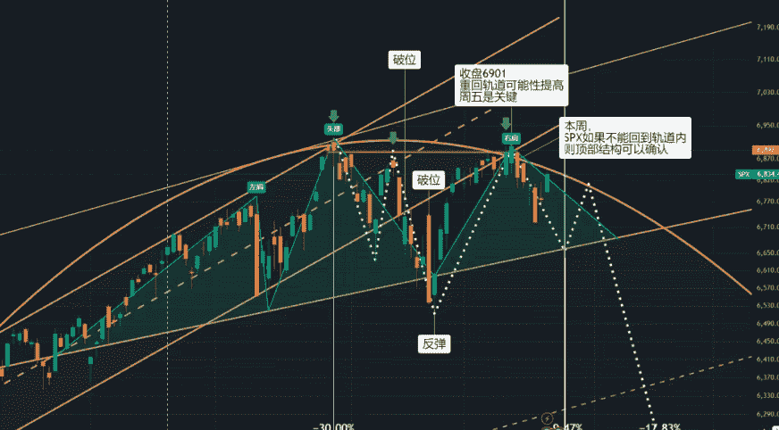

上周预测：前面周报报“川川的圣诞”，虽然直觉U1这种恶心的安排有点“幼稚”；但或许这就是实际的情况：符合预期。完美。

下周预测：下周就圣诞了，验证U1是否让U2过个好年。

### （二）金银

深度视野VIP群 人工追踪50+大 付费进群加微信cuk255 微信chap5568

- CFT黄金未合约增加38,500手，价格上涨96%，期权市场出现明显空头
- 4350附近为关键位
- 市场在下半周黄金发布信号

#### 黄金《新现货战争-黄金》预测目标进阶

保持头脑
5.45%
12月19日交易所期权成交创新高，日内跌幅6%，这周的上涨是回调
白银需要重心，17日后回踩支撑
突破

#### 白银《新现货战争-白银到商品》预测目标进阶

上周预测：这周涨过去，下周要回调。
实际情况：符合预期，黄金最近一直被压制，但白银新高，黄金上涨。
下周预测：下半周白银要一作冲后回调。

### （三) BTC

川普上台后，我们一直看多BTC，台上后，开始看空。所以，其实不用预测，态度明显。

## 新浪财经 块区 > 正文

## 彭博社：中国监管要求券机构减少稳定货币探讨

这就是我们一直不落这个热点的原因，而不是时候。

## 深度视野VIP群 人工避雷50+大V 付费进群加微信cuk255微信chp5568

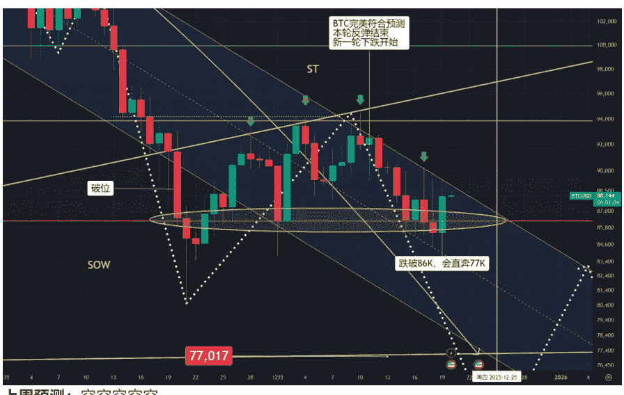

### （四）美元

上周预测：受美股回拉。
实际情况：符合预期。
下周预测：如果黄金能够突破350，则美债要涨，美元要跌。

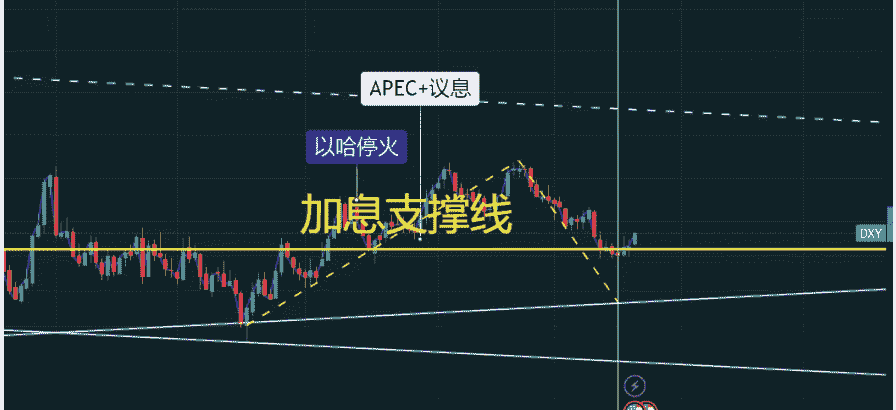

### （五）H

深度视野VIP群 人工追踪50+大 付费进群加微信cuk255微信chp568

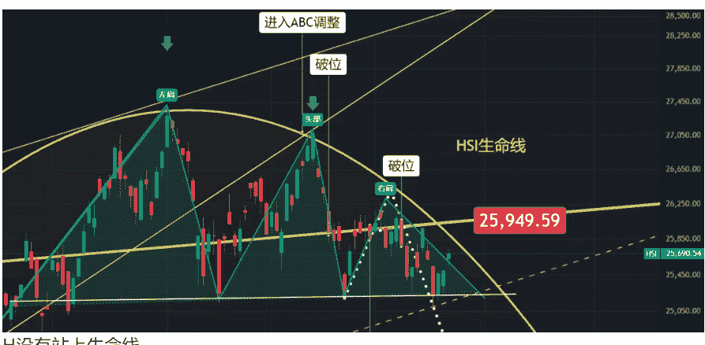
上周预测：强防御。
实际情况：弱于预期。
下周预测：强。

## 三、技术分析

### （一） 事件震动

- 日期：2025年12月22日（周一）
- 数据：美国至12月22日
- 总结：该数据是观察窗口。在财政政策激进背景下，货币政策继续维持宽松。若数据持平，需观察利率；若下调，则宽松。无论何种结果，均影响短期波动，汇率变动。

- 日期：2025年12月23日（周二）
- 数据：美国至12月23日
- 数据：第三季度修正后PCE指标年化率
- 总结：该数据是检验经济温度与路径的关键。若数据于预期，美联储维持宽松；若数据超预期，将抑制降息，加剧通胀，反而不利于美元。

- 日期：2025年12月24日（周四）
- 数据：美国至12月20日非农就业人数
- 总结：首次申请就业人数就是市场最敏感领先指标。该数据是判断美国经济是否从“放缓”向“衰退”的关键。若人数持续，将把美联储转向“通胀抑制”，让油价下跌作为“宏观缓器”或许为美联储降息打开大门，但油价又防止通胀反弹，形成“增长压力”，黄金拉锯底。对美股是双刃剑：受高下跌冲击压力，但中期宽松政策又提供支撑。对美元明朗利好，因衰胀低维持利率收益。对黄金影响显著：恶化引发衰退需求，黄金将获得双重胜利。
- 数据：美国石油井总数&API/EIA原油数据
核心解析：
- 石油井数：反映美国需求导致供给充足的库存数据，直接反映短期油价。
- API/EIA库存：美国石油供给充足的库存，下跌是宏观缓器，在季节、地缘、政治周期性高波动影响下非常态。
- 总结：油价下跌给通胀反弹，为美联储减轻压力，但周期性影响下非常态。若井持续下降库存压力，将强化通胀的下行趋势，对中国科技股（改善版）、美股（降低通胀压力）、黄金（减少潜在需求）、美（稳定预期）预期产生深远影响。反之，若井数形成衰退压力，油价可能下跌，需警惕“油价下跌反弹压力”，可能引发黄金“衰退”行情。

- 日期：2025年12月25日（周四）
- 事件：中国3000亿MLF和3883
- 延续：在财政政策不宽松、消费非优的框架下，央行宏观选择“量平价操作”或“小幅净回放方式”，维持流动性合理充足而持宽宽松。意外下调，需警惕内部经济震化引发“防御风险”。操作直接影响银行利率和债券收益率，进而导致险偏好回。对人民币汇率影响中性，短期操作不改变汇率升向。关注是否出现“灵活度”，精准防范政策调整。

### （二）美股

- 标普500：日线结构
上周观点（精简）：SPX在6819（区间顶部）获得支撑，若有效突破6883，SPX未破极端线，等待右侧结构完成（复合头部、右肩）。
- 压力：6870（前高）、6883（压力）、6920（前高）
- 支撑：6819（区间顶部）、均线（绿色底部）、6551（区间底部）
- 周：SPX有效破6819（区间顶部），有弱迹象，12/19日央行加落地，市场风险偏好回升。
- 周展望：右肩结构的时间临近（26），压力6883。SPX未破极端线，等待右侧结构完成（复合头部、右肩）。

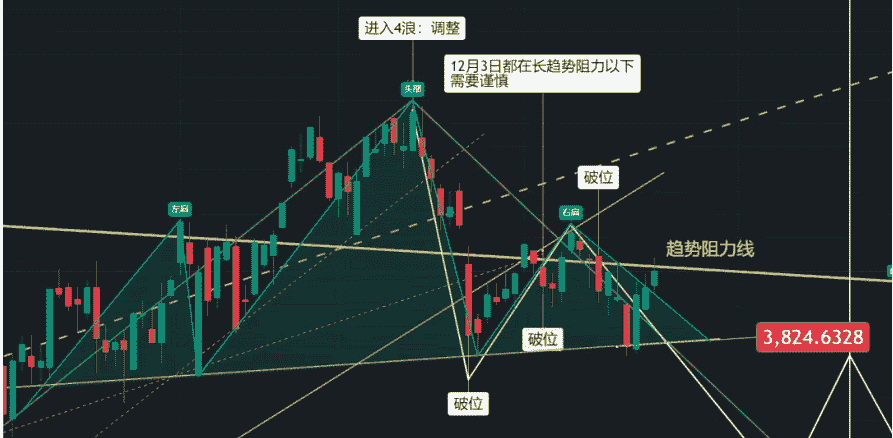

### （三）黄金

- 黄金现/美元：日线结构
上周观点（精简）：黄金维持窄幅震荡（4177至4352），有有效支撑上加速，等待突破4616。
- 中期：黄金正处于结构性破位之前，上涨空间远超市场预期。
- 压力：6870（前高）、6883（压力）、6920（前高）
- 支撑：6819（区间顶部）、均线（绿色底部）、6551（区间底部）
- 周：SPX有效破6819（区间顶部），有弱迹象，12/19日央行加落地，市场风险偏好回升。
- 周展望：右肩结构的时间临近（26），压力6883。SPX未破极端线，等待右侧结构完成（复合头部、右肩）。

- 黄金现/美元：日线结构
上周观点（精简）：黄金维持震荡，核心在于美国通胀需求严重。
- 黄金ETF占私人资产0.17%，12年触低近个月，十年规模巨大“避险资产”。
- 量化模型显示，配置比例每提升1个点将推动金上涨，若从17%调整至27%（远离低位），金价理论涨幅14%。

### （四）BTC

- 比特币/美元：周线结构
本周观点：周线进入第二阶段下跌，等待跌幅满足76162，月线结构颈线，等待确认第二个月跌。
- 支撑：76162（周，跌幅满足）
- 压力：94850（周，区间顶端）、103516（日）

- BTC/美元：日
上点（精间）：BTC周线、日线空头结构共振跌，月线结构等待确认，建议控制好仓位，等待跌幅满足76162。
- 短空：BTC收4181及上，日线连续三日上92881
- 中空：日线连续三日上94850
- 压力：92886（日，区间顶部）、94850（周，区间顶部）、103516（日）
- 支撑：76162（周）
- 复盘：BTC周线收十字，日走势呈现窄幅横盘，未触发。
- 未来一：BTC周线、日线空头结构共振跌，月线结构等待确认。
- 未来展望：继续等待跌幅满足76162。

### （五）美元

- 美元指数：日线结构
上周观点（精简）：表现基本符合预期，美元指数回盘（991至98）。
- 压力：991（涨幅）
- 支撑：97.6（支撑）
- 技术面：市场落地，美元指数回盘（991至98）。
- 展望：12/16非农数据公布前，避险情绪增大压力，指数跌突破线，跌破低25178小缩幅，短空趋势。12/17恒指数再度回测25178转强，收盘站上顶线。12/18、12/19：连续两个交易日，收于顶线上。有效破跌线，暂停日线下跌跌幅。
- 总结：2255后，美元可能面临实质性挑战。
- 压力：991（涨幅）
- 支撑：97.6（支撑）

### （六）AH

- 恒生指数：周线结构
上周观点（精简）：周线跌25919（区间顶部），颈线再次失守，走势偏空。
- 技术分析：根据右侧走势结构，恒生指数日线呈现乌头顶结构，右侧头部基本型。周线颈线调整为压力，预期未来周线在24263之上，构建周线右侧结构，将根据右侧走势结构重新划分周线趋势。
- 压力：26550

- 恒生指数：日线结构
上周观点：防守为主，需要沿均线震荡上行，盘整区间（25919至26550）。有效破线转转，将下测。
- 压力：25919（区间顶部）、26550（区间顶部）
- 支撑：顶线（绿色虚线）、24937（波段跌幅）、24550（日线，跌幅满意）
- 周复盘：本周根据侧走结构，调整了周线、日线均线划分，周线再次转弱，日线再次转弱，日线出现头底低。12/16美国农非数据公布前，避险情绪增大压力，指数跌突破线，跌破低25178小缩幅，短空趋势。12/17恒指数再度回测25178转强，收盘站上顶线。12/18、12/19：连续两个交易日，收于顶线上。有效破跌线，暂停日线下跌幅。
- 综上：本周恒指数日线趋势，头部支撑到位，中期空头基本成型。反弹缓解短期趋势，反弹是卖点，不是买点。
- 未来一周：恒生指数日线支撑（绿色虚线），关注短空机会。有效突破线是短空信号，进行幅。
- 压力：25919（区间顶部）、26550（区间顶部）
- 支撑：顶线（绿色虚线）、25178（前低）、24937（波段跌幅）

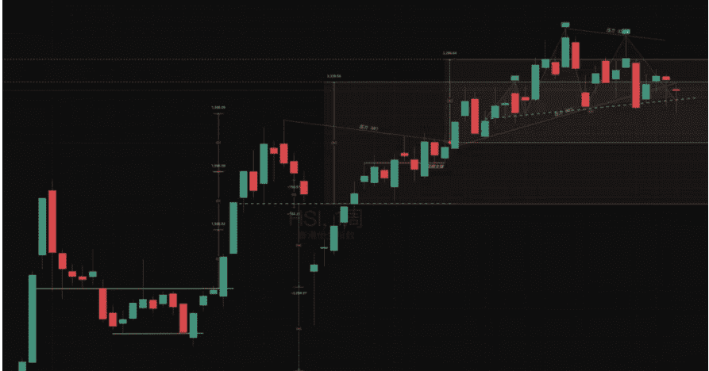
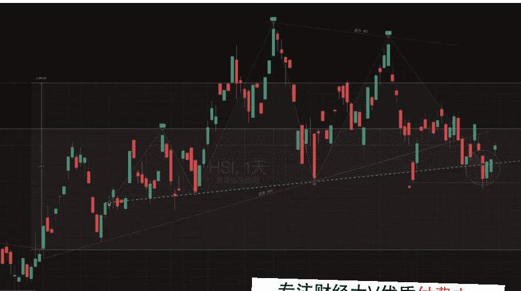
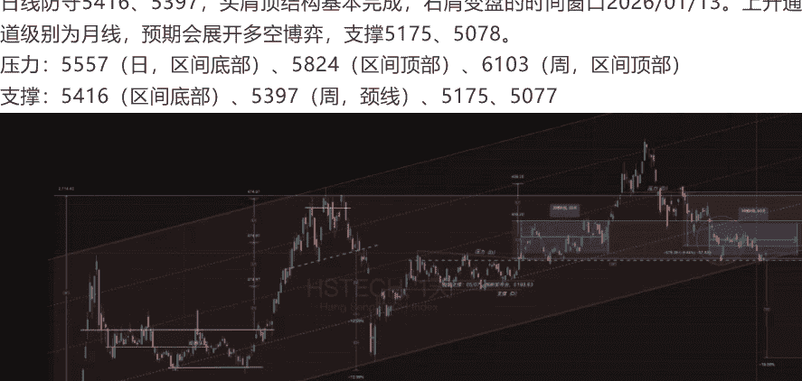

# 证指数：周线

周点：
证指数回测前3818，在盘中资金介入后转向，线收3890，线延续3站上长期压力。防守的维持，继续调整整整构肩。
支撑：3878（更新，长期压力），3714（区间底部），3680（月，区间顶部）
压力：4025（波段满足），4277（涨幅满足），4045（涨幅满足）

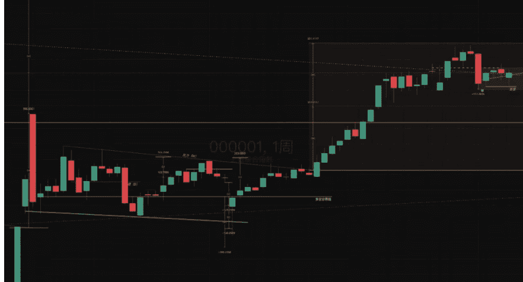

## 证指数：日线

周点（精简）：
证指数防守长期压力为主，预计区间回调（3915 至3820），等待指数完成右侧结构。
支撑：3802（日，区间底部），3714（涨幅满足），3680（涨幅满足）
压力：3886（长期压力），4025（波段满足），4045（区间底部）

周成交量：
12/16 指数跌破长期压力，回测前3818，走势转弱。美国非农数据公布前，市场避险，盘后导致指数承压。
12/17 指数再次回测前3818，下午回后被护盘资金介入，指数转强。
12/19 收3890，日线线站上长期压力，日线12/23 确认。

未来一周：维持观点
证指数防守长期压力为主，预计区间回调（3915 至3820），等待指数完成右侧结构。
支撑：3802（日，区间底部），3714（涨幅满足），3680（涨幅满足）
压力：3886（长期压力），4025（波段满足），4045（区间顶部）

深度视野VIP群 人工追踪50+大V 付费群加微信cuk255 微信chp5568

# 000001,1天
上周简报

## 证50：日线结构

上周观点（精简）：
看外围波动风险加大，预期围绕2930展开多空博弈，窄幅震整为主。

压力：3079（前高）、3276（波段涨幅满足）
支撑：2983（短期支撑）、2910

本周复盘：
证50，本周波动加大，初冲高回调，随后放量下跌击穿支撑2930，12/17 下午开盘后获护盘资金进入后，指数上涨，连续三个交易日站稳2983，暂停下跌。

未来一周：
挑战压力3030，防守支撑2983，继续建构右侧结构。
压力：3030（压力）、3276（波段涨幅满足）
支撑：2983（短期支撑）、2910

# 000016,1天
上周简报

## 沪深300：周线结构

本周观点：
深度视野VIP群 人工追踪50+大V 付费进群加微信cuk255 微信chp5568

# 线量跌破上升线 趋势未有效突破4722达高锁定收益观点 风控参考: 4386

粉色区域: 阶段强涨区间幅4304至4722
蓝色区域: 波段回调满足点4819

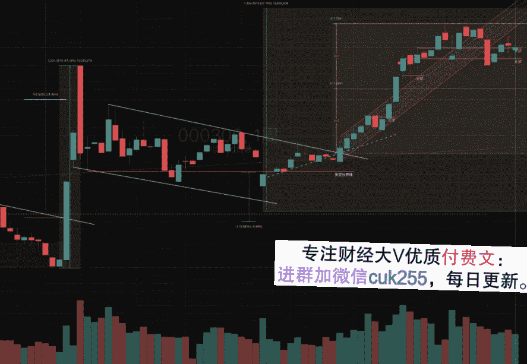

专注财经大V优质付费文：进群加微信cuk255, 每日更新。

## 沪深300: 日线结构
上周观点（精简）：
上最后一个交易日，沪深300量能反弹优于上证50，日线防4565可能跌破回调4499。
压力：4762（前高）、4722（区间顶部）
支撑：4565（短期支撑）、4495（跌破偏空）、4386（日线风控）

本周复盘：
走势符合日线跌破4565后转跳空下跌回4499。12/17 下午开盘后获护盘资金介入后，指数强势反弹回到4565开展多空博弈，本沪深300反弹再次大于上50。

技术分析调整:
根据结构划分日线结构线（绿色虚线）。
未来一周:
日线防4565等待结束结构完成。
压力：4762（前高）、4722（区间顶部）
支撑：4565（短期支撑）、4495（跌破偏空）、4386（日线风控）

# 深度视野VIP群 人工追踪50+V 付费群加微信cuk255 微信chap5568

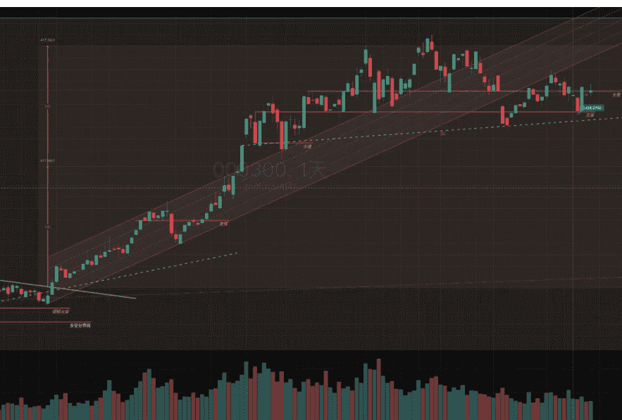

## 证500: 周线结构

本周观点：
根据上周调整的周线结构，等待右侧走势做出方向选择。
粉色区间：6878（区间顶部）、7793（区间顶部）
蓝色区间：波段回测满足点7159

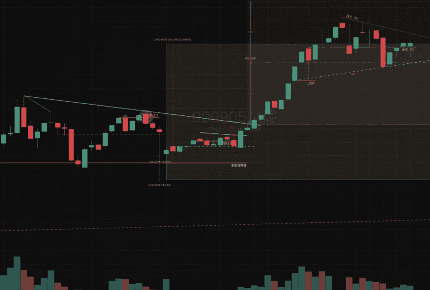

## 中证500: 日线结构

上周观点（精简）：
中证500防御支撑7111，预期振幅加大，盘整区间参考整理结构。
支撑：7111（短期支撑）、6878（区间底部）、颈线（绿色虚线）
压力：压力（黄色虚线）、7159（波段涨幅满足）
本周操作：

深度视野VIP群 人工追踪50+大V 付费群加微信cuk255 微信chp5568

走势符合预期围绕支撑7111开展多空博弈，在整理内盘。中证500强势有机会冲压力高回落。
未来一周：
中证500预计维持内盘，等待右侧走势选择。年末收之际挑战压力线，注意低吸。
支撑：7111（短期支撑）、6878（区间底部）、颈线（绿色虚线）
压力：压力（黄色虚线）、7159（波段满足）

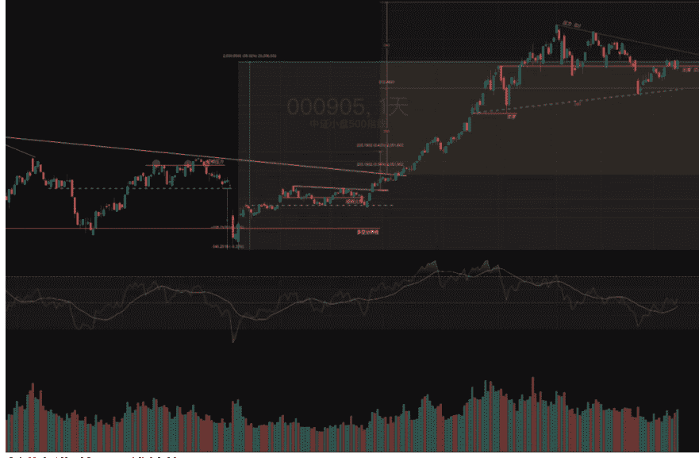

## 创业指数：周线结构
本周观点：
周线确认，窄幅盘整等待选择方向。
支撑：颈线（绿色虚线）、2850（波段支撑）、2748（区间顶部）
压力：3228（区间顶部）

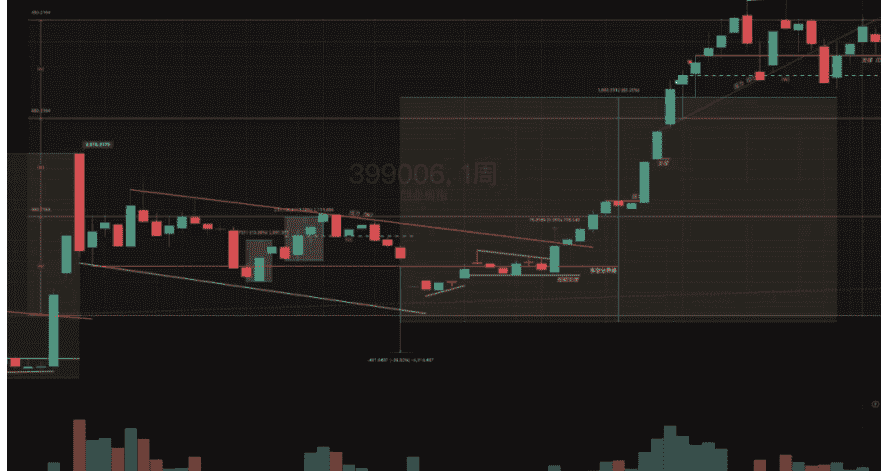

## 创业指数：日线结构
上周观点：
科创50确认跌破支撑1365，跌幅满足。风险提示：周线结构观察，参考（短期涨幅）。
红色区间：底部（结构）
支撑：1365（短期支撑）、1326（波段支撑）、1249（周线）

本周复盘：
本周亚洲3058回测支撑3054，走势呈现窄幅盘整（3054至3228）。
未来一周：
防守3054，预计维持盘整（3054至3228），等待右侧结构完成。
压力：3228（强势）、3331.8（前高）
支撑：3054（短期支撑）、2850（波段支撑）、2748（区间顶部）

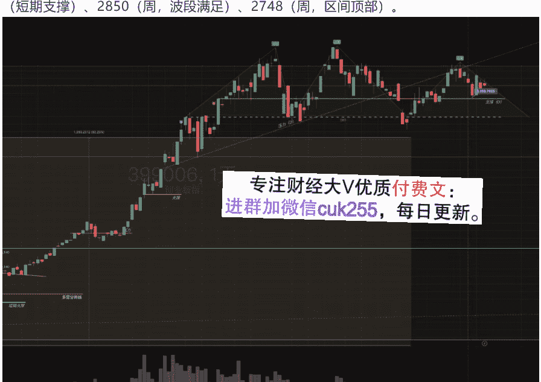

## 科创50：周线结构
上周观点：
科创50确认跌破支撑1365，跌幅满足。风险提示：周线结构观察，参考（短期支撑）。
红色区间：底部（结构）
支撑：1365（短期支撑）、1326（波段支撑）、1249（周线）

## 创50指数：构
观点：
维持观点。
- 反弹突破1326，无法突破1365，等待跌破1326。
- 回测防线1249，预期会有支撑，如多空反复1249寻找短空机会。

逻辑面：
摩尔街举行首届开发者大会，揭晓一代架构与路线。预期美国科技股波动形成对冲，如有效跌破1365，将停止下跌。
支撑：1326（短期支撑）、1496（领先）
支撑参考：1326（波段支撑）、1249（颈线）

本周观点：
本周创50走势转弱，有效跌破触发下跌情况，止损1365。
未来一周：
- 突破1365：短空风险
- 回测防线1249，预期会有支撑，如多空反复1249寻找短空机会。
压力：1326（短期支撑）、1496（领先）
支撑参考：1326（波段支撑）、1249（颈线）

# 四、A-GIX (测试)

A-GIX指标圆离K线市场运行律，其主要意义在于对于综合仓位大小的考量，而不是简单的测试涨跌。

1. 上周建议
上周建议：“继续保持持仓位”，实际走势周初下跌开启反弹。

2. A-GIX指标解析
下为本周数据截图（图中指标为价格均线及情绪趋势，下方为趋势的监控指标和成交均值指标）。

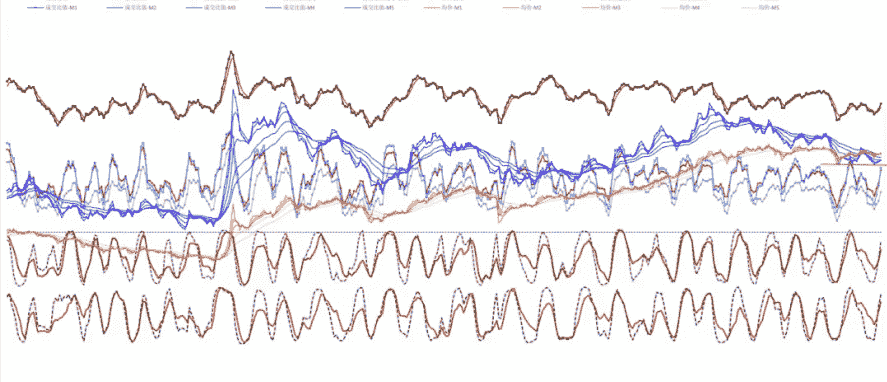

(1)上周指标分析，“监控指标中的红线趋势以及成交均值收上”视为加仓信号。从本周数据显示，成交均值走缓慢，没有明显的收敛。

(2)本周数据，情绪指标在监控指标触底的情况下开始转折向上，但是成交均值未有明显的收敛变化。

下周建议，继续保持持仓位，耐心等待“成交值”震后收上。
A-GIX指标“成交值”下行趋势的扭转，等待经过指标的多次循环，逐步形成向上。

# 深度视野VIP群 人工追踪50+大V 付进微信cuk255 微信chpsp556

33 人付费

每周预测 · 目录

上一篇 · 全球市场每周预测1215——十字路转向

留言
写留言

深度视野VIP群 人工追踪50+大V 付费群加微信cuk255 微信chp5568
