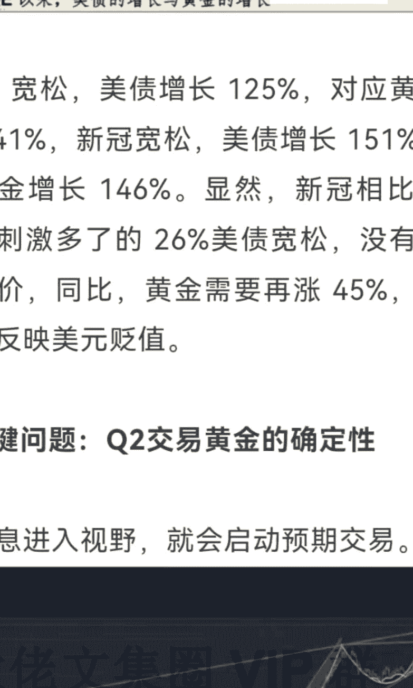

# 通智库：黄金交易——乱世黄金

财富 金融 通智库
2023年09月11日 17:00

前言：
《黄金交易》具有无限的前瞻性，希望读者能认可我们的观点。

这希望也基于我们对宏观政治和金融体系深层次的理解，并结合技术分析以进一步优化。
希望大家在投资时对黄金有信心，并进一步理解“乱世黄金”的逻辑。

## 通智库：黄金交易策略：

- 本系列合集将介绍黄金知识，介绍新发行产品如何帮助我们理解市场分析能力；
- 本系列合集将介绍交易策略，进一步提升投资策略；
- 本系列合集将介绍投资重点，不构成投资建议，仅作为知识分享，并在市场中使用；
- 本系列合集将回顾黄金视频，每月更新。

## 黄金交易逻辑——乱世世纪黄金

原文：2024Q2——乱世黄金
发布时间：2024年3月23日

1971年，美元布雷顿体系崩溃以后，黄金已成为普通民众避险和应急的标的，实物黄金的市场价格相比美元波动巨大，但价格市场行情发生反转，主要集中在黄金交易品种中。

核心逻辑：
- 美元越弱，黄金越贵，在统计上，黄金与美元呈负相关性。可以看到，Q2时期美元黄金相关性较低。
- 黄金具有避险属性，黄金在乱世中收益更高，而黄金上涨主要驱动因素是美元“信用”的贬值支撑了黄金上涨。

关键问题：2024Q2黄金相对于美元的影响：

Q2黄金相对于美元的增大，意味着美元贬值已进入贬值通道的深度时期。

2022年，黄金与美元出现了历史性的拐折，这已经经历了各国对美元高值和通胀的周期交替。

## 2. 关键问题：统计黄金Q2的合理价格

“美元-黄金”振荡在运行，美元在过去一段时间以来获得更高的收益，美元汇率收缩，黄金走强，全球进入“黄金时代”。通过分析911年后美元与黄金相关性的反转，对黄金的价格将开始反弹，来看Q2的价值：

## 深度视野优质文集（链接优质社群，助你成功）

全部包含以下内容：限时年费88/年 加微信cuk255

- ① 吃瓜群众包帝图文加实时群对话（原价365 元/年）
- ② 子顾明私享会内部文章（原价568 元/年）
- ③ 政事室（子顾明）内享再送子顾明群锦
- ④ 米联储【作者米穗】（原价599 元/年）
- ⑤ 欧洲金铂会员专属文章（原价328 元/年）
- ⑥ 砖瓦斥内部图文（原价400 元/年）
- ⑦ 卢克青读书会专属文章（原价699 元/年）
- ⑧ 鉴茶财经知识星球（原价3310 元/年）
- ⑨ 猫哥的视角知识星球文章（原价299 元/年）
- ⑩ 财周刊【独家新闻】原价1498 元/年）
- ⑪ 杨世光在金钱圈（原价2200 元/年）
- ⑫ 森森财经知识星球（原价1600 元/年）
- ⑬ 潇泽异谈付费文章（持续更新）

- ④ 司马涵解读毛选全套音频和全书珍藏版权无删割（原价2.3 万）
- ⑤ 虚走三部曲[民国梦、帝国争、不被理解的MAO]（原价599 元）
- ⑥ 卢克知识星球文章（原价268 元/年）
- ⑦ 额外再送：卢祺新浪微博付费专栏、三村丰老王、三花九洞文集

不定期内容：——（更多资源留不下了……

- ① 守夜人司令星球、接换魔王知识星球、生发术知识星球，
- ② 创始笔记、达叔演论知识星球、成财富圈、雪球花甲老头等
- ③ A视野野、大树乡读、江诸行、砰咩哟、财上海学家等付费文集
- ④ 西风付费文章、老嵩、赢在八小时之外、外人的视角、升值计、体制内等一些大V付费文章（每月低于600 元的付费文章）

## 深度视野文集
进群微信cuk255

深度视野（付费文集）

