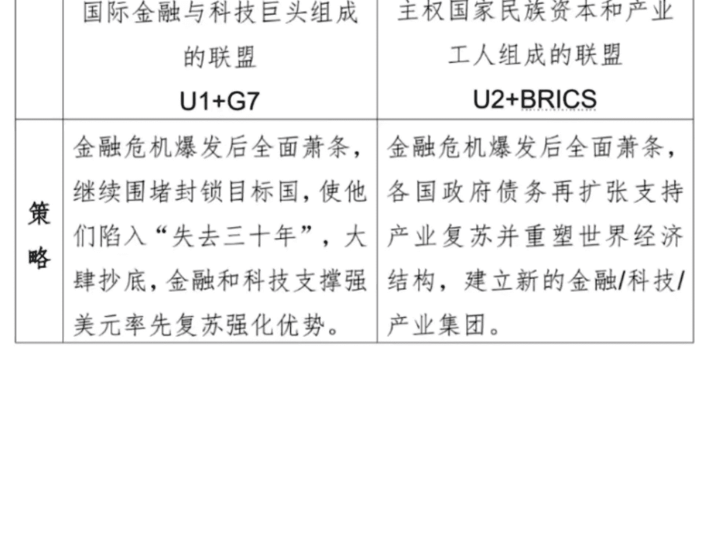

# 【美国对反美国】分裂的U1、U2

财经 金融观察
2025年10月28日 15:00

前言：
特朗普的政策具有所未有的前瞻性，这给美国政策和全球体系带来了深刻影响。通过对特朗普进行深度分析，我们试图还原美国政策的真相，并对未来进行深入调研。

> “这让‘美国’更加强大，也让‘世界’更加‘美国化’。”

【特朗普】对美国政策：来源：路透社jkk

## 美国对反美国——分裂的U1、U2

文/新晋川普·总统
发布时间：2025年2月

### 识破黄金：黄金1.0 VS 黄金

黄金是美国、科技、权力价值的载体。特朗普构建了以美国为核心的经济和世界秩序，他认为美国是最好的国家。他具有高明，以“利益优先”为政策转向。在这一过程中，我们也经历了一场巨大的政治和文化重塑，经历了剧烈的市场竞争。去全球化的进程更加激烈，去全球化的转型让我们看到了“美国优先”的回归。然而，全球化进程并未因此终结，全球经济也面临前所未有的挑战。

Chair of the Federal Reserve

历史上，只有黄金可以私人购买或发行银行；而美国私人银行，可以印刷发行并控制全球经济。财富的本质可以一把拿下

### FED与黄金：美联储与全球金融脉搏

### 选择黄金：二十年 VS 三三十年
历史过去的一片段

当黄金不再是货币，黄金就从“避险资产”转变为“投资资产”。1971年，美元脱离黄金位，结束了布雷顿森林体系。然而随着加息和通胀的加剧，黄金价格经历了前所未有的波动，并创下历史新高。

1985年，黄金价格经历历史低点。2011年，创下历史新高。

“前特朗普”政府的美国政策已经开始布局全球的布局。在政治的博弈中没有谁能不埋下伏子。这正是我们所提到的核心——美国变局以及特朗普政策的两极趋势的再次汇聚。来源：路透社jkk

阅读提示：
1. 本合集仅供参考、不作为投资建议；
2. 本合集为读者付费，为保护知识产权，内容错误概不负责
3. 本合集涉及的观点不代表投资者或者、金融人士意见，个人投资决策的结果自负
4. 错误不当之处，请第一时间联系作者。

# 深度视野优质文集集团（链接优质社群，助你成功）

全部包含以下内容：限时费188/年 加微信cuk255

- ① 吃瓜群众倍帝圈微信付费群对话（原价365 元/年）
- ② 子明私享汇（内部）文章（原价568 元/年）
- ③ 政事室（顾子明）付费内容加送顺子明群聊
- ④ 米联储闲【作者米楷】（原价599 元/年）
- ⑤ 欧洲金获会员专属文章（原价328 元/年）
- ⑥ 砖瓦仁内部圈（原价400 元/年）
- ⑦ 卢克文青读书会专属文章（原价699 元/年）
- ⑧ 鉴茶财经知识星球（原价3310 元/年）
- ⑨ 猫哥的视界知识星球文章（原价299 元/年）
- ⑩ 财经周刊【独家新闻】（原价1498 元/年）
- ⑪ 杨世光在金钱涛（原价2200 元/年）
- ⑫ 森淼财经知识星球（原价1600 元/年）
- ⑬ 潇泽异读付费文章（持续更新）
- ⑭ 司马林解读毛选全套音频和全套书籍藏版无割减（原价2.3 万）
- ⑮ 虚政三部曲【民国梦、帝国争伐、不被理解的MAO】（原价599 元/年）
- ⑱ 克文知识星球（原价268 元/年）
- ⑰ 额外再送：卢薛元新微博付费专栏、三村丰老王、三花九术文集

不定期内容：......（更多资源写下去了......）
- ① 守夜人司令知识星球、接魔王笔记、成交知识星球
- ② 创始笔记、达叔浅论知识星球、成就财富圈、雪花甲老头等
- ③ A视野、大树乡谈、江初序、泮咩说、上海家学等付费文集
- ④ 西风付费文章、老端、赢在八小时之外、局人的视界、升值、老师体制内等等其它一些大V付费文集（每月不超过600 元的付费文章）

# 深度视野文集
进群微信cuk255

深度视野（付费文集）

# 限时费188/年 低成本链接全网V优质内容
