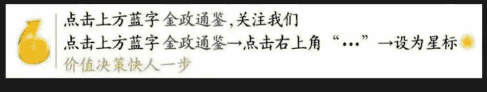
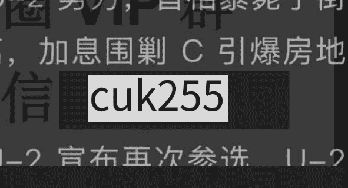
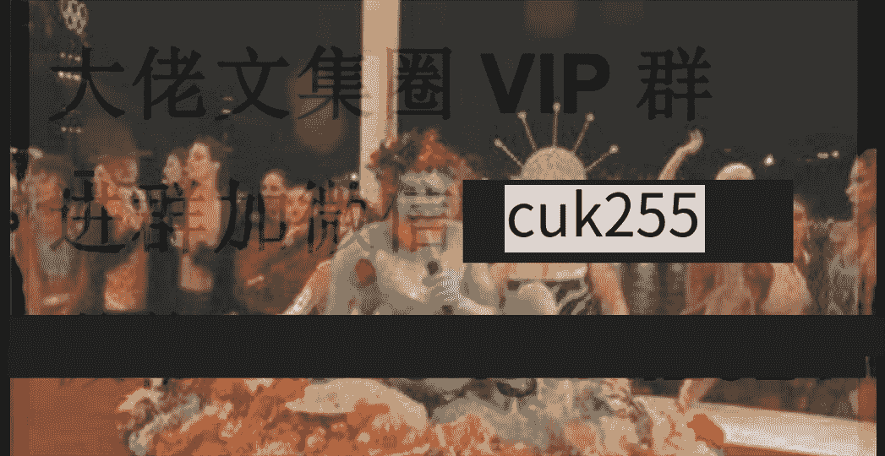
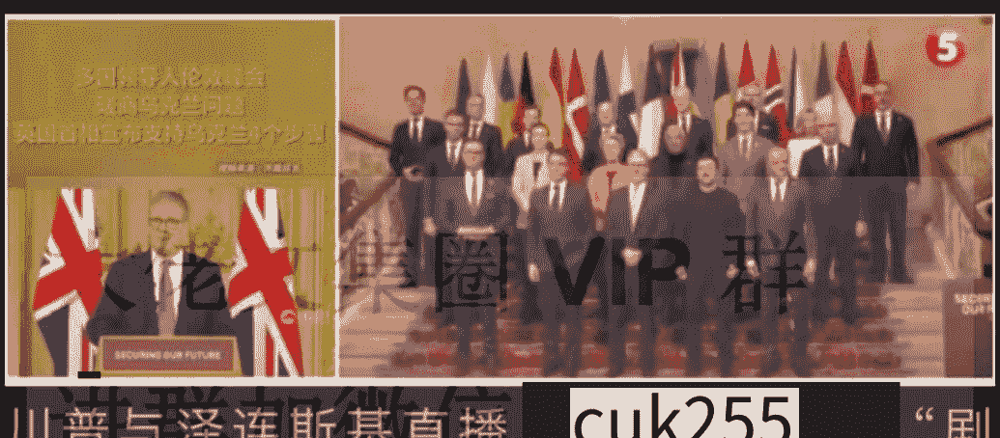

# 【通鉴智库】两个美国——U1、U2的本质及C的伟大反击

原创 财经处小秘书 金政通鉴
2025年11月11日 10:31 辽宁

前言：

《金政通鉴》周报具有很高的预测前瞻性，得到了读者的广泛认可。这种高准确率对于国际政治博弈和金融系统演化的深入理解，并通过标准技术分析以进一步量化。应扩大读者需求，运营官对已发布的周报、研报进行要点整理，便于广大读者复盘“温故而知新”，进一步掌握“金政通鉴”的投研体系。

【通鉴智库】付费合集说明：

①本系列合集会梳理、总结过往费周报、研报各类知识点，以帮助新朋友更好的了解我们的核心逻辑，也有助于老朋友复盘，进一步提升投资分析能力；

②本系列合集宗旨在于“温故知新”，涉及知识点虽不具备时效性，但具备极强的逻辑性，可结合近期国际政治博弈、金融市场演化等构建投研体系；

③本系列合集涉及知识点均不构成投资建议，仅作为知识分享。股市有风险，入市须谨慎；

④本系列合集订阅费用为 666 微信豆/每月，每月4篇。

深度视野文集
进群微信cuk255

## 两个美国——U1、U2的本质及C的伟大反击

原文：特刊Warning
发布时间：2025年1月
原文：新货币战争-总论
发布时间：2025年4月8日

我们在《新川交易》中，分析了全球政治的“百年未有之大变局”。再深一层层次，“百年未有”，百年以前是“一战”，而回顾百年以来，中间发生了这么多事情，甚至还不能与当下并论，足以说明“变局”的这个局，是全球政治局。

这个巨大的趋势转折，始于美国内部反对美国，我们在《WARNING》中将两个美国定义为 U-1与U-2。

### U-1: 美联储、华尔街、90年代崛起的以微软为代表的互联网巨头共同组成的金融和科技“全球化”主力力量；他们在政治上的当下代表是民主党，以及G7国家延伸：

U-1: 执政、打金融战。（2021-2024)
生产力上释放 AI，生产关系联合G7 围圈 C 等，利率 Higher Longer 策略，美债和赤字率走高以维持美股和美元强势，直到 C 被抽干，陷入“失去的三十年”。这个过程，美国的实体经济和底层会因为通胀而被削弱，危机会爆发，但放水也会继续围割政策，G7底部上雪加霜的 C，完成绝杀。

U-2: 支持川普的美国传统产业（能源、航空、消费等）企业、非精英国民（红脖子）、以马斯克为首的科技巨头新崛起；他们在政治上的当下代表是共和党；

### C 的伟大反击。（2022-2024)

C 与 U 是对抗的。但是，C 与 U-2 有共同的敌人 U-1。

U-1 在全球割买 U-2 势力下首暴毙于街头，哀鸟百万流离，加息围剿 C 引爆房地产危机加剧。2022年11日 U-2宣布再次参议，U-2需要 C 的支持，美国U-1彻底溃败，C需要 U-2 破局，C 与 U-2 都是背水一战，因此可以达成更大范围的共识和合作。

结合美元通胀贬值预期，各国都有“去美元化”的诉求，于是黄金暴走，出现黄金与美债的“历史性背离”，BRICS更直接提出了对当前美元金融体系的质疑，“东南互保”共同抵抗通胀和衰退；这使得 U-1 的 Higher 成本大幅提高，变成了疯狂造“自己”的游戏。

以下两幅，之前的报告也用过，这次讲透：

融合了很多历史故事，非常有内涵。不过，更核心的是文化：作为绝对主题，鼓励同性、混乱、变局，还有“黑崇拜”和极端女权——背后是一个庞大的力量——明确的犹太学、共济集团等——这是U-1的巅峰盛会，以“白左”的“解放”来推动全球统一。

川普与泽连斯：“川普是王牌”，加上U-1与U-2之争，这一回合显著削弱了川普的权力。多国领导人后，英国首相宣布支持克兰，U-1和U-2这种“一刀切”的简单划分，实际情况要复杂许多，像诸葛投资在国内外博弈进程慢慢展开，当下放在台上可以很看到的，是U-1和U-2两个阵营互相伤害：U-2操纵泽连基破坏乌政治。这种国际秩序的分裂，也在造成金融的分裂，即美元秩序的分裂。

## 深度视野文集

阅读须知：

1、本合集仅提供参考，不构成投资建议；
2、本合集为付费商品，为保护产权，订阅后不接受退；
3、本合集适合此类文章的成熟投资者或金融专业人士，因个人决策造成的盈亏，金政通鉴不承担责任；
4、订阅此合集后，即代表认同本声明。

## 深度优质优质群（助你成功）

全部包含以下内容：限时年费188/年 加微信cuk255

①吃瓜群众帝（原价365 元/年）
②子明私享汇（含内部文章
③事务室（顾子明）付费内容加送子明群
④米联储闲友【作者米横】（原价599 元/年）
⑤欧洲金雀会员专属文章（原价328 元/年）
⑥砖万瓦内部圈（原价400 元/年）
⑦卢克文青读书会专属文章（原价699 元/年）
⑧鉴茶财经知识星球（原价3310 元/年）
⑨猫哥的视界知识星球文章（原价299 元/年）
⑩财经新周【独家新闻】（原价1498 元/年）
⑪杨世光在钱塔（原价2200 元/年）
⑫森淼财经知识星球（原价1600 元/年）
⑬泽连基译文星球（持续更新）
⑭司马林解读全套音频和全套书籍珍藏无割（原价2.3万）
⑮虚走三部曲[民国梦、帝国扩张、不被理解的毛]（原价599 元）
��克知识星球文章（原价268 元/年）
⑰额外再送：卢祺元新浪微博付费专栏、三村丰老王、三花九洞文集

不定期内容：......（更多资源写下了）......

①守夜人司令星球、接换魔王后星球、成术达论星球、成就财富圈、雪花甲老头等
②创始佳星、达叔达论星球、成就财富圈等等
③A视野、大树乡谈、江初师傅、泮咩说、上海海家学等付费文集
④西凤付费文章、老端、赢在八小时之外、局人的视界、升值优、老A体制内等其它一些大V付费文集（每月不超过600 元的付费文集）

## 限时年费188/年 低成本链接全网优质内容

## 深度视野文集进群微信cuk255

深度视野（付费文集）

