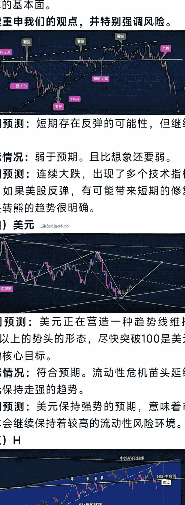
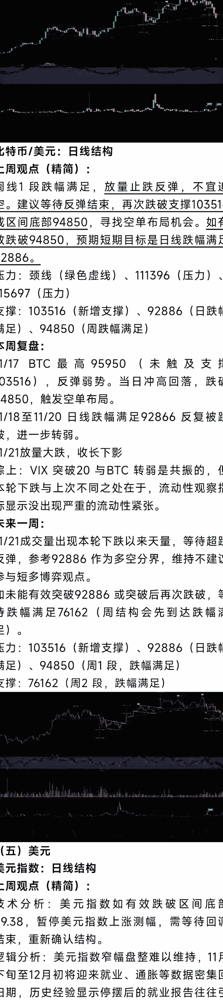
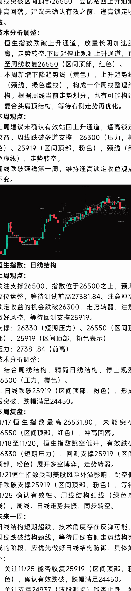
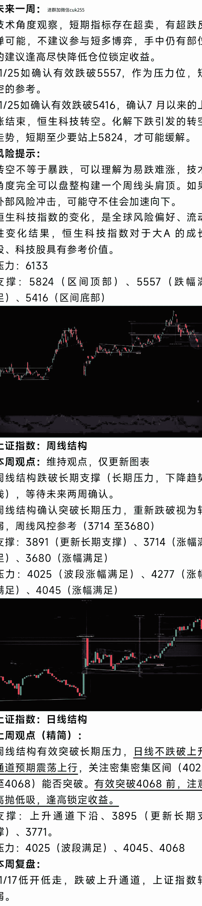
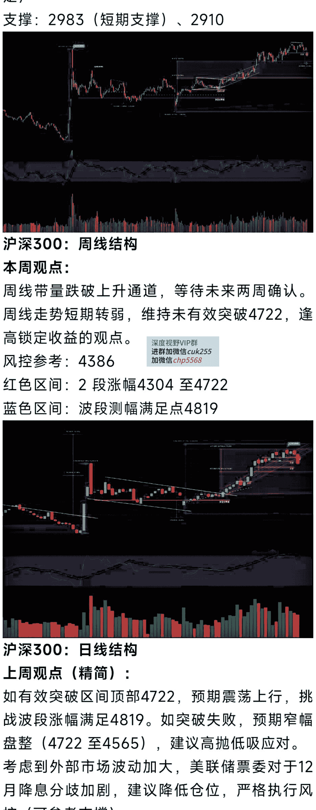

# 全球每周报1124-1128
香港

财经早报

2023年11月24日

## 市场回顾

小回顾：本周结束，全球市场表现震荡。由于美国公布的非农就业数据远超预期，美联储加息预期有所降温，美债收益率回落，美股三大指数全部收涨。标普500指数周涨2.2%，纳斯达克指数周涨2.5%，道琼300指数周涨1.2%。富时记者周跌幅0.5%，恒生指数周跌幅1.5%。

## 重点关注

（一）美股：非农数据超预期，加息预期降温

本周公布的美国非农数据新增30.7万人，远超预期的16.5万。失业率降至3.7%，低于预期的3.8%。这一强劲数据显示美国劳动力市场依然火热，但也引发了市场对美联储进一步加息的担忧。然而，由于美债收益率在数据公布后出现回落，美股在周五大幅反弹。

周四公布的FOMC会议纪要显示，联储认为通胀压力依然存在，可能需要更多政策支持以确保通胀回归目标。这在当时加剧了市场对加息的预期，但周五的非农数据缓解了部分悲观情绪。

### （二）港股：恒指走弱，权重科技股表现疲软

本周恒生指数周跌1.5%，收报19600点。受美股震荡影响，港股周整体走低。其中，科技股回调压力较大，腾讯、阿里巴巴、美团等权重股表现疲软，拖累了指数上行空间。

### （三）商品：金价高企，原油受震荡

本周金价维持高位，收报2020美元/盎司。受地缘局势加剧及通胀预期反复影响，避险资金支撑金价。原油方面，受需求疲软及地缘因素影响，周呈现震荡行情。

### （四）外汇：美元走强，日元波动

本周美元指数走强，收报104.5。受美国非农数据影响，美元对日元一度冲破151心理关口，最终收报151.5。美元对欧元收报1.085。

### （五）债券：收益率回落

本周美10年期收益率回落，收报4.85%。美20年期收益率收报4.75%。

### （六）亚洲：日元走软

本周日元对美元走软，收报151.2。

# 来源：

短期震整，等待等周线确认突破趋势。
压力：4279，支撑：4269（周线底部）、3920（周线箱体底部）

### BTC

插图/数据：BTC周线图

近期进入二整，目前回踩支撑6762，周线支撑6150，周线确认二底反弹后，先看空为主：

压力：7056（日线支撑），7662（周线）
支撑：6485（日线支撑），6160（周线支撑）

### ETH

插图/数据：ETH周线图

近期进入二整，目前回踩支撑2286，周线支撑2150，周线确认二底反弹后，先看空为主：

压力：3056（日线支撑），3662（周线）
支撑：2485（日线支撑），2160（周线支撑）

### SOL

插图/数据：SOL周线图

近期进入二整，目前回踩支撑928，周线支撑850，周线确认二底反弹后，先看空为主：

压力：1056（日线支撑），155（周线）
支撑：95（日线支撑），85（周线支撑）

*(注：由于OCR文本中SOL部分存在严重乱码，根据上下文逻辑进行了结构性修复。)*
