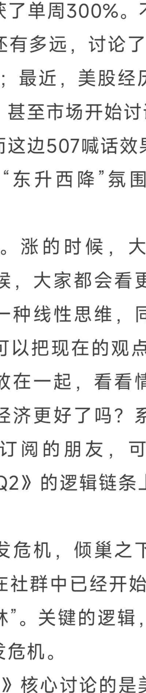
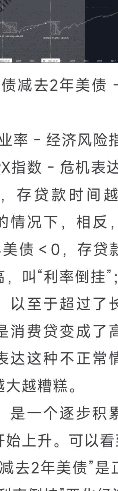
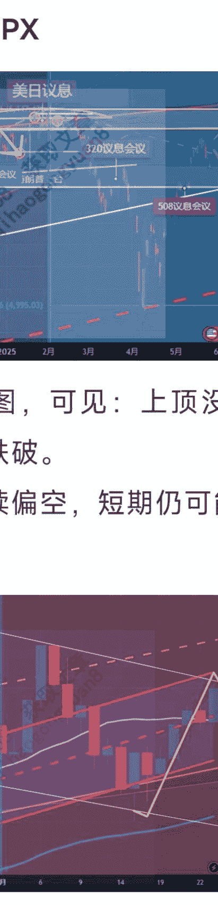
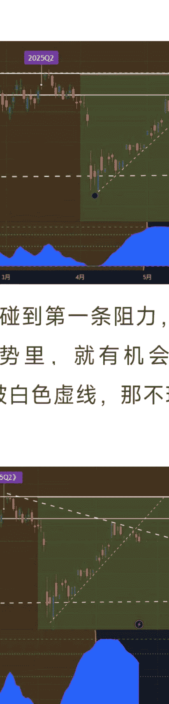
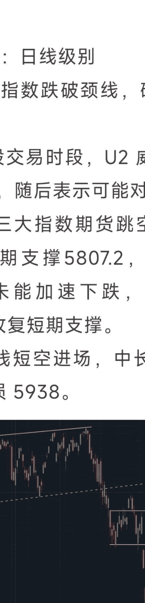
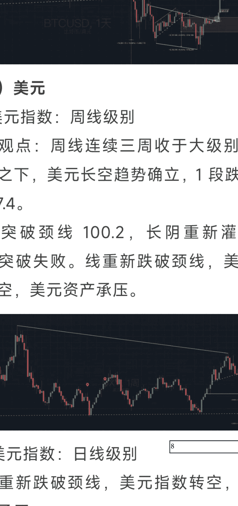
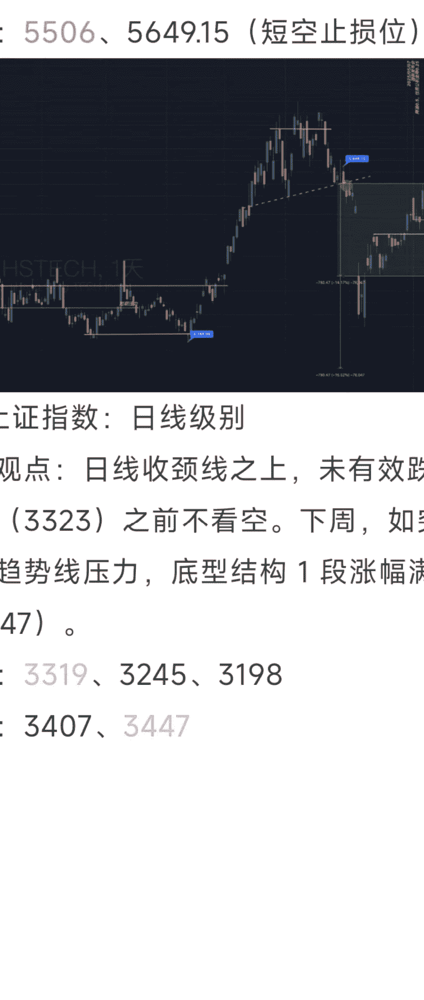
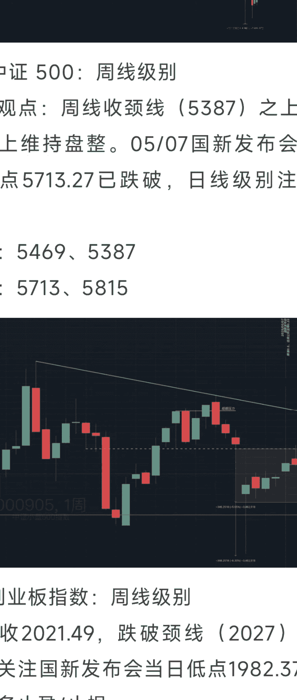
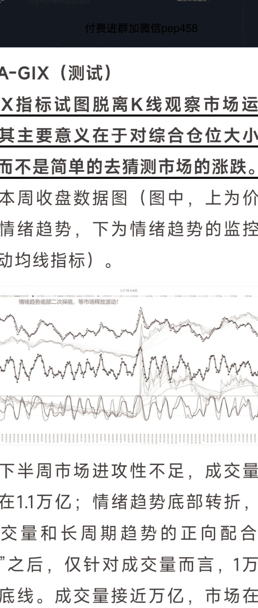
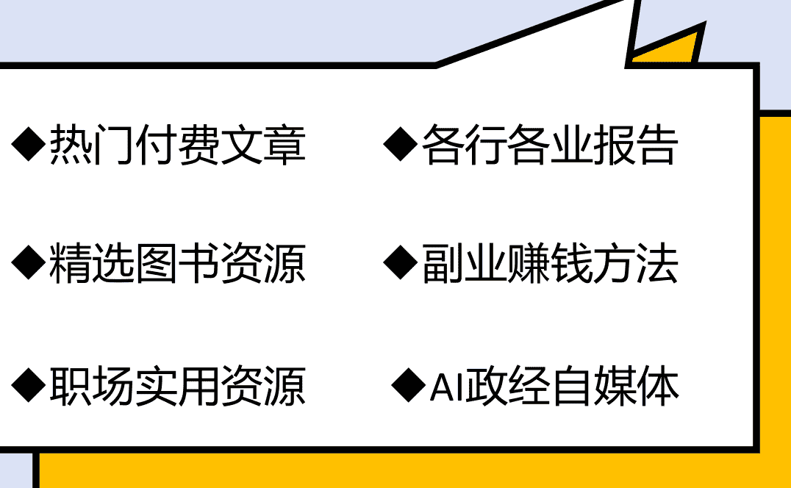

# 全球股市：标普500大跌6%

财经财富 · 2023-05-25 19:20

【美股】周五美股收跌，标普500指数再创半年新低，纳斯达克指数下跌1.42%，道琼斯指数下跌0.82%。科技股继续走软，周五收跌。

由于美国5月CPI数据超出预期，美股周五走软。科技股继续走软，周五收跌，纳斯达克指数大跌1.42%。

标普500跌破4500点，有人“害怕”了吗？

在上面的图上，这种波动，一目了然。

要恐慌了吗？现在还太早了。美股的下跌虽然比平时大，但比去年的“恐慌天”要小得多。

但美股从年初以来上涨了10%，周五跌了1%。你觉得今年已经跌了10%吗？

是的，如果你从年初的高点开始算，美股确实跌了10%。

### （一）通胀回落

如果通胀继续回落，美股可能会迎来反弹。

但是如果通胀不回落，美股可能会继续下跌。

那么，问题是：通胀真的回落了吗？

### （二）利率预期

如果美联储停止加息，美股可能会反弹。

如果美联储继续加息，美股可能会继续下跌。

那么，问题是：美联储会停止加息吗？

### （三）经济增长

## 金

黄金/美元：日线级别
- 支撑点：日线结构尚未突破，日线3210有效位，若跌破2950
- 压力：3210, 3000, 2950
- 05/23：美元亚洲时段，周二前发布数据，美元三大指数期货走空。市场情绪回升，黄金尚未出现下破压力，注意关注行情

### （三）BTC

比特币/美元：日线级别
- 日线线上，周线满足突破，短期109182。
- 05/23：美元亚洲时段，周二前发布数据，三大三大指数期货走空。BTC回调整支撑压力，短期期货参考106574。

### （四）美元

美元指数：日线级别
- 支撑点：日线三线周线回美元大趋势级别支撑位，美元强势立稳，短期目标，上突破跌线102，长期回整跌线失效。若跌破跌线美元将面临压力。美元见压力。

### （五）亚

人民币指数：日线级别
- 支撑点：日线线上，未有效跌破支撑位盘整（22590）之前看。05/07国发布数据，当日跌22691.8为短期多跌参考。
- 支撑：23211, 22691, 22950
- 压力：23973, 23198, 23415（阻位限制）

2. 恒生指数：日线级别
- 支撑点：未有效跌破之前（4725）支撑位盘整，05/07数据发布后，当日日线支撑5198.6为短期跌跌参考。
- 支撑：5198, 5078, 4725
- 压力：5560。

3. 标普指数：日线级别
- 支撑点：日线线上，未有效跌破（3223）之前上看。若跌破则下行趋势压力，结构型1日线满足突破（3447）
- 支撑：3219, 3245, 3815
- 压力：3407, 3407

## 免费 价值 及时 专注

## 扫码加入 知识星球TOP 免费资源群

- 每日免费获取价值资源
- 可提供各类资源搜索服务

公众号:知识星球TOP 微信信号:jntsg8 微信:jntsg2

分享资料仅供个人学习，请及时删除，切勿商用传播
