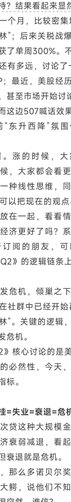
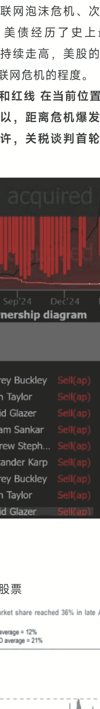
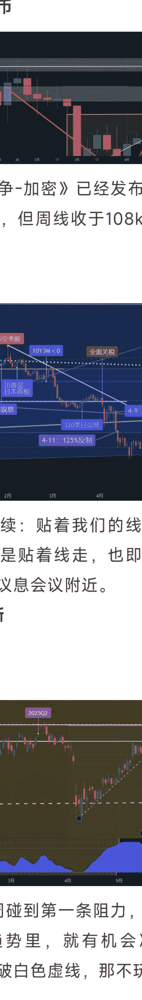
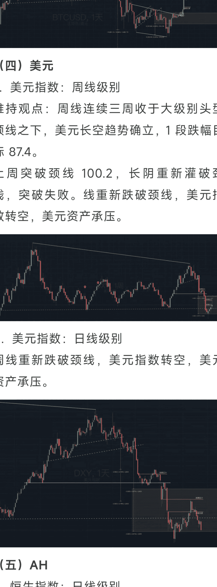
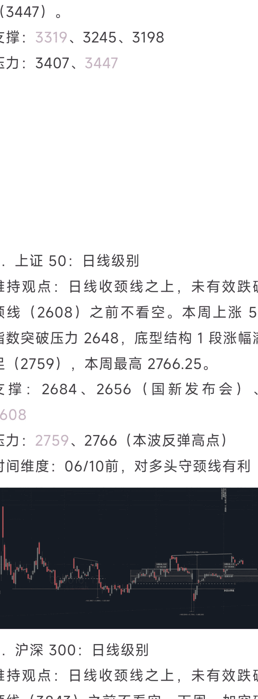
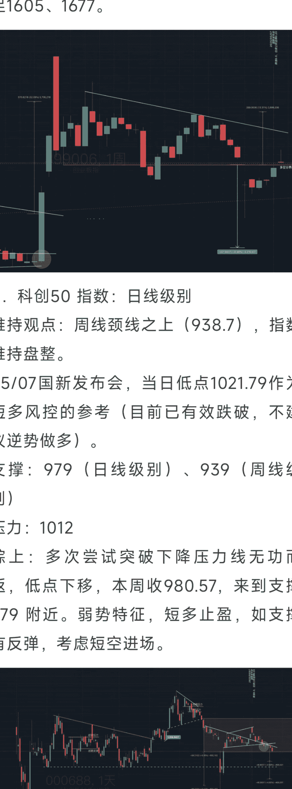

# 全球股市标普500指数跌超26%

财经财富 · 2023年05月26日 19:25

## （一）周五指数低跌，23%跌幅修复

周五美股收跌0.31%，标普500指数跌0.26%，纳斯达克指数跌0.92%，道琼斯指数跌0.55%。周内标普500指数跌幅达2.6%。

由于周四通胀数据超预期，美股周五大跌，纳指跌幅2.4%，纳斯达克周跌幅达3.3%。

周五纳斯达克指数下跌0.92%，标普500指数下跌0.26%，道琼斯指数下跌0.55%。

由于周四通胀数据超预期，美股周五大跌，纳指跌幅2.4%，纳斯达克周跌幅达3.3%。

## （二）周初低迷，周五回升

周五标普500指数收跌0.31%，标普500指数周跌幅达2.6%。

周五纳斯达克指数下跌0.92%，标普500指数下跌0.26%，道琼斯指数下跌0.55%。

周五纳斯达克指数下跌0.92%，标普500指数下跌0.26%，道琼斯指数下跌0.55%。

由于周四通胀数据超预期，美股周五大跌，纳指跌幅2.4%，纳斯达克周跌幅达3.3%。

## （三）周初走低，周五修复

周五标普500指数收跌0.31%，标普500指数周跌幅达2.6%。

周五纳斯达克指数下跌0.92%，标普500指数下跌0.26%，道琼斯指数下跌0.55%。

周五纳斯达克指数下跌0.92%，标普500指数下跌0.26%，道琼斯指数下跌0.55%。

由于周四通胀数据超预期，美股周五大跌，纳指跌幅2.4%，纳斯达克周跌幅达3.3%。

# 黄金

黄金/美元；日线级别
支撑点：日线结构尚未突破，日线3210有效，若有效回测2950。
支撑：3210、3000、2950
05/23：亚洲交易时，上线前发布美国利利，三大指数期货走空。市场情绪回升，黄金未出现突破压力，需关注底部。

## （三）BTC

比特币/美元；日线级别
日线收之上，有效回测，短期109182。
05/23：亚洲交易时，上线前发布美国利，三大指数期货走空。BTC特回离支撑位良好，短期反弹参考106574。

## （四）美元

美元指数；日线级别
支撑点：日线收周三出现大级别回踩之下，美元依然强势，短期目标标的：104。
上方突破指数102，长期突破新低线，失效。若突破新低将美元下方压力，美元上方压力。

## （五）AH

恒指数；日线级别
支撑点：日线收线之上，有效突破线（22590）之前看空。05/07美国数据发布，当日日线22691.8为短期多头参考。
支撑：23211、22691、22590
压力：23593、5078、54915（支撑附近）

# 免费 价值 及时 专注

# 扫码加入 知识星球TOP 免费资源群

- 每日免费获取有价值资源
- 可提供各类资源搜索服务

| 热门付费文章 | 各行行业报告 |
| :--- | :--- |
| 精选图书资源 | 副业挣钱方法 |
| 职场实用资源 | AI政经自媒体 |

公众号:知识星球TOP 微信信号:jntsg8 微信信号:jntsgj2

分享资料仅供个人学习，请及时删除，切勿商用传递
