# 全球市场每周预测0616-0620——中东石油美元

原创 财金处主理 金政监管
2025年06月15日 21:30 辽宁

周报福利：为回报各位读者的支持与信任，我们将在留言中挑选三个合法合规的问题进行答疑并展示——机会有限，期待大家踊跃参与。同时也感谢您的转发和点赞。

《Q1》美股见顶已经验证；《Q2》部分预测已经验证：

- 美国2025年爆发危机的概率高达90%
- 关税摩根、高盛等知名机构和达达欧等权威专家开始讨论危机；
- 重点介绍“春天的热带雨林”，实操UVIX和Gold在关税周取得300%；
- 当前，关税战的进展，符合《Q2》的预测；
- 穆迪下调美国信用的评级；
- 日本首相说：日本金融状况比希腊还糟糕；
- JPM说：你们将会看到债券市场的崩溃。

上周，我们讨论了美股是否新高，然后分析了新高对明年选举的影响。我们仍然认为不会新高，因此，美股概率形成一个双头的结构。

这几年中东局势紧张，以色列和伊朗上周也打起来了，实际这个问题并不复杂，如果中东没有石油，就没有石油美元，各国更不会介入中东。《货币战争-总论》讨论过，中东不太太平，就是石油，就是石油美元，就是各国的博弈。

今天我们结合石油美元做一些展开，这是一个极其明确的政治决定金融的案例。后续通过研报系列，再把“中东-石油-美元”的过去和未来做一次完整剖析。

## 一、政治决定金融的石油案例

《货币战争-总论》讨论石油美元体系建立以后，石油对于美元发挥两个核心作用：

1. 核心作用是支撑美元刚性。石油必须以美元结算，迫使各国的国际贸易必须储储备美元。这是U1的核心关注。
2. 其次是通过调节油价配合美元汇率。油价高，就是美元弱；油价低，就是美元强。

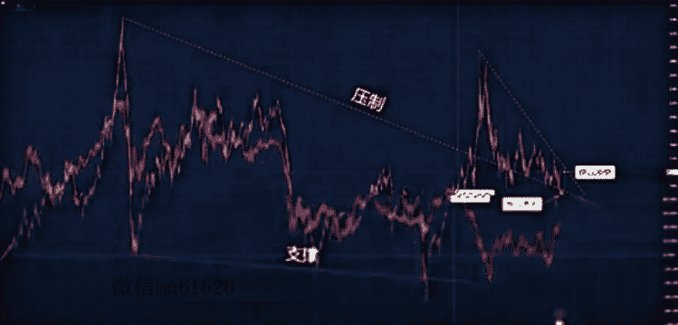

彩色：石油价格；红色：美元指数（上下翻转）

在强势的时代，油价服从美元，美元弱，油价高，各国需要更多美元去买石油，反而支撑了美元。自2008年金融危机以后，油价形成了一条支撑线一条压制线，在这个区间，油价波动降低，美元波动走强。

2020年新冠拜登上线撒钱以后，按照理，美元应该是走弱，但是因为随后的加息而走强；石油也应该走弱，因为U1提出了碳和根本上打击了石油增长的预期。但是，如图，2021年5月开始，石油和美元（图为翻转）一起走强，因为U1引发了俄乌冲突。

油价直接突破了压制线。如果看近期，关税战开始，石油价格跌回了压制线以下。随着俄乌再起和以伊冲突，发现这两次冲突升级，将石油拉到了压力压制线以上。

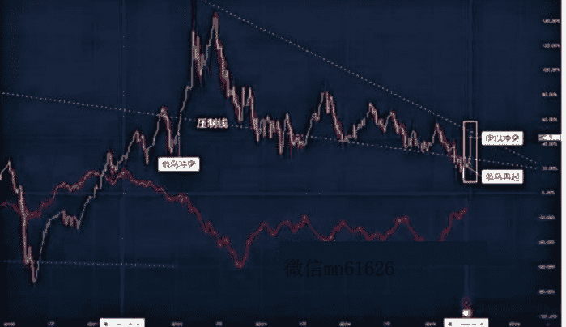

俄乌升级和以伊冲突，都是U1发动的。所以，答案就很简单了：U2要压通胀，不希望石油短期涨价；U1通过战争拉高石油，强美元刚性，推高通胀。而这次冲突推动的石油涨价，恰好发生在618议息会议前，你甚至可以想到鲍威尔会说：“近期的不确定性加上中东的不确定性，加大了通胀的不确定性，我们认为需要保持政策的稳定性，对利率的调节更加谨慎，维持当前的利率。”

## 二、全球主要资产跟踪

### （一）美股SPX

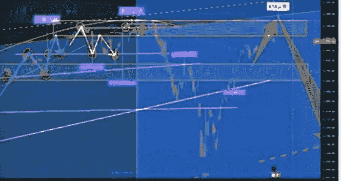

上周预测：继续上周的图。Q1以来，首次触及黄色区，这将U1和U2金融关键的一周。下周预测：政治博弈的推演是不会新高，所以这个位置，可能开始交换筹码，看空。

### （二）黄金

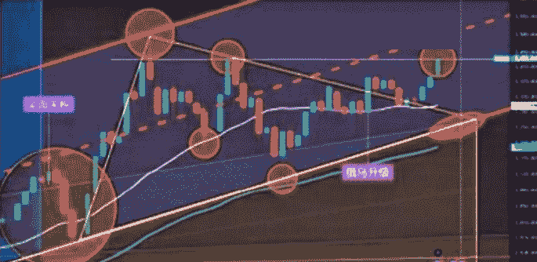

上周预测：如果美股新高，黄金大概回测椭圆寻找支撑；如果美股走低，黄金会继续进攻。本周预测：继续上周的图，美股没有新高，黄金上攻落在我们预判的黄色圈里，但没有破线。

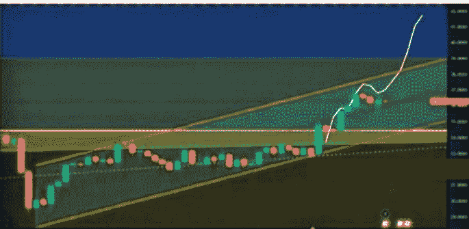

白银突破后，本周开始白银的追踪。下周预测：本周完成调整，下周看涨。

### （三）BTC

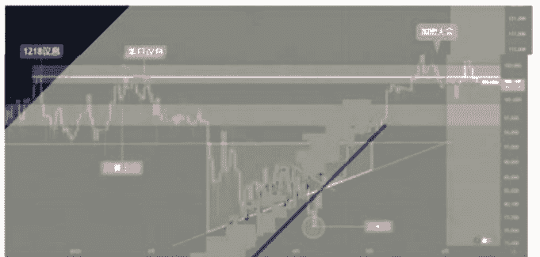

上周预测：出现蓝线，比特币就弱。因此，现在越涨越强，BTC越弱；美国走弱，恐慌走高也会利空。下周预测：继续上周。

### （四）美元

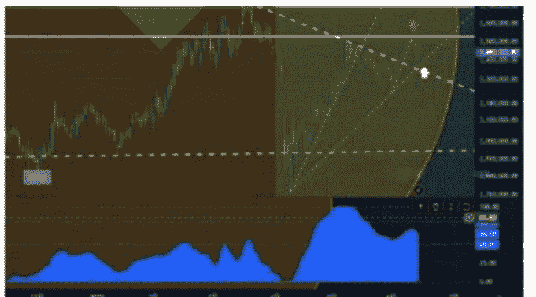

上周预测：美股走强，各国股市开始反弹，看美股。如果美股持续走强，行情延续。本周预测：回及第一白线压制回调，议息会议前后都是比较弱的，如果不跌黄色位置，就可以二次进攻。

### （五）比特币

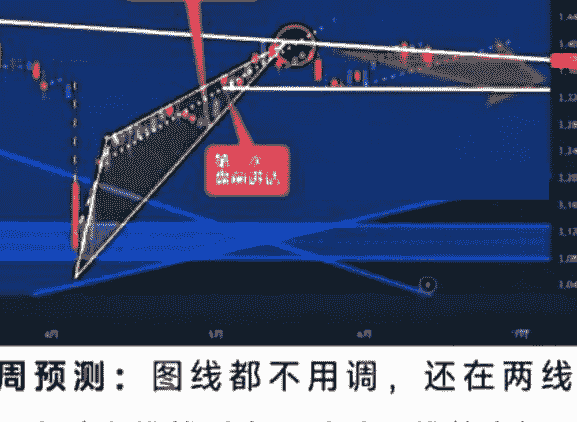

上周预测：还在两线之间，突破下线就看多；跌破下线就离场。下周预测：还在两线之间，上周基本贴着上线，非常好；下周看议息会议，站在3386以上还有行情。

## 三、技术分析

### （一）美股

#### 1. 标普500：日线级别

中长空：周末未确认交易逻辑，继续持有。
短期空单：有效跌破颈线之前，应避免情绪干扰。有效跌破5969开始关注，破颈线5910空进场。
压力：6059.9（本周高点）、6120（反弹结构足够）。支撑：5938、5786。

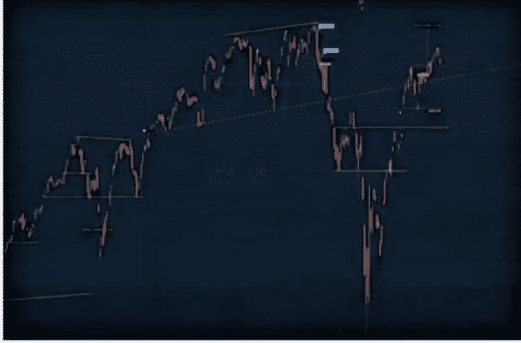

#### 2. 纳斯达克：周线级别

周线收颈线之上，未跌破颈线之前看空。压力：19534、20017。

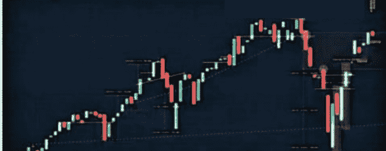

#### 3. 纳斯达克：日线级别

06/13以色列空袭伊朗，全球避险情绪升温。需要注意的是，06/12纳指成交量明显放大，可打开5分钟级别进一步观察。我的个人理解是内幕交易，目前已跌破放量的K线，意味着这些追高的筹码未来可能转换为短空筹码。设置短期支撑19227作为短期空观察，有跌破第一段跌幅18656.61、第二段跌幅窄。

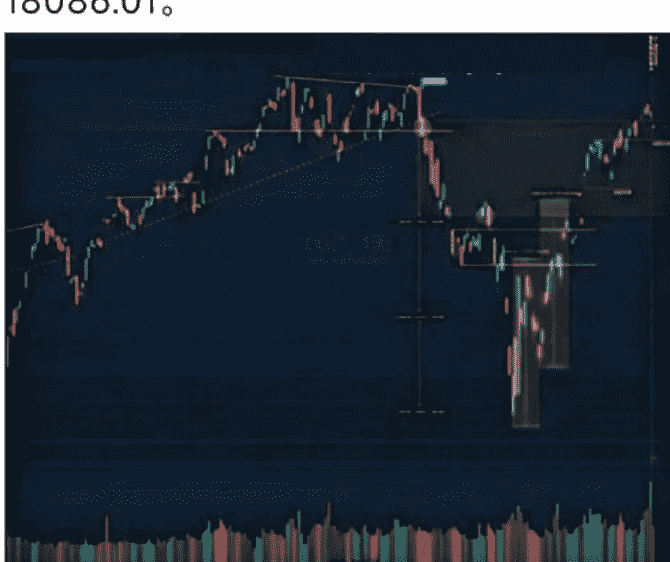

### （二）黄金

#### 1. 黄金现货/美元：日线级别

日线级别突破整理结构，第一段涨幅满足3629，第二段涨幅满足3953。

技术分析图形调整：
- 微调颈线：下移至3175
- 新增观察区间：3307.8至4176.17

复盘本周黄金走势：
06/09回测短期支撑3289，当日低点3293.69，未跌破支撑，完成洗盘。
06/10站上趋势线，06/12突破区间，资金在此期间加速了筹码收集，收盘价震荡走升。
06/13以色列空袭伊朗，全球避险情绪升温。避险资产拉升，等待突破左侧高点。

#### （三）比特币/美元：日线级别

目前正在构筑线型，设置两条短期支撑：
1. 有效跌破短期支撑60374，短多盈。
2. 如跌破9424，短空进场，等破颈线。

技术分析图形调整：
- 新增上升趋势（黄色）：右侧头型结构，领先指标破线做好短空计划，含盈、止损。
- 新增绿色线（本周参考10132）：风险偏高，短空布局和止损。风险偏低，沿上周破9424短空，等破颈线空单。

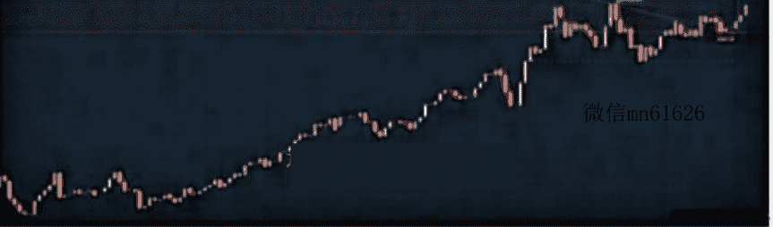

### （四）美元

#### 1. 美元指数：周线级别

维持观点：周线连续收于大级别颈线之下，美元长空趋势确立，第一跌幅目标874。

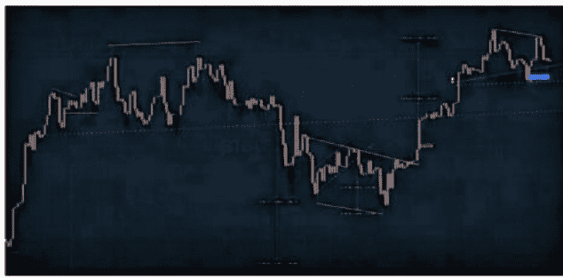

#### 2. 美元指数：日线级别

06/10鲍威尔会结束，06/11联合公报，美元指数对这场博弈计价话题相对敏感。06/13以色列发动空袭，全球避险情绪升温，美元指数冲高回落。综上，美元周线进入长空趋势，震荡下行。随着地缘冲突升温，美元完成底构建。

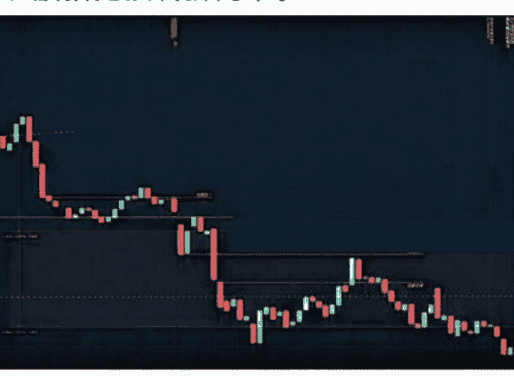

### （五）恒生

#### 1. 恒生指数：日线级别

维持观点：日线收颈线之上，未有效跌破颈线（2590）之前看空。

06/13：
- 以色列空袭伊朗，地缘冲突升温。
- 同日，外交发言人林剑主持记者会。彭社记者提问，伊朗在受到以色列袭击后可能会封锁霍尔兹海峡，中方是否支持将霍尔兹海峡作为报复措施？林剑表示，对假设性的问题不做评论。地区局势再度升温，不符合任何一方的利益。我们呼吁有关方有利于地区稳定，避免紧张态势进一步升级。中方也愿意为此发挥建设性作用。

个人观点：封锁霍尔兹海峡的概率不高，封锁对中国的原油供给的影响十倍于美国。虽然概率不高，但不代表冲突升级，作为短期情绪博弈点时应调高风控的标准。

技术分析图形调整：
- 新增短期支撑：有效跌破23698。
- 新增头部结构下降压力线：24400作为参考。如突破，短多看24937。未来一周重点观察两条支撑23698、22691作为风控参考。

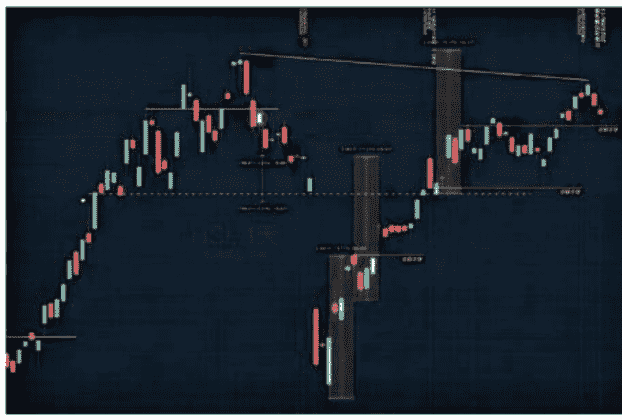

#### 2. 恒生科技指数：日线级别

恒生科技指数正在区间内构头部型结构，未有效跌位之前（4725），指数维持区间盘整（5506至4725）。如有有效跌破5078：构成头型结构，第一跌幅满足4664。综上，考虑到地缘冲突引发，做好交易计划应对波动率加大。建议调高风控标准，恒生科技对有效跌破5198，建议短多止盈。

#### 3. 上证指数：日线级别

维持观点：日线收颈线之上，未有效跌破颈线（3323）之前看空。下周的重点是防御，关注3340、3325支撑。

#### 4. 上证50：日线级别

维持观点：日线收颈线之上，未有效跌破颈线（2608）之前看空。上周收大级别头型，跌幅足够，股指见顶转向向下。

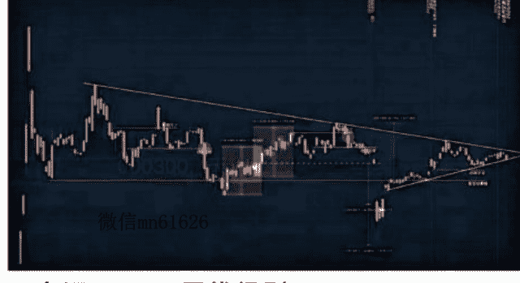

## 四、A-GIX指标（测试）

A-GIX指标试图脱离K线观察市场规律，其主要意义在于对综合仓位大小的考量，而不是简单的预测市场的涨跌。下为本周收盘数据图（图中，上为价格均线，下为情绪趋势的监控指标和波动均线指标）。本周“情绪趋势”持续下行，“长期周期”空头状态下平，直至周五向下发散。

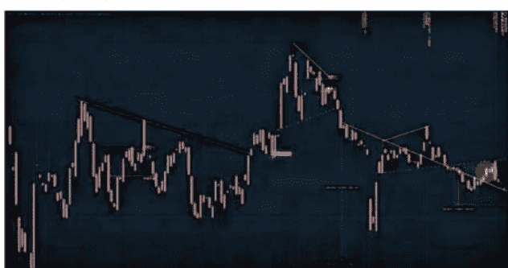

“波动”指标逐步上，沪深市场成交量接近1.5万亿；情绪类指标全部下中。预计周延续调整，建议周中低吸仓位。
