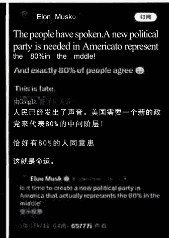
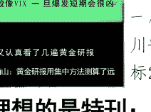
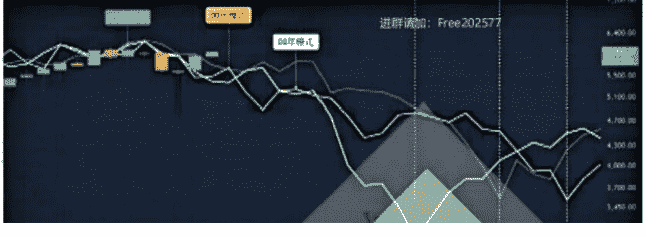
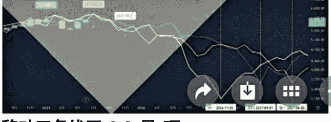
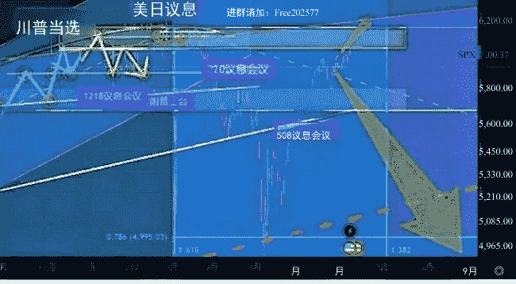
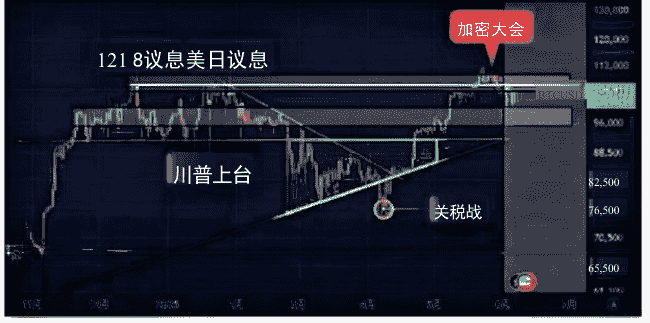

# 全球市场每周预测0609-0613如果美股新高

原创 财经处主理 金政通鉴
2025年06月08日22:16 辽宁

《Q1》美股见顶已经验证；《Q2》部分预测已经验证：√

- √ 美国税2025年爆发危机的概率高达90%——关税周摩根、高盛等知名机构和达利欧等权威专家开始讨论危机：
- √ 重点介绍“春天的热带雨林”，操作UVIX和Gold在关税周取得300%：
- √ 当前，关税战的进展，符合《Q2》的预测：
- √ 穆迪下调美联信用的评级：
- √ 日本首说：日本金融状况比希腊还糟糕：
- √ JPM 说：你们将会看到债券市市场的崩溃：

不过，上周SPX站了6000，距离前高6147.43，只有2.45%。如果新高，那么《Q1》见顶的预测就不对了。6月可见，Q2接近尾声，先复盘，然后看看哪些逻辑需要调整。

## （一）总体状况

马斯克未了吗马斯克及需要的动作，所以他把自己拉出来，特朗普好闲，特朗普了了，特朗普将在2028年马斯克再次竞选

## 预言马斯克与川普斯博是对2028年大选的布局

今年（充）①②
2025-01-01至2025-06-08
55.28%

| 收益率 | 收益额 | 总资产 |
| --- | --- | --- | --- |
| ■标的 | ■上证 | ■实险 | ■创业险 |
| 70.0% | | | |
| 60.0% | | | |
| 50.0% | | | |
| 标1+DS 特利 | | 标5/6 |
| 20.0% | | | |
| 10.0% | | | |
| 0.0% | | | |
| 12-3101-2702-2803-2604-2205-21 | | | |

0 风险值
今年跑上证指数
99.61% > 54.28%

在政治博弈判断的基准下，研报+特利的长短组合 AI 总体收益符合预期，黄金/加密的预测上台阶，预测关税大跌并实现价值回归。

## （二）重点布局

这个季度的核心工作是发布《新市场战争》系列，已经发布的《黄金》/《加密》展现了极高的预测精度；

### 《新战争之加密》5月21日发布，BTC在22日见顶。原文：

- ①据此计算，本周大大致在11万附近。综上，模型分析的结论是：向熊市切换。
- ②高概率：无“属性改变”，由于是5万是期货参与，“重磅消息”都是川普“亲自宣布”，根据前文分析，BTC可能回SPX再次回撤引发恐慌落石底。

感谢各位老板老北哥，大家天天发大红包，之前我感觉或许可以继续降低一点，不用哈哈市值都很低调。

黄金差一点涨3500

### 黄金在当天13点见顶

√标2

5月10日强调矿，一周后，川普签署了新的政策，标2强势上涨了35%

#### 不理想的特征：

- 1. 《防守反击》：发布次日股市前讲话，但反击强度不及预期，看中美经贸磋商机制是否会提振
- 2. 《美股观察》：发布一周后+20%，但未能延续，不过只需要更耐心一些。

熟悉的读者都知道，我们一直认为为川普越早爆发危机越好，对于明年中期选举前实现争取复苏的时间越有利；相反，如果太晚，那么明年选举前还深陷衰退，选举影响可而知。

最近开始密集讨论危机，上周，我们讲6月“不太平”，因为，除非川普维持美股在选后崩盘，否则，6月就是一个临界的时间点了。

目前看，进入6月：BTC 见顶、俄乌升级，黄金一周大幅突破又大幅回落，川普6月将关税最后通牒了，然后和马斯克开始对冲等等，所有这些，指向U1的反攻，如SPX不仅是反攻，更是“跨”，甚至创造了全球流行的词：TACO, Trump Chickens Out，普普弱（我们在分析中提到，关于“美股内幕”）。6月注定美股高并再一段时间，会决定全球走势，美债、货币、加密、AH和各国股市聚焦这个巨大的博弈。有没有一种资产能够应对当前的十字路呢？历史上是有过的，也即无论美股是新高，还是转身，这种资产都应该表达“聪明钱”。随着6月开启，该资产表现，我们将在特定的“十字路口”中介绍。现在U1和U2的博弈，就在中期选举中，本周，我们结合历史上危机走势，进行美股Q1见顶和Q2见顶，两种情况相似，进一步讲解为什么6月是一个临界点。

## 二、2025危机走势

美股是全球最大的流动性吸收。所以，我们讲美股跌，全球央行、投行虽然不是博弈的主要方，但是主要的影响者。上周SPX站了6000，距离前高6147.43，只有2.45%，但这个位置足以对全球资产走势进行定位。

### （一）Q1见顶

71绿、00黄、08年危机对25年走势的拟合，最好的08模式，到2026年6月底，这更有利于确保中期选举胜利；就是我们说的川普越早爆发危机好有利于危机后的重建。最差的情况，71模式，到2026年1月中选底，这将决定川普在中选举时失去优势。偏差的情况，00模式，从2026年3月到1月，是一个持续震荡，这就有很多不确定。

### （二）如果Q2见顶

移动三条线至三种情况下，最早是08模式，到2026年1月中选见底，71和00模式见底的时间更晚，会导致川普在中选举遭遇“滑铁卢”的概率大幅提升。唯一可以增加中期选举胜算00模式，在中选举前推动一个月的型的震荡反弹，过了中期选举再继续跌。

### （三）如果Q3见顶

三条曲线继续右移，那基本不用看了，川普几乎失去中期选举。所以，6月一上来，我们就看到U1在高歌猛进，在到处“骑脸”，这2.45%剑所指的2026中期选举，势在必得。挨了一抢站起来高举拳头的川普先生，让泽连基直播打脸以后，现在被全球交易者称为TACO，马斯克的离开是可以理解的。因此，如果美股新高，我们需要开始计入川普利中期选举而影响2028大选胜概率。

## 三、全球资产追踪

### （一）美股SPX

上周预测：继续上周的图，震荡完成，看着。本周预测：继续上周的图，Q1以来，第一次面对黄色阻力区，这是U1和U2金融对决的关键的一周。

### （二）黄金

上周预测：继续上周的图，黄色的压制线，如果收盘站上3350，就要看多，3450是一个强阻力；站不上3350，就看空。本周预测：继续上周的图，上周突破黄色三角区域，然后回踩，得到均线支撑，这是黄金在观察美股是否新高。如果美股新高，黄金大概概率回红色圈寻支撑；如果美股走弱，黄金继续向上进攻。

### （三）BTC

上周预测：加密大会后，加大空的趋势性。下周预测：川普TACO，比特就弱。因此，现在美股越强，BTC越弱；美国走弱，风险走高，也会利空BTC。

### （四）美元

图调，预测不调，沿着线延续。

## 四、技术分析

### （一）美股

- 1.标普500：日线级别触发引发空，未有效破颈线之前看空。上周提示，随着颈线斜率向上，与空逐步接近，空需要做好交易和心理建设。未来12周波动会加大，短空：目前收颈线之上，短空5938，如有效站上，考虑风控。06/03突破盘整，收于短空5983。中长期空：颈线斜率上行，对于多头压力会增大，6月中前保持。上周提示空单需做好计划，本周波动预期，基于日线型结构，空单决策。本周走势判断。本周突破整理，对应涨幅6120，风险可控。综上，短空技术决策权重，触发风控。中长空：逻辑决策权重，触发风控5986，颈线之上空单加码。未确认逻辑失效，不减码。
- 2.纳斯达克：周线级别，周线收颈线之上，未有效跌颈线之前看空。本周最高19610.5，收19529.95，压力19534。压力：3289、20017。

### （二）黄金

- 1.黄金现货：日线级别本周下降趋势，06/06美股突破，市场风险偏好提升，避险情绪降温。未来一周，若跌破短期支撑3289，回测颈线3210。支撑：3289（带量突破）、3210（颈线）、3000、2950。压力：3414.70、3438.13。

### （三）BTC

- 1.比特币/美元：日线级别维持观点：日线级别2段涨幅满足，满足点109182。目前正在构筑头型，设置两道短期支撑观察：160374、99424。①已有跌破短期支撑160374，短多止盈②如跌破99424，短空进场，等跌破颈线加码。

### （四）美元

- 1.美元指数：周线级别维持观点：周线连续三周收于大级别头颈线之下，美元长空趋势确立，1段跌87.4。

### （五）AH

1. 恒生指数：日线级别维持观点：日线收颈线之上，未有效跌破颈线(22590)之前看空。05/07国新发布会，当日低点22691.88为短线风控的参考。06/02低开，注意观察06/03在南下资金流动性支持下，能否守住22691支撑，要为破颈线风控做好心理建设。06/03跳空高开，收于日内相对高位。支撑：23211、22691、22590压力：23973、24937。综上，本周恒生指数低开高走，领先 SPX走强，收于05/21高点之上。考虑到内部、外部风险偏好回升，未来一周如有有效突破22973压力，可参考波段涨幅充足点24937。

2. 恒生科技指数：日线级别恒生科技指数，正在区间内构筑头型，未有效跌位（4725），维持区间盘整（5506至4725）。05/07国新发布会，当日低点5198.63，已跌多盈。06/02低开跌破5078。未来一周，如有有效跌破，则支撑转向，目标4725。06/03跳空高开，恢复5078、5198.63。支撑：5198、5078、4725压力：5506、5649.15（短空位）。综上，恒生科技走弱于恒生指数，维持区间盘整（5506至4725），谨慎对待恒生科技。

3. 上证指数：日线级别维持观点：日线收颈线之上，未有效跌颈线（3323）之前看空。下周，若突破下跌接近压力，底结构段涨幅满足（3447）。支撑：3319、3245、3198压力：340、3447。

4. 上证50：日线级别维持观点：日线收颈线之上，未有效跌颈线（2608）之前看空。上证50指数本周回落，多次回测2648，作为上证指数多头领先，意味着多头转弱。未来一周，观察国新发布会低点2656，有效跌回测颈线2608。支撑：2656（国新发布会）、2608压力：2684、2759维度：06/10前对多头守线有利。

5. 沪深300：日线级别维持观点：日线回颈线（3843），多空颈线展开博弈，短多止盈。未来如能突破，涨幅满足4023。如跌破颈线3843，反弹结束，指数转空。支撑：3769、3843、3815压力：3940、4023。

6. 中证500：周线级别周线收颈线（5387）之上，颈线之上盘整（5815至5469）。本周已收复，05/07国新发布会，当日低点5713.27。市场风险偏好回暖，可以将5815作为短线参考指标，如未能收复建议多少动。支撑：5469、5387压力：5713、5815。

7. 创业板指数：周线级别维持观点：周线颈线之下（2027），指数转空。关注国新发布会当日低点1982.37，跌破短多止盈/止损。04/07恐慌周线破位的头型确认，跌幅满1605、1677。

8. 科创50指数：日线级别本周突破下降趋势线，站稳盘整区间(1068至979)。未来一周，关注是否能收于下跌中继之上。支撑：979（日线级别）、939（周线级别）压力：1012

## 五、AH 判断

### （一）H

HKJP：美股走强=危机延后。各国股市开始反弹，看美股，如果美股持续走强，行情会延续。

### （二）A

图线都不用调，还在两线之间：突破上线就看多；跌破下线就离场。

## 六、A-GIX (测试)

A-GIX指标试图图脱离K线观察市场规律，其主要意义在于对综合仓位大小的考量，而不是简单的猜测市场的涨跌。下为本周收盘数据图（图中，上上为价格均线及情绪趋势，下为情绪趋势的监控指标和波动线）。本周继续维持低波状态，但科技板块表现优异。