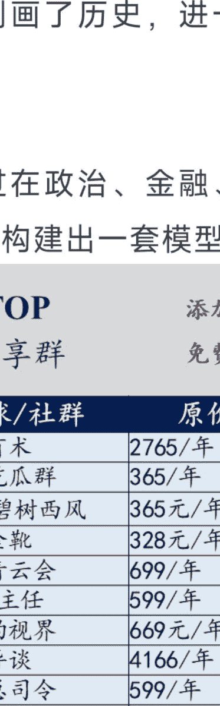

# 【通鑫】HSI/底部指标——如何精准捕捉底部机会

原创 金融汇享 金融通鑫 2025年08月16日 12:01 已订阅

前言：

《通鑫》周报具有很强的预测瞻性，得到了读者朋友的认可。

这种选择策略基于对国际政治和金融复律的深刻理解，并通过技术标准分析以量化，且具备数据的灵敏性，让大家关注及时性，运营对已发布的周报，把握我们的核心，建议大家多关注“通鑫”周报，进一步掌握“通鑫”的投资策略。

## 【通鑫】付费集合说明：

- 1. 本集集合将周报、总汇总周报、研报各类知识点，让新粉丝了解我们的核心，帮助粉丝进步，进一步提升投资能力。
- 2. 本集集合主题主要在于“底部新发现”，涉及知识点已具独特性，可以结合国际政治、金融市场量化等维度构建投资体系。
- 3. 本集集合关注的知识点不构成投资建议，仅作为知识分享。股市有风险，入市需谨慎。

本集集合订阅费需666微信订阅/月，每月4期。

## HSI*/底部指标——如何精准捕捉底部机会

原文：全球市场每周周报0224-0228
发布时间：2025年02月25日

主图为HSI*USDJPY，衡量2000年以后HSI的底部位置，这个指标标注了2007、2015、2018年的三个底部：

副图是调整后的MACD指标，配合主图进行验证。

办理原理涉及到2000年以后全球政治格局的调整，以及与欧元体系的调整。调整后的HSI在的位置，从上来看直观明显——

主图和副图来看，与2007、2015、2018的情况是非常接近的。

底部在水回压力区域，副图将进入上限区域。

接下来，我们分别看919以来的HSI和USDJPY：

HSI上回6附近，也就是2500点位就会到达一个非常强劲的位置。

回到HSI*USDJPY，在日元突破140以前，如果能再冲到2500，那么按照22日周报的“要点”收盘价计算：2347792*14226250*140

日本3月18日日次观测，最后一次CI已经确认了底部，也近期。如果回进2500点，必须在日元突破140之前再次触发“要点”。这就是在日元突破140后日元回撤后的平衡，这只是春季的机会。

第二次机会，不是很精彩。

### 底部指标——底部时空

请注意，这个指标还需要与其他指标从多个角度组合使用，也就是在图中画的底部，单等。不要在“某指标”上有投资这样的建议。指标有灵活性，而温度底部。

政治决策决定了金融股市，或者说全球的价格上涨。股市的属性是世界上唯一的价格上涨下跌，一个价格的上涨下跌是由市场波动的。我们团队的任务，就是把这个过程量化，设计出一个可以实时反映风险与核心关系的观察型指标——

一个好的底部：就是我们在现在所处的位置，它们画了底部，并进一步阐述了底部。

类似的，在政治、金融、科技领域也可以看多个指标，构建一个模型。

## 知识星球通鑫

## 付费专享/底部

| 序号 | 账号/名称 | 底部价格 | 趋势 |
|---|---|---|---|
| 1 | 恒生 | 2765/ | 成长期、底部 |
| 2 | 汇率/人民币美元指数 | 3268/ | 成长期、底部 |
| 3 | 汇率/日元美元 | 328/ | 成长期、底部 |
| 4 | 宏观 | 5999/ | 体质、底部 |
| 5 | 宏观 | 7999/ | 体质、底部 |
| 6 | 股票 | 5999/ | 体质、底部 |
| 7 | 股票 | 5688/ | 成长期、底部 |
| 8 | 股票 | 1399/ | 成长期、底部 |
| 9 | 黄金 | 5999/ | 体质、底部 |
| 10 | 黄金 | 10000/ | 成长期、底部 |
| 11 | 黄金 | 4576/ | 成长期、底部 |
| 12 | 科技 | 5688/ | 成长期、底部 |

* 免费粉丝看底部 * VIP粉丝每天看底部(20天+)*
