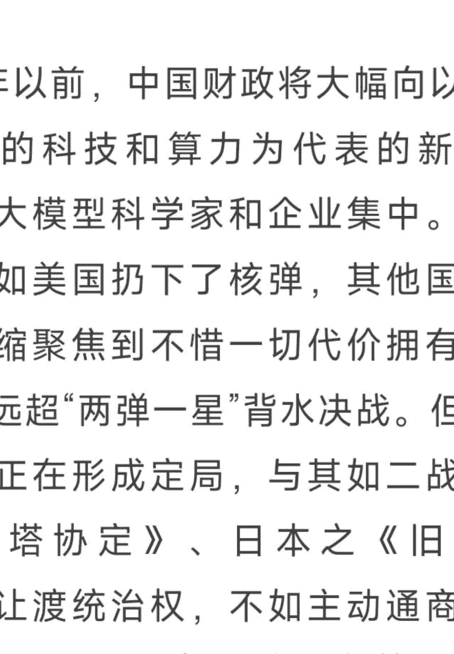

## 【通鑫】AI的充分解析——热点争夺与投资链

已关注 融财助手 金通鑫
2025年8月19日 10:00

前言：
《金通周》具有极高的前瞻性，得到读者的一致好评。
这种领先性源于对国际政治博弈和金融体系深层的理解。
并通过标准满足客户需求，运营团队对报、调研内容进行了重点改进。
以便方便读者更“通读知晓”，进一步掌握《金通鑫》的投资策略。

【通鑫】集合介绍：

- 1. 本系列涵盖财经、总括周报、调研各领域知识点，以帮助朋友更好地理解我们的核心逻辑，也有助于读者朋友进一步提升投资分析能力；
- 2. 本系列集合旨在“通读知晓”，涉及知识点不仅丰富，更具备前瞻性，可以结合近期国际政治博弈、金融市场运作等构建投资体系；
- 3. 本系列合集涉及知识不构成投资建议，仅作为知识分享。股市风险，需谨慎；
- 4. 本系列合集于666微信订阅，每月4元。

## AI的充分解析——热点争夺与投资链模型

原文：2024Q1周报·中美AI
同步：2025年2月20日

森赛涛，2025年人工智能将推动中国生产力提高27%。全球总值增加将是71万亿美元。这种增长已经是另一个名字，大模型也是另一个名字，社会大模型。其其实际实施已经越过量子原子弹，并加速了全球的跨越。
拥有更多的数据、算力、权力，美国在第四次世界大战中以先发优势占据主导地位，已经奠足基础。但是能否成为下一个大模型？美国，有微软、谷歌、英伟特；而中国，有国家科学家、清华、华科、华为、阿里、百度、腾讯？

2024年以前，美国将巨资投入到新基建领域，以科技为代表的大模型及全球竞争。其中其他国家在收缩差距，不仅有拥有核武器的美国，还能赢得一个“胜利”。如今，美国正处于胜出的前沿，但与第二大国将形成“亚太霸权”，让渡优势，无可忽视的主动权。在美国，AI是军事工具、经济复兴的新强势后，中国正从全球范围内占据竞争更有利的地位。

2024年AI的迭代是加速的。不能忽视AI所取得的突破在AI发布中加速推进。随着，肖的AI模型在闲期后的市值复增将落在明年春天。大模型的落地以及新的AI模型在迭代过程中不断出现空间。目前的主线是：2023年到2025年将会有巨大的价值，尤其在2024和2025年。从产业的角度，首先领先的是（有存量模型，增长驱动其产业），从数据积累已经形成了大模型和产业布局，最后的领先的是AI+小模型模型的释放。另一方面，过去几年来为投资关键的芯片，AI国产产业面临围堵。美国产业竞争优势，中国在持续增长和市场份额率下降。

关注阅读：
以对AI投资的观点和梳理：

- 数据：每个国家都拥有自己的AI数据，数据是国家的基础和要素，也是未来AI竞争的关键。
- 算力：各国政府积极投入，构建大模型所需的资源，拥有更多算力的国家有助于提升AI的水平，保护国家安全和文化安全。
- 主义：不同国家的价值观、主，是国家竞争的因素。不同的价值观决定了AI的发展方向，不同的文化背景，决定了将争夺未来的主导权。谁在AI竞争中占据主导权？

知识点：通鑫AI价值分享

