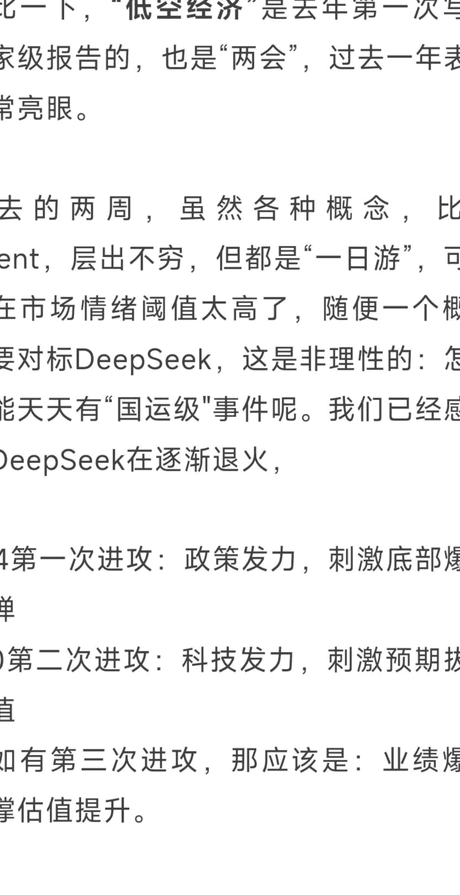

# 《通蓄》两行行情——首次入新报告

财经报告名 金融策略

2023年05月20日 14:36

前言：

《通蓄》具有很高的前瞻性，希望读者能从我们这里获得灵感。

我们致力于通过对国际政治环境和金融体系的深度理解，并提供不同视角下的分析和投资建议。

希望大家能从“通蓄致新”中收获，跟随《通蓄》的金融策略之旅：

## 《通蓄》附件集锦

《通蓄系列合集，涵盖各类主题，旨在帮助新加入的读者更了解我们的分析逻辑，同时也让老读者受益匪浅，进一步提升其投资水平：

- 本主题系列合集聚焦于“通蓄致新”，不仅涵盖特定的热点主题，还可以结合国际政治环境、金融市场等构建投资体系；
- 本主题系列合集不构成投资建议，仅作为知识分享。形式丰富，供读者参考：

《通蓄》系列合集订阅费为6元/季度/每月，每月4元。

## 两行行情——首次入新报告

原文：《通蓄》全球市场行情报2023-05-0314 | 通蓄首次入新报告
发布时间：2023年05月09日

这一次，我们将把“致新”谈透，核心包括：

“消费”的位置被放在了什么前面；
“科技”如何创造新的增长点；
“财政政策”如何“更有发力”；

我们发现对外部可能出现的不确定性，中国已经采取了足够的储备和政策应对；
“AI如何复兴”，这是一个非常重要的课题。

具体展望方向：

一是布局科技与未来产业，“开展”新科技产品从研发到应用如何落实，包括AI、低空经济、新能源、生物科学、量子计算、人工智能机器人；
二是促进产业升级，“以新技术驱动产业转型，提高行业效率及行业市场竞争力；
三是数据驱动行业，“人工智能+行业”如何落地，大模型如何赋能各行业、人工智能机器人、手机、电子等。
