# 全球市场每周预测0707-0711 BBB

20250706 财金处主理金政通鉴

知识星球TOP资源共享群

让更多人获取高价价值信息

添加微信免费进群

| 付费文章 | 付费社群 |
| --- | --- |
| 付费课程 | 行业&分析 |
| 财经&股市 | 行业报告 |
| 时效·职场·体制·自媒体 | 学习·军事·软件·音影·社会学 |

周报福利：为回馈各位读者的支持与信任，我们将在留言中挑选三个合法合规的问题进行答疑并展示。“机会有限，期待大家踊跃参与。同时也感谢您的转发和点赞。

《Q1》预测部分美股见顶
《Q2》部分预测美国2025年爆发危机的概率高达90%

- 关税周豪根、高盛等知名机构和达利欧等权威专家开始讨论危机；
- 重点介绍“春天的热带雨林”，操作UVIX和Gold在关税周取得3300%；
- 当前，关税战的进展，符合《Q2》的预测；
- 穆迪下调美国信用的评级；
- 日本首相说：日本金融状况比希腊糟糕；
- JPM 说：你们将会看到债券市场的崩盘；

微信公众号jntsg2，免费进资料群

- 中东局势紧张
- 美联储下调经济增长预期从1.7%至1.44%，并上调了明年的失业率和通胀预期。
- 美国一季度GDP为-0.3%。
- 标2如红，标5新高。

从Q1至今，每周跟踪美股、金银、BTC和AH，总体预测的准确率高达90%以上，经常数周都不需要调整技术分析，最长的如黄金，从去年9月降息以来就没有调整通道，一直适用，甚至时候走势路径的预测都一样。周线级别的预测是在季度预测的框架下开展的，这也说明季度预测的合理性。

目前最大的偏差是《Q1》预测美股见顶，Q1确实见顶了，到4月关税引发美股跌幅超过20%，触发熊市技术指标；但随后川普喊大家入市，把美股拉了起来。BBB的预期下，美股走出了新高。关税战的时候，全球市场都在讨论危机，而新高时在讨论牛市。熊市说危机，见新高牛市，更符合直觉；但是，经年累月的国际秩序变化和金融系统演化，可以因为川普而调整节奏，但不会发生方向性的变化。《Q3》经过严谨的推论，美股将见二顶，形成大双顶结构。这一加微信号jntg2，免费进资料群

# 推论，是基于川普BBB的货币贬值策略，巧的是，本周达利欧也发表了同样的观点。
这周我们看一下BBB。

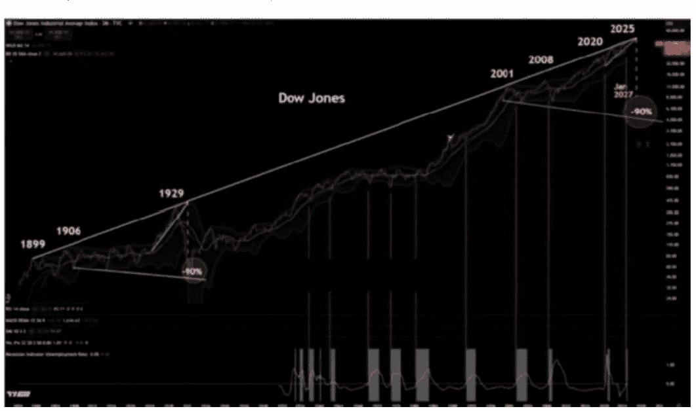

美股位临百年趋势线，形态上构成大

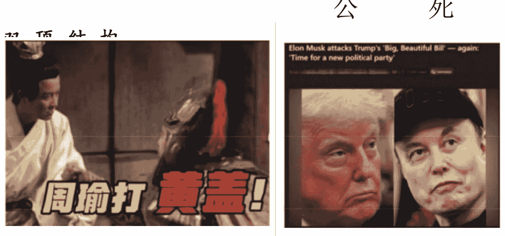

自古CP分手热搜
一龙说 BBB过了了就创

## 一、 BBB
（一）先看基本面：1. 历史最贵的美股

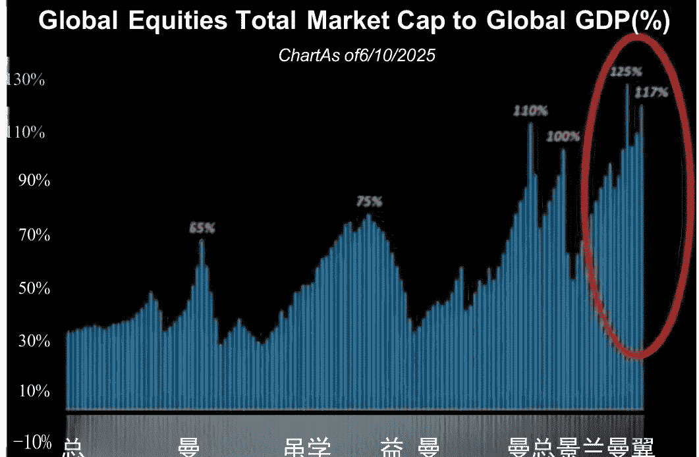

加微公众号jntg2，免费资料群

### 全球股市市值/GDP 次新高，前高是新冠前。

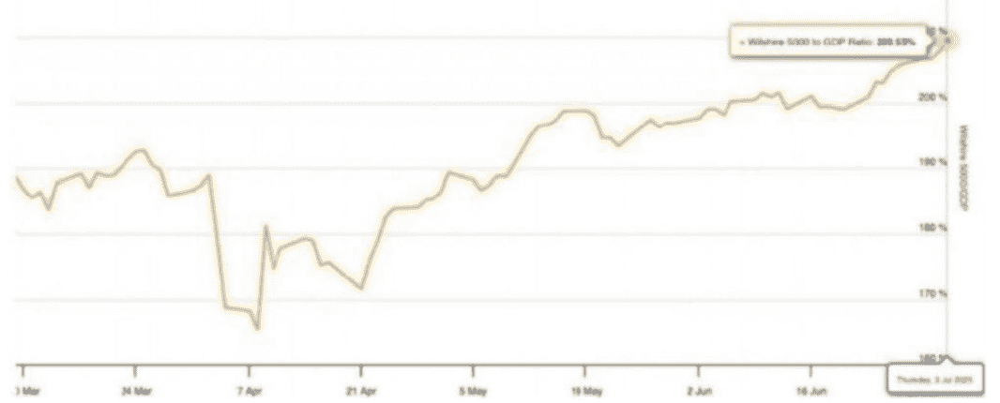

### 巴菲泡泡沫指标达到210%，历史最高

## 2. 就业恶化

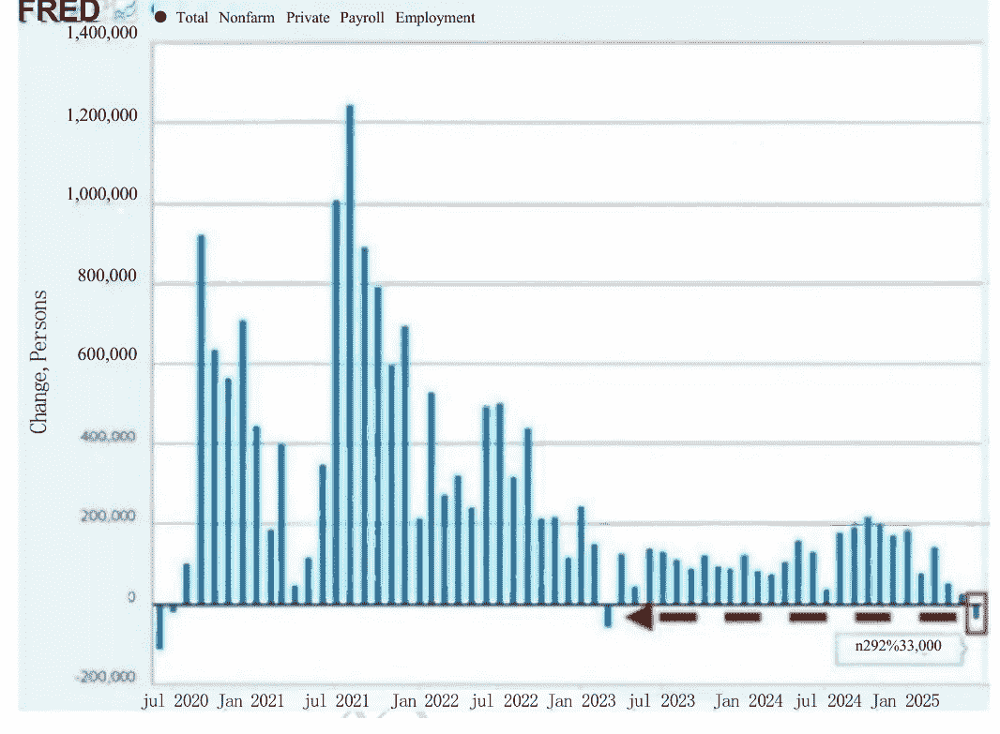

### 6月份美国私营部门就业岗位减少3.3万个，为新冠以来第二大跌

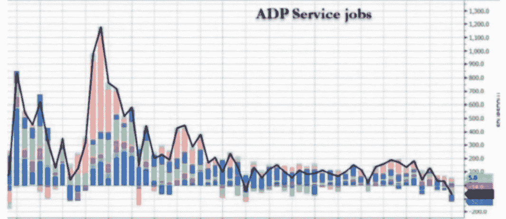

### 6月份服务业就业岗位出现2020年3月美国经济因新冠疫情停摆以来最大降幅

加微信号jntsg2，免费资料群

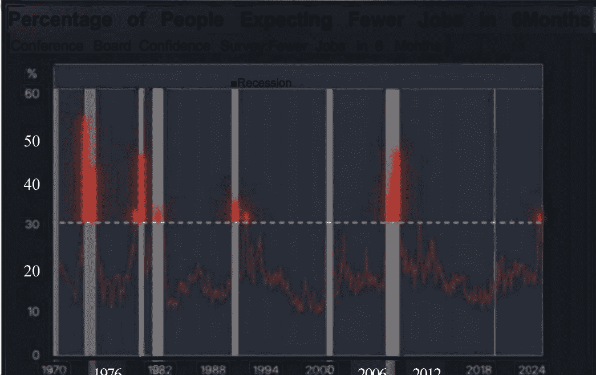

## 难就业预期指标达到30%，1970年以来最高

## 3. 金融系统风险高

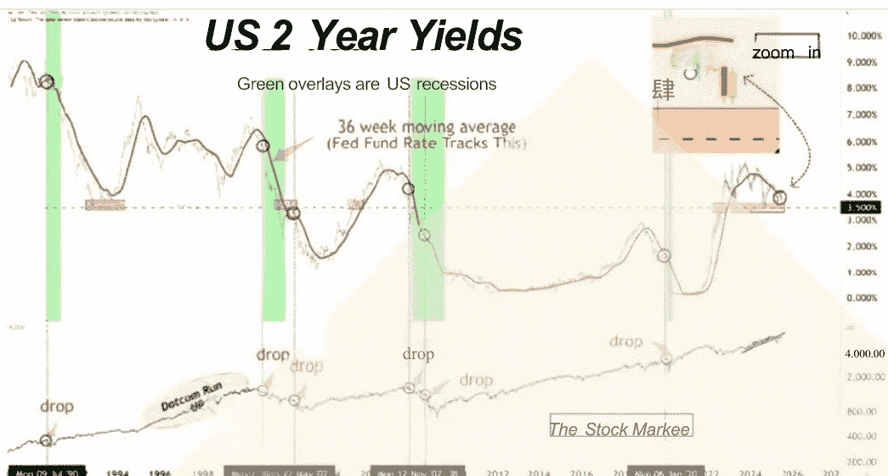

### 30年期美债触顶且进一步穿均线

### 回购协议(REPO): 市场首次干预

### (二) BBB 的内容与影响

理解BBB的前提，需要基于全球金融秩序的主要矛盾：作为印钞机，继续印钞，美元贬值，将威胁整个系统的稳定。而控制只有两条路：要减支出，要减税，保信用；发展。

所以，BBB条款中，核心两条：
一是企业减税，这会直接增加公司利润，虽然BBB对股市短期有利于，但市场已经深入关注并并充分消化了。
二是大幅提高美债上限。在上周周报中，我们分析了全球资产表现，由于BBB意味着更多的债务和更弱的美元，在深度贬值预期下，美股实际收益更差，这个预期市场还没反映。

> Ray Dalio: Now that the budget has passed Congress, we can see what projections look like for deficits and debt service expenses. The bill is expected to lead to spending of $7 trillion with inflows of $6 trillion taken in, from 100% of GDP to about 130% of GDP. The average family debt growing from $25,000 to $42,500 per family ($18 trillion in debt and interest is squeezing out and cutting off $9 trillion of spending) or unimaginable interest rates to attractively low levels. This printing and devaluing as those holding bonds and US Treasury market is the backbone of all capital markets which are being rectified to bring the budget deficit from roughly 7% of GDP to big. Pain disruptions will likely occur.

达利欧算了一笔账，BBB选择了债务从GDP的100%推到十年后的130%，平均家庭负债增长，要么深度贬值，“可能会出现重大痛苦的混乱”。

### （三）川普与一龙

在《Q3》，从财政部长的国会辩中，已经对危机的严重性说得很清楚了；因此，我们一直认为，BBB是在危机前给美国争取子弹，毕竟货币政策至今都拿不到手里。另一方面，我们也讨论了更远一点的布局，下届大选和BBB的“预期双顶”。如果美股接下来见双顶，那么未来美股下跌，触发危机，无论如何这个机会会被以关税和BBB扣在川普头上——就像鲍威尔说的，如果不是关税（恶化就业和造成通胀）他早就降息了。

这种情况下，保证中期选举和下届大选吗不能，成立新党好一点可以彻底改变格局，也可分流。如果要成立新党，没有一些必要性，一些共识，一些全民关注，新党接下来能快速发展吗？媒体上可以调侃川普，但川普什么样的角色？民主党川普斗了八年，最终还是输了；民主党拜登赢了八年，最终也输了（见《新川普交易》）。下棋尚一步看三步，川普和一龙至于像媒体讲的“意气用事”，又不是水浒，何况都是正八经在全局聚光灯下刷了几十年脸而且专门从事媒体事业的老戏骨了，怎么也得套个三国以上的剧本。

## 二、全球市场跟踪

### (一)美股SPX

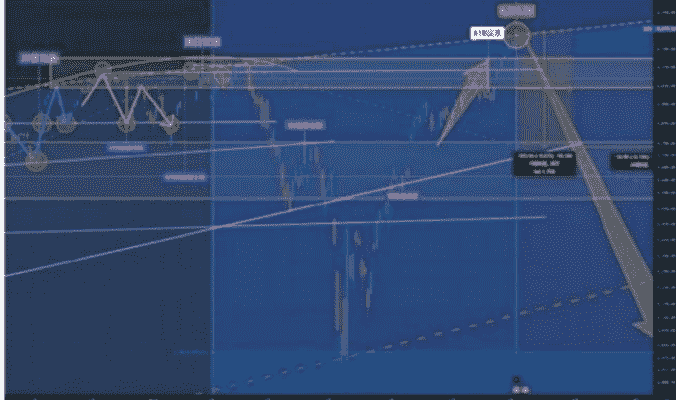

上周预测：图不动，趋势看空不变。短期美股可能延续势头，新增黄圈，这次冲锋的上限区间（7月上旬）6250附近。

下周预测：符合预测，到达目标位，回调启动。

### (二)金银

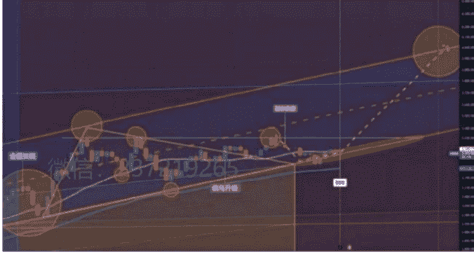

上周预测：图不用调，确实走了最差路径。这个图用了8个月了，黄金破位，需要再看几天按路径延续。本周预测：和预测的路径一样，下周看反弹。

### (三)BTC

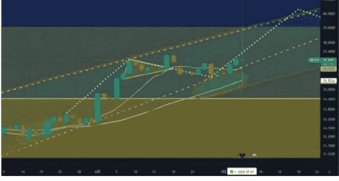

上周预测：随美股反弹，但没有高，更像是一个双顶结构。趋势看空。本周预测：BTC阻力位置震荡，本周出现了许多套现交易，继续看空。

### (四)美元

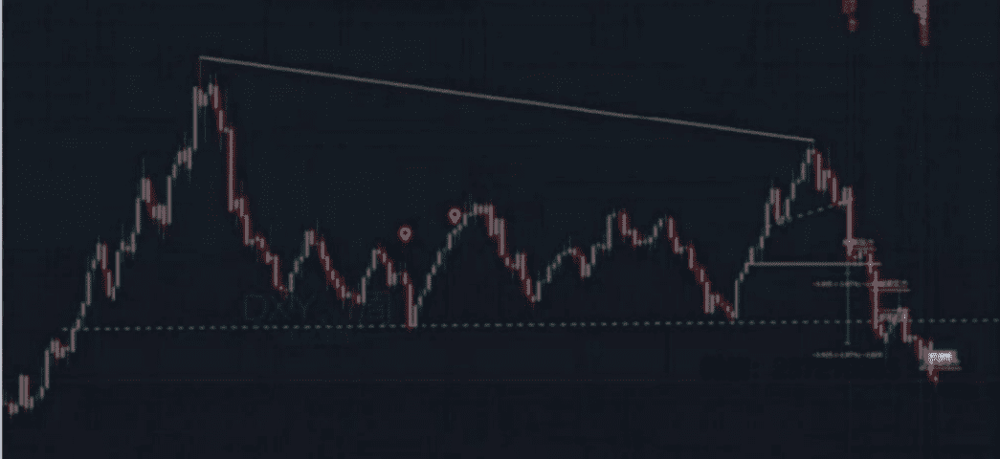

美元指数：周线级别，周线收楔型之下，跌幅87.4。美元指数：日线级别，本周收于97.602之下，未来一周关注BBB法案签署后，美元是否会破底96.37。跌落后政策预期（供给侧），有利于人民币，筑底。美元持续走弱，推动人民币走强。

### (五)AH

恒生指数：日线级别维持观点：日线收颈线之上，有效跌破颈线(22590)之前不看空。本周回测短期支撑(23698），低点23690.94，收23916.07，有效跌破23698。

- 短期支撑(23698)：有效跌破，低风偏多盈。
- 短期支撑(22691)：有效跌破，高风偏止盈。未触发止损，多单持有，涨幅满足24937。

恒生科技指数：日线级别本周回调短期压力(5198)，反弹高点未接近压力线(黄色线)，波弹相对弱。07/04 BBB法案签署，美股不开亚洲交易时段无干扰。市场风险降温。07/07如恒生科技指数是否转弱。

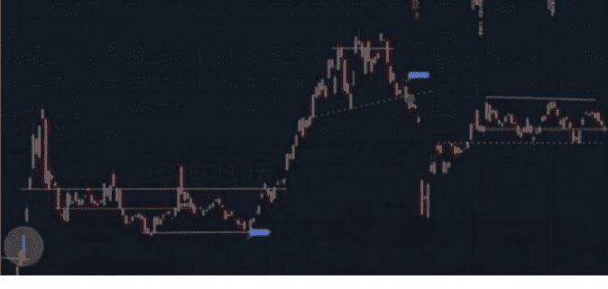

上证指数：日线级别未有效跌破3348点之前，指数维持强势。本周指数最高3497.22，突破2024/12/10高点3494.86。

上证50：日线级别作为上证指数的领先指标观察。本周指数达到涨幅满足点(2759)，日内指数承压回落，短多未止盈的，可将2684作为短多止盈参考。

## 沪深300、日线级别

本周观点：

- 止盈参考(4022): 本周指数最高点4013.84,接近涨幅满足(4022)
- 止损参考：低风偏3815高偏3768

## 中证500:日线级别

本周观点：

- 周线收颈线(5387)之上，颈线之上维持横盘(5815至5469)。
- 带量突破5815, I段涨幅满足6004。本周未突破下降压力(黄色线), 压力约为5975左右。

## 创业板:日线级别

本周观点：

- 周线收颈线(2027)，未来有效。突破下降趋势，涨幅满足2297。
- 日线级别突破整理，I段涨幅满足2140。

## 科创50指数：日线级别维持观点：

- 周线头肩顶成型，颈线939。
- 下跌中继结构，I段跌幅满足907。
- 下跌中继结构，I段跌幅满足954，会跌破颈线。

## 四、A-GIX（测试）

A-GIX指标脱离K线运行规律，其意义在于对仓位大小的考虑，而不是简单的涨跌。本周收盘数据（图中，上为价格均线及情绪趋势，下为情绪趋势和监控指标）。周一惯性上冲之后开始下行，未见迹象。本周成交量维持在4亿，面整体维持强势。后视角角度看，高位，综合仓位逐步降仓。周五，午盘突然上冲，但在情绪趋势下完成突破概率低，应该在冲刺进一步降低。结合A-GIX指标，两个情绪趋势以及监控指标仍处于行过程中，建议周初观察，如果市场整体仍为震荡，可积极试错。具体操作以盘后A-GIX数据趋势回头向上为指引。

## 知识星球 TOP付费资源分享群

| 序号 | 公号/星球/社群 | 原价 | 领域 |
| --- | --- | --- | --- |
| 1 | 生财有木 | 2765/年 | 副业、摇钱 |
| 2 | 容众吃饭 | 365/年 | 时政、历史 |
| 3 | 记忆斩/树莉西风 | 360/年 | 成长、经济 |
| 4 | 欧洲洲 | 328/年 | 时政、经济 |
| 5 | 克文天会 | 699/年 | 时政、社会 |
| 6 | 体内无时 | 598/年 | 体操、职场 |
| 7 | 外人的境界 | 669/年 | 金融、股市 |
| 8 | liquidity 浑异 | 4166/年 | 财富、成长 |
| 9 | 宁宁人入司令 | | 时政、经济 |
| 10 | 江宁扣号 | 365/万 | 时政、国际 |
| 11 | 时政/顾子明 | | 时政、经济 |
| 12 | 书院 | 1399/合 | 金融、财富 |
| 13 | 大树仿谈 | 199/年 | 成长、经济 |
| 14 | 水座大叔 | 10000/连 | 房产、经济 |
| 15 | 洪灏的宏观策略 | 4376/年 | 经济、摇钱 |
| 16 | 金政通/海南南 | 4576/年 | 股票、行研 |
| 17 | 猫的世界 | 299/年 | 时政、社会 |
| 18 | 飞龙云 | 3600/年 | 股市、经济 |
| 19 | 联祺韭间 | 599/年 | 经济、加银 |
| 20 | 签签财经 | 330/年 | 房产、房产 |
| 21 | 盈在八小时之外 | 365/年 | 成长、职场 |

