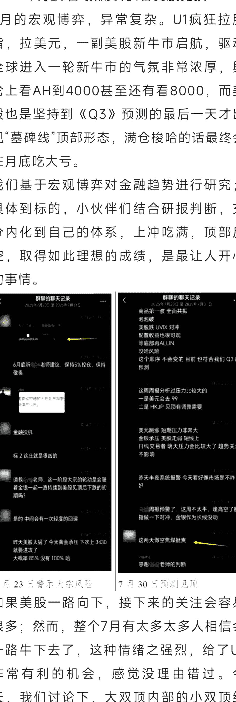
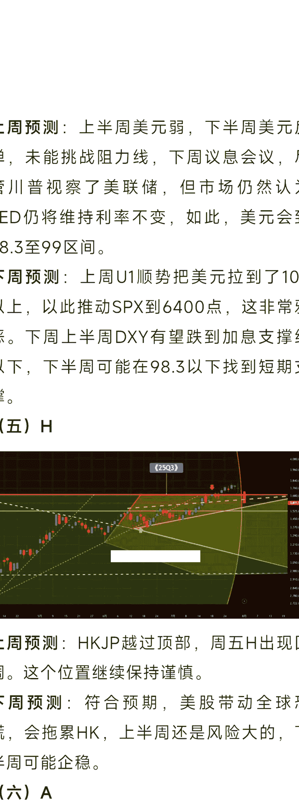
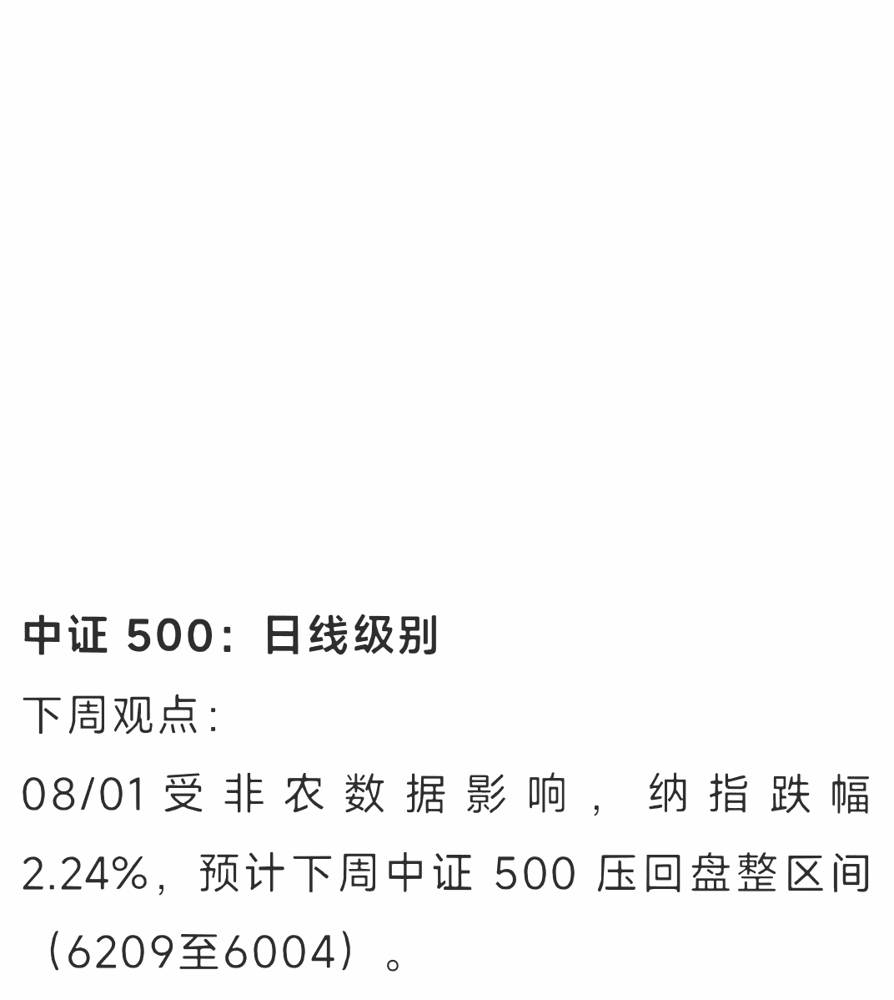
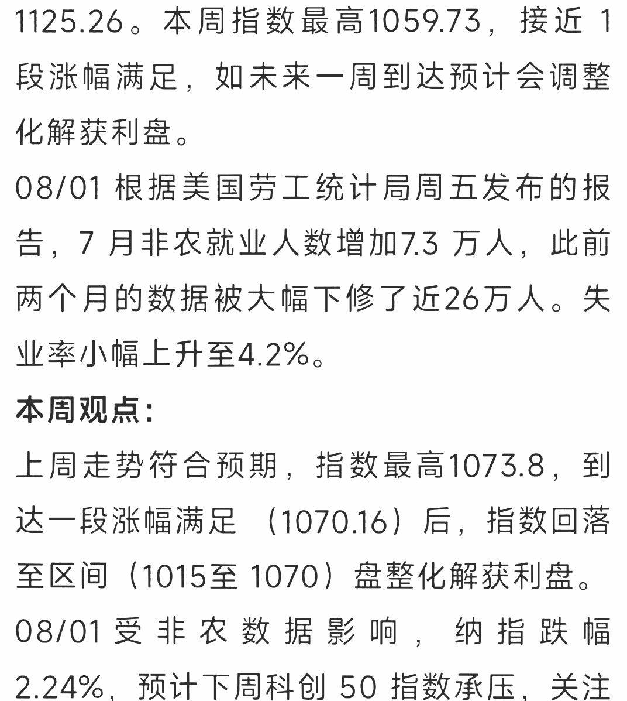

# 全球每周报-0804-0808 周小

金通

回顾：本周市场在支撑位震荡。美股受非农就业数据影响小幅震荡，标普500指数跌0.99%，纳斯达克100指数跌0.6%，道斯斯指跌0.3%。

Q19 周报：“本周一跌2.1%”
Q19 周报：标普跌0.99%，纳指跌0.6%，道指跌0.3%。

Q19《周报：跌的横盘

- 周一：非农数据公布，市场情绪偏谨慎。
- 周二：美国公布制造业PMI，CPI数据公布。
- 周三：美国公布初请失业金人数，欧洲数据公布。
- 周四：美国公布零售销售数据，美联储多个官员讲话。
- 周五：美国公布非农就业数据，JOLTS数据公布。

周五，7月25日非农数据公布后远超预期，引发市场震荡。周一，美股开低回升，收于标普500支撑位，纳斯达克100指数回升至17800点附近，道指回升至39000点附近。市场对美国经济“软着陆”的信心在下月内回升。

本周，我们对后市趋势保持谨慎。具体的关注点包括：市场表现、美国通胀数据、美联储政策转向、地缘政治等风险依然巨大。

## 一、美股大盘表现

2024年，SPX在“大牛市”行情后经历了三次回调：第一次和第二次回调均结束，以此确认支撑位。

本周无回调，结束了市场对衰退的担忧。Q19 周报：非农数据超预期，市场反转。二周确认支撑位后继续上涨。本周再次确认支撑位，下周还有回调吗？

上周一，美股开低回升，收于标普500支撑位，纳指回升至17800点附近，道指回升至39000点附近。

## 二、全球市场表现

## (一)日股

上周：日股在强劲支撑下震荡，周五收高。周二，科技股、半导体等板块走强带动日股反弹。

## 欧元/美元：日线

欧元将关注（1.0800-1.0850）。

## 美元/美元：日线

07/28 美镑周初走跌但收收反强，受周末情绪影响，美元走强，至1.0638，跌0.66%。

美元将关注（1.0900-1.0950）。

## 日元/美元：日线

07/28 美元周初走跌但收收反强，受周末情绪影响，美元走强，至146.38，跌0.66%。

美元在（147.50-148.00）区间震荡。

日元将关注（149.00-150.00）。

## 澳元/美元：日线

07/28 澳元周初走跌但收收反强，受周末情绪影响，美元走强，至0.6638，跌0.66%。

美元在（0.6750-0.6800）区间震荡。

澳元将关注（0.6600-0.6700）。

## 英镑/美元：日线

07/28 英镑周初走跌但收收反强，受周末情绪影响，美元走强，至1.2638，跌0.66%。

## 沪深 300: 日线级别

维持观点：未来一周，市场预计波动加大，支撑参考：4022.5，跌破短期可以考虑风控。
压力：4118

## 中证 500: 周线级别

维持观点：更新周线级别。中证 500 周线级别突破整理结构，已确认有效，涨幅满足为6876。

## 中证 500: 日线级别

下周观点：08/01受非农数据影响，将跌幅2.24%，预计下周中证500运行回压力区间（6209至6004）。

## 创业板指数: 周线级别

维持观点：更新图表。创业板周线级别突破整理结构，已确认有效，涨幅满足为2876。

## 创业板指数: 日线级别

维持观点：更新图表。创业板周线级别突破整理结构，已确认有效，涨幅满足为2515。

## 创业板指数: 日线级别

下周观点：08/01受非农数据影响，将跌幅2.24%，预计下周中证500运行回压力区间（6209至6004）。

## 三、AIGX (测试)

AIGX测试，下周关注。
