# 全球市场每周预测0421-0425 一别忘了日元已付费

财金出主理资金运通达 2025年04月20日20:28北京

《Q1》美股顶部已经验证：
《Q2》部分预测已经验证：

- 美国2025年爆发危机的概率高达90%~关税，泽摩根、高盛等知名机构和达利欧等权威开始预测危机、
- 重点回顾去年春天的红利林，实操UVIX和Gold在关税周取得300%；
- 当前，关税的进展已经，符合《Q2》的预测：
- A方面，上周预测，我们画了一条蓝线和一个红线，非常完美；不需要调整，对于下周的预测仍然有效：
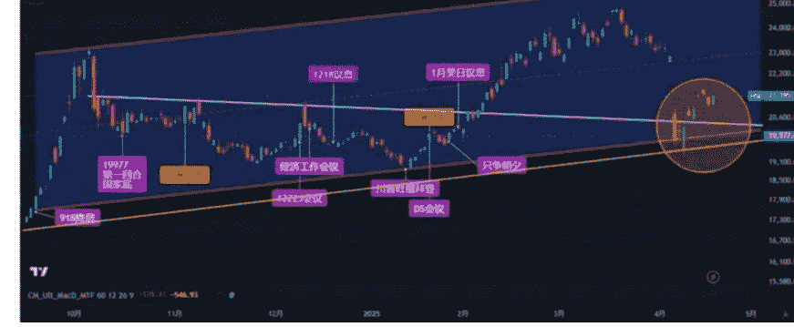
- A方面，上周预测，我们画了一条蓝线和红色线，非常完美；不需要调整，对于下周的预测仍然有效：
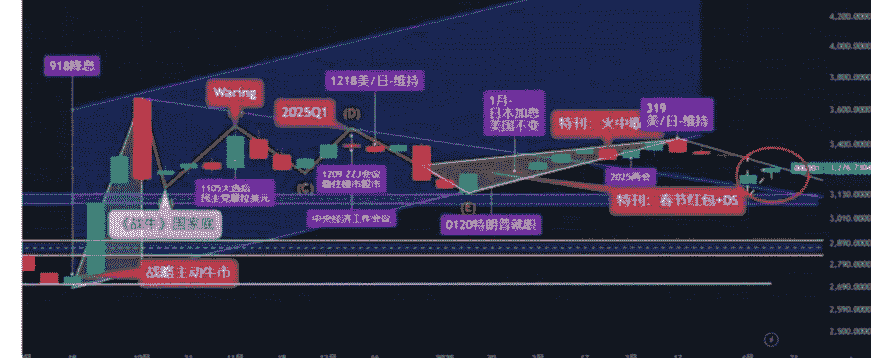

我们在2月10日至14日的周报中，强调了，特别是要日元贬值，并在之后的几周对日元的影响做了一些解读。有趣的，2024年的8月跌与关税日的恐怖，在美元对日元汇率上，表达了高度的一致性。

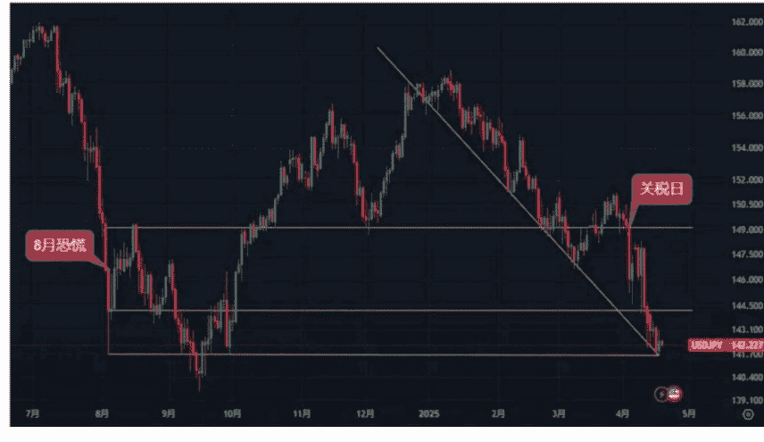

这周，我们聊聊日元。

## 一、日元

长期以来，日元因极低的利率和贬值状态成为套利交易（carry trade）的核心工具；投资者借入低成本日元高收益资产（利息接近0而且还为日元贬值时则更为方便）。

日元从2012年开始趋势性贬值，已经维持这种状态十余年了，在日本借钱太划算了，这些年机构/个人在日本日元借贷到各类资产的规模在10万亿美元左右。

然而，当日本处于趋势性贬值阶段时，这种策略的经济逻辑被打破，不仅是因为利率高了，更重要的是利率的升级。2024年7月31日，日本银行（BoJ）将政策利率从0调整到0.25%，并在2024年9月再次增加25个基点，标志着日本货币政策正常化的开启。这两次调整推动日元升值，对全球市场带来了显著冲击。

- 2024年8月5日：全球暴跌，日指数跌12.4%，创1987年以来最大单日幅；VIX指数（股市恐慌的波动率）从20飙升至65，显示全球市场情绪激增。
- 2025年4月：美国对日本商品实施关税，VIX指数抬升至60。同时，日元达到与2024年8月5日同等汇率水平。

这显然不是偶然巧合，反映了全球金融系统在当前水平已经进入到了一个不稳定的状态，尤其，在全球经济预期变化，大家面临的压力都比以前更大，当时借钱的时候，现在还链上日元走强，雪上加霜。

## 二、全球主要资产跟踪

### （一）美股

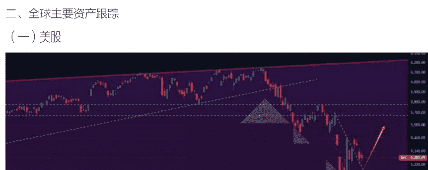

上周美股反弹很弱，不过市场情绪明显趋于稳定，这为了接下来的反弹修复奠定了基础。

### （二）黄金

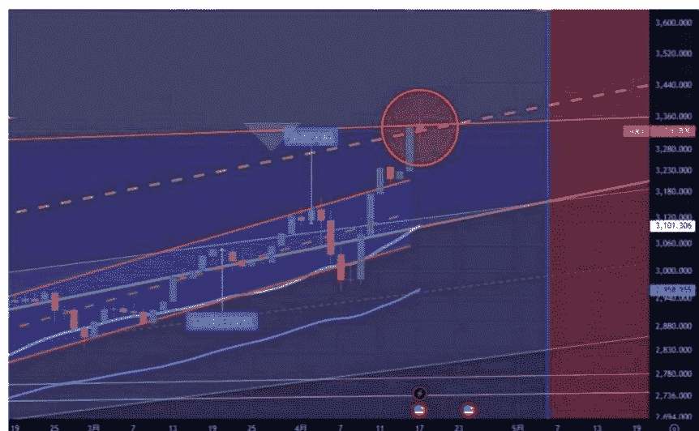

3350-3600是我们对黄金的预期“获利”区间，上周第一目标已经达到，短期不再是进场的时机。

### （三）加密

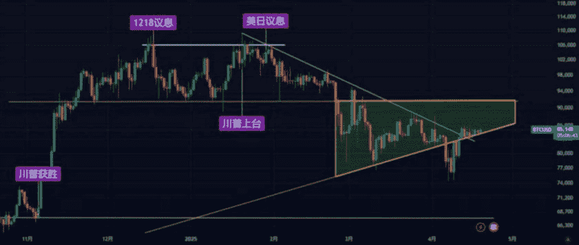

短期看，应该向黄色沿尝试回撤。

### （四）美元

上周，我们讲精彩的三国杀，从金融的视角：去年8月日元升，带来全球市场的罕见。我们在一季度的周报中多次强调，关税与去年8月日元位置。从这个角度看，美元短期倾向修复。

## 三、AH判断

### （一）H

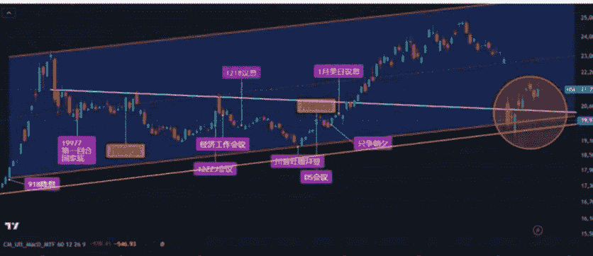

图不需要调整，接一段时间，主要在量筹。

### （二）H

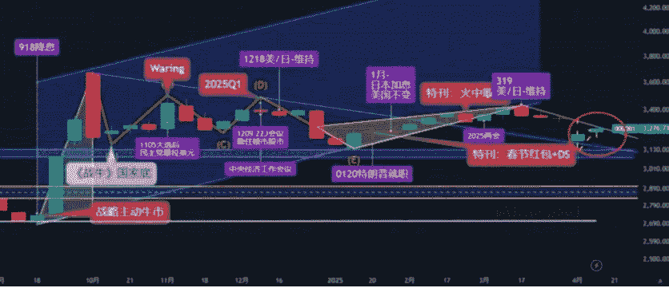

图不需要调整，接一段时间，主要在量筹。

## 四、技术分析

### （一）美股

- 标普500：周线优于颈线之上，未有效突破颈线之前看空。采用第二种方式，具体如下：
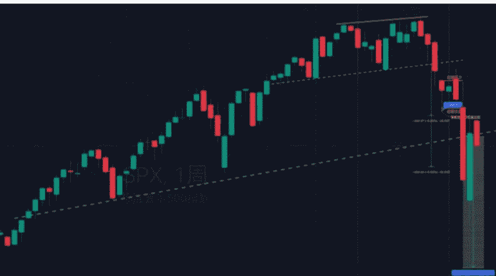

- 纳斯达克：周线级别，周线收于颈线之上，未有效突破颈线之前看空。反弹相对强势，已经突破第一个头部第二段跌幅区间，下周看是否突破短期压力1730，支撑1659。

### （二）黄金

- 日线级别：上周基于日线结构，使用涨幅区间（涨幅满足3207）和底部结构（涨幅满足3370）两种角度观察涨幅区间。本周黄金最高3357.92，低点3193.67，下周压力3370，支撑3207、3000。

### （三）BTC

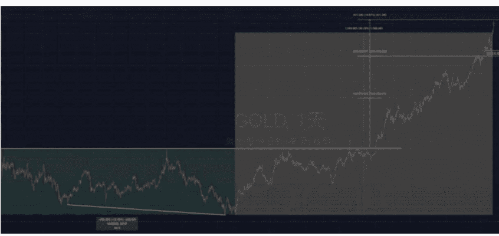

- 日线级别：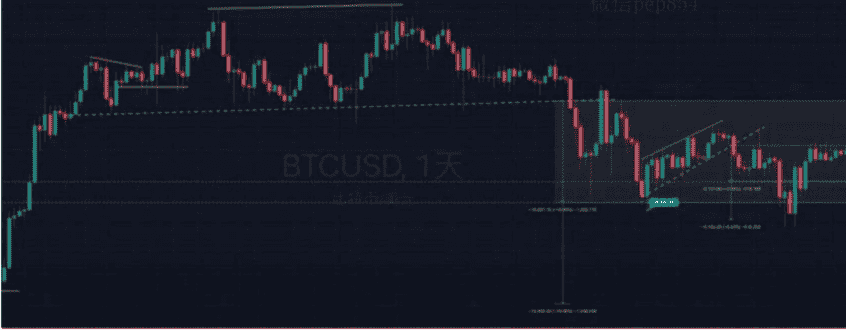 目前周走势为窄幅盘整，延续上周的观点，BTC有效跌破7760开空具有性价比。支撑80582、77760。

### （四）美元

- 美元指数：周线级别，目前仍然处于头部结构第二段跌区间满足窄幅震荡，满足点99，本周低点99.213。注意：周线连续三周收十字大级别颈线之下，美元长空趋势确立，一段跌幅目标87.4。支撑98.975，压力100.2。

### （五）AH

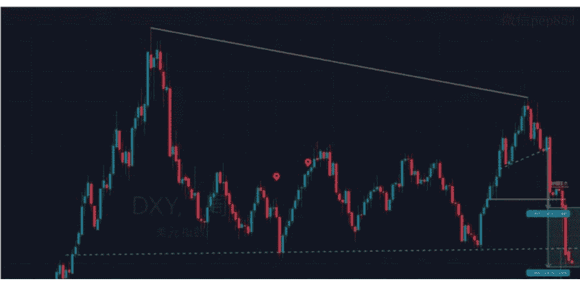

- 恒生指数：日线级别：维持上周观点，未有效破位之前(20307)，指数维持盘整。有效跌破20307，启动第二段跌幅，满足点18022。(img/46cbc42db484915fef1e462e7bc92a1e_7_1.png)
- 恒生科技指数：日线级别：维持上周观点，未有效破位之前(4725)，指数维持盘整。有效跌破4725，启动第二段跌幅，满足点3945。(img/46cbc42db484915fef1e462e7bc92a1e_7_2.png) 恒生指数突破收敛三角形二波。

### （六）A：周线级别

- 上证指数：周线级别观察指标：
  (1）周线收复3245。未有效破位之前(3245)指数维持贴盘。有效跌破3245、规模更大的头部成型。
  (2）长期支撑（红色上升趋势）：长期支撑的结构超过月线级别，线下整理时间以季度为单位。如图所示，对指数周线收盘点越来越高。
  综上，本周3276.73两道观察指标均达，下周长期支撑要求3260之上。上证本能反弹走势先领先，多头看上证SO，空头看沪深300。(img/46cbc42db484915fef1e462e7bc92a1e_8_0.png)

- 上证50：日线级别。上证50本周相对强势，在颈线2608之上震上行。可将上证50作为上证的领先指标参考，下周支撑2608，压力2684。综上，颈线2608可以不做多但不应空。

- 沪深300：周线级别观察指标：周线收复3767。3245周线收复3767。3245之上指数维持盘整，未来有效跌破、规模更大的头部型。(img/46cbc42db484915fef1e462e7bc92a1e_9_0.png)

- 沪深300：日线级别观察日线结构，周线虽然收于3767，但反弹较弱，多空缩量。综上，周线、日线显示做多沪深300需要谨慎，位置建议做好风控。收3767之上。(img/46cbc42db484915fef1e462e7bc92a1e_9_1.png)

- 中证500：周线级别更大头部颈线，修正为5389，目前日线、周线收于颈线之上，维持盘整。日线级别关注5468.6，破位回测颈线5389。

- 创业板：周线级别周线未能收复2027，下周未收于2027之上导致破位的头部型。根据统计，跌幅足够给出参考位1605、1677。(img/46cbc42db484915fef1e462e7bc92a1e_1_0.png)

- 科创指数：日线级别维持上周观点，周线收益于938.7之上，指数维持盘。当前指数维持强势，可以不做多，但没有理由看空。支撑978.7（日线级别）、938.7（周线级别）。img/46cbc42db484915fef1e462e7bc92a1e_1_1.png)

A-GIX指标图观察K线市场运行，其主要意义在于干预仓位大小的考量，而不是简单的猜市场的涨跌。上周，周初保持仓位滚动（不建议追高），下周整体仓位重建建议。本周收盘，除上周指数、科指横荡，其他主要指数呈现震下势；个股方面，周二两次实现涨幅4044只，周三至周五仅为1623只，其中涨幅超过2%为743只；同时，市场成交最低为924之后的新低。下为本周收盘数据（图中，上为价格均线及情绪趋势，下为情绪趋势的监控指标和波动趋势线）。img/46cbc42db484915fef1e462e7bc92a1e_12_0.png)

指标解读：
上周收盘数据，情绪趋势正常上行，且两项监控指标均在高位，所以建议周初保持仓位参与；本周数据显示，情绪趋势、监控领先、4月15日开始同步向下、波动同步向下发散。从市场成交分布来看，传统行业，如电力、交通运输、商贸零售等板块占比从月底开始逐步上升，科技板块优模拟芯片、光刻机等局部机会，但是并未形成规模，市场仍处于防御阶段。如下绿色板块波动指标（黑色为板块成交占比，绿色板块波动指标），月底已进入防御阶段。(img/46cbc42db484915fef1e462e7bc92a1e_12_1.png)

鉴于A-GIX指标全部在下行过程中，且市场整体重心逐步下降，下周建议：
1. 从均价线、波动指标均线可以看出，本周收盘后市场基调仍是反抽，以防守仓位为主。
2. 如无特殊外力影响，预计上半年情绪趋势及其两项指标会继续下，下周接近底部时，市场可能会出现力度的转换，保持耐心，观察三周：
3. 观察上几张行业整体成交量，均线位置已经经过2024年12月底的高位，这里存在风格转换的机会，但是如何转换出来？本周芯片（模拟芯片）半持建议或择守均附近前期强势

财金处助理
每次赞赏有随机福利
