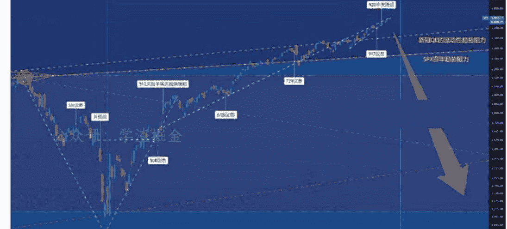
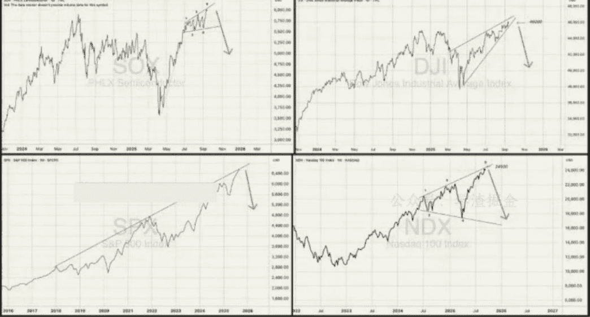
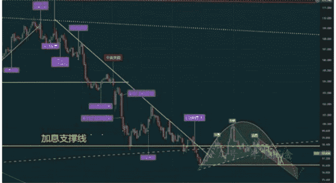
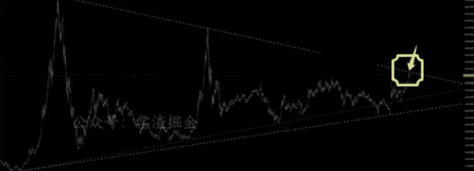
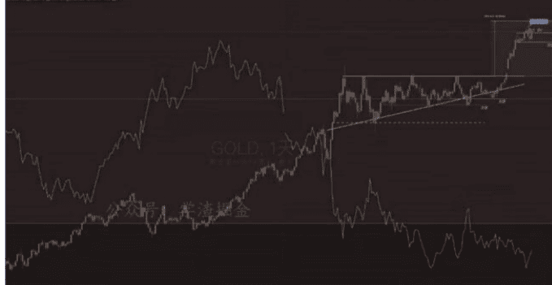
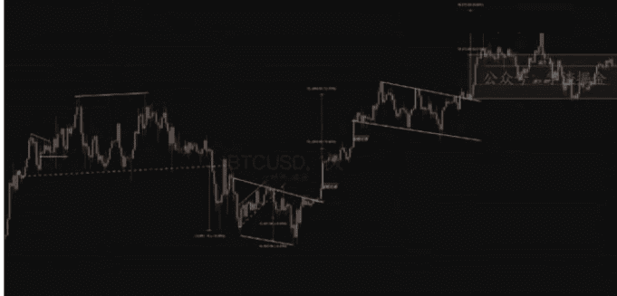
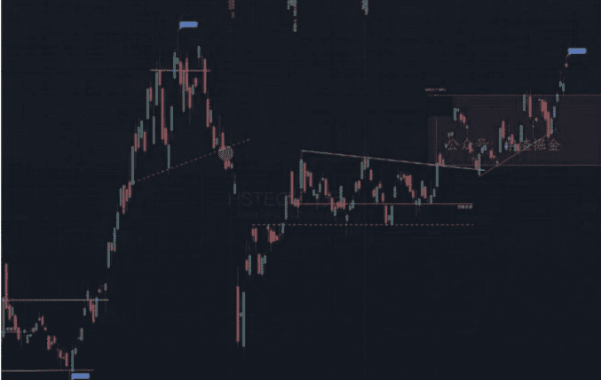
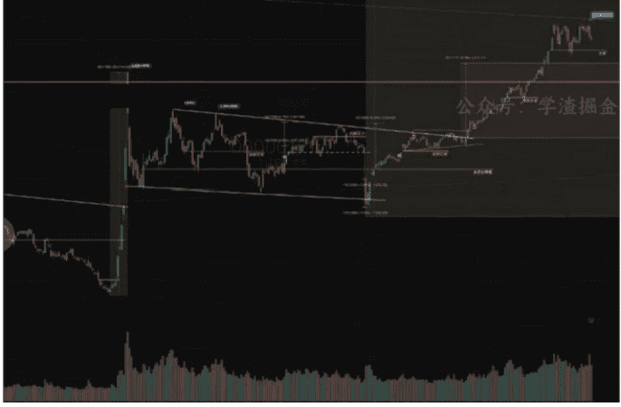
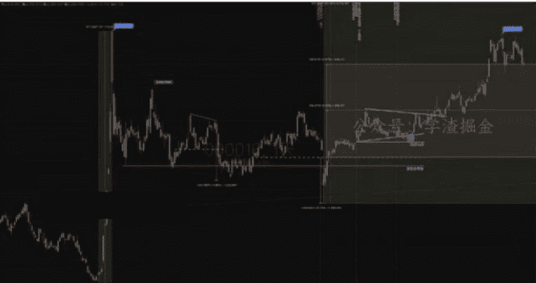

# 全球市场每日预测0922-0927资产再定位

20250921 财处主理金政通鉴

助理提醒：本周报内内容超多，回顾《新川交易》《新货币战争》布局；探底美联储降息后各类资产再定位；通过川普通判最新国际博弈形势。以下周重点事件、关键数据为出发拓展延伸，纵览全球市场，研判各资产影响。建议仔细阅读。

《Q1》预测美股迎顶，2月出现“一顶”《Q2》预测美国2025年爆发危机的概率高达90%；关税大跌，美国一季度GDP为-0.3%。

《Q3》预测“二顶”，期间段走强震荡：标I-8都表现亮眼，联合特利，总收益翻倍。

今年甄享群的课程介绍了“标1是《新川交易》的引导指标，必须成为全市场的龙头”而“标2是《新货币战争》的引导指标，将为两个系列收高潮。

时政·财经·职业·职·自媒体·行业·影音·软件 付费文章·付费课程·付费社群·其他资源

加微信top28688，免费进资料群

这个策略设计，目前1和2都已经翻倍，一年前发布的研报逻辑——兑现。

标1-新川普交易
标2-新货币战争 公众号

## 2024年9月设计本策略的介绍图

根据策略设计，我们先推出《新川普交易》，然后是《新货币战争》，结合《季报》，已经把整个策略的框架和逻辑顺序渐进地做了介绍，一言以蔽之：

资产配置应当从股票开始，逐渐配到商品均衡配置。

趋势避害，是天性。对于大A投资者，只能做多，通过股票上涨来赚钱，因此，期待上涨是一种普遍的情绪；对于机构投资者，特别是外资，习惯做空，并且做空有的时候也是一种重要的盈利手段，有时候会制造下跌，如比索罗斯。多空均衡，可以避免主观情感，更冷静客观。

结合《周报》与一些社群互动，通过市场实践练上上述策略，一言以蔽之：交易技能应当从“单做多”逐步向“多空均衡”发展，因为黄金坑一定会来。

加微信top28688，免费进资料群

上周鲍威尔直播，“本来应该从容，游刃有余，”虽然已经习惯了睁着眼睛说谎，但还是第一次感觉鲍威尔有些“忙忙忙，语无伦次”。

今天，我们聊聊降息后美元、金银、美股、AH走势所表达的资产再定位，这是下周盘后的背景，而根士丹利最新的表态验证了我们的策略，后讨论一下川普电话：不在于内容，而在于布局。

## 一、资产再定位

回顾历史，刚开始，降息是应对经济危机的直接手段，一出事，迟迟降息：后来有了一些领先指标，降息得以提前，具备了一定的预防功能。说白了，降息就是药，病了才会吃。在宏观经济研究方面，类似于医生说“常规规划”，属于常识。917鲍威尔启动第四次降息，市场一致预测还有第五次六次，各国央行和机构都明白：病得重，药不能停。

各国央行和机构，主要配置都包括大规模的美债，毫无疑问，降息的接近以及持续降息的预期，会推动他们进一步低美债的持有，所以首先应该看到长端美债卖出增加，还会看到美元走弱；远离美元资产体系的资本，寻求新的长期通胀的安全资产，加微信信号top28688，免费资料群

结果看到：美股偏弱，AH强势，金银很强，这在降息前几天表达的很充分。

随着降息落地，资金开始组织反攻，也就是修复弱势的美元资产，压制非美资产，结果看到：金银和AH压承，上周二三四属于博弈高峰，到上周五基本给了短线趋势预期：银+3%，金+1.11%，SPX+0.49%，美元+0.3%，H-0%，A-0.3%。

这个过程并不理想的是A，A当前位置，前几周期报已已经讲得很透彻了，如果A猛一点，SPX就会弱一点，此消彼长，但是周四A在3899.96硬生生地被封到3801，“本应该从从容，游刃有余”，但但在这种形势下这种表现，实在是打击士气。这会直接导致轮进攻上限和防御下限，总体向下调整：原本估计进攻上4200在3500，现在哎。盘后就是上述背景。

另一方面，中美通话，代表了川普从普罗到英国到东大，形成了对欧盟的合围，可以预见，欧洲，具体是法国很快要出事，我们将在季报《Q4》中进一步展开。

加微信top28688，免费进资料群

### 摩根士丹利60/40/20 策略配置表

| 资产类别 | 权重比例 |
| :--- | :--- |
| 股票 | 60% |
| 固定收益 | 40% |
| 黄金 | 20% |

| 摩根士丹利偏好60/40/20策略，黄金作为通胀对冲。By Mike Wilson, September 17, 2025. Morgan Stanley (MS) Chief Investment Officer Mike Wilson said on Tuesday, A 60/40 portfolio which typically has 60% of holdings in stocks and the remaining 40% fixed income, moves on two asset classes to offset another, with stocks strengthening amid optimism and bonds rising during turbulent times. 全球央行持续增持并推高金价至3700位置的背景下，可以理解。至此，《新川交易》和《新货币战争》的布局得到了验证。

## 二、全球市场跟踪

### （一）美股SPX

上周预测：最后的最后的疯狂。

### （二）金银

上周预测：符合预期。上周二达到3700位置后撤出开始受阻于红轨。

下周预测：整体受阻于红轨。上周预测：符合预期。节奏黄金，下周初白银需要强势突破可打开空，否则金银倾向于防御。本周预测：周一二突破，周三四防守，周五反攻。金银已完成“降息洗盘”，下周大概率加速。

### （三）BTC

川普上台，我们一直看多BTC，上台后开始看空。所以其实不用预测，态度鲜明。不赌这个热点的原因，还不是时候。随着《法案》发布，稳定币气势如虹，BTC也突破了关键阻力线，范围5W/3W甚至50W。这是一个很好的例子：7月1日突破阻力形成技术上的看涨形态，而在8月1日一把消灭。技术分析服从博弈分析。BTC每周观察进展。我们的图，数月不需要调整，技术只是辅助，博弈才是关键，然后是基本面的确认，是的，BTC的基本面。继续重观点，并特别强调风险。

### （四）美元

上周预测：符合预测。先看下哪些新闻。以色列在72小时内轰袭了6个国家外交部表态

| 财财经(关注) | 0人参与评论 |
| :--- | :--- |
| 2025年09月13日 15:49来自北京 | |

政治|抗议活动 法国处于十字路口：全面封锁与政府面临的塔威胁

在《特刊：黑红血液》已经经分析中东局势与美元的关系，72小时轰袭6个国家是明显挑衅，而且急升局势，尽量维持美元在当前位置，避免降息的冲击过大。

下周预测：美元在降息周走了深V，但周波动幅度不大；下周上半周，中东局势需要快速升级以支持美元逆转趋势，否则美元短暂反弹后将开启更深的下降通道。

### （五）日

上周预测：强于预期。恒生第5次突破，有效破HKJP的粉锁，技术上应该看到更高了--HKJP是一个源自2008年的封印，长期来看，这预示了恒生未更开阔空间。

### （六）A

下周预测：HKJP的突破，标志着恒生完成了第一阶段；同时回到HSI，我们看到周四“摸顶”就开始回调了。支撑线在3600。

上周预测：类似HKJP，指数正在3900以下区域整顿，目前看是一种进攻形态，蓄势，这次进攻应该是通过核心权重来实现。本周预测：上周弱于预期，很失望。在3899.96被按下，然后跌破短期线，哪怕390。

## 三、技术分析

### （一）事件驱动：09-22

【数据】中国9月1期与5期LPR报价(09:00)。综述：LPR若调5bp，“宽松前置”为A股流动性溢价；持平，则符合“谨慎”。

【事件】经济运行情况举行发布(15:00)。综述：若释放财政加码、消费刺激或“大招”，A股溢价有望反弹；若仅重复“稳”，市场等待明确落地，A股溢价维持但不涨。

【事件】美联储威威尔·鲍斯讲话(45)。综述：暗示“10月暂降息”，可能引发“过热→通胀回潮”叙事（美元长债↑）；若强调“就业下行风险”，则加强“转冷→增长下行”叙事（美元长债）。

【事件】美联储鲍威尔讲话(22:00)。综述：同上。与威威尔·鲍斯同步，若同时放宽，强化“过热→通胀回潮”叙事；若双鸿，则加强“转冷”叙事，黄金与长债获得对冲需求。09-23 周二【数据】欧区9月制造业PMI初值(16:00)。综述：欧区制造业PMI若跌破45，将强化“全球差异”逻辑，加强“过热→通胀回潮”叙事（美元长债↓）；若回升，则削弱美元避险。“全球差异”指欧美数据相对强弱，若欧区数据更弱，美元相反优势而走，加强“过热→通胀回潮”叙事。【数据】美国9月Markit制造业PMI初值(45)。综述：PMI>50且高于预期，将推升“过热→通胀回潮”叙事（美元长债↓）；PMI<48则触发“转冷→增长下行”叙事（美元长债），黄金与长债获得缓冲需求。【数据】美国9月Markit服务业PMI初值(45)。综述：服务业占美国经济权重，若同步跌破50，将确认“转冷→增长下行”叙事（美元长债）；若回升，则削弱“转冷→增长下行”叙事。【事件】2026年FOMC票委、克利夫兰联储主席哈玛马克就美国经济发表讲话(00:00)。综述：若强调“通胀粘性→10月暂停降息”，将加强“过热→通胀回潮”叙事（美元长债↑）；若强调“就业下行风险”，加强“转冷→增长下行”叙事（美元长债）。综述：与哈玛克同向放鹰，强化“过热→通胀回潮”叙事；同向放鹰，则加强“转冷→增长下行”叙事（美元长债）。【事件】英国央行行长贝利发表讲话（22:00）。综述：贝利若放鹰（暗示继续降息），英镑走弱→美元相对走强。若放鹰，则削弱美元相对优势。补充：若欧元区、英国数据和前景美国还差，美元也可能因相对优势而坚挺。【事件】2027年FOMC票委、亚特兰联储主席鲍斯蒂就经济前景发表讲话（22:00）。综述：鲍斯蒂提及“通胀上行风险”，将加强“过热→通胀回潮”叙事（美元长债↑）；若强调“劳动力市场快速降温”，则加强“转冷→增长下行”叙事（美元长债）。

## 09-25 周三

【数据】美国8月新房销售总数（万户）（22:00）。原文引用同上。综述：新房销售<40万将强化“弱”共报；>42万则延缓“转冷”叙事，进入“过热”场景。

## 09-18 周四

【数据】美国8月个人支出率(20:30)。综述：个人支出<0%将PCE初期形成“滞胀”雏形，进入“冷场”场景；>0.5%则削弱通胀担忧。【数据】美国8月核心PCE物指数同比&环比(20:30)。综述：终值>2.7%强化“通胀回潮”场景，进入“过热”路径；<2.5%则巩固“冷场”场景。【事件】美联储鲍威尔就银行压力测试发表讲话(01:00)。综述：若鲍强调“金融稳定→不急于降息”，将短线提振美元；若暗示“压力测试宽松→继续降息”，则压制美元。【事件】2027年FOMC票委、旧金山联储主席载利发表讲话(03:30)。综述：若强调“通胀粘性”，将进入“过热”场景；若强调“就业下行风险”，则进入“转冷”场景。【事件】2027年FOMC票委、里奇豪联储主席鲍威尔发表讲话(21:00)。综述：巴尔提及“通胀上行风险”将进入“过热”场景；若强调“劳动市场快速降温”，则进入“转冷”场景。【事件】美联储理事事鲍威尔发表讲话（22:00）。综述：鲍威尔若提及“通胀上行风险”，将进入“过热”场景；若强调“劳动市场快速降温”，则进入“转冷”场景。

## (二)美股

### 标普500：日线级别

上周观点（精简）：本周SPX低开高走，突破区间（5999至6512），最高6600.21。日线级别确认了突破有效性，确认后6512作为支撑观点。

本周观点：09/18 09/1820 本周SPX低开高走，突破区间，最高6600.21。日线级别确认了突破有效性，确认后6512作为支撑观点。09/19 周五SPX回落3900，纳指同步回落，2:30SPX转强。

### 纳斯达克：日线级别

上周观点（精简）：本周纳指低开高走，突破区间（18000至19500），最高20000。日线级别确认了突破有效性，确认后19500作为支撑观点。本周观点：09/18 09/1820 本周纳指低开高走，突破区间，最高20000。09/19 周五纳指回落3900，纳指同步回落，2:30纳指转强。

未来一周，因美元指数转强与黄金现同步转强，建议关注支撑3674.78，具体观点如下：

1、支撑3674.78之上，现货黄金领先于加速上行。如突破前高3707.47，关注涨幅满足3741。

2、如现货黄金冲高回落，不跌支撑3674.78，黄金窄幅盘整，白银加速上涨。跌破支撑3674.78，现货黄金区间盘整（3623至3674），白银波动加大。

压力：3674.78（09/15突破，压力位上移）、3741、4176

## (四)BTC

比特币/美元：日线级别
上周观点（精简）：

本周走势与预期基本一致，维持不建议参与短期博弈的观点。BTC耐心等待震荡型结构完成，届时寻找做空机会。BTC作为加密资产流动性、投机情绪更为敏感，可作为投机情绪参考指标之一。

本周观点：

加微信信号top28688，免费进资料群

本周美联储降息落地，作为美元计价资产的BTC，本周突破压力115697（受益于市场投机情绪升温）。

未来一周，BTC有望维持高位，意味着市场投机情绪持续，纳指、SPX、白银受益。BTC突破顶部118343，投机情绪创高，纳指、白银加速速涨。

如BTC量能下降，可作为投机情绪退潮的参考信号之一。

压力：118343（区间顶部）
支撑：115697、11396

## (五)美元

美元指数：日线级别
上周观点（精简）：
美元指数确认跌破支撑线，跌幅满95.384。本周美国就业数据大幅下修，PPI数据大幅低于预期，美元指数围绕97.6展开多空博，未有效跌破97.6，走势强于预期。

未来一周，关键在鲍威尔如何描述“后续路径”。若示“暂停观察”，加微信信号top28688，免费资料群将短线空头回调，黄金与新兴市场回落；若保留连续降息选项，美元位下跌，黄金创高，非美股市普涨。如美元再次出现利空不跌，需引起重视。可能是欧洲、日本经济前景更弱，或地缘冲突升温，避险需求对美元形成支撑。

### 本周观点：

美联储利率决议，降息一次，但点阵图和鲍威尔记者会，无不在表达这次是一次偏鹰的降息。09/17 2:00美元跌破前低96.31，最低96.21。2:30美元指数转强，收96.87，30分钟级别别反包跌幅。09/18、09/19美元指数数据延续反弹，09/19收97.6（支撑97.6）。

未来一周，将97.6作为短期空分界线进行观察，可结合事件驱动章节与现货黄金走势观察。美元指数与现货黄金同步转，如果维持，意味着未知风险资金在避险，例如国债、日债、地缘冲突等。

支撑：97.60（区间下沿）、97.10（前低）、96.37（前低）

## (六)AH

恒生指数：周线级别

上周观点（精简）：

恒生指数突破压力（25919），选择向上突破。本周为突破线涨幅满足区间，第一周，如认为有效突破，进行第二段测幅。

### 本周视点：

恒生指数突破压力(25919)，选择向上突破。本周为突破线涨幅满足区间，第二周，如认为有效突破，进行第二段测幅。

### 恒生指数：日线级别

### 上周视点：

本周走势强于预期，恒生指数有效突破区间顶部(25919)，最高26585.95点。周线级别未确认突破有效性之前，建议谨慎参与。未来一周，日线级别博弈，可参考上升通道，高抛低吸。风控参考支撑25919(区间顶部):如有跌破或放量跌破，止损。如回测破，短期博弈买点。

### 本周视点：

09/17、09/18，受益于美联储降息预期，恒生指数日线突破上升通道上沿，随后指数冲回落。未来一周，建议做好风控，跌破买点26330指数转弱。博弈短期买点，参考区间顶部25919或上升通道下沿。

### 恒生科技：日线级别

### 上周观点：

本周走势强于预期，恒生指数有效突破区间顶部(5824)，最高6042.61。恒生科技选择在此时突破，存在测试高点的可能性。未来一周，参与博弈需谨慎。受美联储降息预期，回调可能构成压力。风控参考5824(区间顶部)，有效跌破止损。如回测破，短期博弈买点。

### 本周观点：

恒生科技突破年内高点6195，09/18跟随美联储降息预期同步转强。未来一周，建议做好交易，如指数冲高建议锁定。如跌破6133，恒生科技转弱，建议做好风控。

### 上证指数：周线级别

### 维持观点：

周线高位盘整，如有有效突破长期压力，期待波段涨幅。风险提示：周线持续缩量，建议保持意识严格风控。支撑：3771（短期支撑）、3714（涨幅满足）。压力：3912（长期压力）、4025（波段满足）。

### 上证指数：日线级别

### 上周观点：

本周走势强于预期，09/11放量上涨，09/12最高3892.73（反包前高3888.59），距离长期压力3915之遥。未来一周，预期试探长期压力3915，突破后会有回调，建议提前做好交易。如有有效突破长期压力3915，参考周线波段满足4025。风控参考支撑：3771，3714。

### 本周观点：

上证上周最高3899.95，距离长期压力3915之遥，随后指数冲高回落。未来一周，指数位于3771之上，如保持成交量高，视为温和调整，可通过高位盘整解获利，突破长期压力蓄势。长期压力为下降趋势，随着逐步下移，突破的概率并不低。压力：3912（长期压力）、4025（波段满足）。

### 上证50：日线级别

### 上周观点：

本周走势强于预期，09/11放量上涨，09/12最高3892.73（未反包前高3006.68）。未来一周，上证指数试图突破长期压力，预期上证50尝试突破。

### 本周观点：

本周走势低于预期，低开低走，09/18/09/19连续击穿支撑2910。作为控盘工具，连续打压上证指数涨速可以理解，如果跌破支撑2910，意味着上证50转弱，且形成成型结构，将进行预测幅度。未来一周，密切关注2910能否守住，如有有效跌破或放量跌破，上证指数需降低短期乐观预期，同时关注沪深300走势（对题材股、周期股都有影响）。

压力：3006.68（前高）、3016.87（24/10/08高点）、3276（波段涨幅满足）
支撑：2910

### 沪深300：周线级别

未来一周，建议根据自身风险偏好，逢高锁定收益。

2段涨幅4304至4722，波浪测幅满足点4819

### 沪深300：日线级别

### 上周观点：

本周走势强于预期，09/11放量上涨，09/12最高4564（反包前高4548）。沪深300与上证指数同步转强突破前高，本周走势强于上50。未来一周，建议逢高锁定利润，如上证突破长期压力3915，沪深300回测不破支撑4386。

### 本周观点：

本周指数最高4573.83，呈现冲高回落走势，09/19相对弱，未能有效反包跌幅。未来一周，操作偏守为主，建议逢高锁定利润，风控参考支撑4386。上证50未跌支撑2910，沪深300回测不破支撑4386，博弈机会。支撑：4386（日线风控）、4304（周线），压力：4722（区间顶部）。

### 中证500：周线级别

### 本周观点：

仅更新表，增加上升通道，未来一周，根据自身风险偏好，逐步兑现收益。波段测幅满足7159。

### 中证500：日线级别

### 上周观点：

本周走势符合预期，6878高位盘整，09/11放量上涨。09/12最高7200（反包前高7110），到达周线波段满足7159。中证500与上证指数同步转强突破前高，本周走势强于上50。未来一周，建议适当兑现收益。如上证指数有效突破长期压力，建议做好交易计划，注意做好风控。回测不破6878，放量转强，有短线线机会。

### 本周观点：

本周指数最高7350.97，呈现冲高回落走势，回测短期支撑7110.68，收7170（突破6878不破）。未来一周，关注短期支撑7110.68，作为短期风控。6878支撑有效，有短期博弈机会。结构即使转弱，仍可能构建右肩，暂不直接破6613。支撑：7159（波段涨幅满足）、6878（涨幅满足）、6613（支撑）。

### 创业板：日线级别

上周观点：

本周走势强于预期（反包高2985.94），预计跟随上证指数突破转强。

### 本周观点：

指数本周最高点3168.67，回测未跌破支撑3053。未来一周，建议逢高锁定收益，高抛低吸。短期风控参考3054，跌破2985下跌可能加速。如2985支撑有效，有短期博弈机会。支撑：3054（短期支撑）、2850（日）、2747（周）。

### 科创50指数：周线级别

### 本周观点：

计划下周停止科创50周线级别观察，保留线级别观察。周线级别涨幅满足，按波测幅也涨幅满足，1601非短期目标。周线级别结构观察，供参考（非短期涨幅目标）：红色区间：底部结构（2022年以来），足够点1601。

支撑：1326、1275

### 科创50指数：日线级别

### 上周观点：

本周走势超预期，09/11放量突破1275回到支撑之上，09/12最高1360（未反包前高1366.9），再次达到周线波段满足1326。未来一周，建议逢高兑现收益。如上证指数有效突破长线压力，建议做好交易计划，注意好风控。

### 本周观点：

指数本周最高1433.57，回测短期支撑1364.60，收1362.64。未来一周，关注短期支撑7110.68，作为短期风控。6878支撑有效，有短期博弈机会。结构即使转弱，仍可能构建右肩，暂不直接破6613。支撑：7159（波段涨幅满足）、6878（涨幅满足）、6613（支撑）。
