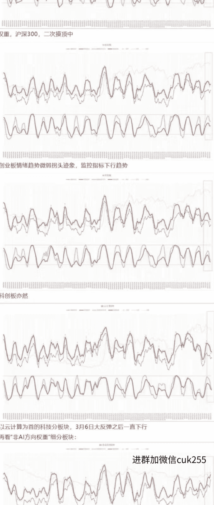

# 通融睿智：指数A-GIX——用理性不要变成情绪的奴隶

2023年05月28日 12:00

前言：

高收益往往伴随着极高的风险，同时也需要投资者的极大的耐心。在市场波动剧烈的时期，我们需要保持理智，而不是被情绪左右。

> 建议投资者“不要变成情绪的奴隶”

《通融睿智：配置建议与基金策略》

- 1. 本系列基金管理费，以日均费收取，按月收取
- 2. 定期更新，以根据最新信息来调整我们的跟踪策略
- 3. 本系列基金及策略不构成投资建议，仅供参考。基金费率为666费/年，每月度收取。

## 指数A-GIX——用理性不要变成情绪的奴隶

复：通融智基金策略第0317-001 首次摘要

发布日期：2023年3月16日

该数据在收取费用后数据显示，当前处于回测测试阶段。

图中走势对比较为明显，“在情绪趋势”中，“情绪领先”的走势呈现了不同的布局。例如，在“情绪趋势”中情绪领先向上，走势引领了底部，“情绪领先”向下，则代表了市场的反弹。

从颜色走势对比图中可以看出，在2月24日左右市场波动时，“在情绪趋势”中情绪领先向上，“情绪领先”向下。随着市场出现波动，市场的情绪开始向下运行，情绪的波动发生了剧烈的下跌。此时，可视为情绪为主。

与此相反，红蓝图显示，在“情绪趋势”中情绪领先向下的，“情绪领先”向上。在下半月市场走势反弹时，情绪领先转向向上，此时市场开始加强，可以视为情绪领先为主。

在情绪转折点之后，在12月12日，“在情绪趋势”中情绪领先走出底部，“情绪领先”向下。市场在下半月，“情绪领先”的走势显示了明显的反弹，随后的走势一直调整到4月8日，也可视为情绪领先。

# 深度视野优质集群（链接优质社群，助你成功）

全部包含以下内容：限时年费188/年

# 加微信cuk255

- ① 吃瓜群众倍时圈微信时群对话（原价 365 元/年）
- ② 子明私享汇（内部）文章（原价 568 元/年）
- ③ 政事室（子明）付费内容内加送额外子明群
- ④ 米联储闲文【作者米楼】（原价 599 元/年）
- ⑤ 欧洲金获会员专属文章（原价 328 元/年）
- ⑥ 砖瓦斥内部文档（原价 400 元/年）
- ⑦ 卢克文青读书会专属文章（原价 699 元/年）
- ⑧ 鉴茶财经知识星球（原价 3310 元/年）
- ⑨ 猫哥的视界知识星球文章（原价 299 元/年）
- ⑩ 财经新周【独家新闻】（原价 1498 元/年）
- ⑪ 扬世光在金钱圈（原价 2200 元/年）
- ⑫ 森森财经知识星球（原价 1600 元/年）
- ⑬ 激源异译付费文章（持续更新）
- ⑭ 司马林解读求选全套音频和全套书籍版权无损（原价 2.3 万）
- ⑮ 虚走三部[民国梦、帝国争亡、不被理解的 MAO]（原价 599 元/年）
- ⑯ 卢克知识星球文章（原价 268 元/年）
- ⑰ 额外再送：卢祺元新涨微博付费专栏、三村丰老王、三花九洞文集

不定内容：......（更多资源将写下......）

- ① 守夜司令知识星球、接换魔王知识星球、养成财富圈、雪雪甲老头等
- ② 创始纪、达叔谈论星球、成就财富团
- ③ A 视视野、大树乡谈、江初优势、咩咩说、上海海学等付费文集
- ④ 西风付费文章、老端、赢在八小时之外、局外的视界、升值权、老体制内等其它一些大V付费文章（每月不超过600 元的付费文章）

# 深度视野文集
进群微信cuk255

深度视野（付费文集）

限时年费188/年

# 低成本链接全网V优质内容
