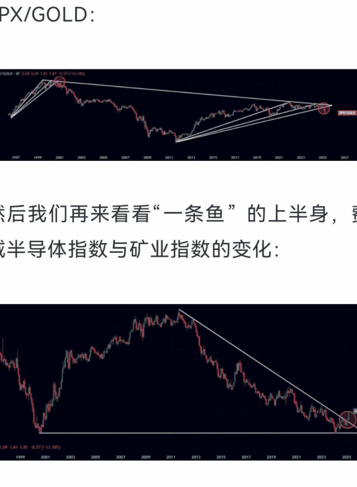
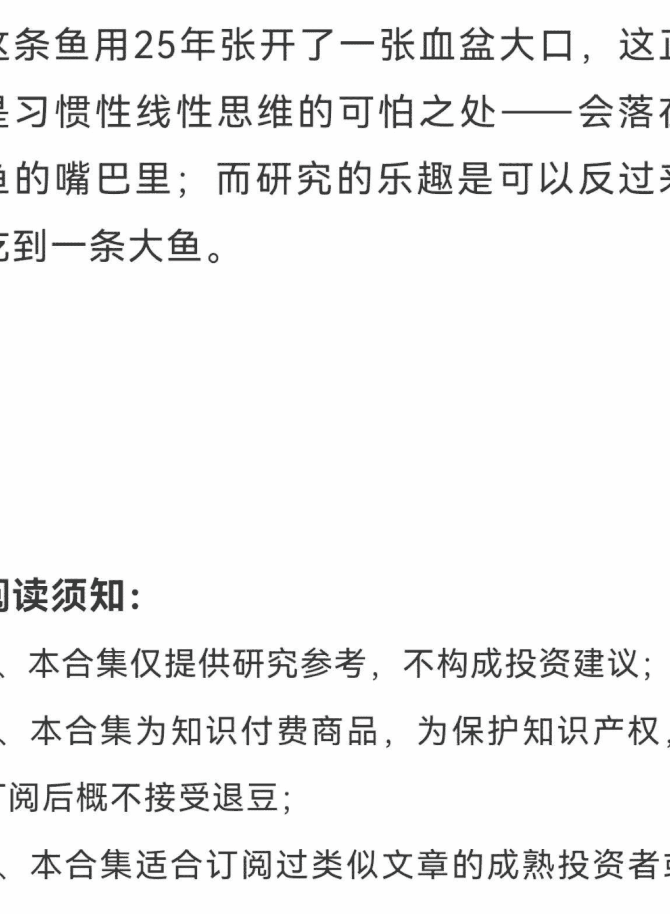
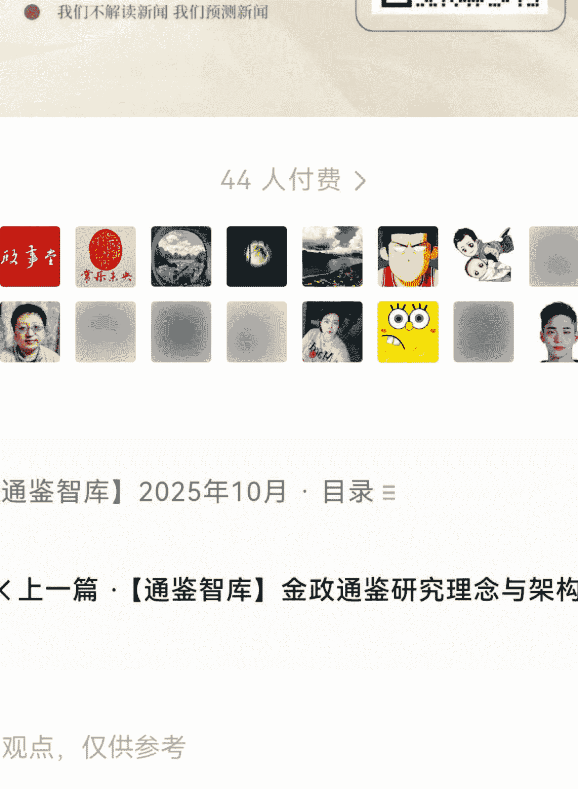

# 【通箔】一条鱼——吃与被吃

财富 金融

2025年10月25日 12:00 🕒 全享

前言：

《通箔》有我们领先的视角，能够带给读者不一样的洞见。深度视角cuk255

当前高收益率对黄金和股市带来了哪些深层次的影响？

并通过对技术分析的进一步优化，我们对市场进行深入调研，并进行策略调整：

希望让广大的读者通过我们的报告，分享我们的逻辑，可以涵盖国际宏观政策、市场波动，进一步完善“通箔”的投资体系：

- 第一系列合集报告“一条鱼”，旨在让读者获益，报告涵盖全球新知识，以我们的视角带给读者不一样的洞见。希望帮助读者获益，进一步提升投资收益；
- 第二系列合集侧重于“通策略”，旨在提供投资建议，可以涵盖国际宏观政策、市场波动、矿业等板块构建投资体系；
- 第三系列合集订购为 666 元/月，每月 4 期。

## 一条鱼——吃与被吃

原文：全球市场深度视角 0331-0440 ——一条鱼

发布时间：2025年03月30日

“5030 点底部告诉我们，对于美国股市长牛表现非常离常，尤其是其中的科技股，如此几只指数。以费率半导体指数为例，从 2009 年至今，涨了 30 倍”。

正是你所疑惑的，从 1971 年与黄金就开始跟踪，黄金累计涨幅超过了 SPX：

历史上，SPX 与黄金基本上是如此涨长的。但是，他们却跑在一起。我们放大尺度，先看“一条鱼”的尾巴，身体也是

然后我们再来看“一条鱼”的上半身，黄金或半导体指数与矿业指数的变化：

正是你所疑惑的，在 2000 年到 2011 年，矿业指数走势领先了黄金或半导体指数 10 年。

这条鱼用了多年涨了一鱼大口，是习惯性线性的可能的之处——合在黄金的泡沫里，但却是可以过来看到这一鱼。

阅读导：

- 1. 本合集仅供参考，不作为投资建议；
- 2. 本合集为付费需购买，保护读者知识产权，任何转载不构成侵权；
- 3. 本合集订购为类似的投资者交流金融人士参考，仅供投资者投资决策参考，错误不承担任何责任；
- 4. 订购后回复，代表观点代表本人声明。

【通箔】2025年10月 · 目录

上一篇 · 【通箔】金箔研究经历与积累

个人观点，仅供参考

## 深度视野优质集圈（链接优质群，助你成功）

全部包含以下内容：限时优惠 188/年 加微信cuk255

- ① 吃瓜群众倍联时圈加时群对话（原价 365 元/年）
- ② 子明私享（含）内部文章
- ③ 政事堂（陈子明）优质内容内报送陈子明群
- ④ 米联实闲间【作者刘谦】原价 599 元/年）
- ⑤ 澳洲企会员专属文章（原价 328 元/年）
- ⑥ 砖瓦人内部图圈（原价 400 元/年）
- ⑦ 卢克文读书会专属文章（原价 699 元/年）
- ⑧ 鉴茶财经知识星球（原价 3310 元/年）
- ⑨ 猫咪的视野知识星球文章（原价 299 元/年）
- ⑩ 财新周【独家新闻】原价 1498 元/年）
- ⑪ 扬世光在金钱圈（原价 2200 元/年）
- ⑫ 森森财经知识星球（原价 1600 元/年）
- ⑬ 洗羊赢享付费文章（持续更新）
- ⑭ 司马涵逻辑选题全套音频和全书珍藏版无割（原价 2.3 万）
- ⑮ 虚构三部曲【民国、帝国扩张、不被理解的 Mao】原价 599 元）
- ⑯ 卢克文星球文章（原价 268 元/年）
- ⑰ 额外再送：卢祺元新微播付费专栏、村西边老王、三花九树文集

不定期内容：（更多资源暂不下去了……

- ① 守夜人笔记星球、拯救魂王知识星球、养成财富、雪雪甲头等
- ② 创始纪元、达叔谈论星球、养成财富、雪雪甲头等
- ③ A 视野、大树乡谈、江宁师傅、泮咩说、上海海学等付费文集
- ④ 西凤付费文章、老端、赢在八小时之外、局人的视野、升值、老
- ⑤ 体制内等等其它大V付费文集（每月不超过600 元付费文集）
