# 全球市场每周预测1201-1205双周

原创 财金主理 金通源 2025年11月30日 22:40 辽宁

点击上方蓝字金通源，关注我们
点击上方蓝字金通源，点击右上角“...”设星标
价值决胜一步走
❤️本期报已走完，请阅读合集的朋友注意收敛~

⭐小助理提醒：本周报内容包含，上周对除英达以外，全市场都将迎来反弹的预测完全命中！真黄金白银尤其均衡。

双周将至，特朗普将为市场准备什么礼物？对于整个市场，又是惊喜还是压力？
照例以下重点事件、关键数据为出发点延伸，提示敏锐点，纵全球市场，研判各资产数据。
建议仔细阅读~

- 《Q1》预测模型见，周二“出炉”。
- 《Q2》预测2025年爆发危机的概率高达90%；关税大，美国一季度GDP增长为0.3%。
- 《Q3》预测“二期”，预测阶段将强势反转；1-8月表现良好，联合获利，总收益翻倍。
- 《Q4》“三步走”策略迎来第三步”，10月10日美股大跌，10月29日将见底。

上周，我们聊了英达还是“鲍金香泡沫”，然后，BURRY发布了全球目的的深度分析。

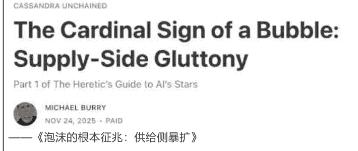

不过来说，“鲍金香泡沫”写的更透彻和简洁。
同时，上周，我们排除了英达以外，全市场都将迎来反弹，然后这周所有资产的表现都不错。
需要注意的是，全面的反弹将持续到下周五，也许最快一周就结束了。只有真黄金白银会持续。

# 深度视野VIP群 人工追踪50+大V 付费群加微信cuk255 微信chp5568

## 星我们

必须给老师点赞...
（此处内容重复，此处已略）

预测突破并加速

下周开启12月，圣诞节快来了，然后就是元旦年，特朗普为了普民准备的礼物。这周我们聊聊“川普的双线”。

PS 公众账号压缩图片，文档中含有某些无法清晰的。有查看清楚图片需求的付费读者，请您联系问问客服，请恳谅。

## 一、川普的双线

2024年4月，我们预测川普将上台，随后我们开始看BTC，上台后，我们开始看空，底部，然后看顶，做空。这幅图，用了一年后，没调整。

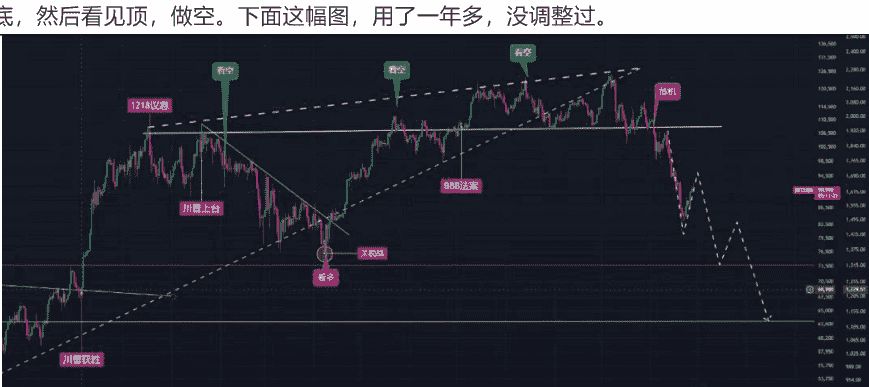

川普说，“比特币和其他其他加密货币much more important than any industry”（比任何行业都更重要）。

### 川普说：“I only care about one thing... will we be number one in crypto”（我只关心一件事……我们能在加密领域成为第一吗）
川普关于加密的等等，很多。

《新启市成军：加密已经充分拆分并预测了这个框架下的数学模型显示：圣诞节前BTC回测试74K，后圣诞反弹，在川普就职周年（260120）前测试63K，值此圣诞节旧旧迎新又就职周年的BTC，以川普为首，美元资产将好不到去，特朗普送您“压力山”。到时候我们将看“川普的反击”。

## 二、全球市场跟踪

### （一）美股SPX

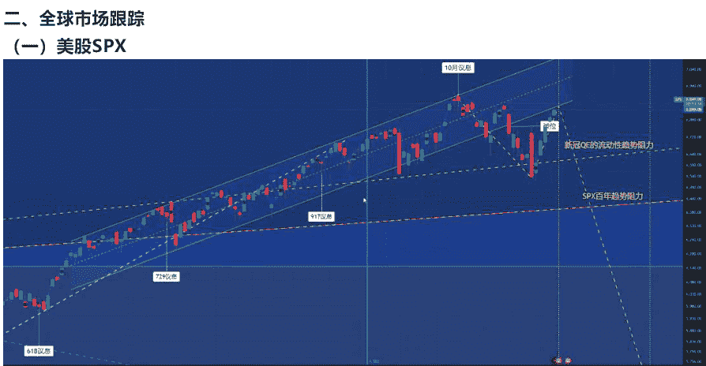

上周预测：美股总体弱于预期。仍然可能有小反弹，但是，继续下跌甚至加速下跌的趋势性极强。
实际情况：符合预期。美股本周反弹，且未回到6月以来的上升通道。
下周预测：这轮反弹突破6832，那么极限跟在6852-6892间。

### （二）金银

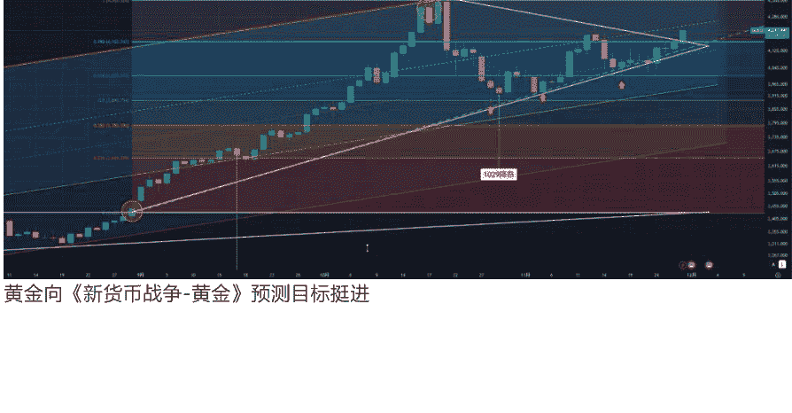

黄金向《新货币战争-黄金》预测目标挺进

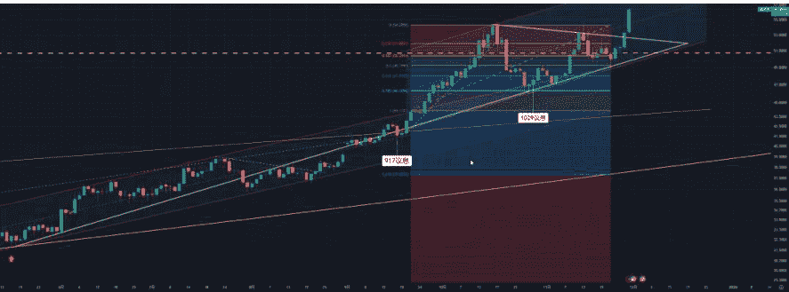

白银向《新货币战争-股市》预测目标挺进

上周预测：本次突破以来，金银都处于三角形整理，显然，还在区间继续整理，因此，继续观察。
实际情况：强于预期。突破即。
下周预测：只要美股不崩，金银可保。

### （三）BTC

上周预测：本次正在酝酿2024年以来的第5浪，但还未形成。
川普上台后，我们一直多看BTC，台上后，开始看空。所以其实不用预测，态度明显。
新浪财经：加密监管要稳定，这就是我们一直关注这个热点，不是时候。BTC每周进展。
我们的图，不需要调整，技术只是辅助，博弈才是关键，然后是基本面的确认，BTC继续。
重申我的观点，特别强调风险。

### （四）美元

上周预测：美元保持强势，意味着市场总体继续保持较高的风险。
实际情况：符合预期。美元继续在以上。
下周预测：美元还会努力维持。
注意：之前预测提到FED重启注入流动性，过去一个月在。

### （五）黄金

上周预测：即便反弹，在夺回生命线以前都要防御。
实际情况：符合预期。反弹继续。
下周预测：跌破生命线难度大，继续防御。

### （六）亚洲

上周预测：在空压力下都要防御。
实际情况：符合预期。反弹继续。
下周预测：跌破生命线难度大，继续防御。

## 三、技术分析

### （一）事件驱动

VIX指标回落至20以下，恢复市场观察。

12月2日（周二）
【事件】美联储鲍威尔举行讲话

【数据】中国1月制造业PMI
名词解释：制造业PMI是采购经理指数，反映制造业景气的先行指标，由订单、就业等分项构成，判断经济强弱。
综述：中国1月制造业PMI是评估周期性和强度的关键数据，直接影响趋势与结构方向。
- PMI显示维持甚至改善，将强化周期性“托底不涨”立场，降低当前全球制造业面临的压力，数据可能压制风险，但好在。
- PMI意外跌破结构框架可能意味着风险，需当重心转向“防风险”与“结构性软”，即便数据不佳，刺激力度也有限，市场需避免过度解读。

【数据】美国1月制造业PMI
名词解释：美国采购协会公布的制造业经理指数，是衡量制造业活跃度指标。
综述：美国1月制造业PMI是判断经济强弱、短期内面临衰退的关键指标，美联储影响将在2月会议上落地。
- PMI意外跌破并伴通胀下滑，导致政策转向，鲍威尔获得支撑，威尔仍会在通胀中考量，市场波动适度，美元迎来反弹收益。
- PMI外部扩张持续放缓，通胀获得支撑，威尔需要数据支持，但可能影响环境。
数据的质量和分项权重更为重要——权威证实鲍威尔所描述的降胀，将检验黏性是否缓解。

【日本】日本银行行长植田
名词解释：汇率优势指国内利率与其他主要经济体利率的差异，是驱动跨境资本流入和汇率走势的核心因素。
综述：日本银行行长的话是理解全球央行政策转向的关键。当美联储准备暂停，其他央行（特别是日本银行）可能继续加息，这将抑制美元的利差优势。美元汇率优势可能缩小至反向，直接影响G7市场及全球资产配置方向。
- 植田若进一步采取加息或削减购债规模的债券信号，将强化汇率优势，对美元构成额外下行压力。
- 植田话语强调温和，以缓解美元部分走弱。

12月2日（周二）
【事件】美联储鲍威尔举行讲话
综述：美联储12月议息几乎确定，关键在于鲍威尔的措辞是“鲍胀降息”还是“鲍胀加息”。鲍威尔在12月14日会议之前的最后一次公开讲话，将影响市场对12月18日会议决策的解读。
- 他强调通胀具有韧性，通胀并不等于均衡周期的回归，并指出市场可能会出现回调且非跑步，将美联储“维持立”立场，这符合其对2%目标过度的通胀预期。此可能引发美元走强，美股或表现于行情。
- 他对增长前景表态谦逊，为市场留出解释空间，市场可能进一步推宽2025年预期。
注意的是，鲍威尔在担任主席前的表现，未被视为引导，因此可能转向市场，市场可能会调高对通胀预期，关注12月会议的引导。

【事件】美联储主席鲍威尔述职词
综述：美联储内部立场，直接关注。
- 鲍威尔暗示通胀呈上行压力，不确定，可能维持高位，美元走强。
- 鲍威尔言论影响，反映美联储内部存在分歧，强化了降息预期，关注的维持。

12月3日（周三）
【数据】美国1月ADP
综述：ADP数据是重要的就业参考。
- 如果数据符合预期，市场将继续反弹，维持支撑。
- 如果数据低于预期，市场可能出现回跌，美元走弱。

12月4日（周四）
【数据】美国12月失业率
综述：失业率升至4.4%属于正常。
- 失业率回升在2周内波动，表明市场需求健康，季节性影响。
- 若就业数据未显著恶化，可能出现“交易回调”，美元反弹，美股回调。若数据幅抬头，则增强衰退，美联储维持降息。

12月5日（周五）
【数据】美国9月核心CPI指标
【数据】美国9月核心CPI数据
【数据】美国9月失业人数
综述：
- 9月核心CPI数据：“通胀弹性”验证。
- 9月核心CPI符合“压力模式”，高端与大众分化加剧，美联储维持立场，可能在12月会议后下调2026年降息次数，美元获利，黄金短期支撑。
- 数据意外走弱，将获得主导地位。
- 9月失业人数：反映消费健康状况，进入“压力周期”。
- 若个人支出持续回落或低于预期，则就业调整，强化“下行”预期，增大压力。
数据组合将决定美联储是否转向，通胀无法锁定就业与消费。市场存在分歧，若持续非消融，可能迫美联储选择“利率术”的微调路径，增加2026年政策不确定性。

### （二）美股
500：终线数据

## 上周观点（精简）：
根据本周的结构性趋势，1/24确认有效突破，跌离6270，预期突破6512下跌加速，建议根据风险偏好空单，等跌幅满足即可。
建议提前做好交易计划，SPX回到底部后，观察是否可构建右侧结构（头部型，右肩）。可以根据个人风险偏好进行设置，担心空的风控参考6238，风险不可担心，持有空单等待。
压力：顶线（绿色虚线）、6819（波段区间顶部）、6870（前高）
支撑：6689（波段区间底部）、6512（涨幅区间顶部）、6270（跌幅满足）

### 本周复盘：
SPX回底部，底部回粘有效触及底部，尝试底部，等待突破或跌破，选择方向。
1/24：SPX放量突破6705.1，未有效突破顶线（绿色虚线），停止突破，VIX出现20.5，避险情绪震荡，流动性指标高（可能是效应），需进一步观察。
SPX未确认有效破线，因此未触发空布局，上周触发的UVIX布局，应结合风控参考自身情况进行空管理。
11/25：SPX震荡上行，VIX为18.55（低于20），避险情绪震荡，流动性指标上行。
11/26：SPX窄幅震荡，最高6831.4，收6812.6（确认收线），VIX为17.18，避险情绪进一步下降，流动性指标下降。
11/28：SPX上涨，6849，6689（波段区间顶部）。感恩假期影响，成交量严重，需要下周确认有效。

### 下周展望：
12/01 美联储结束QT，市场流动性改善。预计SPX波动放大，冲回落，区间（6819至6551）。SPX未跌破线，等待右侧结构（头部型，右肩）。对应时间22个交易日（12/26后），压力6883。
压力：6819（波段区间顶部）、6870（前高）
支撑：顶线（绿色虚线）、6551（波段区间底部）、6512（涨幅区间顶部）、6270（跌幅满足）

### 纳达
上周观点（简简）：
根据周初的结构破，1/24确认有效破，跌离6270，预期跌幅充足。建议根据风险偏好空单，等跌幅满足即可。
建议提前做好交易计划，纳指回到底部后，观察是否可构建右侧结构（头部型，右肩）。可以根据个人风险偏好进行设置，担心空的风控参考6238，风险不可担心，持有空单等待。
压力：顶线（绿色虚线）、6309（波段区间顶部）、6419（前高）
支撑：6260（波段区间底部）、6219（涨幅区间顶部）、6270（跌幅满足）

### 本周复盘：
纳指回底部，底部回粘有效触及底部，尝试底部，等待突破或跌破，选择方向。
1/24：纳指放量突破，未有效突破顶线（绿色虚线），停止突破，VIX出现20.5，避险情绪震荡，流动性指标高（可能是效应），需进一步观察。
纳指未确认有效破线，因此未触发空布局，上周触发的布局。
11/28：纳指上涨，6849，6260（底部）。

### 下周展望：
12/01 美联储结束QT，市场流动性改善。预计成交量放大，冲回落，区间（6309至6260）。纳指未跌破线，等待右侧结构（头部型，右肩）。对应时间22个交易日（12/26后），压力6383。
压力：6309（波段区间顶部）、6419（前高）
支撑：顶线（绿色虚线）、6260（波段区间底部）、6219（涨幅区间顶部）、6270（跌幅满足）

### （三）黄金
上周观点（简简）：
维持现状，等待突破线选择方向。
压力：下降压力线，4247.9（前高）
支撑：4048（涨幅区间顶部）、3941（短期支撑）、3920（区间顶部）

### 本周复盘：
本周美联储降息预期引发美元指数回落，美股跌后反弹，VIX回踩至20。12月跨期风险重新定价，推升黄金风险暴露，多重共振推黄金转向。
11/28收。
4218.76，现货黄金突破下降压力线，如12/02确认，进行上涨调。
需要注意的是，VIX指标来到低位，对应市场风险偏较高，本周流动性指标（需）。考虑到假期影响，需关注走后性能缓解。

下周预期：
现货黄金维持震荡箱（4177至4352），有效突破4245，上涨加速。
12/01 美周储购停止，有利于市场流动性改善，关注流动性指标本周能否回落。流动性指标一步走高，密切关切。
12/02确认突破（下降压力线），下周上涨调。
压力：下降线，4245.22（修正，前高），4352（区间顶部）
支撑：4047（区间顶部）、3941（短期支撑）、3920（区间顶部）

### （四）BTC
周线结构：
周观点：维持观点，更新图表。
周线进入第二阶段下跌，等待跌幅满足76162，月线结构颈线，等确认需要2个月，先用统计计测。
支撑：94850（1段）、76162（2段跌幅）
压力：103516（日线级别）、113537（区间顶部）

日线结构：
上周观点（精确）：
11/21量出现本周下跌以来来周，等待回调反弹，参考92886作为多空分界，维持不建议参与短期多弈观点。
如未能有效突破92886或突破后再次突破，等待跌幅满足71612（周期结构会先到达跌满）。
压力：103516（新增支撑）、92886（日线满足）、94850（周1段）
支撑：71612（周2段）

### 本周复盘：
本市场重新定义12月降息预期，SPX、纳指，尝试突破整区间，现货黄金突破下降支撑压力，现货白银突破下降后回力增大。BTC本周最高93161.8，缩量弱势反弹，多空分界92886而得恢复，维持上周观点，等待跌幅满足71612（周）。

## 未来一周：
目前IX已回低位区间，大幅的空间收敛，风险偏好对资产价格上涨力度放缓。BTC若未有效突破92886或突破后再次跌，风控关注4850。

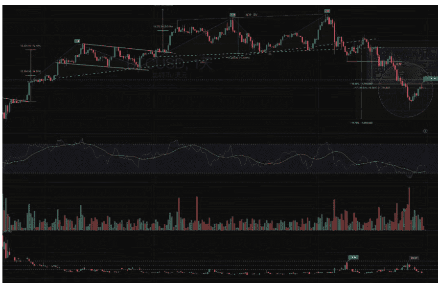

### （五）美元

美元指数：日线结构

上周观点（精简）：
等待美元指数跌破长期压力（绿色虚线），涨幅目标满足103.26。

- 压力：103.26（涨幅回调）
- 支撑：99.38（区间底部）、97.6（区间底部）、96.37（盘整区间底部）

本周整体：
本周市场重新定价 12 月降息预期，美元指数压力回调，回测99.38（区间底部），短期可能经历震荡，需适当回整。

未来来周：
- 技术分析：等右侧结构走出来，有效破99.38，停止涨回调，压力103.26夺取。
- 逻辑分析：
美元指数当前处于技术性与政策性的双重博弈阶段，严密关注12月中旬非农数据，美联储人的定价与政策转变，这些因素将决定美元短期趋势反弹还是直接进入中期通过。当前的美元本质是政策预期与经济之间的再平衡。
- 短期：市场已定价12月降息及未来路径，技术面显示偏弱，鲍威尔在议会前可能通过强硬性维持美元优势持续增长，其他政府政策化领域可能启动下二周期。
- 中期：随着联储主席上台及经济预期显示调整，美元优势将持续增长，其他政府政策。
- 长期：市场可能系统性低估美联储宽松空间，正向的推动将在市场重新定价期间激进宽松之时。

- 压力：103.26（涨幅回调）
- 支撑：99.38（区间底部）、97.6（区间底部）、96.37（盘整区间底部）

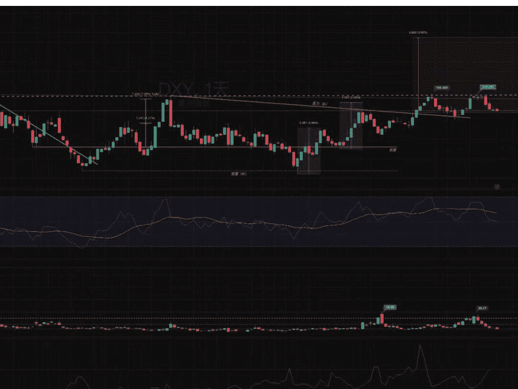

欧元/美元走势观察（更新）：欧元为美元指数第一大权重

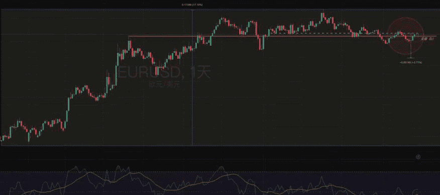

## (六) AH

恒生指数：周线结构

上周观点（精简）：
上周跌未确认有效通道回升回弹，逢高确认收益。周线跌破过多支撑，26300（压力，橙色）、25919（区间顶部，粉色），周线（绿色虚线），走势转空。
周线跌破第一线，维持到位确认收益观点不变。

本周观点：
本周最高26136，收25858.9，收于强势线之上（绿色虚线），暂停周线下跌幅扩大（等待重新突破线）。周线弱反弹，未能回到 25919（区间顶部，粉色），维持转弱观点，建议锁定收益。

## 恒生指数：日线结构

周线结构：
日线短期超跌，技术角度存在反弹可能，周线跌破颈线，等待周线右侧走势结构完成的阶段，应优先考虑日线结构机会，具体如下：

1. 关注26529（区间顶部，粉色），确认有效跌破，跌幅满足24450。
2. 关注23947（波段位置）能够阻止跌，如无法止跌等日线跌满足24450。
3. 短线策略，预期会有底部反弹，不建议进行短多操作，手中仍有部位的，把握反弹机会行情。
4. 突破26550（区间顶部），短期趋势转向。反弹突破颈线，再次跌破，进一步确认走势趋势，可尝试布局空单（放量突破颈线止损）。
5. 24264（周线底部），有效跌破，7月以来周线结构结束可以视为加速跌，这里会有强势支撑。

支撑：24937（波段位置）、24264（周线，区间底部）、2328（周线，趋势）
压力：周线结构（绿色虚线）、25919（区间顶部，粉色）、26330（短期压力）、26550（区间顶部）。

本周回顾：
恒生指数本周开展跌破反弹，周线25919开展布局，最高26316，收25858.9，周线未能突破25919（区间顶部）。11/25确认跌破25919（区间顶部，粉色），跌幅满足24450。

未来展望：
恒生指数再次突破颈线，进一步确认走势，可尝试布局空（放量突破颈线止损）。
支撑：颈线（绿色虚线）、24937（波段位置）、24550（日线，跌幅满足）
压力：25919（区间顶部，粉色）、26550（区间顶部）。

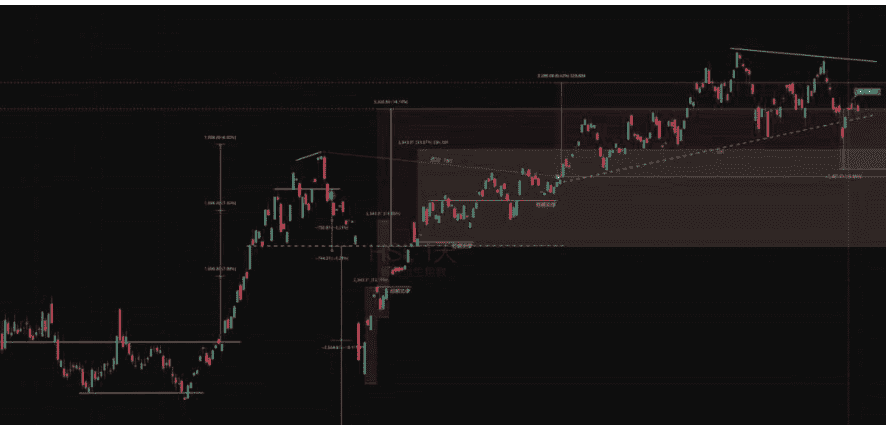

## 恒生指数：日线结构

上周观点：
技术角度观察，短期存在超卖，短期反弹可能，不建议参与短多博弈，手中仍有位的建议降低风险。11/25确认有效破546，作为压力位，短空参考。
11/25确认有效破546，确认7月以来上涨结束，恒生转空。下跌引发的转空走势，短期至少站下5824才可能缓解。

风险提示：
转空暴跌，可以理解为跌难涨，技术角度完全盘整构建一个周线头底，风险冲击可能将加速向下。恒生指数的变化是流动性结果，恒生对于大A股具有价值。

压力：6133
支撑：5824（区间顶部）、5557（跌幅满足）、5416（区间底部）

本周展望：
11/25恒生开启底部反弹，收5612。本周指数围绕5557（跌幅满足）开展多空博弈，走势可见宽幅盘整。

未来一周：
恒生指数反弹相对弱，不建议参与短多博弈，手中已有位的降低低位。
压力：5824（区间顶部）、6133；支撑：5557（跌幅满足）、5416（区间底部）。

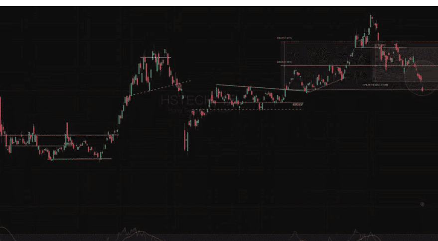

## 上证指数：周线结构

本周观点：
周线结构跌破长期支撑（长期压力，下降趋势线），等待下周确认。周线结构确认突破长期压力，重新跌视为转弱，周线风控参考（3714 至3680）。

支撑：3891（长期支撑）、3714（涨幅满足）、3680（涨幅满足）
压力：4025（波浪涨幅满足）、4277（涨幅满足）、4045（涨幅满足）。

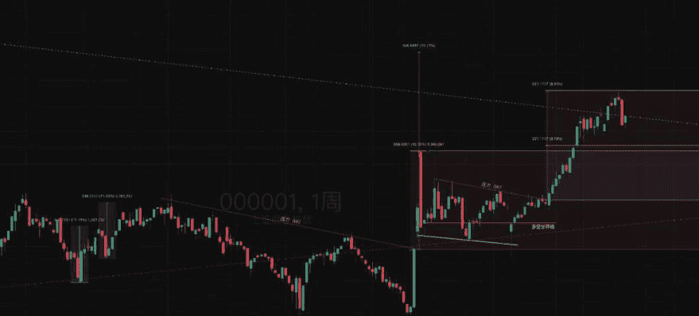

## 上证指数：日线结构

上周观点（精简）：
关注11/25能否恢复3915（绿色线），若收复颈线重新站上长期支撑，指数还有机会高位回整。无法恢复3915（绿色线），等待跌幅满足3802。
3714（修正）、3680 是日线结构涨幅满足，支撑较强，预期指数将获得支撑，完成右侧型结构构建。

支撑：3891（长期支撑）、3714（修正）、3680。
压力：4025（波浪幅满足）、4045（区间顶部）。

**本周宣告：**
指数周弱反弹，未收复长期支撑，等待跌幅满足3802。

未来周：
如指数不能有效破压力，预期回盘（3915 至3802），等待指数完成后右侧结构。
支撑：3714（周，涨幅充足）、3680（周，涨幅充足）
压力：长期压力（日线有效破，日线结构压力）、4025（波段充足）、4045（区间顶部）。

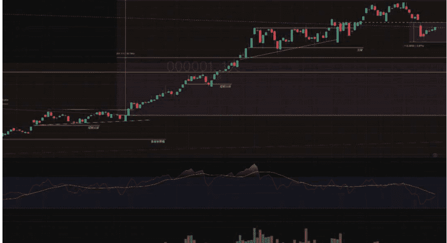

## 上证指数：日线结构

上周观点（精简）：
关注11/25，上证50收支撑2983，上方维持盘整。11/25确认跌破2983，考虑调整为周线进行跌破，跌幅充足2890。参考支撑2910。

压力：3079（前高）、3276（波段涨幅）
支撑：2983（短期支撑）、2910。

本周复盘：
上证50有盘整无意，指数回绕2983震荡，等待跌破，跌幅充足2890。

未来周：
上证50确认跌破2983，跌幅充足2890。耐心等待2983之前右侧结构，风阻参考2910。
压力：3079（前高）、3276（波段涨幅）
支撑：2983（短期支撑）、2910。

## 沪深300：周线结构

本周观点：
周线带突破通道，等待下周确认。周线走势短期转折，未有效突破4722，逢高回调的观点。风险参考4386，红色区间：4304 至4722，蓝色区间：波段满足4819。

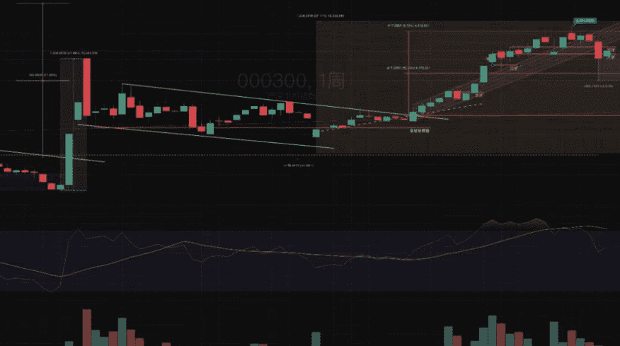

## 沪深300：日线结构

上周观点（精简）：
关注11/25能否阻止跌，关注4565、4495能否收复。关注4495，意味着防守为主，考虑进行小型类型下跌回调。收复4565，意味着可以尝试回到上升通道，等到回到上升通道，暂缓回调。

压力：4762（前高）、4722（区间顶部）
支撑：4565（短期支撑）、4495（缺口支撑）、4386（日线风险）。

本周复盘：
日线有效收4495，反弹收复4565，符合防守的走势。

未来一周：
日线防守4495，如突破4565，沪深300转强，关注能否回到上升通道。风控参考4495或4386。
压力：4762（前高）、4722（区间顶部）
支撑：4565（短期支撑）、4495（跌破偏空）、4386（日线风险）。

## 中证500：周线结构

本周观点：
周线缩量反弹，收7031.55，收复6878，未来一周防守为主。
粉色区域：6878（区间顶部）、7793（区间顶部）
蓝色区域：波段幅满足点7159。

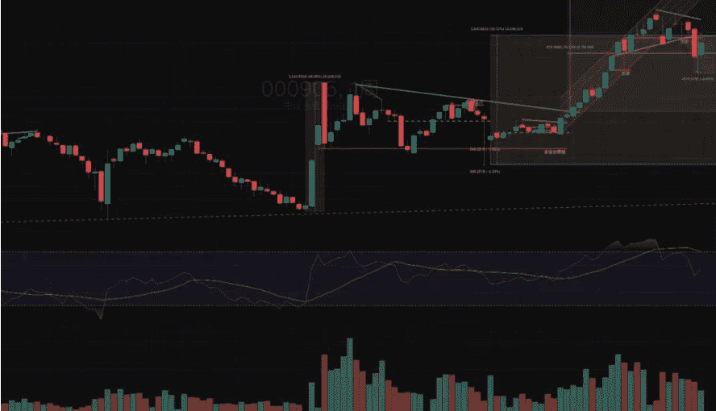

## 中证500：日线结构

上周观点（精操）：
整理结构与支撑7111同步放量跌破，等待11/24确认（有效概率大）。如有效跌破，指数趋势转空，宽幅底部参考6567（短期机会，要等反弹）。

本周复盘：
11/24 收6688.96，确有效突破7111，指数短期趋势转空，跌幅满足6567。
中证500，周窄缩盘（6878至7111）。

未来一周：
中证500防守为主，耐心等待侧结构。突破6878寻找机会，跌幅满足6567。突破7111转强，注意矩形结构。
压力：7111（短期支撑）、7159（波段涨幅满足）、7793（区间顶端）
支撑：6878（区间底部）

综上，不建议参与短线博弈，持有部位的，远兑现（6878至7111）。
压力：7111（短期支撑）、7159（波段涨幅满足）、7793（区间顶端）
支撑：6878（区间底部）

## 科创指数：周线结构

上周观点：
周线走势符合调整期，科创50指数确认跌破支撑1365，跌幅满足141。
风险提示：周线结构观察，参考参数（短期涨幅目标）。
红色区域：底部结构（2022年以来），满足点1601。支撑：1365（周，短期支撑）、1326（周，波段支撑）、1249（周颈线）。

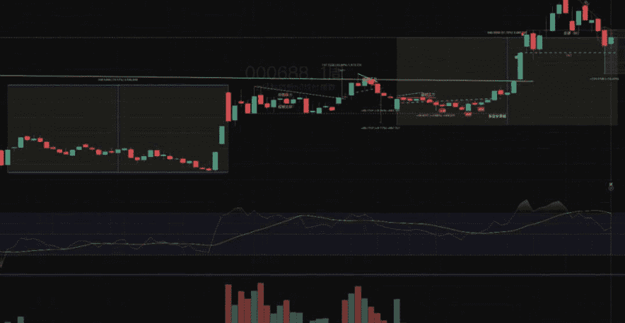

## 科创指数：日线结构

上周观点：
科创50短期超卖，预期会有反弹，可根据跌止和反弹幅度寻找短空机会。
- 反弹突破1326，无法突破1365；关注短空机会，等待跌破1326：短空机会。
- 回测颈线1249，预期会有支撑，如多空复1249，寻找短空机会。
压力：1365（周，短期支撑）、1496（带量前高）

本周复盘：
周线确认突破1365，跌幅满足141。日线反弹围绕1326开展空博弈，未能突破压力1365，可以寻找短空布局机会，风控1365。

未来一周：
走势结构变化不大，维持周观点。
补充：指数围绕1326反复多次空博弈，存在突破可能，突破1365失败，短空赔率较高。
压力：1365（周，短期支撑）、1496（带量前景）
支撑参考：1326（周，波段测幅）、1249（周，颈线）。
